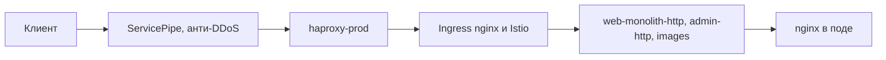
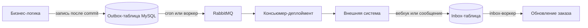

# Инфраструктура

> Сверено с `origin/develop` `dd4a997ac0`, 07.11.2026. Значения секретов и прод-адреса из Vault
> не проверялись.

## CI/CD

GitLab CI собирает образы через Kaniko, публикует в `hub.12stz.dev` и деплоит Helm-чартом
в Kubernetes. Конфиг — `.gitlab-ci.yml`.

### Стадии и условия запуска

| Стадия | Джобы | Когда |
|---|---|---|
| `build backend deps` | `build backend deps` | MR в develop или пуш в develop/master, **только если менялся `composer.*`** |
| `build frontend` | `build frontend`, `build frontend prod`, `build storybook` | При изменениях в `frontend/**`; прод-сборка по тегу `v*.*.*`; Storybook — при изменениях в `.storybook`, `*.stories.*`, `ui-kit` и т. п. |
| `build images` | `build images`, `build images prod` | Матрица: `nginx` и `backend` |
| `stat analyse` | `phpstan`, `phpstan_src`, `codesniffer`, `eslint`, `openspec_config` | На MR; `eslint` — только при изменениях в `frontend/**`, `openspec_config` — при изменениях в `openspec/**` (ECOMDEV-2494) |
| `eslint analyse` | — | Объявлена в `stages`, но ни одна джоба в неё не входит (`eslint` идёт в `stat analyse`) |
| `tests` | `tests`, `phpunit`, `openapi_coverage`, `ui-test`, `api-test` | На MR; UI и API тесты вручную |
| `deploy` | `deploy:dev|fix|mobiledev|sandbox|stg|prod`, `deploy storybook` | Вручную; `deploy storybook` триггерит проект `frontend/vue/storybook` |
| `rollback` | `rollback:*` | Вручную, требует `MIGRATION_COUNT` |

Глобальные переменные: `PROJECT_NAME=web-monolith`, `DOCKERHUB_URL=hub.12stz.dev`,
`HELM_NAMESPACE=web-$ENVIRONMENT`, `PHP_IMAGE_TAG=v1.1.4` (обновлён в ECOMDEV-2563, 02.11.2026;
было `v1.0.13`), `COVERAGE_MIN_PERSENTAGE=6`, `OPENAPI_COVERAGE_MIN_PERSENTAGE=100`.

### Собираемые образы

| Джоба | Образ | Особенности |
|---|---|---|
| `build backend deps` | `.../backend-deps:${DEPS_COMMIT}` | Composer install с SSH-ключом из Vault |
| `build frontend` | `.../frontend:${FRONTEND_IMAGE_TAG}` | `.env` берётся из Vault, тег — хэш последнего коммита в `frontend/` |
| `build images` | `.../nginx:${CI_COMMIT_SHA}`, `.../backend:${CI_COMMIT_SHA}` | Матрица компонентов |
| `build images prod` | То же с `${CI_COMMIT_TAG}` | Раннер `k2-prod` |
| `build storybook` | `.../storybook:${CI_COMMIT_SHA}` | `Dockerfile-storybook`: `npm run build-storybook`, отдаёт `nginx-unprivileged` |

Базовые образы: `php8.2-monolith:v1.1.4`, `nginx:1.25.4-alpine`, `node:18.17.1-alpine`.
Образ `postfix` в CI **не собирается**: `Dockerfile-postfix` (на `alpine:3.20.1`) лежит в
репозитории, а в Helm зашит готовый тег `imageTagPostfix: v1.0.0` (`.deploy/helm/values.yaml:26`).

Dockerfile-ы — в `.deploy/docker/`. `Dockerfile-frontend` кроме `npm run build-prod` также
получает `.env` из Vault (`vault kv get ... > ./.env`) прямо на этапе сборки образа,
устанавливает зависимости (`npm install`) и удаляет `.env` после сборки (`rm ./.env`).
Запись и удаление идут **отдельными `RUN`**, поэтому `.env` остаётся в промежуточном слое
образа `frontend`, который публикуется в registry. Токен Vault передаётся как
`--build-arg VAULT_TOKEN=$VAULT_FRONTEND_TOKEN`, а значения `ARG`, использованные в `RUN`,
сохраняются в истории образа. То же для `Dockerfile-backend-deps` (SSH-ключ там удаляется в
том же `RUN`, но `VAULT_TOKEN` — тоже `ARG`). В итоговый образ `backend` попадает только
содержимое финальной стадии фронтенда, без `.env`.

### Контроль качества

| Проверка | Порог или правило |
|---|---|
| `phpstan` | `phpstan.neon`, уровень 2, весь проект |
| `phpstan_src` | `phpstan_6lvl_src.neon`, уровень 6, при изменениях в `src/**`, `utils/testit/**` или самого конфига |
| `codesniffer` | `phpcs --standard=./phpcs.xml` |
| `eslint` | Читает лимит из `frontend/eslint/config/max-warnings.txt` в переменную `MAX_WARNINGS`, но фактическая команда — `npx eslint . --quiet --format json ...` — флаг `--max-warnings` не передаётся, а `--quiet` отбрасывает warning-уровень целиком, оставляя только ошибки; лимит де-факто не применяется |
| `openspec_config` | Проверяет, что в `openspec/config.yaml` есть строка `context` |
| `phpunit` | Покрытие строк не ниже **6%** |
| `openapi_coverage` | `php openapi-coverage.php 100` — покрытие спецификациями не ниже **100%** |
| `tests` | `check-migrate-trigger.sh` — парные миграции таблиц истории; скрипт переписан в ECOMDEV-2494 (21.10.2026) и теперь корректно обрабатывает несколько файлов |

### Окружения

| Джоба | Окружение | Тег образа | URL |
|---|---|---|---|
| `deploy:dev` | dev | `CI_COMMIT_SHA` | dev.12stz.tech |
| `deploy:fix` | fix | `CI_COMMIT_SHA` | fix.12stz.tech |
| `deploy:mobiledev` | mobiledev | `CI_COMMIT_SHA` | mobiledev.12stz.tech |
| `deploy:sandbox` | sandbox | `CI_COMMIT_SHA` | sandbox.12stz.tech |
| `deploy:stg` | stg | `CI_COMMIT_SHA` | staging.12stz.tech |
| `deploy:prod` | prod | `CI_COMMIT_TAG` | 12storeez.com |

Namespace — `web-{окружение}`. Чарт — обёртка над `nxs-universal-chart ~3.2.2` из
`chartmuseum.stage.12stz.local` (алиас `nuc`, `.deploy/helm/Chart.yaml`), поэтому перед
деплоем выполняется `helm dependency update`. Команда деплоя:

```bash
helm upgrade web-monolith .deploy/helm --install --atomic --timeout 600s \
  -f .deploy/helm/${ENVIRONMENT}.values.yaml \
  --set nuc.defaultImageTag=${IMG_TAG} \
  --set nuc.configMaps.web-monolith-envs.data.BUILD_VERSION=${CI_COMMIT_REF_NAME}
```

### Миграции при деплое

Helm-хуки основного чарта (`.deploy/helm/values.yaml:5205-5294`):

| Хук | Вес | Команда |
|---|---|---|
| pre-install, pre-upgrade | 10 | `yii migrate --interactive=0` |
| pre-install, pre-upgrade | 20 | `yii migrate --migrationPath=@yii/rbac/migrations/` |
| pre-install, pre-upgrade | 30 | `yii migrate --migrationPath=@yii/log/migrations/` |
| post-install, post-upgrade | 40 | `yii message config/i18n.php` |
| pre-install, pre-upgrade | 45 | `yii elastic/deploy-index --checkout --debug` |
| post-install, post-upgrade | 50 | `yii redis/flush` — сброс обоих кластеров Redis после **каждого** деплоя (см. «Инвалидация») |

### Откат

Джобы `rollback:*` используют отдельный чарт `.deploy/migrations/` и релиз
`web-monolith-rollback`. Перед установкой джоба удаляет релиз `web-monolith-rollback`, если он
остался от прошлого запуска (`helm uninstall`):

```bash
helm upgrade web-monolith-rollback .deploy/migrations \
  --set nuc.migrationCount=${MIGRATION_COUNT} \
  --set nuc.defaultImageTag=${IMG_TAG}
```

Джоба выполняет `php ./yii migrate/down {{ $.Values.global.migrationCount }} --interactive=0`.
**Количество миграций задаётся вручную** переменной `MIGRATION_COUNT`, без неё джоба падает
ещё до `helm upgrade` (явная проверка `if [[ -z "${MIGRATION_COUNT}" ]]; then exit 1; fi`).

**Похоже на баг:** чарт `.deploy/migrations` — обёртка над сабчартом `nxs-universal-chart`
(алиас `nuc`, см. `Chart.yaml`), и шаблон читает значение из `global.migrationCount` —
то есть из `nuc.global.migrationCount` с точки зрения родительского чарта. CI же передаёт
`--set nuc.migrationCount=...` — на один уровень выше нужного. Значение по умолчанию
`global.migrationCount: 1` в `.deploy/migrations/values.yaml`, судя по всему, никогда не
переопределяется этим `--set`, и `migrate/down` всегда откатывает ровно 1 миграцию независимо
от `MIGRATION_COUNT`. Стоит перепроверить перед следующим использованием отката. На
`dd4a997ac0` расхождение сохраняется (`.gitlab-ci.yml` — `--set "nuc.migrationCount=..."`,
`.deploy/migrations/values.yaml:7` — `nuc.global.migrationCount: 1`).

## Топология в Kubernetes

### Веб-поды

Деплоймент `web-monolith` — три контейнера в одном поде:

| Контейнер | Роль |
|---|---|
| `web-monolith-backend` | php-fpm, слушает `127.0.0.1:9000`, `pm.max_children=360` |
| `web-monolith-nginx` | Проксирование на fpm, JSON-логи доступа, `/metrics` только с разрешённых IP |
| `web-monolith-postfix` | Локальный SMTP на `127.0.0.1:25` и OpenDKIM |

Реплики `web-monolith`: прод — **30** (CTO-15470 «scale monolith for sales», 02.11.2026; было 3,
поды вынесены на отдельные узлы `purpose: monolith-core`), stg — 3, остальные окружения — 1.
`pm.max_children=360` задан на под, то есть в проде до ~10 800 воркеров fpm на все поды.

Дополнительно:

- `web-monolith-admin` — тот же набор контейнеров с конфигурацией под админку
  (`memory_limit=5G` в базовом `values.yaml`, но **50G** и `pm.max_children=1600` в
  `prod.values.yaml:1086, :1095`), 1 реплика на отдельных узлах `purpose: monolith-admin`;
  лимит памяти контейнера в проде — 45000Mi (requests 7 CPU / 18000Mi), то есть **меньше**
  `memory_limit` PHP; у обычного `web-monolith-backend` — `memory_limit=3G` везде, лимит
  контейнера поднят до 5120Mi (CTO-15470);
- `web-monolith-mobile` — такой же под (backend + nginx + postfix) с меткой `component: mobile`
  и сервисом `web-monolith-mobile:80` **без Ingress** — внутренний вход для мобильных шлюзов;
  прод и stg — 3 реплики;
- `web-monolith-images` — только nginx, отдаёт `www/images`, `www/uploads`, `www/export` с PVC
  (конфиг `web-monolith-images-nginx-configmap`, probe `/healthz`); хост
  `static-image.12storeez.com` в проде (`prod.values.yaml:1151-1168`), `image-{defaultURL}` в
  остальных окружениях; прод и stg — 3 реплики;
- `web-monolith-error-pages` — nginx-заглушка для 5xx (Ingress использует её как
  `default-backend` для кодов 500-504).

Адрес CDN для ссылок на картинки приложение берёт из `CDN_HOST` (`config/config.php:109` →
`EnvironmentConfigurator`, `di/ContainerRegister.php:1426-1430`; в `.env.example` —
staging-хост, прод-значение в Vault не проверялось). Крон `web-monolith-image-check-cdn`
(`yii image/check-cdn`, каждые 5 минут) проверяет доступность CDN.

Общее хранилище: PVC `pvc-web-monolith-sfs` (ReadWriteMany, 10 Гб, `csi-sfsturbo`,
`.deploy/helm/values.yaml:5339-5349`), монтируется в `www/images`, `www/uploads`, `www/export`.

Health-check — `/api2/healthcheck/ping` (у `images` и `error-pages` — `/healthz`).

### Вход трафика, анти-DDoS и белый список



Порядок ServicePipe → haproxy восстановлен по комментариям в Helm-values; сами настройки
ServicePipe и haproxy в репозитории не хранятся.

- **Белый список на Ingress.** Аннотация `nginx.ingress.kubernetes.io/whitelist-source-range`
  берёт `global.ingressIPsWhitelist` (`.deploy/helm/values.yaml:12-21`): подсети ServicePipe,
  офисы, VPN, NAT-шлюзы и адреса партнёров. Напрямую, в обход ServicePipe, сайт недоступен.
  В проде список висит на Ingress сайта и админки; у `web-monolith-images` в проде его нет.
- **Лимит запросов.** На Ingress сайта в проде `limit-rps: 250` (`prod.values.yaml:1118`).
  Стоит проверить, по какому адресу он считается: если Ingress видит адрес узла ServicePipe,
  лимит делится на всех клиентов, пришедших через этот узел.
- **Реальный IP клиента.** nginx в поде берёт адрес из `X-Forwarded-For`. В проде доверенные
  источники перечислены явно: haproxy-prod, подсети ServicePipe, внутренние сети кластера
  (`prod.values.yaml:540-557` для админки и аналогичный блок для сайта после строки 670). В
  базовом `values.yaml:68-69` и в `stg.values.yaml:501, :611` стоит `set_real_ip_from 0.0.0.0/0`:
  на непрод-окружениях `X-Forwarded-For` можно подделать, и allow-списки `/metrics` и
  `/payment/tinkoff/status` там не защищают.
- **Хосты прода.** `12storeez.com`, `www.`, `web.`, `12storeez.ru`, `www.12storeez.ru` —
  nginx пода редиректит все, кроме `12storeez.com`, на основной домен (`prod.values.yaml:531-535`).

### Хранилище PHP-сессий

Компонент `session` в `config/web.php` и `config/common.php` не задан (в `config/console.php:92`
есть только `yii\web\Session` для консоли), а в `app.ini` (`.deploy/helm/values.yaml:341-376`)
нет `session.save_handler` и `session.save_path` — только `use_strict_mode`, `gc_divisor` и
`hash_bits_per_character`. Значит, сайт использует стандартный файловый обработчик PHP внутри
пода, если базовый образ `php8.2-monolith` не задаёт другое (образ не проверялся). При 30
репликах в проде без привязки к поду сессия теряется при переходе запроса на другой под.
Вход на сайте при этом переживает потерю сессии за счёт cookie `_identity` (автологин), а
данные, хранящиеся только в сессии, — нет.

### Воркеры и кроны

Всё описано в `.deploy/helm/values.yaml` с переопределениями в
`.deploy/helm/{env}.values.yaml`:

| Тип | Количество |
|---|---|
| Всего worker-деплойментов (без `web-monolith`, `-admin`, `-mobile`, `-images`, `-error-pages`) | 70 |
| Из них — воркеры MySQL-очереди (`yii queue/listen`) | 25 |
| Из них — консьюмеры RabbitMQ, ESB-консоли и прочие обработчики | 45 |
| CronJob-ов | 112 (ещё 4 закомментированы) |

Все CronJob-ы по умолчанию приостановлены (`cronJobsGeneral.suspend: true`,
`.deploy/helm/values.yaml:2561-2562`); в `prod.values.yaml` явно включены (`suspend: false`) 106.
Пять деплойментов в `prod.values.yaml` перечислены под комментарием `# Not Used`
(`esb-item-stock-qty-*-console`, `queue-receipt-ofd-job`, `queue-receipt-send-job`).

**Это важно:** реальное асинхронное поведение прода задаётся Helm-values, а не кодом
приложения. Консольная команда может существовать без воркера, и наоборот.

Основные воркеры MySQL-очереди:

| Деплоймент | Очередь | Реплик в проде |
|---|---|---|
| `web-monolith-queue` | `default` | 1 |
| `web-monolith-queue-analytics` | `analytics` | 3 |
| `web-monolith-queue-crm` | `crm` | 1 |
| `web-monolith-queue-crm-customer` | `crmcustomer` | 1 |
| `web-monolith-queue-crm-discount` | `crmdiscount` | 1 |
| `web-monolith-queue-crm-payment` | `crmpayment` | 1 |
| `web-monolith-queue-mindbox` | `mindbox` | 1 |
| `web-monolith-queue-receipts` | `receipts` | 1 |
| `web-monolith-queue-reindexproduct` | `reindexproduct` | 1 |
| `web-monolith-queue-reindexproductstocks` | `reindexproductstocks` | 1 |
| `web-monolith-queue-esbstocks` | `esbstocks` | 1 |
| `web-monolith-queue-giftcardsunlock` | `giftcardsunlock` | 1 |
| `web-monolith-queue-orderscounter` | `orderscounter` | 1 |

Консьюмеры RabbitMQ для обмена заказами (в проде с CTO-15470: outbox — по 10 реплик,
inbox — по 5; было по 3):

| Деплоймент | Команда |
|---|---|
| `web-monolith-queue-onec-outbox-rabbit-create` | `rabbit-outbox-transactions/create onec` |
| `web-monolith-queue-onec-outbox-rabbit-update` | `rabbit-outbox-transactions/update onec` |
| `web-monolith-queue-rcrm-outbox-rabbit-create` | `rabbit-outbox-transactions/create rcrm` |
| `web-monolith-queue-rcrm-outbox-rabbit-update` | `rabbit-outbox-transactions/update rcrm` |
| `web-monolith-queue-mindbox-outbox-rabbit-create` | `rabbit-outbox-transactions/create mindbox` |
| `web-monolith-queue-mindbox-outbox-rabbit-update` | `rabbit-outbox-transactions/update mindbox` |
| `web-monolith-queue-onec-inbox-rabbit-update` | `rabbit-inbox-transactions/update onec` |
| `web-monolith-queue-rcrm-inbox-rabbit-create` | `rabbit-inbox-transactions/create rcrm` |
| `web-monolith-queue-rcrm-inbox-rabbit-update` | `rabbit-inbox-transactions/update rcrm` |

Консьюмеры платёжного outbox:

| Деплоймент | Команда | Реплик в проде |
|---|---|---|
| `web-monolith-queue-dolyame-outbox-rabbit-request` | `rabbit-bnpl-outbox-transactions/request dolyame` | 5 |
| `web-monolith-queue-podeli-outbox-rabbit-request` | `... request podeli` | 5 |
| `web-monolith-queue-yandex-split-outbox-rabbit-request` | `... request split` | 5 |
| `web-monolith-queue-yandex-pay-outbox-rabbit-request` | `... request pay` | 2 |
| `web-monolith-queue-yandex-sbp-outbox-rabbit-request` | `... request yandex-sbp` | 2 |

Консьюмеры событий Mindbox (по 1 реплике): `mindbox-mobile-cart-clear-queue-handle`,
`mindbox-mobile-cart-send-queue-handle`, `mindbox-email-subscription-order-queue-handle`,
`mindbox-order-given-bonus-queue-handle` и добавленный в ECOMDEV-2342
`web-monolith-mindbox-mobile-device-queue-handle` (`yii mindbox-console/mobile-device`, очередь
`mindbox.mobile-device.v1.command`). Последний **обязан** работать в одном экземпляре: порядок
привязки устройства держится на единственном консьюмере с prefetch = 1 (комментарий в
`.deploy/helm/values.yaml:2396-2397`).

Прочие консьюмеры: обработка изображений (`imageresize`, `image_s3_upload`), заказы Lamoda,
импорт VIC из RCRM, привязка отзывов, остатки магазинов, сообщения в Mattermost,
импорт пользователей, обмен номенклатурой, офлайн-заказы, отправка чеков в микросервис.

Группы CronJob-ов: экспорт фидов, обработка outbox и inbox, отправка платёжных уведомлений
(каждую минуту), переиндексация товаров, очистка (истёкшие JWT, старые SMS-логи, outbox),
загрузка WSDL 1С.

Файл `config/cron-web` описывает расписания времён bare-metal и в Kubernetes не применяется.

## Асинхронная обработка

### MySQL-очередь

| Параметр | Значение |
|---|---|
| Компонент | `components/SqlQueue.php` |
| Таблица | `default_queue` — имя собирается как `SqlQueueName::DEFAULT . '_queue'` (`components/SqlQueue.php:57-60`), `TABLE_PREFIX` **не применяется** |
| Колонки | `queue`, `run_at`, `payload`, `ukey` |
| Имена очередей | `src/Queue/SqlQueueName.php` — 22 константы |
| Воркер | `php ./yii queue/listen <имя>` |

Идемпотентность обеспечивается уникальным `ukey`: при попытке вставить дубль ловится
`IntegrityException` с кодом 1062, и задание тихо пропускается. Задание удаляется при
извлечении — семантика «не более одного раза».

### RabbitMQ

| Параметр | Значение |
|---|---|
| Компонент | `components/rabbitmq/RabbitMQ.php` (php-amqplib) |
| Настройки | durable-очереди, QoS prefetch = 1 (`basic_qos(0, 1, null)`, `RabbitMQ.php:107`) |
| Публикация из нового кода | `Application\Queue\Service\RabbitMqPublisherService` (например, события Mindbox с ECOMDEV-2342) |
| Переменные | `RABBIT_HOST`, `RABBIT_PORT`, `RABBIT_USER`, `RABBIT_PASSWORD`, `RABBIT_VHOST` |
| Имена очередей | `src/Queue/RabbitMqQueueName.php` — 47 констант: 42 строковых имени очереди и 5 массивов-соответствий («сервис → очередь») |

Публикация номенклатуры идёт в exchange `nomenclature` с routing key
`nomenclature.delta.product.site`.

### Outbox и Inbox

Обмен с внешними системами построен на outbox. **Для заказов он не транзакционный**: строки
outbox пишутся после `commit()` (см. шаг 1).



Порядок работы:

1. бизнес-логика пишет запись в outbox-таблицу. При создании заказа это происходит **вне
   транзакции**: `OrderService::createOrder` делает `commit()`
   (`src/Modules/Order/Services/OrderService.php:182`), затем запускает `AfterSaveEvent`
   (`:201`) и только потом создаёт outbox для 1С, RetailCRM и Mindbox (`:206-212`). Если
   событие или запись outbox упадёт, заказ останется в БД, но во внешние системы не уйдёт
   (подробнее — [09-pitfalls.md](09-pitfalls.md));
2. cron (`process-*-outbox-cron`) или воркер читает таблицу и публикует JSON в Rabbit
   через `OrderIntegrationOutboxFacade` / `OutboxTransactionService`;
3. консьюмер выполняет обработчик: SOAP-вызов 1С, REST RetailCRM, Mindbox, API платёжного
   провайдера;
4. при ошибке публикации запись остаётся, и её подхватит следующий проход крона.

Повторные попытки и идемпотентность:

- счётчик попыток на транзакцию хранится в Redis в группе `Integration` с TTL из
  `PaymentSystemDictionaryEnum::OUTBOX_CACHE_KEY_TTL`;
- максимум попыток берётся из параметров CMS (`outbox_*_max_retries`) либо из значений
  по умолчанию;
- при превышении лимита сообщение отклоняется без возврата в очередь;
- обработчики различают исключения: `OutboxTransactionRetryException` — не удалять запись
  из очереди (`nack()` для повтора), `OutboxTransactionSkipException` — удалить без логирования,
  `OutboxTransactionErrorException` — удалить и записать ошибку через `LogExtendedMessage`
  (отдельного канала уведомлений на этот случай нет, только структурированный лог).

Входящее направление устроено зеркально: `InboxTransactionStrategy` плюс воркеры
`rabbit-inbox-transactions/{create,update} {сервис}` и cron как резервный путь.

## Кэширование

### Кластеры Redis

| Кластер | Переменные | Используется |
|---|---|---|
| Основной | `REDIS_CLUSTER_NODES` либо `REDIS_HOST`/`REDIS_PORT`/`REDIS_PASSWORD`/`REDIS_DATABASE` | `RedisInterface`, компоненты `cache`, `cacheMain`, `cacheYiiT`, denylist JWT, счётчики outbox |
| Нового чекаута | `REDIS_NEW_CLUSTER_NODES` | `NewRedisInterface`, компонент `NewCache` |

Если переменная с узлами кластера заполнена — используется кластерное подключение,
иначе одиночное.

### Формирование ключа кэша

С ECOMDEV-2342 сборка вынесена в `Application\Modules\Common\Component\CacheKeyPrefix::build()`
(`config/web.php:300-304`). Префикс — литерал и четыре переменных составляющих, склеенные без
разделителя, плюс суффикс `__`:

| Составляющая | Как определяется |
|---|---|
| Литерал `old_cache` | Константа |
| Номер сервера | По части хоста: `staging` — 1, `dev` — 2, `env` — 3, иначе 0 |
| Английская версия | Хост содержит `en.` |
| Признак авторизации | Наличие cookie `_identity` |
| Мобильное устройство | Результат `Mobile_Detect->isMobile()` |

Итоговые префиксы: `cache` — сам префикс, `cacheMain` — `p` + префикс, `cacheYiiT` (переводы
i18n) — `t` + префикс. `CacheKeyPrefix::all()` возвращает все 32 варианта — для сброса записи
во всех вариантах (например, когда сброс приходит из приложения через шлюз с другим хостом).

Следствие: один логический ключ существует во множестве вариантов, у гостя и авторизованного
пользователя кэши разные, но **все авторизованные пользователи делят один вариант** — ключ
различает только наличие cookie, а не пользователя. Подробнее — [09-pitfalls.md](09-pitfalls.md).

### Переключение кластера по URL

В `config/web.php` компонент `cache` подменяется на `NewCache` (кластер нового чекаута) по
функции `isNewCheckout()`, которая проверяет **URI запроса** — без обращения к каким-либо
флагам-параметрам. `NewCheckoutCacheConfigurator` (`src/Modules/Cart/Service/`) — отдельный
класс с единственным методом `isCacheEnabled(): bool`, читающим флаг
`NEW_CHECKOUT_CACHE_ENABLED`; он не участвует в подмене `Yii::$app->cache`, а служит
gate-проверкой для отдельного Redis-кэша чекаута в `CheckoutCacheService`. Это два независимых
механизма, которые легко перепутать.

### Кэш схемы БД

Компонент `cacheSchema` — `FileCache` в `@runtime/cache/dbSchema`, TTL 1 час. Redis для схемы
не используется. Регистрируется только в `config/web.php` — у «чистой» консоли (без веб-расширения
конфига) этого компонента нет.

### Инвалидация

Стандартная команда `yii cache/*` отключена — `CacheController`
(`src/Modules/Common/Console/CacheController.php`) возвращает подсказку использовать
`RedisInterface`. Но массовый сброс **есть и запускается регулярно**: `yii redis/flush`
(`modules/product/console/RedisCacheController.php:274-287`) очищает оба кластера Redis
(основной и нового чекаута), кроме групп из `RedisGroupDictionary::getFlushExcludedGroups()`.
Он выполняется post-upgrade-хуком после каждого деплоя и CronJob-ом
`web-monolith-cache-flush-all` в 03:10 ежедневно (в проде включён).

Точечная инвалидация: `TagDependency::invalidate()` (отзывы, лукбуки),
`cacheYiiT->flush()` (после правки переводов в админке), `geoCache->flush()`,
`Cache::flush()` через Redis.

## Наблюдаемость

### Sentry

| Переменная | Назначение |
|---|---|
| `SENTRY_ENABLED` | Включение |
| `SENTRY_DSN` | Адрес проекта |
| `SENTRY_SAMPLE_RATE` | Доля отправляемых ошибок |
| `SENTRY_TRACES_SAMPLE_RATE`, `SENTRY_ENABLE_TRACING` | Трейсинг |
| `SENTRY_PROFILES_SAMPLE_RATE`, `SENTRY_ENABLE_PROFILER` | Профилирование |
| `SENTRY_DEBUG` | Отладка |

Инициализация — в `config/common.php`. Сервис — `src/Monitoring/Sentry/Service/SentryService.php`.
Не отправляются: `NotFoundHttpException`, `TooManyRequestsHttpException`,
`RequestValidatorException`. Тег релиза берётся из `BUILD_VERSION`, который задаётся при деплое.

### Метрики

`/metrics` → `metrics/metrics/index` (`MetricsController`), формат Prometheus text 0.0.4,
библиотека `prometheus/client_php`. Доступ ограничен на уровне nginx списком IP.
Сервис `web-monolith-metrics` отдаёт порты 8080 (nginx stub_status) и 9000.

### Логи

Настройка — `config/log.php`.

| Цель | Класс | Куда | Уровни |
|---|---|---|---|
| `errors` | `DbTargetExtended` | БД `log_db` | error, warning |
| `default` | `DbTargetExtended` | БД `log_db` | info, trace, profile |
| `stderr` | `LogJsonTarget` | `php://stderr` | error, warning (категория `GRAFANA_ERR`) |
| `stdout` | `LogJsonTarget` | `php://stdout` | info (категория `GRAFANA`) |
| `container` | `FileTarget` | `@runtime/logs/container.log` | Вызовы DI при `LOG_CONTAINER_CALLS` |
| `dev` | `FileTarget` | файл по умолчанию | error, warning; только при `YII_ENV_DEV` |

Логи фронтенда — не цель логирования, а таблица `frontend_logs` через модель `FrontendLog`.

### Обработка ошибок

Веб: `app\coreExtends\errorHandler\ExtendedErrorHandler`, действие `cms/frontend/error`.
При недоступности апстрима nginx отдаёт заглушку из `web-monolith-error-pages`.

## Конфигурация и секреты

### Vault в CI

| Этап | Что берётся |
|---|---|
| `build backend deps` | SSH-ключ `dev_ops/cicd/git_bot_ssh` для приватных Composer-репозиториев |
| `build frontend` | `.env` из `develop/backend/web/12storeez/frontend/{dev|prod}/envs` (токен `VAULT_FRONTEND_TOKEN` передаётся как build-arg) |
| Деплой и откат | OIDC-токен GitLab (`aud: https://vault.12stz.tech`) → `kube-login` |

### Vault в Kubernetes

Синхронизация через `nuc-vault-secret-operator`:

| Секрет | Путь в Vault | Содержимое |
|---|---|---|
| `web-monolith-secret-envs` | `backend/web/12storeez/{env}/envs` | Все чувствительные переменные; при изменении перезапускает деплоймент |
| `web-monolith-s3-envs` | `.../s3-envs` | Доступы к S3 |
| `web-monolith-dkim-key` | `.../dkim-key` | Ключ DKIM для Postfix |
| `web-monolith-registry-hub-auth` | `common/registry_hub_auth` | Доступ к registry |
| TLS | `dev_ops/certificates/{домен}` | Сертификаты; в проде отдельно `12storeez.ru-tls` |

Путь секретов — `{scope}/{project}/{environment}/...`, то есть `backend/web/12storeez/{env}/...`
(`.deploy/helm/values.yaml:5306-5331`). Vault-auth: `kubernetes_vsphere` в базовых values,
`kubernetes_k2` в проде.

### Порядок применения конфигурации

1. Секрет Vault → переменные окружения во всех подах.
2. ConfigMap `web-monolith-envs` → несекретные переменные (`APP_ENV`, `BUILD_VERSION`;
   `APP_ENV=prod` в проде, `dev` в базовых values).
3. `config/config.php` читает переменные в массив `$params`.
4. `config/common.php` и `config/web.php` конфигурируют компоненты из `$params`.
5. Helm-values задают тюнинг nginx, php-fpm, postfix, число реплик и расписания кронов.

Локально используется файл `.env` (в git не хранится, пример — `.env.example`).
Для phpstan и phpcs есть `config/params_example.php`, для тестов — `.env.test`.

Переменные, которые есть в `config/config.php`, но отсутствуют в `.env.example`:
`REDIS_NEW_CLUSTER_NODES`, `BUILD_VERSION`.
