# AS-IS ER-диаграмма `cms_orders` и связанных таблиц

## Примечания

- Схема собрана по предоставленным скриншотам и ранее присланной структуре `cms_orders` / `cms_order_positions`.
- Поля не сокращены.
- Типы данных являются **логическими/предварительными**:
  - `number` — поле с числовой иконкой `123`;
  - `string` — поле с иконкой `A-Z`;
  - `datetime` — поле с иконкой даты/времени;
  - для `cms_orders` и `cms_order_positions` использованы ранее определённые предварительные типы по примерам данных.
- Фактические SQL-типы нужно сверить с DDL / `DESCRIBE`.
- Для большинства дочерних таблиц связь показана как `cms_orders.id = <table>.order_id`.
- Для `cms_promo_codes` связь обратная: `cms_orders.promo_code_id = cms_promo_codes.id`.
- Кардинальности в Mermaid предварительные и отражают логическую модель. Их при необходимости можно уточнить отдельно.

```mermaid
erDiagram

    cms_promo_codes ||--o{ cms_orders : "cms_orders.promo_code_id = cms_promo_codes.id"

    cms_orders ||--o{ cms_receipts : "cms_receipts.order_id = cms_orders.id"
    cms_orders ||--o{ cms_order_position_confirm : "cms_order_position_confirm.order_id = cms_orders.id"
    cms_orders ||--o{ cms_giftcard_use : "cms_giftcard_use.order_id = cms_orders.id"
    cms_orders ||--o| cms_orders_response : "cms_orders_response.order_id = cms_orders.id"
    cms_orders ||--o{ cms_orders_feedback : "cms_orders_feedback.order_id = cms_orders.id"
    cms_orders ||--o{ cms_payments_log : "cms_payments_log.order_id = cms_orders.id"
    cms_orders ||--o{ cms_orders_payments : "cms_orders_payments.order_id = cms_orders.id"
    cms_orders ||--o| cms_orders_status_timer : "cms_orders_status_timer.order_id = cms_orders.id"
    cms_orders ||--o{ cms_order_payment_links : "cms_order_payment_links.order_id = cms_orders.id"
    cms_orders ||--o{ cms_notifications : "cms_notifications.order_id = cms_orders.id"
    cms_orders ||--o{ cms_atol_documents : "cms_atol_documents.order_id = cms_orders.id"
    cms_orders_payments ||--o{ cms_receipts : "cms_receipts.payment_id = cms_orders_payments.id"
    cms_orders_payments ||--o{ cms_atol_documents : "cms_atol_documents.order_payment_id = cms_orders_payments.id"
    cms_orders ||--o{ cms_order_paypal_sale : "cms_order_paypal_sale.order_id = cms_orders.id"
    cms_orders ||--o{ cms_feedbacks : "cms_feedbacks.order_id = cms_orders.id"
    cms_orders ||--o{ cms_giftcard_sell : "cms_giftcard_sell.order_id = cms_orders.id"
    cms_orders ||--o{ cms_order_return_positions : "cms_order_return_positions.order_id = cms_orders.id"
    cms_orders ||--o| cms_order_free_delivery_snapshots : "cms_order_free_delivery_snapshots.order_id = cms_orders.id"
    cms_orders ||--o{ cms_users_activities : "cms_users_activities.order_id = cms_orders.id"

    cms_order_positions ||--o{ cms_order_return_positions : "cms_order_return_positions.position_id = cms_order_positions.id"
    cms_order_statuses ||--o{ cms_orders : "cms_orders.status = cms_order_statuses.internal_id"
    cms_order_position_statuses ||--o{ cms_order_positions : "cms_order_positions.status = cms_order_position_statuses.internal_id"
    cms_order_statuses_wms ||--o{ cms_orders : "cms_orders.status_wms = cms_order_statuses_wms.code"
    cms_order_return_statuses_wms ||--o{ cms_orders : "cms_orders.return_status_wms = cms_order_return_statuses_wms.code"
    cms_order_statuses ||--o{ cms_mb_statuses_map : "cms_mb_statuses_map.order_status_id = cms_order_statuses.id"
    cms_order_position_statuses ||--o{ cms_mb_statuses_map : "cms_mb_statuses_map.order_position_status_id = cms_order_position_statuses.id"
    cms_return_reasons_groups ||--o{ cms_return_reasons : "cms_return_reasons.group_id = cms_return_reasons_groups.id"
    cms_return_reasons ||--o{ cms_return_reasons_content : "cms_return_reasons_content.parent_id = cms_return_reasons.id"
    cms_return_reasons ||--o{ cms_orders : "cms_orders.return_reason = cms_return_reasons.code"


    cms_orders {
        bigint id PK
        bigint order_num
        bigint retail_id
        bigint dolyame_id
        uuid receipt_guid
        int dl_version
        string status_tbank_dolyami
        bigint lamoda_id
        string lamoda_last_status
        int status_alpha
        int status_split
        int status_yandex_pay
        int status_yandex_sbp
        bigint user_id
        datetime created_at
        decimal promo
        decimal sum
        decimal discount_sum
        decimal discount_val
        decimal discount_manual
        decimal discount_promo
        decimal discount_bonus
        decimal discount_rounding
        decimal discount_percent
        decimal total_sum
        decimal spend_bonus
        decimal given_bonus
        decimal delivery_price
        int status
        string status_wms
        string return_status_wms
        string return_order_num
        string _order
        bigint bitrix_id
        string delivery_method
        string delivery_slug
        string return_delivery_tk
        string return_delivery_method
        int payment_status
        int payment_method
        decimal paid_sum
        datetime payment_date
        bigint payment_id
        string payment_url
        string confirmation_token
        string podeli_url
        string split_url
        string yandex_pay_url
        string name
        string surname
        string email
        string number
        string comment
        string flat
        string floor
        string porch
        string housing
        string house
        string street
        string city
        string state
        string country
        string postal
        uuid city_fias
        string site
        int ga_sended
        datetime end_date
        bigint pvz_id
        string admitad_uid
        string roistat
        int callme
        date delivery_date
        string delivery_time
        string delivery_time_from
        string delivery_time_to
        string delivery_interval_code
        string delivery_internal_time_from
        string delivery_internal_time_to
        boolean is_delivery_interval_changed
        int delivery_date_changed_count
        bigint transaction_id
        string payment_data
        string org
        string transport_company
        bigint promo_code_id FK
        decimal surcharge_sum
        string surcharge_comment
        boolean is_unf
        string order_method
        int is_preorder
        boolean is_offline_shipment
        string type
        int is_click_and_collect
        boolean is_qr
        string track_number
        string user_refund
        string status_comment
        uuid uuid
        string url_hash_parameter
        int one_click
        bigint ga_client_id
        bigint ym_client_id
        string utm_source
        string utm_medium
        bigint mindbox_id
        string last_payment_place
        string correct_discount
        int store_code
        bigint seller_id
        string admitad_sended
        string last_change_source
        string full_address
        string pvz_provider
        bigint pvz_provider_id
        datetime updated_at
        datetime updated_at_timestamp
        boolean is_mobile
        string processing_reason
        bigint manager_id
        string operator_comment
        string return_money
        string return_store
        string return_reason
        string cancel_reason
        bigint client_cancel_reason_id
        string client_cancel_reason_text
        string lamoda_cancel_reason
        boolean is_cancel_site
        string address_dop_info
        string delivery_phone
        int version
        bigint seller_store_id
        bigint seller_user_id
        string seller_name
        datetime storage_expired_at
        boolean is_increased_storage_expired_at
        boolean is_dismantle
        boolean for_blogger
        datetime preorder_planned_delivery_from
        datetime preorder_planned_delivery_to
        boolean is_certificate_order
        string return_city
        string return_address
        string return_postal
        date return_date
        string return_interval
        date shipment_date
        string store_recipient_name
        string store_recipient_phone
        decimal latitude
        decimal longitude
        bigint cart_id
        boolean is_payment_changed
        boolean is_another_person_get_order
        boolean is_concierge
        boolean is_rcrm_modified_before_payment
    }


    cms_order_positions {
        bigint id PK
        bigint item_id
        string item_title
        bigint order_id
        bigint lamoda_id
        string lamoda_last_status
        int quantity
        decimal price
        decimal sum
        decimal discount_sum
        decimal discount_manual
        decimal discount_promo
        decimal discount_bonus
        decimal discount_rounding
        decimal promo
        decimal spend_bonus
        decimal given_bonus
        decimal discount_percent
        int status
        bigint stock_id
        int store_code
        string reason
        int payed
        int _state
        int stock_confirmed
        datetime _created
        string slack_ts
        string slack_channel
        string slack_text
        int stock_cancel_status
        string comment
        decimal price_before_discount
        int ga_enable_send
        string store_comment
        datetime updated_at
        datetime sent_at_to_1c
        datetime created_at
        string barcode
        bigint bitrix_id
        bigint model_id
        string article
        string model_name
        string model_title_ru
        string model_title_en
        bigint image_site_id
        string image_site_url
        bigint image_mobile_id
        string image_mobile_url
        bigint color_id
        string color_hash
        string color_image
        string color_title_ru
        string color_model_title_ru
        string color_model_title_en
        string color_title_en
        int color_has_circle
        string size_title_ru
        string size_title_en
        string last_change_source
        int is_preorder
        bigint pickup_point_id
        int is_click_and_collect
        string lamoda_cancel_reason
        int is_present
        int is_added_after_pay
    }


    cms_receipts {
        number id PK
        number order_id FK
        number payment_id
        string yandex_check_id
        string yandex_payment_id
        string type
        number has_marked_items
        string email
        string phone
        number sum
        string json
        string json_atol
        datetime sent_at
        string atol_uuid
        datetime created_at
        datetime check_date
        number payment_not_found
    }


    cms_order_position_confirm {
        number id PK
        number type
        number order_id FK
        number position_id
        datetime _modified
        datetime _created
        string channel
        string reason
        number receive
    }


    cms_giftcard_use {
        number id PK
        number order_id FK
        number cart_id
        string guid
        string cert_number
        number amount
        number is_locked
        number use_locked
        number is_purchased
        datetime created_at
    }


    cms_orders_response {
        number order_id PK,FK
        string crm_response
    }


    cms_orders_feedback {
        number id PK
        number order_id FK
        datetime _modified
        datetime _created
        number rank_work
        number rank_delivery
        number rank_quality
        number rank_recommend
        string comment
    }


    cms_payments_log {
        number id PK
        number order_id FK
        number type
        string title
        string message
        datetime created_at
        string transaction_id
        number is_refund
    }


    cms_orders_payments {
        number id PK
        number order_id FK
        string transaction_id
        number cost
        datetime date
        number type
        number status
        datetime _created
        string data
        number retail_id
        number from_yandex
    }


    cms_orders_status_timer {
        number order_id PK,FK
        number change_time
        number status
    }


    cms_order_payment_links {
        number id PK
        string order_uuid
        number order_id FK
        string payment_system
        string external_id
        string url
        number is_surcharge
        string payment_status
        number amount
        datetime created_at
        datetime updated_at
    }


    cms_promo_codes {
        number id PK
        string code
        number discount_id
        number expired
        number reusable
        datetime _created
        datetime _expires
        number one_use
    }


    cms_notifications {
        number id PK
        string uuid
        string type
        string payload
        number order_id FK
        number user_id
        number is_read
        datetime created_at
        datetime updated_at
    }


    cms_atol_documents {
        number id PK
        number order_id FK
        string uuid
        datetime _created
        string status
        number total
        string fn_number
        string shift_number
        datetime receipt_datetime
        string fiscal_receipt_number
        string fiscal_document_number
        string ecr_registration_number
        number error_code
        string error_description
        string email
        string phone
        string positions
        string fiscal_document_attribute
        string operation_type
        number order_payment_id
    }


    cms_order_paypal_sale {
        number id PK
        string paypal_id
        number order_id FK
        number completed
    }


    cms_feedbacks {
        number id PK
        number rank
        string email
        string text
        string answer
        string name
        string city
        number user_id
        number _order
        datetime _modified
        datetime _created
        number _state
        number order_id FK
        string offline_order_number
        number thank_sended
        number lang_id
        number product_id
        string group_guid
        number rank_work
        number rank_delivery
        number rank_quality
        number rank_recommend
        number position_id
        number offline_position_row_receipt
        number type
        number notice
        string phone
        number is_rating_disabled
        number store_code
    }


    cms_giftcard_sell {
        number id PK
        string guid
        number order_id FK
        number cert_value
        number has_message
        string cert_text
        string cert_design
        string cert_send_via
        string recipient_name
        string recipient_phone
        string recipient_email
        string sender_name
        number send_additional_sms
        number postpone_send
        number gmt
        datetime date
        string time
        string cert_number
        number is_issued
        number is_sent
    }


    cms_order_return_positions {
        number id PK
        number order_id FK
        number position_id FK
        string return_quid
        number barcode
        number quantity
    }


    cms_order_free_delivery_snapshots {
        number order_id PK,FK
        string payload
    }


    cms_users_activities {
        number id PK
        number user_id
        string action
        number order_id FK
        datetime created_at
        datetime updated_at
    }


    cms_order_statuses {
        number id PK
        string title
        string client_title
        string code
        number active
        number _order
        string group
        number internal_id
        number can_delete
        number is_returned
        number is_collective
        number is_preorder
        number is_offline_shipment
        number can_be_cancelled
        number can_be_marked
        number send_cookies_by_status
        number in_progress
    }


    cms_order_position_statuses {
        number id PK
        string title
        string code
        number _order
        number active
        number cancel_status
        number can_delete
        number internal_id
    }


    cms_mb_statuses_map {
        number id PK
        number order_status_id FK
        number order_position_status_id FK
        number mindbox_status_id
    }


    cms_return_reasons_groups {
        number id PK
        string title
        number order
        number active
        datetime created_at
        datetime updated_at
    }


    cms_return_reasons {
        number id PK
        number group_id FK
        string code
        string title
        number active
        number _order
        string description
    }


    cms_return_reasons_content {
        number id PK
        number lang_id
        number parent_id FK
        string title
    }


    cms_order_statuses_wms {
        number id PK
        string code
        string title
    }


    cms_order_return_statuses_wms {
        number id PK
        string code
        string title
    }

```



## Таблицы на диаграмме

1. `cms_orders` — основная таблица заказов: хранит общие данные заказа, оплату, доставку, статусы и существующие атрибуты возврата.
2. `cms_order_positions` — позиции заказа: товары, входящие в заказ, их количество, цена, скидки, статус и товарные атрибуты.
3. `cms_receipts` — данные чеков по заказу и оплате, включая данные Яндекса/АТОЛ.
4. `cms_order_position_confirm` — подтверждение/обработка отдельных позиций заказа с указанием типа, канала и причины.
5. `cms_giftcard_use` — использование подарочного сертификата в заказе.
6. `cms_orders_response` — сохранённый ответ CRM, связанный с заказом.
7. `cms_orders_feedback` — оценка клиентом работы, доставки, качества и готовности рекомендовать по заказу.
8. `cms_payments_log` — журнал событий и сообщений, связанных с оплатой заказа, включая признак возврата.
9. `cms_orders_payments` — операции оплаты заказа и их статусы.
10. `cms_orders_status_timer` — данные, связанные с изменением статуса заказа по времени.
11. `cms_order_payment_links` — платёжные ссылки и данные платёжной системы по заказу.
12. `cms_promo_codes` — справочник промокодов; заказ ссылается на использованный промокод через `promo_code_id`.
13. `cms_notifications` — уведомления, связанные с заказом и пользователем.
14. `cms_atol_documents` — фискальные документы АТОЛ по заказу и платёжным операциям.
15. `cms_order_paypal_sale` — данные оплаты заказа через PayPal.
16. `cms_feedbacks` — отзывы и оценки клиента, в том числе связанные с заказом и его позициями.
17. `cms_giftcard_sell` — данные продажи подарочного сертификата в рамках заказа.
18. `cms_order_return_positions` — позиции заказа, участвующие в возврате; связывает возвратную позицию с заказом и исходной позицией заказа.
19. `cms_order_free_delivery_snapshots` — сохранённый снимок данных бесплатной доставки для заказа.
20. `cms_users_activities` — журнал действий пользователя, связанных в том числе с заказом.
21. `cms_order_statuses` — справочник статусов заказа: техническое и клиентское название статуса, код и признаки бизнес-логики заказа.
22. `cms_order_position_statuses` — справочник статусов позиций заказа.
23. `cms_mb_statuses_map` — таблица маппинга статусов заказа и позиций заказа на статусы Mindbox.
24. `cms_return_reasons_groups` — справочник групп причин возврата.
25. `cms_return_reasons` — справочник причин возврата: код, название, группа, активность, порядок отображения и описание.
26. `cms_return_reasons_content` — локализованный/дополнительный контент причины возврата; связывается с причиной через `parent_id`.
27. `cms_order_statuses_wms` — справочник WMS-статусов заказа: `id`, символьный `code` и название `title`; `cms_orders.status_wms` маппится на `code`.
28. `cms_order_return_statuses_wms` — справочник WMS-статусов возврата: `id`, символьный `code` и название `title`; `cms_orders.return_status_wms` маппится на `code`. Фактическое использование требует дополнительной проверки, так как заполненные значения `return_status_wms` в просмотренных записях `cms_orders` не обнаружены.

## Связи таблиц

Все подтверждённые связи фиксируются в едином формате:

```text
<таблица>.<поле> = <таблица>.<поле>
```

### Связи с `cms_orders`

```text
cms_orders.promo_code_id = cms_promo_codes.id

cms_receipts.order_id = cms_orders.id
cms_order_position_confirm.order_id = cms_orders.id
cms_giftcard_use.order_id = cms_orders.id
cms_orders_response.order_id = cms_orders.id
cms_orders_feedback.order_id = cms_orders.id
cms_payments_log.order_id = cms_orders.id
cms_orders_payments.order_id = cms_orders.id
cms_orders_status_timer.order_id = cms_orders.id
cms_order_payment_links.order_id = cms_orders.id
cms_notifications.order_id = cms_orders.id
cms_atol_documents.order_id = cms_orders.id
cms_order_paypal_sale.order_id = cms_orders.id
cms_feedbacks.order_id = cms_orders.id
cms_giftcard_sell.order_id = cms_orders.id
cms_order_return_positions.order_id = cms_orders.id
cms_order_free_delivery_snapshots.order_id = cms_orders.id
cms_users_activities.order_id = cms_orders.id
```

### Связи оплат, чеков и фискальных документов

```text
cms_receipts.payment_id = cms_orders_payments.id
cms_atol_documents.order_payment_id = cms_orders_payments.id
```

### Связи позиций возврата

```text
cms_order_return_positions.position_id = cms_order_positions.id
cms_order_return_positions.order_id = cms_orders.id
```

### Связи статусов заказа

```text
cms_orders.status = cms_order_statuses.internal_id
cms_mb_statuses_map.order_status_id = cms_order_statuses.id
```

### Связи статусов позиций заказа

```text
cms_order_positions.status = cms_order_position_statuses.internal_id
cms_mb_statuses_map.order_position_status_id = cms_order_position_statuses.id
```

### Связи WMS-статусов

```text
cms_orders.status_wms = cms_order_statuses_wms.code
cms_orders.return_status_wms = cms_order_return_statuses_wms.code
```

> Для `cms_orders.return_status_wms = cms_order_return_statuses_wms.code` связь по структуре подтверждена, но фактическое использование поля `cms_orders.return_status_wms` пока не подтверждено данными: в просмотренных записях `cms_orders` заполненных значений не обнаружено.

### Связи причин возврата

```text
cms_orders.return_reason = cms_return_reasons.code
cms_return_reasons.group_id = cms_return_reasons_groups.id
cms_return_reasons_content.parent_id = cms_return_reasons.id
```

