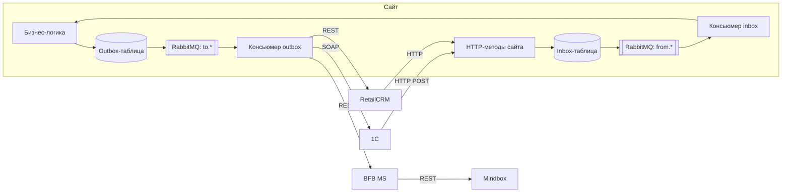
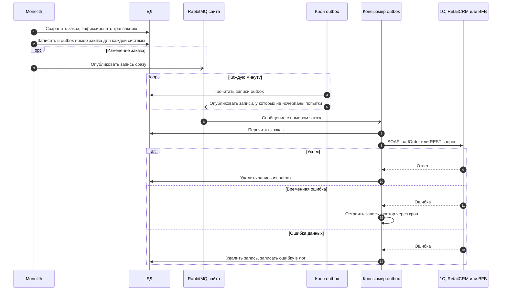
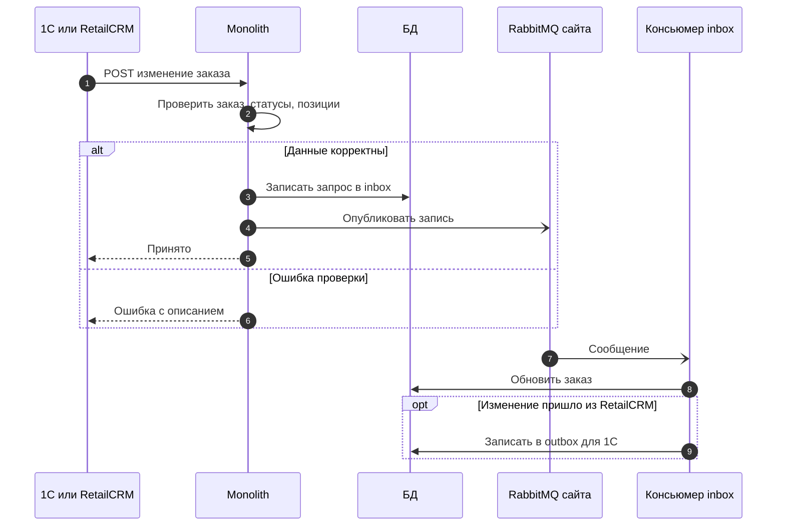

# Обмен заказами сайта с 1С, RetailCRM и Mindbox: RabbitMQ и outbox/inbox

Сверено с `12stz/12storeez-master-web`, ветка `develop`, коммит `be3cd759d2` (07.10.2026). Дата: 16.10.2026.

## 1. Коротко

RabbitMQ — **внутренняя очередь сайта (монолита)**. Ни 1С, ни RetailCRM, ни Mindbox в эту очередь
не пишут и из неё не читают. Внешние системы и сайт общаются по HTTP:

| Система | Сайт → система | Система → сайт |
|---|---|---|
| 1С | **SOAP**, метод `loadOrder` (WSDL берётся у 1С и кешируется в S3) | **HTTP POST** `/api2/orders/order-update` |
| RetailCRM | **REST API v5** (официальная PHP-библиотека RetailCRM) | **HTTP-запрос** в контроллер `modules/api/controllers/OrdersNewController.php` |
| Mindbox | **REST** во внутренний микросервис BFB (`BFB_MS_HOST`, `/api/v1/mindbox/orders`), он уже обращается в Mindbox | Нет: обмен заказами односторонний |

RabbitMQ и таблицы outbox/inbox стоят **внутри сайта** между бизнес-логикой и HTTP-вызовом. Они
нужны, чтобы:
- сбой или медленный ответ внешней системы не ломал оформление заказа;
- отправку можно было повторить;
- входящий запрос от 1С или RetailCRM сразу получал ответ «принято», а обрабатывался позже.

## 2. Исходящий обмен: сайт → 1С, RetailCRM, Mindbox

### 2.1. Порядок

1. Сайт сохраняет заказ в БД и фиксирует транзакцию.
2. **После фиксации** для каждой системы (1С, RetailCRM, Mindbox) пишется запись в её outbox-таблицу.
   В записи — только номер заказа, не данные заказа.
3. Запись попадает в очередь RabbitMQ своей системы:
   - **создание заказа** — только кроном: крон раз в минуту публикует в очередь все записи из таблицы;
   - **изменение заказа** — сразу после записи; если публикация не удалась, запись подхватит тот же крон.
4. Консьюмер (постоянно работающий процесс) берёт сообщение из очереди, перечитывает заказ из БД,
   собирает данные и вызывает внешнюю систему: SOAP в 1С, REST в RetailCRM или в BFB для Mindbox.
5. Если вызов прошёл успешно, запись удаляется из outbox-таблицы.

### 2.2. Повторы и потеря сообщений

- Номер попытки по каждой записи хранится в Redis. Срок жизни счётчика — 1 сутки, для 1С — 3 часа.
- Лимит попыток задаётся параметрами CMS `outbox_transaction_onec_max_retries`,
  `outbox_transaction_rcrm_max_retries`, `outbox_transaction_mindbox_max_retries`. Если параметр не
  задан, лимит — **1 попытка**. Значения на проде не проверялись.
- Обработчик делит ошибки на три вида:
  - **повторить** (сбой связи, 1С занята, ошибка БД) — запись остаётся в таблице, крон опубликует её
    снова, пока не исчерпан лимит;
  - **пропустить** (заказ не нужно отправлять, например покупка сертификата в RetailCRM) — запись удаляется;
  - **ошибка** (нет заказа, неверные данные) — запись удаляется, ошибка пишется в лог.
- Сообщение подтверждается в RabbitMQ только при успехе. При ошибке консьюмер отклоняет его
  (`nack()` без возврата в очередь); повтор обеспечивает не RabbitMQ, а крон, который снова
  публикует запись из таблицы.
- Когда лимит исчерпан, запись остаётся в таблице, но не публикуется, пока не истечёт счётчик в Redis
  (сутки или 3 часа для 1С). Ежедневный крон `cron-outbox-transactions/get-stuck-stat` собирает
  статистику по зависшим записям.
- Запись в outbox делается **после** фиксации транзакции заказа, а не в той же транзакции. Если процесс
  упадёт между этими шагами, заказ сохранится, а отправка во внешнюю систему не произойдёт.
- Крон публикует все записи, которые ещё лежат в таблице, в том числе те, что уже стоят в очереди.
  Поэтому одно и то же сообщение может прийти дважды. От двойной отправки защищают сами обработчики:
  1С — флагом «заказ в работе» в Redis на 60 секунд, RetailCRM — проверкой, что у заказа уже есть
  `retail_id` (тогда вместо создания идёт обновление).

### 2.3. Особенности по системам

| Система | Что вызывается | Особенности |
|---|---|---|
| 1С | SOAP `loadOrder`, один метод и для создания, и для изменения. Данные — JSON в параметре `OrderList` | Из ответа берётся `bitrix_id` и сохраняется в заказ. Таймаут соединения — 30 с |
| RetailCRM | REST API v5: создание и изменение заказа, создание клиента, если его ещё нет | Перед отправкой в RetailCRM заказ дополнительно ставится в старую очередь отправки в 1С. Заказы на покупку сертификата в RetailCRM не отправляются |
| Mindbox | REST в BFB MS: `/api/v1/mindbox/orders` — создание (`checkoutOrder`) и изменение (`patchOrder`) | Прямого вызова Mindbox из этого обмена нет, только через BFB |

## 3. Входящий обмен: 1С и RetailCRM → сайт

### 3.1. Порядок

1. 1С или RetailCRM вызывает HTTP-метод сайта.
2. Сайт проверяет запрос и сохраняет его в inbox-таблицу.
3. Сайт публикует запись в свою очередь RabbitMQ и **сразу отвечает** «принято». Если публикация не
   удалась, запись подхватит крон.
4. Консьюмер inbox берёт сообщение и обновляет заказ на сайте.
5. После изменения заказа по данным RetailCRM сайт отправляет изменения в 1С через outbox (раздел 2).

### 3.2. Методы

| Источник | Метод сайта | Действие | Очередь |
|---|---|---|---|
| 1С | `POST /api2/orders/order-update` (`modules/api2/controllers/OrdersController.php`, `actionOrderUpdate`) | Изменение заказа: статус, статус WMS, статус WMS возврата, позиции, `return_positions`, ТК | `from.onec.order.update.v1.command` |
| RetailCRM | `modules/api/controllers/OrdersNewController.php` (`createUpdateOne`); точный URL в `config/url.php` не найден, вероятно маршрут модуля `api` по умолчанию | Создание заказа (без `id`) или изменение | `from.rcrm.order.create.v1.command`, `from.rcrm.order.update.v1.command` |

Других входящих методов по заказам от 1С нет. Вебхуки `/api/onec/webhooks/*` касаются только
подарочных сертификатов.

## 4. Очереди и процессы

| Направление | Очередь RabbitMQ | Консьюмер (постоянный процесс) | Крон (раз в минуту) |
|---|---|---|---|
| Сайт → 1С, создание | `to.onec.order.create.v1.command` | `rabbit-outbox-transactions/create onec` | `cron-outbox-transactions/send onec` |
| Сайт → 1С, изменение | `to.onec.order.update.v1.command` | `rabbit-outbox-transactions/update onec` | то же |
| Сайт → RetailCRM, создание | `to.rcrm.order.create.v1.command` | `rabbit-outbox-transactions/create rcrm` | `cron-outbox-transactions/send rcrm` |
| Сайт → RetailCRM, изменение | `to.rcrm.order.update.v1.command` | `rabbit-outbox-transactions/update rcrm` | то же |
| Сайт → Mindbox, создание | `mindbox.order.create.v1.command` | `rabbit-outbox-transactions/create mindbox` | `cron-outbox-transactions/send mindbox` |
| Сайт → Mindbox, изменение | `mindbox.order.update.v1.command` | `rabbit-outbox-transactions/update mindbox` | то же |
| 1С → сайт | `from.onec.order.update.v1.command` | `rabbit-inbox-transactions/update onec` | `cron-inbox-transactions/update onec` |
| RetailCRM → сайт, создание | `from.rcrm.order.create.v1.command` | `rabbit-inbox-transactions/create rcrm` | `cron-inbox-transactions/create rcrm` |
| RetailCRM → сайт, изменение | `from.rcrm.order.update.v1.command` | `rabbit-inbox-transactions/update rcrm` | `cron-inbox-transactions/update rcrm` |

Таблицы: `onec_create_transaction_outbox`, `onec_update_transaction_outbox`,
`rcrm_create_transaction_outbox`, `rcrm_update_transaction_outbox`,
`mindbox_create_transaction_outbox`, `mindbox_update_transaction_outbox`,
`onec_update_transaction_inbox`, `rcrm_create_transaction_inbox`, `rcrm_update_transaction_inbox`
(подробнее — [architecture/04-database.md](../architecture/04-database.md)).

## 5. Что важно для возвратов

- **Возврат сейчас уходит в 1С внутри заказа.** В JSON для `loadOrder` есть блок `return`: способ
  возврата денег, причина, магазин, город, адрес, индекс, дата, интервал. У позиции — признак
  `return` и `return_reason`. Отдельного метода возврата в 1С нет.
- **1С возвращает данные возврата тем же методом `order-update`:** `return_status_wms` (статус WMS
  возврата) и `return_positions` (позиция, GUID возврата, количество).
- **Возвратные заказы RetailCRM сайт сейчас отклоняет.** Если номер заказа из RetailCRM содержит
  «Возврат.», «Чек.» или точку, сайт отвечает «не является заказом» и ничего не сохраняет. Для отдельного
  возвратного заказа в RetailCRM нужен новый входящий метод или доработка этой проверки.
- **Mindbox о возврате узнаёт только через изменение заказа** (`patchOrder` через BFB). Отдельной
  операции «возврат» в этом обмене нет.
- Новый обмен возвратами можно построить по той же схеме: свои outbox/inbox-таблицы, очереди и
  консьюмеры. Нужно учесть, что запись в outbox сейчас делается после фиксации транзакции, а лимит
  попыток по умолчанию — 1.

## 6. Где смотреть в коде

| Что | Файл |
|---|---|
| Запись в outbox при создании и изменении заказа | `src/Modules/Order/Services/OrderService.php` (`createOrder`, `updateOrder`) |
| Публикация в очередь, обработка сообщения, повторы | `src/Modules/Order/Services/Outbox/OutboxTransactionService.php` |
| Обработчики по системам | `src/Modules/Order/Services/Outbox/TransactionHandler/{Onec,Rcrm,Mindbox}TransactionHandler.php` |
| Клиент 1С (SOAP) | `src/Modules/OneC/Client/OneCClient.php` |
| Клиент RetailCRM (REST v5) | `src/Modules/Rcrm/Client/RcrmClient.php`, `modules/retailCrm/client/RetailCrmApiClient.php` |
| Клиент Mindbox через BFB | `src/Modules/Mindbox/Client/MindboxClient.php`, хост — `di/ContainerRegister.php` (`BFB_MS_HOST`) |
| Входящие от 1С | `modules/api2/controllers/OrdersController.php` (`actionOrderUpdate`) |
| Входящие от RetailCRM | `modules/api/controllers/OrdersNewController.php` |
| Inbox: запись и публикация | `src/Modules/Order/Services/OrderIntegrationInboxFacade.php` |
| Имена очередей | `src/Queue/RabbitMqQueueName.php` |
| Лимиты и сроки повторов | `src/Modules/Order/Enum/ExternalServiceDictionaryEnum.php` |
| Компонент RabbitMQ | `components/rabbitmq/RabbitMQ.php` |
| Консьюмеры и кроны | `.deploy/helm/values.yaml` (`rabbit-*-transactions`, `cron-*-transactions`) |
