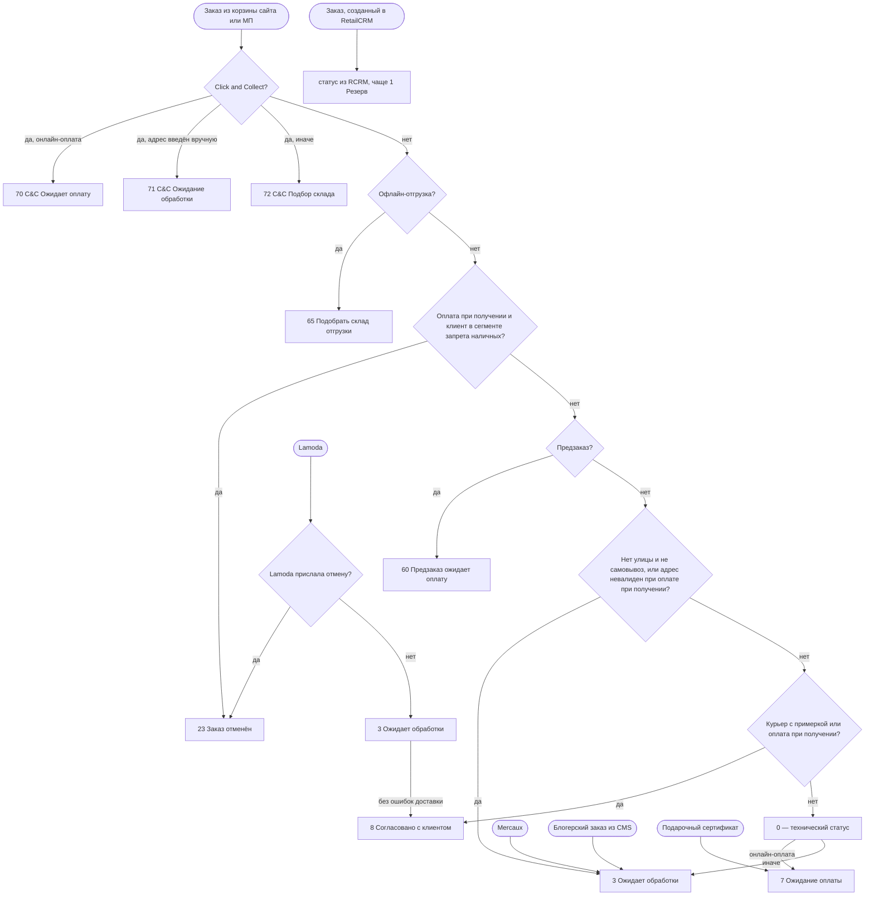
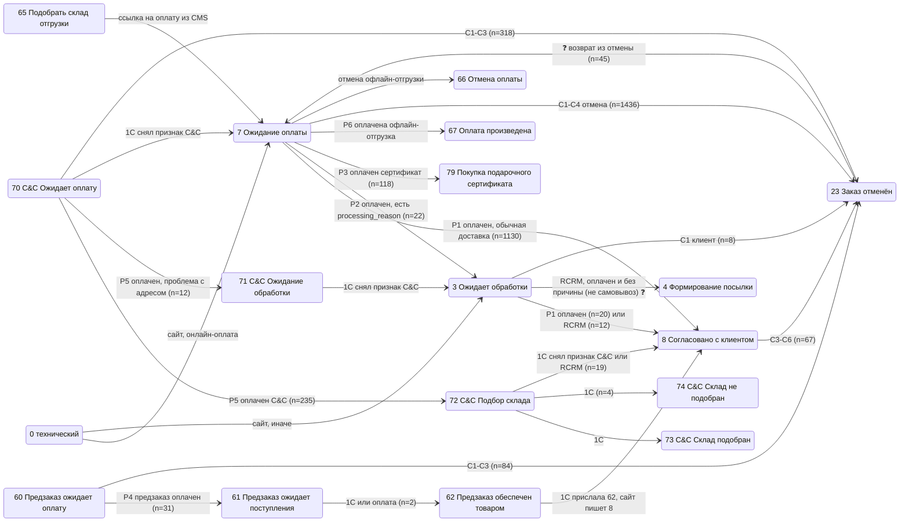
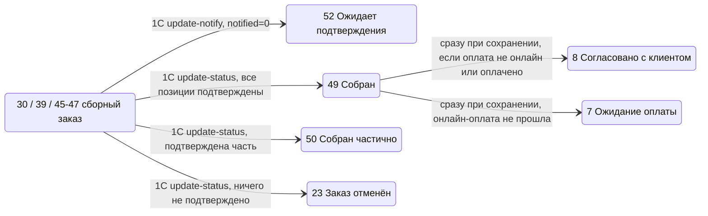
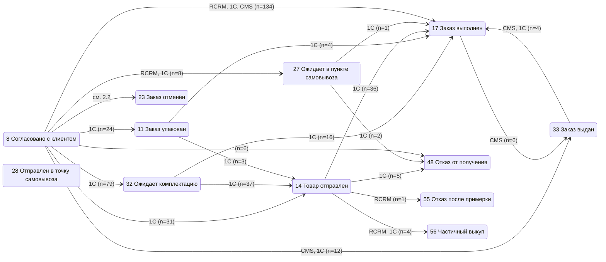
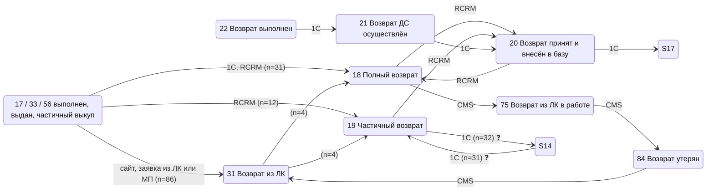

# Статусы заказа (AS-IS): переходы и условия

**Тип:** диаграмма состояний заказа (`cms_orders.status`) в монолите `12storeez-master-web`, как работает сейчас.
**Сверено:** код `12stz/12storeez-master-web` и история заказов стенда (`12stz_staging.cms_orders_history`), 17.10.2026.
**Расшифровка кодов статусов:** [order-status-dictionaries.md](../database/order-status-dictionaries.md) §3. Числа на схемах — `internal_id`.

## 0. Главное

1. **В монолите нет конечного автомата и таблицы разрешённых переходов.** Проверки «из какого статуса в какой можно» в коде нет: искали `allowedStatus`, `transition`, `canChangeStatus` и похожие имена — ничего не нашли.
2. **Сайт сам ставит статус только на пяти этапах:** создание заказа, оплата, отмена, заявка на возврат из ЛК или МП, подтверждение сборки магазином. Ещё несколько правил срабатывают при каждом сохранении заказа (§6).
3. **Всё остальное ставят внешние системы.** 1С (`api2/orders/order-update`, `api2/orders/status`) и RetailCRM присылают код статуса, и сайт записывает его как есть, без проверки, из какого статуса пришёл заказ. Менеджер в админке (CMS) тоже может поставить любой статус. Поэтому логистический путь (сборка → отправка → выдача → возврат) на сайте — это только порядок, который видно в данных. Код его не задаёт и не ограничивает.
4. В коде есть ссылка на бизнес-карту статусов: `Order::setPaidStatus()` → Google Sheets `1FEEnBrf5Tmos6BuNxnKNOPDeDYbczss6ivT57JDEelM`. Здесь она не сверялась.

**Обозначения на схемах:**
- `[сайт]` — переход ставит сам монолит, условие есть в коде (§2–§5);
- `[1С]`, `[RCRM]`, `[CMS]` — статус приходит извне, сайт его только записывает; условие перехода находится во внешней системе;
- `n=…` — сколько раз такой переход встретился в `cms_orders_history` на стенде (данные тестовые, это порядок величин, а не прод);
- ❓ — поведение неясно, см. §8.

## 1. Создание заказа: стартовый статус

После выбора статуса при сохранении действуют ещё две поправки (§6): ошибка ПВЗ переводит заказ в `3`, слишком длинный адрес — в `3` или `71`.

| Канал | Правило | Код | На стенде |
|---|---|---|---|
| Корзина сайта и МП | Проверки идут сверху вниз, первая сработавшая задаёт статус. Если ни одна не сработала, возвращается `0`, и при сохранении `getNewStatus()` ставит `7` для онлайн-оплаты или `3` для остальных | `src/Modules/Order/Helpers/OrderHelper.php:885-950` (`getOrderStartStatus`), `:153-176` (`getNewStatus`); вызовы — `CartOrderCreateDtoPrepareService.php:228`, `AbstractCreateOrderDtoBuilder.php:268` | `S→0→7` 2468, `S→70` 565, `S→8` 439, `S→60` 114, `S→72` 43 |
| Mercaux | Всегда `3` | `src/Modules/Order/Services/MercauxOrderCreateDtoPrepareService.php:109` | `S→3` mercaux 40 |
| Блогерский заказ (CMS) | Всегда `3` | `modules/orders/controllers/BloggerBackendController.php:502` | `S→3` blogger 79 |
| Lamoda | `23`, если Lamoda прислала отмену, иначе `3`. Затем `3 → 8`, если при подготовке не было ошибок | `LamodaOrderCreateDtoPrepareService.php:180-190`, `src/Modules/Order/Helpers/LamodaOrderHelper.php:101-109` | — |
| Подарочный сертификат | `7` | `src/Modules/Giftcard/Service/GiftcardCreateOrderService.php:54`, `modules/giftcards/service/GiftcardsService.php:295` | `S→7` без источника 222 ❓ |
| Заказ, созданный в RetailCRM | Статус приходит из RCRM по коду. Для C&C ставится `70` (онлайн-оплата или способ оплаты не указан) или `72`. Для предзаказа `1 → 60` | `src/Modules/Rcrm/Service/RcrmOrderCreateService.php:612, 703`, `RcrmOrderService.php:675-679` | `S→1` 103, `S→61` 188 |

## 2. Оплата, обработка, отмена (статусы ставит сайт)

### 2.1. Оплата: `Order::setPaidStatus()`

Срабатывает, когда платёжная система подтверждает оплату (`modules/payment/models/Payment.php:270-288`), источник `payment`. Код — `modules/orders/models/Order.php:2122-2147`, `:2824-2846`.

| № | Из статуса | Условие | В статус |
|---|---|---|---|
| P3 | любой | заказ на подарочный сертификат | `79` |
| P4 | `0`, `60`, `3`, `7`, `70` | `is_preorder` | `61` |
| P6 | те же | офлайн-отгрузка | `67` (в справочнике `active = 0`) |
| P5 | `70` | C&C | `71`, если `processing_reason = address_check`, иначе `72` |
| P2 | `0`, `60`, `3`, `7`, `70` | заполнен `processing_reason` | `3` |
| P1 | те же | доставка не экспресс (`TYPE_FAST`) и не курьер с примеркой | `8` |
| — | те же | экспресс-доставка или курьер с примеркой | статус не меняется |

Проверки идут по порядку, срабатывает первая подходящая.

### 2.2. Отмена

Отмена ставит `23`, а для офлайн-отгрузки — `66`. Позиции заказа отменяются, позиции снимаются с резерва в буфере. Код — `modules/orders/services/OrderService.php:359-437` (`cancelOrder`), `src/Modules/Order/Services/OrderCancelService.php:33`.

| № | Кто | Когда | Код |
|---|---|---|---|
| C1 | Клиент в ЛК или МП | Статус разрешает отмену (`can_be_cancelled = 1`: `3`, `7`, `60`, `70`, `71`), либо бронь с постоплатой в статусе `8` | `OrderHelper::canBeCancelled()` — `OrderHelper.php:572-585`; `modules/users/controllers/UsersController.php:669`, `src/Modules/Mobile/Controllers/OrdersController.php:388` |
| C2 | Крон `status/check-payment-status` | Статус `7`, `60` или `70`, не оплачен, в статусе дольше параметра `max_minutes_wait_payment` (для экспресса — `max_minutes_wait_payment_express_delivery`, для брони — параметр `MAX_MINUTES_WAIT`). Время отсчитывается от `cms_orders_status_timer` | `modules/orders/console/StatusController.php:88-115`, `src/Modules/Order/Repository/OrderRepository.php:82-124`, `StatusEnum::ORDER_STATUSES_FOR_TIMEOUT_CANCEL` |
| C3 | Крон `status/check-payment-status-dolyame` | Рассрочка (Долями, Подели), статус `7`, `60` или `70`, не оплачен, с момента создания прошло больше тех же параметров | `StatusController.php:125-182` |
| C4 | 1С или RCRM | Прислали `23` → сайт вызывает `cancelOrder()` с причиной из заказа или по умолчанию: «доставка отменена», если WMS-статус `deliveryCanceled`, иначе «нет в наличии» | `src/Modules/Order/Services/Inbox/OrderUpdateService.php:192-200`, `src/Modules/Rcrm/Service/RcrmOrderUpdateService.php:377-386` |
| C5 | Менеджер в CMS | Сохранил заказ со статусом `23` | `modules/orders/controllers/OrdersBackendController.php:219-224` |
| C6 | 1С для заказа Lamoda | Позиция пришла в статусе «Отменён» или «Нет в наличии» | `OrderUpdateService.php:772-780` |
| — | Консоль `confirmation/cancel <id…>` | Вручную, без условий | `modules/orders/console/ConfirmationController.php:44-61` |

### 2.3. Прочие правила этого этапа

| Переход | Условие | Код |
|---|---|---|
| `70 → 7`, `71 → 3`, `72`/`73`/`74 → 8` | 1С прислала `is_click_and_collect = false` | `OrderUpdateService.php:535-565` |
| `62 → 8` | 1С прислала статус «Предзаказ обеспечен товаром»: сайт записывает `8` вместо `62` | `OrderUpdateService.php:304-307` |
| `65 → 7` | Менеджер выставил ссылку на оплату заказа с офлайн-отгрузкой | `modules/orders/services/OrderService.php:234-244`, `SurchargeBackendController.php:88` |
| `* → 3` (`position_lost`) | RCRM добавила позицию со склада сайта, а остатка нет | `RcrmOrderUpdateService.php:638-643` |
| `1 → 60` | RCRM прислала заказ, который по позициям оказался предзаказом | `RcrmOrderService.php:675-679` |
| `3 → 8` или `3 → 4` | При отправке в RCRM: заказ оплачен, статус `3`, причины обработки нет, не блогерский. Самовывоз → `8`, иначе `4`. Статус меняется в объекте перед отправкой в CRM. Сохраняется ли он в БД, по коду не видно ❓ | `src/Modules/Rcrm/Service/RcrmExchangeService.php:93-104` |

## 3. Заказы со сборкой в магазине: подтверждение наличия

Сценарий «Ожидает подтверждения наличия» (`30`, сборные `39`, `45`–`47`). Сначала магазин подтверждает позиции через 1С, потом статус ставит сайт.

- `api2/orders/update-status` — `modules/api2/controllers/OrdersController.php:579-742`. Если все позиции подтверждены, ставится `49` и списываются деньги (capture). Если часть — `50` и capture. Если ничего — `23`, платёж отменяется, `is_cancel_site = 1`. Неподтверждённой позиции с комментарием ставится статус «нет в магазине».
- `49` надолго не остаётся: `Order::afterSave()` (`Order.php:1564-1573`) и `beforeSave` инбокса 1С и RCRM (`OrderUpdateService.php:885-891`, `RcrmOrderService.php:610-616`) сразу переводят его в `8` или `7`. В истории стенда `49` не встречается.
- `api2/orders/update-notify` с `notified = 0` → `52` (`OrdersController.php:784-793`).

## 4. Логистика и завершение (статусы ставят 1С, RCRM, CMS)

Сайт только записывает пришедший код. Ниже — переходы, которые встречаются в истории стенда, с основным источником. Условия задаёт 1С (склад, ТК) или менеджер.

- По справочнику (`_order`, группы) типовой путь такой: `8` → `32` → `10`/`11` → `14` → (`28` → `27`/`57` | `58`/`59`) → `17`/`33`. Также бывают `48`, `55`, `56` и «потерянные» `63`, `81`. Статусы `10`, `28`, `57`, `58`, `59`, `63`, `81` в истории стенда не встретились.
- Офлайн-отгрузка: `65` → `68` «В работе» → `69` «Изделие отложено». Эти статусы ставит 1С или CMS; на стенде есть только `7 → 68` и `68 → 17` (CMS).
- Когда заказ попадает в группу `complete` (`17`, `33`, `56`), заполняется `end_date`. От неё считается срок возврата (`OrderUpdateService.php:894-896`, `RcrmOrderService.php:618-620`).

## 5. Возврат

- **Сайт ставит только `31`.** Условие: заказ в группе `complete` (`17`, `33`, `56`) или в статусе с `is_returned = 1` (`17`, `31`, `33`, `56`), и с `end_date` прошло не больше `days_can_be_returned` дней. Позиции заявки получают статус `9` «ВОЗВРАТ (если был отгружен)». Код — `src/Modules/Order/Services/OrderRefundService.php:80-124`, вызовы — `modules/users/controllers/UserRefundController.php:128`, `src/Modules/Mobile/Controllers/OrdersController.php:501`. Старый путь — `OrderPosition::returnPosition()` → `Order::updateReturnStatus()` (`Order.php:1864-1876`).
- Статусы `29`, `34`, `40`, `53` (поступил, осмотрен, поступил в магазин, запрос реквизитов) ставят 1С или RCRM. На стенде их нет.
- Прямые и обратные переходы `14 ↔ 19` (около 30 раз в каждую сторону от 1С) похожи на переключение статусов при обмене или тестовые данные ❓.
- TO-BE статусы возврата проекта «Возвраты 2.0» — в [return-status_state.md](../../../projects/returns-2.0/requirements/diagrams/state/return-status_state.md).

## 6. Правила, которые срабатывают при каждом сохранении

| Правило | Условие | Результат | Код |
|---|---|---|---|
| Пустой статус | `status` пустой | `7` для онлайн-оплаты, иначе `3` | `OrderGetterTrait::getChangedStatus()` (`src/Modules/Order/Traits/OrderGetterTrait.php:1119-1142`), `OrderHelper::getNewStatus()` |
| Ошибка ПВЗ | Тип доставки — ПВЗ, есть `pvz_id`, адрес пустой, статус пустой или `1`, `7`, `3` | `3` | те же методы, `hasErrorInPvz()` (`OrderGetterTrait.php:1169-1179`) |
| Длинный адрес (только новый заказ) | Дом или квартира длиннее лимита 1С; заказ не офлайн-отгрузка, не предзаказ, статус не `7` и не `70` | `3`, для C&C — `71`; `processing_reason = address_check` | `Order::beforeSave()` (`Order.php:961-979`); `OrderHelper::updateStatusIfAddressTooLong()` (`OrderHelper.php:310-337`) — см. §8 п. 2 |
| Сборка магазином | Статус `49` | `8`, если оплата не онлайн или уже оплачено, иначе `7` | `Order.php:1564-1573`, `OrderUpdateService.php:885-891`, `RcrmOrderService.php:610-616` |

## 7. Все переходы на стенде

Источник — `cms_orders_history`: снимок заказа на каждое изменение, вместе со `status` и `last_change_source`. Подсчитаны пары «предыдущий статус → новый статус» внутри одного заказа (137 разных пар). `S` — первая запись заказа. Здесь все пары с `n ≥ 2`; в скобках — источники (`last_change_source`).

| Переход | n | Источники |
|---|---:|---|
| S→0 | 2472 | mobile 1361, cart 1111 |
| 0→7 | 2468 | mobile 1361, cart 1107 |
| 7→23 | 1436 | autocancel 969, mobile 374, user 63, cart 19, 1c 10, cms 1 |
| 7→8 | 1160 | payment 1130, mobile 15, cart 12, retailcrm 2, cms 1 |
| S→70 | 565 | mobile 284, cart 281 |
| S→8 | 439 | mobile 301, cart 119, yandex-pay 6, payment 4, yandex-split 3, user 2, script-resend 2, retailcrm 1, autocancel 1 |
| 70→23 | 318 | autocancel 246, mobile 65, user 5, 1c 1, retailcrm 1 |
| 70→72 | 238 | payment 235, cart 2, mobile 1 |
| S→7 | 222 | источник пустой |
| S→61 | 188 | retailcrm 142, payment 44, alpha-podeli 2 |
| S→3 | 135 | blogger 79, mercaux 40, mobile 8, cart 4, retailcrm 2, yandex-split 1, yandex-pay 1 |
| 8→17 | 134 | retailcrm 34, payment 28, 1c 26, cms 24, script-resend 13, mobile 5, cart 4 |
| 7→79 | 118 | payment 118 |
| S→60 | 114 | mobile 70, cart 37, retailcrm 7 |
| S→1 | 103 | retailcrm 102, user 1 |
| 60→23 | 84 | mobile 55, autocancel 29 |
| 8→32 | 81 | 1c 79, retailcrm 2 |
| 17→31 | 80 | user 41, mobile 39 |
| 8→23 | 67 | mobile 31, cms 14, retailcrm 8, payment 7, cart 4, 1c 2, user 1 |
| 23→7 | 45 | autocancel 16, mobile 14, yandex-pay 13, yandex-split 2 |
| S→72 | 43 | cart 31, mobile 12 |
| 32→14 | 38 | 1c 37, retailcrm 1 |
| 14→17 | 38 | 1c 36, retailcrm 2 |
| 8→14 | 36 | 1c 31, payment 2, cart 2, retailcrm 1 |
| 3→8 | 33 | payment 20, retailcrm 12, script-resend 1 |
| 19→14 | 32 | 1c 31, retailcrm 1 |
| 60→61 | 31 | payment 31 |
| 17→18 | 31 | 1c 19, retailcrm 12 |
| 14→19 | 31 | 1c 31 |
| 1→7 | 30 | retailcrm 29, cms 1 |
| 8→7 | 27 | payment 22, retailcrm 3, cms 1, user 1 |
| 1→3 | 27 | retailcrm 27 |
| 8→11 | 24 | 1c 24 |
| 7→3 | 23 | payment 22, retailcrm 1 |
| 72→8 | 19 | retailcrm 10, import_from_1c 6, payment 2, cart 1 |
| S→23 | 16 | user 8, autocancel 3, yandex-split 3, payment 1, 1c 1 |
| 32→17 | 16 | 1c 16 |
| 7→17 | 14 | cms 8, script-resend 5, 1c 1 |
| 8→33 | 12 | cms 3, script-resend 3, 1c 3, retailcrm 2, payment 1 |
| 72→17 | 12 | script-resend 6, cms 6 |
| 70→71 | 12 | payment 12 |
| 17→19 | 12 | retailcrm 11, 1c 1 |
| S→79 | 8 | payment 6, yandex-split 2 |
| 8→27 | 8 | retailcrm 5, 1c 3 |
| 3→23 | 8 | user 7, mobile 1 |
| 8→18 | 7 | payment 3, 1c 2, retailcrm 2 |
| 1→60 | 7 | retailcrm 7 |
| 8→48 | 6 | cart 2, retailcrm 2, payment 1, 1c 1 |
| 33→31 | 6 | mobile 4, user 2 |
| 17→33 | 6 | cms 4, mobile 1, 1c 1 |
| 23→79 | 5 | payment 5 |
| 23→17 | 5 | 1c 3, cms 2 |
| 19→18 | 5 | retailcrm 4, cms 1 |
| 17→7 | 5 | cms 3, 1c 2 |
| 14→48 | 5 | 1c 5 |
| 11→17 | 5 | 1c 4, cms 1 |
| 8→19 | 4 | retailcrm 3, payment 1 |
| 72→74 | 4 | 1c 4 |
| 33→17 | 4 | cms 2, retailcrm 1, 1c 1 |
| 31→19 | 4 | mobile 3, user 1 |
| 31→18 | 4 | user 3, mobile 1 |
| 3→17 | 4 | 1c 3, cms 1 |
| 27→8 | 4 | retailcrm 4 |
| 14→56 | 4 | retailcrm 2, 1c 2 |
| 1→70 | 4 | retailcrm 4 |
| 0→3 | 4 | cart 4 |
| 72→70 | 3 | retailcrm 3 |
| 72→23 | 3 | retailcrm 3 |
| 33→56 | 3 | cms 2, 1c 1 |
| 23→3 | 3 | user 3 |
| 11→14 | 3 | 1c 3 |
| 8→56, 8→3, 74→23, 70→33, 61→62, 32→56, 31→17, 3→33, 3→7, 27→48, 20→17, 18→20, 17→8, 1→8 | по 2 | разные |

Пары с `n = 1` (ещё 46 пар, в основном `cms`, `1c`, `retailcrm`) здесь не перечислены. Среди них есть, например, `22→7`, `23→8`, `23→60`, `56→23`, `17→8` — откаты из конечных статусов. Это ещё одно подтверждение, что ограничений на переходы нет. Период данных не уточнялся: запрос упёрся в лимит подключений к БД.

Источник `last_change_source` относится ко всей записи истории, а не только к смене статуса. Например, `23→7` с источником `autocancel` означает, что статус сменился, а поле источника осталось от прошлого изменения.

## 8. Наблюдения и вопросы

1. **Запрет отката статусов из RetailCRM, по-видимому, не работает.** В `RcrmOrderUpdateService::orderUpdate()` (`:178-195`) задуманы запреты `60→1`, `61→1`, `61→60`, `8→7`, `72→70`. Но `OrderStatus::getRetailStatus()` ищет по символьному `code`, а получает `internal_id` текущего заказа, поэтому почти всегда возвращает `null` → `0`, и условия не срабатывают. Это подтверждают данные стенда: `72→70` от retailcrm встречается 3 раза, `8→7` от retailcrm — 3 раза.
2. **Два варианта правила «длинный адрес» расходятся.** Старый `Order::beforeSave()` срабатывает, если длинный дом **или** квартира. Новый `OrderHelper::updateStatusIfAddressTooLong()` выходит из метода, если короткий дом **или** короткая квартира, то есть срабатывает, только когда длинные **оба**. Заказы из корзины и МП идут по новому пути (`src/Modules/Order/Services/OrderService.php:615`).
3. Константа `StatusEnum::ORDER_STATUSES_FOR_RESERVATION_TIMEOUT_CANCEL = [8]` объявлена, но нигде не используется: автоотмены брони в статусе `8` по этой константе нет.
4. Инбокс 1С принимает только активные статусы (`getActiveOrderStatusByCode`). Путь RCRM (`getRetailStatus`) и старый `api2/orders/status` принимают любые. Сайт сам ставит неактивный `67` «Оплата произведена» (офлайн-отгрузка).
5. ❓ `23 → 7` (45 раз: autocancel, mobile, yandex-pay) — отменённый заказ снова ждёт оплаты. В `setPaidStatus()` статуса `23` нет. Что именно возвращает заказ, по коду не найдено. Вероятно, повторная оплата или обработчик платёжного провайдера.
6. ❓ `S → 7` без источника (222) — предположительно заказы на подарочные сертификаты (`GiftcardCreateOrderService`); не проверено.
7. ❓ `3 → 8` / `3 → 4` в `RcrmExchangeService::sendOrderUpdate()` меняют статус в объекте перед отправкой в CRM. Похоже, что в БД сайта он попадает только когда RCRM возвращает этот статус обратно (`3→8` от retailcrm — 12 раз).
