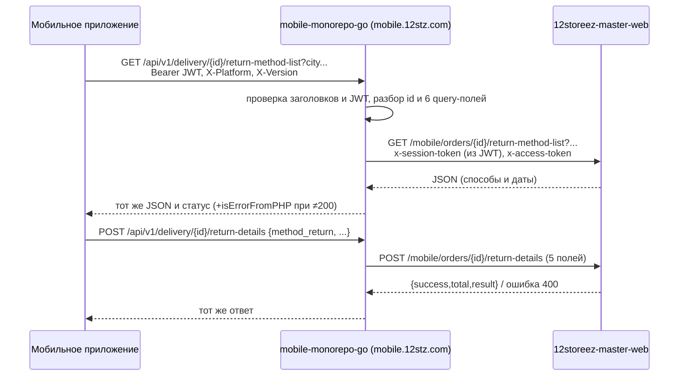

# Структура репозитория mobile-monorepo-go

**Назначение документа:** карта-справочник по кодовой базе `mobile-monorepo-go` (Mobile API Gateway на Go) для быстрого поиска при анализе требований.

**Дата актуализации:** 07.11.2026
**Сверено с кодом:** `origin/master`, коммит `631ac38673d64e9263f6ba88ba2e29153ac385aa` (03.11.2026, «Merge branch 'develop' into 'master'»); `origin/develop` не впереди. Предыдущая сверка — `f302aeb` (06.10.2026)
**Путь к коду:** `C:\Users\RobotComp.ru\Desktop\12stz\mobile-monorepo-go\` (только чтение)
**Примечание:** структура описана по фактическому содержимому папок; назначение пакетов — по коду, названиям и godoc-аннотациям. Номера строк `file:line` — по `origin/master` `631ac38`. Сводная раскладка «ручка core → копия в Go» с номерами строк — `knowledge/architecture/call-chain.html`.

> **Главное изменение с `f302aeb` (24 коммита, ECOMDEV-2342/2361/2409/2422/2438/2480):** в шлюз перенесены копии ручек старого шлюза ESB `core` (`core.12stz.com`, код в `esb-monorepo`) — авторизация, старая корзина, каталог, метаданные, товары, заказы, уведомления, отзывы, лендинги, веблинки. Новые файлы `internal/app/service/*_core.go`, `old_cart.go`, `cart_boxberry.go`, `catalog.go`. Путь копии = путь core без сегмента `v2` под префиксом `/api/v1`; числовые параметры ограничены `regex(^\d+$)`. **iOS эти копии пока не вызывает** — по-прежнему ходит в `core.12stz.com`.

---

## 1. Назначение и общая архитектура

- **Что это:** HTTP-шлюз мобильного приложения («Mobile API Gateway» — `cmd/mobile_api/mobile_api.go:41-43`). Принимает запросы iOS/Android по путям `/api/v1/...` и `/api/v2/...`, проверяет JWT и заголовки и **в основном проксирует их в монолит** `12storeez-master-web` (пути `mobile/...`, `mobilev2/...`, `api2/...`). Часть методов уходит по gRPC в микросервисы ESB (гео, логистика, мета и магазины, настройки авторизации и Т-Банк, Mindbox — только бонусы, с ECOMDEV-2422/2480 ещё офлайн-заказы `orders.Offline` и отзывы `feedbacks.Mobile`).
- **Собственной бизнес-логики и БД нет.** В коде нет подключения к БД, ORM, миграций или брокеров сообщений (в `go.mod` нет драйверов БД, Kafka или RabbitMQ). Шлюз работает без состояния.
- **Прод-хост:** `mobile.12stz.com` (`.deploy/helm/prod.values.yaml:4`). Это тот же хост, что в iOS-клиенте называется `BASE_URL_NEW` (`knowledge/12storeez-ios/repo-map.md`, §4.3). Легаси-хост `core.12stz.com` этим репозиторием **не** обслуживается — его код в `12stz/esb-monorepo` (см. [../esb-monorepo/repo-map.md](../esb-monorepo/repo-map.md)). С ноября 2026 в шлюзе есть **копии** большинства ручек `core` (см. §3.2), но клиенты на них ещё не переключены.
- **Стек:** Go 1.23 (`go.mod:3`), веб-фреймворк Fiber v2, HTTP-клиент resty, gRPC (контракты — пакет `github.com/12storeez/esb-protobufs`), логирование zap/`logzer`, Sentry, Swagger (swaggo), конфигурация через env (`envconfig`).
- **Зона ответственности по README** (`README.md`): authorization, cart, catalog, geo, metadata, notifications, orders, pages, products, profile, reviews, swagger, zabbix. Новая доменная область согласуется с командой BTS.

---

## 2. Корневые папки и файлы

| Путь | Назначение |
|---|---|
| `cmd/mobile_api/mobile_api.go` | **Точка входа**: инициализация конфигурации, Sentry, Fiber, middleware, gRPC- и HTTP-клиентов; **регистрация всех маршрутов** (`configureAPIV1` `:161-286`, `configureAPIV2` `:288-306`, функции `set*Routes` `:308-530`) |
| `cmd/mobile_api/core_orders_config.go`, `core_reviews_config.go` | Предупреждение в лог при старте, если не заданы `ORDERS_GRPC_URL`, `FEEDBACKS_GRPC_URL`, `SITE_API2_PRODUCTS_TOKEN` (запуск не прерывается; без них офлайн-заказы, CanBeSaved и gRPC-отзывы отвечают 503) |
| `cmd/mobile_api/*_test.go` | Интеграционные тесты маршрутов перенесённых ручек: `core_metadata_test.go`, `core_orders_test.go`, `core_products_test.go`, `core_reviews_test.go`, `core_landings_test.go`, `core_ulink_test.go`, `old_cart_test.go` |
| `config/config.go` | Структура конфигурации: env-переменные (`Server`, `Authorization`, `*GRPC`, `Site` `:49-174`, `Logistics` `:175-181`); `.env` подгружается через `gotenv` (`config.go:184-193`) |
| `internal/app/service/` | **Хендлеры HTTP** (слой «service»): по файлу на домен, каждый метод — `func(c *fiber.Ctx) error` с godoc/swagger-аннотациями. Копии ручек `core` — в отдельных файлах: `metadata_core.go`, `orders_core.go`, `product_core.go`, `reviews_core.go`, `notification_core.go`, `landings_core.go`, `ulink_core.go` (+ `ulink_core_url.go` — порт `isURL` из validator.js), `old_cart.go`, `cart_boxberry.go`, `catalog.go`. Тесты: `auth_test.go`, `user_test.go` |
| `internal/app/usecase/` | Обращения к gRPC-микросервисам (auth — настройки и Т-Банк, delivery/логистика, geo, metadata + `stores.go`, user/Mindbox-бонусы, `orders_core.go` — orders.Offline и feedbacks.CanBeSaved, `reviews_core.go` — feedbacks.Mobile) и вызовы монолита для авторизации (`auth.go` `callSite`). `core_grpc_metadata.go` — проброс `x-request-id`, `version`, `api_key`, `sentry-trace` в метаданные gRPC (ECOMDEV-2409, 2422) |
| `internal/app/helpers/` | Прокси в монолит (`site_proxy.go` — `ProxyToSite`, `ProxyToSiteAuth`; `site_proxy_as_is.go` — `ProxyToSiteAsIs` для копий `core`; `core_gateway_site_post.go` — POST в монолит без клиентских заголовков), совместимость с Core Gateway (`core_gateway_compat.go` — разбор query как в NestJS, обёртки `ResponseList`/`ResponseAction`; `core_gateway_grpc_error.go` — таблица gRPC-код → HTTP-статус), прокси в логистику (`logistics_proxy.go`), JWT (`jwt.go`), вызов resty (`common.go`). `mindbox.go` **удалён** |
| `internal/app/models/dto/<домен>/` | DTO запросов и ответов по доменам (auth, cart, category, common, delivery, geo, giftcard, logistics, metadata, notification, **oldcart**, order — в т.ч. `offline.go`, `orders_core.go`, pages — `landings_ulink_core.go`, payment(s), product — `product_core.go`, profile — `user_last_context.go`, reservation, reviews — `reviews_core.go`, settings, …) |
| `internal/app/models/converters/` | Конвертеры protobuf → DTO (`auth.go`, `mindbox.go`) |
| `internal/app/constants/constants.go` | Имена заголовков (`X-Platform`, `X-Version`, `x-session-token`, `x-access-token`, `X-Device-Id`, IP-заголовки), константа `prod` |
| `internal/app/monitoring/monitoring.go` | Хендлеры `/ping` и `/health` |
| `internal/middlewares/` | Middleware: IP клиента (`client_ip.go` + `client_ip_test.go`), проверка заголовков (`headers_validation.go`), логирование (`logging.go`; с ECOMDEV-2342 тела `/api/v1/auth*` маскируются — `log_mask.go` скрывает `password`, `code`, `code_verifier`, `refresh_token`, `access_token`, `session_token`), Sentry и трассировка (`sentry.go`) |
| `pkg/grpc_client/grpc_client.go` | Ленивые gRPC-клиенты: Logistics (WinnerService, `:53`), Geo (`:75`), Meta Mobile (`:91`), Meta Stores (`:108`), Mindbox User (`:124`), Auth (`:140`), Orders Offline (`:158`, `sync.Once`), Feedbacks Mobile (`:175`, `sync.Once`). Клиента Mindbox Mobile больше нет. Orders/Feedbacks/Stores восстановлены после мержа в релиз (коммит `6b6d69c`) |
| `pkg/errors/` | Ошибки и маппинг gRPC ↔ HTTP |
| `docs/mobile_api/` | Сгенерированный Swagger (`swagger.yaml`, `swagger.json`, `docs.go`; генерация — `make build` / `swag init`, `Makefile`). Опубликован по `/swagger/*` |
| `.deploy/docker/Dockerfile`, `docker-compose.yml` | Сборка образа `hub.12stz.dev/apps/esb/mobile-monorepo-go/mobile-api`, порт 8080→80 |
| `.deploy/helm/*.values.yaml`, `Chart.yaml` | Helm-чарт и окружения (см. §6). Зависимость `nxs-universal-chart` `~3.2.2` теперь берётся из `http://chartmuseum.stage.12stz.local` (было `oci://registry.nixys.ru/nuc` 3.2.1) |
| `.gitlab-ci.yml` | CI: lint → unit-тесты → сборка образа (kaniko) → ручной деплой в k8s (helm) |
| `.envexample` | Пример env-переменных. **Содержит значения, похожие на реальные ключи** (API-ключи gRPC/логистики, Sentry DSN); в справочник не переносятся |

---

## 3. Как регистрируются маршруты и хендлеры

1. `main()` создаёт `usecase.New(grpcClient, cfg, logger, restyClient)` и `service.New(uc, cfg, logger, restyClient)` (`cmd/mobile_api/mobile_api.go:125-126`). Перед этим — предупреждения о незаданных env для перенесённых заказов и отзывов (`:62`, `:107`).
2. `service.Service` (`internal/app/service/service.go:11-35`) — фасад с ленивыми геттерами по доменам: `Delivery()`, `Cart()`, `OldCart()`, `Order()`, `Giftcard()`, `User()`, `Auth()`, `Catalog()` и т.д. (новые — `OldCart` `:220`, `Catalog` `:340`). `usecase.Usecase` (`internal/app/usecase/usecase.go:12-20`) — добавлены `Reviews()` и `Orders()`.
3. Маршруты регистрируются в `mobile_api.go` прямо на группах Fiber: `apiV1 := app.Group("/api/v1")` (`:162`), `apiV2 := app.Group("/api/v2")` (`:289`), затем `group.Get/Post(...)` → `svc.<Домен>().<Метод>`.
4. **Цепочка middleware для `/api/v1`** (порядок важен):
   - глобально: `ClientIPSource`, `helmet`, `recover`, `cors`, Sentry (`:94-100`);
   - `LoggingMiddleware` (`:163`), тела `/api/v1/auth*` в логе маскируются (`internal/middlewares/log_mask.go`);
   - группа `/auth/*` — **без** проверки заголовков и JWT (`:167-178`); токен в этих ручках проверяет сам хендлер через `helpers.VerifyToken` (`internal/app/helpers/jwt.go:27`; с ECOMDEV-2342 принимает токен и с префиксом `Bearer `, и без, и отклоняет не-HMAC алгоритмы);
   - `HeadersValidationMiddleware` — обязательны `X-Platform`/`Platform` и `X-Version`/`Version`, иначе 400 (`:180`, `internal/middlewares/headers_validation.go:8-25`);
   - `/errors/waf` — без JWT (`:183-186`);
   - `jwtMiddleware` — Bearer-JWT (HS, секрет `JWT_SECRET`); из claims в контекст кладутся `device_id`, `user_id` (`:188`, `:553-578`). Ошибка — 401 `{"error":{"message":"unauthorized"}}`.
   - Rate limiter создан (`:532-551`), но **отключён** (закомментирован, `:164`, `:291`).
5. **`/api/v2`**: Logging → HeadersValidation → JWT (`:288-306`): корзина v2, `payment-types`, `PATCH /orders/{id}/change-payment-method`, подарочные карты v2.
6. Служебные маршруты без префикса: `/swagger/*`, `/ping`, `/health`, `/app-metrics`, `/debug/pprof/*` (кроме prod) (`:129`, `:143-151`). Prometheus `/metrics` — функция есть (`:153-159`), вызов закомментирован (`:103`).
7. **Порядок регистрации у копий `core`:** статические пути регистрируются раньше параметризованных, параметры — `regex(^\d+$)` (у лендинга `regex(^\w+$)`), чтобы `check-items`, `offline`, `return-reasons` и т.п. не попадали в `/:id` и чтобы закрыть обход пути в монолите и SQL-инъекцию через `order_id` в feedbacks-ms (комментарии `mobile_api.go:204-205`, `:312-313`, `:410-411`, `:478-480`, `:497-498`).

### 3.1. Перечень групп `/api/v1` (`cmd/mobile_api/mobile_api.go`)

| Группа | Строки | Куда идёт |
|---|---|---|
| `/auth` (settings, t-bank/login, generate-token, login, login/by-phone/request-code, login/by-phone, logout, session PUT/GET) | 167-178 | settings, t-bank/login — gRPC Auth (`usecase/auth.go:58-93`); остальное — монолит через `usecase/auth.go` `callSite` (`:283`): `mobile/user/token`, `mobile/user/auth` (POST — вход, DELETE — выход), `mobile/user/auth-phone-code` (запрос кода, `SITE_USER_AUTH_PHONE_CODE_PATH`, в монолите `actionAuthPhoneCode`), `mobile/user/auth-phone`, `mobile/user/session`. **gRPC Mindbox в авторизации больше не используется** (ECOMDEV-2342) |
| `/errors/waf` | 183-186 | логирование ошибок WAF |
| `/geo/countries/...`, `/geo/cities/:ip` | 189-194, 362-380 | gRPC Geo; `get-by-phone/:phone_number` (`:379`) на месте |
| `/metadata` | 195-196, 308-325 | contacts, about — gRPC Meta Mobile; `stores`, `stores/cities`, `stores/:store_id` — gRPC Meta Stores (`usecase/stores.go`); splash-screen-image, sizes-table, sizes, social, faq, faq/category/:id, faq/theme/:id, stories/v2[/:id] — монолит (`mobile/metadata/*`, `mobile/support`, `mobile/v2/lookbooks`) |
| `/catalog/filter` **(новое)** | 197-200 | монолит `mobile/catalog/filter` |
| `/reviews` | 201-214 | offline-product — монолит; **новые**: `GET/PUT company` → `mobile/feedback/shop`, `GET product/:model_id`, `PUT product/:order_id` → `mobile/feedback/items`; `PUT order`, `PUT store`, `PUT app`, `GET order/reasons/:order_id` — gRPC Feedbacks |
| `/landings/:id` **(новое)** | 216-219 | монолит `mobile/v2/landings/{id}` |
| `POST /ulink` **(новое)** | 220-223 | монолит `mobile/v2/ulink`; `url` предварительно валидируется по белому списку хостов (`12storeez.com`, `12stories.com`, `*12stz.dev/tech*`) |
| `/delivery` (types, intervals, **`{order_id}/return-details`, `{order_id}/return-method-list`**) | 224-230 | монолит; intervals — gRPC Logistics |
| `/pickup/provider/:provider/points[/:point]` | 232-236 | HTTP логистика (`LOGISTICS_BASE_URL`) |
| `/products/...` | 238-239, 400-420 | монолит; **новые** `last-view`, `suggest`, `last-search-term`, `/:model_id`, `/:model_id/{stocks,last-view,fashion,fashion-stylist}` → `mobile/v2/products/...` |
| `/cart/...` | 241-242, 422-476 | монолит; **новые** `delivery/boxberry[/:boxberry_id]` → `mobile/v2/delivery/boxberry` (общие для старого и нового чекаута) |
| `/old-cart/...` **(новое)** + `PUT /old-cart/order` | 244-245, 250, 478-489 | монолит: `check-items`, `clean`, `payment`, `delivery` → `mobile/cart/*`; `delivery2` → `mobile/v2/delivery`; `POST/DELETE /:barcode` → `mobile/cart`; `PUT /old-cart/order` → `mobile/orders` (создание заказа старого чекаута) |
| `/orders` | 247-248, 495-507 | `POST /` — создание (монолит `mobile/orders`); **новые**: `GET /`, `DELETE /`, `GET /:order_id`, `POST /:order_id/return`, `GET /dolyame-id/:order_id` → монолит `mobile/orders`; `GET /return-reasons` → `mobile/v2/orders`; `GET /offline[/:id]` — gRPC Orders Offline + `api2/products/items`; проверка «можно ли оставить отзыв» — gRPC Feedbacks `CanBeSaved` |
| `/giftcards/...` | 252-253, 509-521 | монолит |
| `/timezones`, `/payment`, `/payments`, `/pages`, `/reservation`, `/settings`, `/version`, `/notification`, `/users`, `/profile/bind-phone` | 255-285 | монолит; `/users/bonuses*` — gRPC Mindbox; **новые** `GET/PUT /users/last-context` (`:349-350`, ECOMDEV-2248) → `mobile/user/last-context`; **новые** `/notification/{message,info}` → `mobile/v2/notification/*`, `/notification/user-activities` → `mobile/user-activities` |

> **Важно для анализа заказов и возвратов (обновлено 07.11.2026):** в шлюзе теперь **есть копии** просмотра заказа `GET /api/v1/orders/{id}`, списка `GET /api/v1/orders`, отмены `DELETE /api/v1/orders`, возврата `POST /api/v1/orders/{id}/return` и причин возврата `GET /api/v1/orders/return-reasons` (ECOMDEV-2422; хендлеры — `internal/app/service/orders_core.go`). Но **iOS их пока не вызывает** — эти методы по-прежнему идут через легаси-хост `core.12stz.com` (см. `knowledge/12storeez-ios/repo-map.md`, [../esb-monorepo/repo-map.md](../esb-monorepo/repo-map.md)).

### 3.2. Копии ручек старого шлюза `core` (перенос ECOMDEV-2342…2480)

Раскладка по хендлерам (путь core → путь шлюза → `файл:строка`); полная таблица с цепочкой до монолита — `knowledge/architecture/call-chain.html`.

| Домен (задача) | core → шлюз | Хендлер |
|---|---|---|
| Авторизация (2342) | `authorization/*` → `/api/v1/auth/*` | `service/auth.go`: generate-token `:110`, login `:138`, logout `:176`, session PUT `:209`, GET `:239`, by-phone/request-code `:274`, by-phone `:314` |
| Корзина (2361) | `cart/{barcode}` POST/DELETE, `cart/clean`, `cart/check-items`, `cart/payment`, `cart/delivery`, `cart/delivery2` → `/api/v1/old-cart/*`; `cart/delivery2/boxberry[/{id}]` → `/api/v1/cart/delivery/boxberry[/{id}]` | `old_cart.go`: check-items `:63`, DELETE `:94`, POST `:131`, payment `:177`, clean `:224`, delivery `:260`, delivery2 `:304`; `cart_boxberry.go:41`, `:72` |
| Каталог, метаданные (2409) | `catalog/filter`, `metadata/{stores,stores/cities,stores/{id},sizes-table,faq*,sizes,social,stories/v2*}` | `catalog.go:45`; `metadata_core.go`: stores `:59`, cities `:107`, store `:149`, sizes-table `:192`, faq `:231`, category `:261`, theme `:293`, sizes `:323`, social `:350`, stories `:381`, story `:422` |
| Уведомления, заказы (2422) | `notification/{message,info,user-activities}`; `orders` GET/DELETE/PUT, `orders/{id}`, `orders/offline[/{id}]`, `orders/dolyame-id/{id}`, `orders/{id}/return`, `orders/v2/return-reasons` → `/api/v1/orders/return-reasons` | `notification_core.go:38`, `:74`, `:114`; `orders_core.go`: list `:69`, cancel `:131`, PUT (→ `/old-cart/order`) `:169`, offline `:206`, offline/{id} `:282`, return-reasons `:343`, `{id}` `:376`, return `:458`, dolyame-id `:494` |
| Товары (2438) | `products/v2/*` → `/api/v1/products/*` (сегмент `v2` убран) | `product_core.go`: last-view `:105`, suggest `:153`, last-search-term `:185`, `{id}` `:218`, stocks `:251`, `{id}/last-view` `:287`, fashion `:318`, fashion-stylist `:350` |
| Отзывы, лендинги, веблинки (2480) | `reviews/*`, `landings/v2/{id}` → `/api/v1/landings/{id}`, `v2/ulink` → `/api/v1/ulink` | `reviews_core.go`: order `:67`, store `:123`, app `:184`, order/reasons `:244`, company GET `:294`, PUT `:324`, product GET `:368`, PUT `:402`; `landings_core.go:43`; `ulink_core.go:57` |

Особенности копий:
- В монолит ходят через `helpers.ProxyToSiteAsIs` (`site_proxy_as_is.go:48`) по **`SITE_BASE_INTERNAL_URL`**: клиентские query передаются как есть (с повторами), дополнительно пробрасываются `X-Request-Id` и `X-Gender` (из query `gender`); ответ 2xx отдаётся как есть, иначе со статусом монолита и `isErrorFromPHP: true`.
- Разбор query и обёртки ответов повторяют NestJS-шлюз `core` (`helpers/core_gateway_compat.go`: `Number()` из JS, `PaginationQueryDto` с `limit=10`, `offset=0`, `ResponseList`/`ResponseAction`); ошибки gRPC → HTTP-статус по таблице core (`helpers/core_gateway_grpc_error.go`).
- Офлайн-заказы с позициями дозапрашивают `api2/products/items` POST без клиентских заголовков, токен — `SITE_API2_PRODUCTS_TOKEN` в query (`helpers/core_gateway_site_post.go:24`; в core токен был зашит в код).
- Особенность core «RedirectToPingInterceptor / пропуск AuthRequestGuard для URL с `ping`» у лендингов и ulink **не перенесена** (`landings_core.go:13-15`, `ulink_core.go:17-20`).
- Собственный метод `geo/countries/phone-details`, добавленный в рамках ECOMDEV-2409 (`1f991da`), в той же задаче удалён (`13c28f0`, `f7e29b8`); замена — `GET /api/v1/geo/countries`. Относительно `f302aeb` маршруты `/geo` не изменились.

---

## 4. Интеграции

| Система | Протокол | Направление | Где в коде | Назначение |
|---|---|---|---|---|
| **Монолит `12storeez-master-web`** | HTTP/JSON (resty) | шлюз → монолит | `internal/app/helpers/site_proxy.go:21-65` (`ProxyToSite`), `:113-200` (`ProxyToSiteAuth`); `site_proxy_as_is.go:48-121` (`ProxyToSiteAsIs`, копии `core`); `core_gateway_site_post.go:24-80` (POST без клиентских заголовков); авторизация — `internal/app/usecase/auth.go:95-300` (`callSite`); базовый URL `SITE_BASE_URL` / `SITE_BASE_INTERNAL_URL` (`config/config.go:50-51`); пути — `SITE_*_PATH` (`config/config.go:52-173`, значения — `.deploy/helm/values.yaml:26-140`) | Основной бэкенд почти для всех методов: корзина (новая и старая), заказы, сертификаты, товары, профиль, возвраты, авторизация, метаданные, отзывы, лендинги, веблинки. Дополнительно `api2/products/items` с токеном `SITE_API2_PRODUCTS_TOKEN` (офлайн-заказы) |
| gRPC **Logistics** (WinnerService) | gRPC (TLS опционально) | шлюз → сервис | `pkg/grpc_client/grpc_client.go:53-73`, `internal/app/usecase/delivery.go:26` | Интервалы доставки |
| HTTP **Logistics** | HTTP/JSON, `Authorization` из `LOGISTICS_ACCESS_TOKEN` | шлюз → сервис | `internal/app/helpers/logistics_proxy.go:22-64`, `internal/app/service/pickup.go:49,86` | ПВЗ: список и карточка точки |
| gRPC **Geo** | gRPC TLS | шлюз → сервис | `pkg/grpc_client/grpc_client.go:75-89`, `internal/app/usecase/geo.go` | Страны, города, адреса, город по IP или телефону |
| gRPC **Meta** (Mobile + Stores) | gRPC TLS, `META_GRPC_URL` | шлюз → сервис | `pkg/grpc_client/grpc_client.go:91-122`, `internal/app/usecase/metadata.go:41,58`, `internal/app/usecase/stores.go:29,50,72` | Контакты, «О нас»; **новое** — магазины: список, города, магазин по id (`meta.Stores` `All`/`Cities`/`ByID`) |
| gRPC **Orders** (`orders.Offline`) **(новое)** | gRPC, TLS по `ORDERS_GRPC_NEED_SSL` (по умолчанию да), `ORDERS_GRPC_URL` (Vault) | шлюз → сервис | `pkg/grpc_client/grpc_client.go:158-172`, `internal/app/usecase/orders_core.go:94-129` (`ByClient`, `GetById`) | Офлайн-заказы (покупки в магазинах) |
| gRPC **Feedbacks** (`feedbacks.Mobile`) **(новое)** | gRPC, TLS по `FEEDBACKS_GRPC_NEED_SSL`, `FEEDBACKS_GRPC_URL` (Vault) | шлюз → сервис | `pkg/grpc_client/grpc_client.go:175-189`, `internal/app/usecase/reviews_core.go:39-101` (`Order`, `Store`, `App`, `ReasonsByOrder`), `internal/app/usecase/orders_core.go:39-92` (`CanBeSaved`) | Отзывы о заказе, магазине, приложении; причины; признак «можно оставить отзыв» у заказа |
| gRPC **Auth** (`auth-go-ms`) | gRPC без TLS (внутри кластера) | шлюз → сервис | `pkg/grpc_client/grpc_client.go:140-154`, `internal/app/usecase/auth.go:58-93` | Настройки авторизации, вход через Т-Банк |
| gRPC **Mindbox** (`mindbox-srv-go`) | gRPC без TLS | шлюз → сервис | `pkg/grpc_client/grpc_client.go:124-138`, `internal/app/usecase/user.go:31,49` (`MindboxUser().Info` / `.Orders`) | Только бонусы и история бонусов. Инициализация клиента и коды подтверждения через Mindbox из авторизации **убраны** (ECOMDEV-2342: вход идёт через монолит), клиент `MindboxMobile` удалён |
| Sentry | HTTPS SDK | шлюз → Sentry | `cmd/mobile_api/mobile_api.go:63-76`, `internal/middlewares/sentry.go` | Ошибки и трейсинг (sample 0.4) |
| Прочее наблюдение | HTTP | входящие | `/ping`, `/health`, `/app-metrics` | Мониторинг (в README упомянут zabbix) |

**Чего нет в коде:** прямых обращений к 1С, RetailCRM, `esb-monorepo` (кроме общих protobuf-контрактов `esb-protobufs`), к БД, Redis, Kafka и RabbitMQ.

### 4.1. Как шлюз ходит в монолит (`ProxyToSite`)

- Берёт `session_token` из claims JWT и передаёт его в монолит заголовком `x-session-token`. Добавляет сервисный `x-access-token` (`SITE_ACCESS_TOKEN`). С `631ac38` сборка запроса вынесена в `newSiteProxyRequest` (`site_proxy.go:69-110`), её же использует `ProxyToSiteAsIs`. По этому токену монолит находит сессию пользователя (`12storeez-master-web/src/Modules/Mobile/Controllers/ApiBaseController.php:627`, `Repository/UserMobileSessionRepository.php:21`).
- Пробрасывает `x-platform`, `x-version` (или `Version`), `Cookie`, `X-Real-IP` (вычисляется из `X-Original-Forwarded-For` / `X-Qrator-Ip-Source` / `X-Forwarded-For`), `User-Agent`, `X-Device-Id`, `Referer` (`site_proxy.go:69-110`, `:217-259`).
- Тело — переданное хендлером, иначе исходное тело запроса. Если `isCrutch=false`, к запросу добавляются исходные query-параметры клиента (`:40-42`; флаг временный, задача DEVIOS-1224).
- Ответ монолита декодируется как JSON и отдаётся клиенту с тем же HTTP-статусом. При статусе ≠ 200 в тело добавляется `"isErrorFromPHP": true` (`:53-64`).
- **`ProxyToSiteAsIs`** (`site_proxy_as_is.go:40-121`, копии `core`): те же заголовки плюс `X-Request-Id` и `X-Gender` (из query `gender`); query клиента передаются как есть, в исходном порядке и с повторами; ответ 2xx (в т.ч. пустой) — как есть; не 2xx — со статусом монолита и `isErrorFromPHP: true`; не JSON или пустое тело ошибки — ошибка шлюза в формате `dto.SiteErrorResponse`; монолит недоступен — 500.

---

## 5. Эндпоинты возврата `v1/delivery/{orderId}/...` — **реализованы здесь**

Оба метода — **тонкий прокси** в монолит. Собственной логики возврата в шлюзе нет: он только меняет внешний путь `/api/v1/delivery/{id}/...` на внутренний `mobile/orders/{id}/...`. Хендлеры `delivery.go` с `f302aeb` не менялись. Не путать с копией core `POST /api/v1/orders/{id}/return` (`orders_core.go:458`, §3.2) — это отдельная ручка оформления возврата.

### 5.1. `GET /api/v1/delivery/{order_id}/return-method-list` — способы возврата

| Что | Где / значение |
|---|---|
| Маршрут | `cmd/mobile_api/mobile_api.go:229` — `delivery.Get("/:order_id<int>/return-method-list", svc.Delivery().GetOrderReturnMethods)`; `order_id` — только целое число |
| Защита | `HeadersValidationMiddleware` (`X-Platform`, `X-Version`) + JWT Bearer (`mobile_api.go:180,188`) |
| Хендлер | `internal/app/service/delivery.go:166-191` (`deliveryService.GetOrderReturnMethods`), swagger-аннотации `:139-165` |
| Path | `order_id` int (`internal/app/models/dto/delivery/get_order_return_methods.go:3-5`) |
| Query (только эти 6) | `country_iso`, `region`, `region_id`, `city`, `city_id`, `city_fias` (`get_order_return_methods.go:7-14`). Хендлер пересобирает query только из этих полей и вызывает прокси с `isCrutch=true` (`delivery.go:176-190`), поэтому другие query-параметры клиента в монолит **не передаются** |
| Куда идёт | `GET {SITE_BASE_URL}/mobile/orders/{order_id}/return-method-list?<query>` — шаблон `SITE_ORDER_GET_RETURN_METHODS` (`config/config.go:138`; значение `mobile/orders/%d/return-method-list` — `.deploy/helm/values.yaml:122`) |
| Обработчик в монолите | `12storeez-master-web/src/Modules/Mobile/Rules/UrlRule.php:77-79` → `src/Modules/Mobile/Controllers/OrdersController.php:1327-1370` (`actionReturnMethodList`): пользователь по сессии → заказ по `id` + `user_id` → `ReturnMethodListRequestDto` → `returnDetailsServiceFacade->getReturnMethodsList()` → трансформер |
| Ответ (DTO шлюза, для swagger) | `{ success, result: [ { method, method_type, title, description, active, active_mobile, available_dates_return[] } ] }` (`get_order_return_methods.go:16-27`). Фактически шлюз отдаёт тело монолита как есть, DTO на ответ не применяется |
| Ошибки | 400 — ошибка разбора path/query в шлюзе (`delivery.go:171-180`); 500 — ошибка кодирования query (`:182-186`) или ответ монолита не в JSON (`site_proxy.go:55-58`); статусы монолита пробрасываются с `isErrorFromPHP: true` |

### 5.2. `POST /api/v1/delivery/{order_id}/return-details` — сохранить способ, адрес и дату возврата

| Что | Где / значение |
|---|---|
| Маршрут | `cmd/mobile_api/mobile_api.go:228` — `delivery.Post("/:order_id<int>/return-details", svc.Delivery().SaveOrderReturnDetails)` |
| Защита | как в 5.1 |
| Хендлер | `internal/app/service/delivery.go:112-137` (`deliveryService.SaveOrderReturnDetails`), swagger `:90-111` |
| Path | `order_id` int (`internal/app/models/dto/delivery/save_order_return_details.go:23-25`) |
| Тело (только эти 5) | `method_return`, `city_return`, `index_return`, `address_return`, `date_return` — все строки (`save_order_return_details.go:27-33`). Тело разбирается в DTO и сериализуется заново (`delivery.go:123-132`), поэтому **другие поля в монолит не уходят**. Валидации значений в шлюзе нет |
| Куда идёт | `POST {SITE_BASE_URL}/mobile/orders/{order_id}/return-details` — шаблон `SITE_ORDER_SAVE_RETURN_DETAILS` (`config/config.go:137`; значение `mobile/orders/%d/return-details` — `.deploy/helm/values.yaml:121`); query клиента пробрасываются (`isCrutch=false`, `delivery.go:136`) |
| Обработчик в монолите | `UrlRule.php:72-74` → `OrdersController.php:1258-1319` (`actionReturnDetails`): пользователь → заказ по `id` + `user_id` → если `method_return` пуст, по умолчанию `courier` (ECOMDEV-1126) → `ReturnDetailsDto` → `returnDetailsValidatorFacade->validate()` → `orderService->updateOrderReturnDetails()` |
| Ответ 200 | `{ success, total, result: {} }` (`save_order_return_details.go:3-8`) |
| Ответ 400 | `{ success:false, result: { error_code, error_text, error_data:[{target, code, message}] } }` (`save_order_return_details.go:10-21`) |

### 5.3. Схема

---

## 6. Конфигурация и окружения

| Окружение | Хост | Файл |
|---|---|---|
| dev | `mobile-dev.12stz.dev` | `.deploy/helm/dev.values.yaml:3-4` |
| fix | `mobile-fix.12stz.dev` | `.deploy/helm/fix.values.yaml:3-4` |
| sandbox | `mobile-sandbox.12stz.dev` | `.deploy/helm/sandbox.values.yaml:3-4` |
| mobiledev | `mobile-mobiledev.12stz.dev` | `.deploy/helm/mobiledev.values.yaml:3-4` |
| stg | `mobile-stg.12stz.dev` | `.deploy/helm/stg.values.yaml:3-4` |
| prod | `mobile.12stz.com` (4 реплики) | `.deploy/helm/prod.values.yaml:3-5,25` |

- Общие несекретные переменные (пути монолита и логистики) — ConfigMap в `.deploy/helm/values.yaml:20-143`. Секреты (`JWT_SECRET`, `SITE_ACCESS_TOKEN`, `SITE_BASE_URL`, `SITE_API2_PRODUCTS_TOKEN`, адреса и ключи gRPC, в т.ч. новые `ORDERS_GRPC_URL`, `FEEDBACKS_GRPC_URL`, и т.п.) — из Vault: `esb/mobile-monorepo-go/<env>/envs` (`values.yaml:240-259`).
- **Новые переменные с `f302aeb`** (`config/config.go`, значения в `values.yaml` и `.envexample`):
  - gRPC: `ORDERS_GRPC_URL`, `ORDERS_GRPC_NEED_SSL` (`config.go:41-44`), `FEEDBACKS_GRPC_URL`, `FEEDBACKS_GRPC_NEED_SSL` (`:45-48`) — в ConfigMap их нет, только Vault;
  - отзывы, лендинги, веблинки: `SITE_FEEDBACK_ITEMS_PATH` = `mobile/feedback/items`, `SITE_FEEDBACK_SHOP_PATH` = `mobile/feedback/shop`, `SITE_LANDINGS_PATH` = `mobile/v2/landings`, `SITE_ULINK_PATH` = `mobile/v2/ulink`;
  - товары: `SITE_PRODUCT_LAST_VIEW_PATH`, `_SUGGEST_PATH`, `_LAST_SEARCH_TERM_PATH` (`mobile/v2/products/...`), `SITE_PRODUCT_DETAIL_PATH` = `mobile/v2/products/%s`, `_STOCKS_PATH` = `.../stocks/%s`, `_MODEL_LAST_VIEW_PATH` = `.../last-view/%s`, `_FASHION_PATH`, `_FASHION_STYLIST_PATH`;
  - метаданные и каталог: `SITE_METADATA_SIZES_TABLE_PATH`, `SITE_METADATA_SIZES_PATH`, `SITE_METADATA_SOCIALS_PATH` (`mobile/metadata/*`), `SITE_SUPPORT_PATH` = `mobile/support` (FAQ), `SITE_CATALOG_FILTER_PATH` = `mobile/catalog/filter`, `SITE_LOOKBOOK_PATH` = `mobile/v2/lookbooks` (stories);
  - старая корзина: `SITE_CART_CHECK_ITEMS_PATH`, `SITE_CART_CLEAN_PATH`, `SITE_CART_OLD_PAYMENT_PATH`, `SITE_CART_OLD_DELIVERY_PATH` (`mobile/cart/*`), `SITE_CART_DELIVERY_V2_PATH` = `mobile/v2/delivery`, `SITE_CART_DELIVERY_BOXBERRY_PATH` = `mobile/v2/delivery/boxberry`;
  - заказы, уведомления: `SITE_ORDERS_PATH` = `mobile/orders`, `SITE_ORDERS_V2_PATH` = `mobile/v2/orders`, `SITE_NOTIFICATION_MESSAGE_PATH`, `SITE_NOTIFICATION_INFO_PATH` (`mobile/v2/notification/*`), `SITE_USER_ACTIVITIES_PATH` = `mobile/user-activities`, `SITE_API2_PRODUCTS_ITEMS_PATH` = `api2/products/items`, `SITE_API2_PRODUCTS_TOKEN` (секрет, `config.go:145`);
  - пользователь и авторизация: `SITE_USER_LAST_CONTEXT_PATH` = `mobile/user/last-context`, `SITE_USER_AUTH_PHONE_CODE_PATH` = `mobile/user/auth-phone-code`.
- Существовавшие ранее и полезные для анализа корзины: `SITE_CART_COMBINED_DELIVERY_LIST_PATH` = `mobile/cart-delivery/update-delivery-from-list` (`POST /api/v1/cart/delivery-list`, `config.go:83`, `values.yaml:66`, хендлер `service/cart.go:265`), `SITE_CART_SUBSCRIPTION_CHECK_PATH` = `mobile/cart/subscription/check` (`POST /api/v1/cart/subscription/check`, `config.go:88`, `values.yaml:68`, хендлер `service/cart.go:1602`).
- Ingress и Istio пропускают в сервис только префиксы `/api/v1`, `/api/v2`, `/swagger`, `/metrics`, `/app-metrics`, `/ping`, `/health` (ingress `values.yaml:187-231`, Istio `:261-290`). На ingress есть whitelist IP (`values.yaml:8`, `:192`).
- В `.envexample` `SITE_BASE_URL=http://monolith-nginx` (`.envexample:1`) — шлюз обращается к монолиту по внутреннему адресу.
- HTTP-транспорт: таймаут соединения 30 с, TLS handshake 10 с, до 20 соединений на хост (`mobile_api.go:110-123`). Общий таймаут запроса к монолиту в resty не задан.
- Базовый URL монолита: старые хендлеры используют в основном `SITE_BASE_URL`, корзина и все копии `core` — `SITE_BASE_INTERNAL_URL` (в `.envexample` оба `http://monolith-nginx`).
- CI/CD: `.gitlab-ci.yml` — деплой в любое окружение кроме prod вручную из MR, `develop` или `master`; в prod — вручную по тегу `vX.Y.Z`.

---

## 7. Где искать типичные вещи

| Вопрос | Где |
|---|---|
| Какой путь шлюза → какой хендлер | `cmd/mobile_api/mobile_api.go` (функции `configureAPIV1`/`V2`, `set*Routes`) |
| Что делает хендлер, куда проксирует | `internal/app/service/<домен>.go` — godoc `@Description Proxy to http ...` и `cfg.Site.<...>Path` |
| Во что превращается путь в монолите | `config/config.go` (имя env) → `.deploy/helm/values.yaml` (значение `mobile/...`) → в монолите `src/Modules/Mobile/Rules/UrlRule.php` / `config/url.php` |
| Контракт запроса и ответа | `internal/app/models/dto/<домен>/`, `docs/mobile_api/swagger.yaml` (копия у нас — `knowledge/12storeez-master-web/api/mobile/mobile-gateway_swagger.yaml`) |
| Авторизация, JWT, заголовки | `mobile_api.go:553-578`, `internal/app/helpers/jwt.go`, `internal/app/service/auth.go`, `internal/app/usecase/auth.go`, `internal/middlewares/headers_validation.go`, `internal/app/constants/constants.go` |
| gRPC-вызовы микросервисов | `internal/app/usecase/*.go`, `pkg/grpc_client/grpc_client.go`; метаданные gRPC для копий core — `internal/app/usecase/core_grpc_metadata.go` |
| Есть ли в шлюзе копия ручки `core.12stz.com` | §3.2, `knowledge/architecture/call-chain.html` (пометка «копия в Go»), файлы `internal/app/service/*_core.go`, `old_cart.go` |
| Окружения и хосты | `.deploy/helm/<env>.values.yaml` |

---

## 8. Неопределённости и открытые вопросы

- [ ] Фактическое значение `SITE_BASE_URL` в stg и prod лежит в Vault и в репозитории не видно. Через какой хост и nginx шлюз попадает в монолит, по коду не подтвердить.
- [x] Чем обслуживается легаси-хост `core.12stz.com` (карточка заказа, `orders/{id}/return`, причины возврата)? Ответ: `12stz/esb-monorepo`, методы возврата — [../esb-monorepo/repo-map.md](../esb-monorepo/repo-map.md) §8.1 (10.10.2026).
- [ ] Swagger шлюза объявляет `country_iso` и `region` для `return-method-list` как `in: path` (`internal/app/service/delivery.go:154-155`), хотя это query-параметры (DTO `get_order_return_methods.go:8-9`). Это дефект аннотации, на работу кода не влияет.
- [ ] Тесты появились (с ECOMDEV-2342…2480): маршрутные тесты копий core в `cmd/mobile_api/*_test.go`, `service/auth_test.go`, `service/user_test.go`, `helpers/core_gateway_compat_test.go`, `middlewares/log_mask_test.go`, `grpc_client_test.go`, тесты DTO. Старые хендлеры (корзина, сертификаты, оплата, возврат `delivery.go`) по-прежнему без тестов; CI объявляет порог покрытия 90% (`.gitlab-ci.yml:19`), фактическое покрытие не проверялось.
- [ ] Копии ручек `core` (§3.2) зарегистрированы, но iOS их не вызывает. Когда и по каким флагам/версиям клиенты переключатся с `core.12stz.com` на `mobile.12stz.com`, по коду шлюза не видно.
- [ ] В `setReservationRoutes` `GET /:id` (`mobile_api.go:330`) зарегистрирован раньше `GET /instructions` (`:332`) и `GET /expiration` (`:333`) и не ограничен цифрами — запросы `/api/v1/reservation/instructions` и `/expiration` перехватываются хендлером `GetReservationItem`. Проблема с `f302aeb` не исправлена (у новых групп порядок «статика раньше параметров» соблюдён).
- [ ] `users.Put("/addresses", ...)` зарегистрирован дважды (`mobile_api.go:346-347`) — дубль без последствий, но мусор.
- [ ] Для `ORDERS_GRPC_URL`, `FEEDBACKS_GRPC_URL`, `SITE_API2_PRODUCTS_TOKEN` значения только в Vault: если не заданы, шлюз стартует с предупреждением, а офлайн-заказы, `GET /api/v1/orders[/{id}]` (CanBeSaved) и gRPC-отзывы отвечают 503. Заданы ли они в stg/prod, по репозиторию не проверить.
- [ ] В `.envexample` по-прежнему лежат значения, похожие на реальные ключи (например, `META_GRPC_API_KEY`); добавлены адреса `grpc-dev.12storeez.com:443` для Orders/Feedbacks.

---

## История изменений

| Версия | Дата | Автор | Изменение |
|---|---|---|---|
| 1.0 | 10.10.2026 | repository-researcher | Первичная карта по коммиту `f302aeb`; найдена реализация `v1/delivery/{id}/return-method-list` и `return-details` (прокси в монолит) |
| 1.1 | 10.10.2026 | Системный аналитик | Легаси-хост `core.12stz.com` = `12stz/esb-monorepo`: §1, §8 — ссылки на его карту |
| 1.2 | 07.11.2026 | repository-researcher | Сверка с `origin/master` `631ac38` (03.11.2026, 24 коммита после `f302aeb`): шапка; §1–§2 — новые файлы и пакеты (копии ручек `core`, `old_cart`, `catalog`, хелперы совместимости с Core Gateway, `log_mask`, gRPC Orders/Feedbacks/Stores, удалены `helpers/mindbox.go` и клиент Mindbox Mobile); §3 — номера строк middleware и маршрутов, §3.1 — новые группы и маршруты, новый §3.2 — раскладка копий core по хендлерам; §4 — Orders, Feedbacks, Meta Stores, авторизация через монолит вместо Mindbox, `ProxyToSiteAsIs`; §5 — номера строк; §6 — новые `SITE_*_PATH` и gRPC-переменные, chartmuseum; §7–§8 — новые находки (iOS не вызывает копии, порядок маршрутов резерва, дубль `PUT /users/addresses`, env только в Vault) |
