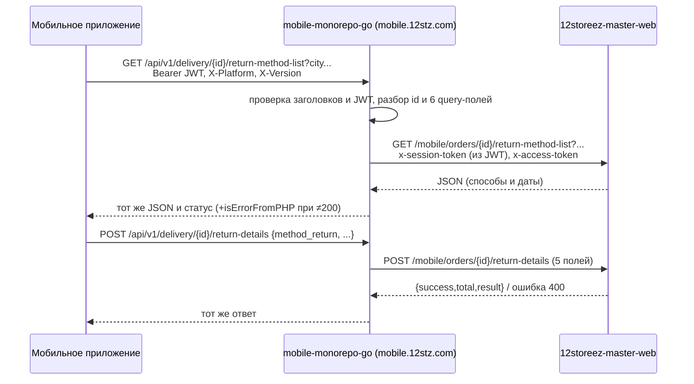

# Структура репозитория mobile-monorepo-go

**Назначение документа:** карта-справочник по кодовой базе `mobile-monorepo-go` (Mobile API Gateway на Go) для быстрого поиска при анализе требований.

**Дата актуализации:** 10.10.2026
**Сверено с кодом:** ветка `master`, коммит `f302aeba4b2cdaf3f0a489be3288206a5d617677` (06.10.2026, «Merge branch 'develop' into 'master'»)
**Путь к коду:** `C:\Users\RobotComp.ru\Desktop\12stz\mobile-monorepo-go\` (только чтение)
**Примечание:** структура описана по фактическому содержимому папок; назначение пакетов — по коду, названиям и godoc-аннотациям.

---

## 1. Назначение и общая архитектура

- **Что это:** HTTP-шлюз мобильного приложения («Mobile API Gateway» — `cmd/mobile_api/mobile_api.go:41-43`). Принимает запросы iOS/Android по путям `/api/v1/...` и `/api/v2/...`, проверяет JWT и заголовки и **в основном проксирует их в монолит** `12storeez-master-web` (пути `mobile/...`, `mobilev2/...`). Часть методов уходит по gRPC в микросервисы ESB (гео, логистика, мета, авторизация, Mindbox).
- **Собственной бизнес-логики и БД нет.** В коде нет подключения к БД, ORM, миграций или брокеров сообщений (в `go.mod` нет драйверов БД, Kafka или RabbitMQ). Шлюз работает без состояния.
- **Прод-хост:** `mobile.12stz.com` (`.deploy/helm/prod.values.yaml:4`). Это тот же хост, что в iOS-клиенте называется `BASE_URL_NEW` (`knowledge/12storeez-ios/repo-map.md`, §4.3). Легаси-хост `core.12stz.com` этим репозиторием **не** обслуживается — его код в `12stz/esb-monorepo` (см. [../esb-monorepo/repo-map.md](../esb-monorepo/repo-map.md)).
- **Стек:** Go 1.23 (`go.mod:3`), веб-фреймворк Fiber v2, HTTP-клиент resty, gRPC (контракты — пакет `github.com/12storeez/esb-protobufs`), логирование zap/`logzer`, Sentry, Swagger (swaggo), конфигурация через env (`envconfig`).
- **Зона ответственности по README** (`README.md`): authorization, cart, catalog, geo, metadata, notifications, orders, pages, products, profile, reviews, swagger, zabbix. Новая доменная область согласуется с командой BTS.

---

## 2. Корневые папки и файлы

| Путь | Назначение |
|---|---|
| `cmd/mobile_api/mobile_api.go` | **Точка входа**: инициализация конфигурации, Sentry, Fiber, middleware, gRPC- и HTTP-клиентов; **регистрация всех маршрутов** (`configureAPIV1`, `configureAPIV2`) |
| `config/config.go` | Структура конфигурации: env-переменные (`Server`, `Authorization`, `*GRPC`, `Site`, `Logistics`); `.env` подгружается через `gotenv` (`config.go:142-151`) |
| `internal/app/service/` | **Хендлеры HTTP** (слой «service»): по файлу на домен, каждый метод — `func(c *fiber.Ctx) error` с godoc/swagger-аннотациями |
| `internal/app/usecase/` | Обращения к gRPC-микросервисам (auth, delivery/логистика, geo, metadata, user/Mindbox) |
| `internal/app/helpers/` | Прокси в монолит (`site_proxy.go`) и в логистику (`logistics_proxy.go`), JWT (`jwt.go`), парсинг запросов, вызов resty (`common.go`), Mindbox (`mindbox.go`) |
| `internal/app/models/dto/<домен>/` | DTO запросов и ответов по доменам (auth, cart, delivery, geo, giftcard, logistics, order, payment(s), product, profile, reservation, …) |
| `internal/app/models/converters/` | Конвертеры protobuf → DTO (`auth.go`, `mindbox.go`) |
| `internal/app/constants/constants.go` | Имена заголовков (`X-Platform`, `X-Version`, `x-session-token`, `x-access-token`, `X-Device-Id`, IP-заголовки), константа `prod` |
| `internal/app/monitoring/monitoring.go` | Хендлеры `/ping` и `/health` |
| `internal/middlewares/` | Middleware: IP клиента (`client_ip.go` + единственный тест `client_ip_test.go`), проверка заголовков (`headers_validation.go`), логирование (`logging.go`), Sentry и трассировка (`sentry.go`) |
| `pkg/grpc_client/grpc_client.go` | Ленивые gRPC-клиенты: Logistics (WinnerService), Geo, Meta, Auth, Mindbox User/Mobile |
| `pkg/errors/` | Ошибки и маппинг gRPC ↔ HTTP |
| `docs/mobile_api/` | Сгенерированный Swagger (`swagger.yaml`, `swagger.json`, `docs.go`; генерация — `make build` / `swag init`, `Makefile`). Опубликован по `/swagger/*` |
| `.deploy/docker/Dockerfile`, `docker-compose.yml` | Сборка образа `hub.12stz.dev/apps/esb/mobile-monorepo-go/mobile-api`, порт 8080→80 |
| `.deploy/helm/*.values.yaml` | Helm-чарт и окружения (см. §6) |
| `.gitlab-ci.yml` | CI: lint → unit-тесты → сборка образа (kaniko) → ручной деплой в k8s (helm) |
| `.envexample` | Пример env-переменных. **Содержит значения, похожие на реальные ключи** (API-ключи gRPC/логистики, Sentry DSN); в справочник не переносятся |

---

## 3. Как регистрируются маршруты и хендлеры

1. `main()` создаёт `usecase.New(grpcClient, cfg, logger, restyClient)` и `service.New(uc, cfg, logger, restyClient)` (`cmd/mobile_api/mobile_api.go:123-124`).
2. `service.Service` (`internal/app/service/service.go:11-33`) — фасад с ленивыми геттерами по доменам: `Delivery()`, `Cart()`, `Order()`, `Giftcard()`, `User()`, `Auth()` и т.д.
3. Маршруты регистрируются в `mobile_api.go` прямо на группах Fiber: `apiV1 := app.Group("/api/v1")` (`:160`), `apiV2 := app.Group("/api/v2")` (`:259`), затем `group.Get/Post(...)` → `svc.<Домен>().<Метод>`.
4. **Цепочка middleware для `/api/v1`** (порядок важен):
   - глобально: `ClientIPSource`, `helmet`, `recover`, `cors`, Sentry (`:93-99`);
   - `LoggingMiddleware` (`:161`);
   - группа `/auth/*` — **без** проверки заголовков и JWT (`:165-176`);
   - `HeadersValidationMiddleware` — обязательны `X-Platform`/`Platform` и `X-Version`/`Version`, иначе 400 (`:178`, `internal/middlewares/headers_validation.go:8-25`);
   - `/errors/waf` — без JWT (`:181-184`);
   - `jwtMiddleware` — Bearer-JWT (HS, секрет `JWT_SECRET`); из claims в контекст кладутся `device_id`, `user_id` (`:186`, `:468-493`). Ошибка — 401 `{"error":{"message":"unauthorized"}}`.
   - Rate limiter создан, но **отключён** (закомментирован, `:162`, `:261`).
5. **`/api/v2`**: Logging → HeadersValidation → JWT (`:258-276`): корзина v2, `payment-types`, `PATCH /orders/{id}/change-payment-method`, подарочные карты v2.
6. Служебные маршруты без префикса: `/swagger/*`, `/ping`, `/health`, `/app-metrics`, `/debug/pprof/*` (кроме prod) (`:127`, `:141-149`). Prometheus `/metrics` — функция есть, вызов закомментирован (`:102`).

### 3.1. Перечень групп `/api/v1` (`cmd/mobile_api/mobile_api.go`)

| Группа | Строки | Куда идёт |
|---|---|---|
| `/auth` (settings, t-bank/login, generate-token, login, login/by-phone, logout, session) | 165-176 | монолит (`mobile/user/...`) + gRPC Auth, Mindbox |
| `/errors/waf` | 181-184 | логирование ошибок WAF |
| `/geo/countries/...`, `/geo/cities/:ip` | 187-192, 313-331 | gRPC Geo |
| `/metadata` (contacts, about, splash-screen-image) | 193-194, 278-282 | gRPC Meta; splash — монолит |
| `/reviews/offline-product` | 195-198 | монолит |
| `/delivery` (types, intervals, **`{order_id}/return-details`, `{order_id}/return-method-list`**) | 199-205 | монолит; intervals — gRPC Logistics |
| `/pickup/provider/:provider/points[/:point]` | 207-211 | HTTP логистика (`LOGISTICS_BASE_URL`) |
| `/products/...` | 213-214, 351-361 | монолит |
| `/cart/...` | 216-217, 363-414 | монолит |
| `/orders` (только `POST /` — создание заказа) | 219-220, 420-422 | монолит (`mobile/orders`) |
| `/giftcards/...` | 222-223, 424-436 | монолит |
| `/timezones`, `/payment`, `/payments`, `/pages`, `/reservation`, `/settings`, `/version`, `/notification`, `/users`, `/profile/bind-phone` | 225-255 | монолит; `/users/bonuses*` — gRPC Mindbox |

> **Важно для анализа заказов и возвратов:** просмотр заказа (`GET orders/{id}`), список заказов, отмена, `POST orders/{id}/return`, причины возврата **в этом шлюзе не зарегистрированы** — из заказов здесь только `POST /api/v1/orders` и `PATCH /api/v2/orders/{id}/change-payment-method`. Эти методы iOS вызывает через легаси-хост `core.12stz.com` (см. `knowledge/12storeez-ios/repo-map.md`), который этот репозиторий не обслуживает.

---

## 4. Интеграции

| Система | Протокол | Направление | Где в коде | Назначение |
|---|---|---|---|---|
| **Монолит `12storeez-master-web`** | HTTP/JSON (resty) | шлюз → монолит | `internal/app/helpers/site_proxy.go:21-102` (`ProxyToSite`), `:105-192` (`ProxyToSiteAuth`); базовый URL `SITE_BASE_URL` / `SITE_BASE_INTERNAL_URL` (`config/config.go:42-43`); пути — `SITE_*_PATH` (`config/config.go:44-131`, значения — `.deploy/helm/values.yaml:26-108`) | Основной бэкенд почти для всех методов: корзина, заказы, сертификаты, товары, профиль, возвраты |
| gRPC **Logistics** (WinnerService) | gRPC (TLS опционально) | шлюз → сервис | `pkg/grpc_client/grpc_client.go:44-64`, `internal/app/usecase/delivery.go:26` | Интервалы доставки |
| HTTP **Logistics** | HTTP/JSON, `Authorization` из `LOGISTICS_ACCESS_TOKEN` | шлюз → сервис | `internal/app/helpers/logistics_proxy.go:22-64`, `internal/app/service/pickup.go:49,86` | ПВЗ: список и карточка точки |
| gRPC **Geo** | gRPC TLS | шлюз → сервис | `pkg/grpc_client/grpc_client.go:66-80`, `internal/app/usecase/geo.go` | Страны, города, адреса, город по IP или телефону |
| gRPC **Meta** | gRPC TLS | шлюз → сервис | `pkg/grpc_client/grpc_client.go:82-96`, `internal/app/usecase/metadata.go:29,46` | Контакты, «О нас» |
| gRPC **Auth** (`auth-go-ms`) | gRPC без TLS (внутри кластера) | шлюз → сервис | `pkg/grpc_client/grpc_client.go:130-144`, `internal/app/usecase/auth.go:46-69` | Настройки авторизации, вход через Т-Банк |
| gRPC **Mindbox** (`mindbox-srv-go`) | gRPC без TLS | шлюз → сервис | `pkg/grpc_client/grpc_client.go:98-128`, `internal/app/usecase/auth.go:105-235`, `internal/app/usecase/user.go:31,49` (`MindboxUser().Info` / `.Orders`) | Инициализация клиента, коды подтверждения, бонусы и история |
| Sentry | HTTPS SDK | шлюз → Sentry | `cmd/mobile_api/mobile_api.go:63-76`, `internal/middlewares/sentry.go` | Ошибки и трейсинг (sample 0.4) |
| Прочее наблюдение | HTTP | входящие | `/ping`, `/health`, `/app-metrics` | Мониторинг (в README упомянут zabbix) |

**Чего нет в коде:** прямых обращений к 1С, RetailCRM, `esb-monorepo` (кроме общих protobuf-контрактов `esb-protobufs`), к БД, Redis, Kafka и RabbitMQ.

### 4.1. Как шлюз ходит в монолит (`ProxyToSite`)

- Берёт `session_token` из claims JWT и передаёт его в монолит заголовком `x-session-token`. Добавляет сервисный `x-access-token` (`SITE_ACCESS_TOKEN`) (`site_proxy.go:32-43`). По этому токену монолит находит сессию пользователя (`12storeez-master-web/src/Modules/Mobile/Controllers/ApiBaseController.php:627`, `Repository/UserMobileSessionRepository.php:21`).
- Пробрасывает `x-platform`, `x-version` (или `Version`), `Cookie`, `X-Real-IP` (вычисляется из `X-Original-Forwarded-For` / `X-Qrator-Ip-Source` / `X-Forwarded-For`), `User-Agent`, `X-Device-Id`, `Referer` (`site_proxy.go:45-69`, `:209-251`).
- Тело — переданное хендлером, иначе исходное тело запроса. Если `isCrutch=false`, к запросу добавляются исходные query-параметры клиента (`:71-79`; флаг временный, задача DEVIOS-1224).
- Ответ монолита декодируется как JSON и отдаётся клиенту с тем же HTTP-статусом. При статусе ≠ 200 в тело добавляется `"isErrorFromPHP": true` (`:90-101`).

---

## 5. Эндпоинты возврата `v1/delivery/{orderId}/...` — **реализованы здесь**

Оба метода — **тонкий прокси** в монолит. Собственной логики возврата в шлюзе нет: он только меняет внешний путь `/api/v1/delivery/{id}/...` на внутренний `mobile/orders/{id}/...`.

### 5.1. `GET /api/v1/delivery/{order_id}/return-method-list` — способы возврата

| Что | Где / значение |
|---|---|
| Маршрут | `cmd/mobile_api/mobile_api.go:204` — `delivery.Get("/:order_id<int>/return-method-list", svc.Delivery().GetOrderReturnMethods)`; `order_id` — только целое число |
| Защита | `HeadersValidationMiddleware` (`X-Platform`, `X-Version`) + JWT Bearer (`mobile_api.go:178,186`) |
| Хендлер | `internal/app/service/delivery.go:166-191` (`deliveryService.GetOrderReturnMethods`), swagger-аннотации `:139-165` |
| Path | `order_id` int (`internal/app/models/dto/delivery/get_order_return_methods.go:3-5`) |
| Query (только эти 6) | `country_iso`, `region`, `region_id`, `city`, `city_id`, `city_fias` (`get_order_return_methods.go:7-14`). Хендлер пересобирает query только из этих полей и вызывает прокси с `isCrutch=true` (`delivery.go:176-190`), поэтому другие query-параметры клиента в монолит **не передаются** |
| Куда идёт | `GET {SITE_BASE_URL}/mobile/orders/{order_id}/return-method-list?<query>` — шаблон `SITE_ORDER_GET_RETURN_METHODS` (`config/config.go:112`; значение `mobile/orders/%d/return-method-list` — `.deploy/helm/values.yaml:97`) |
| Обработчик в монолите | `12storeez-master-web/src/Modules/Mobile/Rules/UrlRule.php:77-79` → `src/Modules/Mobile/Controllers/OrdersController.php:1327-1370` (`actionReturnMethodList`): пользователь по сессии → заказ по `id` + `user_id` → `ReturnMethodListRequestDto` → `returnDetailsServiceFacade->getReturnMethodsList()` → трансформер |
| Ответ (DTO шлюза, для swagger) | `{ success, result: [ { method, method_type, title, description, active, active_mobile, available_dates_return[] } ] }` (`get_order_return_methods.go:16-27`). Фактически шлюз отдаёт тело монолита как есть, DTO на ответ не применяется |
| Ошибки | 400 — ошибка разбора path/query в шлюзе (`delivery.go:171-180`); 500 — ошибка кодирования query (`:182-186`) или ответ монолита не в JSON (`site_proxy.go:92-95`); статусы монолита пробрасываются с `isErrorFromPHP: true` |

### 5.2. `POST /api/v1/delivery/{order_id}/return-details` — сохранить способ, адрес и дату возврата

| Что | Где / значение |
|---|---|
| Маршрут | `cmd/mobile_api/mobile_api.go:203` — `delivery.Post("/:order_id<int>/return-details", svc.Delivery().SaveOrderReturnDetails)` |
| Защита | как в 5.1 |
| Хендлер | `internal/app/service/delivery.go:112-137` (`deliveryService.SaveOrderReturnDetails`), swagger `:90-111` |
| Path | `order_id` int (`internal/app/models/dto/delivery/save_order_return_details.go:23-25`) |
| Тело (только эти 5) | `method_return`, `city_return`, `index_return`, `address_return`, `date_return` — все строки (`save_order_return_details.go:27-33`). Тело разбирается в DTO и сериализуется заново (`delivery.go:123-132`), поэтому **другие поля в монолит не уходят**. Валидации значений в шлюзе нет |
| Куда идёт | `POST {SITE_BASE_URL}/mobile/orders/{order_id}/return-details` — шаблон `SITE_ORDER_SAVE_RETURN_DETAILS` (`config/config.go:111`; значение `mobile/orders/%d/return-details` — `.deploy/helm/values.yaml:96`); query клиента пробрасываются (`isCrutch=false`, `delivery.go:136`) |
| Обработчик в монолите | `UrlRule.php:72-74` → `OrdersController.php:1258-1319` (`actionReturnDetails`): пользователь → заказ по `id` + `user_id` → если `method_return` пуст, по умолчанию `courier` (ECOMDEV-1126) → `ReturnDetailsDto` → `returnDetailsValidatorFacade->validate()` → `orderService->updateOrderReturnDetails()` |
| Ответ 200 | `{ success, total, result: {} }` (`save_order_return_details.go:3-8`) |
| Ответ 400 | `{ success:false, result: { error_code, error_text, error_data:[{target, code, message}] } }` (`save_order_return_details.go:10-21`) |

### 5.3. Схема

---

## 6. Конфигурация и окружения

| Окружение | Хост | Файл |
|---|---|---|
| dev | `mobile-dev.12stz.dev` | `.deploy/helm/dev.values.yaml:3-4` |
| fix | `mobile-fix.12stz.dev` | `.deploy/helm/fix.values.yaml:3-4` |
| sandbox | `mobile-sandbox.12stz.dev` | `.deploy/helm/sandbox.values.yaml:3-4` |
| mobiledev | `mobile-mobiledev.12stz.dev` | `.deploy/helm/mobiledev.values.yaml:3-4` |
| stg | `mobile-stg.12stz.dev` | `.deploy/helm/stg.values.yaml:3-4` |
| prod | `mobile.12stz.com` (4 реплики) | `.deploy/helm/prod.values.yaml:3-5,25` |

- Общие несекретные переменные (пути монолита и логистики) — ConfigMap в `.deploy/helm/values.yaml:20-111`. Секреты (`JWT_SECRET`, `SITE_ACCESS_TOKEN`, `SITE_BASE_URL`, адреса и ключи gRPC и т.п.) — из Vault: `esb/mobile-monorepo-go/<env>/envs` (`values.yaml:208-227`).
- Ingress и Istio пропускают в сервис только префиксы `/api/v1`, `/api/v2`, `/swagger`, `/metrics`, `/app-metrics`, `/ping`, `/health` (`values.yaml:155-258`). На ingress есть whitelist IP (`values.yaml:8`, `:160`).
- В `.envexample` `SITE_BASE_URL=http://monolith-nginx` (`.envexample:1`) — шлюз обращается к монолиту по внутреннему адресу.
- HTTP-транспорт: таймаут соединения 30 с, TLS handshake 10 с, до 20 соединений на хост (`mobile_api.go:108-121`). Общий таймаут запроса к монолиту в resty не задан.
- CI/CD: `.gitlab-ci.yml` — деплой в любое окружение кроме prod вручную из MR, `develop` или `master`; в prod — вручную по тегу `vX.Y.Z`.

---

## 7. Где искать типичные вещи

| Вопрос | Где |
|---|---|
| Какой путь шлюза → какой хендлер | `cmd/mobile_api/mobile_api.go` (функции `configureAPIV1`/`V2`, `set*Routes`) |
| Что делает хендлер, куда проксирует | `internal/app/service/<домен>.go` — godoc `@Description Proxy to http ...` и `cfg.Site.<...>Path` |
| Во что превращается путь в монолите | `config/config.go` (имя env) → `.deploy/helm/values.yaml` (значение `mobile/...`) → в монолите `src/Modules/Mobile/Rules/UrlRule.php` / `config/url.php` |
| Контракт запроса и ответа | `internal/app/models/dto/<домен>/`, `docs/mobile_api/swagger.yaml` (копия у нас — `knowledge/12storeez-master-web/api/mobile/mobile-gateway_swagger.yaml`) |
| Авторизация, JWT, заголовки | `mobile_api.go:468-493`, `internal/app/helpers/jwt.go`, `internal/middlewares/headers_validation.go`, `internal/app/constants/constants.go` |
| gRPC-вызовы микросервисов | `internal/app/usecase/*.go`, `pkg/grpc_client/grpc_client.go` |
| Окружения и хосты | `.deploy/helm/<env>.values.yaml` |

---

## 8. Неопределённости и открытые вопросы

- [ ] Фактическое значение `SITE_BASE_URL` в stg и prod лежит в Vault и в репозитории не видно. Через какой хост и nginx шлюз попадает в монолит, по коду не подтвердить.
- [x] Чем обслуживается легаси-хост `core.12stz.com` (карточка заказа, `orders/{id}/return`, причины возврата)? Ответ: `12stz/esb-monorepo`, методы возврата — [../esb-monorepo/repo-map.md](../esb-monorepo/repo-map.md) §8.1 (10.10.2026).
- [ ] Swagger шлюза объявляет `country_iso` и `region` для `return-method-list` как `in: path` (`internal/app/service/delivery.go:154-155`), хотя это query-параметры (DTO `get_order_return_methods.go:8-9`). Это дефект аннотации, на работу кода не влияет.
- [ ] Тестов на хендлеры нет (единственный тест — `internal/middlewares/client_ip_test.go`), хотя CI объявляет порог покрытия 90% (`.gitlab-ci.yml:19`).

---

## История изменений

| Версия | Дата | Автор | Изменение |
|---|---|---|---|
| 1.0 | 10.10.2026 | repository-researcher | Первичная карта по коммиту `f302aeb`; найдена реализация `v1/delivery/{id}/return-method-list` и `return-details` (прокси в монолит) |
| 1.1 | 10.10.2026 | Системный аналитик | Легаси-хост `core.12stz.com` = `12stz/esb-monorepo`: §1, §8 — ссылки на его карту |
