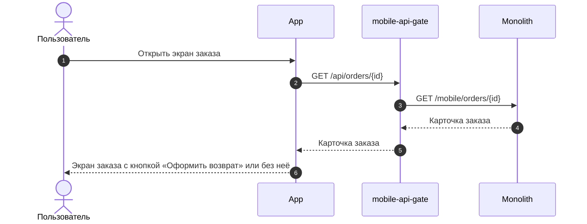
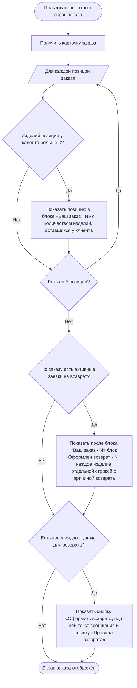

### Отобразить кнопку оформления возврата на экране заказа US 1.1

Как клиент, совершивший покупку, я хочу иметь возможность начать оформление возврата из карточки заказа, чтобы самостоятельно оформить возврат без обращения в поддержку

### Дизайн

Ссылка на Figma: https://www.figma.com/design/u5Fe5N4lypCdqgZn6533F2/%F0%9F%93%B1-06.-Profile--Redesign-?node-id=7985-73307&t=qoHbaQAbTlMNGNZX-4

### Сценарий

#### Предусловие

1. Пользователь авторизован

#### Основная последовательность "Отобразить кнопку оформления возврата на экране заказа"

| Шаг | Исполнитель | Описание |
|---|---|---|
| 1 | Пользователь | Открывает экран заказа |
| 2 | APP | Вызвать метод `GET /получить карточку заказа` (`GET /api/orders/{id}`) |
| 3 | APP | Отобразить в блоке «Ваш заказ · N» позиции заказа с количеством изделий, оставшихся у клиента (`items[].remaining_quantity`, TBD). N — число строк в блоке, одна строка — одна позиция  **Опционально** 1. Если у клиента не осталось изделий позиции (`items[].remaining_quantity = 0`, TBD), то позицию в блоке «Ваш заказ · N» не отображать |
| 4 | APP | Отобразить после блока «Ваш заказ · N» блок «Оформлен возврат · N»: каждое изделие позиций в активных заявках на возврат (`items[].return_items`, TBD) — отдельной строкой с выбранной причиной возврата. N — число строк в блоке, одна строка — одно изделие  **Опционально** 1. Если по заказу нет активных заявок на возврат, то блок «Оформлен возврат · N» не отображать |
| 5 | APP | Отобразить кнопку «Оформить возврат», если в ответе метода `GET /получить карточку заказа` есть сообщение со статусом `can_be_returned`  **Опционально** 1. Если сообщения нет, то кнопку не отображать |
| 6 | APP | Отобразить под кнопкой текст `messages[].message` элемента со `status = "can_be_returned"` — «Можно вернуть изделия до [Дата]» — и ссылку «Правила возврата»  **Опционально** 1. Если кнопка «Оформить возврат» не отображается, то текст и ссылку «Правила возврата» не отображать |

**Примечание**

1. В списке заказов признак возврата не отображается: клиент видит оформленный возврат только на экране заказа.

### Взаимодействие компонентов

### Логика сценария

### Логика бэкенда

**`GET /получить карточку заказа` (`GET /api/orders/{id}`) — доработка метода**

1. Срок возврата: для клиентов F&F — 30 дней с даты получения заказа, для остальных — 14 дней, как сейчас. Отдавать последний день оформления заявки (`return.request_until_date`, TBD). Проверять срок для заказа и позиций по этой дате вместо текущей проверки 14 дней.
2. Текст сообщения `can_be_returned` — «Можно вернуть изделия до [Дата]» изменить на реальную дату, а не упоминание про 14 дней. [Дата] — последний день оформления заявки (`return.request_until_date`, TBD).
3. По каждой позиции отдавать данные по заявкам на возврат — по таблице «Данные позиции для возврата». Позицию с активной заявкой вернуть нельзя, даже если у клиента остались её изделия.
4. Признак `return.is_bank_data_required` = `true` также, если заказ полностью или частично оплачен подарочным сертификатом (US 1.4).
5. Отдавать текст о том, куда вернутся деньги (`return.refund.message`, TBD, US 1.4), если банковские реквизиты не нужны.
6. Отдавать адрес, пункт выдачи или магазин, куда был доставлен заказ (`order_delivery`, TBD, US 1.3).
7. Сообщение со статусом `can_be_returned` возвращать, только если хотя бы одну позицию заказа можно вернуть (`items[].can_be_returned = true`).

**Данные позиции для возврата**

| Поле | Что означает | Как считается | Где используется |
|---|---|---|---|
| `items[].return_items`, TBD | Изделия позиции, оформленные в возврат | Каждое изделие в активной заявке — отдельная запись с причиной возврата (`reason_title`, TBD). Если причина не выбрана — название группы причин | Блок «Оформлен возврат · N» |
| `items[].remaining_quantity`, TBD | Сколько изделий позиции осталось у клиента | Количество в позиции минус изделия в возврате. *Считается всегда, даже если вернуть позицию нельзя* | Блок «Ваш заказ · N» |
| `items[].can_be_returned` | Можно ли оформить возврат по позиции | `true`, если выполнены текущие проверки и: 1. Последний день оформления заявки (`return.request_until_date`, TBD) не прошёл 2. По позиции нет активной заявки | Сообщение «Можно вернуть изделия до [Дата]», экран «Выберите изделия» |
| `items[].available_return_quantity`, TBD | Сколько изделий позиции можно выбрать к возврату | Если позицию можно вернуть — равно `remaining_quantity`, иначе 0 | Экран «Выберите изделия» |

**Пример:** в позиции 3 изделия

| Поле | Заявок нет | Изделие в активной заявке |
|---|---|---|
| `return_items` | пусто | 1 изделие |
| `remaining_quantity` | 3 | 2 |
| `can_be_returned` | `true` | `false` |
| `available_return_quantity` | 3 | 0 |

### Задачи

| Название | Ссылка |
|---|---|
| Доработать метод получения информации по заказу | https://tracker.yandex.ru/ECOMDEV-2343 |

