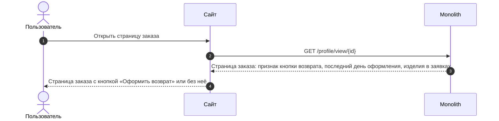
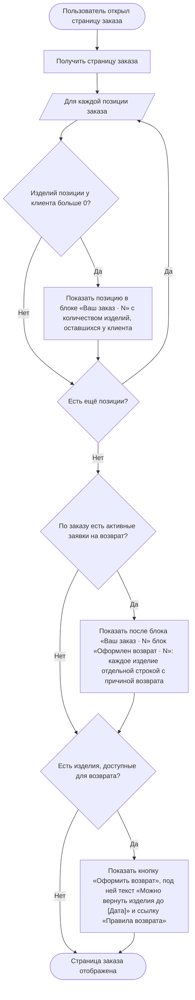

### Отобразить кнопку оформления возврата на странице заказа US 1.1

Как клиент, совершивший покупку, я хочу иметь возможность начать оформление возврата из карточки заказа, чтобы самостоятельно оформить возврат без обращения в поддержку

### Дизайн

Макеты: [web/v1 Создание возврата](<../../sources/mockups/web/v1 Создание возврата/>), макет 1

### Сценарий

#### Предусловие

1. Пользователь авторизован

#### Основная последовательность "Отобразить кнопку оформления возврата на странице заказа"

| Шаг | Исполнитель | Описание |
|---|---|---|
| 1 | Пользователь | Открывает страницу заказа |
| 2 | Сайт | Вызвать метод `GET /получить страницу заказа` (`GET /profile/view/{id}`) |
| 3 | Сайт | Отобразить в блоке «Ваш заказ · N» позиции заказа с количеством изделий, оставшихся у клиента (`positions[].remaining_quantity`, TBD). N — число строк в блоке, одна строка — одна позиция  **Опционально** 1. Если у клиента не осталось изделий позиции (`positions[].remaining_quantity = 0`, TBD), то позицию в блоке «Ваш заказ · N» не отображать |
| 4 | Сайт | Отобразить после блока «Ваш заказ · N» блок «Оформлен возврат · N»: каждое изделие позиций в активных заявках на возврат (`positions[].return_items`, TBD) — отдельной строкой с выбранной причиной возврата. N — число строк в блоке, одна строка — одно изделие  **Опционально** 1. Если по заказу нет активных заявок на возврат, то блок «Оформлен возврат · N» не отображать |
| 5 | Сайт | Отобразить в блоке «Статус» кнопку «Оформить возврат», если `status.show_refund_button = true`  **Опционально** 1. Если `status.show_refund_button = false`, то кнопку не отображать |
| 6 | Сайт | Отобразить под кнопкой текст «Можно вернуть изделия до [Дата]», где [Дата] — последний день оформления заявки (`status.request_until_date`, TBD), и ссылку «Правила возврата»  **Опционально** 1. Если кнопка «Оформить возврат» не отображается, то текст и ссылку «Правила возврата» не отображать |

**Примечание**

1. В списке заказов признак возврата не отображается: клиент видит оформленный возврат только на странице заказа.

### Взаимодействие компонентов

### Логика сценария

### Логика бэкенда

**`GET /получить страницу заказа` (`GET /profile/view/{id}`) — доработка метода**

* логика — [SRS МП, US 1.1](./srs-mobile-mvp.md), метод `GET /получить карточку заказа`: срок возврата, данные позиции для возврата
* отдавать последний день оформления заявки (`status.request_until_date`, TBD)
* признак кнопки возврата (`status.show_refund_button`) — по общему расчёту вместо текущей проверки 14 дней: `true`, если хотя бы одну позицию заказа можно вернуть (`items[].can_be_returned = true` в SRS МП), иначе `false`
* по каждой позиции отдавать данные для возврата — по таблице «Данные позиции для возврата»

**Данные позиции для возврата**

| Поле сайта | Поле в SRS МП | Где используется |
|---|---|---|
| `positions[].return_items`, TBD | `items[].return_items` | Блок «Оформлен возврат · N» |
| `positions[].remaining_quantity`, TBD | `items[].remaining_quantity` | Блок «Ваш заказ · N» |
| в ответе по позиции не отдаётся | `items[].can_be_returned` | Кнопка «Оформить возврат» (`status.show_refund_button`); отбор позиций в методе `GET /получить позиции для возврата` (US 1.2) |
| `data.positions[].available_return_quantity`, TBD — в ответе метода `GET /получить позиции для возврата` (US 1.2) | `items[].available_return_quantity` | Число строк позиции на экране выбора изделий (US 1.2) |

### Задачи

| Название | Ссылка |
|---|---|

