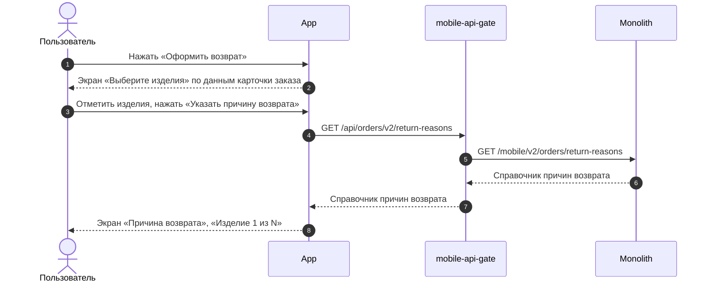
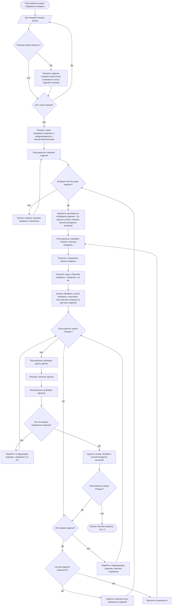

### Выбрать изделия и причины возврата US 1.2

Как клиент, оформляющий возврат, я хочу выбрать одно или несколько изделий из заказа и указать причину возврата для каждого выбранного изделия, чтобы сформировать возврат только для тех изделий, которые я хочу вернуть

### Дизайн

Ссылка на Figma: https://www.figma.com/design/u5Fe5N4lypCdqgZn6533F2/%F0%9F%93%B1-06.-Profile--Redesign-?node-id=7240-60450&t=qoHbaQAbTlMNGNZX-4

### Сценарий

#### Предусловие

1. На экране заказа отображается кнопка «Оформить возврат» (US 1.1)

#### Основная последовательность "Выбрать изделия и причины возврата"

| Шаг | Исполнитель | Описание |
|---|---|---|
| 1 | Пользователь | Нажимает «Оформить возврат» |
| 2 | APP | Отобразить экран «Выберите изделия» по данным ответа метода `GET /получить карточку заказа` |
| 2.1 | APP | Отобразить позиции, у которых `items[].can_be_returned = true`  **Опционально** 1. Если `items[].can_be_returned = false`, то позицию не отображать |
| 2.2 | APP | Отобразить каждое изделие позиции отдельной строкой. Количество строк — число изделий позиции к выбору (`items[].available_return_quantity`, TBD) |
| 2.3 | APP | Отобразить предупреждение о необходимости вернуть изделия в полной комплектации |
| 3 | Пользователь | Отмечает чекбоксами изделия |
| 4 | APP | Изменить заголовок экрана на «Выберите изделия · N», где N — число выбранных изделий. Сделать кнопку «Указать причину возврата» активной  **Опционально** 1. Если не выбрано ни одного изделия, то кнопка «Указать причину возврата» неактивна |
| 5 | Пользователь | Нажимает «Указать причину возврата» |
| 6 | APP | Вызвать метод `GET /получить справочник причин возврата` (`GET /api/orders/v2/return-reasons`) |
| 7 | APP | Отобразить экран «Причина возврата» с подзаголовком «Изделие 1 из N» |
| 8 | Пользователь | Выбирает группу причин в выпадающем списке |
| 9 | APP | Отобразить список причин выбранной группы |
| 10 | Пользователь | Выбирает причину |
| 11 | APP | Перейти к следующему выбранному изделию и изменить подзаголовок на «Изделие K из N», где K — номер изделия. Шаги 8–10 повторяются для каждого выбранного изделия  **Опционально** 1. Если пользователь нажал «Назад», то перейти к предыдущему изделию. Выбранная причина сохраняется, её можно изменить 2. Если пользователь нажал «Назад» на первом изделии, то вернуться к экрану «Выберите изделия» |
| 12 | APP | После выбора причины для последнего изделия сделать кнопку «Выбрать способ возврата» активной  **Опционально** 1. Если причина указана не для всех выбранных изделий, то кнопка «Выбрать способ возврата» неактивна 2. Если пользователь вернулся к экрану «Выберите изделия» и изменил состав изделий, то сбросить причины. Причины указываются заново, начиная с шага 5. Вернуться можно с экранов «Причина возврата» и «Оформление возврата» |

### Взаимодействие компонентов

### Логика сценария

### Логика бэкенда

**Справочник причин и групп возврата — обновление данных**

1. Актуализировать существующий справочник причин возврата в таблицах `cms_return_reasons` и `cms_return_reasons_groups` согласно таблице [«Причины возвратов»](https://docs.google.com/spreadsheets/u/1/d/1bBBNP4z9KuJfFFw6_zToKsN-TS_cBT0x/edit?gid=175594683#gid=175594683): обновить названия существующих причин и добавить новые причины. Существующую структуру справочника, коды причин и механизм их обработки не изменять. Справочник общий для сайта и мобильного приложения.

### Задачи

| Название | Ссылка |
|---|---|

