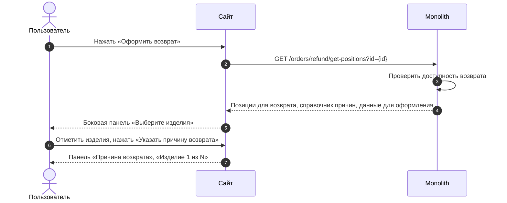
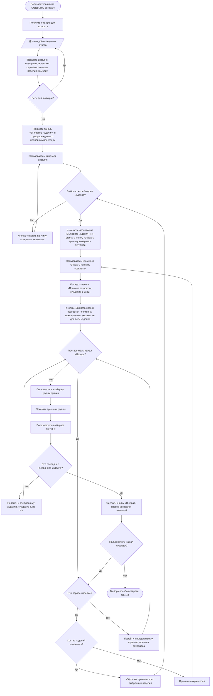

### Выбрать изделия и причины возврата US 1.2

Как клиент, оформляющий возврат, я хочу выбрать одно или несколько изделий из заказа и указать причину возврата для каждого выбранного изделия, чтобы сформировать возврат только для тех изделий, которые я хочу вернуть

### Дизайн

Макеты: [web/v1 Создание возврата](<../../sources/mockups/web/v1 Создание возврата/>), макеты 2–6, 29

### Сценарий

#### Предусловие

1. На странице заказа отображается кнопка «Оформить возврат» (US 1.1)

#### Основная последовательность "Выбрать изделия и причины возврата"

| Шаг | Исполнитель | Описание |
|---|---|---|
| 1 | Пользователь | Нажимает «Оформить возврат» |
| 2 | Сайт | Вызвать метод `GET /получить позиции для возврата` (`GET /orders/refund/get-positions?id={id}`) |
| 3 | Сайт | Отобразить панель «Выберите изделия» по данным ответа метода `GET /получить позиции для возврата` |
| 3.1 | Сайт | Отобразить каждое изделие позиции отдельной строкой. Количество строк — число изделий позиции к выбору (`data.positions[].available_return_quantity`, TBD) |
| 3.2 | Сайт | Отобразить предупреждение о необходимости вернуть изделия в полной комплектации |
| 4 | Пользователь | Отмечает чекбоксами изделия |
| 5 | Сайт | Изменить заголовок панели на «Выберите изделия · N», где N — число выбранных изделий. Сделать кнопку «Указать причину возврата» активной  **Опционально** 1. Если не выбрано ни одного изделия, то кнопка «Указать причину возврата» неактивна |
| 6 | Пользователь | Нажимает «Указать причину возврата» |
| 7 | Сайт | Отобразить панель «Причина возврата» с подзаголовком «Изделие 1 из N» |
| 8 | Пользователь | Выбирает группу причин в выпадающем списке |
| 9 | Сайт | Отобразить список причин выбранной группы |
| 10 | Пользователь | Выбирает причину |
| 11 | Сайт | Перейти к следующему выбранному изделию и изменить подзаголовок на «Изделие K из N», где K — номер изделия. Шаги 8–10 повторяются для каждого выбранного изделия  **Опционально** 1. Если пользователь нажал «Назад», то перейти к предыдущему изделию. Выбранная причина сохраняется, её можно изменить 2. Если пользователь нажал «Назад» на первом изделии, то вернуться к панели «Выберите изделия» |
| 12 | Сайт | После выбора причины для последнего изделия сделать кнопку «Выбрать способ возврата» активной  **Опционально** 1. Если причина указана не для всех выбранных изделий, то кнопка «Выбрать способ возврата» неактивна 2. Если пользователь вернулся к панели «Выберите изделия» и изменил состав изделий, то сбросить причины. Причины указываются заново, начиная с шага 6. Вернуться можно с панелей «Причина возврата» и «Оформление возврата» |

### Взаимодействие компонентов

### Логика сценария

### Логика бэкенда

**Справочник причин и групп возврата — обновление данных**

* актуализировать существующий справочник причин возврата в таблицах `cms_return_reasons` и `cms_return_reasons_groups` согласно таблице [«Причины возвратов»](https://docs.google.com/spreadsheets/u/1/d/1bBBNP4z9KuJfFFw6_zToKsN-TS_cBT0x/edit?gid=175594683#gid=175594683): обновить названия существующих причин и добавить новые причины. Существующую структуру справочника, коды причин и механизм их обработки не изменять. Справочник общий для сайта и мобильного приложения

**`GET /получить позиции для возврата` (`GET /orders/refund/get-positions?id={id}`) — доработка метода**

* логика — [SRS МП, US 1.1](./srs-mobile-mvp.md): доступность возврата и данные позиции для возврата
* рассчитывать доступность возврата при каждом запросе: форма может быть открыта спустя время после открытия страницы заказа
* подарок определять по признаку подарка, а не по цене
* отдавать только позиции, которые можно вернуть, и число изделий к выбору (`data.positions[].available_return_quantity`, TBD) — по таблице «Данные позиции для возврата» US 1.1. Если возврат по заказу недоступен, отдавать пустой список позиций
* отдавать текст о том, куда вернутся деньги (`data.refund.message`, TBD), если банковские реквизиты не нужны, и адрес, пункт выдачи или магазин доставки заказа (`data.order_delivery`, TBD)
* признак банковских реквизитов (`data.need_bank_details`) — [SRS МП, US 1.1](./srs-mobile-mvp.md): реквизиты нужны, если заказ оплачен при получении или полностью или частично подарочным сертификатом. Сейчас на сайте признак `true` для всех способов оплаты, кроме онлайн-оплаты: текущий расчёт заменить общим

### Задачи

| Название | Ссылка |
|---|---|

