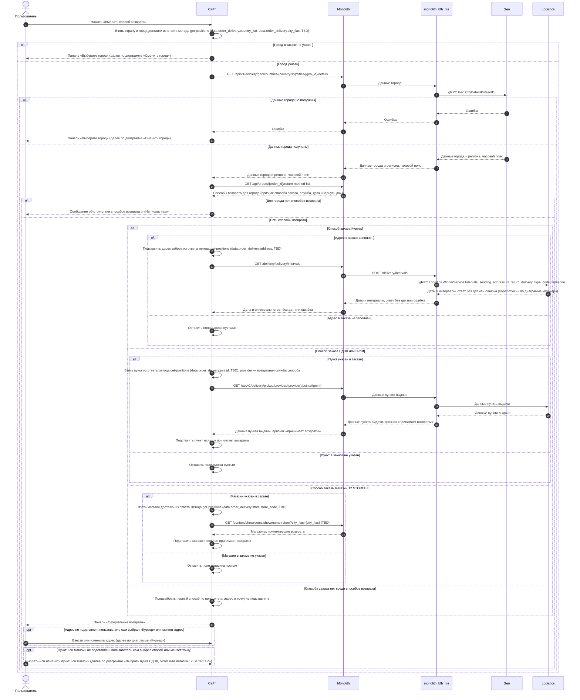
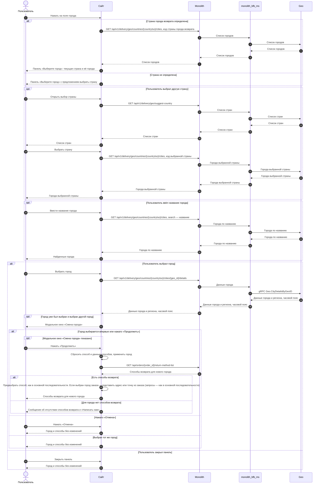
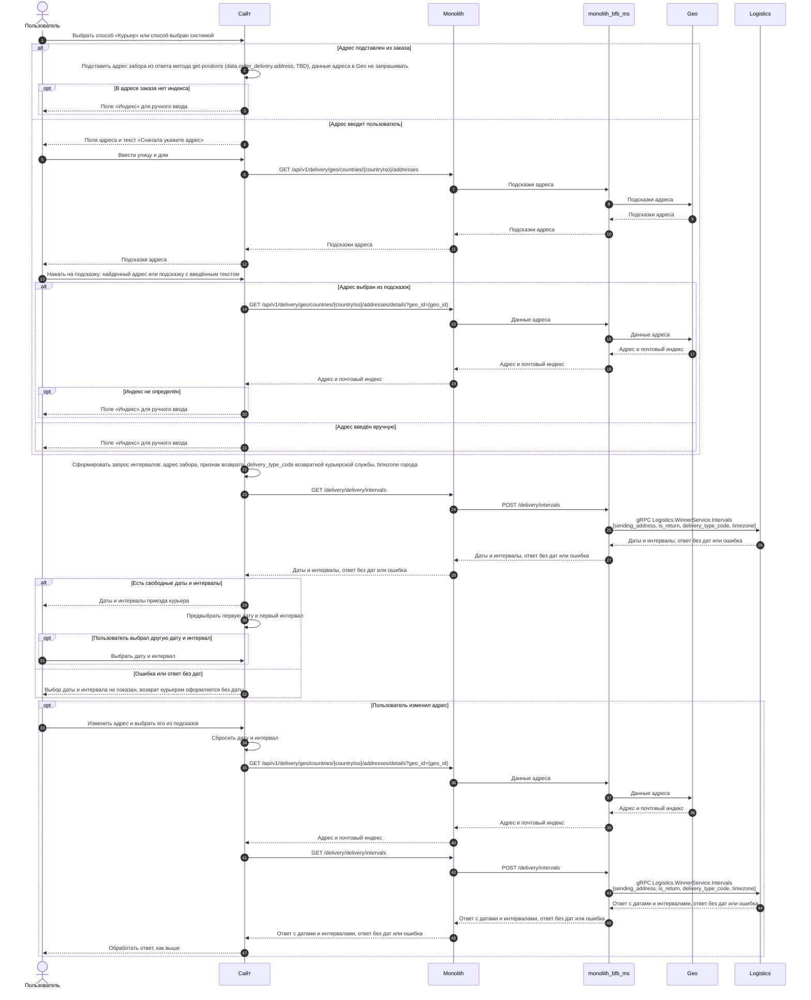
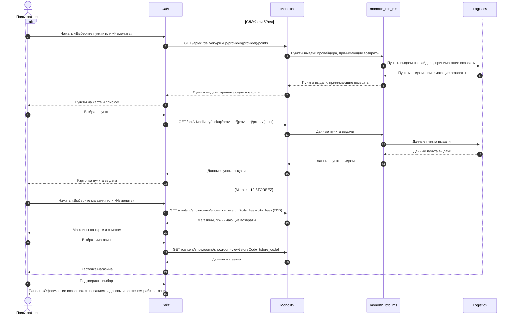
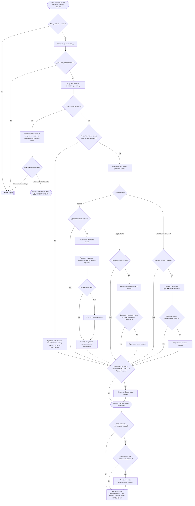
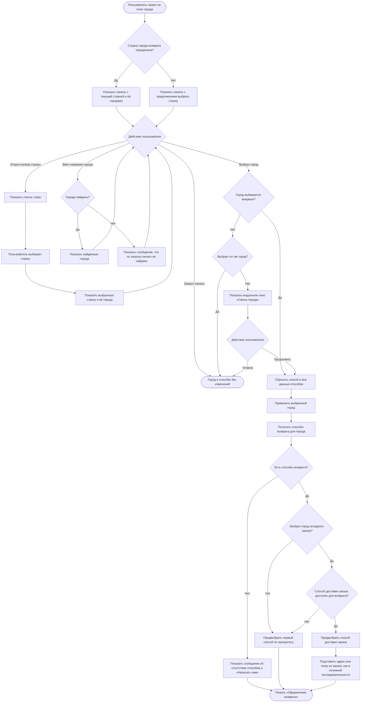
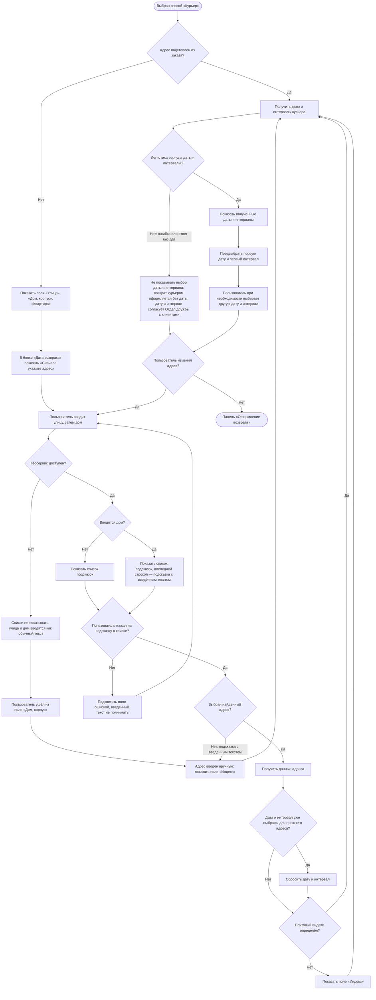
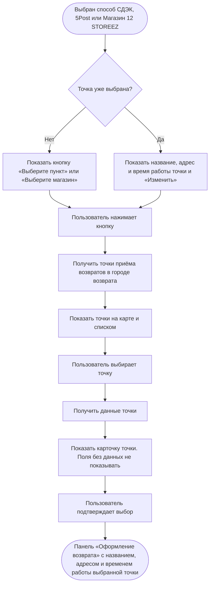
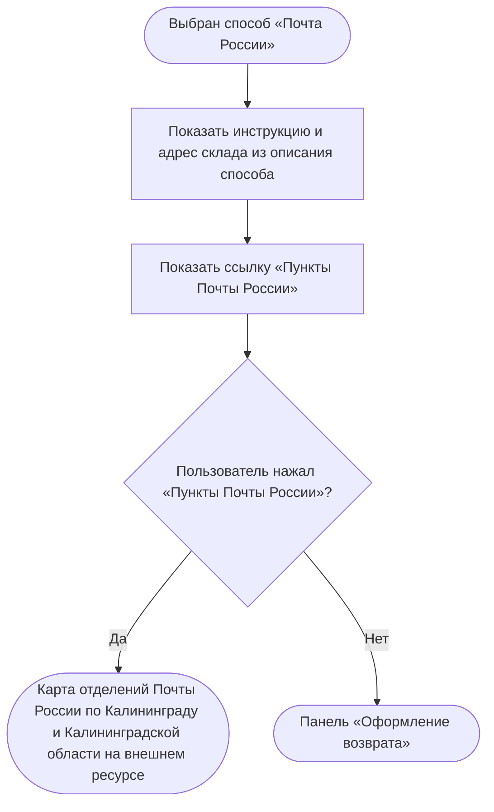

### Выбрать способ возврата US 1.3

Как клиент, оформляющий возврат, я хочу выбрать способ возврата товаров, чтобы успешно завершить оформление заявки на возврат

### Дизайн

Макеты: [web/v1 Создание возврата](<../../sources/mockups/web/v1 Создание возврата/>), макеты 7–9, 12–20, 22, 23, 25–28

### Сценарий

#### Предусловие

1. Пользователь указал причины возврата для всех выбранных изделий (US 1.2)

#### Основная последовательность "Выбрать способ возврата"

| Шаг | Исполнитель | Описание |
|---|---|---|
| 1 | Пользователь | Нажимает «Выбрать способ возврата» |
| 2 | Сайт | Определить город возврата: взять страну и город доставки заказа (`data.order_delivery.country_iso`, `data.order_delivery.city_fias`, TBD) из ответа метода `GET /получить позиции для возврата` (US 1.2)  **Опционально** 1. Если город доставки заказа (`data.order_delivery.city_fias`, TBD) не заполнен, то открыть панель «Выберите город». См. альтернативную последовательность "Сменить город" |
| 3 | Сайт | Вызвать метод `GET /получить данные города` (`GET /api/v1/delivery/geo/countries/{countryIso}/cities/{geo_id}/details`) по стране и городу доставки заказа  **Опционально** 1. Если данные города не получены, то открыть панель «Выберите город». См. альтернативную последовательность "Сменить город" |
| 4 | Сайт | Вызвать метод `GET /получить способы возврата для города` (`GET /api/orders/{order_id}/return-method-list`) по городу возврата |
| 5 | Сайт | Отобразить панель «Оформление возврата» с городом и способами возврата из ответа метода `GET /получить способы возврата для города`  **Опционально** 1. Если для города нет доступных способов возврата, то отобразить сообщение об отсутствии доступных способов возврата и действие «Написать нам». Поле города остаётся доступным для нажатия 2. Если пользователь нажал «Написать нам», то открыть модальное окно «Отдел дружбы с клиентами» с часами работы отдела и действиями «Позвонить» и «Написать», как в US 1.4 3. Если пользователь нажал «Назад», то вернуться к панели «Причина возврата» на последнее изделие. Выбранные изделия и причины сохраняются |
| 6 | Сайт | Предвыбрать способ возврата, совпадающий со способом доставки заказа (`is_order_method = true`, TBD)  **Опционально** 1. Если такого способа нет, то выбрать первый способ в списке 2. Если пользователь переключился на другой способ в том же городе и вернулся к прежнему, то отобразить данные, заполненные для этого способа: подставленные из заказа или введённые пользователем. Данные не сбрасываются |
| 7 | Сайт | Подставить адрес или точку из исходного заказа, если выбран способ, совпадающий со способом доставки заказа (`is_order_method = true`, TBD)  **Опционально** 1. Если способ выбран по приоритету, то адрес и точку не подставлять: пользователь заполняет их сам |
| 7.1 | Сайт | Курьер — подставить адрес доставки заказа (`data.order_delivery.address`, TBD) из ответа метода `GET /получить позиции для возврата`: улица, дом, корпус, квартира, индекс. Отобразить над полями адреса подсказку "проверить актуальность адреса"  **Опционально** 1. Если адрес доставки заказа не заполнен, то поля адреса оставить незаполненными 2. Если в адресе заказа нет индекса, то отобразить поле «Индекс» для ручного ввода |
| 7.1.1 | Сайт | Запросить и отобразить даты и интервалы курьера для адреса из заказа — шаги 7–8 альтернативной последовательности "Курьер"  **Опционально** 1. Если пользователь изменил подставленный адрес, то сбросить выбранные дату и интервал и выполнить шаги 3–8 альтернативной последовательности "Курьер" |
| 7.2 | Сайт | СДЭК, 5Post — вызвать метод `GET /получить данные пункта выдачи` (`GET /api/v1/delivery/pickup/provider/{provider}/points/{point}`) по службе выбранного способа и пункту выдачи заказа (`data.order_delivery.pvz.id`, TBD)  **Опционально** 1. Если пункт в заказе не указан, то метод не вызывать и поле точки оставить незаполненным |
| 7.2.1 | Сайт | Подставить пункт в поле точки, если в ответе метода `is_return_available = true` (TBD)  **Опционально** 1. Если `is_return_available = false`, то поле точки оставить незаполненным 2. Если данные пункта не получены, то поле точки оставить незаполненным |
| 7.3 | Сайт | Магазин 12 STOREEZ — вызвать метод `GET /получить магазины, принимающие возвраты` (`GET /content/showrooms/showrooms-return?city_fias={city_fias}`, TBD) по городу возврата  **Опционально** 1. Если магазин в заказе не указан, то метод не вызывать и поле точки оставить незаполненным |
| 7.3.1 | Сайт | Подставить магазин доставки заказа (`data.order_delivery.store.store_code`, TBD) в поле точки, если он есть в списке  **Опционально** 1. Если магазина заказа нет в списке, то поле точки оставить незаполненным |
| 8 | Сайт | Для способов СДЭК, 5Post, Магазин 12 STOREEZ и Почта России отобразить дату «Вернуть до» из ответа метода `GET /получить способы возврата для города`. Пока пользователь на панели «Оформление возврата», дата не меняется |

#### Альтернативная последовательность "Сменить город"

| Шаг | Исполнитель | Описание |
|---|---|---|
| 1 | Пользователь | Нажимает на поле города |
| 2 | Сайт | Вызвать метод `GET /получить список городов` (`GET /api/v1/delivery/geo/countries/{countryIso}/cities`) с кодом страны города возврата, без поискового запроса  **Опционально** 1. Если страна города возврата не определена, то метод не вызывать |
| 3 | Сайт | Отобразить панель «Выберите город»: поле страны с текущей страной, поле поиска и список городов этой страны  **Опционально** 1. Если страна не определена, то в поле страны предложить выбрать страну, список городов не отображать 2. Если пользователь закрыл панель, не выбрав город, то оставить ранее выбранный город и способы возврата |
| 3.1 | Пользователь | Нажимает на поле страны |
| 3.2 | Сайт | Вызвать метод `GET /получить список стран` (`GET /api/v1/delivery/geo/suggest-country`) и отобразить окно выбора страны со списком стран и поиском по названию |
| 3.3 | Пользователь | Выбирает страну |
| 3.4 | Сайт | Вызвать метод `GET /получить список городов` (`GET /api/v1/delivery/geo/countries/{countryIso}/cities`) с кодом выбранной страны и отобразить в панели выбранную страну и её города |
| 3.5 | Пользователь | Вводит название города в поле поиска |
| 3.6 | Сайт | Вызвать метод `GET /получить список городов` (`GET /api/v1/delivery/geo/countries/{countryIso}/cities`) с кодом страны и введённым названием и отобразить найденные города  **Опционально** 1. Если города не найдены, то отобразить сообщение, что по запросу ничего не найдено |
| 4 | Пользователь | Выбирает город в списке: среди городов страны или среди найденных по поиску. Сменить страну (шаги 3.1–3.4) и искать город (шаги 3.5–3.6) необязательно |
| 4.1 | Сайт | Вызвать метод `GET /получить данные города` (`GET /api/v1/delivery/geo/countries/{countryIso}/cities/{geo_id}/details`) для выбранного города |
| 5 | Сайт | Закрыть панель и отобразить модальное окно «Смена города» с предупреждением о сбросе способа возврата и кнопками «Продолжить» и «Отмена»  **Опционально** 1. Если город возврата не определён из заказа, то модальное окно не отображать и перейти к шагу 7 2. Если выбран тот же город, то модальное окно не отображать и оставить данные без изменений 3. Если пользователь нажал «Отмена», то закрыть модальное окно и оставить данные без изменений |
| 6 | Пользователь | Нажимает «Продолжить» |
| 7 | Сайт | Сбросить выбранный способ возврата и все данные способов (адрес, дата и интервал, точка передачи), применить выбранный город |
| 8 | Сайт | Вызвать метод `GET /получить способы возврата для города` (`GET /api/orders/{order_id}/return-method-list`) с данными нового города из шага 4.1 |
| 9 | Сайт | Отобразить способы возврата для нового города  **Опционально** 1. Если для города нет доступных способов возврата, то отобразить сообщение и действие «Написать нам», как на шаге 5 основной последовательности |
| 10 | Сайт | Выбрать способ возврата так же, как на шаге 6 основной последовательности  **Опционально** 1. Если выбран город исходного заказа и способ, совпадающий со способом доставки заказа (`is_order_method = true`, TBD), то подставить адрес или точку из заказа, как на шаге 7 основной последовательности 2. Если выбран другой город, то адрес и точку не подставлять: пользователь заполняет их сам |

#### Альтернативная последовательность "Курьер"

| Шаг | Исполнитель | Описание |
|---|---|---|
| 1 | Пользователь | Выбирает способ «Курьер» или способ выбран системой на шаге 6 основной последовательности |
| 2 | Сайт | Отобразить поля адреса: «Улица», «Дом, корпус», «Квартира»  **Опционально** 1. Если улица и дом не заполнены, то в блоке «Дата возврата» вместо выбора даты и интервала отобразить текст «Сначала укажите адрес» |
| 3 | Пользователь | Вводит улицу, затем дом |
| 4 | Сайт | Вызвать метод `GET /получить подсказки адреса` (`GET /api/v1/delivery/geo/countries/{countryIso}/addresses`) по введённому тексту и отобразить список подсказок  **Опционально** 1. Если вводится дом, то последней строкой списка отобразить подсказку с введённым текстом из ответа метода 2. Если геосервис недоступен, то список не отображать. Улица и дом вводятся как обычный текст, адрес введён вручную |
| 5 | Пользователь | Нажимает на подсказку в списке: найденный адрес или подсказку с введённым текстом  **Опционально** 1. Если выбрана подсказка с введённым текстом, то адрес введён вручную 2. Если пользователь ушёл из поля, не нажав на подсказку, то подсветить поле ошибкой, как при оформлении заказа, и введённый текст не принимать 3. Если геосервис недоступен, то вводит улицу и дом без выбора из списка |
| 6 | Сайт | Вызвать метод `GET /получить данные адреса` (`GET /api/v1/delivery/geo/countries/{countryIso}/addresses/details?geo_id={geo_id}`) по `geo_id` выбранного адреса  **Опционально** 1. Если в ответе нет индекса или геосервис недоступен, то отобразить поле «Индекс» для ручного ввода 2. Если дата и интервал уже были выбраны для прежнего адреса, то сбросить их 3. Если адрес введён вручную, то метод не вызывать и отобразить поле «Индекс» для ручного ввода |
| 7 | Сайт | Вызвать метод `GET /получить даты и интервалы курьера` (`GET /delivery/delivery/intervals`) после выбора дома на шаге 5 по адресу забора, способу «Курьер» и часовому поясу города возврата  **Опционально** 1. Если геосервис недоступен, то вызвать метод, когда пользователь ушёл из поля «Дом, корпус», а улица и дом заполнены |
| 8 | Сайт | Отобразить даты и интервалы приезда курьера из ответа метода `GET /получить даты и интервалы курьера`  **Опционально** 1. Если метод вернул ошибку или пустой список дат, то не отображать выбор даты и интервала. Возврат оформляется без них. Дату и интервал согласует с клиентом Отдел дружбы с клиентами (US 1.5) |
| 8.1 | Сайт | Предвыбрать первую дату и первый интервал |
| 9 | Пользователь | При необходимости выбирает другую дату и интервал |

#### Альтернативная последовательность "Выбрать пункт СДЭК, 5Post или магазин 12 STOREEZ"

| Шаг | Исполнитель | Описание |
|---|---|---|
| 1 | Сайт | Отобразить в блоке точки кнопку «Выберите пункт» для СДЭК и 5Post или «Выберите магазин» для магазина 12 STOREEZ  **Опционально** 1. Если точка уже выбрана, то отобразить название, адрес и время работы точки и «Изменить» |
| 2 | Пользователь | Нажимает «Выберите пункт», «Выберите магазин» или «Изменить» |
| 3 | Сайт | Вызвать метод получения точек приёма, принимающих возвраты, в городе возврата. Метод зависит от выбранного способа: — СДЭК, 5Post — `GET /получить пункты выдачи` (`GET /api/v1/delivery/pickup/provider/{provider}/points`) по службе выбранного способа и городу возврата; — магазин — `GET /получить магазины, принимающие возвраты` (`GET /content/showrooms/showrooms-return?city_fias={city_fias}`, TBD) по городу возврата |
| 4 | Сайт | Отобразить точки, принимающие возвраты, на карте и списком |
| 5 | Пользователь | Выбирает точку |
| 6 | Сайт | Получить данные выбранной точки. Метод зависит от способа: — СДЭК, 5Post — `GET /получить данные пункта выдачи` (`GET /api/v1/delivery/pickup/provider/{provider}/points/{point}`); — магазин — `GET /получить данные магазина` (`GET /content/showrooms/showroom-view?storeCode={store_code}`) |
| 7 | Сайт | Отобразить карточку точки: — пункт СДЭК, 5Post — название, адрес, как добраться, время работы, телефон; — магазин — название, адрес, как добраться, время работы, телефон, парковка  **Опционально** 1. Если у поля нет данных, то поле не отображать |
| 8 | Пользователь | Подтверждает выбор |
| 9 | Сайт | Вернуть пользователя на панель «Оформление возврата» и отобразить название, адрес и время работы выбранной точки |

#### Альтернативная последовательность "Почта России"

| Шаг | Исполнитель | Описание |
|---|---|---|
| 1 | Пользователь | Выбирает способ «Почта России» |
| 2 | Сайт | Отобразить инструкцию по возврату и адрес склада из описания способа «Почта России» и внешнюю ссылку «Пункты Почты России» |
| 3 | Пользователь | Нажимает «Пункты Почты России» |
| 4 | Сайт | Открыть карту отделений Почты России по Калининграду и Калининградской области по ссылке на внешнем ресурсе |

**Примечание**

*Способы возврата*

1. Способ возврата отображается, если его возвратная служба работает в городе возврата. Возвратные службы ведутся отдельно от служб доставки, со своим списком городов, и он может не совпадать с городами доставки. «Почта России» определяется по тому же правилу: её возвратная служба работает только в Калининграде и Калининградской области, поэтому в других городах этого способа нет. Например, курьер СДЭК есть только в населённых пунктах с офисом СДЭК.
2. Если способа, совпадающего со способом доставки заказа, нет, то предвыбирается первый способ по приоритету. Так бывает, если способ доставки заказа недоступен для возврата или город возврата отличается от города заказа.
3. Дата «Вернуть до» на панели «Оформление возврата» предварительная: она считается при открытии панели и не меняется, пока пользователь на ней. Окончательная дата — дата создания заявки + 10 календарных дней. Если пользователь начал оформление до полуночи, а подтвердил после, окончательная дата будет на день позже предварительной.

*Курьер: адрес забора*

4. Адрес из заказа не считается введённым вручную, даже если клиент вводил его вручную при оформлении заказа: адрес заказа уже проверил Отдел дружбы с клиентами, и по нему заказ доставлен. Даты и интервалы курьера для адреса из заказа запрашиваются как обычно.
5. Подсказка с введённым текстом — отдельная строка в раскрывающемся списке подсказок, в которой повторяется текст, введённый в поле. Это не само поле ввода: на эту подсказку нужно нажать, как на найденный адрес. Адрес принимается, только когда пользователь нажал на подсказку в списке — найденный адрес или подсказку с введённым текстом. Подсказка с введённым текстом приходит в ответе метода `GET /получить подсказки адреса` последней строкой списка подсказок дома. Исключение — геосервис недоступен: тогда списка нет, и улица и дом вводятся как обычный текст. Даты и интервалы курьера запрашиваются:
   - адрес найден в подсказках — после нажатия на найденный дом в списке подсказок;
   - адреса нет в подсказках — после нажатия на подсказку с введённым текстом в списке подсказок дома;
   - геосервис недоступен — когда пользователь ушёл из поля «Дом, корпус», а улица и дом заполнены;
   - адрес подставлен из заказа — сразу после подстановки;
   - пользователь изменил улицу или дом — дата, интервал и индекс сбрасываются, запрос повторяется по тем же правилам.

*Курьер: даты и интервалы*

6. Часовой пояс города `timezone` всегда передаётся в запрос дат и интервалов курьера. По нему логистика считает ручные интервалы; без него интервалы считаются по московскому времени (UTC+03:00). Часовой пояс приходит только в ответе метода `GET /получить данные города`. Поэтому данные города запрашиваются и тогда, когда город подставлен из заказа.
7. В MVP даты и интервалы курьера для возврата приходят только от СДЭК и только по населённым пунктам РФ.
8. Для курьера СДЭК на каждую дату приходит один интервал — 9:00–18:00 по местному времени.
9. Число дат задаёт логистика. Сайт его не меняет, в том числе для клиентов F&F.

### Взаимодействие компонентов

**Основная последовательность "Выбрать способ возврата"**

**Альтернативная последовательность "Сменить город"**

**Альтернативная последовательность "Курьер"**

**Альтернативная последовательность "Выбрать пункт СДЭК, 5Post или магазин 12 STOREEZ"**

### Логика сценария

**Основная последовательность "Выбрать способ возврата"**

**Альтернативная последовательность "Сменить город"**

**Альтернативная последовательность "Курьер"**

**Альтернативная последовательность "Выбрать пункт СДЭК, 5Post или магазин 12 STOREEZ"**

**Альтернативная последовательность "Почта России"**

### Логика бэкенда

**`GET /получить способы возврата для города` (`GET /api/orders/{order_id}/return-method-list`) — доработка метода**

* отбирать и отдавать способы возврата по новой логике, общей с новым методом способов возврата мобильного приложения: логика — [SRS МП, US 1.3](./srs-mobile-mvp.md). Расчёт один для обоих каналов, отличается только набор способов, включённых для канала
* текущий расчёт списка способов используется и этим методом, и методом выпущенных версий мобильного приложения. Его не менять: метод сайта переводится на новую логику, метод выпущенных версий приложения работает по-прежнему
* входные параметры не меняются: страны, региона и города возврата достаточно. В ответ добавляются признак способа заказа, служба, `delivery_type_code` и дата «Вернуть до»
* поддержать новые способы «Магазин 12 STOREEZ» и «Почта России»

**`GET /получить магазины, принимающие возвраты` (`GET /content/showrooms/showrooms-return?city_fias={city_fias}`, TBD) — новый метод**

* отдавать магазины, которые принимают возвраты в выбранном городе: логика — [SRS МП, US 1.3](./srs-mobile-mvp.md)

**`GET /получить пункты выдачи` (`GET /api/v1/delivery/pickup/provider/{provider}/points`) — доработка метода**

* передавать через `monolith_bfb_ms` в сервис логистики возвратную службу выбранного способа (`provider`) и фильтр `is_return_available = true`, чтобы получить только пункты, принимающие возвраты
* для служб доставки заказов метод работает как сейчас (оформление заказа)

**`GET /получить данные пункта выдачи` (`GET /api/v1/delivery/pickup/provider/{provider}/points/{point}`) — доработка метода**

* отдавать признак `is_return_available` из ответа логистики

**`GET /получить даты и интервалы курьера` (`GET /delivery/delivery/intervals`) — доработка метода**

* Необходимо добавить новые параметры в запрос к Логистике (через `monolith_bfb_ms`):
  * `sending_address` (TBD) — полный адрес забора изделий для возврата. Передаётся одной строкой (требование Логистики).
  * `is_return` (TBD) — признак возврата, по которому Логистика определяет, что необходимо проверить доступные даты и интервалы для возвратного потока.
* код типа доставки возвратной курьерской службы (`delivery_type_code`) и часовой пояс города (`timezone`) передаются, как сейчас; часовой пояс — всегда
* код города не передаётся. Состав строки `sending_address`:
  * адрес из подсказок — `data.house.fullTitle` из ответа `GET /получить данные адреса` (`GET /api/v1/delivery/geo/countries/{countryIso}/addresses/details?geo_id={geo_id}`);
  * адрес из заказа — поля адреса заказа: страна, регион, населённый пункт, улица, дом, квартира, индекс;
  * адрес, введённый вручную, — на уточнении.
* для возврата интервалы не зависят от корзины: тип заказа из корзины не определяется
* без адреса забора метод работает как сейчас (оформление заказа)

### Задачи

| Название | Ссылка |
|---|---|
| Добавить признак приёма возвратов | https://tracker.yandex.ru/ECOMDEV-2359 |
| Логистика: фильтр и признак приёма возвратов для пунктов выдачи | https://tracker.yandex.ru/TNT-2712 |

