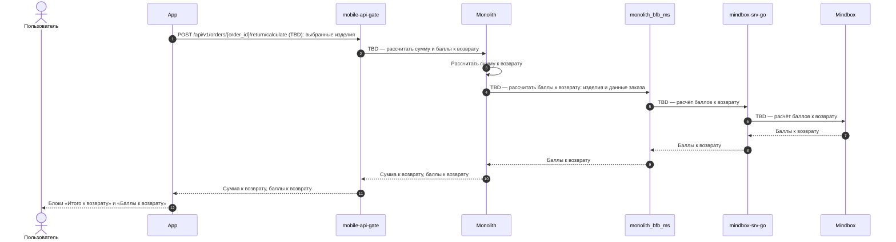
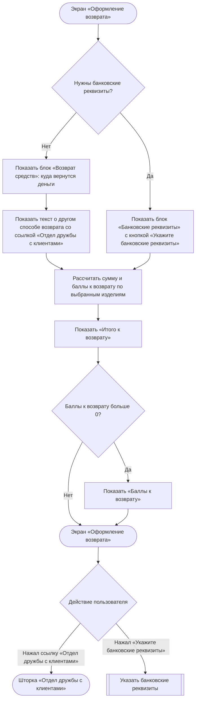
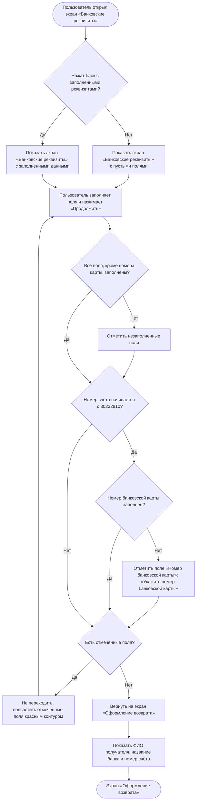

### Определить способ возврата денежных средств US 1.4

Как клиент, оформляющий возврат, я хочу понимать, каким способом мне будут возвращены денежные средства, и при необходимости указать банковские реквизиты, чтобы получить денежные средства за возвращённые изделия

### Дизайн

Ссылка на Figma: https://www.figma.com/design/u5Fe5N4lypCdqgZn6533F2/%F0%9F%93%B1-06.-Profile--Redesign-?node-id=7240-58493&t=KUiaYx2kcuq61I5X-4

### Сценарий

#### Предусловие

1. Пользователь находится на экране «Оформление возврата» (US 1.3)

#### Основная последовательность "Определить способ возврата денежных средств"

| Шаг | Исполнитель | Описание |
|---|---|---|
| 1 | APP | Взять из ответа метода `GET /получить карточку заказа` (US 1.1): — нужны ли банковские реквизиты (`return.is_bank_data_required`); — текст о том, куда вернутся деньги (`return.refund.message`, TBD) |
| 2 | APP | Отобразить в блоке «Возврат средств» текст о том, куда вернутся деньги. Блок «Банковские реквизиты» не отображать  **Опционально** 1. Если `return.is_bank_data_required = true`, то блок «Возврат средств» не отображать, а в блоке «Банковские реквизиты» отобразить кнопку «Укажите банковские реквизиты». См. альтернативную последовательность "Указать банковские реквизиты" |
| 3 | APP | Отобразить текст «Если вам необходимо получить возврат другим способом или на другие реквизиты, пожалуйста, обратитесь в Отдел дружбы с клиентами» со ссылкой «Отдел дружбы с клиентами»  **Опционально** 1. Если `return.is_bank_data_required = true`, то текст не отображать 2. Если пользователь нажал на ссылку «Отдел дружбы с клиентами», то открыть шторку «Отдел дружбы с клиентами» с часами работы отдела и действиями «Позвонить» и «Написать» |
| 4 | APP | Вызвать метод `POST /рассчитать сумму и баллы к возврату` (`POST /api/v1/orders/{order_id}/return/calculate`, TBD) по выбранным изделиям |
| 5 | APP | Отобразить в блоке «Итого к возврату» сумму к возврату из ответа метода `POST /рассчитать сумму и баллы к возврату`  **Опционально** 1. Если баллы к возврату больше 0, то отобразить их в блоке «Баллы к возврату» 2. Если баллы не рассчитаны — TBD |

#### Альтернативная последовательность "Указать банковские реквизиты"

| Шаг | Исполнитель | Описание |
|---|---|---|
| 1 | Пользователь | Нажимает «Укажите банковские реквизиты» |
| 2 | APP | Отобразить экран «Банковские реквизиты» с пустыми полями. Реквизиты из предыдущих возвратов не подставлять |
| 3 | Пользователь | Заполняет поля |
| 4 | Пользователь | Нажимает «Продолжить». Кнопка «Продолжить» активна всегда |
| 5 | APP | Проверить заполнение полей: обязательны все поля, кроме «Номер банковской карты»  **Опционально** 1. Если номер счёта начинается с «30232810», то поле «Номер банковской карты» тоже обязательно 2. Если обязательные поля не заполнены, то не выполнять переход и подсветить незаполненные поля красным контуром. Под полем «Номер банковской карты» показать текст «Укажите номер банковской карты»|
| 6 | APP | Вернуть пользователя на экран «Оформление возврата» и отобразить сохранённые реквизиты: ФИО получателя, название банка и номер счёта  **Опционально** 1. Если пользователь нажал на блок с заполненными реквизитами, то открыть экран «Банковские реквизиты» с заполненными данными 2. Если пользователь изменил реквизиты и нажал «Продолжить», то проверить поля, как на шаге 5, и обновить реквизиты на экране «Оформление возврата» |

**Примечание**

1. Банковские реквизиты нужны, если заказ оплачен при получении или подарочным сертификатом (полностью или частично). В этом случае текст о том, куда вернутся деньги, не приходит.

### Взаимодействие компонентов

### Логика сценария

**Основная последовательность "Определить способ возврата денежных средств"**

**Альтернативная последовательность "Указать банковские реквизиты"**

### Логика бэкенда

**`POST /рассчитать сумму и баллы к возврату` (`POST /api/v1/orders/{order_id}/return/calculate`, TBD) — новый метод**

1. Рассчитывать сумму к возврату по выбранным изделиям.
2. Запрашивать в Mindbox баллы к возврату по выбранным изделиям.
3. Возвращать сумму к возврату и баллы к возврату. Значения предварительные: при создании заявки сумма и баллы рассчитываются заново (US 1.5).

### Задачи

| Название | Ссылка |
|---|---|

