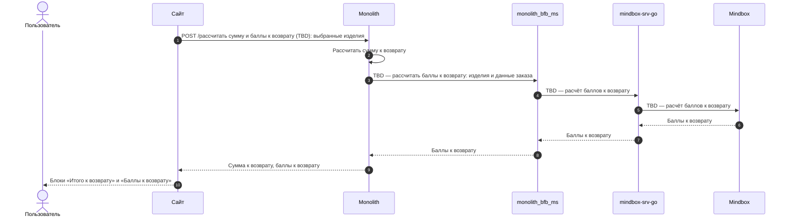
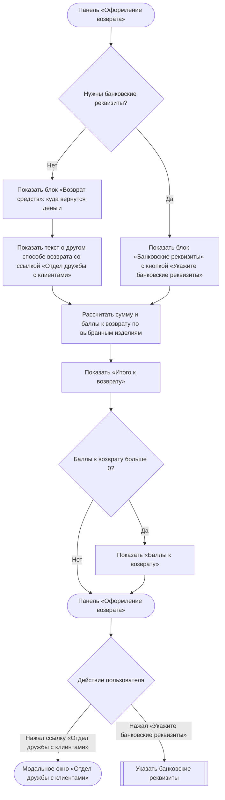
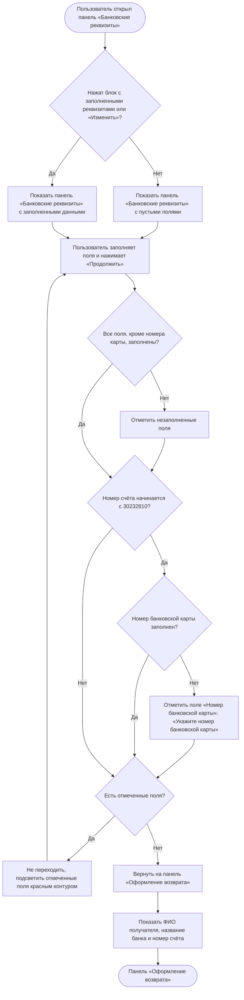

### Определить способ возврата денежных средств US 1.4

Как клиент, оформляющий возврат, я хочу понимать, каким способом мне будут возвращены денежные средства, и при необходимости указать банковские реквизиты, чтобы получить денежные средства за возвращённые изделия

### Дизайн

Макеты: [web/v1 Создание возврата](<../../sources/mockups/web/v1 Создание возврата/>), макеты 7, 11, 12, 14, 28

### Сценарий

#### Предусловие

1. Пользователь находится на панели «Оформление возврата» (US 1.3)

#### Основная последовательность "Определить способ возврата денежных средств"

| Шаг | Исполнитель | Описание |
|---|---|---|
| 1 | Сайт | Взять из ответа метода `GET /получить позиции для возврата` (US 1.2): — нужны ли банковские реквизиты (`data.need_bank_details`); — текст о том, куда вернутся деньги (`data.refund.message`, TBD) |
| 2 | Сайт | Отобразить в блоке «Возврат средств» текст о том, куда вернутся деньги. Блок «Банковские реквизиты» не отображать  **Опционально** 1. Если `data.need_bank_details = true`, то блок «Возврат средств» не отображать, а в блоке «Банковские реквизиты» отобразить кнопку «Укажите банковские реквизиты». См. альтернативную последовательность "Указать банковские реквизиты" |
| 3 | Сайт | Отобразить текст «Если вам необходимо получить возврат другим способом или на другие реквизиты, пожалуйста, обратитесь в Отдел дружбы с клиентами» со ссылкой «Отдел дружбы с клиентами»  **Опционально** 1. Если `data.need_bank_details = true`, то текст не отображать 2. Если пользователь нажал на ссылку «Отдел дружбы с клиентами», то открыть модальное окно «Отдел дружбы с клиентами» с часами работы отдела и действиями «Позвонить» и «Написать» |
| 4 | Сайт | Вызвать метод `POST /рассчитать сумму и баллы к возврату` (TBD) по выбранным изделиям |
| 5 | Сайт | Отобразить в блоке «Итого к возврату» сумму к возврату из ответа метода `POST /рассчитать сумму и баллы к возврату`  **Опционально** 1. Если баллы к возврату больше 0, то отобразить их в блоке «Баллы к возврату» 2. Если баллы не рассчитаны — TBD |

#### Альтернативная последовательность "Указать банковские реквизиты"

| Шаг | Исполнитель | Описание |
|---|---|---|
| 1 | Пользователь | Нажимает «Укажите банковские реквизиты» |
| 2 | Сайт | Отобразить панель «Банковские реквизиты» с пустыми полями. Реквизиты из предыдущих возвратов не подставлять |
| 3 | Пользователь | Заполняет поля |
| 4 | Пользователь | Нажимает «Продолжить». Кнопка «Продолжить» активна всегда |
| 5 | Сайт | Проверить заполнение полей: обязательны все поля, кроме «Номер банковской карты»  **Опционально** 1. Если номер счёта начинается с «30232810», то поле «Номер банковской карты» тоже обязательно 2. Если обязательные поля не заполнены, то не выполнять переход и подсветить незаполненные поля красным контуром. Под полем «Номер банковской карты» показать текст «Укажите номер банковской карты» |
| 6 | Сайт | Вернуть пользователя на панель «Оформление возврата» и отобразить сохранённые реквизиты: ФИО получателя, название банка и номер счёта  **Опционально** 1. Если пользователь нажал на блок с заполненными реквизитами или «Изменить», то открыть панель «Банковские реквизиты» с заполненными данными 2. Если пользователь изменил реквизиты и нажал «Продолжить», то проверить поля, как на шаге 5, и обновить реквизиты на панели «Оформление возврата» |

**Примечание**

1. Банковские реквизиты нужны, если заказ оплачен при получении или подарочным сертификатом (полностью или частично). В этом случае текст о том, куда вернутся деньги, не приходит.

### Взаимодействие компонентов

### Логика сценария

**Основная последовательность "Определить способ возврата денежных средств"**

**Альтернативная последовательность "Указать банковские реквизиты"**

### Логика бэкенда

**`POST /рассчитать сумму и баллы к возврату` (TBD) — новый метод**

* логика — [SRS МП, US 1.4](./srs-mobile-mvp.md)

### Задачи

| Название | Ссылка |
|---|---|

