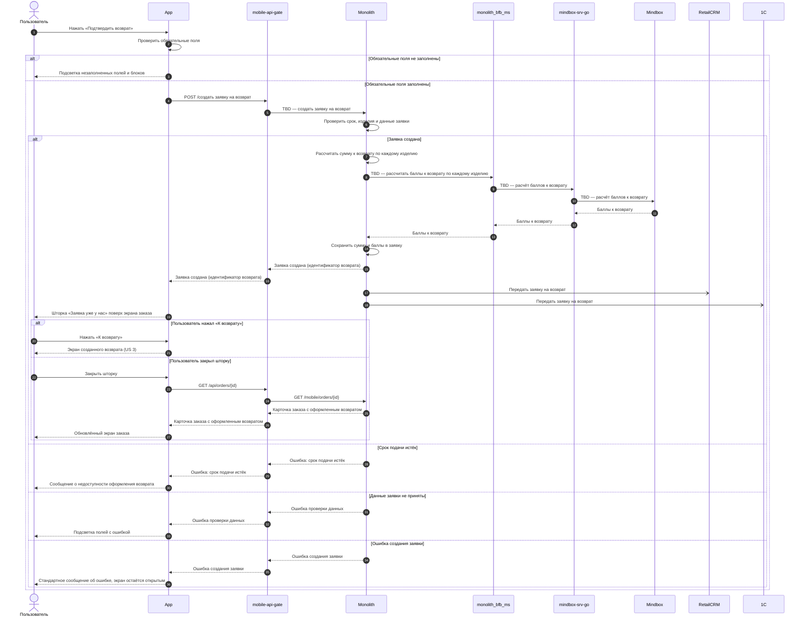
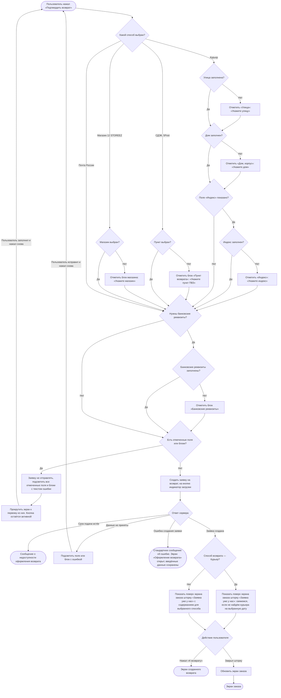

### Подтвердить создание заявки на возврат US 1.5

Как клиент, я хочу отправить заполненную форму и увидеть экран подтверждения заявки, чтобы быть уверенным, что мой возврат принят в работу, и легко отслеживать его статус

### Дизайн

Ссылка на Figma: https://www.figma.com/design/u5Fe5N4lypCdqgZn6533F2/%F0%9F%93%B1-06.-Profile--Redesign-?node-id=9066-130891&t=KUiaYx2kcuq61I5X-4

### Сценарий

#### Предусловие

1. Пользователь заполнил данные на экране «Оформление возврата» (US 1.3, US 1.4)

#### Основная последовательность "Подтвердить создание заявки на возврат"

| Шаг | Исполнитель | Описание |
|---|---|---|
| 1 | Пользователь | Нажимает «Подтвердить возврат» |
| 2 | APP | Проверить заполнение обязательных полей и блоков для выбранного способа возврата по таблице «Проверка обязательных полей»  **Опционально** 1. Если обязательные поля или блоки не заполнены, то заявку не отправлять, подсветить все незаполненные поля и блоки с текстом ошибки и прокрутить экран к первому из них. Кнопка «Подтвердить возврат» остаётся активной |
| 3 | APP | Вызвать метод `POST /создать заявку на возврат` (TBD) с данными, заполненными на экране «Оформление возврата». На время запроса отобразить на кнопке «Подтвердить возврат» индикатор загрузки, повторное нажатие недоступно |
| 4 | APP | Скрыть индикатор загрузки. После успешного создания заявки закрыть экран «Оформление возврата»  **Опционально** 1. Если бэкенд вернул ошибку срока подачи, то показать сообщение о недоступности оформления возврата 2. Если бэкенд вернул ошибку проверки данных, то подсветить поле или блок с ошибкой, как на шаге 2 3. Если ошибка в номере банковской карты, то подсветить блок «Банковские реквизиты» 4. Если бэкенд вернул ошибку, то оставить экран «Оформление возврата» открытым, кнопку «Подтвердить возврат» сделать доступной. Введённые данные не сбрасываются |
| 4.1 | APP | Показать поверх экрана заказа шторку «Заявка уже у нас» с кнопкой «К возврату». Текст шторки зависит от способа возврата  **Опционально** 1. Если способ возврата — Курьер, то показать сообщение, что с клиентом свяжутся, если на выбранную дату курьера не найдут |
| 5 | Пользователь | Нажимает «К возврату» или закрывает шторку |
| 6 | APP | Открыть экран созданного возврата (US 3)  **Опционально** 1. Если пользователь закрыл шторку, то вызвать метод `GET /получить карточку заказа` (`GET /api/orders/{id}`) и отобразить обновлённый экран заказа (US 1.1) |

**Проверка обязательных полей**

| Способ возврата | Поле или блок | Когда обязательно | Подсветка |
|---|---|---|---|
| Курьер | «Улица» | Всегда | Красный контур, текст «Укажите улицу» |
| Курьер | «Дом, корпус» | Всегда | Красный контур, текст «Укажите дом» |
| Курьер | «Индекс» | Если поле отображается | Красный контур, текст «Укажите индекс» |
| СДЭК, 5Post | Блок «Пункт возврата» | Всегда | Текст «Укажите пункт ПВЗ» |
| Магазин 12 STOREEZ | Блок «Магазин 12 STOREEZ» | Всегда | Текст «Укажите магазин» |
| Любой | Блок «Банковские реквизиты» | Если нужны банковские реквизиты | Текст «Укажите банковские реквизиты» красным со значком ошибки |

### Взаимодействие компонентов

### Логика сценария

### Логика бэкенда

**`POST /создать заявку на возврат` (TBD) — новый метод**

1. Проверять, что срок оформления заявки не истёк — по последнему дню оформления заявки (`return.request_until_date`, TBD), как в US 1.1. Если срок истёк, заявку не создавать и возвращать ошибку срока подачи.
2. Заново проверять по правилам US 1.1, что выбранные изделия можно вернуть: по позиции нет активной заявки и изделий не больше, чем доступно. Если изделия нельзя вернуть, заявку не создавать и возвращать ошибку с полем или блоком.
3. Повторять на сервере проверку обязательных данных, которую делают сайт и приложение (таблица «Проверка обязательных полей»). Неполную заявку не создавать, а возвращать ошибку с полем или блоком.
4. Для пункта и магазина сохранять в заявке название, адрес, режим работы и координаты на момент создания.
5. Заявку курьером без даты и интервала создавать в статусе «Возврат ожидает обработки», с датой и интервалом — в статусе «Заявка на возврат принята». Принимать признак ручного ввода адреса (`manual_input`, TBD): заявку с адресом, введённым вручную, создавать по тому же правилу; если она создаётся без даты и интервала, передавать в RetailCRM причину обработки «проверить адрес», как у заказа.
6. Для СДЭК, 5Post, Магазина 12 STOREEZ и Почты России считать дату «Вернуть до»: дата создания заявки + 10 календарных дней. Сохранять её в заявке.
7. Менять статус позиций заказа из заявки целиком.
8. Статус заказа не менять: смену статуса заказа на «Возврат из ЛК», которая выполняется сейчас, при создании заявки не выполнять.
9. Записывать снимок заявки с позициями и их статусами в историю изменений заявки — для показа истории статусов.
10. Проверять, что заказ принадлежит клиенту. Иначе возвращать ошибку.
11. Дату и интервал курьера, если они переданы, проверять, как сейчас.
12. Принимать из RetailCRM дату и интервал курьера, которые Отдел дружбы с клиентами согласовал с клиентом или перенёс по его просьбе, и сохранять их в заявке.
13. После создания передавать заявку в RetailCRM и 1С одновременно, как заказ: каждая система получает её из своей очереди.
14. Если номер лицевого счёта начинается с «30232810», проверять, что передан номер банковской карты. Если номера карты нет, возвращать ошибку, по которой приложение и сайт подсвечивают блок «Банковские реквизиты».
15. Заново рассчитывать сумму к возврату по каждому изделию заявки и сохранять её в заявке.
16. Заново запрашивать в Mindbox баллы к возврату по каждому изделию заявки и сохранять их в заявке.

### Задачи

| Название | Ссылка |
|---|---|

