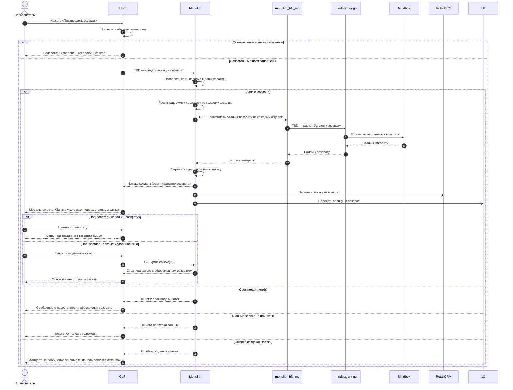
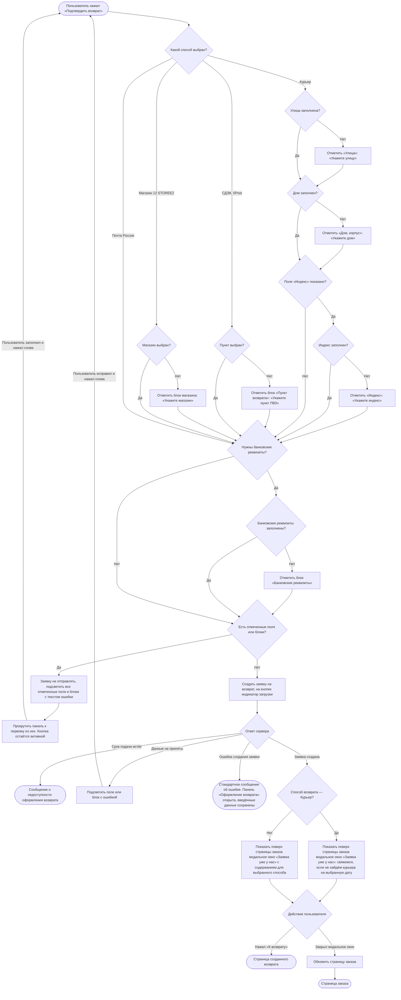

### Подтвердить создание заявки на возврат US 1.5

Как клиент, я хочу отправить заполненную форму и увидеть экран подтверждения заявки, чтобы быть уверенным, что мой возврат принят в работу, и легко отслеживать его статус

### Дизайн

Макеты: [web/v1 Создание возврата](<../../sources/mockups/web/v1 Создание возврата/>), макеты 21, 24

### Сценарий

#### Предусловие

1. Пользователь заполнил данные на панели «Оформление возврата» (US 1.3, US 1.4)

#### Основная последовательность "Подтвердить создание заявки на возврат"

| Шаг | Исполнитель | Описание |
|---|---|---|
| 1 | Пользователь | Нажимает «Подтвердить возврат» |
| 2 | Сайт | Проверить заполнение обязательных полей и блоков для выбранного способа возврата по таблице «Проверка обязательных полей»  **Опционально** 1. Если обязательные поля или блоки не заполнены, то заявку не отправлять, подсветить все незаполненные поля и блоки с текстом ошибки и прокрутить панель к первому из них. Кнопка «Подтвердить возврат» остаётся активной |
| 3 | Сайт | Вызвать метод `POST /создать заявку на возврат` (TBD) с данными, заполненными на панели «Оформление возврата». На время запроса отобразить на кнопке «Подтвердить возврат» индикатор загрузки, повторное нажатие недоступно |
| 4 | Сайт | Скрыть индикатор загрузки. После успешного создания заявки закрыть боковую панель «Оформление возврата»  **Опционально** 1. Если бэкенд вернул ошибку срока подачи, то показать сообщение о недоступности оформления возврата 2. Если бэкенд вернул ошибку проверки данных, то подсветить поле или блок с ошибкой, как на шаге 2 3. Если ошибка в номере банковской карты, то подсветить блок «Банковские реквизиты» 4. Если бэкенд вернул ошибку, то оставить панель «Оформление возврата» открытой, кнопку «Подтвердить возврат» сделать доступной. Введённые данные не сбрасываются |
| 4.1 | Сайт | Показать поверх страницы заказа модальное окно «Заявка уже у нас» с кнопкой «К возврату». Текст модального окна зависит от способа возврата  **Опционально** 1. Если способ возврата — Курьер, то показать сообщение, что с клиентом свяжутся, если на выбранную дату курьера не найдут |
| 5 | Пользователь | Нажимает «К возврату» или закрывает модальное окно |
| 6 | Сайт | Открыть страницу созданного возврата (US 3)  **Опционально** 1. Если пользователь закрыл модальное окно, то вызвать метод `GET /получить страницу заказа` (`GET /profile/view/{id}`) и отобразить обновлённую страницу заказа (US 1.1) |

**Проверка обязательных полей**

| Способ возврата | Поле или блок | Когда обязательно | Подсветка |
|---|---|---|---|
| Курьер | «Улица» | Всегда | Красный контур, текст «Укажите улицу» |
| Курьер | «Дом, корпус» | Всегда | Красный контур, текст «Укажите дом» |
| Курьер | «Индекс» | Если поле отображается | Красный контур, текст «Укажите индекс» |
| СДЭК, 5Post | Блок «Пункт возврата» | Всегда | Текст «Укажите пункт ПВЗ» |
| Магазин 12 STOREEZ | Блок «Магазин 12 STOREEZ» | Всегда | Текст «Укажите магазин» |
| Любой | Блок «Банковские реквизиты» | Если нужны банковские реквизиты | Текст «Укажите банковские реквизиты» красным со значком ошибки |

### Взаимодействие компонентов

### Логика сценария

### Логика бэкенда

**`POST /создать заявку на возврат` (TBD) — новый метод**

* логика — [SRS МП, US 1.5](./srs-mobile-mvp.md)

### Задачи

| Название | Ссылка |
|---|---|

