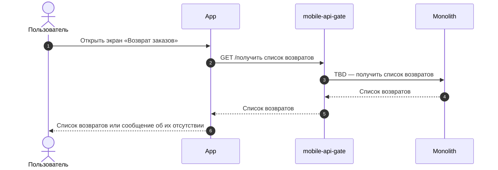
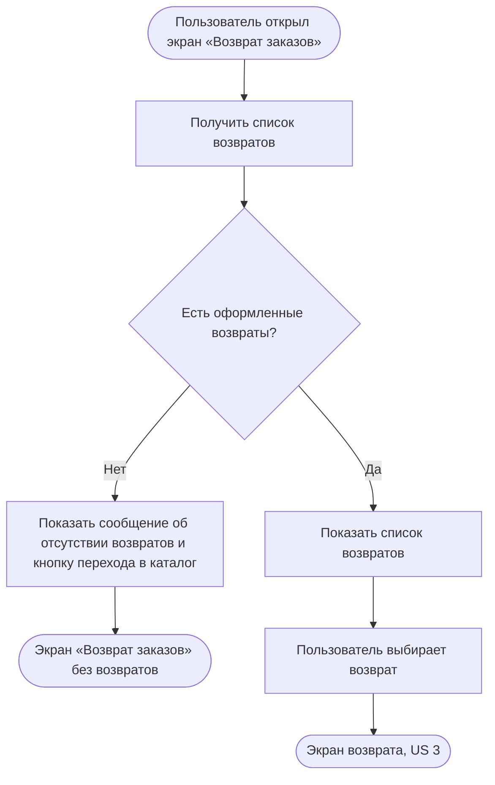

### Просмотреть список возвратов US 2

Как авторизованный клиент, я хочу видеть список оформленных возвратов, чтобы находить нужную заявку на возврат, понимать текущее состояние и перейти к подробной информации

### Дизайн

Ссылка на Figma: https://www.figma.com/design/u5Fe5N4lypCdqgZn6533F2/%F0%9F%93%B1-06.-Profile--Redesign-?node-id=7987-111023&t=KUiaYx2kcuq61I5X-4

### Сценарий

#### Предусловие

1. Пользователь авторизован

#### Основная последовательность "Просмотреть список возвратов"

| Шаг | Исполнитель | Описание |
|---|---|---|
| 1 | Пользователь | Открывает экран «Возврат заказов» из пункта «Возврат заказов» на экране «Профиль» |
| 2 | APP | Вызвать метод `GET /получить список возвратов` (TBD) |
| 3 | APP | Отобразить список возвратов  **Опционально** 1. Если у пользователя нет оформленных возвратов, то отобразить сообщение об их отсутствии и кнопку перехода в каталог |
| 4 | Пользователь | Выбирает возврат |
| 5 | APP | Открыть экран возврата (US 3) |

**Примечание**

1. Статус возврата показывается под клиентским названием, которое задаётся в админке. Если у нескольких внутренних статусов одно клиентское название, клиент видит их как один статус.

### Взаимодействие компонентов

### Логика сценария

### Логика бэкенда

**`GET /получить список возвратов` (TBD) — новый метод**

1. Отдавать заявки на возврат клиента по всем его заказам, в любом статусе, включая отменённые, независимо от того, кто оформил заявку: клиент, Отдел дружбы с клиентами или магазин.
2. Сортировать по дате создания, от новых к старым.
3. Дату «Вернуть до», сохранённую в заявке при создании (US 1.5), отдавать для СДЭК, 5Post, Магазина 12 STOREEZ и Почты России.
4. Отдавать клиентский статус заявки: название и тип для значка (`status.type`, TBD) — в работе, выполнен, отменён (ориентироваться на макет).
5. Каждую заявку отдавать отдельным элементом списка, в том числе если по одному заказу оформлено несколько заявок.
6. Для каждого изделия передавать цены за единицу из соответствующей позиции исходного заказа: цену со скидкой и цену до скидки.

### Задачи

| Название | Ссылка |
|---|---|

