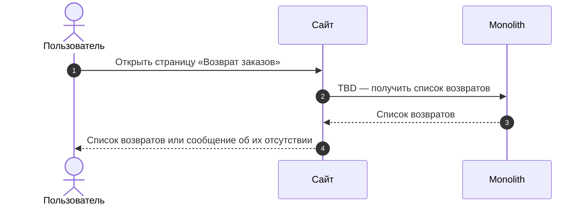
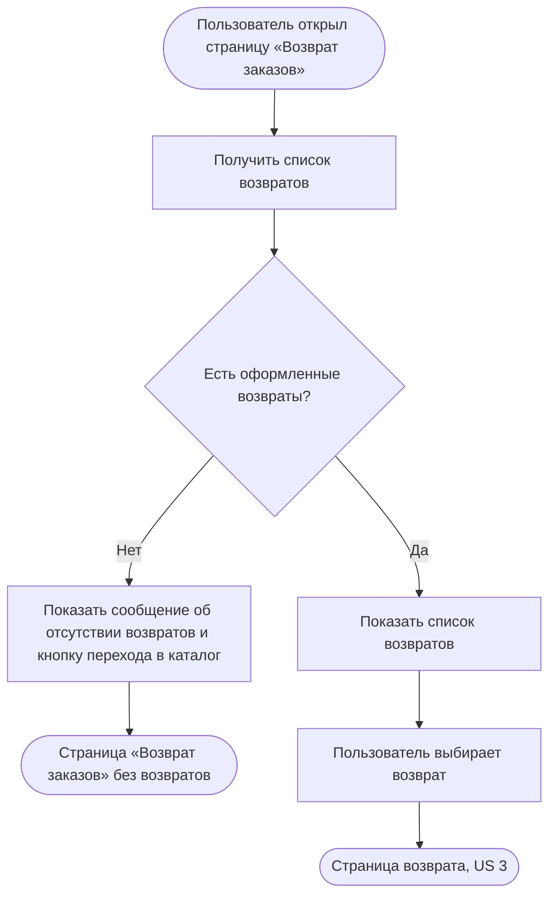

### Просмотреть список возвратов US 2

Как авторизованный клиент, я хочу видеть список оформленных возвратов, чтобы находить нужную заявку на возврат, понимать текущее состояние и перейти к подробной информации

### Дизайн

Макеты: [web/v1 После создания возврата (просмотр и раздел возвратов)](<../../sources/mockups/web/v1 После создания возврата (просмотр и раздел возвратов)/>), макеты 8, 9

### Сценарий

#### Предусловие

1. Пользователь авторизован

#### Основная последовательность "Просмотреть список возвратов"

| Шаг | Исполнитель | Описание |
|---|---|---|
| 1 | Пользователь | Открывает страницу «Возврат заказов» из пункта «Возврат заказов» в меню профиля |
| 2 | Сайт | Вызвать метод `GET /получить список возвратов` (TBD) |
| 3 | Сайт | Отобразить список возвратов  **Опционально** 1. Если у пользователя нет оформленных возвратов, то отобразить сообщение об их отсутствии и кнопку перехода в каталог |
| 4 | Пользователь | Выбирает возврат |
| 5 | Сайт | Открыть страницу возврата (US 3) |

**Примечание**

1. Статус возврата показывается под клиентским названием, которое задаётся в админке. Если у нескольких внутренних статусов одно клиентское название, клиент видит их как один статус.

### Взаимодействие компонентов

### Логика сценария

### Логика бэкенда

**`GET /получить список возвратов` (TBD) — новый метод**

* логика — [SRS МП, US 2](./srs-mobile-mvp.md)

### Задачи

| Название | Ссылка |
|---|---|

