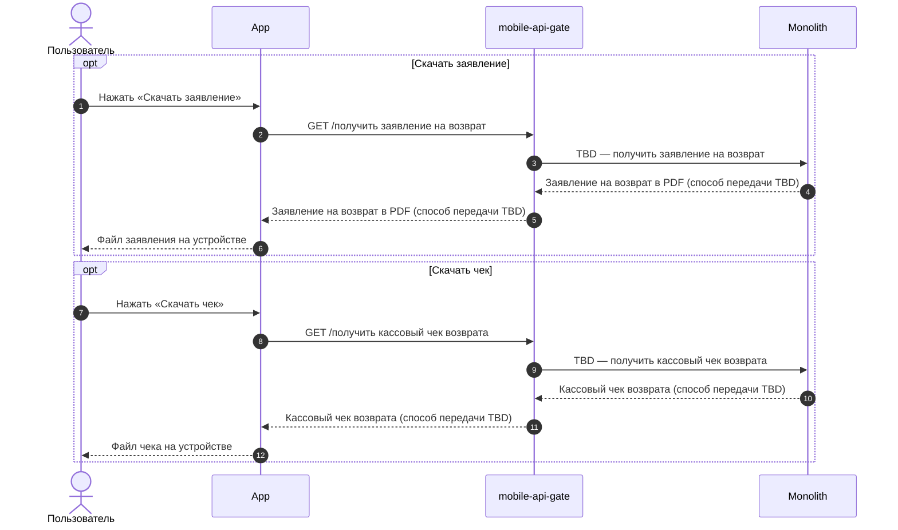
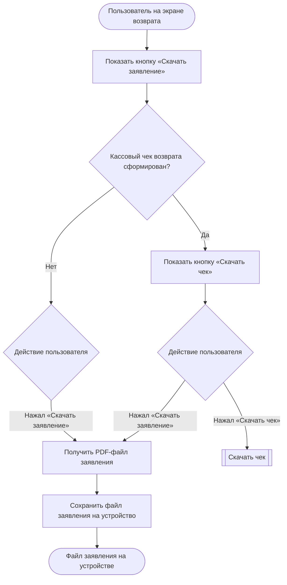

### Скачать заявление и чек возврата US 3.1

Как клиент, оформивший возврат, я хочу скачивать заявление на возврат и кассовый чек возврата, чтобы иметь необходимые документы без обращения в поддержку

### Дизайн

Ссылка на Figma: https://www.figma.com/design/u5Fe5N4lypCdqgZn6533F2/%F0%9F%93%B1-06.-Profile--Redesign-?node-id=8007-118957&t=KUiaYx2kcuq61I5X-4

### Сценарий

#### Предусловие

1. Пользователь находится на экране возврата (US 3)

#### Основная последовательность "Скачать заявление на возврат"

| Шаг | Исполнитель | Описание |
|---|---|---|
| 1 | APP | Отобразить на экране возврата кнопку «Скачать заявление»  **Опционально** 1. Если кассовый чек возврата сформирован (`has_receipt = true`, TBD), то отобразить кнопку «Скачать чек». См. альтернативную последовательность "Скачать чек" |
| 2 | Пользователь | Нажимает «Скачать заявление» |
| 3 | APP | Вызвать метод `GET /получить заявление на возврат` (TBD) |
| 4 | APP | Сохранить PDF-файл заявления на устройство |

#### Альтернативная последовательность "Скачать чек"

| Шаг | Исполнитель | Описание |
|---|---|---|
| 1 | Пользователь | Нажимает «Скачать чек» |
| 2 | APP | Вызвать метод `GET /получить кассовый чек возврата` (TBD) |
| 3 | APP | Сохранить файл чека на устройство |

### Взаимодействие компонентов

### Логика сценария

Основная последовательность "Скачать заявление на возврат"

### Логика бэкенда

**`GET /получить заявление на возврат` (TBD) — новый метод**

1. Обеспечить получение PDF-файла заявления на возврат, сформированного на основании данных заявки.

**`GET /получить кассовый чек возврата` (TBD) — новый метод**

1. Обеспечить получение кассового чека возврата, если чек сформирован (`has_receipt = true`, TBD).

### Задачи

| Название | Ссылка |
|---|---|

