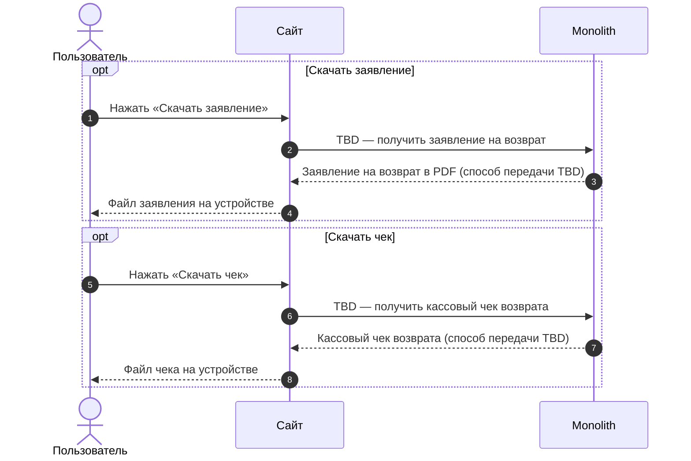
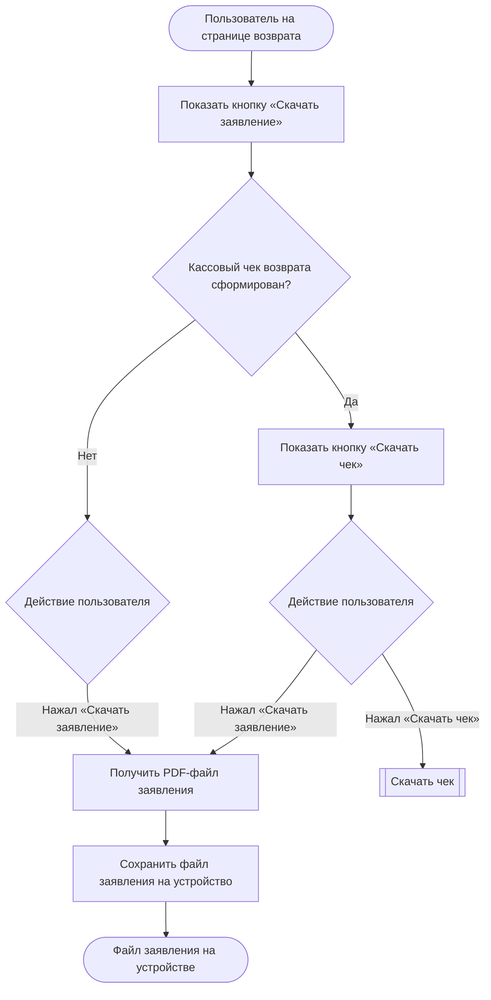

### Скачать заявление и чек возврата US 3.1

Как клиент, оформивший возврат, я хочу скачивать заявление на возврат и кассовый чек возврата, чтобы иметь необходимые документы без обращения в поддержку

### Дизайн

Макеты: [web/v1 После создания возврата (просмотр и раздел возвратов)](<../../sources/mockups/web/v1 После создания возврата (просмотр и раздел возвратов)/>), макеты 1–6

### Сценарий

#### Предусловие

1. Пользователь находится на странице возврата (US 3)

#### Основная последовательность "Скачать заявление на возврат"

| Шаг | Исполнитель | Описание |
|---|---|---|
| 1 | Сайт | Отобразить на странице возврата кнопку «Скачать заявление»  **Опционально** 1. Если кассовый чек возврата сформирован (`has_receipt = true`, TBD), то отобразить кнопку «Скачать чек». См. альтернативную последовательность "Скачать чек" |
| 2 | Пользователь | Нажимает «Скачать заявление» |
| 3 | Сайт | Вызвать метод `GET /получить заявление на возврат` (TBD) |
| 4 | Сайт | Сохранить PDF-файл заявления на устройство |

#### Альтернативная последовательность "Скачать чек"

| Шаг | Исполнитель | Описание |
|---|---|---|
| 1 | Пользователь | Нажимает «Скачать чек» |
| 2 | Сайт | Вызвать метод `GET /получить кассовый чек возврата` (TBD) |
| 3 | Сайт | Сохранить файл чека на устройство |

### Взаимодействие компонентов

### Логика сценария

Основная последовательность "Скачать заявление на возврат"

### Логика бэкенда

**`GET /получить заявление на возврат` (TBD) — новый метод**

* логика — [SRS МП, US 3.1](./srs-mobile-mvp.md)

**`GET /получить кассовый чек возврата` (TBD) — новый метод**

* логика — [SRS МП, US 3.1](./srs-mobile-mvp.md)

### Задачи

| Название | Ссылка |
|---|---|

