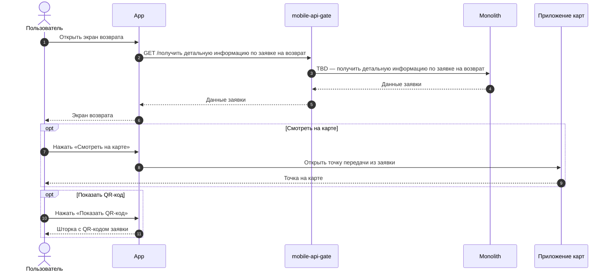
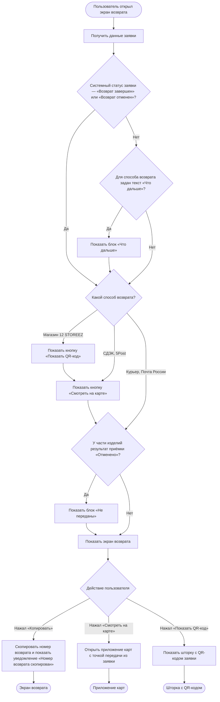

### Просмотреть детальную информацию по заявке на возврат US 3

Как клиент, оформивший возврат, я хочу иметь полный доступ к информации и материалам по своей заявке, чтобы легко контролировать статус возврата на каждом этапе и оперативно получать нужные данные без обращения в поддержку

### Дизайн

Ссылка на Figma: https://www.figma.com/design/u5Fe5N4lypCdqgZn6533F2/%F0%9F%93%B1-06.-Profile--Redesign-?node-id=7992-114681&t=KUiaYx2kcuq61I5X-4

### Сценарий

#### Предусловие

1. Заявка на возврат создана

#### Основная последовательность "Просмотреть детальную информацию по заявке на возврат"

| Шаг | Исполнитель | Описание |
|---|---|---|
| 1 | Пользователь | Открывает экран возврата |
| 2 | APP | Вызвать метод `GET /получить детальную информацию по заявке на возврат` (TBD) |
| 3 | APP | Отобразить экран возврата: статус, инструкцию «Что дальше», срок возврата, способ возврата, способ возврата денег, изделия к возврату, «Итого к возврату» и «Баллы к возврату»  **Опционально** 1. Если системный статус заявки (`status.code`, TBD) — «Возврат завершен» или «Возврат отменен», то блоки «Что дальше» и «Срок возврата» не отображать 2. Если для способа возврата не задан текст «Что дальше», то блок не отображать 3. Если способ возврата — СДЭК, 5Post или Магазин 12 STOREEZ, то отобразить кнопку «Смотреть на карте» 4. Если способ возврата — Магазин 12 STOREEZ, то отобразить кнопку «Показать QR-код» 5. Если у части изделий заявки результат приёмки «Отменено» (`items[].status`, TBD), то отобразить их в блоке «Не переданы» отдельно от изделий к возврату |
| 4 | APP | Обработать действие пользователя на экране  **Опционально** 1. Если пользователь нажал «Копировать» рядом с номером возврата, то скопировать номер в буфер обмена и показать уведомление «Номер возврата скопирован» 2. Если пользователь нажал «Смотреть на карте», то открыть приложение карт на устройстве с точкой передачи из заявки, как на экране магазина при бронировании товара. Изменить точку нельзя 3. Если пользователь нажал «Показать QR-код», то отобразить шторку с QR-кодом заявки |

**Примечание**

1. Дата и интервал курьера на экране — выбранные при оформлении. Если их согласовал или перенёс Отдел дружбы с клиентами, показываются новые. Если клиент сам договорился с курьером о переносе, на экране остаются прежние.
2. Дата «Вернуть до» — срок передачи изделий в точку сдачи, сохранённый при создании заявки.
3. Если дата «Вернуть до» прошла, заявка не отменяется автоматически (автоотмена — Post-MVP). Если через 30 дней после создания изделия не поступили на склад или в магазин, заявка переходит в статус «Подтверждение возврата» и её обрабатывает Отдел дружбы с клиентами.
4. Срок возврата денег клиенту сообщается в тексте «Что дальше» из админки. Компания отправляет деньги в течение 3 дней: при возврате в магазин — от приёмки в магазине, для остальных способов — от поступления на склад. Клиенту сообщается только срок отправки, одной формулировкой для всех способов оплаты: срок зачисления зависит от банка. Поэтому текст для магазина отличается от текста для остальных способов.
5. Изменить заявку (способ возврата, точку, дату и интервал курьера) клиент в приложении не может. Изменения вносит Отдел дружбы с клиентами по обращению клиента.
6. Статус возврата показывается под клиентским названием, которое задаётся в админке. Если у нескольких внутренних статусов одно клиентское название, клиент видит их как один статус.
7. QR-код можно показать с экрана, без печати и без интернета.
8. Если клиент не может показать QR-код, сотрудник магазина находит заявку по ФИО, номеру телефона или номеру заказа.
9. Результат приёмки изделия — «Принято» или «Отменено». «Отменено» получает изделие, которое клиент не принёс или магазин отказался принять. Заявка при этом не отменяется: принятые изделия продолжают обработку возврата, отменённые исключаются из возврата.
10. Статус «Возврат завершен» означает, что компания перечислила деньги клиенту. Дата зачисления зависит от банка клиента.

### Взаимодействие компонентов

### Логика сценария

### Логика бэкенда

**`GET /получить детальную информацию по заявке на возврат` (TBD) — новый метод**

1. Дату и интервал курьера отдавать из заявки. Если их согласовал или перенёс Отдел дружбы с клиентами, отдавать обновлённые.
2. Текст «Что дальше» отдавать из админки по способу возврата.
3. Отдавать признак, можно ли отменить заявку (`can_be_cancelled`, TBD), по её текущему статусу.
4. Данные точки передачи (название, адрес, режим работы, координаты) отдавать из заявки. Координаты нужны для кнопки «Смотреть на карте».
5. Для способа «Магазин 12 STOREEZ» отдавать данные для QR-кода (`qr_code`, TBD).
6. Отдавать признак, что кассовый чек возврата сформирован (`has_receipt`, TBD), — для кнопки «Скачать чек» (US 3.1).
7. Отдавать системный статус заявки (`status.code`, TBD) и его клиентское название.
8. Дату «Вернуть до», сохранённую в заявке при создании (US 1.5), отдавать для СДЭК, 5Post, Магазина 12 STOREEZ и Почты России.
9. Для каждого изделия передавать цены за единицу из соответствующей позиции исходного заказа: цену со скидкой и цену до скидки.
10. «Итого к возврату» и «Баллы к возврату» отдавать по изделиям заявки, кроме изделий с результатом приёмки «Отменено»: по суммам к возврату и баллам, потраченным при покупке, сохранённым для каждого изделия при создании заявки (US 1.5). Баллы, начисленные за покупку, в «Баллы к возврату» не входят.
11. В статусе «Возврат завершен» в «Итого к возврату» отдавать сумму, перечисленную клиенту.
12. Для каждого изделия отдавать результат приёмки (`items[].status`, TBD): «Принято», «Отменено» или пусто, пока результата нет.

### Задачи

| Название | Ссылка |
|---|---|

