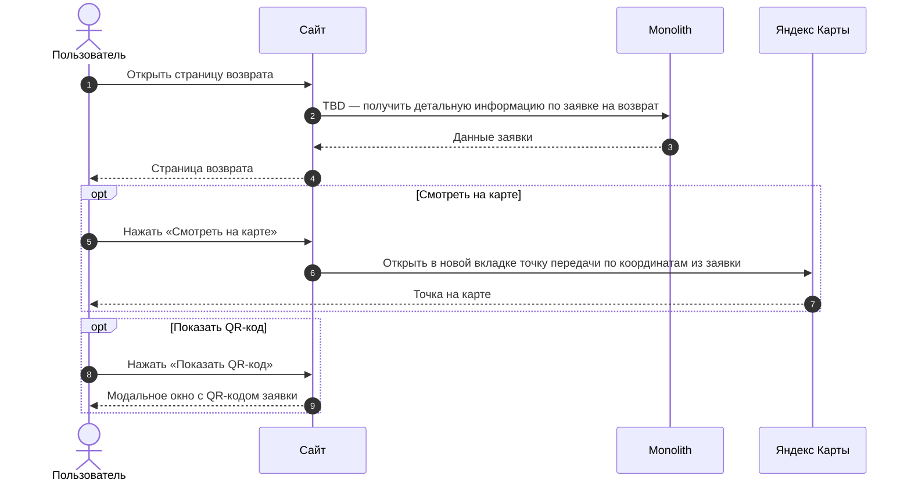
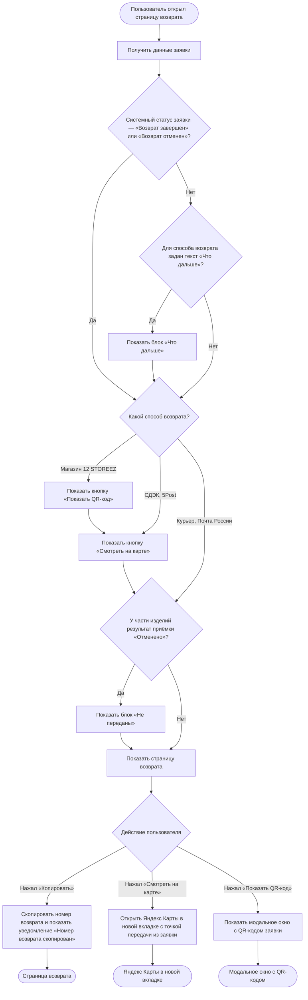

### Просмотреть детальную информацию по заявке на возврат US 3

Как клиент, оформивший возврат, я хочу иметь полный доступ к информации и материалам по своей заявке, чтобы легко контролировать статус возврата на каждом этапе и оперативно получать нужные данные без обращения в поддержку

### Дизайн

Макеты: [web/v1 После создания возврата (просмотр и раздел возвратов)](<../../sources/mockups/web/v1 После создания возврата (просмотр и раздел возвратов)/>), макеты 1–7

### Сценарий

#### Предусловие

1. Заявка на возврат создана

#### Основная последовательность "Просмотреть детальную информацию по заявке на возврат"

| Шаг | Исполнитель | Описание |
|---|---|---|
| 1 | Пользователь | Открывает страницу возврата |
| 2 | Сайт | Вызвать метод `GET /получить детальную информацию по заявке на возврат` (TBD) |
| 3 | Сайт | Отобразить страницу возврата: статус, инструкцию «Что дальше», срок возврата, способ возврата, способ возврата денег, изделия к возврату, «Итого к возврату» и «Баллы к возврату»  **Опционально** 1. Если системный статус заявки — «Возврат завершен» или «Возврат отменен», то блоки «Что дальше» и «Срок возврата» не отображать 2. Если для способа возврата не задан текст «Что дальше», то блок не отображать 3. Если способ возврата — СДЭК, 5Post или Магазин 12 STOREEZ, то отобразить кнопку «Смотреть на карте» 4. Если способ возврата — Магазин 12 STOREEZ, то отобразить кнопку «Показать QR-код» 5. Если у части изделий заявки результат приёмки «Отменено», то отобразить их в блоке «Не переданы» отдельно от изделий к возврату |
| 4 | Сайт | Обработать действие пользователя на странице  **Опционально** 1. Если пользователь нажал «Копировать» рядом с номером возврата, то скопировать номер в буфер обмена и показать уведомление «Номер возврата скопирован» 2. Если пользователь нажал «Смотреть на карте», то открыть Яндекс Карты в новой вкладке с точкой передачи из заявки по её координатам. Изменить точку нельзя 3. Если пользователь нажал «Показать QR-код», то отобразить модальное окно с QR-кодом заявки |

**Примечание**

1. Дата и интервал курьера на странице — выбранные при оформлении. Если их согласовал или перенёс Отдел дружбы с клиентами, показываются новые. Если клиент сам договорился с курьером о переносе, на странице остаются прежние.
2. Дата «Вернуть до» — срок передачи изделий в точку сдачи, сохранённый при создании заявки.
3. Если дата «Вернуть до» прошла, заявка не отменяется автоматически (автоотмена — Post-MVP). Если через 30 дней после создания изделия не поступили на склад или в магазин, заявка переходит в статус «Подтверждение возврата» и её обрабатывает Отдел дружбы с клиентами.
4. Срок возврата денег клиенту сообщается в тексте «Что дальше» из админки. Компания отправляет деньги в течение 3 дней: при возврате в магазин — от приёмки в магазине, для остальных способов — от поступления на склад. Клиенту сообщается только срок отправки, одной формулировкой для всех способов оплаты: срок зачисления зависит от банка. Поэтому текст для магазина отличается от текста для остальных способов.
5. Изменить заявку (способ возврата, точку, дату и интервал курьера) клиент на сайте не может. Изменения вносит Отдел дружбы с клиентами по обращению клиента.
6. Статус возврата показывается под клиентским названием, которое задаётся в админке. Если у нескольких внутренних статусов одно клиентское название, клиент видит их как один статус.
7. QR-код можно показать с экрана, без печати и без интернета.
8. Если клиент не может показать QR-код, сотрудник магазина находит заявку по ФИО, номеру телефона или номеру заказа.
9. Результат приёмки изделия — «Принято» или «Отменено». «Отменено» получает изделие, которое клиент не принёс или магазин отказался принять. Заявка при этом не отменяется: принятые изделия продолжают обработку возврата, отменённые исключаются из возврата.
10. Статус «Возврат завершен» означает, что компания перечислила деньги клиенту. Дата зачисления зависит от банка клиента.

### Взаимодействие компонентов

### Логика сценария

### Логика бэкенда

**`GET /получить детальную информацию по заявке на возврат` (TBD) — новый метод**

* логика — [SRS МП, US 3](./srs-mobile-mvp.md)

### Задачи

| Название | Ссылка |
|---|---|

