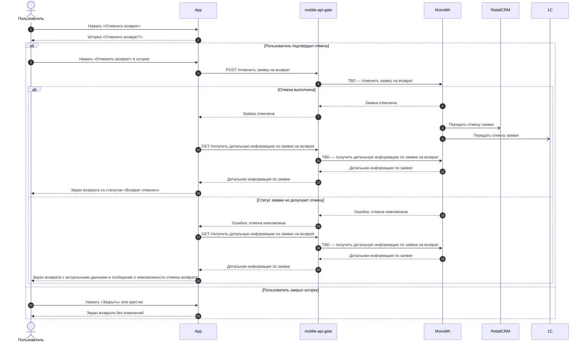
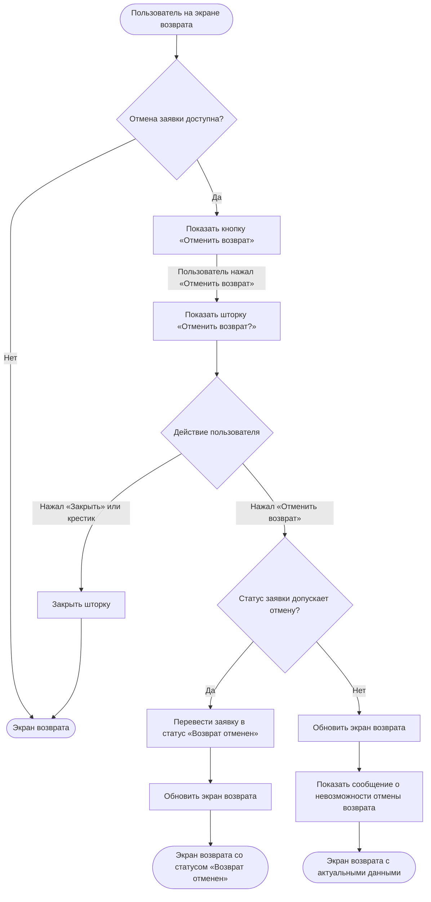

### Отменить заявку на возврат US 4

Как клиент, оформивший заявку на возврат, я хочу иметь возможность самостоятельно отменить созданную заявку, чтобы не возвращать товар, если я передумал, или оформить новую заявку, если допустил ошибку (выбрал не тот товар или способ сдачи)

### Дизайн

Ссылка на Figma: https://www.figma.com/design/u5Fe5N4lypCdqgZn6533F2/%F0%9F%93%B1-06.-Profile--Redesign-?node-id=8943-100757&t=1WHerU9r17fxsUgP-4

### Сценарий

#### Предусловие

1. Пользователь находится на экране возврата (US 3)

#### Основная последовательность "Отменить заявку на возврат"

| Шаг | Исполнитель | Описание |
|---|---|---|
| 1 | APP | Отобразить на экране возврата кнопку «Отменить возврат» и подпись «Если вам нужно внести изменения по возврату, отмените заявку и оформите ее заново», если в ответе метода `GET /получить детальную информацию по заявке на возврат` (TBD, US 3) отмена заявки доступна (`can_be_cancelled = true`, TBD) |
| 2 | Пользователь | Нажимает «Отменить возврат» |
| 3 | APP | Отобразить шторку «Отменить возврат?» с текстом «Заявка на возврат будет отменена» и кнопками «Отменить возврат» и «Закрыть»  **Опционально** 1. Если пользователь нажал «Закрыть» или крестик, то закрыть шторку. Статус заявки не меняется |
| 4 | Пользователь | Нажимает «Отменить возврат» в шторке |
| 5 | APP | Вызвать метод `POST /отменить заявку на возврат` (TBD) |
| 6 | APP | Закрыть шторку и вызвать метод `GET /получить детальную информацию по заявке на возврат` (TBD, US 3) — после успешной отмены и после ошибки, что статус заявки не допускает отмену |
| 7 | APP | Отобразить экран возврата по ответу метода (US 3). После успешной отмены — со статусом «Возврат отменен»  **Опционально** 1. Если бэкенд вернул ошибку, что статус заявки не допускает отмену, то отобразить сообщение о невозможности отмены возврата |

**Примечание**

1. Клиент может отменить заявку в статусах «Возврат ожидает обработки», «Заявка на возврат принята», «Подтверждение возврата» и «Возврат отправлен» — до статуса «Возврат принят».
2. Причину отмены клиент не указывает.
3. Изделия из отменённой заявки снова доступны для оформления возврата, если срок возврата не истёк (US 1.1).

### Взаимодействие компонентов

### Логика сценария

**Основная последовательность "Отменить заявку на возврат"**

### Логика бэкенда

**`POST /отменить заявку на возврат` (TBD) — новый метод**

1. Проверять, что заявка относится к заказу клиента. Иначе возвращать ошибку.
2. Проверять актуальный статус заявки: клиент может отменить заявку в статусах «Возврат ожидает обработки», «Заявка на возврат принята», «Подтверждение возврата» и «Возврат отправлен». В остальных статусах заявку не отменять и возвращать ошибку, что статус заявки не допускает отмену. По этим же статусам отдавать признак `can_be_cancelled` в методе `GET /получить детальную информацию по заявке на возврат` (TBD, US 3).
3. Переводить заявку в статус «Возврат отменен».
4. Изделиям заявки ставить результат «Отменено» (`items[].status`, TBD, US 3). Суммы к возврату и баллы по изделиям, сохранённые при создании заявки (US 1.5), оставлять прежними.
5. Позициям исходного заказа возвращать статус, который был до создания заявки, если по позиции не осталось других заявок, кроме отменённых.
6. Записывать снимок заявки с позициями и их статусами в историю изменений заявки (US 1.5).
7. Передавать отмену заявки в RetailCRM и 1С.

### Задачи

| Название | Ссылка |
|---|---|
