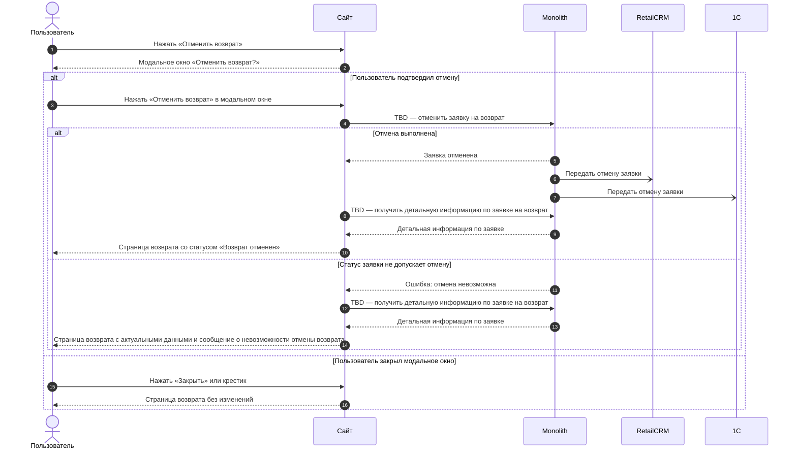
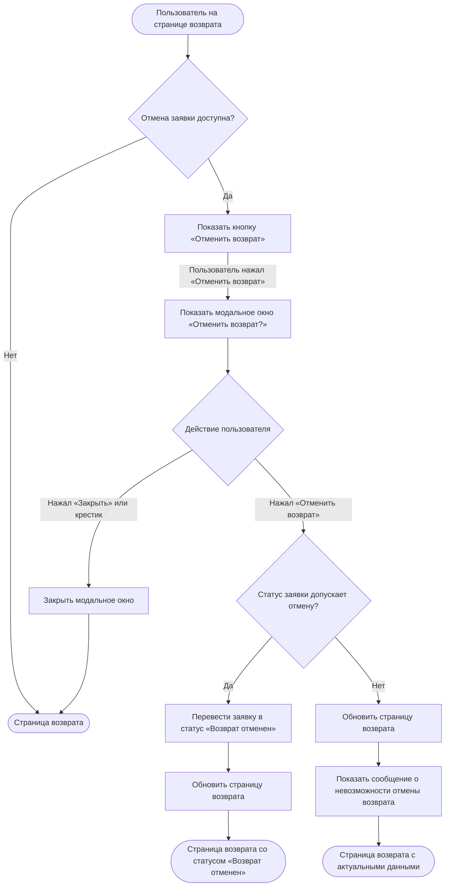

### Отменить заявку на возврат US 4

Как клиент, оформивший заявку на возврат, я хочу иметь возможность самостоятельно отменить созданную заявку, чтобы не возвращать товар, если я передумал, или оформить новую заявку, если допустил ошибку (выбрал не тот товар или способ сдачи)

### Дизайн

Макеты: [web/v1 После создания возврата (просмотр и раздел возвратов)](<../../sources/mockups/web/v1 После создания возврата (просмотр и раздел возвратов)/>), макеты 1–5, 10

### Сценарий

#### Предусловие

1. Пользователь находится на странице возврата (US 3)

#### Основная последовательность "Отменить заявку на возврат"

| Шаг | Исполнитель | Описание |
|---|---|---|
| 1 | Сайт | Отобразить на странице возврата кнопку «Отменить возврат» и подпись «Если вам нужно внести изменения по возврату, отмените заявку и оформите ее заново», если в ответе метода `GET /получить детальную информацию по заявке на возврат` (TBD, US 3) отмена заявки доступна (`can_be_cancelled = true`, TBD) |
| 2 | Пользователь | Нажимает «Отменить возврат» |
| 3 | Сайт | Отобразить модальное окно «Отменить возврат?» с текстом «Заявка на возврат будет отменена» и кнопками «Отменить возврат» и «Закрыть»  **Опционально** 1. Если пользователь нажал «Закрыть» или крестик, то закрыть модальное окно. Статус заявки не меняется |
| 4 | Пользователь | Нажимает «Отменить возврат» в модальном окне |
| 5 | Сайт | Вызвать метод `POST /отменить заявку на возврат` (TBD) |
| 6 | Сайт | Закрыть модальное окно и вызвать метод `GET /получить детальную информацию по заявке на возврат` (TBD, US 3) — после успешной отмены и после ошибки, что статус заявки не допускает отмену |
| 7 | Сайт | Отобразить страницу возврата по ответу метода (US 3). После успешной отмены — со статусом «Возврат отменен»  **Опционально** 1. Если бэкенд вернул ошибку, что статус заявки не допускает отмену, то отобразить сообщение о невозможности отмены возврата |

**Примечание**

1. Клиент может отменить заявку в статусах «Возврат ожидает обработки», «Заявка на возврат принята», «Подтверждение возврата» и «Возврат отправлен» — до статуса «Возврат принят».
2. Причину отмены клиент не указывает.
3. Изделия из отменённой заявки снова доступны для оформления возврата, если срок возврата не истёк (US 1.1).

### Взаимодействие компонентов

### Логика сценария

**Основная последовательность "Отменить заявку на возврат"**

### Логика бэкенда

**`POST /отменить заявку на возврат` (TBD) — новый метод**

* логика — [SRS МП, US 4](./srs-mobile-mvp.md)

### Задачи

| Название | Ссылка |
|---|---|
