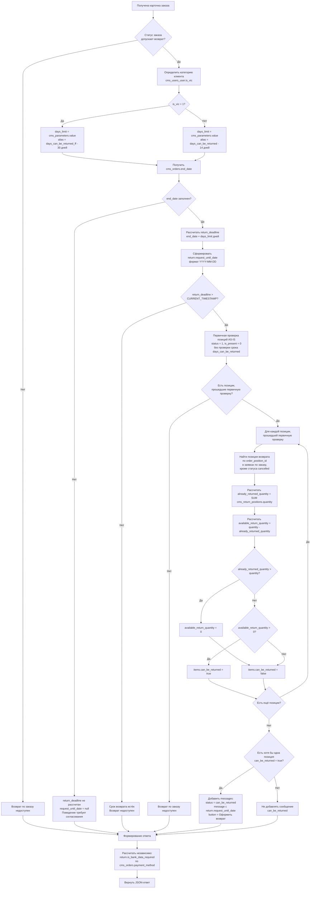

# ECOMDEV-2343: [B][Mobile API] Карточка заказа. Доработать расчёт доступности и количества товара для возврата

## Цель

Доработать ответ карточки заказа в мобильном приложении, чтобы при её открытии система определяла доступность возврата с учётом категории клиента и уже созданных заявок, возвращала дату, до которой можно оформить возврат, остаток изделий к возврату по каждой позиции и данные доставки заказа для автоподстановки на следующих шагах.

**Mobile API**
- Site: `GET /mobile/orders/{id}` — метод монолита, дорабатывается в этой задаче
- Gate: `GET /api/orders/{id}` — старый гейт `core.12stz.*`, передаёт запрос из МП в Site

## Описание реализации

Что требуется изменить:

1. Доработать `GET /mobile/orders/{id}`.
2. Добавить новый параметр `days_can_be_returned_ff`.
3. Добавить новые поля в ответ:
   * `return.request_until_date`

   * `return.refund`

   * `items[].available_return_quantity`

   * `order_delivery`
4. Изменить расчёт `items[].can_be_returned`.

Вне этой задачи:
* дата «Вернуть до …» (срок передачи изделий по способу возврата) — в методе списка способов возврата `return-method-list`, отдельная задача;
* сумма и баллы к возврату по позиции («Итого к возврату», «Баллы к возврату») — отдельная задача после согласования правила расчёта;
* постоянные тексты экранов оформления (подсказка про «Отдел дружбы с клиентами», полная комплектация, смена города и др.) — в приложении, задачи iOS / Android;
* таблицы `cms_returns`, `cms_return_positions`, `cms_return_statuses` создаются задачей на модель данных.

---

#### 1\. Создать новый параметр

Создать новый параметр в `cms_parameters` по аналогии с существующим `cms_parameters.alias = days_can_be_returned` (срок возврата для обычных клиентов, 14 дней).


|Атрибут|Значение|
|:---|:---|
|`alias`|`days_can_be_returned_ff`|
|`value`|`30`|
|`title`|Срок оформления возврата для клиентов Friends & Family, дней|
|`description`|Количество дней с даты выполнения заказа, в течение которых клиент F&F (`cms_users_user.is_vic` = 1) может оформить заявку на возврат|

#### 2\. Добавить выходные параметры



#|
||

**Параметр**

|

**Было**

|

**Стало**

||
||

`items[].can_be_returned`

|

`true`, если заказ выполнен или в возвратном статусе, срок `end_date + 14 дней` не истёк, позиция в статусе «Добавлен» и не подарок

|

Дополнительно: срок считается по категории клиента (14 / 30 дней), и у позиции остались изделия, не занятые заявками на возврат (`available_return_quantity > 0`)

||
||

`messages[]` с `status = "can_be_returned"`

|

Добавляется, если хотя бы одна позиция проходит проверку AS-IS; текст «Вы можете вернуть вещи в течение четырнадцати дней после получения заказа»

|

Добавляется, если хотя бы у одной позиции `can_be_returned = true`; текст «Можно вернуть изделия до `{request_until_date}`» — дата в формате «15 октября 2026». `status` и `button` не меняются

||
|#





#|
||

**Поле**

|

**Тип данных**

|

**Описание**

||
||

`items[].available_return_quantity`

|

`int`

|

Количество изделий позиции, доступных для возврата

||
||

`return.request_until_date`

|

`string` (`YYYY-MM-DD`)

|

Последний день, когда можно оформить заявку на возврат. `null`, **{red}(если у заказа нет даты выполнения или статус заказа не допускает возврат)**

||
||

`return.refund`

|

`object` \| `null`

|

Куда вернутся деньги — блок «Возврат средств». `null`, если `return.is_bank_data_required = true`: тогда клиент указывает банковские реквизиты

||
||

`return.refund.message`

|

`string`

|

Текст для клиента

||
||

`order_delivery`

|

`object`

|

Данные исходной доставки заказа

||
|#

Объект `order_delivery`

#|
||

**Поле**

|

**Тип данных**

|

**Описание**

||
||

`order_delivery.country_iso`

|

string \| null

|

ISO-код страны доставки

||
||

`order_delivery.region`

|

string \| null

|

Регион доставки

||
||

`order_delivery.city`

|

string \| null

|

Город доставки

||
||

`order_delivery.city_fias`

|

string \| null

|

ID города в геосервисе (ФИАС для РФ)

||
||

`order_delivery.address`

|

object \| null

|

Адрес курьерской доставки — для проверки в геосервисе

||
||

`order_delivery.address.postal`

|

string \| null

|

Индекс

||
||

`order_delivery.address.street`

|

string \| null

|

Улица

||
||

`order_delivery.address.house`

|

string \| null

|

Дом

||
||

`order_delivery.address.housing`

|

string \| null

|

Корпус

||
||

`order_delivery.pvz`

|

object \| null

|

Пункт ПВЗ, куда доставлялся заказ — для проверки в сервисе логистики

||
||

`order_delivery.pvz.provider`

|

string

|

Код службы пункта выдачи

||
||

`order_delivery.pvz.id`

|

string

|

ID пункта выдачи

||
||

`order_delivery.store`

|

object \| null

|

Магазин самовывоза — для проверки по списку магазинов, принимающих возвраты

||
||

`order_delivery.store.store_code`

|

int

|

Код магазина

||
|#



**Курьерская доставка:**

```json
{
  "success": true,
  "total": 1,
  "result": {
    "id": 500128139,
    "status": 17,
    "items": [
      {
        "id": 67890,
        "barcode": 2110731899007,
        "count": 3,
        "is_present": false,
        "can_be_returned": true,
        "available_return_quantity": 2
      },
      {
        "id": 67891,
        "barcode": 2110731899014,
        "count": 1,
        "is_present": false,
        "can_be_returned": false,
        "available_return_quantity": 0
      }
    ],
    "messages": [
      {
        "status": "can_be_returned",
        "message": "Можно вернуть изделия до 15 октября 2026",
        "button": "Оформить возврат"
      }
    ],
    "order_delivery": {
      "country_iso": "RU",
      "region": "Москва",
      "city": "Москва",
      "city_fias": "0c5b2444-70a0-4932-980c-b4dc0d3f02b5",
      "address": {
        "postal": "123182",
        "street": "ул Полевая",
        "house": "50",
        "housing": "2"
      },
      "pvz": null,
      "store": null
    },
    "return": {
      "is_bank_data_required": false,
      "request_until_date": "2026-10-15",
      "refund": {
        "message": "На банковскую карту с которой была произведена оплата"
      }
    }
  }
}
```

**Оплата курьеру при получении (нужны банковские реквизиты):**

```json
"return": {
  "is_bank_data_required": true,
  "request_until_date": "2026-10-15",
  "refund": null
}
```

**Пункт выдачи:**

```json
"order_delivery": {
  "country_iso": "RU",
  "region": "Москва",
  "city": "Москва",
  "city_fias": "0c5b2444-70a0-4932-980c-b4dc0d3f02b5",
  "address": null,
  "pvz": {
    "provider": "sdek-pvz",
    "id": "1631548"
  },
  "store": null
}
```

**Самовывоз из магазина:**

```json
"order_delivery": {
  "country_iso": "RU",
  "region": "Москва",
  "city": "Москва",
  "city_fias": "0c5b2444-70a0-4932-980c-b4dc0d3f02b5",
  "address": null,
  "pvz": null,
  "store": {
    "store_code": 3
  }
}
```

**Данных для подстановки нет (например, адрес в заказе не заполнен):**

```json
"order_delivery": {
  "country_iso": "RU",
  "region": "Москва",
  "city": "Москва",
  "city_fias": "0c5b2444-70a0-4932-980c-b4dc0d3f02b5",
  "address": null,
  "pvz": null,
  "store": null
}
```





`order_delivery` формируется всегда, независимо от доступности возврата. Из объектов `address`, `pvz`, `store` заполняется один, два других равны `null`. 

Способ доставки определяется по типу службы доставки заказа (`cms_orders.delivery_method = cms_delivery_tk.id` → `cms_delivery_tk.type`) — так же, как в существующей логике формирования адреса заказа (`getFullAddressCompiled()`). Проверки выполняются по порядку:

1. самовывоз из магазина — `cms_delivery_tk.type` IN (7, 13) → заполняется `store`;
2. пункт выдачи — `cms_delivery_tk.type` IN (3, 11, 14, 15) и заполнен `cms_orders.pvz_id` → заполняется `pvz`;
3. иначе курьерская доставка → заполняется `address`; если пустые `cms_orders.street` и `cms_orders.house` → `address = null`.

#### 3\. Изменить логику определения доступности возврата

**Эндпоинт:** `GET /mobile/orders/{id}`








**Проверки выполняются последовательно — от первого пункта к последнему.**

1. **Проверка статуса заказа**

   1. Если статус заказа допускает возврат, система переходит к определению категории клиента и срока возврата.

   2. Если статус заказа не допускает возврат, дальнейший расчёт доступности возврата не выполняется.

2. **Определение категории клиента и расчет срока возврата**

   1. Система определяет категорию пользователя `cms_users_user.is_vic`

   2. Если `cms_users_user.is_vic = 1`, срок возврата берётся из `cms_parameters.value`, где `cms_parameters.alias = days_can_be_returned_ff` (**новый параметр**)

   3. Иначе срок возврата берётся из `cms_parameters.value`, где `cms_parameters.alias = days_can_be_returned`

   4. Полученное значение записывается во внутреннюю переменную `<days_limit>`.

   5. Система получает дату завершения/вручения заказа `cms_orders.end_date`

   6. Если `cms_orders.end_date` заполнен, система рассчитывает срок окончания возврата:

   ```
   <return_deadline> = cms_orders.end_date + INTERVAL <days_limit> DAY
   ```

   7. Из рассчитанного `<return_deadline>` формируется `return.request_until_date` в формате `YYYY-MM-DD`.
   8. **{red}(Поведение при)** `cms_orders.end_date IS NULL` **{red}(требует отдельного согласования разрешается ли в таком случае оформление возврата.)**

3. **Проверка срока возврата**

   1. Если `<return_deadline>` рассчитан, система проверяет: `<return_deadline> > CURRENT_TIMESTAMP()` {red}(до конца дня или до времени??)

   2. Если срок истёк:

      * заказ считается недоступным для оформления возврата

      * первичная проверка позиций и расчёт доступного количества по позициям не выполняются

   3. Если срок не истёк, система переходит к первичной проверке позиций заказа.

4. **Первичная проверка позиций заказа**

   > **AS-IS:** далее применяется существующая логика проверки позиции. Она не изменяется в рамках данной задачи и должна соответствовать текущей реализации. Приведённые в задаче условия могут быть описаны укрупнённо; если фактическая AS-IS-логика отличается, необходимо сохранить текущую реализацию при условии, что она не противоречит новой логике определения и проверки срока возврата.

   > **Ограничение:** существующая проверка статуса позиции (`status = 1`) может влиять на расчёт `available_return_quantity` при частичном возврате. При подаче заявки статус позиции заказа меняется, и после этого позиция не проходит первичную проверку целиком. **В рамках задачи это не прорабатывается.**

   1. Для каждой позиции заказа система выполняет существующие **AS-IS-проверки позиции**:

      1. статус позиции `cms_order_positions.status = 1` («Добавлен»)
      2. позиция не является подарком: `cms_order_positions.is_present = 0`.

   2. Проверка срока через `cms_parameters.alias = days_can_be_returned` (14 дней), которая входит в текущую AS-IS-проверку позиции, в первичную проверку не включается. **{violet}(Она заменена проверкой срока с учётом категории клиента в пунктах 2–3. Проверка статуса заказа выполнена в пункте 1.)**

   3. Если есть позиции, прошедшие первичную проверку, система переходит к определению количества изделий, уже участвующих в возвратах.

   4. Если таких позиций нет, дальнейший расчёт доступности возврата не выполняется.

5. **Определение количества изделий, уже участвующих в возвратах**

   Для каждой позиции, прошедшей первичную проверку, система определяет количество единиц товара, уже участвующих в ранее созданных заявках на возврат.

   1. {red}(Система выбирает позиции возврата, относящиеся к текущему заказу и текущей позиции заказа:)

      1. Учитываются позиции возврата по текущей позиции заказа (`cms_return_positions.order_position_id = cms_order_positions.id`) из заявок по текущему заказу, кроме заявок в статусе `cancelled` (статус заявки `cms_returns.status_id`, а не статус позиции возврата).

   2. Заявки во всех статусах, кроме `cancelled` («Отменён»), учитываются при расчёте, ++если иное не будет определено статусной моделью возврата++.

   3. Система рассчитывает количество единиц, уже участвующих в возвратах `<already_returned_quantity> = SUM(cms_return_positions.quantity)`

   4. Если подходящие позиции возврата отсутствуют, то `<already_returned_quantity> = 0`

6. **Расчёт доступного количества для возврата**

   1. Для каждой позиции система рассчитывает `<available_return_quantity> = cms_order_positions.quantity - <already_returned_quantity>`
   2. Если ранее созданных возвратов нет `<already_returned_quantity> = 0`, то `<available_return_quantity> = cms_order_positions.quantity`
   3. Если из-за рассинхронизации данных `<already_returned_quantity> > cms_order_positions.quantity`, система устанавливает `<available_return_quantity> = 0`. Отрицательное значение не возвращается.

7. **Формирование признака `items[].can_be_returned`**

   1. Для каждой позиции `items[].can_be_returned = true` , если одновременно выполняются условия:
      1. статус заказа допускает возврат
      2. срок возврата не истёк
      3. позиция прошла первичную проверку (п. 4)
      4. `<available_return_quantity> > 0`
   2. Если хотя бы одно условие не выполнено: `items[].can_be_returned = false`, `items[].available_return_quantity = 0`.

8. **Определение доступности возврата на уровне заказа**

   1. После обработки всех позиций система проверяет наличие хотя бы одной позиции `items[].can_be_returned = true`

   2. Если такая позиция есть, в `result.messages[]` добавляется элемент со `status = "can_be_returned"`.

   3. Для формирования `message` используется рассчитанное значение `return.request_until_date`.

      Перед подстановкой дата преобразуется из формата `YYYY-MM-DD` в пользовательский формат `DD <месяц прописью> YYYY`.

      ```
      {
        "status": "can_be_returned",
        "message": "Можно вернуть изделия до 12 октября 2026",
        "button": "Оформить возврат"
      }
      ```

   4. Если ни одна позиция недоступна для возврата, элемент `status = "can_be_returned"` в `result.messages[]` не добавляется.

   5. **{red}(Если)** `request_until_date`{red}(`= null`**, текст сообщения требует отдельного согласования.**)

9. **Банковские реквизиты — логика не меняется**

   1. Если `cms_orders.payment_method IN (3, 5, 15)` или заказ частично оплачен подарочным сертификатом (поле-признак частичной оплаты сертификатом — уточнить), то в ответе JSON `return.is_bank_data_required = true`, иначе `false`. Признак рассчитывается независимо от `items[].can_be_returned`.

10. **Формирование `return.refund`** — рассчитывается независимо от `items[].can_be_returned`

   1. Если `return.is_bank_data_required = true` → `return.refund = null`.
   2. Иначе `return.refund.message` определяется по способу оплаты заказа `cms_orders.payment_method`:

      | `cms_orders.payment_method` | `return.refund.message` |
      |---|---|
      | 1 — карта онлайн | На банковскую карту, с которой была произведена оплата |
      | 16, 20 — СБП | На банковскую карту, с которой была произведена оплата |
      | 13, 14, 17 — оплата частями | На банковскую карту, с которой была произведена оплата |
      | 15 — сертификат; заказ частично оплачен сертификатом | — (`return.is_bank_data_required = true`, блок реквизитов, `return.refund = null`) |
      | остальные | {red}(к согласованию) |

      Правило по `RULE-37`, `RULE-39`, `FR-45`, `ADR-RET-046` (07.10.2026): все онлайн-оплаты — один текст; при полной или частичной оплате подарочным сертификатом — блок реквизитов, на сертификат деньги не возвращаются.





#|
||

**API**

|

**Тип данных**

|

**БД**

|

**Тип данных**

||
||

`items[].available_return_quantity`

|

int

|

Динамический расчет. Расчёт из `cms_order_positions.quantity` и `cms_return_positions`

|

—

||
||

`return.request_until_date`

|

string (`YYYY-MM-DD`)

|

Динамический расчёт. `cms_orders.end_date + INTERVAL <days_limit> DAY`, где `<days_limit> = cms_parameters.value`

|

—

||
||

`order_delivery.country_iso`

|

string \| null

|

`cms_orders.country`

|

`varchar(255)`

||
||

`order_delivery.region`

|

string \| null

|

`cms_orders.state`

|

`varchar(255)`

||
||

`order_delivery.city`

|

string \| null

|

`cms_orders.city`

|

`varchar(255)`

||
||

`order_delivery.city_fias`

|

string \| null

|

`cms_orders.city_fias`

|

`varchar(255)`

||
||

`order_delivery.address.postal`

|

string \| null

|

`cms_orders.postal`

|

`varchar(255)`

||
||

`order_delivery.address.street`

|

string \| null

|

`cms_orders.street`

|

`varchar(255)`

||
||

`order_delivery.address.house`

|

string \| null

|

`cms_orders.house`

|

`varchar(255)`

||
||

`order_delivery.address.housing`

|

string \| null

|

`cms_orders.housing`

|

`varchar(255)`

||
||

`order_delivery.pvz.provider`

|

string

|

`cms_delivery_tk.slug` (по `cms_orders.delivery_method` = `cms_delivery_tk.id`)

|

`varchar(255)`

||
||

`order_delivery.pvz.id`

|

string

|

`cms_orders.pvz_id`

|

`varchar(32)`

||
||

`order_delivery.store.store_code`

|

int

|

`cms_delivery_tk.store_code` (по `cms_orders.delivery_method` = `cms_delivery_tk.id`)

|

`smallint(6)`

||
||

`return.refund.message`

|

string

|

Динамический расчёт по `cms_orders.payment_method` (шаг 10)

|

—

||
|#



## Открытые вопросы

| Вопрос | Кому |
|---|---|
| 1. Заказ без даты выполнения (`cms_orders.end_date IS NULL`): разрешается ли оформление возврата? Какой текст сообщения в этом случае? | Product Manager |
| 2. Срок действует до времени выполнения заказа или до конца дня? | Product Manager |
| 3. Тексты «Возврат средств» для остальных способов оплаты. СБП, оплата частями и смешанная оплата (карта + сертификат) решены 07.10.2026 (`ADR-RET-046`). Где хранится признак частичной оплаты сертификатом | Product Manager, бэкенд |

