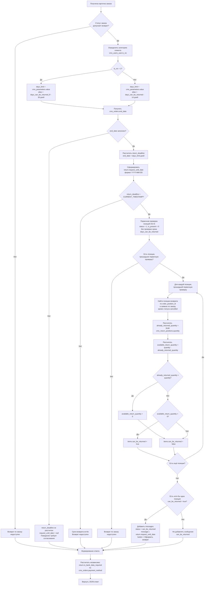
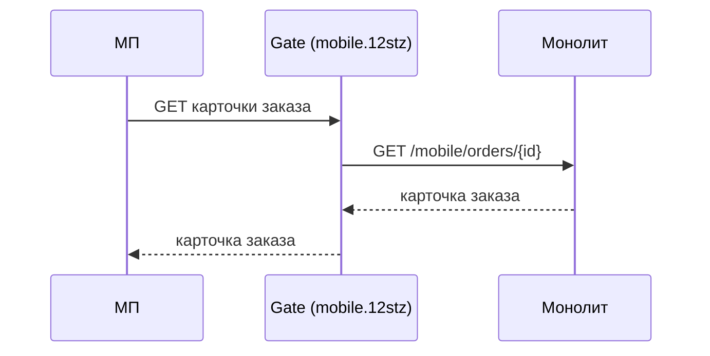

# ECOMDEV-2343: [B][Mobile API] Карточка заказа. Доработать расчёт доступности и количества товара для возврата

## Цель

Доработать ответ карточки заказа в мобильном приложении, чтобы при её открытии система определяла доступность возврата с учётом категории клиента и уже созданных заявок, возвращала дату, до которой можно оформить возврат, остаток изделий к возврату по каждой позиции и данные доставки заказа для автоподстановки на следующих шагах.

**Mobile API**
- Site: `GET /mobile/orders/{id}` — метод монолита, дорабатывается в этой задаче
- Gate: `GET /api/orders/{id}` — старый гейт `core.12stz.*`, передаёт запрос из МП в Site

## Описание реализации

Что требуется изменить:

1. Доработать `GET /mobile/orders/{id}`.
2. Добавить новый параметр `days_can_be_returned_ff`.
3. Добавить новые поля в ответ:
   * `return.request_until_date`

   * `items[].available_return_quantity`

   * `order_delivery`
4. Изменить расчёт `items[].can_be_returned`.

---

#### 1\. Создать новый параметр

Создать новый параметр в `cms_parameters` по аналогии с существующим `cms_parameters.alias = days_can_be_returned` (срок возврата для обычных клиентов, 14 дней).


|Атрибут|Значение|
|:---|:---|
|`alias`|`days_can_be_returned_ff`|
|`value`|`30`|
|`title`|Срок оформления возврата для клиентов Friends & Family, дней|
|`description`|Количество дней с даты выполнения заказа, в течение которых клиент F&F (`cms_users_user.is_vic` = 1) может оформить заявку на возврат|

#### 2\. Добавить выходные параметры



#|
||

**Параметр**

|

**Было**

|

**Стало**

||
||

`items[].can_be_returned`

|

`true`, если заказ выполнен или в возвратном статусе, срок `end_date + 14 дней` не истёк, позиция в статусе «Добавлен» и не подарок

|

Дополнительно: срок считается по категории клиента (14 / 30 дней), и у позиции остались изделия, не занятые заявками на возврат (`available_return_quantity > 0`)

||
||

`messages[]` с `status = "can_be_returned"`

|

Добавляется, если хотя бы одна позиция проходит проверку AS-IS; текст «Вы можете вернуть вещи в течение четырнадцати дней после получения заказа»

|

Добавляется, если хотя бы у одной позиции `can_be_returned = true`; текст «Можно вернуть изделия до `{request_until_date}`» — дата в формате «15 октября 2026». `status` и `button` не меняются

||
|#





#|
||

**Поле**

|

**Тип данных**

|

**Описание**

||
||

`items[].available_return_quantity`

|

`int`

|

Количество изделий позиции, доступных для возврата

||
||

`return.request_until_date`

|

`string` (`YYYY-MM-DD`)

|

Последний день, когда можно оформить заявку на возврат. `null`, **{red}(если у заказа нет даты выполнения или статус заказа не допускает возврат)**

||
||

`order_delivery`

|

`object`

|

Данные исходной доставки заказа

||
|#

Объект `order_delivery`

#|
||

**Поле**

|

**Тип данных**

|

**Описание**

||
||

`order_delivery.country_iso`

|

string \| null

|

ISO-код страны доставки

||
||

`order_delivery.region`

|

string \| null

|

Регион доставки

||
||

`order_delivery.city`

|

string \| null

|

Город доставки

||
||

`order_delivery.city_fias`

|

string \| null

|

ID города в геосервисе (ФИАС для РФ)

||
||

`order_delivery.address`

|

object \| null

|

Адрес курьерской доставки — для проверки в геосервисе

||
||

`order_delivery.address.postal`

|

string \| null

|

Индекс

||
||

`order_delivery.address.street`

|

string \| null

|

Улица

||
||

`order_delivery.address.house`

|

string \| null

|

Дом

||
||

`order_delivery.address.housing`

|

string \| null

|

Корпус

||
||

`order_delivery.pvz`

|

object \| null

|

Пункт ПВЗ, куда доставлялся заказ — для проверки в сервисе логистики

||
||

`order_delivery.pvz.provider`

|

string

|

Код службы пункта выдачи

||
||

`order_delivery.pvz.id`

|

string

|

ID пункта выдачи

||
||

`order_delivery.store`

|

object \| null

|

Магазин самовывоза — для проверки по списку магазинов, принимающих возвраты

||
||

`order_delivery.store.store_code`

|

int

|

Код магазина

||
|#



**Курьерская доставка:**

```json
{
  "success": true,
  "total": 1,
  "result": {
    "id": 500128139,
    "status": 17,
    "items": [
      {
        "id": 67890,
        "barcode": 2110731899007,
        "count": 3,
        "is_present": false,
        "can_be_returned": true,
        "available_return_quantity": 2
      },
      {
        "id": 67891,
        "barcode": 2110731899014,
        "count": 1,
        "is_present": false,
        "can_be_returned": false,
        "available_return_quantity": 0
      }
    ],
    "messages": [
      {
        "status": "can_be_returned",
        "message": "Можно вернуть изделия до 15 октября 2026",
        "button": "Оформить возврат"
      }
    ],
    "order_delivery": {
      "country_iso": "RU",
      "region": "Москва",
      "city": "Москва",
      "city_fias": "0c5b2444-70a0-4932-980c-b4dc0d3f02b5",
      "address": {
        "postal": "123182",
        "street": "ул Полевая",
        "house": "50",
        "housing": "2"
      },
      "pvz": null,
      "store": null
    },
    "return": {
      "is_bank_data_required": true,
      "request_until_date": "2026-10-15"
    }
  }
}
```

**Пункт выдачи:**

```json
"order_delivery": {
  "country_iso": "RU",
  "region": "Москва",
  "city": "Москва",
  "city_fias": "0c5b2444-70a0-4932-980c-b4dc0d3f02b5",
  "address": null,
  "pvz": {
    "provider": "sdek-pvz",
    "id": "1631548"
  },
  "store": null
}
```

**Самовывоз из магазина:**

```json
"order_delivery": {
  "country_iso": "RU",
  "region": "Москва",
  "city": "Москва",
  "city_fias": "0c5b2444-70a0-4932-980c-b4dc0d3f02b5",
  "address": null,
  "pvz": null,
  "store": {
    "store_code": 3
  }
}
```

**Данных для подстановки нет (например, адрес в заказе не заполнен):**

```json
"order_delivery": {
  "country_iso": "RU",
  "region": "Москва",
  "city": "Москва",
  "city_fias": "0c5b2444-70a0-4932-980c-b4dc0d3f02b5",
  "address": null,
  "pvz": null,
  "store": null
}
```





`order_delivery` формируется всегда, независимо от доступности возврата. Из объектов `address`, `pvz`, `store` заполняется один, два других равны `null`. 

Способ доставки определяется по типу службы доставки заказа (`cms_orders.delivery_method = cms_delivery_tk.id` → `cms_delivery_tk.type`) — так же, как в существующей логике формирования адреса заказа (`getFullAddressCompiled()`). Проверки выполняются по порядку:

1. самовывоз из магазина — `cms_delivery_tk.type` IN (7, 13) → заполняется `store`;
2. пункт выдачи — `cms_delivery_tk.type` IN (3, 11, 14, 15) и заполнен `cms_orders.pvz_id` → заполняется `pvz`;
3. иначе курьерская доставка → заполняется `address`; если пустые `cms_orders.street` и `cms_orders.house` → `address = null`.

#### 3\. Изменить логику определения доступности возврата

**Эндпоинт:** `GET /mobile/orders/{id}`








**Проверки выполняются последовательно — от первого пункта к последнему.**

1. **Проверка статуса заказа**

   1. Если статус заказа допускает возврат, система переходит к определению категории клиента и срока возврата.

   2. Если статус заказа не допускает возврат, дальнейший расчёт доступности возврата не выполняется.

2. **Определение категории клиента и расчет срока возврата**

   1. Система определяет категорию пользователя `cms_users_user.is_vic`

   2. Если `cms_users_user.is_vic = 1`, срок возврата берётся из `cms_parameters.value`, где `cms_parameters.alias = days_can_be_returned_ff` (**новый параметр**)

   3. Иначе срок возврата берётся из `cms_parameters.value`, где `cms_parameters.alias = days_can_be_returned`

   4. Полученное значение записывается во внутреннюю переменную `<days_limit>`.

   5. Система получает дату завершения/вручения заказа `cms_orders.end_date`

   6. Если `cms_orders.end_date` заполнен, система рассчитывает срок окончания возврата:

   ```
   <return_deadline> = cms_orders.end_date + INTERVAL <days_limit> DAY
   ```

   7. Из рассчитанного `<return_deadline>` формируется `return.request_until_date` в формате `YYYY-MM-DD`.
   8. **{red}(Поведение при)** `cms_orders.end_date IS NULL` **{red}(требует отдельного согласования разрешается ли в таком случае оформление возврата.)**

3. **Проверка срока возврата**

   1. Если `<return_deadline>` рассчитан, система проверяет: `<return_deadline> > CURRENT_TIMESTAMP()` {red}(до конца дня или до времени??)

   2. Если срок истёк:

      * заказ считается недоступным для оформления возврата

      * первичная проверка позиций и расчёт доступного количества по позициям не выполняются

   3. Если срок не истёк, система переходит к первичной проверке позиций заказа.

4. **Первичная проверка позиций заказа**

   > **AS-IS:** далее применяется существующая логика проверки позиции. Она не изменяется в рамках данной задачи и должна соответствовать текущей реализации. Приведённые в задаче условия могут быть описаны укрупнённо; если фактическая AS-IS-логика отличается, необходимо сохранить текущую реализацию при условии, что она не противоречит новой логике определения и проверки срока возврата.

   > **Ограничение:** существующая проверка статуса позиции (`status = 1`) может влиять на расчёт `available_return_quantity` при частичном возврате. При подаче заявки статус позиции заказа меняется, и после этого позиция не проходит первичную проверку целиком. **В рамках задачи это не прорабатывается.**

   1. Для каждой позиции заказа система выполняет существующие **AS-IS-проверки позиции**:

      1. статус позиции `cms_order_positions.status = 1` («Добавлен»)
      2. позиция не является подарком: `cms_order_positions.is_present = 0`.

   2. Проверка срока через `cms_parameters.alias = days_can_be_returned` (14 дней), которая входит в текущую AS-IS-проверку позиции, в первичную проверку не включается. **{violet}(Она заменена проверкой срока с учётом категории клиента в пунктах 2–3. Проверка статуса заказа выполнена в пункте 1.)**

   3. Если есть позиции, прошедшие первичную проверку, система переходит к определению количества изделий, уже участвующих в возвратах.

   4. Если таких позиций нет, дальнейший расчёт доступности возврата не выполняется.

5. **Определение количества изделий, уже участвующих в возвратах**

   Для каждой позиции, прошедшей первичную проверку, система определяет количество единиц товара, уже участвующих в ранее созданных заявках на возврат.

   1. {red}(Система выбирает позиции возврата, относящиеся к текущему заказу и текущей позиции заказа:)

      1. Учитываются позиции возврата по текущей позиции заказа (`cms_return_positions.order_position_id = cms_order_positions.id`) из заявок по текущему заказу, кроме заявок в статусе `cancelled` (статус заявки `cms_returns.status_id`, а не статус позиции возврата).

   2. Заявки во всех статусах, кроме `cancelled` («Отменён»), учитываются при расчёте, ++если иное не будет определено статусной моделью возврата++.

   3. Система рассчитывает количество единиц, уже участвующих в возвратах `<already_returned_quantity> = SUM(cms_return_positions.quantity)`

   4. Если подходящие позиции возврата отсутствуют, то `<already_returned_quantity> = 0`

6. **Расчёт доступного количества для возврата**

   1. Для каждой позиции система рассчитывает `<available_return_quantity> = cms_order_positions.quantity - <already_returned_quantity>`
   2. Если ранее созданных возвратов нет `<already_returned_quantity> = 0`, то `<available_return_quantity> = cms_order_positions.quantity`
   3. Если из-за рассинхронизации данных `<already_returned_quantity> > cms_order_positions.quantity`, система устанавливает `<available_return_quantity> = 0`. Отрицательное значение не возвращается.

7. **Формирование признака `items[].can_be_returned`**

   1. Для каждой позиции `items[].can_be_returned = true` , если одновременно выполняются условия:
      1. статус заказа допускает возврат
      2. срок возврата не истёк
      3. позиция прошла первичную проверку (п. 4)
      4. `<available_return_quantity> > 0`
   2. Если хотя бы одно условие не выполнено: `items[].can_be_returned = false`, `items[].available_return_quantity = 0`.

8. **Определение доступности возврата на уровне заказа**

   1. После обработки всех позиций система проверяет наличие хотя бы одной позиции `items[].can_be_returned = true`

   2. Если такая позиция есть, в `result.messages[]` добавляется элемент со `status = "can_be_returned"`.

   3. Для формирования `message` используется рассчитанное значение `return.request_until_date`.

      Перед подстановкой дата преобразуется из формата `YYYY-MM-DD` в пользовательский формат `DD <месяц прописью> YYYY`.

      ```
      {
        "status": "can_be_returned",
        "message": "Можно вернуть изделия до 12 октября 2026",
        "button": "Оформить возврат"
      }
      ```

   4. Если ни одна позиция недоступна для возврата, элемент `status = "can_be_returned"` в `result.messages[]` не добавляется.

   5. **{red}(Если)** `request_until_date`{red}(`= null`**, текст сообщения требует отдельного согласования.**)

9. **Банковские реквизиты — логика не меняется**

   1. Если `cms_orders.payment_method IN (3, 5)`, то в ответе JSON `return.is_bank_data_required = true`, иначе `false`. Признак рассчитывается независимо от `items[].can_be_returned`.





#|
||

**API**

|

**Тип данных**

|

**БД**

|

**Тип данных**

||
||

`items[].available_return_quantity`

|

int

|

Динамический расчет. Расчёт из `cms_order_positions.quantity` и `cms_return_positions`

|

—

||
||

`return.request_until_date`

|

string (`YYYY-MM-DD`)

|

Динамический расчёт. `cms_orders.end_date + INTERVAL <days_limit> DAY`, где `<days_limit> = cms_parameters.value`

|

—

||
||

`order_delivery.country_iso`

|

string \| null

|

`cms_orders.country`

|

`varchar(255)`

||
||

`order_delivery.region`

|

string \| null

|

`cms_orders.state`

|

`varchar(255)`

||
||

`order_delivery.city`

|

string \| null

|

`cms_orders.city`

|

`varchar(255)`

||
||

`order_delivery.city_fias`

|

string \| null

|

`cms_orders.city_fias`

|

`varchar(255)`

||
||

`order_delivery.address.postal`

|

string \| null

|

`cms_orders.postal`

|

`varchar(255)`

||
||

`order_delivery.address.street`

|

string \| null

|

`cms_orders.street`

|

`varchar(255)`

||
||

`order_delivery.address.house`

|

string \| null

|

`cms_orders.house`

|

`varchar(255)`

||
||

`order_delivery.address.housing`

|

string \| null

|

`cms_orders.housing`

|

`varchar(255)`

||
||

`order_delivery.pvz.provider`

|

string

|

`cms_delivery_tk.slug` (по `cms_orders.delivery_method` = `cms_delivery_tk.id`)

|

`varchar(255)`

||
||

`order_delivery.pvz.id`

|

string

|

`cms_orders.pvz_id`

|

`varchar(32)`

||
||

`order_delivery.store.store_code`

|

int

|

`cms_delivery_tk.store_code` (по `cms_orders.delivery_method` = `cms_delivery_tk.id`)

|

`smallint(6)`

||
|#



---

## Приложение. Предыдущая версия задачи с полной логикой (справочно)

> Сохранена на всякий случай. Для реализации актуальна задача выше; при расхождении верна задача выше.

### [B][Mobile API] Карточка заказа. Доступность возврата, срок, остаток изделий и данные доставки заказа

**Связи**
- Связана: <ECOMDEV-NNNN — [QA] Подготовка тестовой документации по задаче> — завести
- Блокирует: <DEVIOS-NNNN, DEVANDROID-NNNN — отображение срока возврата и ограничение количества на экране выбора изделий> — завести
- Связана: <ECOMDEV-NNNN — [B][Mobile API][Gate] Карточка заказа на новом гейте `mobile.12stz.*`> — завести (эндпоинт сейчас только на `core.12stz.*`)
- Связана: <ECOMDEV-NNNN — [B][Mobile API] Создание заявки на возврат> — повторная проверка остатка в момент создания заявки
- Связана: <ECOMDEV-NNNN — [B][Mobile API] Способы возврата: признак способа заказа `is_order_method`> — завести; способ возврата «как в заказе» определяет `return-method-list` по `order_id`, поэтому тип доставки в карточке не передаётся
- Основание: [TO-BE шаг 01](../../steps/mobile/01-load-order-card.md), [TO-BE шаг 04](../../steps/mobile/04-prefill-city-method-point.md), [ERD-RET](../../diagrams/erd/return-entity_erd_merged.md), макет [`v2 Создание возврата/MVP/1.png`](<../../../sources/mockups/v2 Создание возврата/MVP/1.png>)

**Трассировка:** `FR-03`, `BR-03`, `RULE-07`, `RULE-10`, `US-CR-01`, `BL-RET-ELIG-01`, `ADR-RET-034`, `ADR-RET-016`

#### Цель

Доработать ответ карточки заказа в мобильном приложении, чтобы при её открытии система определяла доступность возврата с учётом категории клиента и уже созданных заявок, возвращала дату, до которой можно оформить возврат, остаток изделий к возврату по каждой позиции и данные доставки заказа для автоподстановки на следующих шагах.

**Mobile API**
- Site: `GET /mobile/orders/{id}`
- Gate: `GET /api/orders/{id}` — старый гейт `core.12stz.*`

#### Описание реализации

**Что требуется:**
1. Создать новый параметр `cms_parameters.days_can_be_returned_ff` = 30 — срок оформления возврата для клиентов F&F («Логика и маппинг на БД» → «Новые данные БД»).
2. Доработать метод `GET /mobile/orders/{id}`. Добавить в ответ новые параметры: `return.until_date`, `items[].available_return_quantity`, `order_delivery` (Выходные параметры).
3. Изменить логику определения доступности возврата: срок по категории клиента, учёт уже созданных заявок, остаток изделий по позициям, новый текст сообщения `can_be_returned` (шаги 2–9).

Вне этой задачи: создать эндпоинт карточки заказа на новом гейте `mobile.12stz.*`, проксирующий в `GET /mobile/orders/{id}`, — отдельная задача `[B][Mobile API][Gate]`.

##### Характеристики

- Метод и путь: `GET /mobile/orders/{id}` — существующий метод, доработка.
- Архитектура: REST
- Протокол: HTTPS
- Формат: JSON



##### Входные параметры

Не меняются: `id` (path) — ID заказа; авторизация по `x-session-token`.

##### Выходные параметры

**Изменённые поля**

| Параметр | Было | Стало |
|---|---|---|
| `items[].can_be_returned` | `true`, если заказ выполнен или в возвратном статусе, срок `end_date + 14 дней` не истёк, позиция в статусе «Добавлен» и не подарок | Дополнительно: срок считается по категории клиента (14 / 30 дней), и у позиции остались изделия, не занятые заявками на возврат (`available_return_quantity > 0`) — «Логика», шаги 5–8 |
| `messages[]` с `status = "can_be_returned"` | Добавляется, если хотя бы одна позиция проходит проверку AS-IS; текст «Вы можете вернуть вещи в течение четырнадцати дней после получения заказа.» | Добавляется, если хотя бы у одной позиции `can_be_returned = true`; текст «Можно вернуть изделия до {until_date}» — дата в формате «15 октября 2026». `status` и `button` не меняются |

**Новые поля**

| Параметр | Тип данных | Описание |
|---|---|---|
| `items[].available_return_quantity` | int | Сколько изделий позиции ещё можно вернуть: купленное количество минус изделия в заявках на возврат, кроме отменённых. Для позиции, которую вернуть нельзя, — `0`. Ограничивает выбор на экране выбора изделий |
| `return.until_date` | ?string `YYYY-MM-DD` | Последний день, когда можно оформить заявку на возврат. `null`, если у заказа нет даты выполнения или статус заказа не допускает возврат |
| `order_delivery` | object | Данные доставки заказа — куда и как был доставлен заказ. К возврату не относятся; используются на следующих шагах, чтобы проверить и подставить город, пункт выдачи, магазин или адрес курьера. Из объектов `address`, `pvz`, `store` заполнен один — по типу доставки, остальные `null` |
| `order_delivery.country_iso` | ?string | ISO-код страны доставки |
| `order_delivery.region` | ?string | Регион доставки |
| `order_delivery.city` | ?string | Город доставки |
| `order_delivery.city_fias` | ?string | ID города в геосервисе (ФИАС для РФ) |
| `order_delivery.address` | ?object | Адрес курьерской доставки — для проверки в геосервисе |
| `order_delivery.address.postal` | ?string | Индекс |
| `order_delivery.address.street` | ?string | Улица |
| `order_delivery.address.house` | ?string | Дом |
| `order_delivery.address.housing` | ?string | Корпус |
| `order_delivery.pvz` | ?object | Пункт выдачи, куда доставлялся заказ — для проверки в сервисе логистики |
| `order_delivery.pvz.provider` | string | Код службы пункта выдачи |
| `order_delivery.pvz.id` | string | ID пункта выдачи |
| `order_delivery.store` | ?object | Магазин самовывоза — для проверки по списку магазинов, принимающих возвраты |
| `order_delivery.store.store_code` | int | Код магазина |

Пример успешного ответа (поля AS-IS без изменений сокращены):

**Курьерская доставка:**
```json
{
  "success": true,
  "total": 1,
  "result": {
    "id": 500128139,
    "status": 17,
    "items": [
      {
        "id": 67890,
        "barcode": 2110731899007,
        "count": 3,
        "is_present": false,
        "can_be_returned": true,
        "available_return_quantity": 2
      },
      {
        "id": 67891,
        "barcode": 2110731899014,
        "count": 1,
        "is_present": false,
        "can_be_returned": false,
        "available_return_quantity": 0
      }
    ],
    "messages": [
      {
        "status": "can_be_returned",
        "message": "Можно вернуть изделия до 15 октября 2026",
        "button": "Оформить возврат"
      }
    ],
    "order_delivery": {
      "country_iso": "RU",
      "region": "Москва",
      "city": "Москва",
      "city_fias": "0c5b2444-70a0-4932-980c-b4dc0d3f02b5",
      "address": {
        "postal": "123182",
        "street": "ул Полевая",
        "house": "50",
        "housing": "2"
      },
      "pvz": null,
      "store": null
    },
    "return": {
      "is_bank_data_required": true,
      "until_date": "2026-10-15"
    }
  }
}
```

**Пункт выдачи:**

```json
"order_delivery": {
  "country_iso": "RU",
  "region": "Москва",
  "city": "Москва",
  "city_fias": "0c5b2444-70a0-4932-980c-b4dc0d3f02b5",
  "address": null,
  "pvz": {
    "provider": "sdek-pvz",
    "id": "1631548"
  },
  "store": null
}
```

**Самовывоз из магазина:**

```json
"order_delivery": {
  "country_iso": "RU",
  "region": "Москва",
  "city": "Москва",
  "city_fias": "0c5b2444-70a0-4932-980c-b4dc0d3f02b5",
  "address": null,
  "pvz": null,
  "store": {
    "store_code": 3
  }
}
```

**Данных для подстановки нет (например, адрес в заказе не заполнен):**

```json
"order_delivery": {
  "country_iso": "RU",
  "region": "Москва",
  "city": "Москва",
  "city_fias": "0c5b2444-70a0-4932-980c-b4dc0d3f02b5",
  "address": null,
  "pvz": null,
  "store": null
}
```

##### Ошибки

Состав ошибок не меняется. Недоступность возврата ошибкой не является: метод отвечает успешно, с `can_be_returned = false` и без сообщения `can_be_returned`.

| HTTP | Код (Mobile) | `target` | Сообщение | Когда |
|---|---|---|---|---|
| 401 | `1001` / `1002` | — | — | Нет токена сессии или сессия невалидна |
| 404 | `1009` | — | Заказ {id} не найден у пользователя | Заказа нет, он принадлежит другому пользователю, это заказ Lamoda или бронь |

Пример ответа с ошибкой:

```json
{
  "success": false,
  "result": {
    "error_code": 1009,
    "error_text": "Заказ 500128139 не найден у пользователя"
  }
}
```

##### Логика и маппинг на БД

**Логика: было → стало**

**Было:** при открытии карточки система проверяет, что заказ выполнен или в возвратном статусе и что с даты выполнения заказа прошло не больше 14 дней (одинаково для всех клиентов). Затем по каждой позиции проверяет статус и признак подарка. Уже созданные заявки на возврат не учитываются. Дата, до которой можно оформить возврат, и данные доставки заказа в ответ не передаются.

**Стало** — система выполняет шаги по порядку. Модель изменения статуса позиции заказа в этой задаче не меняется; противоречия при частичном возврате — в «Ограничениях логики».

**1. Поиск заказа** *(без изменений)*
- Система ищет заказ по `cms_orders.id` = `id` из запроса среди заказов авторизованного пользователя (`cms_orders.user_id`). Заказы Lamoda (заполнен `cms_orders.lamoda_id`) и брони (`cms_orders.type` = `reservation`) не ищутся.
- Заказ не найден → ошибка `1009`, обработка прекращается.
- Заказ найден → шаг 2.

**2. Проверка статуса заказа**
- Система берёт статус заказа `cms_orders.status` и находит его в справочнике статусов `cms_order_statuses` (по `internal_id`).
- Проверка: статус относится к группе выполненных (`cms_order_statuses.group` = `complete`) или отмечен как возвратный (`cms_order_statuses.is_returned` = 1). На дату выгрузки справочника это статусы 17, 31, 33, 56, 84.
- Не выполняется → возврат по заказу недоступен: у всех позиций `can_be_returned = false` и `available_return_quantity = 0`, `return.until_date = null`, сообщения `can_be_returned` нет. Шаги 3–8 не выполняются → шаг 9.
- Выполняется → шаг 3.

**3. Определение категории клиента и длительности периода возврата**
- Система берёт признак клиента F&F `cms_users_user.is_vic` у владельца заказа на момент запроса.
- `is_vic` = 1 → период возврата берётся из параметра `cms_parameters.value` с `alias` = `days_can_be_returned_ff` (новый параметр, значение 30 — см. «Новые данные БД»).
- `is_vic` = 0 → период возврата берётся из существующего параметра `cms_parameters.value` с `alias` = `days_can_be_returned` (значение 14).
- Результат — длительность периода в днях → шаг 4.

**4. Расчёт даты, до которой можно оформить возврат**
- Система берёт дату выполнения заказа `cms_orders.end_date`.
- `end_date` пустая → дату рассчитать нельзя: `return.until_date = null`, возврат по заказу недоступен (как при невыполненной проверке на шаге 2) → шаг 9. В AS-IS при пустой дате возврат был доступен без ограничения срока — поведение меняется, см. «Открытые вопросы», 1.
- `end_date` заполнена → `until_date` = календарная дата `end_date` плюс длительность периода из шага 3. Время не учитывается: срок действует до конца этого дня по московскому времени.
- Результат передаётся в `return.until_date` → шаг 5.

**5. Проверка, не истёк ли срок**
- Система сравнивает текущую дату с `until_date`.
- Текущая дата позже `until_date` → срок истёк. Возврат по заказу недоступен: у всех позиций `can_be_returned = false` и `available_return_quantity = 0`, сообщения `can_be_returned` нет. `return.until_date` всё равно передаётся. Шаги 6–8 не выполняются → шаг 9.
- Срок не истёк → шаг 6.

**6. Первичная проверка позиций** *(условия AS-IS)*
- По каждой позиции заказа (`cms_order_positions`, `order_id` = ID заказа) система проверяет два условия:
  - статус позиции `cms_order_positions.status` = 1 («Добавлен» в справочнике `cms_order_position_statuses`) — так отсекаются отменённые, невыкупленные и уже возвращённые позиции;
  - позиция не подарок: `cms_order_positions.is_present` = 0.
- Хотя бы одно условие не выполнено → `can_be_returned = false`, `available_return_quantity = 0`, расчёт остатка по позиции не выполняется.
- Оба выполнены → позиция идёт на шаг 7.

**7. Поиск заявок по заказу и расчёт остатка изделий к возврату**
- Система находит заявки на возврат по заказу: `cms_returns.order_id` = ID заказа. Учитываются заявки из всех каналов (сайт, МП, «Дружба», магазин).
- Из них система оставляет действующие — заявки во всех статусах, кроме «Отменён»: статус заявки `cms_returns.status_id` → `cms_return_statuses.internal_id`, у которого `cms_return_statuses.code` ≠ `cancelled`. Отменённая заявка изделия не занимает — по ним клиент может оформить возврат заново. Завершённые заявки изделия занимают — повторно вернуть их нельзя.
- По каждой позиции из шага 6 система считает, сколько изделий уже участвует в действующих заявках: количество строк позиций возврата `cms_return_positions` этих заявок, у которых `cms_return_positions.order_position_id` = ID позиции заказа (`cms_order_positions.id`). Одна строка — одно изделие (`cms_return_positions.quantity` всегда 1).
- Остаток к возврату = купленное количество `cms_order_positions.quantity` минус количество изделий в действующих заявках. Отрицательный результат (рассинхрон данных) считается равным 0.
- Результат передаётся в `items[].available_return_quantity`.
  - Пример: купленное количество 3; изделия позиции есть в заявке «Создан» (1 шт.), «Завершён» (1 шт.) и «Отменён» (1 шт.) → в действующих заявках 2, остаток 1.
- Заявок по заказу нет → у каждой позиции из шага 6 остаток равен купленному количеству.

**8. Итоговая доступность возврата**
- По позиции: `can_be_returned = true`, если позиция прошла шаг 6 и её остаток из шага 7 больше 0. Иначе `false`.
- По заказу: если хотя бы у одной позиции `can_be_returned = true`, в `messages[]` добавляется элемент `status = "can_be_returned"`, текст «Можно вернуть изделия до {until_date}», кнопка «Оформить возврат» — приложение показывает кнопку и текст под ней. Если ни у одной позиции остатка нет (все изделия уже в действующих заявках) — элемента нет, кнопка не показывается.
- Положение элемента в `messages[]` не фиксировано: раньше него могут стоять `can_be_cancelled` и `can_be_payed`.
- → шаг 9.

**9. Данные доставки заказа** — формируется всегда, независимо от доступности возврата.
- `country_iso`, `region`, `city`, `city_fias` — из заказа (таблица «БД → ответ»).
- Тип доставки: `cms_orders.delivery_method` → `cms_delivery_tk.type`. По нему заполняется один объект, два других — `null`:

| `cms_delivery_tk.type` | Объект | Источник |
|---|---|---|
| 3, 11, 14, 15 (ПВЗ) и заполнен `cms_orders.pvz_id` | `pvz` | `provider` = `cms_delivery_tk.slug`, `id` = `cms_orders.pvz_id` |
| 7, 13 (самовывоз) | `store` | `store_code` = `cms_delivery_tk.store_code` (не `cms_orders.store_code`) |
| Остальные | `address` | `cms_orders.postal`, `street`, `house`, `housing`; если `street` и `house` пустые — `address = null` |

- `return.is_bank_data_required` — без изменений.

**API → БД**

| Параметр API | Тип данных | Параметр в БД | Тип данных |
|---|---|---|---|
| `items[].available_return_quantity` | int | Расчёт: `cms_order_positions.quantity` − число строк `cms_return_positions` по `order_position_id` в заявках `cms_returns` со статусом не `cancelled` | `int(3)` |
| `return.until_date` | ?string | Расчёт: дата `cms_orders.end_date` + `cms_parameters.value` (`days_can_be_returned` или `days_can_be_returned_ff` по `cms_users_user.is_vic`) | `datetime` / тип `cms_parameters.value` — «Открытые вопросы», 5 |
| `order_delivery.country_iso` | ?string | `cms_orders.country` | `varchar(255)` |
| `order_delivery.region` | ?string | `cms_orders.state` | `varchar(255)` |
| `order_delivery.city` | ?string | `cms_orders.city` | `varchar(255)` |
| `order_delivery.city_fias` | ?string | `cms_orders.city_fias` | `varchar(255)` |
| `order_delivery.address.postal` | ?string | `cms_orders.postal` | `varchar(255)` |
| `order_delivery.address.street` | ?string | `cms_orders.street` | `varchar(255)` |
| `order_delivery.address.house` | ?string | `cms_orders.house` | `varchar(255)` |
| `order_delivery.address.housing` | ?string | `cms_orders.housing` | `varchar(255)` |
| `order_delivery.pvz.provider` | string | `cms_delivery_tk.slug` (по `cms_orders.delivery_method` = `cms_delivery_tk.id`) | `varchar(255)` |
| `order_delivery.pvz.id` | string | `cms_orders.pvz_id` | `varchar(32)` |
| `order_delivery.store.store_code` | int | `cms_delivery_tk.store_code` (по `cms_orders.delivery_method` = `cms_delivery_tk.id`) | `smallint(6) unsigned` |

Преобразования:
- `return.until_date` — только дата, без времени, формат `YYYY-MM-DD`.
- Текст `messages[].message` — дата `until_date` в формате «15 октября 2026».
- `order_delivery.city_fias` содержит ID города геосервиса; совпадение с `cms_delivery_city.geo_id` подтверждено на данных (TO-BE шаг 04).

Новые данные БД:
- **Создать новый параметр** в `cms_parameters` по аналогии с существующим `cms_parameters.alias` = `days_can_be_returned` (срок возврата для обычных клиентов, 14 дней):

| Атрибут | Значение |
|---|---|
| `alias` | `days_can_be_returned_ff` |
| `value` | `30` |
| `title` | Срок оформления возврата для клиентов F&F, дней |
| `description` | Количество дней с даты выполнения заказа, в течение которых клиент F&F (`cms_users_user.is_vic` = 1) может оформить заявку на возврат |
| `category_id`, `value_type` | Как у `days_can_be_returned` |

  Параметр добавляется миграцией — так же, как другие настроечные параметры (`ParameterManager::addSettingParameter()`); откат миграции удаляет строку по `alias`. Значение должно меняться в админке параметров, как у `days_can_be_returned`.
- Таблицы `cms_returns`, `cms_return_positions`, `cms_return_statuses` создаются задачей на модель данных ([ERD-RET](../../diagrams/erd/return-entity_erd_merged.md)); эта задача от неё зависит.

**Ограничения логики**

- Модель изменения статуса позиции заказа в задаче не меняется. По `ADR-RET-039` позиция при подаче заявки переходит в статус «Заявка на возврат», а при частичном возврате нескольких одинаковых изделий одной строки статус меняется у всей строки — тогда позиция отсекается на шаге 6 целиком, независимо от остатка. Это противоречие в задаче не прорабатывается.
- `US-CR-01` («независимо от категории клиента», 14 дней) расходится с `ADR-RET-034` (30 дней для F&F); задача следует более позднему решению `ADR-RET-034`. `BL-RET-ELIG-01` и `available-return-quantity_backend.md` описывают расчёт остатка по таблицам AS-IS и требуют синхронизации с этой задачей.
- Остаток к возврату считается только в карточке заказа. В списке заказов и других ответах мобильного API `can_be_returned` считается по правилам AS-IS.
- Остаток из карточки служит для отображения; метод создания заявки обязан пересчитать его в момент создания.

Основание состава полей: макет `v2 Создание возврата/MVP/1.png` (кнопка «Оформить возврат», текст «Можно вернуть изделия до …»), `2.png` (выбор изделий — ограничение количества), автоподстановка — [TO-BE шаг 04](../../steps/mobile/04-prefill-city-method-point.md), `ADR-RET-016`.

##### Совместимость с МП

| Изменение | Тип | Что увидит старая версия | Решение |
|---|---|---|---|
| Новые поля `items[].available_return_quantity`, `return.until_date`, `order_delivery` | безопасное* | Ничего, если приложение игнорирует неизвестные поля | Добавить поля рядом с существующими |
| `items[].can_be_returned` учитывает заявки и категорию клиента | безопасное | Позиции, уже включённые в заявку, нельзя выбрать; клиенту F&F кнопка показывается до 30 дней | Смысл поля не меняется, меняется только правило расчёта |
| Новый текст `messages[].message` | безопасное | Новый текст «Можно вернуть изделия до …» на месте старого | Формат элемента (`status`, `message`, `button`) не меняется |
| Пустая `cms_orders.end_date` делает возврат недоступным | опасное для пользователей, не для приложения | Кнопка не показывается у заказов без даты выполнения | Решение — «Открытые вопросы», 1 |

- Минимальная версия МП: iOS <x.y.z>, Android <x.y.z> — из задач iOS / Android после их заведения.
- Порядок выкатки: бэк раньше приложения, работает с обеими версиями.

#### Тестирование

**Предусловия**
- Пользователь авторизован; у него есть заказы в статусе «Заказ выполнен» (17).
- `cms_orders.end_date` заполнена. На dev обменов с RetailCRM нет и `end_date` пустая — дату нужно выставить вручную или проверять на стейдже.
- Есть клиент с `cms_users_user.is_vic = 1` и клиент с `is_vic = 0`.
- В `cms_parameters` есть `days_can_be_returned` = 14 и созданный миграцией `days_can_be_returned_ff` = 30.
- Таблицы заявок на возврат созданы; есть заявки в статусах «Создан», «Завершён», «Отменён».

**Критерии приёмки**
- Клиент без F&F, с даты выполнения прошло 14 дней → `until_date` = дата выполнения + 14, кнопка есть; прошло 15 дней → `can_be_returned = false` у всех позиций, сообщения `can_be_returned` нет, `until_date` передаётся.
- Клиент F&F, с даты выполнения прошло 20 дней → `until_date` = дата выполнения + 30, кнопка есть.
- Позиция с `quantity = 3`, изделия в заявках «Создан» (1), «Завершён» (1), «Отменён» (1) → `available_return_quantity = 1`, `can_be_returned = true`.
- Все изделия всех позиций в действующих заявках → у всех позиций `available_return_quantity = 0`, сообщения `can_be_returned` нет.
- Заявка по позиции отменена, других нет → `available_return_quantity` = `quantity`.
- Позиция-подарок или позиция не в статусе «Добавлен» → `can_be_returned = false`, `available_return_quantity = 0`; позиция остаётся в `items[]`.
- Заказ не в статусе выполненного или возвратного → `until_date = null`, кнопки нет, `order_delivery` заполнен.
- Курьерский заказ → заполнен `order_delivery.address`: индекс, улица, дом, корпус; `pvz` и `store` — `null`.
- Заказ с пунктом выдачи СДЭК → заполнен `order_delivery.pvz`: код службы и ID пункта; `address` и `store` — `null`.
- Самовывоз из магазина → заполнен `order_delivery.store.store_code` = `cms_delivery_tk.store_code` службы заказа; `address` и `pvz` — `null`.
- Курьерский заказ со склада сайта (`cms_orders.store_code = 100`) → `store = null`.
- В заказе не заполнены улица и дом, нет пункта выдачи и это не самовывоз → `address`, `pvz`, `store` — `null`.
- Чужой заказ, заказ Lamoda, бронь → HTTP 404, `error_code = 1009`.
- Метод проверен на последней версии приложения из стора и на новой сборке: карточка открывается, старая версия показывает новый текст сообщения.
- Миграция создала в `cms_parameters` параметр `days_can_be_returned_ff` = 30 с той же категорией и типом значения, что у `days_can_be_returned`; параметр виден и редактируется в админке; после изменения значения в админке срок для клиента F&F считается по новому значению.
- Внесены изменения в swagger.

#### Открытые вопросы

| Вопрос | Кому |
|---|---|
| 1. Заказ без даты выполнения (`cms_orders.end_date` пустая): возврат недоступен (как в задаче) или доступен без ограничения срока (как сейчас в AS-IS)? | Product Manager |
| 2. Срок по `RULE-10` «14 дней включительно»: последний день = дата выполнения + 14 (как в `US-CR-01` и в задаче) или + 13? Совпадает ли «дата выполнения» `end_date` с «датой получения заказа клиентом»? | Product Manager |
| 3. Игнорирует ли приложение неизвестные поля ответа? Кто решает поднимать обязательную версию? Есть ли на мобильном шлюзе поиск адреса в городе по `city_fias` и строке «улица, дом, корпус»? | Команда МП |
| 4. Какие статусы заявки, кроме «Отменён», освобождают изделия (например, будущий «Отказ в возврате», `ADR-RET-040`)? Статусная схема ожидается 07–08.10.2026 | Project Manager |
| 5. Тип колонки `cms_parameters.value` в БД (в модели — строка) | Бэкенд-команда |
| 6. Доступны ли к возврату позиции в статусах «Допродажа» (2) и «Сборный добавлен» (11)? Сейчас отсекаются, как в AS-IS | Product Manager |
| 7. У всех ли служб самовывоза типа 7 заполнен `cms_delivery_tk.store_code`? Для типов 13 и 16 код ищет службу по `store_code`, для типа 7 не подтверждено | Бэкенд-команда |
| 8. Выполняет ли старый гейт `core` какую-либо логику для `GET /api/orders/{id}` (фильтрация, преобразование ответа) или только проксирует в монолит? Если логика есть — решить, переезжает она в новый гейт или в монолит | Бэкенд-команда Gate |
