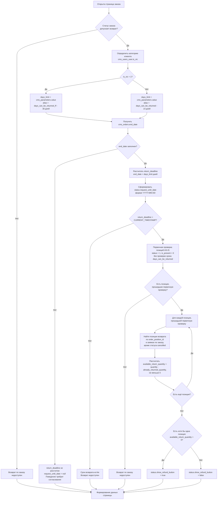

# [B][Web] Карточка заказа. Доработать расчёт доступности возврата и срок оформления возврата

## Цель

Доработать данные страницы заказа на сайте, чтобы кнопка «Оформить возврат» показывалась с учётом категории клиента и уже созданных заявок — по тем же правилам, что в мобильном приложении (ECOMDEV-2343), — и сайт получал дату, до которой можно оформить возврат.

**Web**
- `GET /profile/view/{id}` — страница заказа; данные формируются на сервере и встраиваются в страницу

## Описание реализации

Что требуется изменить:

1. Доработать `GET /profile/view/{id}`.
2. Добавить новое поле в данные страницы:
   * `status.request_until_date`
3. Изменить расчёт `status.show_refund_button`.

Вне этой задачи:
* параметр `days_can_be_returned_ff` создаётся в ECOMDEV-2343;
* текст «Можно вернуть изделия до …» под кнопкой выводит фронт сайта — отдельная задача;
* таблицы `cms_returns`, `cms_return_positions`, `cms_return_statuses` создаются задачей на модель данных.

---

#### 1\. Выходные параметры

Входные параметры не меняются.



| Параметр | Было | Стало |
|---|---|---|
| `status.show_refund_button` | `true`, если заказ выполнен или в возвратном статусе, срок `end_date + 14 дней` не истёк и хотя бы одна позиция в статусе «Добавлен» и не подарок | Дополнительно: срок считается по категории клиента (14 / 30 дней), и хотя бы у одной позиции остались изделия, не занятые заявками на возврат |





| Поле | Тип данных | Описание |
|---|---|---|
| `status.request_until_date` | `string` (`YYYY-MM-DD`) \| `null` | Последний день, когда можно оформить заявку на возврат. `null`, {red}(если у заказа нет даты выполнения или статус заказа не допускает возврат) |



```json
{
  "id": 500128139,
  "status": {
    "show_refund_button": true,
    "request_until_date": "2026-10-15"
  }
}
```





#### 2\. Изменить логику определения доступности возврата

**Эндпоинт:** `GET /profile/view/{id}`

Логика расчёта — та же, что в ECOMDEV-2343 (шаги 1–7). Расчёт реализуется один раз и используется обоими каналами; отличается только то, что отдаётся в ответ.









**Проверки выполняются последовательно — от первого пункта к последнему.**

1. **Проверка статуса заказа**

   1. Если статус заказа допускает возврат, система переходит к определению категории клиента и срока возврата.

   2. Если статус заказа не допускает возврат, дальнейший расчёт доступности возврата не выполняется.

2. **Определение категории клиента и расчёт срока возврата**

   1. Система определяет категорию пользователя `cms_users_user.is_vic`.

   2. Если `cms_users_user.is_vic = 1`, срок возврата берётся из `cms_parameters.value`, где `cms_parameters.alias = days_can_be_returned_ff`.

   3. Иначе срок возврата берётся из `cms_parameters.value`, где `cms_parameters.alias = days_can_be_returned`.

   4. Полученное значение записывается во внутреннюю переменную `<days_limit>`.

   5. Система получает дату завершения/вручения заказа `cms_orders.end_date`.

   6. Если `cms_orders.end_date` заполнен, система рассчитывает срок окончания возврата:

   ```
   <return_deadline> = cms_orders.end_date + INTERVAL <days_limit> DAY
   ```

   7. Из рассчитанного `<return_deadline>` формируется `status.request_until_date` в формате `YYYY-MM-DD`.
   8. **{red}(Поведение при)** `cms_orders.end_date IS NULL` **{red}(требует отдельного согласования, разрешается ли в таком случае оформление возврата.)**

3. **Проверка срока возврата**

   1. Если `<return_deadline>` рассчитан, система проверяет: `<return_deadline> > CURRENT_TIMESTAMP()` {red}(до конца дня или до времени??)

   2. Если срок истёк:

      * заказ считается недоступным для оформления возврата

      * первичная проверка позиций и расчёт доступного количества по позициям не выполняются

   3. Если срок не истёк, система переходит к первичной проверке позиций заказа.

4. **Первичная проверка позиций заказа**

   > **AS-IS:** далее применяется существующая логика проверки позиции. Она не изменяется в рамках данной задачи и должна соответствовать текущей реализации. Приведённые в задаче условия могут быть описаны укрупнённо; если фактическая AS-IS-логика отличается, необходимо сохранить текущую реализацию при условии, что она не противоречит новой логике определения и проверки срока возврата.

   > **Ограничение:** существующая проверка статуса позиции (`status = 1`) может влиять на расчёт доступного количества при частичном возврате. При подаче заявки статус позиции заказа меняется, и после этого позиция не проходит первичную проверку целиком. **В рамках задачи это не прорабатывается.**

   1. Для каждой позиции заказа система выполняет существующие **AS-IS-проверки позиции**:

      1. статус позиции `cms_order_positions.status = 1` («Добавлен»)
      2. позиция не является подарком: `cms_order_positions.is_present = 0`.

   2. Проверка срока через `cms_parameters.alias = days_can_be_returned` (14 дней), которая входит в текущую AS-IS-проверку (`Order::canBeReturned()`), в первичную проверку не включается. Она заменена проверкой срока с учётом категории клиента в пунктах 2–3. Проверка статуса заказа выполнена в пункте 1.

   3. Если есть позиции, прошедшие первичную проверку, система переходит к определению количества изделий, уже участвующих в возвратах.

   4. Если таких позиций нет, дальнейший расчёт доступности возврата не выполняется.

5. **Определение количества изделий, уже участвующих в возвратах**

   Для каждой позиции, прошедшей первичную проверку, система определяет количество единиц товара, уже участвующих в ранее созданных заявках на возврат.

   1. Учитываются позиции возврата по текущей позиции заказа (`cms_return_positions.order_position_id = cms_order_positions.id`) из заявок по текущему заказу, кроме заявок в статусе `cancelled` (статус заявки `cms_returns.status_id`, а не статус позиции возврата).

   2. Заявки во всех статусах, кроме `cancelled` («Отменён»), учитываются при расчёте, ++если иное не будет определено статусной моделью возврата++.

   3. Система рассчитывает количество единиц, уже участвующих в возвратах: `<already_returned_quantity> = SUM(cms_return_positions.quantity)`.

   4. Если подходящие позиции возврата отсутствуют, то `<already_returned_quantity> = 0`.

6. **Расчёт доступного количества для возврата**

   1. Для каждой позиции система рассчитывает `<available_return_quantity> = cms_order_positions.quantity - <already_returned_quantity>`.
   2. Если из-за рассинхронизации данных `<already_returned_quantity> > cms_order_positions.quantity`, система устанавливает `<available_return_quantity> = 0`. Отрицательное значение не используется.

7. **Формирование признака `status.show_refund_button`**

   1. `status.show_refund_button = true`, если одновременно выполняются условия:
      1. статус заказа допускает возврат
      2. срок возврата не истёк
      3. хотя бы одна позиция прошла первичную проверку (п. 4) и у неё `<available_return_quantity> > 0`
   2. Если хотя бы одно условие не выполнено: `status.show_refund_button = false`.





| API | Тип данных | БД | Тип данных |
|---|---|---|---|
| `status.show_refund_button` | boolean | Динамический расчёт по шагам 1–7 | — |
| `status.request_until_date` | string (`YYYY-MM-DD`) \| null | Динамический расчёт: `cms_orders.end_date + INTERVAL <days_limit> DAY`, где `<days_limit> = cms_parameters.value` | — |



### Ошибки

Состав ошибок не меняется.

## Открытые вопросы

| Вопрос | Кому |
|---|---|
| 1. Заказ без даты выполнения (`cms_orders.end_date IS NULL`): разрешается ли оформление возврата? | Product Manager |
| 2. Срок действует до времени выполнения заказа или до конца дня `request_until_date`? | Product Manager |
| 3. Список заказов в ЛК (`UserOrderListExtractor`) тоже показывает кнопку «Оформить возврат» через `canBeReturned()`. Оставить кнопку в списке с тем же расчётом или убрать её, как в мобильном приложении? | Product Manager |
