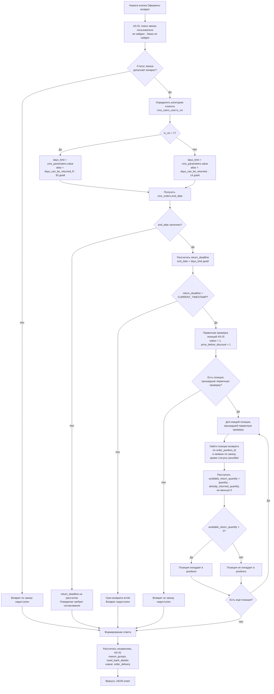

# [B][Web] Форма возврата. Доработать получение позиций для возврата: срок, остаток изделий и данные доставки заказа

## Цель

Доработать ответ, который сайт получает при нажатии «Оформить возврат», чтобы система заново проверяла доступность возврата по тем же правилам, что в мобильном приложении (ECOMDEV-2343), отдавала только позиции с изделиями, доступными для возврата, остаток изделий по каждой позиции и данные доставки заказа для автоподстановки на следующих шагах.

**Web**
- `GET /orders/refund/get-positions?id={id}` — AJAX-запрос попапа возврата

## Описание реализации

Что требуется изменить:

1. Доработать `GET /orders/refund/get-positions?id={id}`.
2. Добавить новые поля в ответ:
   * `data.positions[].available_return_quantity`

   * `data.order_delivery`
3. Изменить отбор позиций `data.positions[]`.

Вне этой задачи:
* параметр `days_can_be_returned_ff` создаётся в ECOMDEV-2343;
* ограничение выбора количества изделий в попапе — задача фронта сайта;
* таблицы `cms_returns`, `cms_return_positions`, `cms_return_statuses` создаются задачей на модель данных.

---

#### 1\. Выходные параметры

Входные параметры не меняются.



| Параметр | Было | Стало |
|---|---|---|
| `data.positions[]` | Позиции заказа в статусе «Добавлен» и не подарок (`price_before_discount > 1`). Статус заказа и срок возврата не проверяются | Дополнительно: статус заказа допускает возврат, срок возврата по категории клиента (14 / 30 дней) не истёк, у позиции остались изделия, не занятые заявками на возврат (`available_return_quantity > 0`). Позиции без доступных изделий в список не попадают |





| Поле | Тип данных | Описание |
|---|---|---|
| `data.positions[].available_return_quantity` | `int` | Количество изделий позиции, доступных для возврата. Всегда больше 0 |
| `data.order_delivery` | `object` | Данные исходной доставки заказа |

Объект `data.order_delivery` — тот же, что `order_delivery` в ECOMDEV-2343:

| Поле | Тип данных | Описание |
|---|---|---|
| `data.order_delivery.country_iso` | string \| null | ISO-код страны доставки |
| `data.order_delivery.region` | string \| null | Регион доставки |
| `data.order_delivery.city` | string \| null | Город доставки |
| `data.order_delivery.city_fias` | string \| null | ID города в геосервисе (ФИАС для РФ) |
| `data.order_delivery.address` | object \| null | Адрес курьерской доставки — для проверки в геосервисе |
| `data.order_delivery.address.postal` | string \| null | Индекс |
| `data.order_delivery.address.street` | string \| null | Улица |
| `data.order_delivery.address.house` | string \| null | Дом |
| `data.order_delivery.address.housing` | string \| null | Корпус |
| `data.order_delivery.pvz` | object \| null | Пункт выдачи, куда доставлялся заказ — для проверки в сервисе логистики |
| `data.order_delivery.pvz.provider` | string | Код службы пункта выдачи |
| `data.order_delivery.pvz.id` | string | ID пункта выдачи |
| `data.order_delivery.store` | object \| null | Магазин самовывоза — для проверки по списку магазинов, принимающих возвраты |
| `data.order_delivery.store.store_code` | int | Код магазина |



```json
{
  "data": {
    "positions": [
      {
        "id": 67890,
        "title": "Пламя",
        "quantity": 3,
        "price_before_discount": 1500,
        "is_present": false,
        "available_return_quantity": 2
      }
    ],
    "reason_groups": [],
    "need_bank_details": true,
    "order_delivery": {
      "country_iso": "RU",
      "region": "Москва",
      "city": "Москва",
      "city_fias": "0c5b2444-70a0-4932-980c-b4dc0d3f02b5",
      "address": null,
      "pvz": {
        "provider": "sdek-pvz",
        "id": "1631548"
      },
      "store": null
    }
  },
  "errorCode": null,
  "errors": [],
  "message": "success",
  "success": true
}
```

Примеры `order_delivery` для курьерской доставки, самовывоза и случая без данных — как в ECOMDEV-2343.





`data.order_delivery` формируется всегда, независимо от доступности возврата. Из объектов `address`, `pvz`, `store` заполняется один, два других равны `null`.

Способ доставки определяется по типу службы доставки заказа (`cms_orders.delivery_method = cms_delivery_tk.id` → `cms_delivery_tk.type`) — так же, как в существующей логике формирования адреса заказа (`getFullAddressCompiled()`). Проверки выполняются по порядку:

1. самовывоз из магазина — `cms_delivery_tk.type` IN (7, 13) → заполняется `store`;
2. пункт выдачи — `cms_delivery_tk.type` IN (3, 11, 14, 15) и заполнен `cms_orders.pvz_id` → заполняется `pvz`;
3. иначе курьерская доставка → заполняется `address`; если пустые `cms_orders.street` и `cms_orders.house` → `address = null`.

#### 2\. Изменить логику отбора позиций для возврата

**Эндпоинт:** `GET /orders/refund/get-positions?id={id}`

Логика расчёта — та же, что в ECOMDEV-2343 (шаги 1–6). Расчёт реализуется один раз и используется обоими каналами; отличается только то, что отдаётся в ответ. Расчёт выполняется заново при каждом запросе: попап может быть открыт из списка заказов или спустя время после открытия страницы заказа.









**Проверки выполняются последовательно — от первого пункта к последнему.**

1. **Поиск заказа** — логика не меняется

   1. Система ищет заказ по `id` среди заказов авторизованного пользователя. Заказ не найден → ответ AS-IS: `success = false`, «Заказ не найден».

2. **Проверка статуса заказа** (новая проверка для этого метода)

   1. Если статус заказа допускает возврат, система переходит к определению категории клиента и срока возврата.

   2. Если статус заказа не допускает возврат, дальнейший расчёт доступности возврата не выполняется.

3. **Определение категории клиента и расчёт срока возврата** (новая проверка для этого метода)

   1. Система определяет категорию пользователя `cms_users_user.is_vic`.

   2. Если `cms_users_user.is_vic = 1`, срок возврата берётся из `cms_parameters.value`, где `cms_parameters.alias = days_can_be_returned_ff`.

   3. Иначе срок возврата берётся из `cms_parameters.value`, где `cms_parameters.alias = days_can_be_returned`.

   4. Полученное значение записывается во внутреннюю переменную `<days_limit>`.

   5. Система получает дату завершения/вручения заказа `cms_orders.end_date`.

   6. Если `cms_orders.end_date` заполнен, система рассчитывает срок окончания возврата:

   ```
   <return_deadline> = cms_orders.end_date + INTERVAL <days_limit> DAY
   ```

   7. **{red}(Поведение при)** `cms_orders.end_date IS NULL` **{red}(требует отдельного согласования, разрешается ли в таком случае оформление возврата.)**

4. **Проверка срока возврата** (новая проверка для этого метода)

   1. Если `<return_deadline>` рассчитан, система проверяет: `<return_deadline> > CURRENT_TIMESTAMP()` {red}(до конца дня или до времени??)

   2. Если срок истёк:

      * заказ считается недоступным для оформления возврата

      * первичная проверка позиций и расчёт доступного количества по позициям не выполняются

   3. Если срок не истёк, система переходит к первичной проверке позиций заказа.

5. **Первичная проверка позиций заказа**

   > **AS-IS:** далее применяется существующая логика отбора позиций для возврата (`OrderPositionRepository::findAllForRefundByOrderId()`). Она не изменяется в рамках данной задачи и должна соответствовать текущей реализации. Приведённые в задаче условия могут быть описаны укрупнённо; если фактическая AS-IS-логика отличается, необходимо сохранить текущую реализацию при условии, что она не противоречит новой логике определения и проверки срока возврата.

   > **Ограничение:** существующая проверка статуса позиции (`status = 1`) может влиять на расчёт доступного количества при частичном возврате. При подаче заявки статус позиции заказа меняется, и после этого позиция не проходит первичную проверку целиком. **В рамках задачи это не прорабатывается.**

   1. Для каждой позиции заказа система выполняет существующие **AS-IS-проверки позиции**:

      1. статус позиции `cms_order_positions.status = 1` («Добавлен»)
      2. позиция не является подарком: `cms_order_positions.price_before_discount > 1`.

   2. Если есть позиции, прошедшие первичную проверку, система переходит к определению количества изделий, уже участвующих в возвратах.

   3. Если таких позиций нет, дальнейший расчёт доступности возврата не выполняется.

6. **Определение количества изделий, уже участвующих в возвратах**

   Для каждой позиции, прошедшей первичную проверку, система определяет количество единиц товара, уже участвующих в ранее созданных заявках на возврат.

   1. Учитываются позиции возврата по текущей позиции заказа (`cms_return_positions.order_position_id = cms_order_positions.id`) из заявок по текущему заказу, кроме заявок в статусе `cancelled` (статус заявки `cms_returns.status_id`, а не статус позиции возврата).

   2. Заявки во всех статусах, кроме `cancelled` («Отменён»), учитываются при расчёте, ++если иное не будет определено статусной моделью возврата++.

   3. Система рассчитывает количество единиц, уже участвующих в возвратах: `<already_returned_quantity> = SUM(cms_return_positions.quantity)`.

   4. Если подходящие позиции возврата отсутствуют, то `<already_returned_quantity> = 0`.

7. **Расчёт доступного количества для возврата**

   1. Для каждой позиции система рассчитывает `<available_return_quantity> = cms_order_positions.quantity - <already_returned_quantity>`.
   2. Если из-за рассинхронизации данных `<already_returned_quantity> > cms_order_positions.quantity`, система устанавливает `<available_return_quantity> = 0`. Отрицательное значение не возвращается.

8. **Формирование `data.positions[]`**

   1. Позиция попадает в `data.positions[]`, если одновременно выполняются условия:
      1. статус заказа допускает возврат
      2. срок возврата не истёк
      3. позиция прошла первичную проверку (п. 5)
      4. `<available_return_quantity> > 0`
   2. Для позиции из списка `data.positions[].available_return_quantity = <available_return_quantity>`.
   3. Если хотя бы одно условие не выполнено, позиция в `data.positions[]` не попадает.
   4. Если ни одна позиция не попала в список: `data.positions = []`, {red}(ответ сайту при недоступности возврата — `success = true` с пустым списком или `success = false` с текстом — требует согласования.)

9. **Причины возврата и банковские реквизиты — логика не меняется**

   1. `data.reason_groups` и `data.need_bank_details` формируются по AS-IS-логике, независимо от результата шагов 2–8.





| API | Тип данных | БД | Тип данных |
|---|---|---|---|
| `data.positions[].available_return_quantity` | int | Динамический расчёт. Расчёт из `cms_order_positions.quantity` и `cms_return_positions` | — |
| `data.order_delivery.country_iso` | string \| null | `cms_orders.country` | `varchar(255)` |
| `data.order_delivery.region` | string \| null | `cms_orders.state` | `varchar(255)` |
| `data.order_delivery.city` | string \| null | `cms_orders.city` | `varchar(255)` |
| `data.order_delivery.city_fias` | string \| null | `cms_orders.city_fias` | `varchar(255)` |
| `data.order_delivery.address.postal` | string \| null | `cms_orders.postal` | `varchar(255)` |
| `data.order_delivery.address.street` | string \| null | `cms_orders.street` | `varchar(255)` |
| `data.order_delivery.address.house` | string \| null | `cms_orders.house` | `varchar(255)` |
| `data.order_delivery.address.housing` | string \| null | `cms_orders.housing` | `varchar(255)` |
| `data.order_delivery.pvz.provider` | string | `cms_delivery_tk.slug` (по `cms_orders.delivery_method` = `cms_delivery_tk.id`) | `varchar(255)` |
| `data.order_delivery.pvz.id` | string | `cms_orders.pvz_id` | `varchar(32)` |
| `data.order_delivery.store.store_code` | int | `cms_delivery_tk.store_code` (по `cms_orders.delivery_method` = `cms_delivery_tk.id`) | `smallint(6)` |



### Ошибки

Состав ошибок не меняется. Недоступность возврата ошибкой не является — см. шаг 8.4.

## Открытые вопросы

| Вопрос | Кому |
|---|---|
| 1. Заказ без даты выполнения (`cms_orders.end_date IS NULL`): разрешается ли оформление возврата? | Product Manager |
| 2. Срок действует до времени выполнения заказа или до конца дня? | Product Manager |
| 3. Ответ, если на момент нажатия возврат уже недоступен (истёк срок, все изделия в заявках): пустой список или `success = false` с текстом? Какой текст? | Product Manager, фронт сайта |
| 4. Нужен ли в `data.positions[]` штрихкод позиции (`barcode`) для метода создания заявки? Сейчас позиция передаётся только `id` | Бэкенд-команда |
