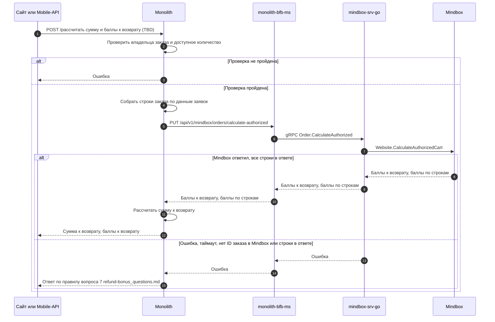
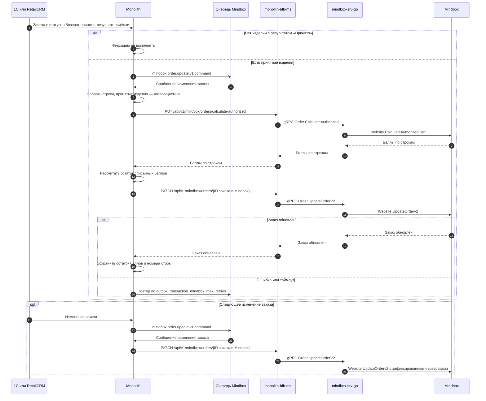

# BL-RET-BONUS: Баллы к возврату. Расчёт и фиксация возврата баллов в Mindbox

**Системы:** монолит, `monolith-bfb-ms`, `mindbox-srv-go` (команда BTS), Mindbox
**Связанные артефакты:** US 1.4, US 1.5, US 3 — [SRS сайта](../srs/srs-web-mvp.md), [SRS МП](../srs/srs-mobile-mvp.md); `ADR-RET-092`, `ADR-RET-099`, `ADR-RET-101`, `ADR-RET-039`; [доступное к возврату количество](./available-return-quantity_backend.md)
**Решения и открытые вопросы:**
- [mindbox-exchange_questions.md](../questions/mindbox-exchange_questions.md) — операции, строки, статусы, `mindbox-srv-go`. В тексте: «факт N», «решение N», «❓N»;
- [refund-bonus_questions.md](../questions/refund-bonus_questions.md) — правила баллов для клиента. В тексте: «refund-bonus, решение N», «❓ refund-bonus N»

## Коротко

Документ описывает, как система возвращает клиенту баллы при возврате товара. Когда клиент оформляет возврат, сайт спрашивает у Mindbox, сколько баллов вернётся, и показывает это число на экране. Когда склад или магазин принял товар, сайт сообщает Mindbox, что возврат состоялся, и Mindbox возвращает баллы на счёт клиента. Если потом заказ снова меняется, возврат не теряется.

Сначала описано, что происходит в каждой ситуации и почему. Затем — технические детали: как обмен с Mindbox работает сейчас, методы, параметры, правила сборки строк, ошибки, доработки по сервисам, схемы и пример.

## Содержание

**Часть 1. Логика взаимодействия**

1.1. Цель и роль Mindbox
1.2. Почему текущего обмена недостаточно
1.3. Общая последовательность: от оформления до возврата баллов
1.4. Как сайт показывает Mindbox заказ с возвратом
1.5. Предварительный расчёт баллов на экране оформления
1.6. Расчёт и сохранение баллов при создании заявки
1.7. Фиксация возврата баллов при «Возврат принят»
1.8. Отмена заявки
1.9. Повторный возврат по тому же заказу
1.10. Следующие изменения заказа

**Часть 2. Техническое взаимодействие**

2.1. Цепочка вызовов
2.2. Обмен сейчас: что монолит передаёт и получает
2.3. Правила сборки строк заказа для Mindbox
2.4. Расчёт: запрос и ответ
2.5. Изменение заказа: запрос
2.6. Очередь, повторы и ошибки
2.7. Доработки по сервисам
2.8. Что не меняется
2.9. Схемы взаимодействия
2.10. Пример запроса и ответа

**Открытые вопросы**

---

## Часть 1. Логика взаимодействия

### 1.1. Цель и роль Mindbox

**Цель** — возвращать клиенту баллы, которыми он оплатил возвращённые изделия: считать баллы к возврату в Mindbox при оформлении заявки, фиксировать возврат в Mindbox при «Возврат принят» и сохранять его при следующих изменениях заказа.

Баллы ведёт Mindbox. Сайт не считает баллы сам: он показывает результат расчёта Mindbox и сообщает Mindbox о состоявшемся возврате.

Отдельной сущности возврата у Mindbox нет. Возврат передаётся изменением заказа: строки возвращённых изделий получают статус возврата, сумма списанных баллов уменьшается на возвращённые (`ADR-RET-092`; решения 3, 7).

Одинаковые изделия хранятся в заказе одной позицией с количеством, списанные баллы — на всю позицию (решение 10). Делить баллы позиции на изделия должен Mindbox, поэтому в сообщении для Mindbox позиция делится на строки остающихся и возвращаемых изделий (решение 5).

### 1.2. Почему текущего обмена недостаточно

**Как сейчас.** При возврате из личного кабинета сайт меняет статус заказа на «Возврат из ЛК», а возвращаемые позиции — на «Возврат». Mindbox получает новый статус заказа и строки возврата (факт 5).

**Что меняется.** Статус заказа при возврате больше не меняется: выполненный заказ остаётся выполненным (`ADR-RET-039`). О возврате Mindbox узнаёт только по строкам заказа.

**Чего не позволяет текущая реализация:**

1. **Посчитать возврат по существующему заказу.** Сейчас расчёт в Mindbox работает только для корзины: ID заказа в него не передаётся.
2. **Различить строки одного товара.** Номер строки сейчас равен ID товара, поэтому две строки одной футболки для Mindbox неотличимы.
3. **Передать возврат при новых статусах позиции.** «Заявка на возврат» и «Частичный возврат» уходят в Mindbox как новая позиция.
4. **Сохранить возврат в Mindbox.** Каждое изменение заказа отправляет позиции с исходными статусами и исходным списанием баллов — уже зафиксированный возврат затирается.

Технически — раздел 2.2.

### 1.3. Общая последовательность: от оформления до возврата баллов

| Когда | Что делает система | Mindbox | Что сохраняется | Раздел |
|---|---|---|---|---|
| Клиент выбирает изделия на экране оформления | Показывает «Баллы к возврату» | Расчёт | Ничего | 1.5 |
| Клиент создаёт заявку | Считает и запоминает баллы по каждому изделию заявки | Расчёт | Баллы к возврату по изделиям | 1.6 |
| Заявка перешла в «Возврат принят» | Сообщает Mindbox о возврате принятых изделий | Расчёт, затем изменение заказа | Остаток списанных баллов, номера строк | 1.7 |
| Заявка отменена до «Возврат принят» | Ничего не отправляет | — | — | 1.8 |
| Заказ снова изменился, например в RetailCRM | Отправляет заказ вместе с зафиксированными возвратами | Изменение заказа | — | 1.10 |

**Что нужно сделать:**

1. Собирать строки заказа для Mindbox по данным заявок (1.4, 2.3).
2. Считать баллы к возврату при оформлении и при создании заявки (1.5, 1.6).
3. Фиксировать возврат в Mindbox при «Возврат принят» (1.7).
4. Учитывать зафиксированные возвраты в каждой отправке заказа в Mindbox (1.10).
5. Передавать ID заказа и номера строк через `monolith-bfb-ms` и `mindbox-srv-go` (2.7).

Новый процесс включается фичетоглом новых возвратов. Когда фичетогл выключен, обмен с Mindbox работает по текущей логике без изменений.

### 1.4. Как сайт показывает Mindbox заказ с возвратом

**Простыми словами.** Для каждой операции монолит собирает заказ так, как он выглядит с учётом возвратов: что осталось у клиента, что уже возвращено и что возвращается сейчас. Правило одно для расчёта, фиксации и любой отправки заказа.

**Что считается возвращённым.** Изделия с результатом приёмки «Принято» в заявках в статусах «Возврат принят» и «Возврат завершён». Изделия активных заявок и изделия с результатом «Отменено» считаются остающимися: возврат по ним не состоялся.

**Как позиция превращается в строки:**

- изделия, которые остаются у клиента, — одна строка с прежним статусом;
- каждое возвращённое и каждое возвращаемое сейчас изделие — отдельная строка с количеством 1 и статусом возврата;
- строка с количеством 0 не передаётся.

Отдельная строка на каждое изделие нужна, так как сайт хранит баллы к возврату по каждому изделию заявки, а Mindbox отдаёт баллы по строке.

**Какие изделия «возвращаются сейчас»:**

| Операция | Возвращаемые сейчас |
|---|---|
| Предварительный расчёт, создание заявки | Выбранные клиентом изделия |
| Фиксация | Изделия фиксируемой заявки с результатом «Принято» |
| Любая другая отправка заказа | Нет |

**Сумма списанных баллов заказа:** если возвратов не было — баллы, списанные при покупке, как сейчас; если были зафиксированные возвраты — остаток списанных баллов после последней фиксации (1.7).

Строки — формат обмена с Mindbox. Как позиция хранится в заказе сайта и передаётся в RetailCRM и 1С, определяет [order-position-split_questions.md](../questions/order-position-split_questions.md).

Пошаговый алгоритм, статусы, номера строк и скидки — раздел 2.3.

### 1.5. Предварительный расчёт баллов на экране оформления

**Что происходит и зачем.** Клиент выбирает изделия для возврата и до отправки заявки видит, сколько денег и баллов получит. Деньги считает монолит, баллы — Mindbox: только он знает, как баллы, списанные при покупке, распределяются по изделиям (refund-bonus, решение 7). Поэтому монолит показывает Mindbox, как будет выглядеть заказ после возврата, и спрашивает, сколько баллов вернётся. US 1.4.

**Метод монолита:** `POST /рассчитать сумму и баллы к возврату` (TBD; МП — `POST /api/v1/orders/{order_id}/return/calculate`, TBD). Входные параметры — в SRS. Сайт и приложение вызывают один метод и получают готовые значения.

#### Когда выполняется

Когда клиент на экране оформления выбрал изделия или изменил выбор.

#### Условия

Расчёт выполняется, если:

- заказ принадлежит клиенту;
- выбранные изделия относятся к позициям заказа, и их количество не больше доступного к возврату ([available-return-quantity_backend.md](./available-return-quantity_backend.md));
- у заказа есть ID в Mindbox.

#### Что делает система

1. **Проверяет заказ.** Если заказ не принадлежит клиенту — возвращает ошибку.
2. **Проверяет изделия.** Если изделия не относятся к позициям заказа или их больше доступного к возврату — возвращает ошибку.
3. **Собирает строки заказа** по правилам 1.4 и 2.3: выбранные изделия — возвращаемые сейчас. Сумма списанных баллов заказа — по 1.4.
4. **Запрашивает расчёт в Mindbox.** Монолит вызывает `PUT /api/v1/mindbox/orders/calculate-authorized` в `monolith-bfb-ms` → gRPC `Order.CalculateAuthorized` в `mindbox-srv-go` → операция Mindbox `Website.CalculateAuthorizedCart`. Передаются ID заказа в Mindbox (`order.ids.mindboxId`), строки и сумма списанных баллов `bonuses[].amount`.
5. **Проверяет ответ.** Если `mindbox-srv-go` вернул ошибку или не ответил за `MINDBOX_TIMEOUT`, у заказа нет ID в Mindbox или в ответе нет переданной строки — отвечает клиенту по ❓ refund-bonus 7.
6. **Берёт баллы к возврату.** `spentAmount` из ответа: отрицательное значение — баллы, которые Mindbox вернёт (`-33` → 33 балла).
7. **Возвращает результат**: сумму к возврату и «Баллы к возврату» = модуль `spentAmount`.

#### Взаимодействие с Mindbox

| Направление | Что передаётся | Откуда берётся |
|---|---|---|
| Монолит → Mindbox | ID заказа в Mindbox (`order.ids.mindboxId`) | Заказ сайта. Сейчас в расчёт не передаётся — доработка, ❓15 |
| Монолит → Mindbox | Строки: товар, количество, цена, статус строки, `line_id`, `sequence_number` | Позиции заказа и заявки на возврат, 2.3 |
| Монолит → Mindbox | `bonuses[].amount` — сумма списанных баллов заказа | 1.4 |
| Mindbox → монолит | `spentAmount` — изменение списанных баллов | → «Баллы к возврату» |
| Mindbox → монолит | Списанные баллы по строкам | В этом сценарии не используются |
| Mindbox → монолит | `earnedAmount` — начисленные баллы, которые снимаются при возврате | Клиенту не показываются (❓ refund-bonus 3, 6) |

Поля запроса и ответа — 2.4.

#### Результат

- Клиент видит «Итого к возврату» и «Баллы к возврату».
- Ничего не сохраняется: значения предварительные.

**Пример.** В заказе 3 футболки, на них списано 100 баллов. Клиент выбирает одну. Монолит передаёт строку «2 футболки, прежний статус» и строку «1 футболка, возврат», `bonuses[].amount` = 100. Mindbox отвечает `spentAmount` = `-33`. Клиент видит «Баллы к возврату: 33». Запрос — 2.10.

#### Если что-то пошло не так

| Ситуация | Что происходит |
|---|---|
| Заказ не принадлежит клиенту | Ошибка, Mindbox не вызывается |
| Изделия не из заказа или их больше доступного к возврату | Ошибка, Mindbox не вызывается |
| Сумма количеств строк не равна количеству позиции | Сообщение не отправляется, ошибка — в лог (2.3, шаг 8). Что видит клиент — открытый вопрос |
| У заказа нет ID в Mindbox | Ответ клиенту — ❓ refund-bonus 7 |
| Ошибка `mindbox-srv-go` или нет ответа за `MINDBOX_TIMEOUT` | Ответ клиенту — ❓ refund-bonus 7. Допустимое время ответа — ❓14 |
| В ответе нет переданной строки | Ответ клиенту — ❓ refund-bonus 7 |
| Mindbox разделил строку на несколько с одним `lineId` | Монолит присваивает каждой новой строке свой `line_id` для следующих запросов (2.3, шаг 6) |
| По заказу уже были возвраты | 1.9 |

#### Что решено и что открыто

| Правило | Статус |
|---|---|
| Баллы к возврату считает Mindbox, сумму к возврату — монолит, один метод для сайта и приложения | Решено: refund-bonus, решение 7 |
| Расчёт — `Website.CalculateAuthorizedCart` по существующему заказу | Решено: решение 4, `ADR-RET-092` |
| Существующий заказ передаётся по `order.ids.mindboxId` | Решено: решение 11. Передача через `mindbox-srv-go` — ❓15 |
| «Баллы к возврату» = модуль `spentAmount` | Решено: решение 6 |
| Каждое возвращаемое изделие — отдельная строка с количеством 1 | Предложено. Можно ли делить строку у созданного заказа — ❓8 |
| Код статуса строки возврата — `401` | Предложено. Подтверждение — ❓5 |
| Что видит клиент без ответа Mindbox | Открыто: ❓ refund-bonus 7 |
| Какие промоакции применяет расчёт к существующему заказу | Открыто: ❓11 |
| Кто делит скидку промокода между строками | Открыто: ❓12 |

---

### 1.6. Расчёт и сохранение баллов при создании заявки

**Что происходит и зачем.** Клиент отправил заявку. Монолит ещё раз считает баллы в Mindbox — уже по изделиям заявки — и запоминает, сколько баллов приходится на каждое изделие. Эти значения клиент видит в заявке (US 3). US 1.5.

**Метод монолита:** `POST /создать заявку на возврат` (TBD).

#### Когда выполняется

Когда клиент создаёт заявку на возврат.

#### Условия и действия

Как в 1.5, с отличиями:

1. Возвращаемые сейчас — изделия заявки.
2. После ответа Mindbox монолит сохраняет баллы к возврату по каждому изделию заявки — количество списанных баллов строки этого изделия из ответа. Источник — `spentBonusPointsAmount` элемента `appliedPromotions` с типом `spentBonusPoints`. `amount` этого элемента — размер скидки; при курсе 1 балл = 1 ₽ он совпадает с количеством баллов (❓13).
3. Если сумма баллов по изделиям отличается от модуля `spentAmount`, монолит сохраняет баллы по строкам и записывает расхождение в лог.

Цепочка вызовов та же: `calculate-authorized` → `Order.CalculateAuthorized` → `Website.CalculateAuthorizedCart`.

#### Результат

- Заявка создана, по каждому изделию сохранены баллы к возврату.
- Заказ в Mindbox не меняется: возврат ещё не состоялся.

**Пример.** Строка возвращаемой футболки в ответе: `spentBonusPointsAmount` = 33 → у изделия заявки сохраняется 33 балла.

#### Если что-то пошло не так

Как в 1.5. Отдельно: сумма баллов по изделиям не совпала с модулем `spentAmount` — сохраняются баллы по строкам, расхождение — в лог.

#### Что решено и что открыто

| Правило | Статус |
|---|---|
| Сумма и баллы сохраняются по каждому изделию заявки | Решено: refund-bonus, решение 7 |
| Баллы изделия = `spentBonusPointsAmount` строки | Предложено. Совпадение с `amount` и передача поля через `mindbox-srv-go` — ❓13 |

---

### 1.7. Фиксация возврата баллов при «Возврат принят»

**Что происходит и зачем.** До этого момента Mindbox только считал баллы — заказ в нём не менялся. Баллы возвращаются клиенту, когда Mindbox получает изменённый заказ: строки принятых изделий со статусом возврата и уменьшенную сумму списанных баллов. Это и есть фиксация возврата (решение 7).

Возвращаются баллы только за изделия, которые склад или магазин принял. За отменённые изделия баллы не возвращаются (refund-bonus, решение 6).

#### Когда выполняется

Когда заявка переходит в «Возврат принят», в том числе вручную (`ADR-RET-099`; решение 8). Статус заказа при этом не меняется (`ADR-RET-039`).

#### Условия

Если в заявке есть изделия с результатом «Принято» — фиксация выполняется. Иначе фиксация не выполняется, заказ в Mindbox не меняется.

#### Что делает система

Фиксация асинхронная: монолит ставит сообщение в очередь `mindbox.order.update.v1.command`, как обычное изменение заказа, и обрабатывает его из очереди.

1. **Проверяет заявку.** Если изделий с результатом «Принято» нет — фиксацию не выполняет.
2. **Собирает строки** по 1.4 и 2.3: принятые изделия заявки — возвращаемые сейчас; отменённые изделия заявки — остающиеся; ранее возвращённые — со статусом возврата.
3. **Запрашивает расчёт в Mindbox** с ID заказа и этими строками: `PUT /api/v1/mindbox/orders/calculate-authorized` → gRPC `Order.CalculateAuthorized` → `Website.CalculateAuthorizedCart`. `bonuses[].amount` — по 1.4.
4. **Считает остаток списанных баллов** — сумму списанных баллов по строкам из ответа, которые остаются за клиентом (решение 7; противоречие — в «Что решено и что открыто»).
5. **Отправляет изменение заказа** с теми же строками и `bonuses[].amount` = остаток: `PATCH /api/v1/mindbox/orders/{ID заказа в Mindbox}` → gRPC `Order.UpdateOrderV2` → `Website.UpdateOrderv2`.
6. **Сохраняет результат** после успешного ответа: остаток списанных баллов и номера строк. Способ хранения — на усмотрение разработки.
7. **При ошибке или таймауте** сообщение остаётся в outbox и повторяется по лимиту `outbox_transaction_mindbox_max_retries`. Попытки исчерпаны — ошибка в лог.

Расчёт при фиксации выполняется заново, так как часть изделий заявки могла получить «Отменено». Баллы по изделиям, сохранённые при создании заявки, не перезаписываются: их видит клиент (US 3).

Повторная обработка той же заявки формирует тот же состав строк и ту же сумму.

#### Взаимодействие с Mindbox

| Шаг | Операция Mindbox | Что передаётся | Что возвращается и для чего |
|---|---|---|---|
| Расчёт | `Website.CalculateAuthorizedCart` | ID заказа в Mindbox, строки по шагу 2, `bonuses[].amount` до этой фиксации | Списанные баллы по строкам → остаток |
| Изменение заказа | `Website.UpdateOrderv2` | Те же строки и номера строк; `bonuses[].amount` = остаток (в Mindbox — `bonusPoints[].amount`, решение 12) | Подтверждение. Mindbox возвращает баллы на бонусный счёт клиента |

Что Mindbox делает по строке со статусом возврата — возвращает ли списанные баллы и снимает ли начисленные — ❓5. Подходят ли эти операции при неизменном статусе заказа — ❓1, ❓2. Поля изменения заказа — 2.5.

#### Результат

- Mindbox вернул клиенту баллы за принятые изделия.
- На сайте сохранены остаток списанных баллов и номера строк — их использует каждая следующая отправка заказа (1.10).
- Статус заказа не изменился.

**Пример.** В заказе 3 футболки, на них списано 100 баллов. Заявка на одну футболку, склад её принял.

| Шаг | Строки | `bonuses[].amount` |
|---|---|---|
| Расчёт | 2 шт. прежний статус (`311`); 1 шт. возврат | 100 |
| Ответ Mindbox | 66 баллов на оставшиеся, 33 — на возвращённую | — |
| Изменение заказа | Те же строки | 66 |
| После фиксации | Mindbox вернул клиенту 33 балла; на сайте сохранён остаток 66 | — |

Числа — из примера Mindbox: сумма долей 99 из 100, куда относится остаток 1 балл — ❓9.

**Частичная приёмка.** Заявка на 2 футболки, склад принял одну, вторая получила «Отменено». Фиксируется возврат одной футболки; отменённая передаётся как остающаяся.

#### Если что-то пошло не так

| Ситуация | Что происходит |
|---|---|
| В заявке нет изделий с результатом «Принято» | Фиксация не выполняется |
| Сумма количеств строк не равна количеству позиции | Сообщение не отправляется, ошибка — в лог (2.3, шаг 8) |
| Ошибка или таймаут расчёта или изменения заказа | Сообщение остаётся в outbox, повтор по лимиту `outbox_transaction_mindbox_max_retries`. Пока фиксация не прошла, баллы клиенту не возвращаются |
| Попытки исчерпаны | Ошибка в лог; остаток и номера строк не сохраняются |
| Та же заявка обработана повторно | Тот же состав строк и та же сумма |
| Mindbox разделил строку на несколько с одним `lineId` | Монолит присваивает каждой новой строке свой `line_id` и сохраняет номера (2.3, шаг 6) |
| По заказу уже был возврат | 1.9 |

#### Что решено и что открыто

| Правило | Статус |
|---|---|
| Возврат фиксируется изменением заказа с теми же строками, что в расчёте; в списанных баллах — остаток за изделия, которые клиент оставляет | Решено: решение 7, `ADR-RET-092` |
| Фиксация — при «Возврат принят», по принятым изделиям, в том числе при ручном переводе | Решено: решение 8, `ADR-RET-099` |
| Фиксация асинхронная, через очередь `mindbox.order.update.v1.command` | Предложено по текущему обмену |
| Код статуса строки возврата — `401`, и он запускает возврат баллов | Предложено. Подтверждение — ❓5 |
| Остаток считается по строкам остающихся изделий или по строкам остающихся и ранее возвращённых | **Противоречие, нужно решение.** Решение 7 — только остающиеся. Прежняя редакция этого описания — остающиеся и ранее возвращённые. Передавать ли ранее возвращённые строки в расчёт — ❓10 |
| Остаток 1 балл при делении | Открыто: ❓9 |
| Списание с нескольких балльных счетов — как передавать остаток | Открыто: ❓13 |
| Что видит клиент в заявке, если после частичной приёмки баллы к возврату меньше показанных при создании | Открыто, к PM |

---

### 1.8. Отмена заявки

**Что происходит.** Клиент или Дружба отменили заявку до «Возврат принят».

**Что делает система.** Изменение заказа для фиксации в Mindbox не отправляется: изделия активной заявки и так передаются в Mindbox как остающиеся (1.4). Предварительный расчёт и расчёт при создании заявки к этому моменту могли быть выполнены, но заказ в Mindbox они не меняли.

**Результат.** Заказ в Mindbox остаётся без возврата. Изделия отменённой заявки при следующих отправках заказа — остающиеся.

| Правило | Статус |
|---|---|
| Изделия активной заявки передаются с прежним статусом строки | Предложено: ❓6, вариант а) |
| Обратный переход строки из статуса заявки на возврат, если по ❓6 выбран вариант б) | Открыто: ❓7 |

### 1.9. Повторный возврат по тому же заказу

**Что происходит.** Клиент вернул часть изделий, возврат зафиксирован, и он оформляет следующий возврат по тому же заказу.

**Что делает система.** Всё как в 1.5–1.7, с двумя отличиями:

- ранее возвращённые изделия передаются отдельными строками со статусом возврата;
- сумма списанных баллов заказа — остаток, сохранённый при последней фиксации, а не баллы при покупке.

**Пример.** Позиция — 3 футболки, на позицию списано 100 баллов. Клиент возвращает одну, затем вторую.

| Момент | Строки | `bonuses[].amount` |
|---|---|---|
| Предрасчёт первого возврата | 2 шт. `311`; 1 шт. возврат | 100 |
| Фиксация первого возврата, Mindbox: 66 на оставшиеся, 33 на возвращённую | 2 шт. `311`; 1 шт. возврат | 100 → после фиксации 66 |
| Изменение заказа из RetailCRM | 2 шт. `311`; 1 шт. возврат | 66 |
| Предрасчёт второго возврата | 1 шт. `311`; 1 шт. возврат (ранее); 1 шт. возврат (сейчас) | 66 |

| Правило | Статус |
|---|---|
| Как Mindbox считает второй возврат: `spentAmount` только за текущий возврат или за оба; передавать ли ранее возвращённую строку | Открыто: ❓10 |
| Вернутся ли при возврате оставшихся изделий все 100 баллов | Открыто: ❓9 |

### 1.10. Следующие изменения заказа

**Что происходит.** После фиксации заказ меняется по другой причине — например, в RetailCRM.

**Что делает система.** Каждое изменение заказа, которое сейчас уходит в Mindbox, собирает строки и `bonuses[].amount` по 1.4 и 2.3: возвращённые изделия — строками со статусом возврата, списанные баллы — остаток после последней фиксации. Возвращаемых сейчас изделий нет. Остальные данные сообщения — по текущей логике. Цепочка — изменение заказа (2.1), очередь `mindbox.order.update.v1.command`.

**Результат.** Зафиксированный возврат сохраняется в Mindbox. Если возвратов по заказу не было, строки и `bonuses[].amount` совпадают с текущими.

| Правило | Статус |
|---|---|
| Каждая отправка заказа в Mindbox, в том числе после изменения из RetailCRM, учитывает зафиксированные возвраты | Решено: решение 9 |

---

## Часть 2. Техническое взаимодействие

### 2.1. Цепочка вызовов

**AS-IS.** Все обращения к Mindbox идут из монолита через `monolith-bfb-ms` и `mindbox-srv-go`.

| Операция | Монолит → `monolith-bfb-ms` | `monolith-bfb-ms` → `mindbox-srv-go` | `mindbox-srv-go` → Mindbox | Когда |
|---|---|---|---|---|
| Расчёт | `PUT /api/v1/mindbox/orders/calculate-authorized` | gRPC `Order.CalculateAuthorized` | `Website.CalculateAuthorizedCart` | Расчёт корзины |
| Создание заказа | `PUT /api/v1/mindbox/orders` | gRPC `Order.CreateOrder` | Операция создания заказа | Очередь `mindbox.order.create.v1.command` |
| Изменение заказа | `PATCH /api/v1/mindbox/orders/{ID заказа в Mindbox}` | gRPC `Order.UpdateOrderV2` | `Website.UpdateOrderv2` | Любое изменение заказа, в том числе из RetailCRM; очередь `mindbox.order.update.v1.command` |

Соответствие gRPC-методов операциям Mindbox — по названиям: в `architecture-docs` пары не указаны. Подробно об обмене — [order-integration-exchange.md](../../../../knowledge/12storeez-master-web/features/order-integration-exchange.md), [08-integrations.md](../../../../knowledge/12storeez-master-web/architecture/08-integrations.md).

**TO-BE.** Цепочка та же. Расчёт дополнительно вызывается по существующему заказу — при предрасчёте (1.5), создании заявки (1.6) и фиксации (1.7). Изменение заказа — при фиксации (1.7) и при каждом изменении заказа (1.10). Новые методы `mindbox-srv-go` нужны, только если текущие операции Mindbox не подходят (❓1).

### 2.2. Обмен сейчас: что монолит передаёт и получает

**AS-IS.**

**Строка заказа** — одна позиция заказа:

* `id` — товар (размер)
* `quantity`
* `price` — цена до скидки за единицу
* `status` — код статуса Mindbox из `cms_mb_statuses_map` по паре `order_status_id` + `order_position_status_id`; если пары нет — `101`
* `line_id` — ID товара
* `sequence_number` — порядковый номер строки 1…N, только в изменении заказа
* `custom_fields.positionStatus` — код статуса позиции сайта
* `requested_promotions` — скидка распродажи `Sale_12Storeez` и скидка промокода позиции

**Заказ:**

* расчёт — ID клиента, ID корзины, сумма баллов к списанию; ID заказа не передаётся
* изменение заказа — ID заказа на сайте, `bonuses[].amount` — все баллы, списанные по заказу при покупке, доставка, оплаты, свойства заказа

**Что монолит получает из расчёта:**

* `bonuses_changes[]` — `earned_amount`, `spent_amount` одной суммой на заказ
* `positions[].applied_promotions[]` — `type`, `amount`; списанные на строку баллы монолит берёт из элемента с `type = spentBonusPoints`
* поля `spentBonusPointsAmount` в `mindbox.proto` нет

**Статус строки при выполненном заказе:**

| Статус позиции | Код Mindbox |
|---|---|
| Добавлен и другие активные | `311` |
| Возврат (`lost`, `internal_id = 9`) | `401` |
| «Заявка на возврат», «Частичный возврат» (`ADR-RET-101`) | пары нет → `101` |

Полная таблица — [order-status-dictionaries.md](../../../../knowledge/12storeez-master-web/database/order-status-dictionaries.md), раздел 5.

**Текущая реализация не позволяет** (простыми словами — 1.2):

1. Считать существующий заказ: в расчёт не передаётся ID заказа. Mindbox его принимает (`order.ids.mindboxId`), но в `CalculateRequest` в `mindbox.proto` на `origin/master` (v0.9.10) поля нет; TNT-2687 закрыта, задача сайта ECOMDEV-1185 в бэклоге (❓15)
2. Различать строки одного товара: `line_id` = ID товара, у строк одного товара `lineId` совпадает
3. Передать возврат при новых статусах позиции: они уходят как `101` «новая»
4. Сохранить возврат в Mindbox: каждое изменение заказа передаёт позиции с исходными статусами и исходное списание баллов

### 2.3. Правила сборки строк заказа для Mindbox

**TO-BE.** Строки собираются по данным заявок, а не по статусу позиции заказа. Правило одно для расчёта (1.5, 1.6), фиксации (1.7) и отправки заказа (1.10). Простыми словами — 1.4.

Возвращёнными считаются изделия с результатом приёмки «Принято» в заявках в статусах «Возврат принят» и «Возврат завершён». Изделия активных заявок и изделия с результатом «Отменено» — остающиеся.

**Алгоритм для каждой позиции заказа:**

1. Определить количество возвращённых изделий.
2. Определить количество изделий, которые возвращаются сейчас:
   * предрасчёт и создание заявки — выбранные изделия;
   * фиксация — изделия фиксируемой заявки с результатом «Принято»;
   * отправка заказа — 0.
3. Определить количество остающихся: количество позиции минус возвращённые минус возвращаемые сейчас.
4. Сформировать строки:
   * остающиеся изделия — одна строка, статус — код Mindbox по паре «статус заказа + статус позиции до первой заявки» (для выполненного заказа — `311`);
   * каждое возвращённое и каждое возвращаемое сейчас изделие — отдельная строка с `quantity = 1`, статус — код возврата Mindbox (`401`, если Mindbox подтвердит значение — ❓5);
   * строку с количеством 0 не передавать.
5. Присвоить строкам `line_id` (`lineId` в Mindbox): уникальный в заказе и неизменный между отправками для остающихся и уже зафиксированных строк. `sequence_number` (`lineNumber`) — порядковый номер строки 1…N. Можно ли менять `lineId` у заказа, уже созданного в Mindbox, — ❓8.
6. Если Mindbox в ответе разделил строку на несколько с одним `lineId`, присвоить каждой новой строке свой `line_id` и передавать строки так в следующих запросах.
7. Рассчитать скидки строки:
   * скидка распродажи — (цена до скидки − цена со скидкой) × количество строки, как сейчас;
   * скидка промокода позиции — делится между строками, правило — ❓12.
8. Проверить, что сумма количеств строк равна количеству позиции. Иначе не отправлять сообщение и записать ошибку в лог.

**Сумма списанных баллов заказа `bonuses[].amount`:**

* возвратов не было — баллы, списанные по заказу при покупке, как сейчас;
* есть зафиксированные возвраты — остаток списанных баллов после последней фиксации (1.7).

Строки — формат обмена с Mindbox. Хранение позиции в заказе сайта и передача в RetailCRM и 1С — [order-position-split_questions.md](../questions/order-position-split_questions.md). Пример по шагам — 1.9.

### 2.4. Расчёт: запрос и ответ

**Операция Mindbox.** По [описанию операции `Website.CalculateAuthorizedCart`](<../../sources/mindbox/Website.CalculateAuthorizedCart — расчёт корзины авторизованного пользователя.md>):

* существующий заказ — `order.ids.mindboxId` (ID заказа в Mindbox) или `order.ids.externalSystemstoreez.com` (ID заказа на сайте);
* строка — `lineId` (идентификатор строки) и `lineNumber` (порядковый номер); статус строки — `status.ids.externalId`;
* при расчёте скидок Mindbox может разделить строку и вернуть несколько строк с одним `lineId`; клиент присваивает каждой новой строке свой `lineId` для следующих запросов;
* баллы к списанию и изменения баллов — по балльному счёту: `bonusPoints[].amount` + `balanceType`, `bonusPointsChanges[].spentAmount` / `earnedAmount` + `balanceType`;
* в ответе по строке элемент `appliedPromotions` с типом `spentBonusPoints` содержит `amount` — размер скидки и `spentBonusPointsAmount` — количество списанных баллов;
* расчёт применяет промоакции, активные в момент расчёта (❓11).

**`mindbox.proto`.** Строка расчёта `CalculatePositions` уже содержит `line_id` (`int64`) и `sequence_number`, ответ `CalculateResponsePositions` — `line_id` и `sequence_number`. Код `mindbox-srv-go` недоступен: передаёт ли сервис эти поля в `lineId` / `lineNumber` — ❓15.

**TO-BE: запрос монолита в `calculate-authorized`:**

| Поле | Значение | AS-IS / TO-BE |
|---|---|---|
| ID заказа в Mindbox | `order.ids.mindboxId` | Новое (ECOMDEV-1185, ❓15) |
| `bonuses[].amount` | По 2.3 | Новое правило значения |
| Строки | По 2.3: `id`, `quantity`, `price`, `status`, `line_id`, `sequence_number`, `requested_promotions` | `line_id` — уникальный номер строки вместо ID товара; `sequence_number` — новое для расчёта |

**TO-BE: что монолит берёт из ответа:**

| Поле | Где используется |
|---|---|
| `spentAmount` балльного счёта (в монолите — `bonuses_changes[].spent_amount`) | Модуль → «Баллы к возврату» (1.5) |
| Списанные баллы строки — `spentBonusPointsAmount` элемента `spentBonusPoints`; сейчас монолит берёт `amount` (❓13) | Баллы к возврату изделия заявки (1.6); остаток списанных баллов (1.7) |
| `earnedAmount` | Начисленные баллы, которые снимаются; клиенту не показываются (❓ refund-bonus 3, 6) |
| `lineId` строк ответа | Проверка, что все переданные строки вернулись (1.5); новые номера разделённых строк (2.3, шаг 6) |

### 2.5. Изменение заказа: запрос

**Операция Mindbox.** `Website.UpdateOrderv2` принимает (решение 12): списанные баллы `bonusPoints[].amount` (обязательно) с балльным счётом `balanceType.ids.systemName` (необязательно); у строки `lineId` (необязательно), `lineNumber` (обязательно), статус строки `status.ids.externalId` (обязательно), доп. поле `positionStatus`; в заказе — `totalPrice`. Ответ содержит `bonusPointsChanges` (`earnedAmount`, `spentAmount`).

**`mindbox-srv-go`.** gRPC `UpdateOrderV2` уже принимает `bonuses` и строки с `line_id`, `sequence_number` — доработка не нужна.

**TO-BE: что меняется в запросе монолита:**

| Поле | AS-IS | TO-BE |
|---|---|---|
| Строки | Одна позиция — одна строка, статус по `cms_mb_statuses_map` | По 2.3 |
| `line_id` | ID товара | Уникальный неизменный номер строки (2.3, шаг 5) |
| `bonuses[].amount` | Все баллы, списанные при покупке | По 2.3: после фиксации — остаток |
| `totalPrice` | Передаётся только при создании заказа (факт 8) | Нужно ли передавать с учётом возвратов — ❓3 |
| Остальные данные | — | По текущей логике |

### 2.6. Очередь, повторы и ошибки

| Операция | Режим | Ошибка или таймаут |
|---|---|---|
| Предрасчёт (1.5), расчёт при создании заявки (1.6) | Синхронно, таймаут `MINDBOX_TIMEOUT` | Ответ клиенту — ❓ refund-bonus 7; допустимое время — ❓14 |
| Фиксация (1.7) | Асинхронно, очередь `mindbox.order.update.v1.command`, outbox | Сообщение остаётся в outbox, повтор по `outbox_transaction_mindbox_max_retries`; исчерпаны — ошибка в лог |
| Изменение заказа (1.10) | Асинхронно, очередь `mindbox.order.update.v1.command` | По текущей логике |

Записи в лог:

* сумма количеств строк не равна количеству позиции — сообщение не отправляется (2.3, шаг 8);
* сумма баллов по изделиям заявки не равна модулю `spentAmount` — сохраняются баллы по строкам (1.6);
* исчерпаны попытки фиксации (1.7).

Повторная обработка той же заявки формирует тот же состав строк и ту же сумму.

### 2.7. Доработки по сервисам

**Монолит:**

* собирает строки по 2.3 для расчёта и изменения заказа;
* передаёт ID заказа в Mindbox в `calculate-authorized` (ECOMDEV-1185, код в ветке `bugfix/ECOMDEV-1185`);
* передаёт в расчёт и изменение заказа уникальный `line_id` строки вместо ID товара и `sequence_number`;
* хранит баллы к возврату по изделию заявки, остаток списанных баллов и номера строк по заказу;
* фиксирует возврат по 1.7.

**`monolith-bfb-ms`:**

* передаёт ID заказа из `calculate-authorized` в gRPC `Order.CalculateAuthorized` (код в ветке — со слов Backend Developer);
* передаёт `line_id` и `sequence_number` строк в gRPC `CalculatePositions` (поля в `mindbox.proto` есть).

**`mindbox-srv-go`** (команда BTS):

* принимает ID заказа в Mindbox в `CalculateRequest` и передаёт в `order.ids.mindboxId` операции `Website.CalculateAuthorizedCart` — TNT-2687 закрыта, в `mindbox.proto` поля нет (❓15);
* передаёт `line_id` и `sequence_number` строк расчёта в `lineId` и `lineNumber` (❓15);
* возвращает `spentBonusPointsAmount` строки в `CalculateResponseAppliedPromotions`, если курс баллов отличается от 1 балл = 1 ₽ (❓13).

  ```
  message CalculateRequest {
      ...
      optional string order_id = 13; //новый параметр, название и номер на усмотрение разработки (вопрос 15)
  }

  message CalculateResponseAppliedPromotions {
      ...
      float spent_bonus_points_amount = 8; //новый параметр, если нужен (вопрос 13)
  }
  ```

* изменение заказа `UpdateOrderV2` уже принимает `bonuses` и строки с `line_id`, `sequence_number` — доработка не нужна.

**Mindbox:**

* код статуса возврата строки; при необходимости — новые статусы (❓2, ❓5, ❓6);
* операции расчёта и фиксации возврата, если текущие не подходят при неизменном статусе заказа (❓1); тогда `mindbox-srv-go` нужны новые методы.

### 2.8. Что не меняется

* Расчёт корзины и создание заказа в Mindbox.
* Изменение заказа без возвратов: строки и `bonuses[].amount` совпадают с текущими.
* Обмен с Mindbox при выключенном фичетогле новых возвратов.

### 2.9. Схемы взаимодействия

**Предрасчёт и расчёт при создании заявки (1.5, 1.6)**



При создании заявки (1.6) последовательность та же: метод `POST /создать заявку на возврат` (TBD), после ответа Mindbox монолит сохраняет баллы по каждому изделию заявки.

**Фиксация возврата и следующие изменения заказа (1.7, 1.10)**



### 2.10. Пример запроса и ответа

Предрасчёт первого возврата из примера 1.9. Имена полей — как в изменении заказа; код возврата — при подтверждении `401` (❓5).

```json
{
  "order_id": "{ID заказа в Mindbox}", //новый параметр, в Mindbox — order.ids.mindboxId
  "bonuses": [{ "amount": 100 }],
  "positions": [
    { "id": 1001, "quantity": 2, "price": 3990, "status": 311, "line_id": "{номер строки}", "sequence_number": 1 },
    { "id": 1001, "quantity": 1, "price": 3990, "status": 401, "line_id": "{номер строки}", "sequence_number": 2 }
  ]
}
```

Из ответа берутся:

* `bonusPointsChanges[].spentAmount` балльного счёта = `-33` → «Баллы к возврату» = 33 (1.5);
* списанные баллы строки 1 = 66 → остаток списанных баллов при фиксации (1.7);
* списанные баллы строки 2 = 33 → баллы к возврату изделия заявки (1.6);
* `bonusPointsChanges.earnedAmount` — начисленные баллы, которые снимаются; клиенту не показывается (❓ refund-bonus 3, 6).

После фиксации изменение заказа уходит с теми же строками и `bonuses[].amount` = 66.

---

## Открытые вопросы

Вопросы ведутся в файлах вопросов; здесь — к каким разделам они относятся.

**[mindbox-exchange_questions.md](../questions/mindbox-exchange_questions.md):**

| № | Вопрос | Разделы |
|---|---|---|
| 1 | Подходят ли текущие операции Mindbox для возврата при неизменном статусе заказа? | 1.7, 2.1, 2.7 |
| 2 | Примет ли Mindbox выполненный заказ со строками возврата? | 1.7, 2.7 |
| 3 | Передавать ли `totalPrice` за вычетом возвращённых изделий? | 2.5 |
| 5 | Какой статус строки означает возврат и запускает возврат баллов? | 1.5, 1.7, 2.3, 2.7, 2.10 |
| 6 | Какие коды ставить для «Заявка на возврат» и «Частичный возврат»? | 1.8, 2.7 |
| 7 | Принимает ли Mindbox обратный переход строки? | 1.8 |
| 8 | Можно ли разделить строку у созданного заказа и дать новый `lineId`? | 1.5, 2.3 |
| 9 | Куда относится остаток при делении баллов? | 1.7, 1.9 |
| 10 | Как Mindbox считает второй возврат? | 1.7, 1.9 |
| 11 | Какие промоакции применяет расчёт к существующему заказу? | 1.5, 2.4 |
| 12 | Кто делит скидку промокода между строками? | 1.5, 2.3 |
| 13 | Совпадают ли списанные баллы строки с размером скидки? | 1.6, 1.7, 2.4, 2.7 |
| 14 | Какой таймаут допустим для расчёта? | 1.5, 2.6 |
| 15 | Как `mindbox-srv-go` принимает ID заказа и поля строк? | 1.5, 2.2, 2.4, 2.7 |

**[refund-bonus_questions.md](../questions/refund-bonus_questions.md):** 3, 6 — показ и разбивка отменяемых начисленных баллов (1.5, 2.4, 2.10); 7 — что видит клиент без ответа Mindbox (1.5, 2.6, 2.9).

**Новые, в файлы вопросов не внесены:**

- Что видит клиент в заявке, если после частичной приёмки баллы к возврату меньше показанных при создании заявки? — PM (1.7)
- Что видит клиент на экране оформления, если сумма количеств строк не сошлась с количеством позиции и расчёт не отправлен? — PM (1.5)
