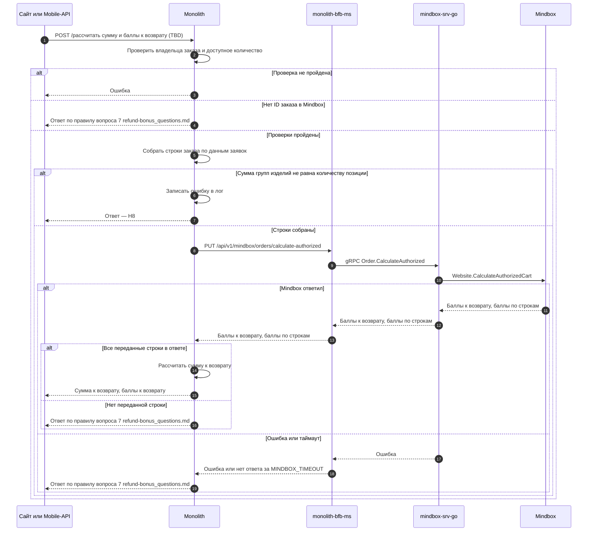
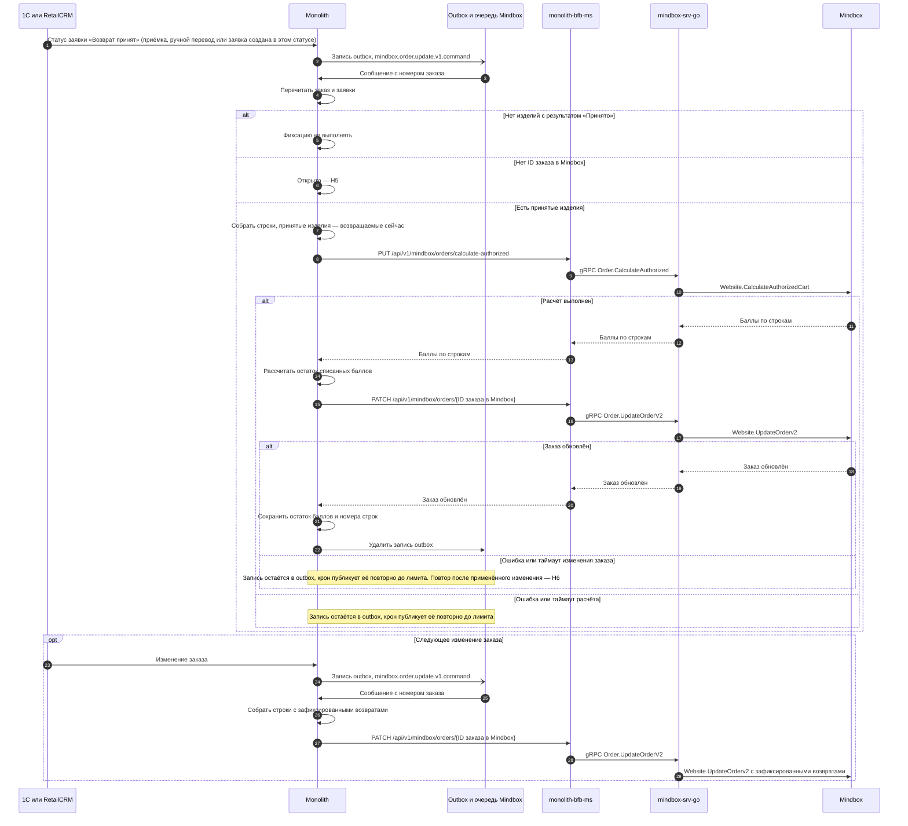

# BL-RET-BONUS: Баллы к возврату. Расчёт и фиксация возврата баллов в Mindbox

**Системы:** монолит, `monolith-bfb-ms`, `mindbox-srv-go` (команда BTS), Mindbox
**Назначение:** подробный анализ обмена с Mindbox — правила, обоснования, варианты и открытые вопросы. Краткое описание логики для команды — [BL-RET-BONUS-SUM](./mindbox-return-bonus-summary_backend.md)
**Связанные артефакты:** US 1.4, US 1.5, US 3 — [SRS сайта](../srs/srs-web-mvp.md), [SRS МП](../srs/srs-mobile-mvp.md); схема взаимодействия — [`SEQ-RET-BONUS`](../diagrams/sequence/return-bonus-mindbox_sequence.md); `ADR-RET-114`, `ADR-RET-115`, `ADR-RET-099`, `ADR-RET-112`, `ADR-RET-039`; [доступное к возврату количество](./available-return-quantity_backend.md)
**Решения и открытые вопросы:**
- [mindbox-exchange_questions.md](../questions/mindbox-exchange_questions.md) — операции, строки, статусы, `mindbox-srv-go`. В тексте: «факт N», «решение N», «❓N»;
- [refund-bonus_questions.md](../questions/refund-bonus_questions.md) — правила баллов для клиента. В тексте: «refund-bonus, решение N», «❓ refund-bonus N»

## Коротко

Документ описывает, как система возвращает клиенту баллы при возврате товара. Когда клиент оформляет возврат, сайт спрашивает у Mindbox, сколько баллов вернётся, и показывает это число на экране. Когда склад или магазин принял товар или заявку вручную перевели в «Возврат принят», сайт сообщает Mindbox, что возврат состоялся, и Mindbox возвращает баллы на счёт клиента. Если потом заказ снова меняется, возврат не теряется.

Сначала описано, что происходит в каждой ситуации и почему. Затем — технические детали: как обмен с Mindbox работает сейчас, методы, параметры, правила сборки строк, ошибки, доработки по сервисам, схемы и пример.

## Содержание

**Часть 1. Логика взаимодействия**

1.1. Цель и роль Mindbox
1.2. Почему текущего обмена недостаточно
1.3. Общая последовательность: от оформления до возврата баллов
1.4. Как сайт показывает Mindbox заказ с возвратом
1.5. Предварительный расчёт баллов на экране оформления
1.6. Расчёт и сохранение баллов при создании заявки
1.7. Фиксация возврата баллов при «Возврат принят»
1.8. Отмена заявки
1.9. Повторный возврат по тому же заказу
1.10. Следующие изменения заказа

**Часть 2. Техническое взаимодействие**

2.1. Цепочка вызовов
2.2. Обмен сейчас: что монолит передаёт и получает
2.3. Правила сборки строк заказа для Mindbox
2.4. Расчёт: запрос и ответ
2.5. Изменение заказа: запрос
2.6. Очередь, повторы и ошибки
2.7. Доработки по сервисам
2.8. Что не меняется
2.9. Схемы взаимодействия
2.10. Пример запроса и данных ответа

**Открытые вопросы**

---

## Часть 1. Логика взаимодействия

### 1.1. Цель и роль Mindbox

**Для клиента.** Клиент видит, сколько баллов вернётся на бонусный счёт: на экране оформления — до отправки заявки (US 1.4) и в созданной заявке (US 1.5, US 3). Так он понимает, сколько сможет потратить. Баллы возвращаются на счёт, когда склад или магазин принял изделия. Этот документ описывает, что для этого делают системы; экраны и шаги клиента — в SRS сайта и МП.

**Цель** — возвращать клиенту баллы, которыми он оплатил возвращённые изделия: считать баллы к возврату в Mindbox при оформлении заявки, фиксировать возврат в Mindbox при «Возврат принят» и сохранять его при следующих изменениях заказа.

Баллы ведёт Mindbox. Сайт не считает баллы сам: он показывает результат расчёта Mindbox и сообщает Mindbox о состоявшемся возврате.

Отдельной сущности возврата у Mindbox нет. Возврат передаётся изменением заказа: строки возвращённых изделий получают статус возврата, сумма списанных баллов уменьшается на возвращённые (`ADR-RET-114`; решения 3, 7).

Одинаковые изделия хранятся в заказе одной позицией с количеством, списанные баллы — на всю позицию (решение 10). Делить баллы позиции на изделия должен Mindbox, поэтому в сообщении для Mindbox позиция делится на строку изделий с прежним статусом строки и строки возвращаемых изделий (решение 5).

### 1.2. Почему текущего обмена недостаточно

**Как сейчас.** При возврате из личного кабинета на сайте и в приложении сайт ставит возвращаемым позициям статус «Возврат», а заказу — «Возврат из ЛК». Изменение заказа уходит в Mindbox: код статуса заказа сайта — в доп. поле `orderStatus`, строки возврата — с кодом по таблице соответствия пары «статус заказа + статус позиции» (факты 2, 5).

**Что меняется.** Статус заказа при возврате больше не меняется: выполненный заказ остаётся выполненным (`ADR-RET-039`). О возврате Mindbox узнаёт только по строкам заказа.

**Чего не позволяет текущая реализация:**

1. **Посчитать возврат по существующему заказу.** Сейчас расчёт в Mindbox работает только для корзины: сайт не передаёт в него ID заказа, хотя сервис связи с Mindbox его уже принимает.
2. **Различить строки одного товара.** Номер строки сейчас равен ID товара, поэтому две строки одной футболки для Mindbox неотличимы.
3. **Передать возврат при новых статусах позиции.** «Заявка на возврат» уходит в Mindbox как новая позиция.
4. **Сохранить возврат в Mindbox.** Каждое изменение заказа отправляет позиции с исходными статусами и исходным списанием баллов — уже зафиксированный возврат затирается.

Технически — раздел 2.2.

### 1.3. Общая последовательность: от оформления до возврата баллов

| Когда | Что делает система | Mindbox | Что сохраняется | Раздел |
|---|---|---|---|---|
| Клиент выбирает изделия на экране оформления | Показывает «Баллы к возврату» | Расчёт | Ничего | 1.5 |
| Клиент создаёт заявку | Считает и запоминает баллы по каждому изделию заявки | Расчёт | Баллы к возврату по изделиям | 1.6 |
| Заявка перешла в «Возврат принят» или создана сразу в нём | Сообщает Mindbox о возврате принятых изделий | Расчёт, затем изменение заказа | Остаток списанных баллов, номера строк | 1.7 |
| Заявка отменена до «Возврат принят» | Ничего не отправляет | — | — | 1.8 |
| Заказ снова изменился, например в RetailCRM | Отправляет заказ вместе с зафиксированными возвратами | Изменение заказа | — | 1.10 |

**Что нужно сделать:**

1. Собирать строки заказа для Mindbox по данным заявок (1.4, 2.3).
2. Считать баллы к возврату при оформлении и при создании заявки (1.5, 1.6).
3. Фиксировать возврат в Mindbox при «Возврат принят» (1.7).
4. Учитывать зафиксированные возвраты в каждой отправке заказа в Mindbox (1.10).
5. Передавать в Mindbox ID заказа и номера строк (2.7).

Новый процесс включается фичетоглом новых возвратов. Когда фичетогл выключен, обмен с Mindbox работает по текущей логике без изменений.

### 1.4. Как сайт показывает Mindbox заказ с возвратом

**Простыми словами.** Для каждой операции монолит собирает заказ для Mindbox по данным заявок на возврат: какие изделия возвращены раньше, какие возвращаются сейчас и какие передаются без изменений. Баллы по строкам считает Mindbox; монолит передаёт строки и берёт результат. Правило одно для расчёта, фиксации и любой отправки заказа.

**Как изделие попадает в группу.** Группа определяется по данным заявок на возврат, а не по статусу позиции заказа. Каждое изделие исходной позиции попадает только в одну группу:

- **возвращаемые сейчас** — зависят от операции: при предварительном расчёте и создании заявки — выбранные клиентом изделия, при фиксации — изделия фиксируемой заявки с результатом «Принято» (таблица ниже);
- **ранее возвращённые** — изделия той же исходной позиции, возврат которых уже зафиксирован в Mindbox по другим заявкам. Изделия фиксируемой заявки сюда не входят. Какие из них относить к этой группе — открыто: Н1;
- **передаваемые с прежним статусом строки** — остальные изделия позиции. Название группы описывает строку для Mindbox, а не то, где изделие находится.

Определения и алгоритм — 2.3.

**Как позиция превращается в строки:**

- изделия, передаваемые с прежним статусом строки, — одна строка с прежним статусом;
- возвращаемые сейчас изделия — одна строка со статусом возврата и количеством выбранных изделий;
- ранее возвращённые изделия — те же строки, с которыми возврат был зафиксирован в Mindbox: с тем же количеством, номером строки и статусом возврата (решение 14). Сколько баллов Mindbox относит на текущий возврат — ❓10;
- все строки одной позиции получают её порядковый номер в заказе, номера остальных позиций не меняются (решение 15);
- строка с количеством 0 не передаётся.

Баллы на изделие — баллы строки, делённые на её количество: внутри строки Mindbox списывает баллы кратно количеству изделий, поэтому на каждое изделие приходится поровну ([распределение скидок Mindbox](<../../sources/mindbox/Как происходит распределение скидок по позициям заказа.md>), «Принцип кратности в балльных скидках»).

**Какие изделия «возвращаются сейчас»:**

| Операция | Возвращаемые сейчас |
|---|---|
| Предварительный расчёт, создание заявки | Выбранные клиентом изделия |
| Фиксация | Изделия фиксируемой заявки с результатом «Принято» |
| Любая другая отправка заказа | Нет |

**Сумма списанных баллов заказа:** если возвратов не было — баллы, списанные при покупке, как сейчас; если были зафиксированные возвраты — остаток списанных баллов после последней фиксации (1.7).

Пошаговый алгоритм, статусы, номера строк, скидки и связь с хранением позиции в заказе сайта — раздел 2.3.

### 1.5. Предварительный расчёт баллов на экране оформления

**Что происходит и зачем.** Клиент выбирает изделия для возврата и до отправки заявки видит, сколько денег и баллов получит. Деньги считает монолит, баллы — Mindbox: только он знает, как баллы, списанные при покупке, распределяются по изделиям (refund-bonus, решение 7). Поэтому монолит показывает Mindbox, как будет выглядеть заказ после возврата, и спрашивает, сколько баллов вернётся. US 1.4.

**Метод монолита:** `POST /рассчитать сумму и баллы к возврату` (TBD; МП — `POST /api/v1/orders/{order_id}/return/calculate`, TBD). Входные параметры — в SRS. Сайт и приложение вызывают один метод и получают готовые значения.

#### Когда выполняется

Когда клиент на экране оформления выбрал изделия или изменил выбор.

#### Условия

Расчёт выполняется, если:

- заказ принадлежит клиенту;
- выбранные изделия относятся к позициям заказа, и их количество не больше доступного к возврату ([available-return-quantity_backend.md](./available-return-quantity_backend.md));
- у заказа есть ID в Mindbox.

#### Что делает система

| № | Кто | Действие |
|---|---|---|
| 1 | Сайт или МП | Вызывает метод предварительного расчёта с выбранными изделиями |
| 2 | Монолит | Проверяет, что заказ принадлежит клиенту. Если нет — возвращает ошибку |
| 3 | Монолит | Проверяет, что изделия из позиций заказа и их не больше доступного к возврату. Если нет — возвращает ошибку |
| 4 | Монолит | Проверяет, что у заказа есть ID в Mindbox. Если нет — Mindbox не вызывает и отвечает по ❓ refund-bonus 7 |
| 5 | Монолит | Считает сумму к возврату |
| 6 | Монолит | Собирает строки заказа по 1.4 и 2.3: выбранные изделия — возвращаемые сейчас. Если сумма групп изделий не равна количеству позиции — Mindbox не вызывает (2.3, шаг 8; Н8) |
| 7 | Монолит | Отправляет расчёт в `monolith-bfb-ms`: `PUT /api/v1/mindbox/orders/calculate-authorized` с ID заказа в Mindbox (`order.ids.mindboxId`), строками и суммой списанных баллов `bonuses[].amount` |
| 8 | `monolith-bfb-ms` | Передаёт запрос в `mindbox-srv-go`: gRPC `Order.CalculateAuthorized` |
| 9 | `mindbox-srv-go` | Вызывает операцию Mindbox `Website.CalculateAuthorizedCart` |
| 10 | Mindbox | Возвращает изменение списанных баллов `spentAmount` и баллы по строкам. Заказ в Mindbox не меняется |
| 11 | Монолит | Проверяет ответ. Если ошибка, нет ответа за `MINDBOX_TIMEOUT` или в ответе нет переданной строки — отвечает по ❓ refund-bonus 7 |
| 12 | Монолит | Возвращает сайту или МП сумму к возврату и «Баллы к возврату» — модуль `spentAmount` (`-33` → 33) |

#### Взаимодействие с Mindbox

| Направление | Что передаётся | Откуда берётся |
|---|---|---|
| Монолит → Mindbox | ID заказа в Mindbox (`order.ids.mindboxId`) | Заказ сайта. Сайт сейчас его не передаёт — ECOMDEV-1185 (факт 16) |
| Монолит → Mindbox | Строки: товар, количество, цена, статус строки, `line_id`, `sequence_number` | Позиции заказа и заявки на возврат, 2.3 |
| Монолит → Mindbox | `bonuses[].amount` — сумма списанных баллов заказа | 1.4 |
| Mindbox → монолит | `spentAmount` — изменение списанных баллов | → «Баллы к возврату» |
| Mindbox → монолит | Списанные баллы по строкам | В этом сценарии не используются |
| Mindbox → монолит | `earnedAmount` — начисленные баллы, которые снимаются при возврате | Клиенту не показываются (❓ refund-bonus 3, 6) |

`totalPrice` в расчёт не передаётся: в запросе операции расчёта такого поля нет (решение 21). Поля запроса и ответа — 2.4.

#### Результат

- Клиент видит «Итого к возврату» и «Баллы к возврату».
- Ничего не сохраняется: значения предварительные.

**Пример.** В заказе 3 футболки, на них списано 100 баллов. Клиент выбирает одну. Монолит передаёт строку «2 футболки, прежний статус» и строку «1 футболка, возврат», `bonuses[].amount` = 100. Mindbox отвечает `spentAmount` = `-33`. Клиент видит «Баллы к возврату: 33». Числа — иллюстрация из ответа Mindbox, а не правило распределения (1.9). Запрос — 2.10.

#### Если что-то пошло не так

| Ситуация | Что происходит |
|---|---|
| Заказ не принадлежит клиенту | Ошибка, Mindbox не вызывается |
| Изделия не из заказа или их больше доступного к возврату | Ошибка, Mindbox не вызывается |
| Сумма групп изделий не равна количеству позиции | Mindbox не вызывается, ошибка — в лог (2.3, шаг 8). Когда это возможно и что метод возвращает сайту и приложению — Н8 |
| У заказа нет ID в Mindbox | Mindbox не вызывается. Ответ клиенту — ❓ refund-bonus 7 |
| Ошибка `mindbox-srv-go` или нет ответа за `MINDBOX_TIMEOUT` | Ответ клиенту — ❓ refund-bonus 7. Допустимое время ответа — ❓14 |
| В успешном ответе нет переданной строки | Ответ клиенту — ❓ refund-bonus 7 |
| Mindbox разделил строку на несколько с одним `lineId` | Каждой новой строке присваивается свой `line_id` (решение 11; 2.3, шаг 6). В предварительном расчёте номера строк не сохраняются. Как сохранять и воспроизводить разделённые строки — Н3 |
| По заказу уже были возвраты | 1.9 |

#### Что решено и что открыто

| Правило | Статус |
|---|---|
| Баллы к возврату считает Mindbox, сумму к возврату — монолит, один метод для сайта и приложения | Решено: refund-bonus, решение 7 |
| Расчёт — `Website.CalculateAuthorizedCart` по существующему заказу | Решено: решение 4, `ADR-RET-114`. Способ описан Mindbox в [ответе по частичному возврату](<../../sources/answers/[2026-10-15] Переписка Лемешева — Васильева Mindbox (баллы при частичном возврате).md>); для нового процесса операция подходит — решение 13 (статус заказа при полном возврате — вопрос 2 файла вопросов) |
| Существующий заказ передаётся по `order.ids.mindboxId` | Решено: решение 11. `mindbox-srv-go` поле принимает, `monolith-bfb-ms` передаёт тело запроса без изменений; сайт — ECOMDEV-1185 (факт 16) |
| «Баллы к возврату» = модуль `spentAmount` | Решено: решение 6 |
| Возвращаемые сейчас изделия позиции — одна строка; баллы изделия — баллы строки, делённые на количество | Предложено. Делить строку у созданного заказа можно — решение 15; равные баллы на изделие внутри строки — принцип кратности Mindbox |
| Ранее возвращённые изделия — строки, с которыми зафиксирован возврат, со статусом возврата | Решено: решение 14. Сколько баллов Mindbox относит на текущий возврат — ❓10 |
| `line_id` и `lineNumber` | `line_id` уникален для строки, хранится и передаётся при каждом изменении заказа; части позиции получают её номер `lineNumber` — решение 15. Правило формирования `line_id` — Н2 |
| Что видит клиент без ответа Mindbox | Открыто: ❓ refund-bonus 7 |
| Какие промоакции применяет расчёт к существующему заказу | Решено: действовавшие на момент оформления заказа — решение 19 |
| Кто делит скидку промокода между строками | Решено: сайт, Mindbox промокодов не знает — решение 20. Правило — [order-position-split_questions.md](../questions/order-position-split_questions.md), вопрос 7 |

---

### 1.6. Расчёт и сохранение баллов при создании заявки

**Что происходит и зачем.** Клиент отправил заявку. Монолит ещё раз считает баллы в Mindbox — уже по изделиям заявки — и запоминает, сколько баллов приходится на каждое изделие. Эти значения клиент видит в заявке (US 3). US 1.5.

**Метод монолита:** `POST /создать заявку на возврат` (TBD).

#### Когда выполняется

Когда клиент создаёт заявку на возврат. Заявка, которую 1С создаёт сразу в «Возврат принят» (возврат в магазине без заявки), этот расчёт не проходит — 1.7.

#### Условия

Те же, что в 1.5.

#### Что делает система

| № | Кто | Действие |
|---|---|---|
| 1 | Сайт или МП | Вызывает метод создания заявки |
| 2 | Монолит | Проверяет заявку по правилам метода создания заявки (SRS, US 1.5) |
| 3 | Монолит | Считает сумму к возврату по каждому изделию заявки |
| 4 | Монолит | Собирает строки заказа по 1.4 и 2.3: изделия заявки — возвращаемые сейчас |
| 5 | Монолит, `monolith-bfb-ms`, `mindbox-srv-go` | Запрашивают расчёт по той же цепочке, что в 1.5: `calculate-authorized` → `Order.CalculateAuthorized` → `Website.CalculateAuthorizedCart` |
| 6 | Mindbox | Возвращает `spentAmount` и баллы по строкам. Заказ в Mindbox не меняется |
| 7 | Монолит | Сохраняет баллы к возврату по каждому изделию заявки — списанные баллы строки возвращаемых изделий, делённые на количество строки (1.4). Списанные баллы строки — `amount` элемента `applied_promotions` с типом `spentBonusPoints`, как при оформлении заказа (решение 24) |
| 8 | Монолит | Если сумма баллов по изделиям отличается от модуля `spentAmount`, сохраняет баллы по строкам и пишет расхождение в лог |
| 9 | Монолит | Отвечает сайту или МП, что заявка создана |

#### Результат

- Заявка создана, по каждому изделию сохранены баллы к возврату.
- Заказ в Mindbox не меняется: возврат ещё не состоялся.

**Пример.** В заявке 2 футболки, строка возвращаемых изделий в ответе: `amount` элемента `spentBonusPoints` = 66 → у каждого изделия заявки сохраняется 33 балла.

#### Если что-то пошло не так

Как в 1.5. Отдельно: сумма баллов по изделиям не совпала с модулем `spentAmount` — сохраняются баллы по строкам, расхождение — в лог.

#### Что решено и что открыто

| Правило | Статус |
|---|---|
| Сумма и баллы сохраняются по каждому изделию заявки | Решено: refund-bonus, решение 7 |
| Баллы строки — `amount` элемента `spentBonusPoints` | Решено: решение 24 |
| Баллы изделия — баллы строки, делённые на количество | Предложено, 1.4 |

---

### 1.7. Фиксация возврата баллов при «Возврат принят»

**Что происходит и зачем.** До этого момента Mindbox только считал баллы — заказ в нём не менялся. Баллы возвращаются клиенту, когда Mindbox получает изменённый заказ: строки принятых изделий со статусом возврата и уменьшенную сумму списанных баллов. Это и есть фиксация возврата (решение 7).

Баллы возвращаются за изделия заявки с результатом «Принято»: склад или магазин принял изделия, либо Дружба вручную перевела заявку в «Возврат принят» — при утере или при возврате денег до поступления изделий (`ADR-RET-099`, решения 12, 13). За изделия с результатом «Отменено» баллы не возвращаются (refund-bonus, решение 6).

#### Когда выполняется

- Заявка переходит в «Возврат принят» после приёмки или вручную (`ADR-RET-099`, решения 12, 13, 17; решение 8).
- 1С создаёт заявку сразу в «Возврат принят» — возврат в магазине без заявки (`ADR-RET-099`, решение 3). Расчёта при создании заявки (1.6) у неё нет, баллы по изделиям не сохранены. Что клиент видит в такой заявке — Н7.

Статус заказа при этом не меняется (`ADR-RET-039`).

#### Условия

Если в заявке есть изделия с результатом «Принято» — фиксация выполняется. Иначе фиксация не выполняется, заказ в Mindbox не меняется.

#### Что делает система

Фиксация асинхронная, через outbox и очередь `mindbox.order.update.v1.command`, как обычное изменение заказа. Запись outbox содержит только номер заказа: при обработке монолит перечитывает заказ и заявки из БД (2.6). Порядок обработки обычного изменения заказа и незавершённой фиксации — Н1.

| № | Кто | Действие |
|---|---|---|
| 1 | 1С или RetailCRM | Передаёт на сайт статус заявки «Возврат принят»: 1С — после приёмки на складе или в магазине (метод TBD), RetailCRM — если Дружба перевела заявку вручную |
| 2 | Монолит | Создаёт запись outbox с номером заказа и публикует её в очередь |
| 3 | Монолит | Получает сообщение из очереди, перечитывает заказ и заявки |
| 4 | Монолит | Проверяет, что в заявке есть изделия с результатом «Принято». Если нет — фиксацию не выполняет |
| 5 | Монолит | Проверяет, что у заказа есть ID в Mindbox. Если нет — Н5 |
| 6 | Монолит | Собирает строки по 1.4 и 2.3: принятые изделия заявки — возвращаемые сейчас, отменённые — с прежним статусом строки, ранее возвращённые — по 2.3 (критерий — Н1) |
| 7 | Монолит, `monolith-bfb-ms`, `mindbox-srv-go` | Запрашивают расчёт: `PUT /api/v1/mindbox/orders/calculate-authorized` → gRPC `Order.CalculateAuthorized` → `Website.CalculateAuthorizedCart`, `bonuses[].amount` — по 1.4. Расчёт идёт в фоне, без устройства клиента: что передавать в заголовке `Device-uuid` — Н4 |
| 8 | Mindbox | Возвращает списанные баллы по строкам |
| 9 | Монолит | Считает остаток списанных баллов — сумму списанных баллов по строкам, которые клиент оставляет (решение 7) |
| 10 | Монолит, `monolith-bfb-ms`, `mindbox-srv-go` | Отправляют изменение заказа с теми же строками, `bonuses[].amount` = остаток, `totalPrice` — за вычетом возвращённых и отменённых изделий (решение 22): `PATCH /api/v1/mindbox/orders/{ID заказа в Mindbox}` → gRPC `Order.UpdateOrderV2` → `Website.UpdateOrderv2` |
| 11 | Mindbox | Возвращает на бонусный счёт клиента баллы, списанные за строки возврата, и снимает баллы, начисленные за них (решения 17, 23). Нужен ли после этого отдельный метод возврата баллов — ❓19 |
| 12 | Монолит | После успешного ответа сохраняет остаток списанных баллов и номера строк и удаляет запись outbox. Способ хранения — на усмотрение разработки. Нужно ли отдельно отмечать, что возврат по заявке зафиксирован, — Н1 |
| 13 | Монолит | При ошибке или таймауте расчёта или изменения заказа оставляет запись в outbox: крон публикует её повторно до лимита `outbox_transaction_mindbox_max_retries` (2.6) |

Расчёт при фиксации выполняется заново, так как часть изделий заявки могла получить «Отменено». Баллы по изделиям, сохранённые при создании заявки, не перезаписываются: их видит клиент (US 3).

Повторная обработка фиксации не подтверждена как безопасная: если Mindbox применил изменение заказа, а монолит не получил ответ, запись outbox отправится снова — Н6.

#### Взаимодействие с Mindbox

| Шаг | Операция Mindbox | Что передаётся | Что возвращается и для чего |
|---|---|---|---|
| Расчёт | `Website.CalculateAuthorizedCart` | ID заказа в Mindbox, строки по шагу 3, `bonuses[].amount` до этой фиксации | Списанные баллы по строкам → остаток |
| Изменение заказа | `Website.UpdateOrderv2` | Те же строки и номера строк; `bonuses[].amount` = остаток (в Mindbox — `bonusPoints[].amount`, решение 12) | Подтверждение. Mindbox возвращает баллы на бонусный счёт клиента |

Списанные баллы по строке со статусом категории «Возврат» Mindbox возвращает автоматически — решение 17; начисленные за эту позицию баллы он снимает сам — решение 23. Операции подходят при неизменном статусе заказа — решение 13; полный возврат при статусе заказа «Выполнен» — ❓2. Поля изменения заказа — 2.5.

#### Результат

- Mindbox вернул клиенту баллы за принятые изделия.
- На сайте сохранены остаток списанных баллов и номера строк — их использует каждая следующая отправка заказа (1.10).
- Статус заказа не изменился.

**Пример.** В заказе 3 футболки, на них списано 100 баллов. Заявка на одну футболку, склад её принял. Код строки возврата во всех примерах — `505`, категория «Возврат» (решение 17; код по таблице соответствия — ECOMDEV-2828).

| Шаг | Строки | `bonuses[].amount` |
|---|---|---|
| Расчёт | 2 шт. прежний статус (`311`); 1 шт. возврат | 100 |
| Ответ Mindbox | 66 баллов на оставшиеся, 33 — на возвращённую | — |
| Изменение заказа | Те же строки | 66 |
| После фиксации | На сайте сохранён остаток 66. Сколько баллов Mindbox вернёт клиенту при остатке 66 — 33 или 34 — ❓9 | — |

Числа — иллюстрация из ответа Mindbox, а не согласованное правило распределения: сумма долей 99 из 100, куда относится 1 балл — ❓9.

**Частичная приёмка.** Заявка на 2 футболки, склад принял одну, вторая получила «Отменено». Фиксируется возврат одной футболки; отменённая передаётся с прежним статусом строки.

#### Если что-то пошло не так

| Ситуация | Что происходит |
|---|---|
| В заявке нет изделий с результатом «Принято» | Фиксация не выполняется |
| У заказа нет ID в Mindbox | Открыто: Н5. Сейчас обычное изменение заказа в этом случае удаляет запись outbox и пишет ошибку в лог (2.6) |
| Сумма групп изделий не равна количеству позиции | Сообщение не отправляется, ошибка — в лог (2.3, шаг 8) |
| Ошибка или таймаут расчёта или изменения заказа | Запись остаётся в outbox, крон публикует её повторно до лимита `outbox_transaction_mindbox_max_retries` (2.6). Пока фиксация не прошла, баллы клиенту не возвращаются |
| Попытки исчерпаны | Ошибка в лог. Запись остаётся в outbox и публикуется снова, когда истечёт счётчик попыток (сутки). Остаток и номера строк не сохраняются до успешной фиксации |
| Mindbox применил изменение заказа, монолит не получил ответ | Запись outbox отправляется повторно. Безопасность повтора не подтверждена — Н6 |
| Сообщение по заказу пришло дважды | Возможно по текущему обмену (2.6). Безопасность повтора не подтверждена — Н6 |
| Mindbox разделил строку на несколько с одним `lineId` | Каждой новой строке присваивается свой `line_id` (решение 11; 2.3, шаг 6). Как сохранять и воспроизводить разделённые строки — Н3 |
| По заказу уже был возврат | 1.9 |

#### Что решено и что открыто

| Правило | Статус |
|---|---|
| Возврат фиксируется изменением заказа с теми же строками, что в расчёте; в списанных баллах — остаток за изделия, которые клиент оставляет | Решено: решение 7, `ADR-RET-114`. Способ описан Mindbox в [ответе по частичному возврату](<../../sources/answers/[2026-10-15] Переписка Лемешева — Васильева Mindbox (баллы при частичном возврате).md>) |
| Фиксация — при «Возврат принят», по принятым изделиям, в том числе при ручном переводе | Решено: решение 8, `ADR-RET-099`, решения 12, 13, 17. Решение процесса возвратов; Mindbox не затрагивает |
| Фиксация заявки, созданной сразу в «Возврат принят» | Следует из `ADR-RET-099`, решения 3, 17. Что видит клиент — Н7 |
| Фиксация асинхронная, через outbox и очередь `mindbox.order.update.v1.command` | Предложено по текущему обмену |
| Код статуса строки возврата относится к категории «Возврат» и запускает возврат списанных баллов | Решено: решение 17. Начисленные баллы Mindbox снимает сам — решение 23 |
| Код строки возврата — `505` вместо `401`, чтобы клиент получал письмо о принятом возврате | Предложено, задача ECOMDEV-2828; вопрос 17 [mindbox-exchange_questions.md](../questions/mindbox-exchange_questions.md) |
| `totalPrice` в изменении заказа — за вычетом возвращённых и отменённых изделий | Решено: решение 22 |
| Сколько баллов Mindbox относит на текущий возврат, если в заказе есть ранее возвращённые строки | Открыто: ❓10 |
| Порядок обработки обычного изменения заказа и незавершённой фиксации | Открыто: Н1 |
| Фиксация при отсутствии ID заказа в Mindbox | Открыто: Н5 |
| Повторная отправка фиксации, которую Mindbox уже применил | Открыто: Н6 |
| Остаток 1 балл при делении | Открыто: ❓9 |
| Что видит клиент в заявке, если после частичной приёмки баллы к возврату меньше показанных при создании | Открыто: Н9 |

---

### 1.8. Отмена заявки

**Что происходит.** Клиент или Дружба отменили заявку до «Возврат принят».

**Что делает система.** Изменение заказа для фиксации в Mindbox не отправляется: изделия активной заявки и так передаются в Mindbox с прежним статусом строки (1.4). Предварительный расчёт и расчёт при создании заявки к этому моменту могли быть выполнены, но заказ в Mindbox они не меняли.

**Результат.** Заказ в Mindbox остаётся без возврата. Изделия отменённой заявки при следующих отправках заказа передаются с прежним статусом строки.

| Правило | Статус |
|---|---|
| Изделия активной заявки передаются с прежним статусом строки | Предложено: ❓6, вариант а) |
| Обратный переход строки из статуса заявки на возврат, если по ❓6 выбран вариант б) | Решено: возможен, если статус не в категориях «Возврат» и «Отмена» — решение 18 |

### 1.9. Повторный возврат по тому же заказу

**Что происходит.** Клиент вернул часть изделий, возврат зафиксирован, и он оформляет следующий возврат по тому же заказу.

**Что делает система.** Всё как в 1.5–1.7, с двумя отличиями:

- ранее возвращённые изделия передаются теми же строками, с которыми зафиксирован возврат, со статусом возврата (решение 14); сколько баллов Mindbox относит на текущий возврат — ❓10;
- сумма списанных баллов заказа — остаток, сохранённый при последней фиксации, а не баллы при покупке (решение 7; `ADR-RET-114`).

**Пример.** Позиция — 3 футболки, на позицию списано 100 баллов. Клиент возвращает одну, затем вторую. Числа 66 и 33 — иллюстрация из ответа Mindbox, а не правило распределения (❓9).

| Момент | Строки | `bonuses[].amount` |
|---|---|---|
| Предрасчёт первого возврата | 2 шт. `311`; 1 шт. возврат | 100 |
| Фиксация первого возврата, в ответе расчёта: 66 на оставшиеся, 33 на возвращённую | 2 шт. `311`; 1 шт. возврат | 100 → после фиксации 66 |
| Изменение заказа из RetailCRM | 2 шт. `311`; 1 шт. возврат | 66 |
| Предрасчёт второго возврата | 1 шт. `311`; 1 шт. возврат (ранее); 1 шт. возврат (сейчас) | 66 |

| Правило | Статус |
|---|---|
| Как Mindbox считает второй возврат: `spentAmount` только за текущий возврат или за оба | Открыто: ❓10 |
| Вернутся ли при возврате оставшихся изделий все 100 баллов | Открыто: ❓9 |

### 1.10. Следующие изменения заказа

**Что происходит.** После фиксации заказ меняется по другой причине — например, в RetailCRM.

**Что делает система.** Каждое изменение заказа, которое сейчас уходит в Mindbox, собирает строки и `bonuses[].amount` по 1.4 и 2.3: ранее возвращённые изделия — строками со статусом возврата, списанные баллы — остаток после последней фиксации, `totalPrice` — за вычетом возвращённых и отменённых изделий (решение 22). Возвращаемых сейчас изделий нет. Как передаются принятые изделия заявки, фиксация которой ещё не прошла, и в каком порядке обрабатываются такое изменение и фиксация — Н1. Остальные данные сообщения — по текущей логике. Цепочка: очередь `mindbox.order.update.v1.command` → `PATCH /api/v1/mindbox/orders/{ID заказа в Mindbox}` → gRPC `Order.UpdateOrderV2` → `Website.UpdateOrderv2`.

**Результат.** Зафиксированный возврат сохраняется в Mindbox. Если возвратов по заказу не было, строки и `bonuses[].amount` совпадают с текущими.

| Правило | Статус |
|---|---|
| Каждая отправка заказа в Mindbox, в том числе после изменения из RetailCRM, учитывает зафиксированные возвраты | Решено: решение 9 |

---

## Часть 2. Техническое взаимодействие

### 2.1. Цепочка вызовов

**AS-IS.** Все обращения к Mindbox идут из монолита через `monolith-bfb-ms` и `mindbox-srv-go`.

| Операция | Монолит → `monolith-bfb-ms` | `monolith-bfb-ms` → `mindbox-srv-go` | `mindbox-srv-go` → Mindbox | Когда |
|---|---|---|---|---|
| Расчёт | `PUT /api/v1/mindbox/orders/calculate-authorized` | gRPC `Order.CalculateAuthorized` | `Website.CalculateAuthorizedCart` | Расчёт корзины |
| Создание заказа | `PUT /api/v1/mindbox/orders` | gRPC `Order.CreateOrder` | Операция создания заказа | Очередь `mindbox.order.create.v1.command` |
| Изменение заказа | `PATCH /api/v1/mindbox/orders/{ID заказа в Mindbox}` | gRPC `Order.UpdateOrderV2` | `Website.UpdateOrderv2` | Любое изменение заказа, в том числе из RetailCRM; очередь `mindbox.order.update.v1.command` |

Соответствие gRPC-методов операциям Mindbox — по названиям: в `architecture-docs` пары не указаны. Подробно об обмене — [order-integration-exchange.md](../../../../knowledge/12storeez-master-web/features/order-integration-exchange.md), [08-integrations.md](../../../../knowledge/12storeez-master-web/architecture/08-integrations.md).

**TO-BE.** Цепочка та же. Расчёт дополнительно вызывается по существующему заказу — при предрасчёте (1.5), создании заявки (1.6) и фиксации (1.7). Изменение заказа — при фиксации (1.7) и при каждом изменении заказа (1.10). Новые методы `mindbox-srv-go` не нужны — текущие операции Mindbox подходят (решение 13).

### 2.2. Обмен сейчас: что монолит передаёт и получает

**AS-IS.**

**Строка заказа** — одна позиция заказа:

* `id` — товар (размер)
* `quantity`
* `price` — цена до скидки за единицу
* `status` — код статуса Mindbox из `cms_mb_statuses_map` по паре `order_status_id` + `order_position_status_id`; если пары нет — `101`
* `line_id` — ID товара
* `sequence_number` — порядковый номер записи позиции 1…N, только в изменении заказа; новая запись позиции сдвигает номера следующих позиций
* `custom_fields.positionStatus` — код статуса позиции сайта
* `requested_promotions` — скидка распродажи `Sale_12Storeez` и скидка промокода позиции

**Заказ:**

* расчёт — ID клиента, ID корзины, сумма баллов к списанию; ID заказа не передаётся; в заголовке `Device-uuid` — устройство клиента
* изменение заказа — ID заказа на сайте, `bonuses[].amount` — все баллы, списанные по заказу при покупке, доставка, оплаты, свойства заказа

**Что монолит получает из расчёта:**

* `bonuses_changes[]` — `earned_amount`, `spent_amount` одной суммой на заказ
* `positions[].applied_promotions[]` — `type`, `amount`; списанные на строку баллы монолит берёт из `amount` элемента с `type = spentBonusPoints` и при оформлении заказа сохраняет их в позиции (факт 15)
* поля `spentBonusPointsAmount` в ответе расчёта сервиса нет, оно и не нужно (решение 24)

**Статус строки при выполненном заказе:**

| Статус позиции | Код Mindbox сейчас | После ECOMDEV-2828 |
|---|---|---|
| Добавлен и другие активные | `311` | `311` |
| Возврат (`lost`, `internal_id = 9`) | `401` | `505` |
| «Заявка на возврат» (`ADR-RET-112`) | пары нет → `101` | новый код Mindbox вне категорий «Возврат» и «Отмена» |

Это строки таблицы соответствия для выполненного заказа. Сейчас при возврате из ЛК заказ получает статус «Возврат из ЛК», и код строки берётся по паре «Возврат из ЛК» + «Возврат» (факт 5). Пары для выполненного заказа используются в новом процессе, где статус заказа не меняется. Полная таблица — [order-status-dictionaries.md](../../../../knowledge/12storeez-master-web/database/order-status-dictionaries.md), раздел 5.

**Текущая реализация не позволяет** (простыми словами — 1.2):

1. Считать существующий заказ: сайт не передаёт в расчёт ID заказа. `mindbox-srv-go` его принимает — `order_id` и `mindbox_order_id` в `CalculateRequest` (TNT-2687; [`mindbox.proto` сервиса](<../../sources/mindbox/mindbox.proto>)); `monolith-bfb-ms` передаёт тело запроса в gRPC без изменений. Передачу с сайта добавляет ECOMDEV-1185 — на паузе (факт 16)
2. Различать строки одного товара: `line_id` = ID товара, у строк одного товара `lineId` совпадает; `sequence_number` считается по записям позиции
3. Передать возврат при новых статусах позиции: они уходят как `101` «новая»
4. Сохранить возврат в Mindbox: каждое изменение заказа передаёт позиции с исходными статусами и исходное списание баллов

### 2.3. Правила сборки строк заказа для Mindbox

**TO-BE.** Строки собираются по данным заявок, а не по статусу позиции заказа. Правило одно для расчёта (1.5, 1.6), фиксации (1.7) и отправки заказа (1.10). Простыми словами — 1.4.

**Группы изделий.** Группа определяется по данным заявок на возврат, а не по статусу позиции заказа или строки позиции. Каждое изделие исходной позиции попадает только в одну группу:

* **возвращаемые сейчас** — по шагу 2: при предрасчёте и создании заявки — выбранные изделия, при фиксации — изделия фиксируемой заявки с результатом «Принято»;
* **ранее возвращённые** — изделия той же исходной позиции, возврат которых уже зафиксирован в Mindbox по другим заявкам; изделия фиксируемой заявки сюда не входят. Критерий отбора — по статусу заявки или по успешной фиксации в Mindbox — открыт: Н1;
* **передаваемые с прежним статусом строки** — остальные изделия позиции: с результатом «Отменено», изделия заявок, которые ещё не приняты (предложено, ❓6, вариант а), и принятые изделия других заявок, если по Н1 они не относятся к ранее возвращённым. Название группы описывает строку для Mindbox, а не то, где изделие находится.

**Позиция** в алгоритме — исходная позиция заказа целиком. Если на сайте она хранится несколькими строками, в группы попадают все её изделия, в какой бы строке они ни хранились, а количество позиции — исходное. Как строки связаны с исходной позицией — [order-position-split_questions.md](../questions/order-position-split_questions.md), вопросы 2, 4, 5.

**Алгоритм для каждой исходной позиции заказа:**

1. Определить количество ранее возвращённых изделий (критерий — Н1).
2. Определить количество изделий, которые возвращаются сейчас:
   * предрасчёт и создание заявки — выбранные изделия;
   * фиксация — изделия фиксируемой заявки с результатом «Принято»;
   * отправка заказа — 0.
3. Определить количество изделий, передаваемых с прежним статусом строки: количество позиции минус ранее возвращённые минус возвращаемые сейчас.
4. Сформировать строки:
   * изделия, передаваемые с прежним статусом строки, — одна строка, статус — код Mindbox по паре «статус заказа + статус позиции до первой заявки» (для «Заказ выполнен» — `311`, для «Заказ выдан» — `302`). Если эта строка после фиксации разделена Mindbox (шаг 6) — Н3;
   * возвращаемые сейчас изделия — одна строка с количеством этих изделий, статус — код по таблице соответствия для пары «статус заказа + Возврат»: `505` (решение 17, ECOMDEV-2828);
   * ранее возвращённые изделия — те же строки, с которыми возврат был зафиксирован в Mindbox: то же количество, тот же `line_id`, тот же код, что у возвращаемых сейчас (решение 14); сколько баллов Mindbox относит на текущий возврат — ❓10;
   * строку с количеством 0 не передавать.
5. Присвоить строкам `sequence_number` (`lineNumber` в Mindbox) и `line_id` (`lineId`):
   * `sequence_number` — порядковый номер исходной позиции в заказе. Все строки одной позиции получают один номер, номера остальных позиций не меняются (решение 15);
   * `line_id` — целое число, уникальное в заказе (решение 11). Строка, которая уже передавалась в Mindbox в изменении заказа, сохраняет свой `line_id` при каждой следующей отправке. При предрасчёте и создании заявки новой строке возвращаемых изделий присваивается временный номер, он не сохраняется. При фиксации номер новой строки становится постоянным;
   * правило формирования `line_id` не утверждено — Н2. Предложение на согласование: `line_id` — ID записи позиции заказа на сайте.
6. Если Mindbox в ответе разделил строку на несколько с одним `lineId`, присвоить каждой новой строке свой `line_id` и передавать строки так в следующих запросах (решение 11). Как сохранять разделённые строки и воспроизводить их при следующих изменениях заказа — Н3.
7. Рассчитать скидки строки:
   * скидка распродажи — (цена до скидки − цена со скидкой) × количество строки, как сейчас;
   * скидка промокода позиции — делится между строками на стороне сайта (решение 20), правило — [order-position-split_questions.md](../questions/order-position-split_questions.md), вопрос 7.
8. Проверить данные перед отправкой:
   * каждое изделие исходной позиции учтено ровно в одной группе, сумма количеств строк позиции равна количеству позиции. Иначе не отправлять сообщение и записать ошибку в лог. Когда расхождение возможно и что метод возвращает сайту и приложению — Н8.

**Сумма списанных баллов заказа `bonuses[].amount`:**

* возвратов не было — баллы, списанные по заказу при покупке, как сейчас;
* есть зафиксированные возвраты — остаток списанных баллов после последней фиксации (1.7).

Строки — формат обмена с Mindbox. Хранение позиции в заказе сайта и передача в RetailCRM и 1С — [order-position-split_questions.md](../questions/order-position-split_questions.md). Пример по шагам — 1.9.

### 2.4. Расчёт: запрос и ответ

**Операция Mindbox.** По [описанию операции `Website.CalculateAuthorizedCart`](<../../sources/mindbox/Website.CalculateAuthorizedCart — расчёт корзины авторизованного пользователя.md>):

* существующий заказ — `order.ids.mindboxId` (ID заказа в Mindbox) или `order.ids.externalSystemstoreez.com` (ID заказа на сайте);
* строка — `lineId` (идентификатор строки) и `lineNumber` (порядковый номер); статус строки — `status.ids.externalId`;
* при расчёте скидок Mindbox может разделить строку и вернуть несколько строк с одним `lineId`; клиент присваивает каждой новой строке свой `lineId` для следующих запросов;
* баллы к списанию и изменения баллов — по балльному счёту: `bonusPoints[].amount` + `balanceType`, `bonusPointsChanges[].spentAmount` / `earnedAmount` + `balanceType`;
* в ответе по строке элемент `appliedPromotions` с типом `spentBonusPoints` содержит `amount` — размер скидки и `spentBonusPointsAmount` — количество списанных баллов;
* `totalPrice` в запросе расчёта нет;
* расчёт по существующему заказу применяет промоакции, действовавшие на момент оформления заказа (решение 19).

**`mindbox.proto` сервиса** ([файл от команды BTS](<../../sources/mindbox/mindbox.proto>)). `CalculateRequest` принимает `order_id` (строка, ID заказа на сайте) и `mindbox_order_id` (целое, ID заказа в Mindbox). Строка расчёта `CalculatePositions` содержит `line_id` (`int64`) и `sequence_number`, ответ `CalculateResponsePositions` — `line_id` и `sequence_number`. Элемент ответа `CalculateResponseAppliedPromotions` содержит `type` и `amount`, без `spentBonusPointsAmount`. Передаёт ли сервис `line_id` и `sequence_number` в `lineId` / `lineNumber` Mindbox, из контракта не видно — ❓15.

**`monolith-bfb-ms`** передаёт тело запроса `calculate-authorized` в gRPC `Order.CalculateAuthorized` без изменений: JSON монолита разбирается сразу в `CalculateRequest`, поэтому имена полей запроса монолита совпадают с контрактом сервиса (`mindbox_order_id`, `line_id`, `sequence_number`). Контракт с полями ID заказа в `monolith-bfb-ms` уже на проде ([переписка с Backend Developer 25.11.2026](<../../sources/answers/[2026-11-25 16-04] Переписка Лемешева — Козлова (ID заказа в расчёте Mindbox через monolith-bfb-ms).md>)). Доработка не нужна.

**TO-BE: запрос монолита в `calculate-authorized`:**

| Поле | Значение | AS-IS / TO-BE |
|---|---|---|
| ID заказа в Mindbox | `mindbox_order_id` → `order.ids.mindboxId` | Новое (ECOMDEV-1185) |
| `bonuses[].amount` | По 2.3 | Новое правило значения |
| Строки | По 2.3: `id`, `quantity`, `price`, `status`, `line_id`, `sequence_number`, `requested_promotions` | `line_id` — номер строки вместо ID товара; `sequence_number` — номер исходной позиции, новое для расчёта |

**TO-BE: что монолит берёт из ответа:**

| Поле | Где используется |
|---|---|
| `spentAmount` балльного счёта (в монолите — `bonuses_changes[].spent_amount`) | Модуль → «Баллы к возврату» (1.5) |
| Списанные баллы строки — `amount` элемента с `type = spentBonusPoints` (решение 24) | Баллы к возврату изделия заявки — баллы строки, делённые на количество (1.6); остаток списанных баллов (1.7) |
| `earnedAmount` | Начисленные баллы, которые снимаются; клиенту не показываются (❓ refund-bonus 3, 6) |
| `lineId` строк ответа | Проверка, что все переданные строки вернулись (1.5); новые номера разделённых строк (2.3, шаг 6) |

### 2.5. Изменение заказа: запрос

**Операция Mindbox.** `Website.UpdateOrderv2` принимает (решение 12): списанные баллы `bonusPoints[].amount` (обязательно) с балльным счётом `balanceType.ids.systemName` (необязательно); у строки `lineId` (необязательно), `lineNumber` (обязательно), статус строки `status.ids.externalId` (обязательно), доп. поле `positionStatus`; в заказе — `totalPrice`. Ответ содержит `bonusPointsChanges` (`earnedAmount`, `spentAmount`).

**`mindbox-srv-go`.** gRPC `UpdateOrderV2` уже принимает `bonuses`, `total_price` и строки с `line_id`, `sequence_number` ([`mindbox.proto` сервиса](<../../sources/mindbox/mindbox.proto>)). Передаёт ли сервис `line_id` и `sequence_number` в `lineId` / `lineNumber` — ❓15; если нет — нужна доработка.

**TO-BE: что меняется в запросе монолита:**

| Поле | AS-IS | TO-BE |
|---|---|---|
| Строки | Одна позиция — одна строка, статус по `cms_mb_statuses_map` | По 2.3 |
| `line_id` | ID товара | По 2.3, шаг 5: уникален в заказе и не меняется между отправками; правило формирования — Н2 |
| `sequence_number` | Номер записи позиции 1…N | Номер исходной позиции; части позиции — с одним номером (2.3, шаг 5) |
| `bonuses[].amount` | Все баллы, списанные при покупке | По 2.3: после фиксации — остаток |
| `totalPrice` | Передаётся только при создании заказа (факт 11) | Сайт рассчитывает и передаёт сумму за вычетом возвращённых и отменённых изделий — решения 21, 22 |
| Остальные данные | — | По текущей логике |

### 2.6. Очередь, повторы и ошибки

| Операция | Режим | Ошибка или таймаут |
|---|---|---|
| Предрасчёт (1.5), расчёт при создании заявки (1.6) | Синхронно, таймаут `MINDBOX_TIMEOUT` | Ответ клиенту — ❓ refund-bonus 7; допустимое время — ❓14 |
| Фиксация (1.7) | Асинхронно, outbox `mindbox_update_transaction_outbox`, очередь `mindbox.order.update.v1.command` | Запись остаётся в outbox, крон публикует её повторно до лимита `outbox_transaction_mindbox_max_retries`; исчерпаны — ошибка в лог |
| Изменение заказа (1.10) | Асинхронно, outbox `mindbox_update_transaction_outbox`, очередь `mindbox.order.update.v1.command` | По текущей логике |

**AS-IS: как работает outbox изменения заказа** ([order-integration-exchange.md](../../../../knowledge/12storeez-master-web/features/order-integration-exchange.md), 2.1–2.2):

* запись outbox содержит только номер заказа; при обработке монолит перечитывает заказ из БД и отправляет его текущее состояние;
* запись удаляется после успешного ответа. Сбой связи или ошибка Mindbox — запись остаётся, сообщение отклоняется без возврата в очередь, повтор обеспечивает крон `cron-outbox-transactions/send mindbox` раз в минуту;
* номер попытки хранится в Redis сутки. Если `outbox_transaction_mindbox_max_retries` не задан, лимит — 1 попытка. После исчерпания запись остаётся в таблице и публикуется снова, когда истечёт счётчик;
* крон публикует все записи из таблицы, в том числе уже стоящие в очереди, поэтому одно сообщение может прийти дважды. Проверки на повторную обработку в обработчике изменения заказа для Mindbox нет;
* ошибка данных — запись удаляется, ошибка пишется в лог. Так обрабатывается и заказ без ID в Mindbox: монолит запрашивает ID у Mindbox по номеру заказа, не находит — пишет ошибку в лог, запись удаляется.

**TO-BE.** Фиксация добавляет к изменению заказа расчёт и сохранение результата (1.7). Безопасность повторной фиксации не подтверждена:

* если Mindbox применил изменение заказа, а монолит не получил ответ, запись отправится снова. Остаток ещё не сохранён, и монолит повторит расчёт с суммой списанных баллов до фиксации, хотя заказ в Mindbox уже изменён;
* вернёт ли Mindbox баллы повторно и как защитить фиксацию от повтора — Н6.

Записи в лог:

* сумма групп изделий не равна количеству позиции — сообщение не отправляется (2.3, шаг 8);
* сумма баллов по изделиям заявки не равна модулю `spentAmount` — сохраняются баллы по строкам (1.6);
* исчерпаны попытки фиксации (1.7).

### 2.7. Доработки по сервисам

**Монолит:**

* собирает строки по 2.3 для расчёта и изменения заказа;
* передаёт ID заказа в Mindbox в `calculate-authorized` (ECOMDEV-1185, ветка `bugfix/ECOMDEV-1185`: параметр `mindbox_order_id`, целое число; задача на паузе — факт 16);
* передаёт в расчёт и изменение заказа `line_id` строки по 2.3, шаг 5 (правило — Н2), и `sequence_number` — номер исходной позиции;
* передаёт в изменение заказа `totalPrice` за вычетом возвращённых и отменённых изделий (решение 22);
* хранит баллы к возврату по изделию заявки, остаток списанных баллов и номера строк по заказу; нужен ли признак зафиксированного возврата по заявке — Н1;
* фиксирует возврат по 1.7.

**`monolith-bfb-ms`:** доработка не нужна. Тело запроса `calculate-authorized` передаётся в gRPC без изменений; ID заказа, `line_id` и `sequence_number` есть в контракте сервиса, контракт на проде (2.4; [переписка с Backend Developer 25.11.2026](<../../sources/answers/[2026-11-25 16-04] Переписка Лемешева — Козлова (ID заказа в расчёте Mindbox через monolith-bfb-ms).md>)).

**`mindbox-srv-go`** (команда BTS):

* ID заказа в расчёте принимает и передаёт в Mindbox — TNT-2687 закрыта;
* передаёт ли `line_id` и `sequence_number` строк в `lineId` и `lineNumber` — в расчёте и изменении заказа — ❓15; если нет — нужна доработка;
* что передавать в заголовке `Device-uuid` при фоновом расчёте во время фиксации — Н4.

**Mindbox:**

* код статуса строки «Заявка на возврат» (❓6); статус заказа при полном возврате (❓2);

### 2.8. Что не меняется

* Расчёт корзины и создание заказа в Mindbox.
* Изменение заказа без возвратов: строки и `bonuses[].amount` совпадают с текущими; `line_id` — по правилу из Н2.
* Обмен с Mindbox при выключенном фичетогле новых возвратов.

### 2.9. Схемы взаимодействия

Сквозная схема от сайта и приложения до Mindbox, по каналам, — [`SEQ-RET-BONUS`](../diagrams/sequence/return-bonus-mindbox_sequence.md). Ниже — те же вызовы от монолита, с ветками ошибок.

**Предрасчёт и расчёт при создании заявки (1.5, 1.6)**



При создании заявки (1.6) последовательность та же: метод `POST /создать заявку на возврат` (TBD), после ответа Mindbox монолит сохраняет баллы по каждому изделию заявки.

**Фиксация возврата и следующие изменения заказа (1.7, 1.10)**



### 2.10. Пример запроса и данных ответа

Предрасчёт первого возврата из примера 1.9. Уровень контракта — REST-запрос монолита в `monolith-bfb-ms` `PUT /api/v1/mindbox/orders/calculate-authorized`; остальные поля запроса — по текущей логике. Числа — иллюстрация (1.9), код возврата — `505` (решение 17, ECOMDEV-2828).

```json
{
  "mindbox_order_id": 123456789,
  "bonuses": [{ "amount": 100 }],
  "positions": [
    { "id": 1001, "quantity": 2, "price": 3990, "status": 311, "line_id": 555001, "sequence_number": 1 },
    { "id": 1001, "quantity": 1, "price": 3990, "status": 505, "line_id": 555002, "sequence_number": 1 }
  ]
}
```

* `mindbox_order_id` — новый параметр, ID заказа в Mindbox (имя — по ветке ECOMDEV-1185 и контракту сервиса); в Mindbox — `order.ids.mindboxId`;
* `id`, `status`, `line_id` — целые числа, как в текущем запросе расчёта. В gRPC `CalculatePositions` `id` — строка, `line_id` — `int64`;
* значения `line_id` показаны по предложению из 2.3, шаг 5: строка изделий с прежним статусом — ID записи позиции, строка возврата — временный номер. Правило не утверждено — Н2;
* `sequence_number` — номер исходной позиции, у обеих строк одинаковый; в расчёт передаётся впервые.

Из ответа `monolith-bfb-ms` берутся:

* `bonuses_changes[].spent_amount` (в Mindbox — `bonusPointsChanges[].spentAmount`) = `-33` → «Баллы к возврату» = 33 (1.5);
* списанные баллы строки 1 — `positions[].applied_promotions[]` с `type = spentBonusPoints` = 66 → остаток списанных баллов при фиксации (1.7);
* списанные баллы строки 2 — то же поле = 33 → баллы к возврату изделия заявки (1.6);
* `bonuses_changes[].earned_amount` (в Mindbox — `bonusPointsChanges[].earnedAmount`) — начисленные баллы, которые снимаются; клиенту не показываются (❓ refund-bonus 3, 6).

После фиксации изменение заказа уходит с теми же строками и `bonuses[].amount` = 66. Сколько баллов Mindbox вернёт клиенту — ❓9.

---

## Открытые вопросы

Вопросы ведутся в файлах вопросов; здесь — к каким разделам они относятся. Новые вопросы Н1–Н9 — в таблице ниже.

**[mindbox-exchange_questions.md](../questions/mindbox-exchange_questions.md):**

| № | Вопрос | Разделы |
|---|---|---|
| 2 | Примет ли Mindbox выполненный заказ, все строки которого в статусе возврата? | 1.7, 2.7 |
| 6 | Какие коды ставить для «Заявка на возврат»? | 1.8, 2.3, 2.7 |
| 9 | Куда относится остаток при делении баллов? | 1.7, 1.9, 2.10 |
| 10 | Как Mindbox считает второй возврат? | 1.4, 1.5, 1.7, 1.9, 1.10, 2.3 |
| 14 | Какой таймаут допустим для расчёта? | 1.5, 2.6 |
| 15 | Передаёт ли `mindbox-srv-go` `line_id` и `sequence_number` строк в Mindbox и разделённые строки без объединения? | 1.5, 2.2, 2.4, 2.5, 2.7 |
| 19 | Достаточно ли изменения заказа со строками в статусе возврата, чтобы Mindbox вернул баллы, или нужен отдельный метод возврата? | 1.7 |

Закрыты и учтены в тексте: 1 (решение 13), 3 (решение 22), 5 (решение 23), 7 (решение 18), 8 (решение 15), 11 (решение 19), 12 (решение 20), 13 (решение 24).

**[refund-bonus_questions.md](../questions/refund-bonus_questions.md):** 3, 6 — показ и разбивка отменяемых начисленных баллов (1.5, 2.4, 2.10); 7 — что видит клиент без ответа Mindbox (1.5, 2.6, 2.9).

**[order-position-split_questions.md](../questions/order-position-split_questions.md):** 2, 4, 5 — как строки позиции связаны с исходной позицией (2.3).

**Новые вопросы, в файлы вопросов не внесены:**

| № | Вопрос | Кому | Разделы |
|---|---|---|---|
| Н1 | По какому признаку при сборке строк для Mindbox считать изделие ранее возвращённым, если по заказу несколько заявок, а фиксация части из них ещё не прошла или повторяется? Подпункты — под таблицей | Backend Developer; Mindbox — ❓10 | 1.4, 1.7, 1.10, 2.3, 2.7 |
| Н2 | По какому правилу формировать `line_id`, чтобы он был уникален в заказе и не менялся между отправками? Подходит ли ID записи позиции заказа на сайте? | System Architect (Леша Осипенко), Backend Developer (Оля Свистунова) | 1.5, 2.3, 2.5, 2.7, 2.8, 2.10 |
| Н3 | Как сохранять строки, которые Mindbox разделил в ответе, и воспроизводить их с теми же `line_id` при следующих изменениях заказа? | Backend Developer | 1.5, 1.7, 2.3 |
| Н4 | Что передавать в заголовке `Device-uuid` при расчёте во время фиксации, когда запрос идёт из очереди без устройства клиента? Обязателен ли заголовок для `Order.CalculateAuthorized`? | BTS | 1.7, 2.7 |
| Н5 | Что происходит с фиксацией, если у заказа нет ID в Mindbox и Mindbox не находит заказ по номеру? | PM, Backend Developer | 1.7, 2.6, 2.9 |
| Н6 | Если Mindbox применил изменение заказа при фиксации, а монолит не получил ответ и outbox отправил запись повторно, вернёт ли Mindbox баллы ещё раз? Как монолит определяет, что фиксация уже применена? | Mindbox, Backend Developer | 1.7, 2.6, 2.9 |
| Н7 | Что видит клиент в заявке, которую 1С создала сразу в «Возврат принят», если баллы к возврату по изделиям при создании не рассчитывались? | PM | 1.6, 1.7 |
| Н8 | При каких данных сумма групп изделий может не совпасть с количеством позиции и какую ошибку метод расчёта возвращает сайту и приложению? После ответа: что видит клиент на экране оформления при этой ошибке — то же, что без ответа Mindbox (❓ refund-bonus 7), или отдельное сообщение? | Backend Developer, затем PM | 1.5, 2.3, 2.9 |
| Н9 | Что видит клиент в заявке, если после частичной приёмки баллы к возврату меньше показанных при создании заявки? | PM | 1.7 |

**Н1. Подпункты:**

1. Считать изделие ранее возвращённым по статусу заявки («Возврат принят», «Возврат завершён») или только после успешной фиксации возврата по заявке в Mindbox? «Возврат завершён» ставит 1С после возврата денег, успешную фиксацию он не подтверждает.
2. С каким статусом строки передавать принятые изделия заявки, фиксация которой не завершена: при предрасчёте и создании другой заявки, при фиксации другой заявки и при изменении заказа из RetailCRM?
3. Если по одному заказу в «Возврат принят» одновременно две заявки, фиксировать их одним изменением заказа или последовательно, и как обеспечить порядок фиксаций?
4. Как при обработке записи outbox, в которой только номер заказа, определить, какие заявки нужно фиксировать?
