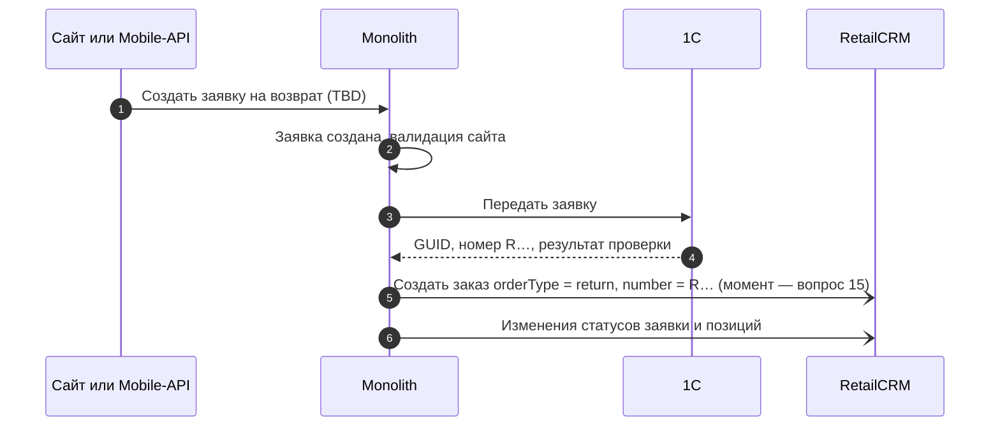
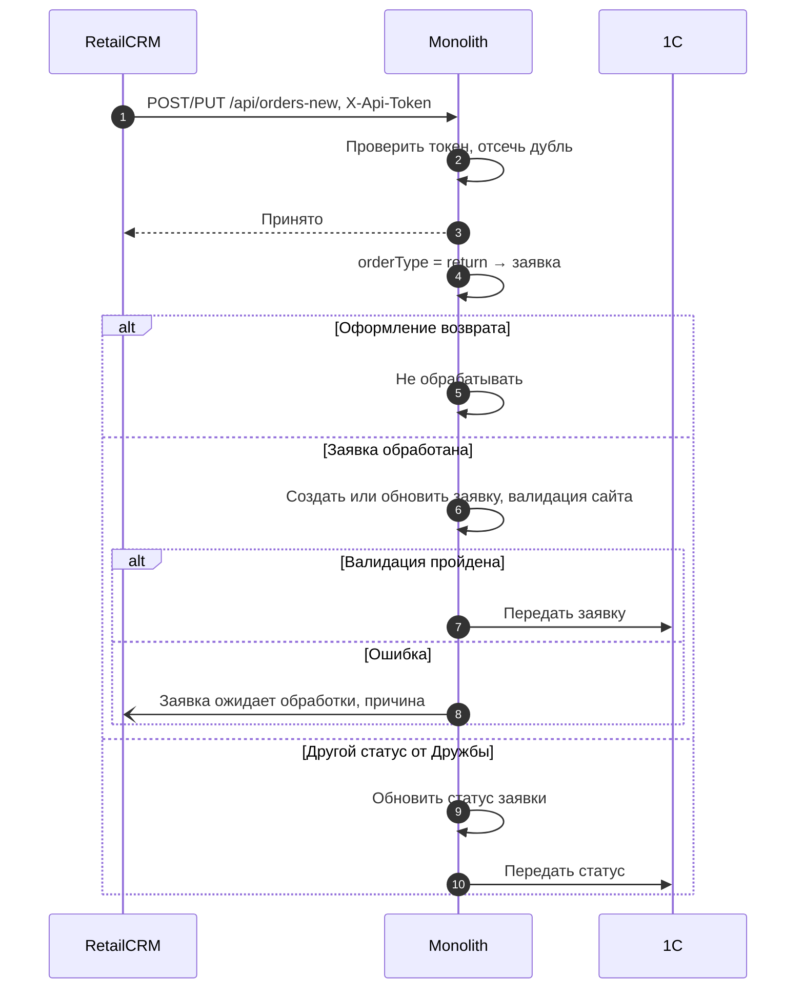
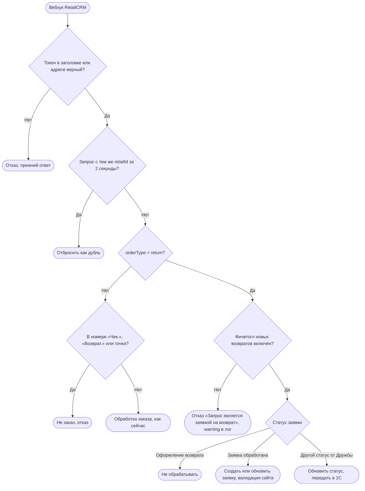

# BL-RET-RCRM: Обмен заявками на возврат между сайтом и RetailCRM

**Системы:** монолит, RetailCRM (Intaro)
**Связанные артефакты:** US 1.5, US 3 — [SRS сайта](../srs/srs-web-mvp.md), [SRS МП](../srs/srs-mobile-mvp.md); `ADR-RET-044`, `ADR-RET-098`, `ADR-RET-099`, `ADR-RET-112`, `ADR-RET-103`, `ADR-RET-104`; [схема статусов, версия 4](../diagrams/state/return-status-v4_state.md); модель данных заявки — ECOMDEV-2587; задачи — ECOMDEV-2677, ECOMDEV-2732
**Решения и открытые вопросы:** [retailcrm-exchange_questions.md](../questions/retailcrm-exchange_questions.md). В тексте нерешённое отмечено «вопрос N»

## Коротко

Как сайт обменивается заявками на возврат с RetailCRM — системой, в которой работает Отдел дружбы с клиентами. Заявки с сайта и из приложения сайт передаёт в RetailCRM. Заявки, которые Дружба оформляет за клиентов, сайт принимает и отправляет в 1С. Статусы заявки и изделий две системы передают друг другу. В документе — как приём заказов из RetailCRM работает сейчас и что нужно доработать: защиту обмена, отличие заявки от заказа, приём и передачу заявок, статусы и сообщения Дружбе об ошибках.

## Цель

Обмениваться заявками на возврат с RetailCRM: передавать в RetailCRM заявки, созданные на сайте и в МП, принимать заявки, которые оформляет Дружба, и синхронизировать статусы заявки и позиций в обе стороны так, чтобы заявка не попала на сайт как заказ и изменения не ушли не в ту сущность

## Контекст

Обмен возвратами идёт через сайт: сайт — центральная система между RetailCRM и 1С, прямой интеграции RetailCRM ↔ 1С по возвратам нет (`ADR-RET-044`).

В RetailCRM заявка на возврат — заказ с типом `orderType = return`. Других значений типа у возвратов нет. Сквозной номер заявки `R…` присваивает 1С (`ADR-RET-098`).

Дружба работает с заявками в RetailCRM: оформляет заявки клиентов, исправляет заявки после ошибки валидации сайта или отказа 1С, ставит ручные статусы. Действие сайта определяется статусом заявки (`ADR-RET-099`, решение 2): черновик Дружбы «Оформление возврата» сайт не обрабатывает, после «Заявка обработана» запускает валидацию сайта.

## Как сейчас

### Приём заказов из RetailCRM

| Что | Как работает |
|---|---|
| Вызов | RetailCRM сам вызывает сайт по триггеру с вебхуком при создании и изменении заказа: `POST /api/orders-new` — создание, `PUT /api/orders-new/{id}` — изменение. Историю изменений RetailCRM сайт не запрашивает |
| Токен | Параметр `token` в адресе. Проверка — общий базовый класс приёмников `modules\api\controllers\ApiController` (`api/orders-new`, `api/orders`, `api/products`, `api/stores`, `api/clients`) |
| Ответ | «Успешно», как только запрос записан во входящую очередь (`from.rcrm.order.create.v1.command`, `from.rcrm.order.update.v1.command`). Заказ обрабатывается позже, ошибка обработки в ответ не попадает |
| Не-заказы | Если в номере есть «Чек.», «Возврат.» или точка, сайт отвечает «не успешно» и заказ не создаёт |
| Тип заказа | `orderType` не читается: заказ с типом `return` и номером без точки создаётся на сайте обычным заказом |
| Дубли | Второй запрос с тем же номером RetailCRM (`retailId`) в течение 2 секунд отбрасывается |
| Статус позиции | Код статуса позиции RetailCRM переводится в код сайта по `cms_order_position_statuses` без проверки наличия: незнакомый код — ошибка обработки всего изменения, хотя RetailCRM получил «успешно» |
| Позиции | Сопоставляются по штрихкоду. При двух строках одного товара данными RetailCRM перезаписывается одна строка |
| Старый приём | `/api/orders` → задача `OrdersJob`: заказ запрашивается из API RetailCRM |

Код и строки — [retailcrm-exchange_questions.md](../questions/retailcrm-exchange_questions.md), раздел «Как сейчас работает обмен»; очереди — [order-integration-exchange.md](../../../../knowledge/12storeez-master-web/features/order-integration-exchange.md)

### Отправка заказа в RetailCRM

* REST API v5 RetailCRM: создание и изменение заказа, создание клиента, если его нет
* через outbox: `to.rcrm.order.create.v1.command`, `to.rcrm.order.update.v1.command`, повторы по `outbox_transaction_rcrm_max_retries`
* `externalId` заказа — `cms_orders.id`; у позиции `offer.externalId` — ID размера товара, ID строки позиции не передаётся
* данные текущего возврата — кастомные поля заказа (`return_city`, `return_address`, `return_date`, `return_money` и др.)

### Текущая реализация не позволяет

1. Отличить заявку от заказа: заявка Дружбы с типом `return` создастся обычным заказом. Отказ по `orderType` — ECOMDEV-2677 (ревью)
2. Принять заявку в таблицы заявки на возврат: приёма заявок нет
3. Различить заявку и заказ с одинаковым ID: ID заявки (`cms_returns.id`) и заказа (`cms_orders.id`) из разных счётчиков
4. Убрать токен из адреса: в вебхук заявки пойдут банковские реквизиты
5. Показать Дружбе ошибку обработки: ответ на вебхук в RetailCRM не отображается (решение 4)
6. Принять новые коды статусов позиции: незнакомый код роняет обработку изменения

## Что нужно сделать

1. Принимать вебхук с токеном в заголовке
2. Различать заказ и заявку по `orderType`
3. Принимать заявки Дружбы и изменения заявок из RetailCRM
4. Передавать в RetailCRM заявки с сайта и из МП и их изменения
5. Синхронизировать статусы заявки и позиций без эха
6. Сообщать Дружбе об ошибках обработки

Новый процесс включается фичетоглом новых возвратов. При выключенном фичетогле обмен заказами с RetailCRM работает по текущей логике, кроме п. 1 и п. 2: токен в заголовке и отказ создавать заказ из заявки действуют независимо от фичетогла

### 1. Токен вебхука

ECOMDEV-2732, `ADR-RET-103`

1. Принимать токен из заголовка `X-Api-Token`; если заголовка нет — из параметра `token` в адресе, как сейчас
2. Если пришли оба — действует заголовок
3. Проверка токена и ответ при ошибке не меняются
4. Значение токена не пишется в логи
5. Заголовок принимают все приёмники на `modules\api\controllers\ApiController`

Приём токена из адреса отключается отдельно, после переключения триггеров RetailCRM. Переключает Лид аналитиков RetailCRM или техподдержка 12 STOREEZ (решение 10). Заголовок или тело запроса и на каких вебхуках — вопрос 14

### 2. Заказ или заявка

`ADR-RET-104`, ECOMDEV-2677

Тип записи определяется по `orderType` в теле вебхука, до поиска записи по `id` из адреса:

* `orderType = return` — заявка на возврат: заказ на сайте не создаётся и не меняется; дальше — п. 3 при включённом фичетогле, иначе ответ `successful: false` «Запрос является заявкой на возврат» и запись warning с `retailId` и `orderType`
* другой `orderType` или поле не заполнено — заказ, обработка как сейчас
* проверка по номеру («Чек.», «Возврат.», точка) остаётся

То же правило — в старом приёме `/api/orders` (`OrdersJob`)

Отсечка дублей по `retailId` за 2 секунды действует и на заявки: `retailId` — номер записи в RetailCRM, заявка там тоже заказ

### 3. Приём заявок из RetailCRM

Заявки Дружбы и изменения заявок с сайта приходят тем же вебхуком с `orderType = return`. Действие сайта — по статусу заявки (`ADR-RET-099`, решения 2, 3):

| Статус в вебхуке | Действие сайта |
|---|---|
| «Оформление возврата» (`return-draft`, вопрос 5) | Не обрабатывать: черновик Дружбы, в 1С не передаётся |
| «Заявка обработана» | Создать заявку на сайте, если её нет, или обновить данные; запустить валидацию сайта. Успех — «Заявка на проверке в 1С» и отправка в 1С, ошибка — «Заявка ожидает обработки» с причиной (п. 6) |
| «Подтверждение возврата», «Возврат отправлен», «Возврат принят» (вручную), «Возврат отменён» | Обновить статус заявки на сайте и передать в 1С по правилам обмена с 1С |
| Отмена позиции возврата | Позиция получает «Отменено» (вопрос 6 ADR-RET-110 — отменять или удалять) |

Какие статусы сайт получает из RetailCRM и их коды — вопрос 12. Заявка Дружбы создаётся на сайте с каналом `support` (ECOMDEV-2587)

Заявка находится на сайте:

* по `externalId` — ID заявки на сайте, если заявка уже была передана сайтом (какой `externalId` у заявки — вопрос 4)
* без `externalId` — новая заявка Дружбы

Незнакомый код статуса заявки или позиции не должен ронять обработку: запись ошибки в лог и сообщение Дружбе (п. 6). Код начального статуса позиции возврата в RetailCRM — вопрос 11

### 4. Передача заявки в RetailCRM

Заявку, созданную на сайте и в МП, сайт создаёт в RetailCRM как заказ:

* `orderType = return`
* `number` — сквозной номер `R…` от 1С: RetailCRM свой номер не присваивает (решение 11). Когда сайт создаёт заявку в RetailCRM — сразу или после номера от 1С — вопрос 15
* `externalId` — вопрос 4
* статус заявки и статусы позиций (п. 5)

Изменения заявки на сайте — статус, ответ 1С, отмена клиентом — передаются в RetailCRM изменением заказа через outbox

Заявке, созданной Дружбой, RetailCRM присваивает свой номер; после ответа 1С сайт заменяет его на `R…` (решение 11)

Состав полей обмена готовят обе стороны: список полей RetailCRM — от Лида аналитиков RetailCRM, после получения — сверка

### 5. Статусы заявки и позиций

* коды статусов заявки — общие для сайта, RetailCRM и 1С; для «Заявка создана», «Заявка обработана», «Заявка на проверке в 1С» кодов нет (вопрос 16 схемы статусов)
* статус позиции исходного заказа «Возврат» — `lost`, «Заявка на возврат» — `return-requested` (`ADR-RET-112`); статуса «Частичный возврат» и кода `return-partial` нет (решение 12)
* новый код статуса позиции RetailCRM ставит только после того, как сайт заведёт его в справочнике (решение 3)
* кто ставит статусы позиции исходного заказа — вопрос 13
* статусы, которые прислал сайт, не должны возвращаться на сайт обратно: как RetailCRM это обеспечивает — вопрос 10. Пока вопрос не решён, повторное получение своего же статуса не должно менять заявку

### 6. Ошибки для Дружбы

Ответ на вебхук в заказе RetailCRM не виден (решение 4). Чтобы Дружба увидела ошибку, сайт после обработки передаёт причину и код ошибки в заявку изменением заказа API RetailCRM. Какие ошибки показывать — вопрос 7

### 7. Что не меняется

* Приём и отправка обычных заказов
* Отсечение чеков и записей с точкой в номере
* Обмен при выключенном фичетогле новых возвратов, кроме п. 1 и п. 2

## Схемы

**Заявка с сайта или из МП**

**Заявка Дружбы и изменения из RetailCRM**

**Разбор вебхука**

