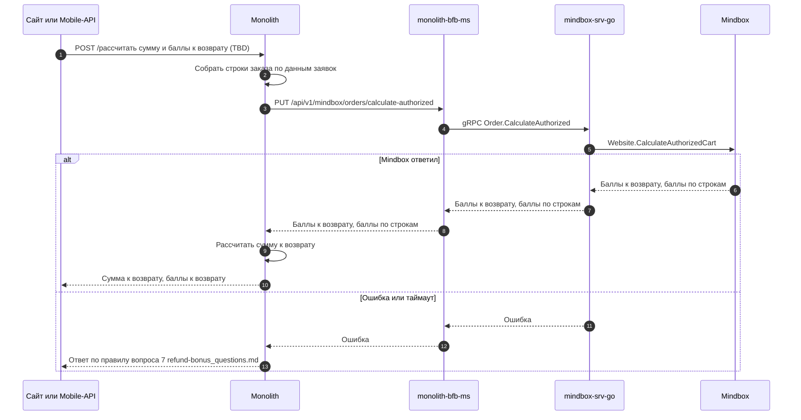
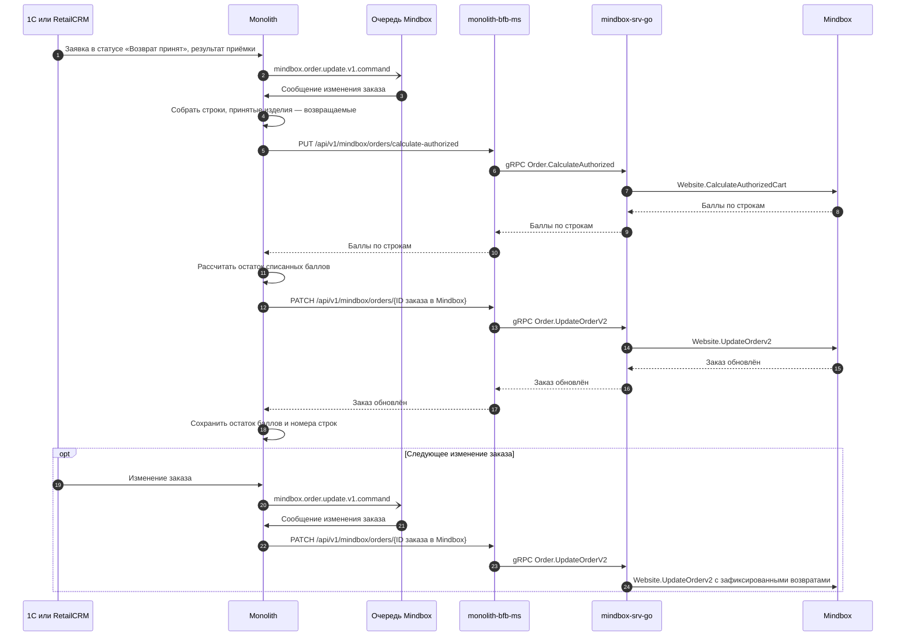

# BL-RET-BONUS: Баллы к возврату. Расчёт и фиксация возврата баллов в Mindbox

**Системы:** монолит, `monolith-bfb-ms`, `mindbox-srv-go` (команда BTS), Mindbox
**Связанные артефакты:** US 1.4, US 1.5, US 3 — [SRS сайта](../srs/srs-web-mvp.md), [SRS МП](../srs/srs-mobile-mvp.md); `ADR-RET-092`, `ADR-RET-099`, `ADR-RET-101`, `ADR-RET-039`; [доступное к возврату количество](./available-return-quantity_backend.md)
**Решения и открытые вопросы:** [mindbox-exchange_questions.md](../questions/mindbox-exchange_questions.md) — операции, строки, статусы, `mindbox-srv-go`; [refund-bonus_questions.md](../questions/refund-bonus_questions.md) — правила баллов для клиента. В тексте нерешённое отмечено «вопрос N» — по `mindbox-exchange_questions.md`, если не указан другой файл

## Цель

Возвращать клиенту баллы, которыми он оплатил возвращённые изделия: считать баллы к возврату в Mindbox при оформлении заявки, фиксировать возврат в Mindbox при «Возврат принят» и сохранять его при следующих изменениях заказа

## Контекст

Баллы ведёт Mindbox: сайт показывает результат его расчёта и сообщает о возврате. Отдельной сущности возврата у Mindbox нет — возврат передаётся изменением заказа: строки возвращённых изделий получают статус возврата, сумма списанных баллов уменьшается на возвращённые (`ADR-RET-092`).

Одинаковые изделия хранятся в заказе одной позицией с количеством, списанные баллы — на всю позицию. Делить баллы позиции на изделия должен Mindbox, поэтому в сообщении для Mindbox позиция делится на строки остающихся и возвращаемых изделий.

Статус заказа при возврате не меняется: выполненный заказ остаётся выполненным (`ADR-RET-039`). О возврате Mindbox узнаёт только по строкам.

## Как сейчас

### Цепочка вызовов

| Операция | Монолит → `monolith-bfb-ms` | `monolith-bfb-ms` → `mindbox-srv-go` | `mindbox-srv-go` → Mindbox | Когда |
|---|---|---|---|---|
| Расчёт | `PUT /api/v1/mindbox/orders/calculate-authorized` | gRPC `Order.CalculateAuthorized` | `Website.CalculateAuthorizedCart` | Расчёт корзины |
| Создание заказа | `PUT /api/v1/mindbox/orders` | gRPC `Order.CreateOrder` | Операция создания заказа | Очередь `mindbox.order.create.v1.command` |
| Изменение заказа | `PATCH /api/v1/mindbox/orders/{ID заказа в Mindbox}` | gRPC `Order.UpdateOrderV2` | `Website.UpdateOrderv2` | Любое изменение заказа, в том числе из RetailCRM; очередь `mindbox.order.update.v1.command` |

Соответствие gRPC-методов операциям Mindbox — по названиям: в `architecture-docs` пары не указаны. Подробно об обмене — [order-integration-exchange.md](../../../../knowledge/12storeez-master-web/features/order-integration-exchange.md), [08-integrations.md](../../../../knowledge/12storeez-master-web/architecture/08-integrations.md)

### Что передаёт монолит

Строка заказа — одна позиция заказа:

* `id` — товар (размер)
* `quantity`
* `price` — цена до скидки за единицу
* `status` — код статуса Mindbox из `cms_mb_statuses_map` по паре `order_status_id` + `order_position_status_id`; если пары нет — `101`
* `line_id` — ID товара
* `sequence_number` — порядковый номер строки 1…N, только в изменении заказа
* `custom_fields.positionStatus` — код статуса позиции сайта
* `requested_promotions` — скидка распродажи `Sale_12Storeez` и скидка промокода позиции

Заказ:

* расчёт — ID клиента, ID корзины, сумма баллов к списанию; ID заказа не передаётся
* изменение заказа — ID заказа на сайте, `bonuses[].amount` — все баллы, списанные по заказу при покупке, доставка, оплаты, свойства заказа

### Что монолит получает из расчёта

* `bonuses_changes[]` — `earned_amount`, `spent_amount` одной суммой на заказ
* `positions[].applied_promotions[]` — `type`, `amount`; списанные на строку баллы монолит берёт из элемента с `type = spentBonusPoints`
* поля `spentBonusPointsAmount` в `mindbox.proto` нет

### Что принимает и возвращает Mindbox в расчёте

По [описанию операции `Website.CalculateAuthorizedCart`](<../../sources/mindbox/Website.CalculateAuthorizedCart — расчёт корзины авторизованного пользователя.md>):

* существующий заказ — `order.ids.mindboxId` (ID заказа в Mindbox) или `order.ids.externalSystemstoreez.com` (ID заказа на сайте)
* строка — `lineId` (идентификатор строки) и `lineNumber` (порядковый номер); статус строки — `status.ids.externalId`
* при расчёте скидок Mindbox может разделить строку и вернуть несколько строк с одним `lineId`; клиент присваивает каждой новой строке свой `lineId` для следующих запросов
* баллы к списанию и изменения баллов — по балльному счёту: `bonusPoints[].amount` + `balanceType`, `bonusPointsChanges[].spentAmount` / `earnedAmount` + `balanceType`
* в ответе по строке элемент `appliedPromotions` с типом `spentBonusPoints` содержит `amount` — размер скидки и `spentBonusPointsAmount` — количество списанных баллов
* расчёт применяет промоакции, активные в момент расчёта

В `mindbox.proto` строка расчёта `CalculatePositions` уже содержит `line_id` (`int64`) и `sequence_number`, ответ `CalculateResponsePositions` — `line_id` и `sequence_number`. Код `mindbox-srv-go` недоступен: передаёт ли сервис эти поля в `lineId` / `lineNumber` — вопрос 15

### Статус строки при выполненном заказе

| Статус позиции | Код Mindbox |
|---|---|
| Добавлен и другие активные | `311` |
| Возврат (`lost`, `internal_id = 9`) | `401` |
| «Заявка на возврат», «Частичный возврат» (`ADR-RET-101`) | пары нет → `101` |

Полная таблица — [order-status-dictionaries.md](../../../../knowledge/12storeez-master-web/database/order-status-dictionaries.md), раздел 5

### Текущая реализация не позволяет

1. Считать существующий заказ: в расчёт не передаётся ID заказа. Mindbox его принимает (`order.ids.mindboxId`), но в `CalculateRequest` в `mindbox.proto` на `origin/master` (v0.9.10) поля нет; TNT-2687 закрыта, задача сайта ECOMDEV-1185 в бэклоге (вопрос 15)
2. Различать строки одного товара: `line_id` = ID товара, у строк одного товара `lineId` совпадает
3. Передать возврат при новых статусах позиции: они уходят как `101` «новая»
4. Сохранить возврат в Mindbox: каждое изменение заказа передаёт позиции с исходными статусами и исходное списание баллов

## Что нужно сделать

1. Собирать строки заказа для Mindbox по данным заявок
2. Считать баллы к возврату при оформлении и при создании заявки
3. Фиксировать возврат в Mindbox при «Возврат принят»
4. Учитывать зафиксированные возвраты в каждой отправке заказа в Mindbox
5. Передавать ID заказа и номера строк через `monolith-bfb-ms` и `mindbox-srv-go`

Новый процесс включается фичетоглом новых возвратов. При выключенном фичетогле обмен с Mindbox работает по текущей логике без изменений

### 1. Строки заказа для Mindbox

Строки собираются по данным заявок, а не по статусу позиции заказа. Правило одно для всех операций п. 2–4

Возвращёнными считаем изделия с результатом приёмки «Принято» в заявках в статусах «Возврат принят» и «Возврат завершён». Изделия активных заявок и изделия с результатом «Отменено» считаем остающимися

Для каждой позиции заказа:

1. Определить количество возвращённых изделий
2. Определить количество изделий, которые возвращаются сейчас:
   * предрасчёт и создание заявки — выбранные изделия
   * фиксация — изделия фиксируемой заявки с результатом «Принято»
   * отправка заказа — 0
3. Определить количество остающихся: количество позиции минус возвращённые минус возвращаемые сейчас
4. Сформировать строки:
   * остающиеся изделия — одна строка, статус — код Mindbox по паре «статус заказа + статус позиции до первой заявки» (для выполненного заказа — `311`)
   * каждое возвращённое и каждое возвращаемое сейчас изделие — отдельная строка с `quantity = 1`, статус — код возврата Mindbox (`401`, если Mindbox подтвердит значение — вопрос 5)
   * строку с количеством 0 не передавать
5. Присвоить строкам `line_id` (`lineId` в Mindbox): уникальный в заказе и неизменный между отправками для остающихся и уже зафиксированных строк. `sequence_number` (`lineNumber`) — порядковый номер строки 1…N. Можно ли менять `lineId` у заказа, уже созданного в Mindbox, — вопрос 8
6. Если Mindbox в ответе разделил строку на несколько с одним `lineId`, присвоить каждой новой строке свой `line_id` и передавать строки так в следующих запросах
7. Рассчитать скидки строки:
   * скидка распродажи — (цена до скидки − цена со скидкой) × количество строки, как сейчас
   * скидка промокода позиции — делится между строками, правило — вопрос 12
8. Проверить, что сумма количеств строк равна количеству позиции, иначе не отправлять сообщение и записать ошибку в лог

Отдельная строка на каждое возвращаемое изделие нужна, так как сайт хранит баллы к возврату по каждому изделию заявки, а Mindbox отдаёт баллы по строке

Сумма списанных баллов заказа `bonuses[].amount`:

* возвратов не было — баллы, списанные по заказу при покупке, как сейчас
* есть зафиксированные возвраты — остаток списанных баллов после последней фиксации (п. 3)

Строки — формат обмена с Mindbox. Как позиция хранится в заказе сайта и передаётся в RetailCRM и 1С, определяет [order-position-split_questions.md](../questions/order-position-split_questions.md)

**Пример.** Позиция — 3 футболки, на позицию списано 100 баллов. Клиент возвращает одну, затем вторую

| Момент | Строки | `bonuses[].amount` |
|---|---|---|
| Предрасчёт первого возврата | 2 шт. `311`; 1 шт. возврат | 100 |
| Фиксация первого возврата, Mindbox: 66 на оставшиеся, 33 на возвращённую | 2 шт. `311`; 1 шт. возврат | 100 → после фиксации 66 |
| Изменение заказа из RetailCRM | 2 шт. `311`; 1 шт. возврат | 66 |
| Предрасчёт второго возврата | 1 шт. `311`; 1 шт. возврат (ранее); 1 шт. возврат (сейчас) | 66 |

Как Mindbox считает второй возврат при уже возвращённой строке — вопрос 10

### 2. Расчёт баллов к возврату

#### 2.1. Предрасчёт на экране оформления (US 1.4)

Метод `POST /рассчитать сумму и баллы к возврату` (TBD; МП — `POST /api/v1/orders/{order_id}/return/calculate`, TBD). Входные параметры — в SRS

1. Проверить, что заказ принадлежит клиенту, иначе вернуть ошибку
2. Проверить, что выбранные изделия относятся к позициям заказа и их количество не больше доступного к возврату ([available-return-quantity_backend.md](./available-return-quantity_backend.md)), иначе вернуть ошибку
3. Собрать строки по п. 1
4. Вызвать расчёт с ID заказа в Mindbox (`order.ids.mindboxId`), строками и `bonuses[].amount` по п. 1
5. Если `mindbox-srv-go` вернул ошибку или не ответил за `MINDBOX_TIMEOUT`, у заказа нет ID в Mindbox или в ответе нет переданной строки — ответ клиенту по вопросу 11
6. Получить `spentAmount` из ответа: отрицательное значение — баллы, которые Mindbox вернёт (`-33` → 33 балла)
7. Сформировать и вернуть сумму к возврату и «Баллы к возврату» = модуль `spentAmount`

Ничего не сохраняется: значения предварительные

#### 2.2. Расчёт при создании заявки (US 1.5)

Аналогично п. 2.1, отличия:

* вызывается при создании заявки по изделиям заявки
* баллы к возврату сохраняются по каждому изделию заявки — количество списанных баллов строки этого изделия из ответа: `spentBonusPointsAmount` элемента `spentBonusPoints`; `amount` этого элемента — размер скидки, совпадает с количеством баллов при курсе 1 балл = 1 ₽ (вопрос 13)
* если сумма баллов по изделиям отличается от модуля `spentAmount`, сохраняются баллы по строкам, расхождение записывается в лог

### 3. Фиксация возврата при «Возврат принят»

Выполняется, когда заявка переходит в «Возврат принят», в том числе вручную (`ADR-RET-099`, решения 12, 13, 17). Асинхронно, через очередь `mindbox.order.update.v1.command`, как изменение заказа

1. Проверить, что в заявке есть изделия с результатом «Принято», иначе фиксацию не выполнять
2. Собрать строки по п. 1: принятые изделия заявки — возвращаемые сейчас
3. Вызвать расчёт с ID заказа и этими строками
4. Рассчитать остаток списанных баллов — сумму списанных баллов по строкам остающихся и ранее возвращённых изделий из ответа
5. Вызвать изменение заказа с теми же строками и `bonuses[].amount` = остаток
6. Сохранить остаток списанных баллов и номера строк после успешного ответа (способ хранения на усмотрение разработки)
7. При ошибке или таймауте оставить сообщение в outbox и повторить по лимиту `outbox_transaction_mindbox_max_retries`; при исчерпании попыток записать ошибку в лог

Расчёт при фиксации выполняется заново, так как часть изделий заявки могла получить «Отменено». Баллы по изделиям, сохранённые при создании заявки, не перезаписываются: их видит клиент (US 3)

Повторная обработка той же заявки формирует тот же состав строк и ту же сумму

### 4. Отправка заказа с учётом возвратов

Каждое изменение заказа, которое сейчас уходит в Mindbox, собирает строки и `bonuses[].amount` по п. 1. Остальные данные сообщения — по текущей логике

Отмена заявки до «Возврат принят» в Mindbox ничего не отправляет: изделия активной заявки уже передаются как остающиеся

### 5. Доработки по сервисам

**монолит:**

* собирает строки по п. 1 для расчёта и изменения заказа
* передаёт ID заказа в Mindbox в `calculate-authorized` (ECOMDEV-1185, код в ветке `bugfix/ECOMDEV-1185`)
* передаёт в расчёт и изменение заказа уникальный `line_id` строки вместо ID товара и `sequence_number`
* хранит баллы к возврату по изделию заявки, остаток списанных баллов и номера строк по заказу
* фиксирует возврат по п. 3

**`monolith-bfb-ms`:**

* передаёт ID заказа из `calculate-authorized` в gRPC `Order.CalculateAuthorized` (код в ветке — со слов Backend Developer)
* передаёт `line_id` и `sequence_number` строк в gRPC `CalculatePositions` (поля в `mindbox.proto` есть)

**`mindbox-srv-go`** (команда BTS):

* принимает ID заказа в Mindbox в `CalculateRequest` и передаёт в `order.ids.mindboxId` операции `Website.CalculateAuthorizedCart` — TNT-2687 закрыта, в `mindbox.proto` поля нет (вопрос 15)
* передаёт `line_id` и `sequence_number` строк расчёта в `lineId` и `lineNumber` (вопрос 15)
* возвращает `spentBonusPointsAmount` строки в `CalculateResponseAppliedPromotions`, если курс баллов отличается от 1 балл = 1 ₽ (вопрос 13)

  ```
  message CalculateRequest {
      ...
      optional string order_id = 13; //новый параметр, название и номер на усмотрение разработки (вопрос 15)
  }

  message CalculateResponseAppliedPromotions {
      ...
      float spent_bonus_points_amount = 8; //новый параметр, если нужен (вопрос 13)
  }
  ```

* изменение заказа `UpdateOrderV2` уже принимает `bonuses` и строки с `line_id`, `sequence_number` — доработка не нужна

**Mindbox:**

* код статуса возврата строки; при необходимости — новые статусы (вопросы 2, 5, 6)
* операции расчёта и фиксации возврата, если текущие не подходят при неизменном статусе заказа (вопрос 1); тогда `mindbox-srv-go` нужны новые методы

### 6. Что не меняется

* Расчёт корзины и создание заказа в Mindbox
* Изменение заказа без возвратов: строки и `bonuses[].amount` совпадают с текущими
* Обмен с Mindbox при выключенном фичетогле новых возвратов

## Схемы

**Предрасчёт и расчёт при создании заявки**



При создании заявки (US 1.5) последовательность та же: метод `POST /создать заявку на возврат` (TBD), после ответа Mindbox монолит сохраняет баллы по каждому изделию заявки

**Фиксация возврата и следующие изменения заказа**



## Пример

Предрасчёт первого возврата из примера п. 1. Имена полей — как в изменении заказа; код возврата — при подтверждении `401` (вопрос 5)

```json
{
  "order_id": "{ID заказа в Mindbox}", //новый параметр, в Mindbox — order.ids.mindboxId
  "bonuses": [{ "amount": 100 }],
  "positions": [
    { "id": 1001, "quantity": 2, "price": 3990, "status": 311, "line_id": "{номер строки}", "sequence_number": 1 },
    { "id": 1001, "quantity": 1, "price": 3990, "status": 401, "line_id": "{номер строки}", "sequence_number": 2 }
  ]
}
```

Из ответа берутся:

* `bonusPointsChanges[].spentAmount` балльного счёта = `-33` -> «Баллы к возврату» = 33
* списанные баллы строки 1 = 66 -> остаток списанных баллов при фиксации
* списанные баллы строки 2 = 33 -> баллы к возврату изделия заявки
* `bonusPointsChanges.earnedAmount` — начисленные баллы, которые снимаются; клиенту не показывается (refund-bonus_questions.md, вопросы 3, 6)

После фиксации изменение заказа уходит с теми же строками и `bonuses[].amount` = 66
