# ERD-RET. Таблицы и связи возврата (TO-BE, без полей)

**Тип:** модель данных (ERD), уровень таблиц и связей.
**Статус:** DRAFT · **Дата:** 15.10.2026
**Связанные артефакты:** [SRS МП, MVP](../../srs/srs-mobile-mvp.md) — US 1.1, US 1.3, US 1.5, раздел «Логика бэкенда»; `ADR-RET-039`, `ADR-RET-040`, `ADR-RET-044`, `ADR-RET-046`, `ADR-RET-048`, `ADR-RET-055`, `ADR-RET-060`, `ADR-RET-061`.

## 1. Диаграмма

```plantuml
@startuml
hide circle
hide empty members
hide stereotype
skinparam linetype ortho
skinparam shadowing false

skinparam class {
  BackgroundColor<<exist>> #BBD3F5
  BorderColor<<exist>> #1F4E9A
  BackgroundColor<<records>> #BBD3F5
  BorderColor<<records>> #1F4E9A
  BackgroundColor<<field>> #FFF4B3
  BorderColor<<field>> #B39200
  BackgroundColor<<new>> #C8F0F7
  BorderColor<<new>> #0F7C8C
  BackgroundColor<<money>> #FFE58A
  BorderColor<<money>> #B38600
  BackgroundColor<<open>> #F7B5B5
  BorderColor<<open>> #A61B1B
}

' ---------- Доставка ----------
entity "cms_delivery_types\nТипы службы доставки" as delivery_types <<records>>
entity "cms_delivery_tk\nСлужбы доставки" as delivery_tk <<records>>
entity "cms_delivery_city\nСлужбы + город" as delivery_city <<records>>

' ---------- Заказ и клиент ----------
entity "cms_users_user\nПользователь" as users <<exist>>
entity "cms_users_refund\nДанные счёта" as users_refund <<exist>>
entity "cms_orders\nЗаказы" as orders <<exist>>
entity "cms_order_positions\nПозиции заказа" as order_positions <<exist>>
entity "cms_order_receipts\nЧеки заказа" as order_receipts <<exist>>
entity "cms_payment_types\nСпособы оплаты" as payment_types <<exist>>

' ---------- Справочники возврата ----------
entity "cms_return_method\nСпособы возврата" as return_method <<records>>
entity "cms_return_method_delivery_type\nТип доставки → способ возврата" as return_method_delivery_type <<new>>
entity "cms_catalog_stock\nМагазины" as catalog_stock <<field>>
entity "cms_return_reasons\nПричины возврата" as return_reasons <<exist>>
entity "cms_return_reasons_groups\nГруппы причин возврата" as reasons_groups <<exist>>

' ---------- Заявка на возврат ----------
entity "cms_returns\nЗаявки на возврат" as returns <<new>>
entity "cms_return_positions\nПозиции возврата" as return_positions <<new>>
entity "cms_return_statuses\nСтатусы заявки" as return_statuses <<new>>
entity "cms_return_status_groups\nГруппы статусов заявки" as return_status_groups <<new>>
entity "cms_return_position_statuses\nСтатусы позиции возврата" as return_position_statuses <<new>>
entity "cms_return_history\nИстория изменений заявки" as return_history <<new>>
entity "cms_order_return_statuses_wms\nСтатус возврата WMS" as return_statuses_wms <<open>>

' ---------- Возврат денег ----------
entity "cms_return_refunds\nВозврат денег по способам" as return_refunds <<money>>
entity "cms_refund_methods\nСпособы возврата денег" as refund_methods <<money>>
entity "cms_payment_type_refund_method\nСпособ оплаты → способ возврата денег" as payment_type_refund_method <<money>>

' ---------- Связи: доставка ----------
delivery_types ||--o{ delivery_tk : "тип службы"
delivery_tk ||--o{ delivery_city : "города службы"
delivery_tk ||--o{ orders : "служба доставки заказа"

' ---------- Связи: заказ и клиент ----------
users ||--o| users_refund : "данные счёта"
users ||--o{ orders : "заказы клиента"
payment_types ||--o{ orders : "способ оплаты"
orders ||--|{ order_positions : "позиции"
orders ||--o{ order_receipts : "чеки"

' ---------- Связи: заявка ----------
orders ||--o{ returns : "заявки по заказу"
users ||--o{ returns : "заявки клиента"
return_method ||--o{ returns : "способ возврата"
delivery_tk ||--o{ returns : "возвратная служба"
catalog_stock |o--o{ returns : "магазин приёма"
return_statuses ||--o{ returns : "статус заявки"
return_status_groups ||--o{ return_statuses : "группа статусов"
return_statuses_wms ||--o{ returns : "статус WMS"
returns ||--o{ return_history : "снимки заявки"

returns ||--|{ return_positions : "изделия"
order_positions ||--o{ return_positions : "позиция заказа"
return_position_statuses ||--o{ return_positions : "статус позиции"
return_reasons |o--o{ return_positions : "причина"
reasons_groups ||--o{ return_positions : "группа причины"
reasons_groups ||--o{ return_reasons : "причины группы"

' ---------- Связи: способ возврата ----------
return_method ||--o{ return_method_delivery_type : "способ возврата"
delivery_types ||--o| return_method_delivery_type : "тип доставки"

' ---------- Связи: возврат денег ----------
returns ||--|{ return_refunds : "куда вернуть деньги"
refund_methods ||--o{ return_refunds : "способ возврата денег"
order_receipts ||--o{ return_refunds : "чек оплаты"
payment_types ||--o{ payment_type_refund_method : "способ оплаты"
refund_methods ||--o{ payment_type_refund_method : "способ возврата денег"

legend right
  |= Цвет |= Таблица |
  |<#BBD3F5> | существует, не меняется или получает новые записи |
  |<#FFF4B3> | существует, добавляется поле |
  |<#C8F0F7> | новая |
  |<#FFE58A> | новая, возврат денег |
  |<#F7B5B5> | существует, связь с возвратом не определена |
endlegend
@enduml
```

## 2. Состав таблиц

| Таблица | Статус | Для чего |
|---|---|---|
| `cms_returns` | новая | Заявка на возврат: заказ, клиент, способ возврата и его данные (адрес, дата и интервал курьера, пункт или магазин со слепком), дата «Вернуть до», банковские реквизиты |
| `cms_return_positions` | новая | Одно изделие — одна строка: позиция заказа, группа причины и причина, статус позиции |
| `cms_return_statuses` | новая | Справочник статусов заявки, включая отмену: название статуса в системе, клиентское название и код статуса для обмена с RetailCRM и 1С. Несколько статусов с одним клиентским названием клиент видит как один статус |
| `cms_return_status_groups` | новая | Группы статусов заявки: группировка статусов в админке и для логики по этапу процесса, например «завершённые» |
| `cms_return_position_statuses` | новая | Статусы позиции возврата: частичная приёмка на складе |
| `cms_return_history` | новая | Снимок всей заявки с позициями и их статусами после каждого изменения — с сайта, из RetailCRM и 1С, как у заказов. История статусов заявки и позиций восстанавливается по снимкам |
| `cms_return_method_delivery_type` | новая | Соответствие типа доставки способу возврата: какая возвратная служба выполняет способ и какой способ возврата соответствует доставке заказа (способ «как в заказе») |
| `cms_return_refunds` | новая | Куда и сколько вернуть по заявке: строка на каждый способ возврата денег |
| `cms_refund_methods` | новая | Справочник способов возврата денег и признак, нужны ли банковские реквизиты |
| `cms_payment_type_refund_method` | новая | Соответствие способа оплаты заказа способу возврата денег |
| `cms_return_method` | существует, новые записи | Способы возврата; новые записи «Магазин 12 STOREEZ» и «Почта России» |
| `cms_delivery_tk` | существует, новые записи | Возвратные службы — отдельные записи со своим типом доставки. Описание способа и инструкция «Что дальше» — в существующих текстовых полях записи возвратной службы |
| `cms_delivery_types` | существует, новые записи | Тип доставки для возврата |
| `cms_delivery_city` | существует, новые записи | Города возвратных служб с ФИАС |
| `cms_catalog_stock` | существует, новое поле | Признак «Принимает возвраты» у магазина |
| `cms_users_user`, `cms_users_refund`, `cms_orders`, `cms_order_positions`, `cms_order_receipts`, `cms_payment_types` | существует, не меняется | Заказ, клиент, сохранённые реквизиты, чеки и способ оплаты, по которым оформляется заявка и считается возврат денег |
| `cms_return_reasons`, `cms_return_reasons_groups` | существует, не меняется | Справочник причин возврата |
| `cms_order_return_statuses_wms` | существует, связь не определена | Статусы возврата из WMS; связь с заявкой зависит от статусной модели возврата |
