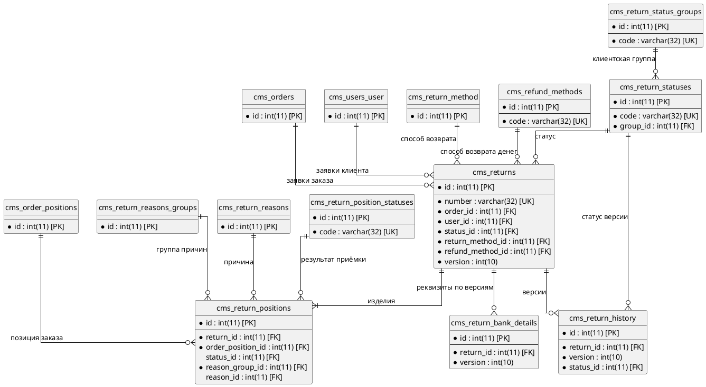

# ERD-RET: Модель данных заявки на возврат

**Основа:** задача [ECOMDEV-2587](<../../tasks/US-01/ECOMDEV-2587 [B] Возвраты. Модель данных заявки на возврат.md>) (по Трекеру на 16.11.2026), ADR архитектурного комитета ADR-0002…0006; статусная модель — `ADR-RET-099`; баллы и суммы к возврату — [BL-RET-BONUS](../../backend/mindbox-return-bonus_backend.md), SRS US 1.5
**СУБД:** MariaDB 10.3, схема монолита
**SQL-скрипт:** [return-request_sql.sql](./return-request_sql.sql)

Заявка на возврат — отдельная сущность со своим номером, изделиями, статусами, реквизитами и версиями; по одному заказу может быть несколько заявок. Существующие таблицы (`cms_orders`, `cms_order_positions`, `cms_users_user`, справочники причин и способов возврата) не меняются.

Обозначения: **PK** — первичный ключ, **FK** — внешний ключ с ограничением в БД, **UK** — уникальный индекс. «NULL: Нет» — `NOT NULL`. Поля с пометкой **(предложено)** в ECOMDEV-2587 нет.

## 1. Диаграмма

На диаграмме — ключи и связи, полный состав полей — в разделе 2.

## 2. Таблицы

### 2.1. `cms_returns` — заявка на возврат

| # | Поле | Тип | NULL | Описание |
|---|---|---|---|---|
| 1 | `id` | `int(11)`, PK, AI | Нет | Внутренний ID заявки на сайте |
| 2 | `number` | `varchar(32)`, UK | Нет | Номер заявки на сайте, внутренний. Клиент видит номер «Р…», который присваивает 1С |
| 3 | `order_id` | `int(11)`, FK → `cms_orders.id`, `ON DELETE RESTRICT` | Нет | Заказ |
| 4 | `user_id` | `int(11)`, FK → `cms_users_user.id` | Нет | Клиент — владелец заказа: список заявок клиента, проверка владельца при отмене |
| 5 | `status_id` | `int(11)`, FK → `cms_return_statuses.id` | Нет | Внутренний статус заявки |
| 6 | `channel` | `varchar(16)` | Нет | Кто создал заявку: `web` — ЛК на сайте, `app` — МП, `support` — «Дружба» в RetailCRM, `store` — 1С при возврате в магазине без заявки |
| 7 | `return_method_id` | `int(11)`, FK → `cms_return_method.id` | Нет | Способ возврата: курьер, СДЭК, 5Post и др. |
| 8 | `refund_method_id` | `int(11)`, FK → `cms_refund_methods.id` | Нет | Способ возврата денег |
| 9 | `return_country_iso` | `varchar(2)` | Да | Страна возврата |
| 10 | `return_city` | `varchar(255)` | Да | Город возврата, может отличаться от города заказа |
| 11 | `return_city_fias` | `varchar(255)` | Да | ID города в геосервисе |
| 12 | `point_provider` | `varchar(255)` | Да | Код службы пункта (`cms_delivery_tk.slug`) — СДЭК, 5Post |
| 13 | `point_id` | `varchar(32)` | Да | ID пункта в службе |
| 14 | `store_code` | `smallint(6) unsigned` | Да | Код магазина (`cms_delivery_tk.store_code`) — «Магазин 12 STOREEZ» |
| 15 | `point_name` | `varchar(255)` | Да | Название пункта или магазина на момент создания заявки |
| 16 | `point_address` | `varchar(512)` | Да | Адрес пункта или магазина на момент создания |
| 17 | `point_schedule` | `text` | Да | Режим работы пункта или магазина на момент создания |
| 18 | `point_lat` | `decimal(10,7)` | Да | Широта пункта или магазина на момент создания — для «Смотреть на карте» |
| 19 | `point_lng` | `decimal(10,7)` | Да | Долгота пункта или магазина на момент создания |
| 20 | `pickup_postal` | `varchar(255)` | Да | Адрес забора курьером: индекс |
| 21 | `pickup_street` | `varchar(255)` | Да | Улица |
| 22 | `pickup_house` | `varchar(255)` | Да | Дом |
| 23 | `pickup_housing` | `varchar(255)` | Да | Корпус |
| 24 | `pickup_flat` | `varchar(255)` | Да | Квартира |
| 25 | `pickup_address_manual` | `tinyint(1)`, default `0` | Нет | Адрес введён вручную, не из подсказок геосервиса; по нему RetailCRM получает причину обработки «проверить адрес» |
| 26 | `courier_date` | `date` | Да | Дата приезда курьера. `NULL` — логистика не вернула даты или адрес введён вручную |
| 27 | `courier_time_from` | `varchar(5)` | Да | Начало интервала курьера, `ЧЧ:ММ` |
| 28 | `courier_time_to` | `varchar(5)` | Да | Конец интервала курьера, `ЧЧ:ММ` |
| 29 | `courier_interval_code` | `varchar(255)` | Да | Код интервала из ответа логистики, например `20-23` |
| 30 | `timezone` | `varchar(64)` | Да | Часовой пояс города возврата — в нём заданы дата и интервал курьера |
| 31 | `return_until_date` | `date` | Да | «Вернуть до» для СДЭК, 5Post, магазина, Почты России: дата создания + 10 календарных дней |
| 32 | `support_comment` | `text` | Да | Комментарий «Дружбы» |
| 33 | `version` | `int(10) unsigned`, default `1` | Нет | Текущая версия заявки; каждое изменение увеличивает её на 1. Номер заявки + версия — ключ идемпотентности обменов |
| 34 | `onec_id` | `varchar(64)` | Да | Идентификатор заявки в 1С; `NULL`, пока 1С его не прислала |
| 35 | `rcrm_id` | `varchar(64)` | Да | Внутренний номер заявки в RetailCRM |
| 36 | `created_at` | `datetime` | Нет | Дата создания |
| 37 | `updated_at` | `datetime` | Нет | Дата последнего изменения |
| 38 | `received_at` | `datetime` | Да | Переход в «Возврат принят» — с этого момента возвращаются баллы |
| 39 | `completed_at` | `datetime` | Да | Переход в «Возврат завершен» |
| 40 | `cancelled_at` | `datetime` | Да | Переход в «Возврат отменен» |

Индексы: `number` (UK), `order_id`, `(user_id, created_at)` — список заявок клиента от новых к старым, `status_id`, `onec_id`, `rcrm_id`.

Из блоков «пункт / магазин» (12–19) и «адрес забора» (20–29) заполняется тот, который соответствует способу возврата; поля другого блока — `NULL`.

### 2.2. `cms_return_positions` — изделие в заявке

Одна строка — одно изделие: у каждого изделия своя причина, свой результат приёмки, своя сумма и свои баллы к возврату.

| # | Поле | Тип | NULL | Описание |
|---|---|---|---|---|
| 1 | `id` | `int(11)`, PK, AI | Нет | |
| 2 | `return_id` | `int(11)`, FK → `cms_returns.id` | Нет | Заявка |
| 3 | `order_position_id` | `int(11)`, FK → `cms_order_positions.id`, `ON DELETE RESTRICT` | Нет | Позиция заказа |
| 4 | `status_id` | `int(11)`, FK → `cms_return_position_statuses.id` | Да | Результат приёмки: «Принято» или «Отменено». `NULL`, пока результата нет |
| 5 | `reason_group_id` | `int(11)`, FK → `cms_return_reasons_groups.id` | Нет | Группа причин |
| 6 | `reason_id` | `int(11)`, FK → `cms_return_reasons.id` | Да | Причина. `NULL`, если у группы нет причин: выбор группы считается выбором причины |
| 7 | `previous_position_status` | `int(2)` | Нет | Статус позиции заказа до создания заявки — восстанавливается, когда по позиции не осталось действующих заявок |
| 8 | `refund_amount` | `decimal(10,2)` | Да | **(предложено)** Сумма к возврату за изделие, рассчитанная при создании заявки (SRS US 1.5) |
| 9 | `refund_bonus_amount` | `decimal(10,2)` | Да | **(предложено)** Баллы к возврату за изделие — списанные баллы строки этого изделия из расчёта Mindbox при создании заявки ([BL-RET-BONUS](../../backend/mindbox-return-bonus_backend.md), п. 2.2). `NULL`, если баллы не рассчитаны |
| 10 | `created_at` | `datetime` | Нет | |
| 11 | `updated_at` | `datetime` | Нет | |

Индексы: `return_id`, `order_position_id`.

«Итого к возврату» и «Баллы к возврату» заявки — сумма полей 8 и 9 по изделиям, кроме изделий с результатом «Отменено» (SRS US 3).

### 2.3. `cms_return_status_groups` — клиентские статусы заявки

Несколько внутренних статусов показываются клиенту под одним названием; клиентское название меняется в админке.

| # | Поле | Тип | NULL | Описание |
|---|---|---|---|---|
| 1 | `id` | `int(11)`, PK, AI | Нет | |
| 2 | `code` | `varchar(32)`, UK | Нет | Код группы |
| 3 | `client_title` | `varchar(255)` | Нет | Название статуса для клиента |
| 4 | `icon_type` | `varchar(16)` | Нет | Тип значка: `in_progress` — в работе, `done` — выполнен, `cancelled` — отменён |
| 5 | `_order` | `int(11)`, default `0` | Нет | Порядок |

### 2.4. `cms_return_statuses` — внутренние статусы заявки

| # | Поле | Тип | NULL | Описание |
|---|---|---|---|---|
| 1 | `id` | `int(11)`, PK, AI | Нет | |
| 2 | `code` | `varchar(32)`, UK | Нет | Код статуса — по нему статус определяют код сайта и обмены |
| 3 | `title` | `varchar(255)` | Нет | Внутреннее название |
| 4 | `group_id` | `int(11)`, FK → `cms_return_status_groups.id` | Нет | Клиентская группа |
| 5 | `is_client_cancellable` | `tinyint(1)`, default `0` | Нет | Клиент может отменить заявку в ЛК или МП |
| 6 | `_order` | `int(11)`, default `0` | Нет | Порядок |

Начальные значения:

| Код | Внутреннее название | Группа → клиентское название | Значок | Клиент может отменить |
|---|---|---|---|---|
| `pending` | Возврат ожидает обработки | `pending` → «Возврат ожидает обработки» | в работе | Да |
| `accepted` | Заявка на возврат принята | `accepted` → «Заявка на возврат принята» | в работе | Да |
| `confirmation` | Подтверждение возврата | `accepted` | в работе | Да |
| `sent` | Возврат отправлен | `accepted` | в работе | Да |
| `received` | Возврат принят | `received` → «Возврат принят» | в работе | Нет |
| `completed` | Возврат завершен | `completed` → «Возврат завершен» | выполнен | Нет |
| `cancelled` | Возврат отменен | `cancelled` → «Возврат отменен» | отменён | Нет |

Справочник собран по статусной модели v3 от 12.11.2026. Действующая модель — v8 (`ADR-RET-099`): состав статусов сверяется с ней при утверждении.

### 2.5. `cms_return_position_statuses` — результат приёмки изделия

| # | Поле | Тип | NULL | Описание |
|---|---|---|---|---|
| 1 | `id` | `int(11)`, PK, AI | Нет | |
| 2 | `code` | `varchar(32)`, UK | Нет | Код |
| 3 | `title` | `varchar(255)` | Нет | Название |

Начальные значения: `accepted` — «Принято», `cancelled` — «Отменено».

### 2.6. `cms_refund_methods` — способы возврата денег

| # | Поле | Тип | NULL | Описание |
|---|---|---|---|---|
| 1 | `id` | `int(11)`, PK, AI | Нет | |
| 2 | `code` | `varchar(32)`, UK | Нет | Код способа |
| 3 | `title` | `varchar(255)` | Нет | Название |
| 4 | `requires_bank_details` | `tinyint(1)`, default `0` | Нет | Нужны банковские реквизиты |

Начальные значения: `original_payment` — «Тем же способом, которым оплачен заказ», реквизиты не нужны; `bank_details` — «По банковским реквизитам», реквизиты нужны.

Признак «возврат на исходный способ оплаты» в обмене с 1С и RetailCRM вычисляется из `refund_method_id` и отдельной колонкой не хранится.

### 2.7. `cms_return_bank_details` — банковские реквизиты заявки

Строка — на версию заявки, в которой реквизиты изменились. Реквизиты хранятся отдельно от заявки, чтобы удалить их после срока хранения, сохранив заявку; в профиль клиента не сохраняются.

| # | Поле | Тип | NULL | Описание |
|---|---|---|---|---|
| 1 | `id` | `int(11)`, PK, AI | Нет | |
| 2 | `return_id` | `int(11)`, FK → `cms_returns.id` | Нет | Заявка |
| 3 | `version` | `int(10) unsigned` | Нет | Версия заявки, с которой действуют реквизиты |
| 4 | `payload_encrypted` | `text` | Нет | Реквизиты одним зашифрованным блоком: фамилия, имя, отчество держателя счёта, БИК, номер лицевого счёта; номер карты — только если номер счёта начинается с «30232810» (кредитный счёт). Шифрует приложение, ключ — в секрет-хранилище инфраструктуры |
| 5 | `is_bank_details_confirmed` | `tinyint(1)`, default `0` | Нет | Клиент подтвердил реквизиты галочкой в форме; передаётся в 1С |
| 6 | `created_at` | `datetime` | Нет | |

Индексы: `(return_id, version)` (UK).

### 2.8. `cms_return_history` — история версий заявки

Снимок заявки с изделиями и их статусами после каждого изменения — для истории статусов.

| # | Поле | Тип | NULL | Описание |
|---|---|---|---|---|
| 1 | `id` | `int(11)`, PK, AI | Нет | |
| 2 | `return_id` | `int(11)`, FK → `cms_returns.id` | Нет | Заявка |
| 3 | `version` | `int(10) unsigned` | Нет | Версия заявки после изменения |
| 4 | `status_id` | `int(11)`, FK → `cms_return_statuses.id` | Нет | Статус заявки после изменения |
| 5 | `source` | `varchar(16)` | Нет | Кто изменил: `client`, `support`, `onec`, `admin`, `system` |
| 6 | `author_id` | `int(11)` | Да | Сотрудник, если изменение внесено в админке сайта |
| 7 | `snapshot` | `longtext`, `CHECK (JSON_VALID(snapshot))` | Нет | JSON-снимок заявки и изделий без банковских реквизитов |
| 8 | `created_at` | `datetime` | Нет | |

Индексы: `(return_id, version)` (UK).

## 3. Данные возврата в заказе сейчас

Сейчас возврат хранится колонками `cms_orders`, одна запись на заказ: `return_city`, `return_address`, `return_postal`, `return_date`, `return_interval`, `return_money`, `return_store`, `return_reason` — из RetailCRM; `return_status_wms`, `return_order_num`, `return_delivery_tk`, `return_delivery_method` — из входящего обновления заказа; `user_refund` — реквизиты из профиля при оформлении возврата в ЛК. Новая модель эти колонки не меняет; что с ними в новом процессе, определяет задача на сервис создания заявки.

## 4. Открытые вопросы

| Вопрос | Что зависит |
|---|---|
| Где хранить номер «Р…» от 1С и GUID 1С; что в `number` до ответа 1С ([return-number_questions.md](../../questions/return-number_questions.md)) | `number`, `onec_id` |
| Нужно ли ГОСТ-шифрование для номера карты кредитного счёта ([stage-0-bank-details_questions.md](../../questions/stage-0-bank-details_questions.md), ИБ-1) | шифрование `payload_encrypted` |
| На какую строку позиции заказа ссылается изделие, если строка делится при частичном возврате ([order-position-split_questions.md](../../questions/order-position-split_questions.md)) | `order_position_id`, `previous_position_status` |
| Где хранить остаток списанных баллов по заказу и номера строк Mindbox после фиксации возврата ([BL-RET-BONUS](../../backend/mindbox-return-bonus_backend.md), п. 3) | новые поля или таблица по заказу |
