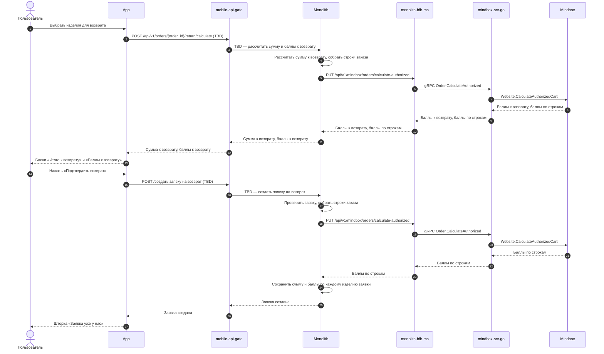
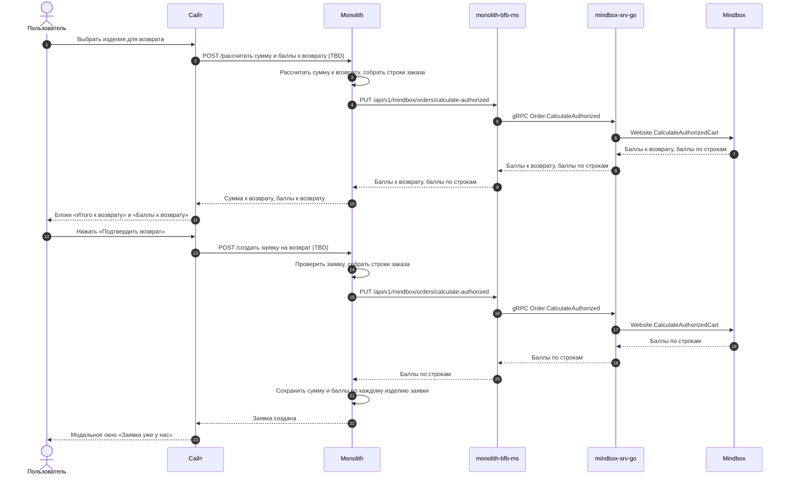
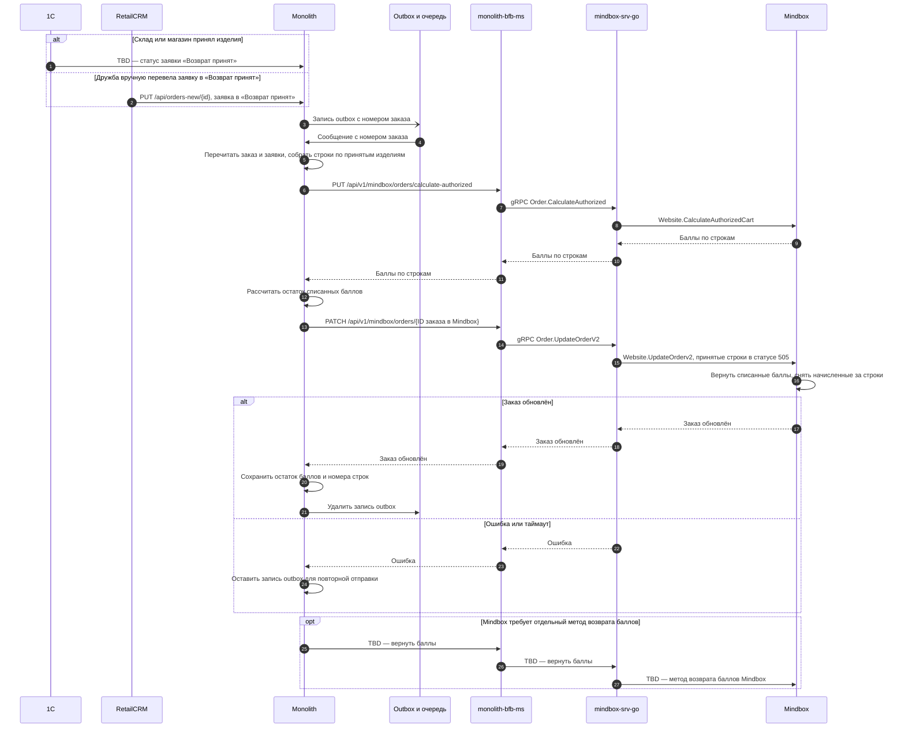

# SEQ-RET-BONUS: Баллы к возврату в Mindbox — от оформления до возврата баллов

Возвраты 2.0 · 26.11.2026 · Статус: предварительная схема

Схемы показывают, через какие системы проходят расчёт и фиксация возврата баллов. Логика — [BL-RET-BONUS-SUM](../../backend/mindbox-return-bonus-summary_backend.md); подробный анализ, правила сборки строк и обработка ошибок — [BL-RET-BONUS](../../backend/mindbox-return-bonus_backend.md); решение — `ADR-RET-114`. Новые методы сайта и мобильного приложения помечены TBD. Нужен ли после изменения заказа отдельный метод возврата баллов, не подтверждено — [mindbox-exchange_questions.md](../../questions/mindbox-exchange_questions.md), вопрос 19.

Участники:

| Участник | Система |
|---|---|
| App | Мобильное приложение |
| mobile-api-gate | Шлюз мобильного приложения |
| Сайт | Фронтенд сайта |
| Monolith | Монолит `12storeez-master-web` |
| Outbox и очередь | Таблица `mindbox_update_transaction_outbox` и очередь `mindbox.order.update.v1.command` монолита |
| monolith-bfb-ms | Сервис-прослойка монолита |
| mindbox-srv-go | Сервис связи с Mindbox (команда BTS) |
| Mindbox | Программа лояльности |
| 1C | Передаёт на сайт статус «Возврат принят» после приёмки на складе или в магазине |
| RetailCRM | Передаёт на сайт статус «Возврат принят», если Дружба перевела заявку вручную |

## 1. Предрасчёт и создание заявки — мобильное приложение

Предрасчёт и расчёт при создании заявки ничего не меняют в заказе Mindbox.

## 2. Предрасчёт и создание заявки — сайт

## 3. Фиксация возврата при «Возврат принят»

При приёмке на складе или в магазине 1С передаёт статус «Возврат принят» на сайт напрямую, метод — TBD. Ручной перевод Дружбой приходит вебхуком RetailCRM — [retailcrm-exchange_backend.md](../../backend/retailcrm-exchange_backend.md). Возврат денег клиенту — отдельный процесс, Mindbox в нём не участвует.
