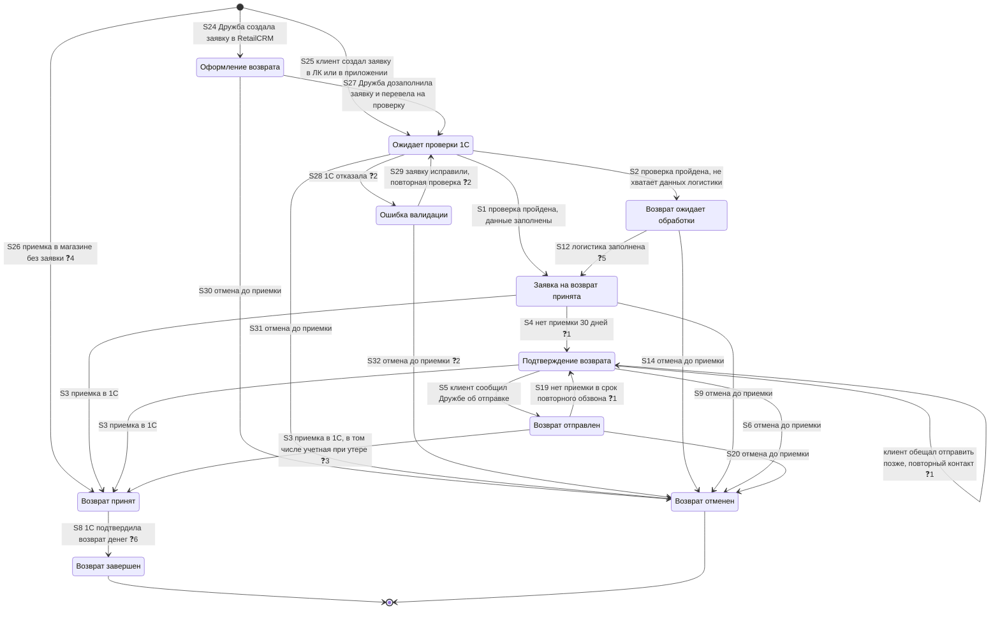

# Статусы заявки на возврат (TO-BE, MVP), версия 2 — с проверкой заявки в 1С

**Тип:** диаграмма состояний заявки на возврат (возвратный заказ).

**Основа:** схема статусов Лида аналитиков RetailCRM (Алена Господинова) — [12Storeez — статусы возврата — полная схема.pdf](<../../../sources/12Storeez — статусы возврата — полная схема.pdf>); решения — `ADR-RET-097`. Статусы позиции возврата и позиции исходного заказа — [return-status_state.md](./return-status_state.md), разделы 2 и 3.

**Обозначения:**

- без пометки — статус или переход есть на схеме RetailCRM;
- ❓N — не определено, N — номер вопроса в разделе «Открытые вопросы».

**Общие правила:**

- Статус исходного заказа при возврате не меняется (`ADR-RET-019`, `ADR-RET-039`).
- Статусная модель одна для всех способов возврата (`ADR-RET-097`).
- После «Возврат принят» заявка не отменяется (`ADR-RET-097`).

## 1. Диаграмма

## 2. Статусы

| Статус | Когда | Кто переводит | Основание |
|---|---|---|---|
| Оформление возврата | Дружба создает заявку в RetailCRM и дозаполняет ее. В 1С на проверку заявка не уходит. Название не согласовано ❓7 | Дружба (форма RetailCRM) | `ADR-RET-097`, решение 2 |
| Ожидает проверки 1С | Заявка отправлена на проверку в 1С: первый статус заявки из ЛК и приложения; после «Оформления возврата»; после исправления ошибки | Сайт, Дружба | `ADR-RET-097`, решения 2, 3 |
| Ошибка валидации | 1С отказала в создании возврата. Сценарий не согласован ❓2 | Сайт по ответу 1С | `ADR-RET-097`, решение 3 |
| Возврат ожидает обработки | Проверка в 1С пройдена, не хватает данных логистики; к заявке подключается Дружба | Сайт по ответу 1С | `ADR-RET-097`, решения 3, 4 |
| Заявка на возврат принята | Проверка в 1С пройдена и данные логистики заполнены, или логистику заполнили после «Возврат ожидает обработки» | Сайт; Дружба или сайт ❓5 | `ADR-RET-097`, решения 3, 4 |
| Подтверждение возврата | Нет приемки 30 дней после создания; повторно — нет приемки в срок повторного обзвона. Если клиент обещал отправить позже, статус не меняется ❓1 | RetailCRM | `ADR-RET-097`, решение 18 |
| Возврат отправлен | Клиент сообщил Дружбе, что отправил возврат | Дружба | `ADR-RET-097`, решение 4 |
| Возврат принят | Приемка в 1С: по заявке; при утере — учетная приемка ❓3; при приемке в магазине без заявки ❓4 | Сайт по данным 1С | `ADR-RET-097`, решения 4, 10 |
| Возврат завершен | 1С подтвердила возврат денег | Сайт по данным 1С | `ADR-RET-097`, решение 12 |
| Возврат отменен | Клиент или Дружба подтвердили отмену до приемки | Клиент, Дружба ❓8 | `ADR-RET-097`, решения 6–9 |

## 3. Переходы

| № | Из | В | Событие |
|---|---|---|---|
| S24 | — | Оформление возврата | Дружба создала заявку через форму RetailCRM |
| S25 | — | Ожидает проверки 1С | Клиент создал заявку в ЛК или в приложении |
| S26 ❓4 | — | Возврат принят | Приемка в магазине без заявки: сайт передал приемку в 1С |
| S27 | Оформление возврата | Ожидает проверки 1С | Дружба дозаполнила заявку и вручную перевела на проверку |
| S28 ❓2 | Ожидает проверки 1С | Ошибка валидации | 1С отказала в создании возврата |
| S29 ❓2 | Ошибка валидации | Ожидает проверки 1С | Заявку исправили и отправили на повторную проверку |
| S2 | Ожидает проверки 1С | Возврат ожидает обработки | Проверка в 1С пройдена, не хватает данных логистики |
| S1 | Ожидает проверки 1С | Заявка на возврат принята | Проверка в 1С пройдена, данные заполнены |
| S12 ❓5 | Возврат ожидает обработки | Заявка на возврат принята | Дружба или сайт заполнили данные логистики |
| S3 | Заявка на возврат принята, Подтверждение возврата, Возврат отправлен | Возврат принят | Приемка в 1С; из «Возврат отправлен» — в том числе учетная приемка при утере ❓3 |
| S4 ❓1 | Заявка на возврат принята | Подтверждение возврата | RetailCRM: нет приемки 30 дней |
| — ❓1 | Подтверждение возврата | Подтверждение возврата | Клиент обещал отправить позже, повторный контакт |
| S5 | Подтверждение возврата | Возврат отправлен | Дружба: клиент сообщил об отправке |
| S19 ❓1 | Возврат отправлен | Подтверждение возврата | RetailCRM: нет приемки в срок повторного обзвона |
| S8 ❓6 | Возврат принят | Возврат завершен | 1С подтвердила возврат денег |
| S30 | Оформление возврата | Возврат отменен | Отмена до приемки |
| S31 | Ожидает проверки 1С | Возврат отменен | Отмена до приемки |
| S32 ❓2 | Ошибка валидации | Возврат отменен | Отмена до приемки |
| S14, S9, S6, S20 | Возврат ожидает обработки, Заявка на возврат принята, Подтверждение возврата, Возврат отправлен | Возврат отменен | Клиент или Дружба подтвердили отмену до приемки |

## 4. Открытые вопросы

1. Какой срок повторного обзвона? Как Дружба получает задачу на повторный звонок, если клиент обещал отправить позже: статус «Подтверждение возврата» сохраняется, а в RetailCRM меняется дата следующего звонка? Решение согласовать с Дружбой (`ADR-RET-097`, открытый вопрос 1).
2. Что происходит с заявкой после ошибки проверки в 1С: какую причину видит Дружба, может ли Дружба исправить заявку и отправить на повторную проверку или только отменить? (`ADR-RET-097`, открытый вопрос 11).
3. Кто переводит заявку в «Возврат принят» при утере: 1С учетной приемкой или Дружба вручную (`ADR-RET-097`, решение 10)?
4. Возврат в магазине без заявки: заявка сразу получает «Возврат принят» или проходит «Заявка на возврат принята» (`ADR-RET-097`, решение 2; `ADR-RET-051`)?
5. Кто переводит заявку из «Возврат ожидает обработки» в «Заявка на возврат принята»: только Дружба или сайт тоже?
6. По какому событию 1С подтверждает возврат денег? Какое событие завершает заявку при обмене без выплаты (`ADR-RET-097`, открытые вопросы 2, 9)?
7. Какие окончательные названия у статусов «Оформление возврата», «Ожидает проверки 1С» и «Ошибка валидации» (`ADR-RET-097`, открытый вопрос 10)?
8. Отменяет ли магазин заявку на возврат в свой магазин, если клиент принес не те изделия или магазин их не принял (`ADR-RET-097`, решение 8)?
9. Как переводится в «Возврат принят» заявка, если деньги возвращают до поступления изделий (`ADR-RET-097`, решение 11, открытый вопрос 3)?
10. Нужен ли статус между «Заявка на возврат принята» и «Возврат принят», если передачу заявки курьеру можно получать в RetailCRM из реестров логистики (`ADR-RET-097`, открытый вопрос 15)?
