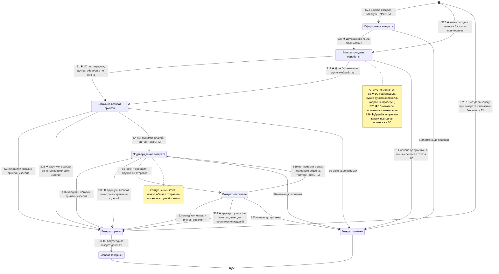
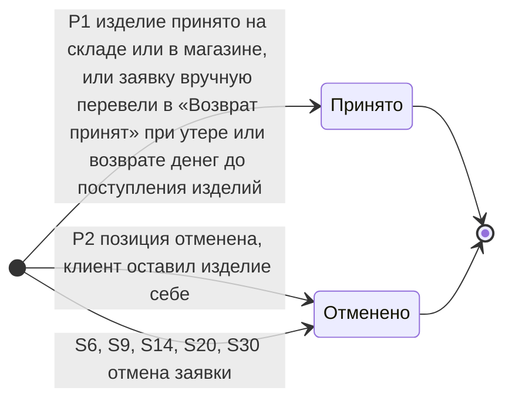
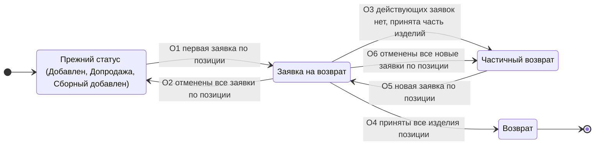

# Статусы возврата (TO-BE, MVP), версия 3 — заявка, позиция возврата, позиция исходного заказа

**Тип:** диаграмма состояний трех уровней: заявка на возврат (возвратный заказ), позиция возврата, позиция исходного заказа.

**Статус:** предложение 12STOREEZ для согласования с RetailCRM.

**Основа:** схема статусов версии 2 — [return-status-v2_state.md](./return-status-v2_state.md) (`ADR-RET-097`); статусы позиций — [return-status_state.md](./return-status_state.md), разделы 2 и 3 (`ADR-RET-094`); предложение по статусам проверки в 1С и черновику Дружбы — [разбор встречи 11.11.2026](<../../../meetings/[2026-11-11 13-01] Вопросы по обмену плат. реквизитами_summary.md>), темы 8–11, [переписка 11.11.2026](<../../../sources/answers/[2026-11-11 12-00] Переписка Свистунова — Осипенко (номер заявки и QR, реквизиты, статусы проверки 1С, одинаковые изделия).md>), ответы 4, 6, 8, и [переписка 12.11.2026](<../../../sources/answers/[2026-11-12 13-21] Переписка Лемешева — Колосов (проверки 1С по заявке на возврат).md>) — что проверяет 1С.

**Обозначения:**

- ✱ — отличается от версии 2 (раздел 6);
- ❓N — не определено, N — номер вопроса в разделе «Открытые вопросы».

**Общие правила:**

- Статус исходного заказа при возврате не меняется и остается «Выполнен» (`ADR-RET-019`, `ADR-RET-039`).
- Статусная модель одна для всех способов возврата (`ADR-RET-097`).
- У заявки два слоя статусов — клиентский и внутренний. Оба слоя ведутся на сайте, в RetailCRM и в 1С, внутренние статусы передаются между системами (`ADR-RET-097`).
- В MVP интеграции с ТК нет: статусы перевозки не ведутся, клиенту статусы курьера и ТК не показываются (`ADR-RET-094`).
- Автоотмены по сроку нет (`ADR-RET-097`).

## 1. Заявка на возврат

### 1.1 Диаграмма (внутренние статусы)

### 1.2 Статусы

| Статус | Слой | Когда | Кто переводит | Что видит клиент | Допускает отмену | Основание |
|---|---|---|---|---|---|---|
| Оформление возврата | Внутренний, только в RetailCRM | Дружба создает заявку в RetailCRM и дозаполняет ее. Сайт заявку в этом статусе игнорирует при обмене, в 1С она не передается | Дружба (форма RetailCRM) | Заявки в ЛК и приложении нет | Да — Дружба | `ADR-RET-097`, решение 2; разбор 11.11.2026, тема 9; переписка 11.11.2026, ответ 6 |
| Возврат ожидает обработки ✱ | Клиентский и внутренний | Первый статус заявки из ЛК и приложения и заявки Дружбы после оформления. Заявка уходит на проверку в 1С. Остается в статусе, если 1С отказала или заявке нужна ручная обработка, например адрес введен вручную и не проверен: причина — в комментарии для оператора RetailCRM, к заявке подключается Дружба | Сайт; Дружба | «Возврат ожидает обработки» | Да — клиент и Дружба | Разбор 11.11.2026, тема 8; переписка 11.11.2026, ответ 4; переписка 12.11.2026; `ADR-RET-089`, `ADR-RET-075` |
| Заявка на возврат принята | Клиентский и внутренний | 1С подтвердила возможность возврата и ручная обработка не нужна, или Дружба закончила ручную обработку после подтверждения 1С | Сайт по ответу 1С; Дружба | «Заявка на возврат принята» | Да — клиент, Дружба, магазин (заявку в свой магазин) | `ADR-RET-097`, решения 3, 4 |
| Подтверждение возврата | Внутренний | Нет приемки 30 дней после создания; повторно — нет приемки в срок повторного обзвона. По этому статусу Дружба отбирает заявки для обзвона. Если клиент обещал отправить позже, статус не меняется | RetailCRM (триггер) | «Заявка на возврат принята» | Да — клиент и Дружба | `ADR-RET-097`, решение 18; `ADR-RET-053` |
| Возврат отправлен | Внутренний | Клиент сообщил Дружбе, что отправил возврат. Статус информационный | Дружба | «Заявка на возврат принята» | Да — клиент и Дружба | `ADR-RET-097`, решение 4; `ADR-RET-053` |
| Возврат принят | Клиентский и внутренний | Склад (по данным WMS) или магазин приняли изделия, и по всем позициям есть итог: принято или отменено. Вручную, без поступления изделий, — при утере и при возврате денег до поступления изделий. При возврате в магазине без заявки — заявка, созданная 1С ❓1 | Сайт по данным 1С; вручную — Дружба | «Возврат принят» | Нет | `ADR-RET-097`, решения 4, 10, 11; `ADR-RET-083`, `ADR-RET-088` |
| Возврат завершен | Клиентский и внутренний | 1С подтвердила возврат денег, после «Возврат принят». Приемка после этого статус не меняет. Если часть изделий принята, а остальные отменены, заявка тоже получает «Возврат завершен», итог виден по позициям | Сайт по данным 1С | «Возврат завершен» | Нет | `ADR-RET-097`, решения 12, 13 |
| Возврат отменен | Клиентский и внутренний | Отмена до приемки: клиентом; Дружбой, в том числе если 1С отказала и возврат оформить нельзя; магазином — заявки в свой магазин | Клиент, Дружба, магазин | «Возврат отменен» | — | `ADR-RET-097`, решения 7–9 |

### 1.3 Правила заявки

| Правило | Что действует | Основание |
|---|---|---|
| Создание заявки и проверки ✱ | Заявка из ЛК и приложения создается, когда клиент заполнил и отправил форму целиком; черновика на сайте нет. Проверки идут по порядку: фронт — заполнение формы; бэкенд сайта — права, статус заказа, срок, количество, доступное к возврату; 1С — окончательное решение: минимальный набор полей и возврат не больше проданного, с учетом уже возвращенного; адрес и интервалы 1С не проверяет. Если не прошли проверки фронта или бэкенда, заявка не создается и статуса у нее нет, клиент видит ошибку при оформлении. Созданная заявка всегда получает первый статус «Возврат ожидает обработки» и в нем ждет ответа 1С | Разбор 11.11.2026, тема 8; переписка 12.11.2026 |
| Заявка Дружбы ✱ | Дружба оформляет заявку в RetailCRM в «Оформлении возврата»; первично ее проверяет RetailCRM. Когда Дружба закончила оформление, заявка переходит в «Возврат ожидает обработки» и уходит на проверку в 1С, как заявка с сайта | `ADR-RET-097`, решение 2; разбор 11.11.2026, тема 9 |
| Ручная обработка ✱ | Если заявке нужны действия Дружбы, она остается в «Возврат ожидает обработки». Причину — отказ 1С или то, что требует ручной обработки, например адрес, введенный вручную, — сайт передает в RetailCRM комментарием для оператора. После отказа 1С Дружба исправляет заявку по комментарию, сайт отправляет ее на повторную проверку в 1С; если возврат оформить нельзя, Дружба отменяет заявку. Ошибку проверки клиенту не показывают, Дружба связывается с клиентом | Разбор 11.11.2026, тема 8; переписка 11.11.2026, ответ 4 |
| Заявка в 1С ✱ | 1С создает заявку у себя и присваивает ей GUID сразу при получении, до проверки. Если проверка не прошла, заявка в 1С остается; после исправления Дружбой сайт отправляет ту же заявку с тем же ID сайта на повторную проверку | [Переписка 12.11.2026, 14:00](<../../../sources/answers/[2026-11-12 14-00] Переписка Лемешева — Колосов (создание заявки на возврат в 1С и GUID).md>) |
| Статусы от Дружбы ✱ | Статусы, которые ставит Дружба, сайт получает из RetailCRM и сохраняет у заявки | `ADR-RET-097`, решение 1 |
| Обзвон | Оба перевода в «Подтверждение возврата» делает триггер RetailCRM, если статус не сменился за срок; срок и число итераций задает RetailCRM | `ADR-RET-097`, решение 18 |
| Отмена заявки | Клиент отменяет заявку в ЛК или приложении в любом статусе до «Возврат принят». В остальных случаях заявку отменяют вручную Дружба или магазин. Магазин отменяет заявку в свой магазин, если клиент принес не те изделия или магазин их не принял. Заявку с другим способом возврата, например курьерскую, магазин не меняет и не отменяет: ее отменяют клиент или Дружба. После «Возврат принят» заявку не отменяет никто | `ADR-RET-097`, решения 7, 8; `ADR-RET-082`, `ADR-RET-085` |
| Отмена без причины | Отмена фиксируется без причины. Клиент видит «Возврат отменен»; если заявку отменил не он, Дружба связывается с клиентом и объясняет | `ADR-RET-097`, решение 9 |
| Приемка | Приемка и экспертиза — один этап. Склад принимает все, что пришло по заявке, включая брак; отказа после приемки нет. В магазине приемка — физическая проверка изделия сотрудником при клиенте: сотрудник либо принимает изделие, либо не принимает, например, если нельзя подтвердить, что оно куплено в 12 STOREEZ | `ADR-RET-097`, решение 6; `ADR-RET-083` |
| Баллы | Баллы возвращаются при «Возврат принят», в том числе когда он поставлен вручную без поступления изделий. Деньги возвращаются отдельным процессом | `ADR-RET-097`, решение 15 |
| Возврат денег до поступления изделий | Дружба вручную переводит заявку в «Возврат принят» без поступления изделий, затем — «Возврат завершен». Заявка не минует «Возврат принят», потому что баллы возвращаются при «Возврат принят». Приемка после «Возврат завершен» статус заявки не меняет | `ADR-RET-097`, решение 11 |
| Утеря возврата | Статуса и признака утери нет. Заявка остается в «Возврат отправлен»; Дружба вручную переводит ее в «Возврат принят» без поступления изделий, позиции возврата получают «Принято», после возврата денег — «Возврат завершен». Если клиент ничего не отправлял — «Возврат отменен». Клиенту утеря не показывается | `ADR-RET-097`, решение 10 |
| Названия для клиента | Клиентские названия статусов пишутся без буквы «е»: «Возврат отменен», «Возврат завершен». Во внутренних названиях «е» допустима. В клиентских текстах вместо «товар» пишется «изделие» | `ADR-RET-097`, решение 16 |

### 1.4 Переходы

| № | Из | В | Событие |
|---|---|---|---|
| S24 | — | Оформление возврата | Дружба создала заявку через форму RetailCRM |
| S25 ✱ | — | Возврат ожидает обработки | Клиент создал заявку в ЛК или в приложении; заявка отправлена на проверку в 1С |
| S26 ❓1 | — | Возврат принят | Возврат в магазине без заявки: сотрудник оформил возврат в 1С, 1С проверила и создала заявку |
| S27 ✱ | Оформление возврата | Возврат ожидает обработки | Дружба закончила оформление и вручную перевела заявку; сайт забирает заявку и отправляет на проверку в 1С |
| S1 ✱ | Возврат ожидает обработки | Заявка на возврат принята | 1С подтвердила возможность возврата, ручная обработка не нужна |
| S2 ✱ | Возврат ожидает обработки | Возврат ожидает обработки | 1С подтвердила возможность возврата, но заявке нужна ручная обработка Дружбы, например адрес введен вручную и не проверен. Адрес и интервалы 1С не проверяет, их уточняет Дружба; повторная проверка в 1С не нужна. Причина — в комментарии для оператора |
| S28 ✱ | Возврат ожидает обработки | Возврат ожидает обработки | 1С отказала в создании возврата; причина отказа из 1С — в комментарии для оператора |
| S29 ✱ | Возврат ожидает обработки | Возврат ожидает обработки | Дружба исправила или дополнила данные заявки по комментарию; сайт отправляет заявку на повторную проверку в 1С |
| S12 ✱ | Возврат ожидает обработки | Заявка на возврат принята | Дружба закончила ручную обработку после подтверждения 1С |
| S3 | Заявка на возврат принята, Подтверждение возврата, Возврат отправлен | Возврат принят | Склад (по данным WMS) или магазин приняли изделия, по всем позициям есть итог; 1С передала приемку |
| S33 ✱ | Заявка на возврат принята, Подтверждение возврата, Возврат отправлен | Возврат принят | Дружба вручную, без поступления изделий: утеря после передачи в ТК; возврат денег до поступления изделий |
| S4 | Заявка на возврат принята | Подтверждение возврата | Триггер RetailCRM: нет приемки 30 дней после создания |
| — | Подтверждение возврата | Подтверждение возврата | Клиент обещал отправить позже, повторный контакт |
| S5 | Подтверждение возврата | Возврат отправлен | Дружба: клиент сообщил об отправке |
| S19 | Возврат отправлен | Подтверждение возврата | Триггер RetailCRM: нет приемки в срок повторного обзвона |
| S8 ❓2 | Возврат принят | Возврат завершен | 1С подтвердила возврат денег. При обмене без возврата денег — ❓3 |
| S30 | Оформление возврата | Возврат отменен | Дружба отменила заявку до окончания оформления |
| S14 ✱ | Возврат ожидает обработки | Возврат отменен | Клиент или Дружба отменили заявку; в том числе Дружба — если 1С отказала и возврат оформить нельзя |
| S9 | Заявка на возврат принята | Возврат отменен | Отмена клиентом, Дружбой или магазином: магазин отменяет заявку в свой магазин, когда клиент принес не те изделия или магазин их не принял |
| S6 | Подтверждение возврата | Возврат отменен | Клиент передумал: отмена клиентом или Дружбой |
| S20 | Возврат отправлен | Возврат отменен | Клиент отменил сам в ЛК или приложении, или Дружба выяснила, что клиент ничего не отправлял |

### 1.5 Пути заявки по способам возврата (MVP)

| Способ | Путь |
|---|---|
| Курьер, СДЭК, 5Post, Почта России | Возврат ожидает обработки → (1С подтвердила) Заявка на возврат принята → Возврат принят → Возврат завершен |
| Нужна ручная обработка, например адрес введен вручную | Возврат ожидает обработки → (1С подтвердила, Дружба уточнила) Заявка на возврат принята → далее по способу / Возврат отменен |
| 1С отказала | Возврат ожидает обработки → (Дружба исправила, 1С подтвердила) Заявка на возврат принята → далее по способу; если возврат оформить нельзя — Возврат отменен |
| Магазин 12 STOREEZ по заявке | Возврат ожидает обработки → Заявка на возврат принята → Возврат принят (в магазине) → Возврат завершен |
| Магазин: клиент сдал часть изделий, остальные не принесет | … → Заявка на возврат принята → магазин отмечает несданные позиции «Отменено» → Возврат принят → Возврат завершен |
| Нет приемки в срок | Заявка на возврат принята → Подтверждение возврата → Возврат отправлен → Возврат принят → … / Возврат отменен |
| Магазин без заявки (`ADR-RET-051`) | 1С создает заявку после возврата: первый статус ❓1 → Возврат принят → Возврат завершен |
| Заявка, созданная Дружбой | Оформление возврата → Возврат ожидает обработки → далее как у заявки с сайта |
| Утеря после отправки | Возврат отправлен → Возврат принят (Дружба вручную) → Возврат завершен; если клиент ничего не отправлял — Возврат отменен |
| Деньги вернули до поступления изделий | Заявка на возврат принята, Подтверждение возврата или Возврат отправлен → Возврат принят (Дружба вручную) → Возврат завершен |

## 2. Позиция возврата

Позиция возврата — одно изделие: у каждого изделия своя причина возврата и свой статус. Статусы позиции возврата нужны, чтобы видеть частичную приемку. У позиции два статуса — «Принято» и «Отменено». При создании заявки статус позиции не задается (пусто) и появляется, когда позицию приняли или отменили. В RetailCRM позиция не может быть без статуса, поэтому там у позиции свой начальный статус; остальные системы работают только с «Принято» и «Отменено». Клиенту статусы позиций в ходе обработки не показываются. При утере возврата и при возврате денег до поступления изделий позиции получают «Принято». По отмененным позициям можно оформить новый возврат, по принятым — нет (`ADR-RET-097`, решение 14; `ADR-RET-094`).

**Статус позиции по сценариям**

| Сценарий | Статус позиции | Статус заявки |
|---|---|---|
| Изделия поступили на склад | Все позиции заявки — «Принято», включая заявленные, но не пришедшие (недостача): склад принимает все заявленное | «Возврат принят» |
| Магазин принял все изделия заявки | Все позиции — «Принято» | «Возврат принят» |
| Клиент сдал в магазине часть изделий, остальные оставляет себе | Сданные — «Принято», остальные — «Отменено» (P2); несданные отмечает магазин при приемке | «Возврат принят», после возврата денег — «Возврат завершен» |
| Магазин не принял изделие: нельзя подтвердить, что оно куплено в 12 STOREEZ | «Отменено» | Не принято ни одно изделие — «Возврат отменен». Принята часть — как при частичной сдаче |
| Утеря после отправки: Дружба перевела заявку в «Возврат принят» | Все позиции — «Принято» | «Возврат принят» |
| Деньги вернули до поступления изделий | Все позиции — «Принято» | «Возврат принят» вручную, после возврата денег — «Возврат завершен» |
| Клиент ничего не сдал | Все позиции — «Отменено» при отмене заявки | «Подтверждение возврата», Дружба звонит клиенту и отменяет заявку, либо клиент отменяет сам — «Возврат отменен» |

## 3. Позиция исходного заказа

| Переход | Правило | Основание |
|---|---|---|
| O1 | При первой заявке по позиции заказа позиция получает «Заявка на возврат» — при создании заявки (S25, S27) | `ADR-RET-039` |
| O2 | При отмене позиция заказа возвращается в прежний статус. Только если по позиции не осталось других заявок, кроме отмененных. Заявка, в которой все изделия позиции получили «Отменено», для этой позиции считается отмененной | `ADR-RET-039`, `ADR-RET-073` |
| O3 | По позиции заказа нет действующих заявок, принята часть изделий — «Частичный возврат» | `ADR-RET-073`; разбор 11.11.2026, тема 11 |
| O4 | Приняты все изделия позиции заказа — «Возврат» | `ADR-RET-039`; разбор 11.11.2026, тема 11 |
| O5 ✱ | Новая заявка по оставшимся изделиям позиции в статусе «Частичный возврат» — снова «Заявка на возврат». Оставшиеся изделия позиции клиент возвращает следующей заявкой в MVP | Разбор 11.11.2026, тема 11; переписка 11.11.2026, ответ 8 |
| O6 | Позиция была «Частичный возврат», по ней создали новую заявку, и все новые заявки отменили — позиция возвращается в «Частичный возврат» | Правило O2 для статуса O3 |

Деление строки позиции заказа ✱: когда клиент возвращает часть одинаковых изделий одной позиции, возвращенные изделия отделяются от оставшихся новой строкой позиции заказа — строки «вернули» и «актуально» (разбор 11.11.2026, тема 11; переписка 11.11.2026, ответ 8). Количество, доступное к возврату, 1С вычисляет сама; статусы позиции нужны сайту, чтобы разрешить или запретить возврат. Как делится строка — ❓6.

Статус позиции исходного заказа ведется в RetailCRM — Дружба работает с исходным заказом. Коды статусов позиции — новые, коды 5 и 9 не используются (`ADR-RET-080`); статусы для Mindbox — ❓7.

## 4. Связь уровней по событиям

События — в порядке процесса.

| Событие | Заявка | Позиция возврата | Позиция исходного заказа |
|---|---|---|---|
| S24 Дружба создала заявку в RetailCRM | «Оформление возврата» (только в RetailCRM) | без статуса | без изменений |
| S25, S27 Заявка создана на сайте или в приложении, или Дружба закончила оформление | «Возврат ожидает обработки» | без статуса | «Заявка на возврат» (O1, или O5 из «Частичный возврат»); без изменений, если по позиции уже есть действующая заявка |
| S1 1С подтвердила, ручная обработка не нужна | «Заявка на возврат принята» | без изменений | без изменений |
| S2, S28, S29 Ручная обработка, отказ 1С, повторная проверка | «Возврат ожидает обработки» | без изменений | без изменений |
| S12 Дружба закончила ручную обработку | «Заявка на возврат принята» | без изменений | без изменений |
| S4 Нет приемки 30 дней | «Подтверждение возврата» | без изменений | без изменений |
| S5 Клиент сообщил, что отправил | «Возврат отправлен» | без изменений | без изменений |
| P1 Изделие принято на складе или в магазине | без изменений, пока не по всем позициям есть итог | «Принято» | «Частичный возврат» (O3) или «Возврат» (O4), когда по позиции не осталось действующих заявок |
| P2 Позиция отменена, клиент оставил изделие себе | без изменений, пока не по всем позициям есть итог | «Отменено» | прежний статус (O2) или «Частичный возврат» (O6), если по позиции не осталось действующих заявок |
| S3 Изделия приняты, по всем позициям есть итог | «Возврат принят» | «Принято» или «Отменено» | «Частичный возврат» (O3) или «Возврат» (O4) |
| S33 Дружба вручную: утеря или возврат денег до поступления изделий | «Возврат принят» | «Принято» | ❓8 |
| S8 1С подтвердила возврат денег | «Возврат завершен» ❓2 | без изменений | без изменений |
| S6, S9, S14, S20, S30 Отмена заявки | «Возврат отменен» | «Отменено» | прежний статус (O2) или «Частичный возврат» (O6), если по позиции не осталось действующих заявок; иначе без изменений. При S30 — без изменений |

При сдаче в магазине без заявки, пока курьерскую заявку не отменили, по позиции исходного заказа две действующие заявки: позиция остается «Заявка на возврат» и получает «Возврат» (O4) только после отмены курьерской заявки.

## 5. Открытые вопросы

### Заявка на возврат

1. Возврат в магазине без заявки: сотрудник оформляет возврат в 1С, 1С проверяет и создает заявку. Какой первый статус ставит 1С — сразу «Возврат принят» или «Заявка на возврат принята» (`ADR-RET-051`)?
2. По какому событию 1С подтверждает возврат денег (`ADR-RET-097`, открытый вопрос 2)?
3. Какой финальный статус у заявки при обмене, когда деньги не возвращаются (`ADR-RET-097`, открытый вопрос 9; `ADR-RET-086`)?
4. Согласна ли RetailCRM убрать статусы «Ожидает проверки 1С» и «Ошибка валидации» и вести ручную обработку в «Возврат ожидает обработки» с причиной в комментарии для оператора? Согласовано ли с Head of PMO, Product Manager и Дружбой, что в «Возврат ожидает обработки» Дружба видит и заявки, которые ждут ответа 1С? В техокна 1С такие заявки ждут проверки часами; отличить их от заявок, которым нужны действия Дружбы, можно только по комментарию.
5. Нужен ли статус между «Заявка на возврат принята» и «Возврат принят», если передачу заявки курьеру можно получать в RetailCRM из реестров логистики (`ADR-RET-097`, открытый вопрос 15)?

### Позиция исходного заказа

6. Как делится строка позиции заказа при возврате части одинаковых изделий: в какой момент, что происходит с отделенной строкой при отмене заявки, какие статусы у строк, как делятся цены, скидки и баллы? Вопросы System Architect — [order-position-split_questions.md](../../questions/order-position-split_questions.md).
7. Какие статусы Mindbox отправлять для заказа «Выполнен» вместе с новыми статусами позиции (`cms_mb_statuses_map`)?
8. Получает ли позиция исходного заказа при утере возврата и при возврате денег до поступления изделий «Частичный возврат» или «Возврат», как при обычной приемке (`ADR-RET-097`, открытый вопрос 6)?

## 6. Отличия от версии 2

| Что | Версия 2 | Версия 3 |
|---|---|---|
| Состав файла | Только статусы заявки; позиции — в отдельной схеме | Заявка, позиция возврата, позиция исходного заказа и связь уровней в одном файле |
| Статус «Ожидает проверки 1С» | Первый статус заявки из ЛК и приложения; заявка ждет ответа 1С | Нет. Заявка ждет ответа 1С в «Возврат ожидает обработки» |
| Статус «Ошибка валидации» | 1С отказала в создании возврата | Нет. Заявка остается в «Возврат ожидает обработки», причина отказа — в комментарии для оператора |
| «Возврат ожидает обработки» | Проверка в 1С пройдена, не хватает данных логистики | Первый статус заявки из ЛК, приложения и после «Оформления возврата»; все случаи, когда нужны действия Дружбы: отказ 1С, ручная обработка |
| После отказа 1С | Не определено: исправление и повторная проверка или отмена | Дружба исправляет заявку по комментарию — повторная проверка в 1С (S29); если возврат оформить нельзя — отменяет (S14) |
| «Оформление возврата» | Дружба переводит в «Ожидает проверки 1С» | Дружба переводит в «Возврат ожидает обработки»; статус только в RetailCRM, сайт заявку в нем игнорирует |
| «Возврат принят» без поступления изделий | Утеря — учетная приемка в 1С или вручную, не определено | Вручную, Дружба: утеря и возврат денег до поступления изделий (S33) |
| Оставшиеся изделия позиции заказа | Через Дружбу (`ADR-RET-065`) | Клиент возвращает следующей заявкой, возвращенные изделия выделяются в новую строку позиции заказа (O5) |
| Переходы | S25, S27, S2 ведут в «Ожидает проверки 1С» или из него; S28, S29, S31, S32 — через «Ошибку валидации» | S25, S27 ведут в «Возврат ожидает обработки»; S1, S2, S28, S29 — из него; S31, S32 удалены; S33 добавлен |
| Что видит клиент, пока заявка проверяется в 1С | Не определено | «Возврат ожидает обработки» |
