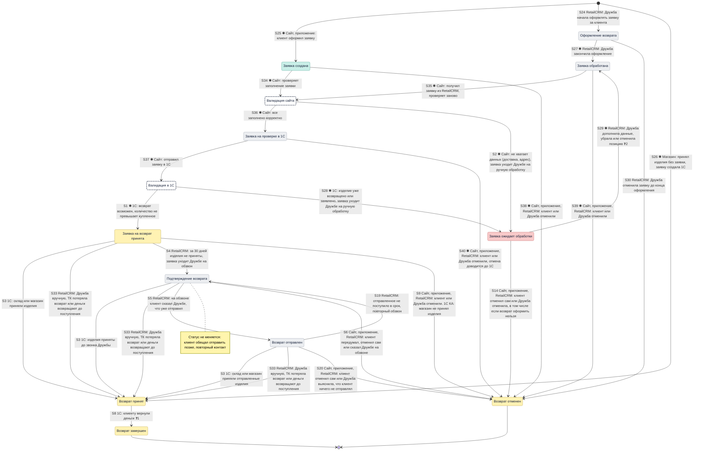
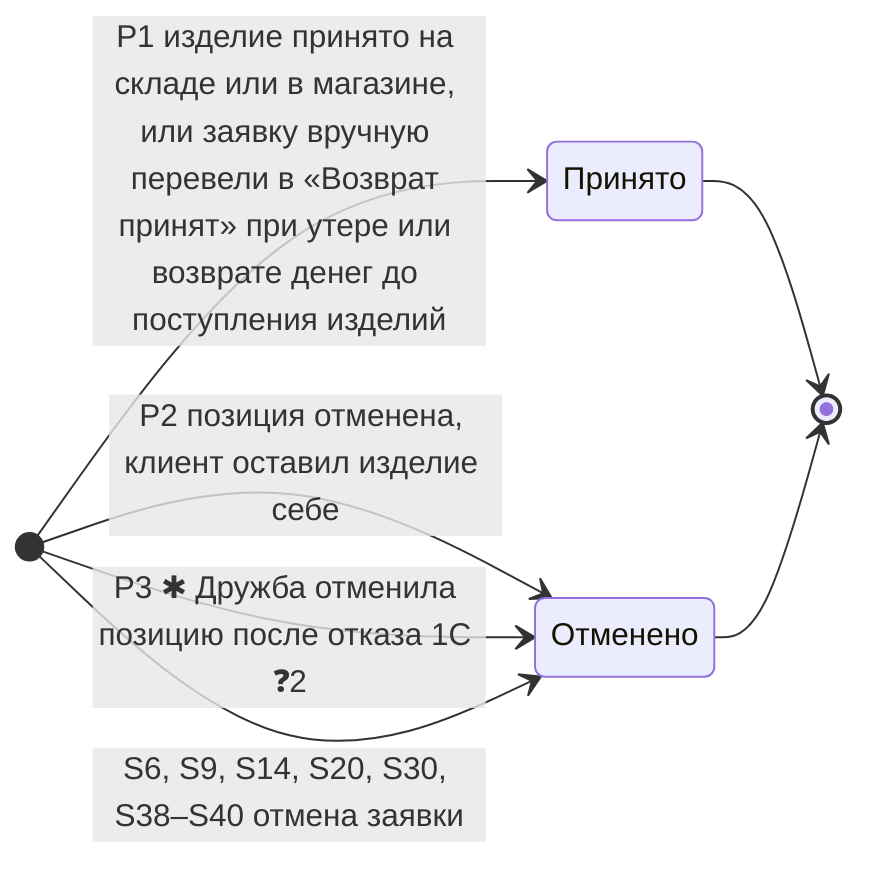
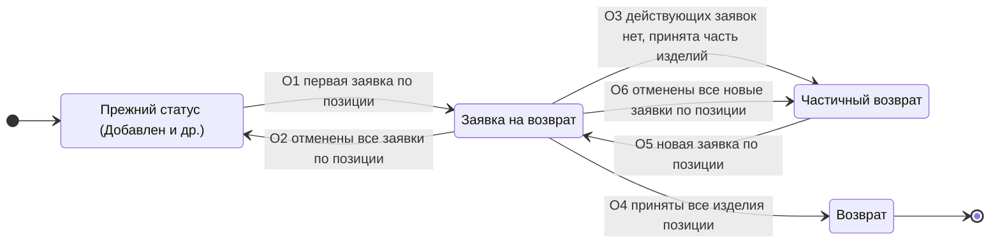

# Статусы возврата (TO-BE, MVP), версия 4 — заявка, позиция возврата, позиция исходного заказа

Ссылка в Вики: https://wiki.yandex.ru/teams/web-development/dokumentacija/konteksty-i-komponenty/biznes-domeny/vozvraty/statusy-vozvrata-to-be-mvp-zajavka-pozicija-vozvra/?utm_referrer=about%3Ablank

**Тип:** диаграмма состояний трех уровней: заявка на возврат (возвратный заказ), позиция возврата, позиция исходного заказа.

**Статус:** согласовано командой 19–20.11.2026, осталось согласовать с RetailCRM. Решение — [`ADR-RET-110`](<../../adr/[2026-11-19 15-00] ADR-RET-110-return-status-model-mvp-v9.md>) (v9, принято); `ADR-RET-099` (заменён `ADR-RET-110`) — решения 1–20 не изменились.

**Основа:**

- схема статусов версии 3 — [return-status-v3_state.md](./return-status-v3_state.md);
- изменения заявки до «Заявка на возврат принята» — [разбор встречи 13.11.2026](<../../../meetings/[2026-11-13 13-30] Статусная схема возвратов_summary.md>) и схема, нарисованная на встрече, — [Статусы v4.png](<../../../sources/Статусы v4.png>);
- что проверяет 1С — [переписка 12.11.2026](<../../../sources/answers/[2026-11-12 13-21] Переписка Лемешева — Колосов (проверки 1С по заявке на возврат).md>);
- статусы после «Заявка на возврат принята», позиция возврата и позиция исходного заказа — как в версии 3, изменения отмечены ✱ (`ADR-RET-097`, `ADR-RET-094`).

**Обозначения:**

- ✱ — отличается от версии 3 (раздел 5);
- ❓N — не определено, N — номер вопроса в разделе «Открытые вопросы».

**Общие правила:**

- Статус исходного заказа при возврате не меняется и остается «Выполнен» (`ADR-RET-019`, `ADR-RET-039`).
- Статусная модель одна для всех способов возврата (`ADR-RET-097`).
- У заявки два слоя статусов — клиентский и внутренний. Оба слоя ведутся на сайте, в RetailCRM и в 1С, внутренние статусы передаются между системами (`ADR-RET-097`).
- ✱ Что система делает с заявкой, определяется только статусом, без дополнительных признаков. Ожидание ответа 1С и ожидание действий Дружбы — разные статусы (разбор 13.11.2026, тема 1).
- В MVP интеграции с ТК нет: статусы перевозки не ведутся, клиенту статусы курьера и ТК не показываются (`ADR-RET-094`).
- Автоотмены по сроку нет (`ADR-RET-097`).
- ✱ Клиентский статус «Заявка ожидает обработки» означает «заявка в обработке»: клиент видит его во внутренних статусах «Заявка на проверке в 1С», «Заявка ожидает обработки» и «Заявка обработана» — от отправки в 1С до «Заявка на возврат принята», в том числе пока Дружба исправляет ошибку. «Заявка создана» клиент видит только до отправки в 1С (`ADR-RET-110`).
- ✱ Обмены — пост-MVP, в статусной модели MVP их нет (`ADR-RET-110`, решение 22).

## Открытые вопросы

### Заявка на возврат

1. По какому событию 1С подтверждает возврат денег (`ADR-RET-097`, открытый вопрос 2)?

### Позиция возврата

2. После отказа 1С Дружба удаляет позицию из заявки или отмечает ее «Отменено»? Предложение: отмечать «Отменено» — в 1С строка тоже остается отмененной.

### Позиция исходного заказа

3. Нужен ли статус позиции исходного заказа «Частичный возврат» (переходы O3, O5, O6)? Зависит от деления строки позиции заказа — [order-position-split_questions.md](../../questions/order-position-split_questions.md), вопрос 3; код — [retailcrm-exchange_questions.md](../../questions/retailcrm-exchange_questions.md), вопрос 6.
4. Кто ставит статусы позиции исходного заказа после «Заявка на возврат»: «Частичный возврат», «Возврат» и возврат в прежний статус при отмене — сайт по данным 1С или RetailCRM?

### Коды статусов

5. Подтверждают ли сайт, RetailCRM и 1С коды новых статусов: `created` («Заявка создана»), `revised` («Заявка обработана»), `1c-check` («Заявка на проверке в 1С»)? В ECOMDEV-2587 их нет — задача по схеме версии 3. Нужен ли всем кодам заявки префикс `return-`, как у `return-draft`, если в RetailCRM статусы заявки на возврат лежат в одном списке со статусами заказов?
6. Подтверждают ли сайт, RetailCRM и 1С предложенные коды статусов в таблице 1.2, в разделе 2 и в таблице кодов раздела 3?

## 1. Заявка на возврат

### 1.1 Диаграмма (внутренние статусы)

«Валидация сайта» и «Валидация в 1С» — проверки (операции), а не статусы: у каждой два выхода — успешный и с ошибкой.

**Цвета** (как на схеме встречи):

- бирюзовый — первый статус заявки, клиентский и внутренний;
- красный — ошибка, клиентский и внутренний;
- желтый — клиентские и внутренние;
- серый — только внутренние;
- белый с пунктиром — проверка.

### 1.2 Статусы

**Столбец «Код»** — код статуса, общий для сайта, RetailCRM и 1С:

- «предложено» — код еще не согласован всеми системами;
- «согласовано» — код согласован;
- пусто — код не задан ❓5.

Предложенные коды — из задачи на модель данных [ECOMDEV-2587](https://tracker.yandex.ru/ECOMDEV-2587) (по схеме версии 3) и от RetailCRM.

| Внутренний статус | Код | Что видит клиент | Когда | Кто переводит | Допускает отмену | Основание |
|---|---|---|---|---|---|---|
| Оформление возврата | `return-draft` — предложено RetailCRM | Заявки в ЛК и приложении нет | Дружба создает заявку в RetailCRM и дозаполняет ее. Сайт заявку в этом статусе игнорирует при обмене, в 1С она не передается | Дружба (форма RetailCRM) | Да — Дружба | `ADR-RET-097`, решение 2 |
| Заявка создана ✱ | `created` — предложено | «Заявка создана» | Первый статус заявки из ЛК и приложения — независимо от того, все ли заполнено. Сайт запускает валидацию сайта. Обратно в этот статус заявку не переводят | Сайт, приложение | Да — клиент и Дружба | Разбор 13.11.2026, темы 2, 8 |
| Заявка обработана ✱ | `revised` — предложено | «Заявка ожидает обработки» | Дружба закончила оформление черновика или исправила заявку после ошибки. Сайт получает заявку из RetailCRM и снова запускает валидацию сайта, а не отправляет сразу в 1С | Дружба | Да — клиент и Дружба | Разбор 13.11.2026, темы 5, 6 |
| Заявка на проверке в 1С ✱ | `1c-check` — предложено | «Заявка ожидает обработки» | Валидация сайта прошла. Сайт отправляет заявку в 1С и ждет ответа, в том числе в техокна 1С | Сайт | Да — клиент и Дружба | Разбор 13.11.2026, тема 3 |
| Заявка ожидает обработки ✱ | `pending` — предложено (в ECOMDEV-2587 — для «Возврат ожидает обработки» версии 3) | «Заявка ожидает обработки» | Ошибка валидации сайта (например, не заполнены данные доставки, адрес введен вручную и не проверен) или отказ 1С. Причина — в комментарии для оператора RetailCRM. Заявка ждет Дружбу; в 1С ее никто не отправляет | Сайт — по своей проверке и по ответу 1С | Да — клиент и Дружба | Разбор 13.11.2026, темы 5, 7, 8 |
| Заявка на возврат принята | `accepted` — предложено | «Заявка на возврат принята» | 1С подтвердила возможность возврата | Сайт по ответу 1С | Да — клиент, Дружба, магазин (заявку в свой магазин) | `ADR-RET-097`, решения 3, 4; разбор 13.11.2026, тема 4 |
| Подтверждение возврата | `confirmation` — предложено | «Заявка на возврат принята» | Нет приемки 30 дней после создания; повторно — нет приемки в срок повторного обзвона. По этому статусу Дружба отбирает заявки для обзвона. Если клиент обещал отправить позже, статус не меняется | RetailCRM (триггер) | Да — клиент и Дружба | `ADR-RET-097`, решение 18; `ADR-RET-053` |
| Возврат отправлен | `sent` — предложено | «Заявка на возврат принята» | Клиент сообщил Дружбе, что отправил возврат. Статус информационный | Дружба | Да — клиент и Дружба | `ADR-RET-097`, решение 4; `ADR-RET-053` |
| Возврат принят | `received` — предложено | «Возврат принят» | Склад (по данным WMS) или магазин приняли изделия, и по всем позициям есть итог: принято или отменено. Вручную, без поступления изделий, — при утере и при возврате денег до поступления изделий. При возврате в магазине без заявки — заявка, созданная 1С ✱ | Сайт по данным 1С; вручную — Дружба | Нет | `ADR-RET-097`, решения 4, 10, 11; `ADR-RET-083`, `ADR-RET-088`; разбор 13.11.2026, тема 9 |
| Возврат завершен | `completed` — предложено | «Возврат завершен» | 1С подтвердила возврат денег, после «Возврат принят». Приемка после этого статус не меняет. Если часть изделий принята, а остальные отменены, заявка тоже получает «Возврат завершен», итог виден по позициям | Сайт по данным 1С | Нет | `ADR-RET-097`, решения 12, 13 |
| Возврат отменен | `cancelled` — предложено | «Возврат отменен» | Отмена до приемки: клиентом; Дружбой, в том числе если 1С отказала и возврат оформить нельзя; магазином — заявки в свой магазин | Клиент, Дружба, магазин | — | `ADR-RET-097`, решения 7–9 |

### 1.3 Правила заявки

| Правило | Что действует | Основание |
|---|---|---|
| Действие системы по статусу ✱ | «Заявка создана», «Заявка обработана» — сайт запускает валидацию сайта. «Заявка на проверке в 1С» — сайт отправляет заявку в 1С и ждет ответа. «Заявка ожидает обработки» — заявка ждет Дружбу, никуда не отправляется. «Оформление возврата» — сайт заявку игнорирует | Разбор 13.11.2026, темы 1, 5 |
| Создание заявки ✱ | Заявка из ЛК и приложения создается, когда клиент отправил форму; черновика на сайте нет. Заявка получает «Заявка создана», даже если не заполнены данные доставки — например, не загрузились интервалы или не проверен адрес: такие заявки после валидации сайта уходят Дружбе. Что проверяется до создания заявки, а что — в валидации сайта, — [return-status-model_questions.md](../../questions/return-status-model_questions.md), вопрос 6 | Разбор 13.11.2026, темы 2, 3 |
| Валидация сайта ✱ | Сайт проверяет заполнение полей и их связки, например при доставке ТК выбраны интервалы, адрес проверен. Проверка идет после «Заявка создана» и после каждого «Заявка обработана» — сайт не знает, что исправила Дружба. Успех — «Заявка на проверке в 1С», ошибка — «Заявка ожидает обработки» с причиной в комментарии. Предложение: RetailCRM не дублирует проверку заполненности полей и их связок, выполняемую сайтом | Разбор 13.11.2026, тема 3 |
| Валидация в 1С ✱ | 1С проверяет заявку, в том числе минимальный набор полей и количество: нельзя вернуть больше, чем куплено. Например, 1С отказывает, если изделие уже возвращено, в том числе в магазине, или по нему уже есть другая заявка. Успех — «Заявка на возврат принята», отказ — «Заявка ожидает обработки» с причиной в комментарии | Разбор 13.11.2026, тема 4; уточнение System Analyst 13.11.2026; переписка 12.11.2026 |
| Заявка Дружбы ✱ | Дружба оформляет заявку в RetailCRM в «Оформлении возврата». Закончив, переводит ее в «Заявка обработана»; дальше — валидация сайта и общий путь, как у заявки с сайта | `ADR-RET-097`, решение 2; разбор 13.11.2026, тема 6 |
| Ручная обработка ✱ | В «Заявка ожидает обработки» попадают только заявки, которым нужны действия Дружбы. После ошибки сайта Дружба исправляет или дополняет данные; после отказа 1С — убирает или отменяет позицию, по которой изделие уже возвращено или заявлено в другой заявке ❓2, либо отменяет заявку. Исправив, Дружба переводит заявку в «Заявка обработана». Сразу в «Заявка на проверке в 1С» или «Заявка на возврат принята» Дружба заявку не переводит | Разбор 13.11.2026, темы 5, 7 |
| Статусы от Дружбы ✱ | Внутренние статусы передаются между системами: статусы, которые ставят Дружба и триггер RetailCRM (таблица 1.2), сайт получает из RetailCRM. Заявки в «Оформлении возврата» сайту не нужны. Предложение: сайт получает «Заявка обработана», «Подтверждение возврата», «Возврат отправлен», «Возврат принят» (вручную), «Возврат отменен» и отмену позиции возврата — [retailcrm-exchange_questions.md](../../questions/retailcrm-exchange_questions.md), вопрос 12. Защита от эха — там же, вопрос 10 | `ADR-RET-097`, решения 1, 2 |
| Отмена заявки в 1С ✱ | Если передача заявки в 1С инициирована, отмена доводится до 1С — иначе состояния заявки в системах разойдутся. Если передача в 1С не инициировалась, отмена в 1С не требуется. Механизм передачи не согласован — [1c-exchange_questions.md](../../questions/1c-exchange_questions.md) | Требование TO-BE |
| Обзвон | Оба перевода в «Подтверждение возврата» делает триггер RetailCRM, если статус не сменился за срок; срок и число итераций задает RetailCRM | `ADR-RET-097`, решение 18 |
| Отмена заявки | Клиент отменяет заявку в ЛК или приложении до «Возврат принят», в том числе из «Заявка создана», «Заявка обработана» и «Заявка на проверке в 1С»; отмена заявки, переданной в 1С, — правило «Отмена заявки в 1С». В остальных случаях заявку отменяют вручную Дружба или магазин. Магазин отменяет заявку в свой магазин в 1С КА — в той же системе, где принимает изделия, — если клиент принес не те изделия или магазин их не принял. Заявку с другим способом возврата, например курьерскую, магазин не меняет и не отменяет: ее отменяют клиент или Дружба. После «Возврат принят» заявку не отменяет никто | `ADR-RET-097`, решения 7, 8; `ADR-RET-082`, `ADR-RET-085` |
| Отмена без причины | Отмена фиксируется без причины. Клиент видит «Возврат отменен»; если заявку отменил не он, Дружба связывается с клиентом и объясняет | `ADR-RET-097`, решение 9 |
| Возврат в магазине без заявки ✱ | Заявку создает 1С при приемке изделий в магазине, в MVP; она сразу получает «Возврат принят» и не проходит проверки. Заявка должна быть полной, чтобы ее можно было показать в ЛК и приложении | `ADR-RET-051`; `ADR-RET-099`, решение 3, открытый вопрос 18 (закрыт); разбор 13.11.2026, тема 9 |
| Приемка | Приемка и экспертиза — один этап. Склад принимает все, что пришло по заявке, включая брак; отказа после приемки нет. В магазине приемка — физическая проверка изделия сотрудником при клиенте: сотрудник либо принимает изделие, либо не принимает, например, если нельзя подтвердить, что оно куплено в 12 STOREEZ | `ADR-RET-097`, решение 6; `ADR-RET-083` |
| Баллы | Баллы возвращаются при «Возврат принят», в том числе когда он поставлен вручную без поступления изделий. Деньги возвращаются отдельным процессом | `ADR-RET-097`, решение 15 |
| Возврат денег до поступления изделий | Дружба вручную переводит заявку в «Возврат принят» без поступления изделий, затем — «Возврат завершен». Заявка не минует «Возврат принят», потому что баллы возвращаются при «Возврат принят». Приемка после «Возврат завершен» статус заявки не меняет | `ADR-RET-097`, решение 11 |
| Утеря возврата | Статуса и признака утери нет. Дружба вручную переводит заявку в «Возврат принят» без поступления изделий из «Заявка на возврат принята», «Подтверждение возврата» или «Возврат отправлен»: клиент может сообщить об утере до обзвона. Позиции возврата получают «Принято», позиция исходного заказа — «Частичный возврат» или «Возврат», как при приемке; после возврата денег — «Возврат завершен». Если клиент ничего не отправлял — «Возврат отменен». Клиенту утеря не показывается | `ADR-RET-099`, решение 12 |
| Названия ✱ | Статусы заявки до «Заявка на возврат принята», кроме «Оформление возврата», называются «Заявка …»: «Возврат ожидает обработки» переименован в «Заявка ожидает обработки». Клиентские названия пишутся без буквы «ё»: «Возврат отменен», «Возврат завершен». В клиентских текстах вместо «товар» пишется «изделие» | `ADR-RET-099`, решение 18 |

### 1.4 Переходы

| № | Из | В | Событие |
|---|---|---|---|
| S24 | — | Оформление возврата | Дружба создала заявку через форму RetailCRM |
| S25 ✱ | — | Заявка создана | Клиент создал заявку в ЛК или в приложении |
| S26 ✱ | — | Возврат принят | Возврат в магазине без заявки: 1С создала заявку после приемки |
| S27 ✱ | Оформление возврата | Заявка обработана | Дружба закончила оформление и вручную перевела заявку |
| S34 ✱ | Заявка создана | Валидация сайта | Сайт проверяет созданную заявку |
| S35 ✱ | Заявка обработана | Валидация сайта | Сайт получил заявку из RetailCRM и проверяет ее |
| S36 ✱ | Валидация сайта | Заявка на проверке в 1С | Все поля заполнены корректно |
| S2 ✱ | Валидация сайта | Заявка ожидает обработки | Не хватает данных: например, не заполнены данные доставки, адрес введен вручную и не проверен. Заявка уходит Дружбе на ручную обработку, причина — в комментарии для оператора |
| S37 ✱ | Заявка на проверке в 1С | Валидация в 1С | Сайт отправил заявку в 1С |
| S1 ✱ | Валидация в 1С | Заявка на возврат принята | 1С подтвердила возможность возврата |
| S28 ✱ | Валидация в 1С | Заявка ожидает обработки | 1С отказала: изделие уже возвращено или по нему уже есть другая заявка — нельзя вернуть больше, чем куплено. Причина отказа из 1С — в комментарии для оператора |
| S29 ✱ | Заявка ожидает обработки | Заявка обработана | Дружба исправила заявку: после ошибки сайта — исправила или дополнила данные; после отказа 1С — убрала или отменила позицию ❓2 |
| S3 | Заявка на возврат принята, Подтверждение возврата, Возврат отправлен | Возврат принят | Склад (по данным WMS) или магазин приняли изделия, по всем позициям есть итог; 1С передала приемку |
| S33 | Заявка на возврат принята, Подтверждение возврата, Возврат отправлен | Возврат принят | Дружба вручную, без поступления изделий: утеря после передачи в ТК; возврат денег до поступления изделий |
| S4 | Заявка на возврат принята | Подтверждение возврата | Триггер RetailCRM: нет приемки 30 дней после создания |
| — | Подтверждение возврата | Подтверждение возврата | Клиент обещал отправить позже, повторный контакт |
| S5 | Подтверждение возврата | Возврат отправлен | Дружба: клиент сообщил об отправке |
| S19 | Возврат отправлен | Подтверждение возврата | Триггер RetailCRM: нет приемки в срок повторного обзвона |
| S8 ❓1 | Возврат принят | Возврат завершен | 1С подтвердила возврат денег. Обмены — пост-MVP |
| S30 | Оформление возврата | Возврат отменен | Дружба отменила заявку до окончания оформления |
| S38 ✱ | Заявка создана | Возврат отменен | Клиент или Дружба отменили заявку |
| S39 ✱ | Заявка обработана | Возврат отменен | Клиент или Дружба отменили заявку |
| S40 ✱ | Заявка на проверке в 1С | Возврат отменен | Клиент или Дружба отменили заявку; отмена доводится до 1С |
| S14 | Заявка ожидает обработки | Возврат отменен | Клиент или Дружба отменили заявку; в том числе Дружба — если 1С отказала и возврат оформить нельзя |
| S9 | Заявка на возврат принята | Возврат отменен | Отмена клиентом, Дружбой или магазином: магазин отменяет заявку в свой магазин в 1С КА, когда клиент принес не те изделия или магазин их не принял |
| S6 | Подтверждение возврата | Возврат отменен | Клиент передумал: отмена клиентом или Дружбой |
| S20 | Возврат отправлен | Возврат отменен | Клиент отменил сам в ЛК или приложении, или Дружба выяснила, что клиент ничего не отправлял |

### 1.5 Пути заявки по способам возврата (MVP)

В квадратных скобках — действия и проверки, без скобок — статусы.

| Способ | Путь |
|---|---|
| Курьер, СДЭК, 5Post, Почта России | Заявка создана → [валидация сайта] → Заявка на проверке в 1С → [1С подтвердила] → Заявка на возврат принята → [склад принял изделия] → Возврат принят → [1С подтвердила возврат денег] → Возврат завершен |
| Ошибка валидации сайта, например не заполнены данные доставки | Заявка создана → [валидация сайта: не хватает данных] → Заявка ожидает обработки → [Дружба исправила] → Заявка обработана → [валидация сайта] → Заявка на проверке в 1С → [валидация в 1С] → далее по способу; если возврат оформить нельзя — [отмена] → Возврат отменен |
| 1С отказала | … → Заявка на проверке в 1С → [1С отказала] → Заявка ожидает обработки → [Дружба убрала или отменила позицию ❓2] → Заявка обработана → [валидация сайта] → Заявка на проверке в 1С → [1С подтвердила] → Заявка на возврат принята; если возврат оформить нельзя — [Дружба отменила] → Возврат отменен |
| Магазин 12 STOREEZ по заявке | Заявка создана → [валидация сайта] → Заявка на проверке в 1С → [1С подтвердила] → Заявка на возврат принята → [магазин принял изделия] → Возврат принят → [1С подтвердила возврат денег] → Возврат завершен |
| Магазин: клиент сдал часть изделий, остальные не принесет | … → Заявка на возврат принята → [магазин принял часть изделий, несданные позиции отметил «Отменено»] → Возврат принят → [1С подтвердила возврат денег] → Возврат завершен |
| Нет приемки в срок | Заявка на возврат принята → [30 дней без приемки] → Подтверждение возврата → [клиент сообщил Дружбе об отправке] → Возврат отправлен → [склад принял изделия] → Возврат принят → …; если клиент передумал — [отмена] → Возврат отменен |
| Магазин без заявки (`ADR-RET-051`) | [магазин принял изделия, 1С создала заявку] → Возврат принят → [1С подтвердила возврат денег] → Возврат завершен |
| Заявка, созданная Дружбой | Оформление возврата → [Дружба закончила оформление] → Заявка обработана → [валидация сайта] → далее как у заявки с сайта |
| Утеря возврата (изделия) | Заявка на возврат принята, Подтверждение возврата или Возврат отправлен → [ТК потеряла возврат, Дружба перевела вручную] → Возврат принят → [1С подтвердила возврат денег] → Возврат завершен; если клиент ничего не отправлял — [Дружба отменила] → Возврат отменен |
| Деньги вернули до поступления изделий | Заявка на возврат принята, Подтверждение возврата или Возврат отправлен → [Дружба перевела вручную] → Возврат принят → [1С подтвердила возврат денег] → Возврат завершен |

## 2. Позиция возврата

**Позиция возврата** — одно изделие, у которого своя причина возврата и свой статус. Статусы позиций позволяют отслеживать частичную приёмку изделий (`ADR-RET-097`, решение 14; `ADR-RET-094`).

**Статусы позиции возврата:**
- **«Принято» (`accepted`)** — изделие принято в возврат.
- **«Отменено» (`cancelled`)** — изделие отменено в рамках возврата.

Коды статусов предложены в [ECOMDEV-2587 — Возвраты. Модель данных заявки на возврат](https://tracker.yandex.ru/ECOMDEV-2587).

**Правила присвоения статусов:**
- При создании заявки статус позиции не задаётся (пустое значение).
- Статус присваивается, когда изделие принято или отменено.
- При утере возврата или возврате денег до поступления изделий позициям присваивается статус «Принято».

**Особенности интеграции с RetailCRM:**
- В RetailCRM позиция не может существовать без статуса, поэтому используется отдельный начальный статус.
- Остальные системы работают только со статусами «Принято» и «Отменено».

**Отображение и повторный возврат:**
- Клиенту статусы позиций в ходе обработки возврата не показываются.
- По позициям со статусом «Отменено» можно оформить новый возврат.
- По позициям со статусом «Принято» повторный возврат недоступен.

**Статус позиции по сценариям**

| Сценарий | Статус позиции | Статус заявки |
|---|---|---|
| Изделия поступили на склад | Все позиции заявки — «Принято», включая заявленные, но не пришедшие (недостача): склад принимает все заявленное | «Возврат принят» |
| Магазин принял все изделия заявки | Все позиции — «Принято» | «Возврат принят» |
| Клиент сдал в магазине часть изделий, остальные оставляет себе | Сданные — «Принято», остальные — «Отменено» (P2); несданные отмечает магазин при приемке | «Возврат принят», после возврата денег — «Возврат завершен» |
| Магазин не принял изделие: нельзя подтвердить, что оно куплено в 12 STOREEZ | «Отменено» | Не принято ни одно изделие — «Возврат отменен». Принята часть — как при частичной сдаче |
| ✱ 1С отказала: изделие уже возвращено или по нему есть другая заявка | Лишняя позиция — «Отменено» (P3) или удалена ❓2 | «Заявка ожидает обработки» → «Заявка обработана» → повторные проверки |
| Утеря после отправки: Дружба перевела заявку в «Возврат принят» | Все позиции — «Принято» | «Возврат принят» |
| Деньги вернули до поступления изделий | Все позиции — «Принято» | «Возврат принят» вручную, после возврата денег — «Возврат завершен» |
| Клиент ничего не сдал | Все позиции — «Отменено» при отмене заявки | «Подтверждение возврата», Дружба звонит клиенту и отменяет заявку, либо клиент отменяет сам — «Возврат отменен» |

## 3. Позиция исходного заказа

| Переход | Правило | Основание |
|---|---|---|
| O1 ✱ | При первой заявке по позиции заказа позиция получает «Заявка на возврат» — при создании заявки клиентом (S25) или когда Дружба закончила оформление (S27) | `ADR-RET-039` |
| O2 | При отмене позиция заказа возвращается в прежний статус. Только если по позиции не осталось других заявок, кроме отмененных. Заявка, в которой все изделия позиции получили «Отменено», для этой позиции считается отмененной — в том числе позиция, которую Дружба отметила «Отменено» после отказа 1С, если позицию отменяют, а не удаляют ❓2 | `ADR-RET-039`, `ADR-RET-073` |
| O3 | По позиции заказа нет действующих заявок, принята часть изделий — «Частичный возврат» | `ADR-RET-073` |
| O4 | Приняты все изделия позиции заказа — «Возврат» | `ADR-RET-039` |
| O5 | Новая заявка по оставшимся изделиям позиции в статусе «Частичный возврат» — снова «Заявка на возврат». Оставшиеся изделия позиции клиент возвращает следующей заявкой в MVP | Разбор 11.11.2026, тема 11 |
| O6 | Позиция была «Частичный возврат», по ней создали новую заявку, и все новые заявки отменили — позиция возвращается в «Частичный возврат» | Правило O2 для статуса O3 |

Деление строки позиции заказа при возврате части одинаковых изделий — [order-position-split_questions.md](../../questions/order-position-split_questions.md).

**✱ Кто ставит статус позиции исходного заказа** — предложение Backend Developer и System Analyst ([переписка 16.11.2026](<../../../sources/answers/[2026-11-16] Переписка Лемешева — Свистунова (статусная модель v4, замечания).md>)):

- «Заявка на возврат» (O1) ставит система, в которой создана заявка:
  - заявка из ЛК и приложения — сайт при создании заявки, затем передает статус в RetailCRM; по этому статусу сайт не дает вернуть то же изделие второй раз;
  - заявка Дружбы — RetailCRM.
- Кто ставит остальные статусы позиции (O2–O6) — ❓4.

| Статус позиции исходного заказа | Код | Основание |
|---|---|---|
| Прежний статус (Добавлен и др.) | Действующие коды | — |
| Заявка на возврат | `return-requested` — предложено RetailCRM; RetailCRM ставит код после того, как его заведет сайт | `ADR-RET-101`, решения 2, 4 |
| Частичный возврат | `return-partial` — предложено RetailCRM; нужен ли статус — ❓3 | `ADR-RET-101`, решение 2 |
| Возврат | `lost` (`internal_id = 9`) — согласовано | `ADR-RET-101`, решение 1 |

Сопоставление статусов позиции с Mindbox — [mindbox-exchange_questions.md](../../questions/mindbox-exchange_questions.md), вопрос 6.

## 4. Связь уровней по событиям

События — в порядке процесса.

| Событие | Заявка | Позиция возврата | Позиция исходного заказа |
|---|---|---|---|
| S24 Дружба создала заявку в RetailCRM | «Оформление возврата» (только в RetailCRM) | без статуса | без изменений |
| S25 Заявка создана в ЛК или в приложении | «Заявка создана» | без статуса | «Заявка на возврат» (O1, или O5 из «Частичный возврат»); без изменений, если по позиции уже есть действующая заявка |
| S27 Дружба закончила оформление | «Заявка обработана» | без статуса | как при S25 |
| S36 Валидация сайта прошла | «Заявка на проверке в 1С» | без изменений | без изменений |
| S2 Ошибка валидации сайта | «Заявка ожидает обработки» | без изменений | без изменений |
| S1 1С подтвердила | «Заявка на возврат принята» | без изменений | без изменений |
| S28 1С отказала | «Заявка ожидает обработки» | без изменений | без изменений |
| S29 Дружба исправила заявку | «Заявка обработана» | отмененная позиция — «Отменено» (P3) ❓2 | по отмененной позиции — прежний статус (O2) или «Частичный возврат» (O6), если по ней не осталось действующих заявок |
| S4 Нет приемки 30 дней | «Подтверждение возврата» | без изменений | без изменений |
| S5 Клиент сообщил, что отправил | «Возврат отправлен» | без изменений | без изменений |
| P1 Изделие принято на складе или в магазине | без изменений, пока не по всем позициям есть итог | «Принято» | «Частичный возврат» (O3) или «Возврат» (O4), когда по позиции не осталось действующих заявок |
| P2 Позиция отменена, клиент оставил изделие себе | без изменений, пока не по всем позициям есть итог | «Отменено» | прежний статус (O2) или «Частичный возврат» (O6), если по позиции не осталось действующих заявок |
| S3 Изделия приняты, по всем позициям есть итог | «Возврат принят» | «Принято» или «Отменено» | «Частичный возврат» (O3) или «Возврат» (O4) |
| S26 1С создала заявку при возврате в магазине без заявки | «Возврат принят» | «Принято» | «Частичный возврат» (O3) или «Возврат» (O4) |
| S33 Дружба вручную: утеря или возврат денег до поступления изделий | «Возврат принят» | «Принято» | «Частичный возврат» (O3) или «Возврат» (O4), как при приемке |
| S8 1С подтвердила возврат денег | «Возврат завершен» ❓1 | без изменений | без изменений |
| S6, S9, S14, S20, S30, S38–S40 Отмена заявки | «Возврат отменен» | «Отменено» | прежний статус (O2) или «Частичный возврат» (O6), если по позиции не осталось действующих заявок; иначе без изменений. При S30 — без изменений |

При сдаче в магазине без заявки, пока курьерскую заявку не отменили, по позиции исходного заказа две действующие заявки: позиция остается «Заявка на возврат» и получает «Возврат» (O4) только после отмены курьерской заявки.

## 5. Отличия от версии 3

| Что | Версия 3 | Версия 4 |
|---|---|---|
| Как система понимает, что делать | «Возврат ожидает обработки» — и ожидание ответа 1С, и ожидание Дружбы; сайт не отличает «отправлять в 1С» от «ждать», возможен цикл | Только по статусу: ожидание 1С — «Заявка на проверке в 1С», ожидание Дружбы — «Заявка ожидает обработки» |
| Первый статус заявки из ЛК и приложения | «Возврат ожидает обработки» | «Заявка создана» — клиентский и внутренний |
| Новые статусы | — | «Заявка создана», «Заявка обработана», «Заявка на проверке в 1С» |
| Проверки | Фронт и бэкенд сайта — до создания заявки; при ошибке заявка не создается. 1С — минимальный набор полей и количество | Валидация сайта и валидация в 1С — операции после создания заявки, у каждой два выхода. Заявка создается, даже если не заполнены данные доставки |
| «Возврат ожидает обработки» | Первый статус и все случаи ручной обработки | Переименован в «Заявка ожидает обработки»; только ошибки валидации сайта и отказ 1С, заявка ждет Дружбу |
| После исправления Дружбой | Повторная проверка в 1С (S29) или Дружба сама переводит в «Заявка на возврат принята» (S12) | Дружба ставит «Заявка обработана», заявка снова проходит валидацию сайта и в 1С. S12 удален |
| «Оформление возврата» | Дружба переводит в «Возврат ожидает обработки» | Дружба переводит в «Заявка обработана» |
| Проверка заполнения в RetailCRM | RetailCRM первично проверяет заявку Дружбы | Предложение: RetailCRM не дублирует проверку заполненности, выполняемую сайтом |
| Ручная обработка адреса (S2) | 1С подтвердила, нужна ручная обработка — статус не меняется | Ошибка валидации сайта — переход в «Заявка ожидает обработки» |
| Что делает Дружба после отказа 1С | Исправляет заявку по комментарию | Убирает или отменяет позицию (P3) ❓2 либо отменяет заявку |
| Возврат в магазине без заявки | 1С создает заявку, первый статус не определен | 1С создает заявку сразу в «Возврат принят» |
| Переходы | S1, S2, S28, S29 — из «Возврат ожидает обработки» в него же или в «Заявка на возврат принята»; S12 | S25, S27, S34–S40 добавлены или изменены; S1, S28 — из валидации в 1С; S2 — из валидации сайта; S29 — в «Заявка обработана»; S12 удален |
| Цвета на диаграмме | Нет | Первый статус, ошибка, клиентские и внутренние, только внутренние, проверки |
