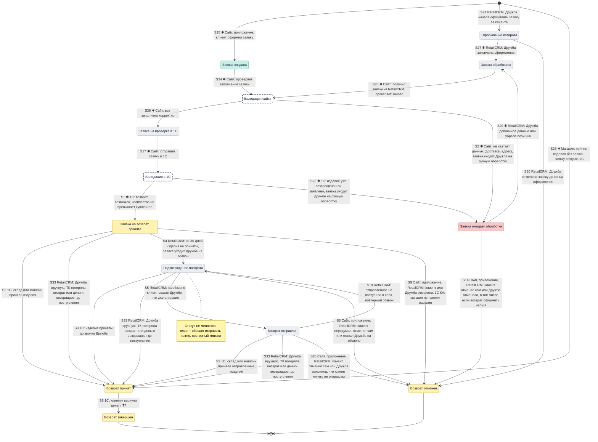
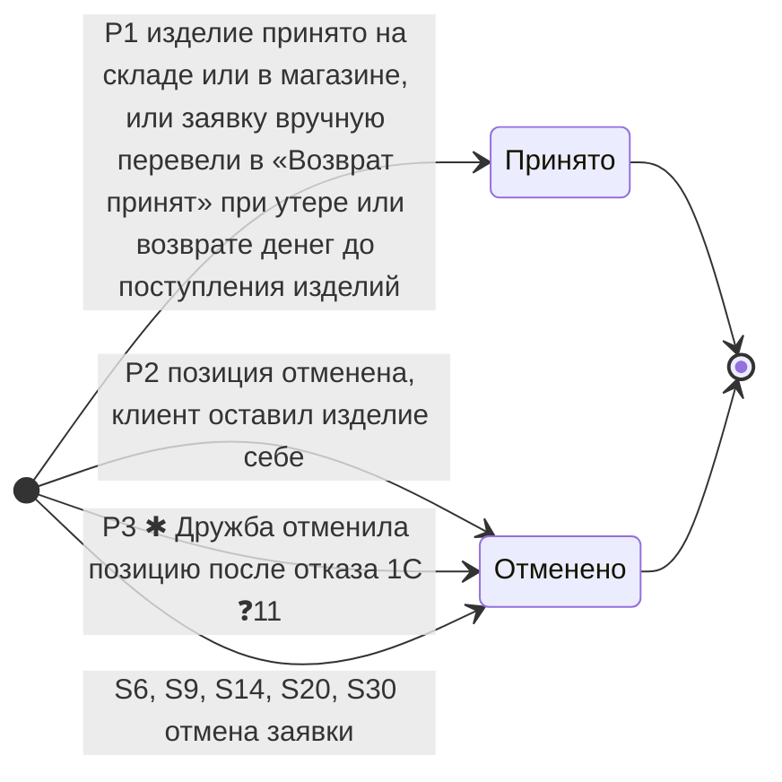
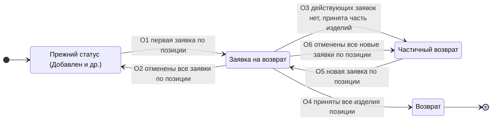

# Статусы возврата (TO-BE, MVP), версия 4 — заявка, позиция возврата, позиция исходного заказа

**Тип:** диаграмма состояний трех уровней: заявка на возврат (возвратный заказ), позиция возврата, позиция исходного заказа.

**Статус:** черновик 12STOREEZ: согласовать внутри команды, затем с RetailCRM.

**Обозначения:**

- ✱ — отличается от версии 3 (раздел 5);
- ❓N — не определено, N — номер вопроса в разделе «Открытые вопросы»;
- названия новых статусов — рабочие ❓1.

**Общие правила:**

- Статус исходного заказа при возврате не меняется и остается «Выполнен».
- Статусная модель одна для всех способов возврата.
- У заявки два слоя статусов — клиентский и внутренний. Оба слоя ведутся на сайте, в RetailCRM и в 1С, внутренние статусы передаются между системами.
- ✱ Что система делает с заявкой, определяется только статусом, без дополнительных признаков. Ожидание ответа 1С и ожидание действий Дружбы — разные статусы.
- В MVP интеграции с ТК нет: статусы перевозки не ведутся, клиенту статусы курьера и ТК не показываются.
- Автоотмены по сроку нет.

## Открытые вопросы

### Заявка на возврат

 1. Как назвать новые статусы? «Заявка создана» или «Заявка в обработке»? «Заполнено корректно по данным сайта» или «Заявка на проверке в 1С»? Предложение System Analyst — «Заявка на проверке в 1С»: название показывает, чего ждет заявка, и продолжает ряд «Заявка …»; статус ставится только после успешной валидации сайта, в отличие от прежнего статуса «Ожидает проверки 1С». «Заявка обработана» или «Внесены изменения»?
 2. Что видит клиент, пока заявка в «Заявка на проверке в 1С» и «Заявка обработана»: тот же первый статус и плашку о том, что обработка может занять больше времени, или отдельный статус «на рассмотрении», в том числе только на сайте, без статуса в модели? Обсудить с бизнесом.
 3. Видит ли клиент «Заявка ожидает обработки»? На встрече 13.11.2026 статус отнесли к клиентским, 11.11.2026 договорились ошибку проверки клиенту не показывать — клиент видит «обрабатывается», Дружба связывается с ним.
 4. Что сайт проверяет до создания заявки (права, статус заказа, срок, количество), а что — в валидации сайта после «Заявка создана»? С какими ошибками заявка не создается вовсе? Предложение Backend Developer: до создания сайт проверяет заказ клиента и его статус, срок возврата, сколько изделий можно вернуть, нет ли изделия в другой заявке; если проверка не прошла, заявка не создается, клиент видит ошибку. После создания сайт проверяет доставку: адрес, интервалы, пункт.
 5. Переименовывать ли остальные статусы «Возврат …» в «Заявка …»?
 6. Может ли клиент отменить заявку в «Заявка создана», «Заявка обработана» и «Заявка на проверке в 1С»? По правилу отмены клиент отменяет заявку в любом статусе до «Возврат принят», на схеме переходов нет. Если может — что делать, если заявка уже отправлена в 1С? Предложение Backend Developer: клиент отменяет заявку в любом статусе до «Возврат принят»; отмена заявки, отправленной в 1С, — ❓18.
 7. По какому событию 1С подтверждает возврат денег?
 8. Какой финальный статус у заявки при обмене, когда деньги не возвращаются?
 9. Нужен ли статус между «Заявка на возврат принята» и «Возврат принят», если передачу заявки курьеру можно получать в RetailCRM из реестров логистики?
10. Согласовать схему внутри команды — Head of PMO, Product Manager, Project Manager, Дружба — и с RetailCRM: технические статусы «Заявка обработана» и «Заявка на проверке в 1С», перевод Дружбой в «Заявка обработана», проверка заполнения только на сайте.

### Позиция возврата

11. После отказа 1С Дружба удаляет позицию из заявки или отмечает ее отмененной? Если отмечает — позиция получает «Отменено» и по ней можно оформить новый возврат? Предложение Backend Developer: отменять, а не удалять — по отмененной позиции можно оформить новый возврат, в 1С строка тоже остается отмененной.

### Позиция исходного заказа

12. Как делится строка позиции заказа при возврате части одинаковых изделий: в какой момент, что происходит с отделенной строкой при отмене заявки, какие статусы у строк, как делятся цены, скидки и баллы? RetailCRM строку позиции не делит: позиция остается одной строкой, статусы и причины возврата по изделиям — в свойствах позиции; делить ли строку на сайте — открыто.
13. Какие статусы Mindbox отправлять для заказа «Выполнен» вместе с новыми статусами позиции (`cms_mb_statuses_map`)?

### Возврат в магазине

15. ~~Какая система создает заявку при возврате в магазине без заявки (S26): 1С при приемке на кассе или RetailCRM? Когда это реализуется и видны ли такие возвраты в ЛК уже сейчас?~~ Закрыт 18.11.2026: заявку создает 1С при приемке изделий в магазине, в рамках MVP; первый статус — «Возврат принят», изделия уже приняты.

### Обмен между системами

16. Какие общие коды получают новые статусы «Заявка создана», «Заявка обработана» и «Заявка на проверке в 1С» (в ECOMDEV-2587 их нет — задача по схеме версии 3)? Принимают ли сайт, RetailCRM и 1С предложенные коды статусов заявки, позиции возврата и позиции исходного заказа — `return-draft`, `pending`, `accepted`, `confirmation`, `sent`, `received`, `completed`, `cancelled`, `return-requested`, `return-partial`?
17. Как RetailCRM не возвращает на сайт статусы, которые прислал сайт (защита от эха)? Нужен ли для этого признак источника изменения в вебхуке?
18. Получает ли 1С отмену заявки, если клиент или Дружба отменили ее после отправки в 1С? Что делает 1С, если отмена пришла, пока заявка проходит валидацию в 1С?
19. Какой код у начального статуса позиции возврата в RetailCRM?
20. Кто ставит статусы позиции исходного заказа после «Заявка на возврат»: «Частичный возврат», «Возврат» и возврат в прежний статус при отмене — сайт по данным 1С или RetailCRM?

## 1\. Заявка на возврат

### 1\.1 Диаграмма (внутренние статусы)

«Валидация сайта» и «Валидация в 1С» — проверки (операции), а не статусы: у каждой два выхода — успешный и с ошибкой.

Цвета: бирюзовый — первый статус заявки, клиентский и внутренний; красный — ошибка, клиентский и внутренний ❓3; желтый — клиентские и внутренние; серый — только внутренние; белый с пунктиром — проверка.

### 1\.2 Статусы

Столбец «Код»: код статуса общий для сайта, RetailCRM и 1С. «Предложено» — код еще не согласован всеми системами, «согласовано» — согласован, пусто — код не задан ❓16. Предложенные коды — из задачи на модель данных ECOMDEV-2587 (по схеме версии 3) и от RetailCRM.

#|
|| **Внутренний статус** | **Код** | **Что видит клиент** | **Когда** | **Кто переводит** | **Допускает отмену** ||
|| Оформление возврата | `return-draft` — предложено RetailCRM | Заявки в ЛК и приложении нет | Дружба создает заявку в RetailCRM и дозаполняет ее. Сайт заявку в этом статусе игнорирует при обмене, в 1С она не передается | Дружба (форма RetailCRM) | Да — Дружба ||
|| Заявка создана ✱ | | «Заявка создана» ❓1 | Первый статус заявки из ЛК и приложения — независимо от того, все ли заполнено. Сайт запускает валидацию сайта. Обратно в этот статус заявку не переводят | Сайт, приложение | ❓6 ||
|| Заявка обработана ✱ | | ❓2 | Дружба закончила оформление черновика или исправила заявку после ошибки. Сайт получает заявку из RetailCRM и снова запускает валидацию сайта, а не отправляет сразу в 1С | Дружба | ❓6 ||
|| Заявка на проверке в 1С ✱ | | ❓2 | Валидация сайта прошла. Сайт отправляет заявку в 1С и ждет ответа, в том числе в техокна 1С | Сайт | ❓6 ||
|| Заявка ожидает обработки ✱ | `pending` — предложено (в ECOMDEV-2587 — для «Возврат ожидает обработки» версии 3) | «Заявка ожидает обработки» ❓3 | Ошибка валидации сайта (например, не заполнены данные доставки, адрес введен вручную и не проверен) или отказ 1С. Причина — в комментарии для оператора RetailCRM. Заявка ждет Дружбу; в 1С ее никто не отправляет | Сайт — по своей проверке и по ответу 1С | Да — клиент и Дружба ||
|| Заявка на возврат принята | `accepted` — предложено | «Заявка на возврат принята» | 1С подтвердила возможность возврата | Сайт по ответу 1С | Да — клиент, Дружба, магазин (заявку в свой магазин) ||
|| Подтверждение возврата | `confirmation` — предложено | «Заявка на возврат принята» | Нет приемки 30 дней после создания; повторно — нет приемки в срок повторного обзвона. По этому статусу Дружба отбирает заявки для обзвона. Если клиент обещал отправить позже, статус не меняется | RetailCRM (триггер) | Да — клиент и Дружба ||
|| Возврат отправлен | `sent` — предложено | «Заявка на возврат принята» | Клиент сообщил Дружбе, что отправил возврат. Статус информационный | Дружба | Да — клиент и Дружба ||
|| Возврат принят | `received` — предложено | «Возврат принят» | Склад (по данным WMS) или магазин приняли изделия, и по всем позициям есть итог: принято или отменено. Вручную, без поступления изделий, — при утере и при возврате денег до поступления изделий. При возврате в магазине без заявки — заявка, созданная системой ✱ | Сайт по данным 1С; вручную — Дружба | Нет ||
|| Возврат завершен | `completed` — предложено | «Возврат завершен» | 1С подтвердила возврат денег, после «Возврат принят». Приемка после этого статус не меняет. Если часть изделий принята, а остальные отменены, заявка тоже получает «Возврат завершен», итог виден по позициям | Сайт по данным 1С | Нет ||
|| Возврат отменен | `cancelled` — предложено | «Возврат отменен» | Отмена до приемки: клиентом; Дружбой, в том числе если 1С отказала и возврат оформить нельзя; магазином — заявки в свой магазин | Клиент, Дружба, магазин | — ||
|#

### 1\.3 Правила заявки



#|
|| **Правило** | **Что действует** ||
|| Действие системы по статусу ✱ | «Заявка создана», «Заявка обработана» — сайт запускает валидацию сайта. «Заявка на проверке в 1С» — сайт отправляет заявку в 1С и ждет ответа. «Заявка ожидает обработки» — заявка ждет Дружбу, никуда не отправляется. «Оформление возврата» — сайт заявку игнорирует ||
|| Создание заявки ✱ | Заявка из ЛК и приложения создается, когда клиент отправил форму; черновика на сайте нет. Заявка получает «Заявка создана», даже если не заполнены данные доставки — например, не загрузились интервалы или не проверен адрес: такие заявки после валидации сайта уходят Дружбе. Что проверяется до создания заявки, а что — в валидации сайта, ❓4 ||
|| Валидация сайта ✱ | Сайт проверяет заполнение полей и их связки, например при доставке ТК выбраны интервалы, адрес проверен. Проверка идет после «Заявка создана» и после каждого «Заявка обработана» — сайт не знает, что исправила Дружба. Успех — «Заявка на проверке в 1С», ошибка — «Заявка ожидает обработки» с причиной в комментарии. Заполнение полей проверяет только сайт; RetailCRM не проверяет, чтобы проверка не дублировалась в трех системах (предложено) ||
|| Валидация в 1С ✱ | 1С проверяет только количество: нельзя вернуть больше, чем куплено. 1С отказывает, если изделие уже возвращено, в том числе в магазине, или по нему уже есть другая заявка. Адрес, интервалы и поля доставки 1С не проверяет. Успех — «Заявка на возврат принята», отказ — «Заявка ожидает обработки» с причиной в комментарии ||
|| Заявка Дружбы ✱ | Дружба оформляет заявку в RetailCRM в «Оформлении возврата». Закончив, переводит ее в «Заявка обработана»; дальше — валидация сайта и общий путь, как у заявки с сайта ||
|| Ручная обработка ✱ | В «Заявка ожидает обработки» попадают только заявки, которым нужны действия Дружбы. После ошибки сайта Дружба исправляет или дополняет данные; после отказа 1С — убирает или отменяет позицию, по которой изделие уже возвращено или заявлено в другой заявке ❓11, либо отменяет заявку. Исправив, Дружба переводит заявку в «Заявка обработана». Сразу в «Заявка на проверке в 1С» или «Заявка на возврат принята» Дружба заявку не переводит ||
|| Заявка в 1С | 1С создает заявку у себя и присваивает ей GUID сразу при получении, до проверки. Если проверка не прошла, заявка в 1С остается; после исправления Дружбой и повторной валидации сайта сайт отправляет ту же заявку с тем же ID сайта на повторную проверку ||
|| Номер заявки ✱ | Клиент видит сквозной номер «R…», его присваивает 1С; по нему формируется QR-код, номер передается во все системы. У каждой системы свой внутренний идентификатор заявки: ID сайта, ID RetailCRM, GUID 1С. Как связаны GUID и номер «R…», не определено ||
|| Статусы от Дружбы ✱ | Сайт получает из RetailCRM статусы, которые ставят Дружба и триггер RetailCRM: «Заявка обработана», «Подтверждение возврата», «Возврат отправлен», «Возврат принят» (вручную), «Возврат отменен», — и отмену позиции возврата. Заявки в «Оформлении возврата» сайту не нужны. Статусы, которые прислал сайт, RetailCRM на сайт не возвращает (защита от эха) ❓17 ||
|| Отмена заявки в 1С ✱ | Если заявку отменили после отправки в 1С («Заявка на проверке в 1С» и позже), отмена передается в 1С ❓18 ||
|| Обзвон | Оба перевода в «Подтверждение возврата» делает триггер RetailCRM, если статус не сменился за срок; срок и число итераций задает RetailCRM ||
|| Отмена заявки | Клиент отменяет заявку в ЛК или приложении до «Возврат принят»; из «Заявка создана» и технических статусов ❓6. В остальных случаях заявку отменяют вручную Дружба или магазин. Магазин отменяет заявку в свой магазин в 1С КА — в той же системе, где принимает изделия, — если клиент принес не те изделия или магазин их не принял. Заявку с другим способом возврата, например курьерскую, магазин не меняет и не отменяет: ее отменяют клиент или Дружба. После «Возврат принят» заявку не отменяет никто ||
|| Отмена без причины | Отмена фиксируется без причины. Клиент видит «Возврат отменен»; если заявку отменил не он, Дружба связывается с клиентом и объясняет ||
|| Возврат в магазине без заявки ✱ | Если заявку создает система, она сразу получает «Возврат принят» и не проходит проверки. Если заявку досоздает клиент или Дружба, она идет по общему пути. Заявка должна быть полной, чтобы ее можно было показать в ЛК и приложении. Срок реализации не определен ||
|| Приемка | Приемка и экспертиза — один этап. Склад принимает все, что пришло по заявке, включая брак; отказа после приемки нет. В магазине приемка — физическая проверка изделия сотрудником при клиенте: сотрудник либо принимает изделие, либо не принимает, например, если нельзя подтвердить, что оно куплено в 12 STOREEZ ||
|| Баллы | Баллы возвращаются при «Возврат принят», в том числе когда он поставлен вручную без поступления изделий. Деньги возвращаются отдельным процессом ||
|| Возврат денег до поступления изделий | Дружба вручную переводит заявку в «Возврат принят» без поступления изделий, затем — «Возврат завершен». Заявка не минует «Возврат принят», потому что баллы возвращаются при «Возврат принят». Приемка после «Возврат завершен» статус заявки не меняет ||
|| Утеря возврата | Статуса и признака утери нет. Дружба вручную переводит заявку в «Возврат принят» без поступления изделий из «Заявка на возврат принята», «Подтверждение возврата» или «Возврат отправлен»: клиент может сообщить об утере до обзвона. Позиции возврата получают «Принято», позиция исходного заказа — «Частичный возврат» или «Возврат», как при приемке; после возврата денег — «Возврат завершен». Если клиент ничего не отправлял — «Возврат отменен». Клиенту утеря не показывается ||
|| Названия ✱ | Статусы заявки до «Заявка на возврат принята» называются «Заявка …»: «Возврат ожидает обработки» переименован в «Заявка ожидает обработки». Переименовывать ли остальные «Возврат …» — ❓5. Клиентские названия пишутся без буквы «ё»: «Возврат отменен», «Возврат завершен». В клиентских текстах вместо «товар» пишется «изделие» ||
|#



### 1\.4 Переходы



#|
|| **№** | **Из** | **В** | **Событие** ||
|| S24 | — | Оформление возврата | Дружба создала заявку через форму RetailCRM ||
|| S25 ✱ | — | Заявка создана | Клиент создал заявку в ЛК или в приложении ||
|| S26 ✱ | — | Возврат принят | Возврат в магазине без заявки: система создала заявку после приемки ||
|| S27 ✱ | Оформление возврата | Заявка обработана | Дружба закончила оформление и вручную перевела заявку ||
|| S34 ✱ | Заявка создана | Валидация сайта | Сайт проверяет созданную заявку ||
|| S35 ✱ | Заявка обработана | Валидация сайта | Сайт получил заявку из RetailCRM и проверяет ее ||
|| S36 ✱ | Валидация сайта | Заявка на проверке в 1С | Все поля заполнены корректно ||
|| S2 ✱ | Валидация сайта | Заявка ожидает обработки | Не хватает данных: например, не заполнены данные доставки, адрес введен вручную и не проверен. Заявка уходит Дружбе на ручную обработку, причина — в комментарии для оператора ||
|| S37 ✱ | Заявка на проверке в 1С | Валидация в 1С | Сайт отправил заявку в 1С ||
|| S1 ✱ | Валидация в 1С | Заявка на возврат принята | 1С подтвердила возможность возврата ||
|| S28 ✱ | Валидация в 1С | Заявка ожидает обработки | 1С отказала: изделие уже возвращено или по нему уже есть другая заявка — нельзя вернуть больше, чем куплено. Причина отказа из 1С — в комментарии для оператора ||
|| S29 ✱ | Заявка ожидает обработки | Заявка обработана | Дружба исправила заявку: после ошибки сайта — исправила или дополнила данные; после отказа 1С — убрала или отменила позицию ❓11 ||
|| S3 | Заявка на возврат принята, Подтверждение возврата, Возврат отправлен | Возврат принят | Склад (по данным WMS) или магазин приняли изделия, по всем позициям есть итог; 1С передала приемку ||
|| S33 | Заявка на возврат принята, Подтверждение возврата, Возврат отправлен | Возврат принят | Дружба вручную, без поступления изделий: утеря после передачи в ТК; возврат денег до поступления изделий ||
|| S4 | Заявка на возврат принята | Подтверждение возврата | Триггер RetailCRM: нет приемки 30 дней после создания ||
|| — | Подтверждение возврата | Подтверждение возврата | Клиент обещал отправить позже, повторный контакт ||
|| S5 | Подтверждение возврата | Возврат отправлен | Дружба: клиент сообщил об отправке ||
|| S19 | Возврат отправлен | Подтверждение возврата | Триггер RetailCRM: нет приемки в срок повторного обзвона ||
|| S8 ❓7 | Возврат принят | Возврат завершен | 1С подтвердила возврат денег. При обмене без возврата денег — ❓8 ||
|| S30 | Оформление возврата | Возврат отменен | Дружба отменила заявку до окончания оформления ||
|| S14 | Заявка ожидает обработки | Возврат отменен | Клиент или Дружба отменили заявку; в том числе Дружба — если 1С отказала и возврат оформить нельзя ||
|| S9 | Заявка на возврат принята | Возврат отменен | Отмена клиентом, Дружбой или магазином: магазин отменяет заявку в свой магазин в 1С КА, когда клиент принес не те изделия или магазин их не принял ||
|| S6 | Подтверждение возврата | Возврат отменен | Клиент передумал: отмена клиентом или Дружбой ||
|| S20 | Возврат отправлен | Возврат отменен | Клиент отменил сам в ЛК или приложении, или Дружба выяснила, что клиент ничего не отправлял ||
|#



### 1\.5 Пути заявки по способам возврата (MVP)



#|
|| **Способ** | **Путь** ||
|| Курьер, СДЭК, 5Post, Почта России | Заявка создана → \[валидация сайта\] → Заявка на проверке в 1С → \[1С подтвердила\] → Заявка на возврат принята → \[склад принял изделия\] → Возврат принят → \[1С подтвердила возврат денег\] → Возврат завершен ||
|| Ошибка валидации сайта, например не заполнены данные доставки | Заявка создана → \[валидация сайта: не хватает данных\] → Заявка ожидает обработки → \[Дружба исправила\] → Заявка обработана → \[валидация сайта\] → Заявка на проверке в 1С → \[валидация в 1С\] → далее по способу; если возврат оформить нельзя — \[отмена\] → Возврат отменен ||
|| 1С отказала | … → Заявка на проверке в 1С → \[1С отказала\] → Заявка ожидает обработки → \[Дружба убрала позицию\] → Заявка обработана → \[валидация сайта\] → Заявка на проверке в 1С → \[1С подтвердила\] → Заявка на возврат принята; если возврат оформить нельзя — \[Дружба отменила\] → Возврат отменен ||
|| Магазин 12 STOREEZ по заявке | Заявка создана → \[валидация сайта\] → Заявка на проверке в 1С → \[1С подтвердила\] → Заявка на возврат принята → \[магазин принял изделия\] → Возврат принят → \[1С подтвердила возврат денег\] → Возврат завершен ||
|| Магазин: клиент сдал часть изделий, остальные не принесет | … → Заявка на возврат принята → \[магазин принял часть изделий, несданные позиции отметил «Отменено»\] → Возврат принят → \[1С подтвердила возврат денег\] → Возврат завершен ||
|| Нет приемки в срок | Заявка на возврат принята → \[30 дней без приемки\] → Подтверждение возврата → \[клиент сообщил Дружбе об отправке\] → Возврат отправлен → \[склад принял изделия\] → Возврат принят → …; если клиент передумал — \[отмена\] → Возврат отменен ||
|| Магазин без заявки | \[магазин принял изделия, система создала заявку\] → Возврат принят → \[1С подтвердила возврат денег\] → Возврат завершен. Заявка, которую досоздали клиент или Дружба, — общий путь ||
|| Заявка, созданная Дружбой | Оформление возврата → \[Дружба закончила оформление\] → Заявка обработана → \[валидация сайта\] → далее как у заявки с сайта ||
|| Утеря возврата (изделия) | Заявка на возврат принята, Подтверждение возврата или Возврат отправлен → \[ТК потеряла возврат, Дружба перевела вручную\] → Возврат принят → \[1С подтвердила возврат денег\] → Возврат завершен; если клиент ничего не отправлял — \[Дружба отменила\] → Возврат отменен ||
|| Деньги вернули до поступления изделий | Заявка на возврат принята, Подтверждение возврата или Возврат отправлен → \[Дружба перевела вручную\] → Возврат принят → \[1С подтвердила возврат денег\] → Возврат завершен ||
|#



## 2\. Позиция возврата



Позиция возврата — одно изделие: у каждого изделия своя причина возврата и свой статус. Статусы позиции возврата нужны, чтобы видеть частичную приемку. У позиции два статуса — «Принято» (`accepted`) и «Отменено» (`cancelled`), коды предложены в ECOMDEV-2587. При создании заявки статус позиции не задается (пусто) и появляется, когда позицию приняли или отменили. В RetailCRM позиция не может быть без статуса, поэтому там у позиции свой начальный статус, его код ❓19; остальные системы работают только с «Принято» и «Отменено». Клиенту статусы позиций в ходе обработки не показываются. При утере возврата и при возврате денег до поступления изделий позиции получают «Принято». По отмененным позициям можно оформить новый возврат, по принятым — нет.

После отказа 1С Дружба может убрать позицию из заявки. В 1С отмененная строка остается с признаком отмены, как в заказах; удалять позицию или отмечать отмененной — ❓11.

#|
|| **Сценарий** | **Статус позиции** | **Статус заявки** ||
|| Изделия поступили на склад | Все позиции заявки — «Принято», включая заявленные, но не пришедшие (недостача): склад принимает все заявленное | «Возврат принят» ||
|| Магазин принял все изделия заявки | Все позиции — «Принято» | «Возврат принят» ||
|| Клиент сдал в магазине часть изделий, остальные оставляет себе | Сданные — «Принято», остальные — «Отменено» (P2); несданные отмечает магазин при приемке | «Возврат принят», после возврата денег — «Возврат завершен» ||
|| Магазин не принял изделие: нельзя подтвердить, что оно куплено в 12 STOREEZ | «Отменено» | Не принято ни одно изделие — «Возврат отменен». Принята часть — как при частичной сдаче ||
|| ✱ 1С отказала: изделие уже возвращено или по нему есть другая заявка | Лишняя позиция — «Отменено» (P3) или удалена ❓11 | «Заявка ожидает обработки» → «Заявка обработана» → повторные проверки ||
|| Утеря после отправки: Дружба перевела заявку в «Возврат принят» | Все позиции — «Принято» | «Возврат принят» ||
|| Деньги вернули до поступления изделий | Все позиции — «Принято» | «Возврат принят» вручную, после возврата денег — «Возврат завершен» ||
|| Клиент ничего не сдал | Все позиции — «Отменено» при отмене заявки | «Подтверждение возврата», Дружба звонит клиенту и отменяет заявку, либо клиент отменяет сам — «Возврат отменен» ||
|#



## 3\. Позиция исходного заказа



#|
|| **Переход** | **Правило** ||
|| O1 ✱ | При первой заявке по позиции заказа позиция получает «Заявка на возврат» — при создании заявки клиентом (S25) или когда Дружба закончила оформление (S27) ||
|| O2 | При отмене позиция заказа возвращается в прежний статус. Только если по позиции не осталось других заявок, кроме отмененных. Заявка, в которой все изделия позиции получили «Отменено», для этой позиции считается отмененной — в том числе если Дружба отменила позицию после отказа 1С ||
|| O3 | По позиции заказа нет действующих заявок, принята часть изделий — «Частичный возврат» ||
|| O4 | Приняты все изделия позиции заказа — «Возврат» ||
|| O5 | Новая заявка по оставшимся изделиям позиции в статусе «Частичный возврат» — снова «Заявка на возврат». Оставшиеся изделия позиции клиент возвращает следующей заявкой в MVP ||
|| O6 | Позиция была «Частичный возврат», по ней создали новую заявку, и все новые заявки отменили — позиция возвращается в «Частичный возврат» ||
|#

Деление строки позиции заказа: когда клиент возвращает часть одинаковых изделий одной позиции, возвращенные изделия отделяются от оставшихся новой строкой позиции заказа — строки «вернули» и «актуально». Количество, доступное к возврату, 1С вычисляет сама; статусы позиции нужны сайту, чтобы разрешить или запретить возврат. Как делится строка — ❓12.

✱ Кто ставит статус позиции исходного заказа. «Заявка на возврат» (O1) ставит система, в которой создана заявка: для заявки из ЛК и приложения — сайт при создании заявки и передает в RetailCRM, по этому статусу сайт не дает вернуть то же изделие второй раз; для заявки Дружбы — RetailCRM. Кто ставит остальные статусы позиции (O2–O6) — ❓20. Предложение Backend Developer и System Analyst.

#|
|| **Статус позиции исходного заказа** | **Код** ||
|| Прежний статус (Добавлен и др.) | Действующие коды ||
|| Заявка на возврат | `return-requested` — предложено RetailCRM; RetailCRM ставит код после того, как его заведет сайт ||
|| Частичный возврат | `return-partial` — предложено RetailCRM; нужен ли статус — ❓12 ||
|| Возврат | `lost` (`internal_id = 9`) — согласовано ||
|#

Статусы для Mindbox — ❓13.



## 4\. Связь уровней по событиям



#|
|| **Событие** | **Заявка** | **Позиция возврата** | **Позиция исходного заказа** ||
|| S24 Дружба создала заявку в RetailCRM | «Оформление возврата» (только в RetailCRM) | без статуса | без изменений ||
|| S25 Заявка создана в ЛК или в приложении | «Заявка создана» | без статуса | «Заявка на возврат» (O1, или O5 из «Частичный возврат»); без изменений, если по позиции уже есть действующая заявка ||
|| S27 Дружба закончила оформление | «Заявка обработана» | без статуса | как при S25 ||
|| S36 Валидация сайта прошла | «Заявка на проверке в 1С» | без изменений | без изменений ||
|| S2 Ошибка валидации сайта | «Заявка ожидает обработки» | без изменений | без изменений ||
|| S1 1С подтвердила | «Заявка на возврат принята» | без изменений | без изменений ||
|| S28 1С отказала | «Заявка ожидает обработки» | без изменений | без изменений ||
|| S29 Дружба исправила заявку | «Заявка обработана» | отмененная позиция — «Отменено» (P3) ❓11 | по отмененной позиции — прежний статус (O2) или «Частичный возврат» (O6), если по ней не осталось действующих заявок ||
|| S4 Нет приемки 30 дней | «Подтверждение возврата» | без изменений | без изменений ||
|| S5 Клиент сообщил, что отправил | «Возврат отправлен» | без изменений | без изменений ||
|| P1 Изделие принято на складе или в магазине | без изменений, пока не по всем позициям есть итог | «Принято» | «Частичный возврат» (O3) или «Возврат» (O4), когда по позиции не осталось действующих заявок ||
|| P2 Позиция отменена, клиент оставил изделие себе | без изменений, пока не по всем позициям есть итог | «Отменено» | прежний статус (O2) или «Частичный возврат» (O6), если по позиции не осталось действующих заявок ||
|| S3 Изделия приняты, по всем позициям есть итог | «Возврат принят» | «Принято» или «Отменено» | «Частичный возврат» (O3) или «Возврат» (O4) ||
|| S26 Система создала заявку при возврате в магазине без заявки | «Возврат принят» | «Принято» | «Частичный возврат» (O3) или «Возврат» (O4) ||
|| S33 Дружба вручную: утеря или возврат денег до поступления изделий | «Возврат принят» | «Принято» | «Частичный возврат» (O3) или «Возврат» (O4), как при приемке ||
|| S8 1С подтвердила возврат денег | «Возврат завершен» ❓7 | без изменений | без изменений ||
|| S6, S9, S14, S20, S30 Отмена заявки | «Возврат отменен» | «Отменено» | прежний статус (O2) или «Частичный возврат» (O6), если по позиции не осталось действующих заявок; иначе без изменений. При S30 — без изменений ||
|#



При сдаче в магазине без заявки, пока курьерскую заявку не отменили, по позиции исходного заказа две действующие заявки: позиция остается «Заявка на возврат» и получает «Возврат» (O4) только после отмены курьерской заявки.

## 5\. Отличия от версии 3

#|
|| **Что** | **Версия 3** | **Версия 4** ||
|| Как система понимает, что делать | «Возврат ожидает обработки» — и ожидание ответа 1С, и ожидание Дружбы; сайт не отличает «отправлять в 1С» от «ждать», возможен цикл | Только по статусу: ожидание 1С — «Заявка на проверке в 1С», ожидание Дружбы — «Заявка ожидает обработки» ||
|| Первый статус заявки из ЛК и приложения | «Возврат ожидает обработки» | «Заявка создана» — клиентский и внутренний ||
|| Новые статусы | — | «Заявка создана», «Заявка обработана», «Заявка на проверке в 1С» ||
|| Проверки | Фронт и бэкенд сайта — до создания заявки; при ошибке заявка не создается. 1С — минимальный набор полей и количество | Валидация сайта и валидация в 1С — операции после создания заявки, у каждой два выхода. Заявка создается, даже если не заполнены данные доставки. 1С проверяет только количество ||
|| «Возврат ожидает обработки» | Первый статус и все случаи ручной обработки | Переименован в «Заявка ожидает обработки»; только ошибки валидации сайта и отказ 1С, заявка ждет Дружбу ||
|| После исправления Дружбой | Повторная проверка в 1С (S29) или Дружба сама переводит в «Заявка на возврат принята» (S12) | Дружба ставит «Заявка обработана», заявка снова проходит валидацию сайта и в 1С. S12 удален ||
|| «Оформление возврата» | Дружба переводит в «Возврат ожидает обработки» | Дружба переводит в «Заявка обработана» ||
|| Проверка заполнения в RetailCRM | RetailCRM первично проверяет заявку Дружбы | Заполнение проверяет только сайт (предложено) ||
|| Ручная обработка адреса (S2) | 1С подтвердила, нужна ручная обработка — статус не меняется | Ошибка валидации сайта — переход в «Заявка ожидает обработки» ||
|| Что делает Дружба после отказа 1С | Исправляет заявку по комментарию | Убирает или отменяет позицию (P3) либо отменяет заявку ||
|| Возврат в магазине без заявки | 1С создает заявку, первый статус не определен | Система создает заявку сразу в «Возврат принят»; заявка от клиента или Дружбы — общий путь ||
|| Переходы | S1, S2, S28, S29 — из «Возврат ожидает обработки» в него же или в «Заявка на возврат принята»; S12 | S25, S27, S34–S37 добавлены или изменены; S1, S28 — из валидации в 1С; S2 — из валидации сайта; S29 — в «Заявка обработана»; S12 удален ||
|| Цвета на диаграмме | Нет | Первый статус, ошибка, клиентские и внутренние, только внутренние, проверки ||
|#
