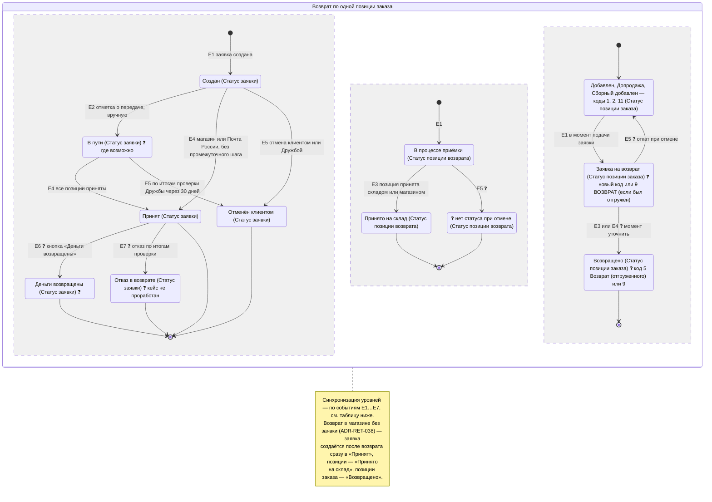

# Статусы возврата (TO-BE, MVP) — заявка, позиция возврата, позиция заказа

**Тип:** диаграмма состояний (state machine) с зависимостями между тремя уровнями статусов.
**Статус:** ЧАСТИЧНО УТВЕРЖДЕНО. Структура и связи уровней — по `ADR-RET-033`, `ADR-RET-039`, `ADR-RET-040`. Конкретные названия статусов заявки — рабочие: полную схему команда 12 STOREEZ передаёт RetailCRM к 07–08.10.2026 (`ADR-RET-040`). Всё, что не решено, помечено ❓.
**Дата:** 02.10.2026

Обозначения в названиях: `(Статус заявки)` — заявка на возврат / возвратный заказ; `(Статус позиции возврата)` — позиция возвратного заказа; `(Статус позиции заказа)` — позиция исходного заказа.

> Статус **исходного заказа** при возврате не меняется и остаётся «Выполнен», даже если возвращены все позиции (`ADR-RET-019`, `ADR-RET-039`). Меняются только статусы его позиций.
>
> В MVP нет интеграции с логистикой: статусы двигаются вручную (склад, магазин, Дружба) до 2027 года (`ADR-RET-017`, `ADR-RET-040`). Автоотмены в MVP нет — она в Post-MVP (`ADR-RET-033`).

## Диаграмма

## Зависимости статусов по событиям

| Событие | Кто / как | Статус заявки | Статус позиции возврата | Статус позиции заказа | Основание |
|---|---|---|---|---|---|
| **E1.** Заявка создана (ЛК, Дружба в RetailCRM) | Клиент или Дружба | → «Создан» | → «В процессе приёмки» (по каждой позиции заявки) | → «Заявка на возврат» (по каждой позиции, включённой в заявку). AS-IS: сейчас здесь ставится код 9, а заказ получает код 31 | `ADR-RET-039`, `ADR-RET-040`, `OrderRefundService.php:90,109` |
| **E2.** Изделие передано в ТК (курьер, ПВЗ, постамат) | Вручную — интеграции с ТК нет | «Создан» → «В пути» ❓ (только где возможно) | без изменений | без изменений | 25.09.2026, `ADR-RET-040` |
| **E3.** Позиция принята складом или магазином | Склад / магазин, вручную | без изменений, пока приняты не все позиции | «В процессе приёмки» → «Принято на склад» | ❓ «Заявка на возврат» → «Возвращено» здесь или на E4 | `ADR-RET-040` (частичная приёмка) |
| **E4.** Приняты все позиции заявки | Следует из E3 | → «Принят» | все — «Принято на склад» | → «Возвращено» (если не на E3) | `ADR-RET-039`, `ADR-RET-040` |
| **E5.** Отмена заявки | Клиент кнопкой «Отмена заявки» — пока изделие у него (`RULE-09`); Дружба — по итогам проверки через 30 дней (`ADR-RET-033`) | → «Отменён клиентом» | ❓ статус не определён | ❓ откат к текущему статусу | `ADR-RET-033`, `ADR-RET-040` |
| **E6.** Деньги возвращены | ❓ кнопка для бухгалтерии | «Принят» → «Деньги возвращены» ❓ | без изменений | без изменений | `ADR-RET-040` (финальный статус открыт) |
| **E7.** Отказ в возврате | Вручную, склад + Дружба; экспертиза вне проекта | → «Отказ в возврате» ❓ | ❓ | ❓ | `ADR-RET-040`, `ADR-RET-041` |

## Статусы в коде монолита (AS-IS)

Разбор `12storeez-master` (только чтение). Статусы заявки и позиции возврата в монолите отсутствуют:
сущности возврата пока нет, она проектируется в [ERD](../erd/return-entity_erd_merged.md).
Ниже — то, что есть сейчас у заказа и его позиций.

### Где хранится статус позиции заказа

- Поле `cms_order_positions.status` (integer) содержит `internal_id` справочника `order_position_statuses`.
- Поля справочника: `title`, `code`, `cancel_status`, `active`, `internal_id` — `modules/statuses/models/OrderPositionStatus.php:11-21`.
- Справочник ведётся в БД (админка `OrderPositionStatusBackendController`), названий в коде нет.
- `code` — код статуса RetailCRM: обмен сопоставляет `code ↔ internal_id` (`src/Modules/Order/Repository/OrderPositionStatusRepository.php`, `RcrmOrderPositionTransformer.php:29-35`).
- Маппинг статусов позиций на статусы Mindbox — таблица `MbStatusesMap.order_position_status_id` (`modules/statuses/models/MbStatusesMap.php`).

### Константы `internal_id`, связанные с возвратом (`modules/orders/models/OrderPosition.php:113-130`)

Названия — из выгрузки `cms_order_position_statuses` от 02.10.2026, см. [справочник статусов](../../../../../knowledge/12storeez-master-web/database/order-status-dictionaries.md).

| Код | Константа | Что известно из кода |
|---|---|---|
| 1, 2, 8, 10, 11 | `STATUS_ADDED` «Добавлен», `STATUS_CROSSSELL` «Допродажа», `STATUS_SALED` «Продан» (`active = 0`), `STATUS_IN_RESERVE` «ПРЕДЗАКАЗ» (`active = 0`), `STATUS_COLLECTIVE_ADDED` «Сборный добавлен» | «Активная» позиция — `OrderPosition::isActive()` (`:678-686`) |
| 5 | `STATUS_RETURNED` «Возврат (отгруженного)», `code = returned`, в справочнике `active = 0` | Считается возвращённой — `OrderPosition::isReturned()` (`:674-676`). Приходит из RetailCRM по коду статуса |
| 9 | `STATUS_LOST` «ВОЗВРАТ (если был отгружен)», `code = lost` | Подпись в коде: «Возврат (если был отгружен)» (`:220`). **Сейчас ставится в момент подачи заявки из ЛК** — `OrderRefundService::prepareRefundPositionOrder` (`src/Modules/Order/Services/OrderRefundService.php:90`), вместе с кодом причины; то же в `OrderPosition::returnPosition()` (`:661`) |
| 13 | `STATUS_CHANGE` «Обмен», `code = obmen` | Обмен |
| 14 | `STATUS_CANCELED` «Отменён», `code = otmenen` | Отменена |

### Статус заказа при возврате сейчас

- При подаче заявки из ЛК заказ получает `31` `ORDER_RETURNED_LK` (`OrderRefundService.php:109`, `Order::updateReturnStatus()` — `modules/orders/models/Order.php:1864-1876`).
- Product Manager 02.10.2026: сейчас три статуса заказа — «возврат из ЛК», «частичный», «полный возврат». В коде это `31`, `19` `REFUND_REQUEST_PARTIAL`, `18` `REFUND_REQUEST_FULL`.
- Статусы заказа, которые возвращает 1С (`OrderDictionary::getStatusesReturnedFromOdinAss`, `modules/orders/dictionaries/OrderDictionary.php:45-57`): `20` `REFUND_REQUEST_TRANSMITTED`, `21` `REFUND_REQUEST_COMPLETED`, `22` `REFUND_REQUEST_FINISHED`, `29` `ITEM_DIAGNOSTED`, `31`, `34` `VOSM`, `40` `RETURN_IN_SHOP`, `53` `NEED_REQUESITS`, `75` `RETURN_LK_IN_WORK`.
- По `ADR-RET-039` эти смены статуса заказа уходят: статус заказа остаётся «Выполнен».

### Что завязано на коды 5 и 9 — риск при выборе кода для «Заявка на возврат»

Позиция с кодом 5 или 9 уже сейчас считается **возвращённой**, хотя код 9 ставится при подаче заявки, до фактического возврата:

| Логика | Где | Эффект |
|---|---|---|
| Сумма к оплате и сумма возврата в ЛК / МП | `OrderService::getPaymentDataDto` (`modules/orders/services/OrderService.php:159-170`) | позиции 5 и 9 исключаются из суммы заказа и считаются суммой возврата |
| Пересчёт суммы заказа из RetailCRM | `OrderService.php:735-743` | позиции 5 и 9 не входят в сумму |
| Обмен с 1С | `OneCExchangeTransformer.php:308-312` | позиции 5 и 9 уходят с признаком `return = true` |
| Обмен с RetailCRM | `RcrmOrderTransformer.php:287-294` | причины возврата позиций 5 и 9 — в поля `prichina_vozv`, `pvt2…` |
| Повторный возврат из МП | `src/Modules/Mobile/Controllers/OrdersController.php:569-573` | позиция с кодом 9 повторно не возвращается |
| Блокировка оплаты наличными | `User::isBlockForCashPay` (`modules/users/models/User.php:1031-1035`) | позиции с кодом 9 (вместе с 4 и 14) участвуют в блокировке клиента |
| Lamoda | `LamodaOrderOutboxService.php:316-318` | код 9 → `CLAIMED_OK` |

**Вывод для TO-BE.** Если «Заявка на возврат» займёт код 9, как сейчас, позиция сразу при подаче
заявки будет считаться возвращённой: в суммах, в обмене с 1С и в блокировке оплаты наличными.
Если ввести для «Заявка на возврат» новый `internal_id`, а «Возвращено» оставить на 5 или 9, нужно
пересмотреть всю логику из таблицы выше. Выбор кода — задача SA (❓).

## Пути заявки по каналам (MVP)

| Канал | Путь статуса заявки |
|---|---|
| Курьер, СДЭК, 5Post | Создан → (В пути ❓) → Принят → (Деньги возвращены ❓) |
| Розничный магазин по QR-коду | Создан → Принят (приёмка в АРМ «Розницы») → (Деньги возвращены ❓) |
| Магазин без заявки (`ADR-RET-038`) | заявка создаётся после возврата → Принят |
| Почта России | Создан → Принят (на складе) → (Деньги возвращены ❓) |
| Нет поступления 30 дней | Создан / В пути → проверка Дружбой ❓ (статус «Подтвердить возврат» или фильтр по датам) → Отменён клиентом или дальше по пути |

## Открытые вопросы (❓)

1. Названия и полный состав статусов заявки — схема команды 12 STOREEZ к 07–08.10.2026 (`ADR-RET-040`, BRD `OQ-1`).
2. Финальный статус: «Деньги возвращены» (кнопка для бухгалтерии) или «Принят» (`ADR-RET-040`).
3. Статус «В пути»: для каких каналов и кто его ставит без интеграции с ТК.
4. Проверка через 30 дней без поступления: отдельный статус «Подтвердить возврат» или фильтр по датам (`ADR-RET-033`).
5. В какой момент позиция заказа становится «Возвращено» при частичной приёмке: при приёмке позиции (E3) или при приёмке всей заявки (E4).
6. Что происходит со статусами позиции возврата и позиции заказа при отмене (E5) и при отказе (E7).
7. Статусы при нескольких одинаковых единицах в одной строке заказа: в RetailCRM статус меняется у всех единиц (`ADR-RET-028`).
8. Триггеры Mindbox и уведомления, завязанные на статусы позиций заказа (`ADR-RET-039`, BRD `OQ-47`). Маппинг — `cms_mb_statuses_map` по паре «статус заказа + статус позиции». При статусе заказа `17` «Заказ выполнен» код `9` даёт Mindbox `401`, для кода `5` строки нет, для нового кода строк тоже не будет — см. [справочник, раздел 5](../../../../../knowledge/12storeez-master-web/database/order-status-dictionaries.md).
9. Какие `internal_id` займут «Заявка на возврат» и «Возвращено»: новый код или существующие 9 и 5 (см. раздел «Статусы в коде монолита»). Предпочтение автора бандла (02.10.2026) — новый код: новая логика, Mindbox будет определять события по новым строкам `cms_mb_statuses_map`, а переиспользование кода 9 может непредсказуемо задеть старую логику. Код 5 не рассматривается (`active = 0`). Не утверждено. Названия существующих статусов — в [справочнике статусов](../../../../../knowledge/12storeez-master-web/database/order-status-dictionaries.md). Код `5` в справочнике неактивен (`active = 0`), фактически возврат обозначается кодом `9`.

## Связанные артефакты

- ADR: `ADR-RET-019`, `ADR-RET-028`, `ADR-RET-033`, `ADR-RET-038`, `ADR-RET-039`, `ADR-RET-040`, `ADR-RET-041` — [adr/](../../adr/).
- BRD: `RULE-09`, `RULE-28`, `RULE-29`, `RULE-30`, `FR-28`, `FR-29`, `FR-31`, `OQ-1` — [brd.md](../../brd.md). `RULE-29` расходится с `ADR-RET-039` — правка BRD ожидает решения.
- User Story: US1, US3, US4, US6 — [user-story.md](../../user-story/user-story.md).
- Модель данных: `cms_return_statuses`, `cms_return_changes`, `cms_return_positions.order_position_id` — [ERD](../erd/return-entity_erd_merged.md). Статусы позиций возврата в ERD есть: справочник `cms_return_position_statuses` (в ERD — «ожидается, получена, принята, отклонена») и история `cms_return_position_status_history`. Набор в ERD (4 статуса) шире, чем на встрече 02.10.2026 (2 статуса, `ADR-RET-040`) — сверить при получении статусной схемы.

## Источники

- [[bandicam 2026-10-02 10-00-25-844] 12storeez & Intaro.ru (возвраты).md](<../../../sources/transcriptions/[bandicam 2026-10-02 10-00-25-844] 12storeez & Intaro.ru (возвраты).md>), `00:03:24–00:19:46`.
- [[bandicam 2026-10-01 14-59-24-902] PJ Возвраты (регулярная встреча по проекта у рамках OKR Q4 ).md](<../../../sources/transcriptions/[bandicam 2026-10-01 14-59-24-902] PJ Возвраты (регулярная встреча по проекта у рамках OKR Q4 ).md>), `00:05:16–00:15:51`, `00:42:37–00:52:26`.
- [[bandicam 2026-09-25 13-30-52-064] Встреча с RCRM.md](<../../../sources/transcriptions/[bandicam 2026-09-25 13-30-52-064] Встреча с RCRM.md>), `00:52:12–00:57:43`.

## История изменений

| Дата | Изменение |
|---|---|
| 01.10.2026 | Создана как гипотеза по встречам 24.09 и 25.09.2026: только статусы заявки (Создан → В пути → Принят → Деньги возвращены; Отменён, в том числе автоотменой; Отклонён) |
| 02.10.2026 | Переработана по встречам 01.10 и 02.10.2026: добавлены статусы позиции возврата и позиции исходного заказа и их зависимости по событиям; автоотмена исключена из MVP (`ADR-RET-033`); «Отклонён» заменён на «Отказ в возврате» ❓ (`ADR-RET-040`, `ADR-RET-041`); нерешённое помечено ❓ |
| 02.10.2026 | Добавлен раздел «Статусы в коде монолита (AS-IS)»: где хранится статус позиции заказа, коды 1/2/8/10/11, 5, 9, 13, 14, статусы заказа при возврате и логика, завязанная на коды 5 и 9. Статусы позиции заказа на диаграмме привязаны к кодам |
| 02.10.2026 | Статусы позиции заказа подписаны названиями из выгрузки `cms_order_position_statuses`; добавлены ссылки на справочник статусов и выводы по маппингу Mindbox |
| 02.10.2026 | Исправлено: статусы позиций возврата в ERD предусмотрены (`cms_return_position_statuses`, `cms_return_position_status_history`) |
| 02.10.2026 | В открытый вопрос 9 добавлено предпочтение автора бандла: новый код статуса позиции |
