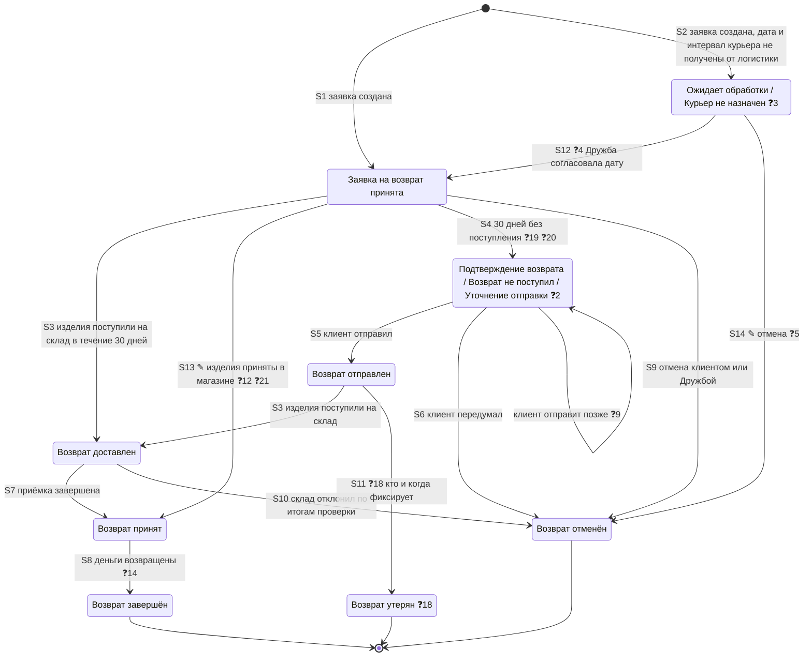
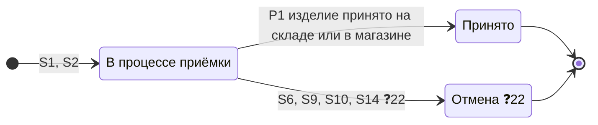
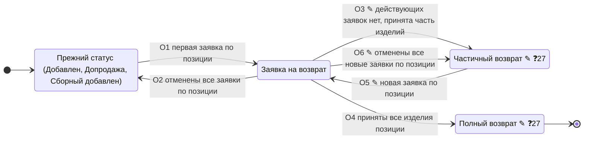

# Статусы возврата (TO-BE, MVP) — заявка, позиция возврата, позиция исходного заказа

**Тип:** диаграмма состояний трёх уровней: заявка на возврат (возвратный заказ), позиция возврата, позиция исходного заказа.

**Обозначения:**
- без пометки — статус или переход взят со встреч или со схемы Miro (источник — в таблицах ниже);
- ✎ — предложение автора бандла, на встречах не обсуждалось и не утверждено (`ADR-RET-073`, «Предложено»); если вариантов несколько через «/», нужно выбрать один;
- ❓N — не определено, N — номер вопроса в разделе «Открытые вопросы».

Схема статусов целиком ещё не подтверждена (вопрос 1).

**Общие правила:**
- Статус исходного заказа при возврате не меняется и остаётся «Выполнен» (`ADR-RET-019`, `ADR-RET-039`).
- В MVP интеграции с логистикой нет: статусы заявки двигают вручную склад, магазин и Дружба (`ADR-RET-017`, `ADR-RET-040`).
- Автоотмены в MVP нет (`ADR-RET-053`).

## 1. Заявка на возврат

### 1.1 Диаграмма

Основа — схема статусов из Miro, которую показывали на встрече 08.10.2026: [Статусы.png](<../../../sources/Статусы.png>). Статус «Ожидает обработки» добавлен по решению 15.10.2026, на схеме его нет.

Названия двух статусов для Дружбы не утверждены, варианты перечислены через «/»: первым — название со встреч, остальные ✎ — предложения автора бандла. Клиент эти статусы не видит.

### 1.2 Статусы

| Статус | Когда | Кто переводит | Видит клиент | Допускает отмену | Источник |
|---|---|---|---|---|---|
| Заявка на возврат принята | Заявка создана в ЛК, МП или Дружбой | Система | Да | Да — клиент ❓10 | Схема Miro; Встреча 08.10, `00:08:55–00:09:12`, `00:15:55` |
| Ожидает обработки / Курьер не назначен ✎ ❓3 | Заявка создана способом «Курьер», но дату и интервал приезда курьера от логистики получить не удалось. Дружба звонит клиенту и согласовывает дату и интервал | Система | ❓6 | ✎ Да — ❓5 клиент или Дружба | `ADR-RET-071`; Встреча 15.10, `00:39:22–00:39:43`; название предлагалось — Встреча 14.10, `00:42:42` |
| Подтверждение возврата / Возврат не поступил ✎ / Уточнение отправки ✎ ❓2 | 30 дней после создания, изделия не поступили на склад и не сданы в магазине | ❓8 система или RetailCRM | Нет ❓7 | Да — на схеме отмена Дружбой; ❓11 может ли клиент | Схема Miro; `ADR-RET-053`; Встреча 08.10, `00:09:12–00:10:13` |
| Возврат отправлен | Клиент на обзвоне сказал, что отправил | Дружба | Нет ❓7 | Нет | Схема Miro; `ADR-RET-053`; Встреча 08.10, `00:09:46–00:10:13` |
| Возврат доставлен | Изделия поступили на склад. Только для склада: в магазине изделия сразу принимаются (✎ ❓12) | Склад, вручную | Да | Нет | Схема Miro; Встреча 08.10, `00:09:12`, `00:15:55` |
| Возврат принят | Приёмка завершена на складе или в магазине | Склад или магазин, вручную | Да | Нет | Схема Miro («В магазине / на складе»); Встреча 08.10, `00:09:12`, `00:17:01–00:18:22` |
| Возврат завершён | Деньги возвращены | ❓14 | Да | Нет | Схема Miro («Возврат ДС»); Встреча 08.10, `00:09:12`; `ADR-RET-040` |
| Возврат отменён | Отмена клиентом, Дружбой или складом по итогам экспертизы | Клиент, Дружба, склад | Да | — | Схема Miro; Встреча 08.10, `00:09:46`, `00:10:39–00:11:06`, `00:19:50–00:21:32`; `ADR-RET-041` |
| Возврат утерян ❓18 | Возврат утерян после отправки | ❓18 | ❓18 на схеме не отмечен как видимый клиенту, на встрече 08.10 назван среди клиентских | Нет | Схема Miro («Заказ утерян?»); Встреча 08.10, `00:15:32–00:15:55` |

**Причина отмены.** На схеме Miro — вопрос «Используем статусы причин отмены для заказа возврата и для отмены по экспертизе?». На встрече 08.10 решили детализировать отмену причинами, как у заказов, если это просто (`00:19:50–00:21:32`). См. вопрос 17.

**Отказ склада.** Отдельного статуса отказа в возврате нет: отказ склада — «Возврат отменён» с причиной отмены (Встреча 08.10, `00:11:06`; `ADR-RET-041`).

**Статусы курьера и ТК** клиенту на первом этапе не показываются (Встреча 08.10, `00:16:20`).

### 1.3 Переходы

| № | Из | В | Событие |
|---|---|---|---|
| S1 | — | Заявка на возврат принята | Заявка создана |
| S2 | — | Ожидает обработки ❓3 | Заявка создана способом «Курьер», но дату и интервал приезда курьера от логистики получить не удалось |
| S12 | Ожидает обработки | Заявка на возврат принята ❓4 | Дружба согласовала с клиентом дату и интервал |
| S14 ✎ | Ожидает обработки | Возврат отменён | Отмена ❓5 |
| S3 | Заявка на возврат принята | Возврат доставлен | Изделия поступили на склад в течение 30 дней после создания заявки |
| S3 | Возврат отправлен | Возврат доставлен | Изделия поступили на склад после того, как клиент на обзвоне подтвердил отправку |
| S13 ✎ | Заявка на возврат принята | Возврат принят | Изделия приняты в магазине ❓12. Отказ магазина — ❓21 |
| S4 | Заявка на возврат принята | Подтверждение возврата ❓2 | 30 дней без поступления. Что дальше, если изделия поступят на склад или в магазин до звонка — ❓19, ❓20 |
| S5 | Подтверждение возврата | Возврат отправлен | Клиент на обзвоне сказал, что отправил |
| — | Подтверждение возврата | Подтверждение возврата | Клиент отправит позже ❓9 |
| S6 | Подтверждение возврата | Возврат отменён | Клиент передумал |
| S7 | Возврат доставлен | Возврат принят | Приёмка завершена. Если часть изделий отклонена — ❓16 |
| S8 | Возврат принят | Возврат завершён | Деньги возвращены ❓14. При обмене без возврата денег — ❓15 |
| S9 | Заявка на возврат принята | Возврат отменён | Отмена клиентом или Дружбой |
| S10 | Возврат доставлен | Возврат отменён | Склад отклонил по итогам проверки. Причина отмены — ❓17 |
| S11 | Возврат отправлен | Возврат утерян | Утеря ❓18 |

### 1.4 Пути заявки по способам возврата (MVP)

| Способ | Путь |
|---|---|
| Курьер, СДЭК, 5Post, Почта России | Заявка на возврат принята → Возврат доставлен → Возврат принят → Возврат завершён |
| Курьер: дата и интервал не получены от логистики | Ожидает обработки ❓3 → ❓4 → далее как у курьера / Возврат отменён ✎ ❓5 |
| Магазин 12 STOREEZ по заявке | Заявка на возврат принята → Возврат принят (в магазине) → Возврат завершён ✎ ❓12 |
| Нет поступления 30 дней | Заявка на возврат принята → Подтверждение возврата → Возврат отправлен → Возврат доставлен → … / Возврат отменён |
| Магазин без заявки (`ADR-RET-051`) | Заявка создаётся после возврата: статус при создании ❓13 |

## 2. Позиция возврата

Два статуса позиции возврата нужны, чтобы видеть частичную приёмку (`ADR-RET-040`; Встреча 02.10, `00:09:06–00:09:53`). Статус при отмене — ❓22, при утере — ❓23.

## 3. Позиция исходного заказа

| Переход | Правило | Источник |
|---|---|---|
| O1 | При первой заявке по позиции позиция получает «Заявка на возврат». На схеме Miro — «меняем статус позиции заказа», статус «(какой??)» | `ADR-RET-039`; Встреча 02.10, `00:08:22–00:08:50`; [Статусы.png](<../../../sources/Статусы.png>) |
| O2 | При отмене позиция возвращается в прежний статус | Схема Miro («Возвращаем предыдущий»); Встреча 12.10, `00:45:17–00:45:42`. ✎ Уточнение автора: только если по позиции не осталось других заявок, кроме отменённых (`ADR-RET-073`) |
| O3 ✎ | По позиции нет действующих заявок, принята часть изделий — «Частичный возврат» | Предложение автора бандла, `ADR-RET-073` |
| O4 | Приняты все изделия позиции — «Полный возврат» | Статус «Возвращено» — `ADR-RET-039` (Встреча 02.10, `00:08:50`). ✎ Название «Полный возврат» — предложение автора бандла ❓27. ✎ Условие «все изделия позиции» — `ADR-RET-073` |
| O5 ✎ | Новая заявка по позиции в статусе «Частичный возврат» — снова «Заявка на возврат» | Предложение автора бандла, `ADR-RET-073` |
| O6 ✎ | Позиция была «Частичный возврат», по ней создали новую заявку, и все новые заявки отменили — позиция возвращается в «Частичный возврат» | Правило O2 «возвращаем предыдущий» для статуса O3 ✎; `ADR-RET-073` |

✎ По `ADR-RET-073` статус позиции исходного заказа — только отметка для Дружбы, RetailCRM и Mindbox; доступность изделий для возврата считается по заявкам. До принятия `ADR-RET-073` действует `ADR-RET-065`: после первой заявки оставшиеся изделия позиции возвращаются через Дружбу.

Коды статусов позиции — ❓24, статусы для Mindbox — ❓25.

## 4. Связь уровней по событиям

События — в порядке процесса.

| Событие | Заявка | Позиция возврата | Позиция исходного заказа |
|---|---|---|---|
| S1 Заявка создана | «Заявка на возврат принята» | «В процессе приёмки» | O1 или O5 ✎; без изменений, если по позиции уже есть действующая заявка |
| S2 Заявка создана, дата и интервал курьера не получены от логистики | «Ожидает обработки» ❓3 | «В процессе приёмки» | O1 или O5 ✎; без изменений, если по позиции уже есть действующая заявка |
| S12 Дружба согласовала дату и интервал курьера | «Заявка на возврат принята» ❓4 | без изменений | без изменений |
| S4 30 дней без поступления | «Подтверждение возврата» ❓2 | без изменений | без изменений |
| S5 Клиент на обзвоне подтвердил отправку | «Возврат отправлен» | без изменений | без изменений |
| S3 Изделия поступили на склад | «Возврат доставлен» | без изменений | без изменений |
| P1 Изделие принято на складе или в магазине | без изменений, пока приняты не все | «Принято» | O3 ✎ или O4, когда по позиции не осталось действующих заявок |
| S7 Приёмка завершена на складе | «Возврат принят» | все — «Принято» | O3 ✎ или O4 |
| S13 ✎ Изделия приняты в магазине | «Возврат принят» ❓12 | все — «Принято» | O3 ✎ или O4 |
| S8 Деньги возвращены | «Возврат завершён» ❓14 | без изменений | без изменений |
| S6, S9, S10, S14 ✎ Отмена | «Возврат отменён» | ❓22 | O2 или O6 ✎, если по позиции не осталось действующих заявок; иначе без изменений |
| S11 Утеря | «Возврат утерян» ❓18 | ❓23 | ❓26 |

## 5. Открытые вопросы

### Схема целиком

**1. Подтвердите схему статусов целиком: какие статусы и переходы согласованы, а какие нужно изменить.**

### Заявка на возврат

**2. Как назвать статус заявки, по которой изделия не поступили за 30 дней?** Клиент его не видит, статус нужен Дружбе.
- а) Подтверждение возврата — `ADR-RET-053`
- б) Возврат не поступил ✎
- в) Уточнение отправки ✎
- г) Не поступил за 30 дней ✎

**3. Как назвать статус заявки, созданной способом «Курьер», если дату и интервал курьера от логистики получить не удалось?**
- а) Ожидает обработки — предлагали на встрече 14.10
- б) Курьер не назначен ✎

**4. В какой статус Дружба переводит заявку «Ожидает обработки» после того, как согласовала с клиентом дату и интервал?** На схеме — «Заявка на возврат принята».

**5. Кто может отменить заявку в статусе «Ожидает обработки»?**
- а) клиент сам в ЛК или МП
- б) Дружба, если клиент отказался при звонке
- в) оба

**6. Видит ли клиент такую заявку (вопрос 3) в отдельном статусе? Если да — какое название ему показывается?**

**7. Какой статус видит клиент, пока заявка в «Подтверждении возврата» и «Возврат отправлен»?** Эти статусы клиенту не показываются. Например, «Заявка на возврат принята»?

**8. Какая система переводит заявку в «Подтверждение возврата» через 30 дней?**
- а) сайт
- б) RetailCRM

**9. Сколько заявка может оставаться в «Подтверждении возврата», если клиент обещает отправить позже? Через какой срок Дружба снова с ним связывается?**

**10. В каких статусах клиент может сам отменить заявку?**
- а) только в «Заявка на возврат принята» — как на схеме Miro
- б) пока изделия не поступили на склад или в магазин — как сейчас в US 4 и SRS

**11. Может ли клиент сам отменить заявку в «Подтверждении возврата», или её отменяет только Дружба?**

**12. Подтвердите: при возврате в магазин заявка из «Заявка на возврат принята» сразу получает «Возврат принят», без «Возврат доставлен».** «Возврат доставлен» — только для склада: изделия поступили, приёмка ещё идёт.

**13. В каком статусе создаётся заявка, если клиент принёс онлайн-заказ в магазин без заявки (`ADR-RET-051`)?**

**14. По какому событию заявка получает «Возврат завершён», и кто его фиксирует, если интеграции с платёжными сервисами нет?**

**15. Какой финальный статус у возвратного заказа при обмене, когда деньги не возвращаются (`ADR-RET-070`)?**
- а) Возврат завершён
- б) Возврат принят

**16. Какой статус у заявки, если склад принял часть изделий, а часть отклонил по итогам экспертизы?**
- а) «Возврат принят» по принятым изделиям, отклонённые позиции — отдельно
- б) вся заявка «Возврат отменён»

**17. Используем ли для заявки причины отмены, как у обычных заказов, чтобы различать отмену клиентом, Дружбой и складом по итогам экспертизы? Если да — какой список причин и кто их проставляет?**

**18. Вводим ли статус «Возврат утерян»? Если да — кто его ставит и видит ли его клиент?**

**19. Что происходит, если заявка уже в «Подтверждении возврата», а изделия поступили на склад до звонка Дружбы?** На схеме перехода «Подтверждение возврата» → «Возврат доставлен» нет.

**20. Что происходит, если заявка в «Подтверждении возврата», а клиент принёс изделия в магазин?** На схеме перехода «Подтверждение возврата» → «Возврат принят» нет.

**21. Какой статус получает заявка, если магазин отказал в возврате по итогам проверки?** Отказ склада — переход S10 из «Возврат доставлен» в «Возврат отменён». Для магазина «Возврат доставлен» нет (S13 ✎), и перехода в «Возврат отменён» после приёмки в магазине на схеме нет.

### Позиция возврата

**22. Какой статус получает позиция возврата при отмене заявки?**

**23. Какой статус получает позиция возврата при утере возврата?**

### Позиция исходного заказа

**24. Какие коды займут статусы позиции «Заявка на возврат», «Частичный возврат» ✎ и «Полный возврат» ✎?** См. приложение и `ADR-RET-073`.
- а) новые коды
- б) существующие «Возврат» (9) и «Возврат (отгруженного)» (5)

**25. Какие статусы Mindbox отправлять для заказа «Выполнен» вместе с новыми статусами позиции (`cms_mb_statuses_map`)?**

**26. Какой статус получает позиция исходного заказа при утере возврата?**

**27. Подтвердите названия статусов позиции исходного заказа.**
- а) «Частичный возврат» и «Полный возврат» ✎ — сейчас так называются статусы заказа целиком; в TO-BE статус заказа не меняется, а эти названия переходят к позиции
- б) «Частично возвращено» и «Возвращено» — «Возвращено» решили на встрече 02.10 (`ADR-RET-039`)

Если а): старые статусы заказа с такими же названиями останутся у заказов, оформленных до запуска. Нужно ли их различать с новыми статусами позиции в RetailCRM, 1С и Mindbox?

## 6. Связанные артефакты

- ADR: `ADR-RET-017`, `ADR-RET-019`, `ADR-RET-039`, `ADR-RET-040`, `ADR-RET-041`, `ADR-RET-051`, `ADR-RET-053`, `ADR-RET-065`, `ADR-RET-070`, `ADR-RET-071`, `ADR-RET-073` — [adr/](../../adr/).
- BRD: `RULE-28`, `RULE-29`, `FR-28`, `FR-29`, `FR-52`, `OQ-1` — [brd.md](../../brd.md).
- User Story: US1, US3, US4 — [user-story-mvp.md](../../user-story/user-story-mvp.md); US16 — [user-story-post-mvp.md](../../user-story/user-story-post-mvp.md).
- Модель данных: `cms_return_statuses`, `cms_return_positions`, `cms_return_position_statuses` — [ERD](../erd/return-entity_erd_merged.md). В ERD у позиции возврата четыре статуса («ожидается, получена, принята, отклонена»), на встрече 02.10.2026 — два.

## 7. Источники

| Метка в тексте | Документ | Фрагменты |
|---|---|---|
| Встреча 02.10 | [[bandicam 2026-10-02 10-00-25-844] 12storeez & Intaro.ru (возвраты).md](<../../../sources/transcriptions/[bandicam 2026-10-02 10-00-25-844] 12storeez & Intaro.ru (возвраты).md>) | `00:03:24–00:19:46` |
| Встреча 07.10, макеты | [[bandicam 2026-10-07 14-00-18-551]  Возвраты 2.0. Макеты.md](<../../../sources/transcriptions/[bandicam 2026-10-07 14-00-18-551]  Возвраты 2.0. Макеты.md>) | `00:33:08–00:35:44` |
| Встреча 07.10, оценки | [[bandicam 2026-10-07 16-30-04-845]  PJ Returns 2.0 - итоги оценок и дальнейшее движение.md](<../../../sources/transcriptions/[bandicam 2026-10-07 16-30-04-845]  PJ Returns 2.0 - итоги оценок и дальнейшее движение.md>) | `00:29:50–00:36:51` |
| Встреча 08.10 | [[bandicam 2026-10-08 15-01-33-311] PJ Возвраты 2.0 - webapp + инструкция для пользователя.md](<../../../sources/transcriptions/[bandicam 2026-10-08 15-01-33-311] PJ Возвраты 2.0 - webapp + инструкция для пользователя.md>) | `00:08:13–00:21:51` |
| Встреча 12.10 | [[bandicam 2026-10-12 13-01-16-972] 12storeez + intaro.ru (RetailCRM).md](<../../../sources/transcriptions/[bandicam 2026-10-12 13-01-16-972] 12storeez + intaro.ru (RetailCRM).md>) | `00:33:34–00:46:56` |
| Встреча 14.10 | [[bandicam 2026-10-14 15-00-46-865] Возвраты 2.0. Обсудить доработки логистики.md](<../../../sources/transcriptions/[bandicam 2026-10-14 15-00-46-865] Возвраты 2.0. Обсудить доработки логистики.md>) | `00:37:58–00:43:19` |
| Встреча 15.10 | [[bandicam 2026-10-15 15-00-31-732] PJ Возвраты (регулярная встреча по проекта у рамках OKR Q4).md](<../../../sources/transcriptions/[bandicam 2026-10-15 15-00-31-732] PJ Возвраты (регулярная встреча по проекта у рамках OKR Q4).md>) | `00:38:08–00:39:43` |
| Синхрон 7–8.10 | [Синхрон 7-8.10.md](<../../../sources/Синхрон 7-8.10.md>) | раздел «Статусная модель» |
| Схема Miro | [Статусы.png](<../../../sources/Статусы.png>) — схема статусов из Miro, показанная на встрече 08.10.2026 | — |

## Приложение. Статусы в коде монолита (AS-IS)

Справочно: что сейчас есть в коде монолита и на что повлияют новые статусы. Используется для проверки по коду.

Сущности возврата в монолите нет, она проектируется в [ERD](../erd/return-entity_erd_merged.md).
Ниже — статусы заказа и позиций, которые сейчас участвуют в возврате.

### Где хранится статус позиции заказа

- Поле `cms_order_positions.status` (integer) содержит `internal_id` справочника `order_position_statuses`.
- Поля справочника: `title`, `code`, `cancel_status`, `active`, `internal_id` — `modules/statuses/models/OrderPositionStatus.php:11-21`.
- `code` — код статуса RetailCRM: обмен сопоставляет `code ↔ internal_id` (`src/Modules/Order/Repository/OrderPositionStatusRepository.php`, `RcrmOrderPositionTransformer.php:29-35`).
- Статус Mindbox по каждой позиции берётся из `cms_mb_statuses_map` по паре «статус заказа + статус позиции»; если пары нет — уходит `101` (`src/Modules/Mindbox/Transformer/MindboxOrderPositionToDtoTransformer.php:37-81`).

### Коды позиций, связанные с возвратом (`modules/orders/models/OrderPosition.php:113-130`)

Названия — из [справочника статусов](../../../../../knowledge/12storeez-master-web/database/order-status-dictionaries.md).

| Код | Константа | Что известно из кода |
|---|---|---|
| 1, 2, 8, 10, 11 | `STATUS_ADDED` «Добавлен», `STATUS_CROSSSELL` «Допродажа», `STATUS_SALED` «Продан» (`active = 0`), `STATUS_IN_RESERVE` «ПРЕДЗАКАЗ» (`active = 0`), `STATUS_COLLECTIVE_ADDED` «Сборный добавлен» | «Активная» позиция — `OrderPosition::isActive()` (`:678-686`) |
| 5 | `STATUS_RETURNED` «Возврат (отгруженного)», `code = returned`, `active = 0` | Считается возвращённой — `OrderPosition::isReturned()` (`:674-676`) |
| 9 | `STATUS_LOST` «ВОЗВРАТ (если был отгружен)», `code = lost` | Ставится при подаче заявки из ЛК — `OrderRefundService::prepareRefundPositionOrder` (`src/Modules/Order/Services/OrderRefundService.php:90`) |
| 13 | `STATUS_CHANGE` «Обмен» | Обмен |
| 14 | `STATUS_CANCELED` «Отменён» | Отменена |

### Статус заказа при возврате сейчас

- При подаче заявки из ЛК заказ получает `31` «Возврат из ЛК» (`OrderRefundService.php:109`).
- 1С возвращает статусы заказа `20`, `21`, `22`, `29`, `31`, `34`, `40`, `53`, `75` (`modules/orders/dictionaries/OrderDictionary.php:45-57`).
- В TO-BE статус заказа не меняется и остаётся «Выполнен» (`ADR-RET-039`).

### Что завязано на коды 5 и 9

| Логика | Где | Эффект |
|---|---|---|
| Сумма к оплате и сумма возврата в ЛК / МП | `OrderService::getPaymentDataDto` (`modules/orders/services/OrderService.php:159-170`) | позиции 5 и 9 исключаются из суммы заказа и считаются суммой возврата |
| Пересчёт суммы заказа из RetailCRM | `OrderService.php:735-743` | позиции 5 и 9 не входят в сумму |
| Обмен с 1С | `OneCExchangeTransformer.php:308-312` | позиции 5 и 9 уходят с признаком `return = true` |
| Обмен с RetailCRM | `RcrmOrderTransformer.php:287-294` | причины возврата позиций 5 и 9 — в поля `prichina_vozv`, `pvt2…` |
| Повторный возврат из МП | `src/Modules/Mobile/Controllers/OrdersController.php:569-573` | позиция с кодом 9 повторно не возвращается |
| Блокировка оплаты наличными | `User::isBlockForCashPay` (`modules/users/models/User.php:1031-1035`) | позиции с кодом 9 участвуют в блокировке клиента |
| Lamoda | `LamodaOrderOutboxService.php:316-318` | код 9 → `CLAIMED_OK` |

Если «Заявка на возврат» займёт код 9, позиция сразу при подаче заявки будет считаться возвращённой:
в суммах, в обмене с 1С и в блокировке оплаты наличными. При новых кодах эту логику и строки
`cms_mb_statuses_map` нужно дополнить.
