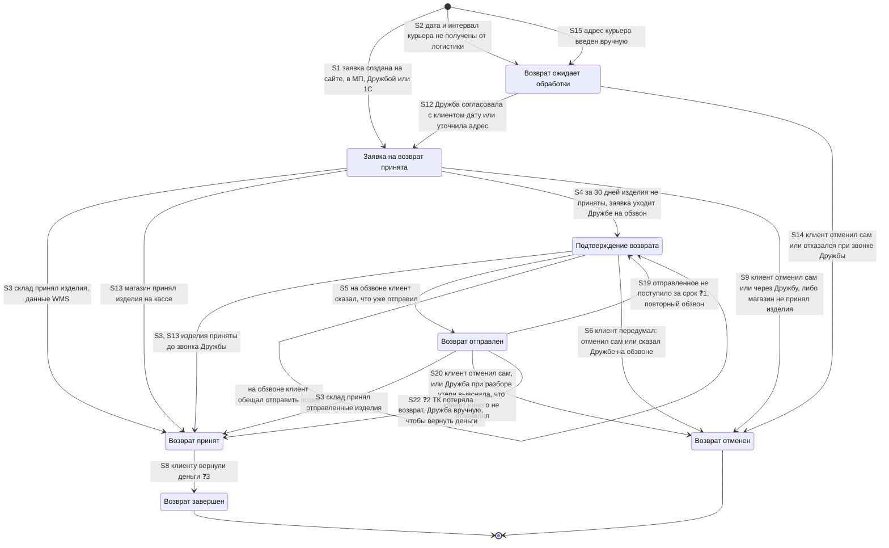
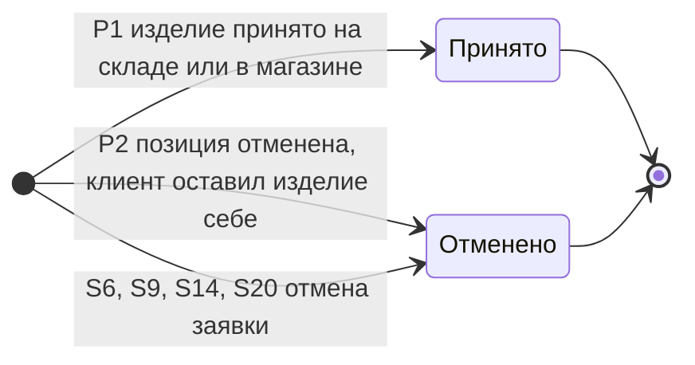
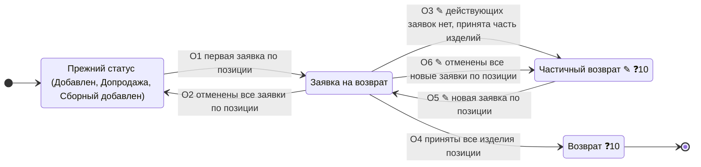

# Статусы возврата (TO-BE, MVP) — заявка, позиция возврата, позиция исходного заказа

**Тип:** диаграмма состояний трех уровней: заявка на возврат (возвратный заказ), позиция возврата, позиция исходного заказа.

**Обозначения:**

- без пометки — согласованный статус или переход, основание — в колонке «Основание» или в тексте;
- ✎ — предложение, не утверждено (`ADR-RET-073`, «Предложено»);
- ❓N — не определено, N — номер вопроса в разделе «Открытые вопросы».

**Общие правила:**

- Статус исходного заказа при возврате не меняется и остается «Выполнен» (`ADR-RET-019`, `ADR-RET-039`).
- В MVP интеграции с ТК нет: статусы заявки двигают вручную склад, магазин и Дружба (`ADR-RET-017`, `ADR-RET-084`).
- Автоотмены в MVP нет (`ADR-RET-053`).
- У заявки два слоя статусов — клиентский и внутренний. Оба слоя ведутся на сайте, в RetailCRM и в 1С, внутренние статусы передаются между системами (`ADR-RET-084`).

## 1. Заявка на возврат

### 1.1 Диаграмма (внутренние статусы)

Основа — схема статусов из Miro: [Статусы.png](<../../../sources/Статусы.png>). Состав статусов и слои — `ADR-RET-084`. Схема заявки согласована 21.10.2026, кроме пунктов с ❓.

### 1.2 Статусы

| Статус | Слой | Когда | Кто переводит | Что видит клиент | Допускает отмену | Основание |
|---|---|---|---|---|---|---|
| Возврат ожидает обработки | Клиентский и внутренний | Заявка создана способом «Курьер», но дату и интервал приезда курьера от логистики получить не удалось — логистика вернула ошибку или ответ без дат. Или адрес введен вручную, без выбора из подсказок геосервиса: по такому адресу даты и интервалы у логистики не запрашиваются, причина «проверить адрес» передается в RetailCRM. Дружба звонит клиенту, уточняет адрес и согласует дату и интервал | Система | «Возврат ожидает обработки» | Да — клиент и Дружба | `ADR-RET-074`, `ADR-RET-075`, `ADR-RET-084`; заказы — [статусы заказа AS-IS, §1](<../../../../../knowledge/12storeez-master-web/features/order-status_state.md>) |
| Заявка на возврат принята | Клиентский и внутренний | Заявка создана на сайте, в МП, Дружбой по звонку клиента или 1С при возврате в магазине без заявки (`ADR-RET-051`). После «Возврат ожидает обработки» — когда Дружба согласовала дату или уточнила адрес | Система, Дружба (S12) | «Заявка на возврат принята» | Да — клиент и Дружба | `ADR-RET-084` |
| Подтверждение возврата | Внутренний | 30 дней после создания изделия не приняты на складе и в магазине. По этому статусу Дружба отбирает заявки для обзвона | ❓1 сайт или RetailCRM | «Заявка на возврат принята» | Да — клиент и Дружба | `ADR-RET-053`, `ADR-RET-084`, `ADR-RET-082` |
| Возврат отправлен | Внутренний | Клиент на обзвоне сказал, что отправил. Статус информационный: клиентский статус не меняет | Дружба | «Заявка на возврат принята» | Да — клиент и Дружба | `ADR-RET-053`, `ADR-RET-084`, `ADR-RET-082` |
| Возврат принят | Клиентский и внутренний | Склад принял изделия — по данным WMS — или магазин принял изделия, и по всем позициям есть итог: принято или отменено. При утере возврата ТК — Дружба вручную, без поступления изделий ❓2 | Склад (WMS), магазин, Дружба | «Возврат принят» | Нет | `ADR-RET-084`, `ADR-RET-083`, `ADR-RET-088` |
| Возврат завершен | Клиентский и внутренний | Деньги возвращены. Если часть изделий принята, а остальные отменены, заявка тоже получает «Возврат завершен», итог виден по позициям | ❓3 | «Возврат завершен» | Нет | `ADR-RET-084` |
| Возврат отменен | Клиентский и внутренний | Заявку отменили клиент, Дружба или магазин. Магазин отменяет заявку, когда клиент принес не те изделия или магазин их не принял. Если клиент ничего не принес, заявку отменяет Дружба после 30 дней без движения или клиент сам | Клиент, Дружба, магазин | «Возврат отменен» | — | `ADR-RET-084`, `ADR-RET-082` |

### 1.3 Правила заявки

| Правило | Что действует | Основание |
|---|---|---|
| Отмена заявки | Клиент отменяет заявку в ЛК или МП в любом статусе до «Возврат принят». В остальных случаях заявку отменяют вручную Дружба или магазин. Магазин отменяет заявку своего магазина, если клиент принес не те изделия или магазин их не принял. Заявку с другим способом возврата, например курьерскую, магазин не меняет и не отменяет: принимает возврат без заявки, а курьерскую заявку отменяют клиент или Дружба. После «Возврат принят» заявку не отменяет никто | `ADR-RET-082`, `ADR-RET-084`, `ADR-RET-085` |
| Отмена без причины | Отмена фиксируется без причины. Клиент видит «Возврат отменен»; если заявку отменил не он, Дружба связывается с клиентом и объясняет | `ADR-RET-084` |
| Приемка | Приемка и экспертиза — один этап. Склад принимает все, что пришло по заявке, включая брак; отказа после приемки нет. В магазине приемка — физическая проверка изделия сотрудником при клиенте, а не отметка в системе. По ее итогу сотрудник либо принимает изделие, либо не принимает — например, если нельзя подтвердить, что оно куплено в 12 STOREEZ. Если не принимает — отменяет заявку, когда она оформлена в этот магазин. После приемки в системе отказа нет | `ADR-RET-083`, `ADR-RET-084` |
| Баллы | Баллы возвращаются при «Возврат принят». Деньги возвращаются отдельным процессом | `ADR-RET-084` |
| Утеря возврата | Утеря после передачи в ТК — не проблема клиента: если ТК подтверждает, что забрала посылку, клиенту возвращают деньги. Если клиент сообщает, что ничего не отправлял, заявка получает «Возврат отменен». Утерю разбирает Дружба вручную, клиенту она не показывается. Отдельного статуса нет: заявка остается в «Возврат отправлен». Чтобы запустить возврат денег, Дружба вручную переводит ее в «Возврат принят», без поступления изделий; после возврата денег — «Возврат завершен». Порядок возврата денег при утере подтверждает Отдел дружбы — ❓2. Попадание в реестр бухгалтерии — ❓3 | `ADR-RET-084` |
| Названия для клиента | Клиентские названия статусов пишутся без буквы «е»: «Возврат отменен», «Возврат завершен». Во внутренних названиях «е» допустима. В клиентских текстах вместо «товар» пишется «изделие» | `ADR-RET-084` |
| Статусы курьера и ТК | Клиенту в MVP не показываются. После интеграции с ТК появятся внутренние статусы перевозки | `ADR-RET-084` |

### 1.4 Переходы

| № | Из | В | Событие |
|---|---|---|---|
| S1 | — | Заявка на возврат принята | Заявка создана на сайте, в МП, Дружбой по звонку клиента или 1С при возврате в магазине без заявки |
| S2 | — | Возврат ожидает обработки | Заявка создана способом «Курьер», но дату и интервал приезда курьера от логистики получить не удалось — логистика вернула ошибку или ответ без дат |
| S15 | — | Возврат ожидает обработки | Заявка создана способом «Курьер», адрес введен вручную |
| S12 | Возврат ожидает обработки | Заявка на возврат принята | Дружба согласовала с клиентом дату и интервал или уточнила адрес |
| S3 | Заявка на возврат принята, Подтверждение возврата, Возврат отправлен | Возврат принят | Склад принял изделия — по данным WMS |
| S13 | Заявка на возврат принята, Подтверждение возврата | Возврат принят | Магазин принял изделия, по всем позициям есть итог: принято или отменено. Если клиент сдал часть изделий и обещает донести остальные, заявка остается в прежнем статусе |
| S4 | Заявка на возврат принята | Подтверждение возврата | 30 дней без приемки на складе или в магазине. Если изделия приняты до звонка Дружбы — S3 или S13 |
| S5 | Подтверждение возврата | Возврат отправлен | Клиент на обзвоне сказал, что отправил |
| — | Подтверждение возврата | Подтверждение возврата | Клиент отправит позже |
| S19 | Возврат отправлен | Подтверждение возврата | Изделия так и не поступили за срок ❓1: заявка снова попадает к Дружбе на обзвон |
| S8 | Возврат принят | Возврат завершен | Деньги возвращены ❓3. При обмене без возврата денег — ❓4 |
| S14 | Возврат ожидает обработки | Возврат отменен | Отмена клиентом или Дружбой |
| S9 | Заявка на возврат принята | Возврат отменен | Отмена клиентом, Дружбой или магазином: магазин отменяет, когда клиент принес не те изделия или магазин их не принял |
| S6 | Подтверждение возврата | Возврат отменен | Клиент передумал: отмена клиентом или Дружбой |
| S20 | Возврат отправлен | Возврат отменен | Клиент отменил сам в ЛК или МП, или Дружба при разборе утери выяснила, что клиент ничего не отправлял. Повторный обзвон — после возврата в «Подтверждение возврата» (S19), отмена по нему — S6 |
| S22 ❓2 | Возврат отправлен | Возврат принят | ТК подтвердила, что забрала посылку и потеряла ее. Дружба вручную, без поступления изделий, чтобы запустить возврат денег. Дальше — S8 |

### 1.5 Пути заявки по способам возврата (MVP)

| Способ | Путь |
|---|---|
| Курьер, СДЭК, 5Post, Почта России | Заявка на возврат принята → Возврат принят → Возврат завершен |
| Курьер: дата и интервал не получены от логистики | Возврат ожидает обработки → Заявка на возврат принята → далее как у курьера / Возврат отменен |
| Курьер: адрес введен вручную | Возврат ожидает обработки → Заявка на возврат принята → далее как у курьера / Возврат отменен |
| Магазин 12 STOREEZ по заявке | Заявка на возврат принята → Возврат принят (в магазине) → Возврат завершен |
| Магазин: клиент сдал часть изделий, остальные не принесет | Заявка на возврат принята → магазин отмечает несданные позиции «Отменено» → Возврат принят → Возврат завершен |
| Нет приемки 30 дней | Заявка на возврат принята → Подтверждение возврата → Возврат отправлен → Возврат принят → … / Возврат отменен |
| Магазин без заявки (`ADR-RET-051`) | 1С создает заявку после возврата: Заявка на возврат принята → Возврат принят → Возврат завершен |
| Заявка, созданная Дружбой по звонку | Заявка на возврат принята → далее по способу возврата |
| Утеря после отправки | Возврат отправлен → Возврат принят (Дружба вручную) ❓2 → Возврат завершен; если клиент ничего не отправлял — Возврат отменен |

## 2. Позиция возврата

Статусы позиции возврата нужны, чтобы видеть частичную приемку. У позиции два статуса — «Принято» и «Отменено». При создании заявки статус позиции не задается (пусто) и появляется, когда позицию приняли или отменили. Клиенту статусы позиций в ходе обработки не показываются (`ADR-RET-084`). При утере — ❓5.

Статусы позиции возврата согласованы 21.10.2026.

**Статус позиции по сценариям**

| Сценарий | Статус позиции | Статус заявки |
|---|---|---|
| Изделия поступили на склад | Все позиции заявки — «Принято», включая заявленные, но не пришедшие (недостача): склад принимает все заявленное. Отмена непришедших позиций складом — после доработки процесса склада | «Возврат принят» |
| Магазин принял все изделия заявки | Все позиции — «Принято» | «Возврат принят» |
| Клиент сдал в магазине часть изделий и донесет остальные | Сданные — «Принято», остальные — без статуса | «Заявка на возврат принята» |
| Клиент сдал в магазине часть изделий, остальные оставляет себе | Сданные — «Принято», остальные — «Отменено» (P2); несданные отмечает магазин при приёмке | «Возврат принят», после возврата денег — «Возврат завершен» |
| Магазин не принял изделие: нельзя подтвердить, что оно куплено в 12 STOREEZ | «Отменено» | Не принято ни одно изделие — «Возврат отменен». Принята часть — как при частичной сдаче; непринятую позицию отмечает магазин при приёмке |
| Клиент ничего не сдал | Все позиции — «Отменено» при отмене заявки | Через 30 дней — «Подтверждение возврата», Дружба звонит клиенту и отменяет заявку, либо клиент отменяет сам — «Возврат отменен» |

## 3. Позиция исходного заказа

| Переход | Правило | Основание |
|---|---|---|
| O1 | При первой заявке по позиции заказа позиция получает «Заявка на возврат» | `ADR-RET-039` |
| O2 | При отмене позиция заказа возвращается в прежний статус. Только если по позиции не осталось других заявок, кроме отмененных | Схема Miro; `ADR-RET-039`; ✎ `ADR-RET-073` |
| O3 ✎ | По позиции заказа нет действующих заявок, принята часть изделий — «Частичный возврат» | `ADR-RET-073` |
| O4 | Приняты все изделия позиции заказа — «Возврат». Название — ❓10. ✎ Условие «все изделия позиции» | `ADR-RET-039`; ✎ `ADR-RET-073` |
| O5 ✎ | Новая заявка по позиции заказа в статусе «Частичный возврат» — снова «Заявка на возврат» | `ADR-RET-073` |
| O6 ✎ | Позиция была «Частичный возврат», по ней создали новую заявку, и все новые заявки отменили — позиция возвращается в «Частичный возврат» | Правило O2 для статуса O3 ✎; `ADR-RET-073` |

✎ По `ADR-RET-073` статус позиции исходного заказа — только отметка для Дружбы, RetailCRM и Mindbox; доступность изделий для возврата считается по заявкам. До принятия `ADR-RET-073` действует `ADR-RET-065`: после первой заявки оставшиеся изделия позиции возвращаются через Дружбу.

Статус позиции исходного заказа должен вестись в RetailCRM — Дружба работает с исходным заказом (требование, 21.10). В 1С при возврате в магазине — по-хорошему, тоже (1C Solution Architect); не подтверждено. Сейчас в 1С строка заказа при клиентском возврате статус не меняет; переделка заложена в оценку 1С. Lead Business Analyst 1C проверяет, на что в 1С влияют новые статусы заказа и строк. Подсчет остатка позиции на сайте 1C Solution Architect не поддерживает — ❓7.

Коды статусов позиции — новые, коды 5 и 9 не используются (`ADR-RET-080`); статусы для Mindbox — ❓8.

## 4. Связь уровней по событиям

События — в порядке процесса.

| Событие | Заявка | Позиция возврата | Позиция исходного заказа |
|---|---|---|---|
| S1 Заявка создана | «Заявка на возврат принята» | без статуса | «Заявка на возврат» (O1, или O5 ✎ из «Частичный возврат»); без изменений, если по позиции уже есть действующая заявка |
| S2 Заявка создана, дата и интервал курьера не получены от логистики | «Возврат ожидает обработки» | без статуса | «Заявка на возврат» (O1, или O5 ✎ из «Частичный возврат»); без изменений, если по позиции уже есть действующая заявка |
| S15 Заявка создана, адрес курьера введен вручную | «Возврат ожидает обработки» | без статуса | «Заявка на возврат» (O1, или O5 ✎ из «Частичный возврат»); без изменений, если по позиции уже есть действующая заявка |
| S12 Дружба согласовала дату и интервал курьера или уточнила адрес | «Заявка на возврат принята» | без изменений | без изменений |
| S4 30 дней без приемки | «Подтверждение возврата» | без изменений | без изменений |
| S5 Клиент на обзвоне сказал, что отправил | «Возврат отправлен» | без изменений | без изменений |
| P1 Изделие принято на складе или в магазине | без изменений, пока не по всем позициям есть итог | «Принято» | «Частичный возврат» (O3 ✎) или «Возврат» (O4), когда по позиции не осталось действующих заявок |
| P2 Позиция отменена, клиент оставил изделие себе | без изменений, пока не по всем позициям есть итог | «Отменено» | прежний статус (O2) или «Частичный возврат» (O6 ✎), если по позиции не осталось действующих заявок |
| S3, S13 Изделия приняты, по всем позициям есть итог | «Возврат принят» | «Принято» или «Отменено» | «Частичный возврат» (O3 ✎) или «Возврат» (O4) |
| S8 Деньги возвращены | «Возврат завершен» ❓3 | без изменений | без изменений |
| S6, S9, S14, S20 Отмена заявки | «Возврат отменен» | «Отменено» | прежний статус (O2) или «Частичный возврат» (O6 ✎), если по позиции не осталось действующих заявок; иначе без изменений |
| S22 ❓2 ТК потеряла возврат, Дружба вручную | «Возврат принят» | ❓5 | ❓9 |

✎ При сдаче в магазине без заявки, пока курьерскую заявку не отменили, по позиции исходного заказа две действующие заявки: позиция остается «Заявка на возврат» и получает «Возврат» (O4) только после отмены курьерской заявки — следствие правила P1.

## 5. Открытые вопросы

Ход обсуждения — разборы встреч 21.10.2026: [утро](<../../../meetings/[2026-10-21 12-03] Статусная модель по возвратам_summary.md>), [вечер](<../../../meetings/[2026-10-21 16-30] Статусная модель. Продолжение_summary.md>).

### Заявка на возврат

**1. Какая система делает оба перевода в «Подтверждение возврата» — сайт или RetailCRM — и через какой срок?** Оба перевода — через срок после создания заявки и повторный после «Возврат отправлен» — делает одна система (решено). Склонялись к 30 дням в обоих случаях; срок фиксируется вместе с выбором системы на встрече 22.10.2026.

- а) сайт
- б) RetailCRM

**2. Какой порядок разбора утери и возврата денег у Отдела дружбы?** Отдельного статуса для утери нет: заявка остается в «Возврат отправлен», дальше — «Возврат принят» или «Возврат отменен», если клиент ничего не отправлял. Отдела дружбы на встрече не было; вопрос к нему — 22.10.2026. У заказов есть отдельный статус «Возврат утерян», клиент в нем видит «Оформлен возврат».

**3. По какому событию заявка получает «Возврат завершен», и кто его фиксирует, если интеграции с платежными сервисами нет?**

- направление (1C Solution Architect): событие из 1С по признаку возврата денег; какой это признак и кто его ставит, не определено — разговор с финансами и Дружбой; признак может появиться и до приемки;
- вариант для текущего этапа (Head of PMO): финальным для клиента показывать «Возврат принят» с текстом, что деньги придут в срок банка; «Возврат завершен» — когда появится интерфейс или интеграция для отметки обратного платежа. Сама Head of PMO не уверена, этот этап или будущий.

Сейчас бухгалтерия возвращает деньги по реестрам из 1С: отдельно по возвратам магазинов и склада, отдельно — по реестру Дружбы. В какой реестр и на каком основании попадает возврат по утерянной посылке, если изделия на склад не поступили?

**4. Какой финальный статус у заявки при обмене, когда деньги не возвращаются?** Обмен оформляется только через Дружбу.

- направление (предложил 1C Solution Architect): у заявки признак «деньги не возвращать»; при «Возврат принят» такая заявка сразу получает «Возврат завершен»; клиенту — приписка «По этому возврату произведен обмен» — доработка сверх изначального плана;
- Head of PMO — вернуться к обсуждению обменов с RetailCRM; System Analyst BTS — перепроверить, что обмены не сломаются; 1C Solution Architect — как признак будет в RetailCRM, вопрос к RetailCRM.

### Позиция возврата

**5. Получают ли позиции возврата «Принято», когда Дружба при утере переводит заявку в «Возврат принят»?**

**6. Как клиент видит принятые и отмененные позиции в итоговой заявке?** Макет нужен, его пока нет. Вариант Head of PMO — как у Lamoda: непринятое изделие показано неактивным с пометкой «не принято». Визуал — уточнить у Ромы.

### Позиция исходного заказа

**7. Как не дать вернуть больше штук, чем в позиции исходного заказа, если в позиции несколько штук?** Несколько штук хранятся в одной позиции. Статус «Заявка на возврат» не показывает, сколько штук еще можно вернуть. Такие заказы — меньше 1%. Вопрос взял 1C Solution Architect вместе с командой сайта.

- считать остаток по заявкам: количество в позиции минус штуки в заявках — предлагали System Analyst BTS и System Analyst; ограничение — количество в позиции заказа. 1C Solution Architect против: сайт не должен вычислять остаток по истории заявок
- промежуточные таблицы между позициями заказа и позициями возврата — предложила System Analyst BTS; 1C Solution Architect отклонил: это то же вычисление, только закешированное
- временно: пока позиция в статусе «Заявка на возврат», новую заявку по ней не разрешать — предлагает 1C Solution Architect

**8. Какие статусы Mindbox отправлять для заказа «Выполнен» вместе с новыми статусами позиции (`cms_mb_statuses_map`)?**

**9. Получает ли позиция исходного заказа при утере возврата «Частичный возврат» или «Возврат», как при обычной приемке?** System Analyst предположила: при утере позиция считается как при успешном возврате — виноват уже не клиент.

**10. Подтвердите названия статусов позиции исходного заказа: «Заявка на возврат», «Частичный возврат», «Возврат».** «Возврат» вместо «Полный возврат» предложили 21.10 Head of PMO и System Analyst BTS: «Полный возврат» у каждой из разных позиций путает. В `ADR-RET-039` финальный статус назван «Возвращено» — после подтверждения обновить `ADR-RET-039`. Таблицу названий отправляем в чат Роме и Кате Филатовой.
Старые статусы заказа с похожими названиями останутся у заказов, оформленных до запуска. Нужно ли их различать с новыми статусами позиции в RetailCRM, 1С и Mindbox?

## 6. Связанные артефакты

- ADR: `ADR-RET-017`, `ADR-RET-019`, `ADR-RET-039`, `ADR-RET-051`, `ADR-RET-053`, `ADR-RET-065`, `ADR-RET-066` (заменен `ADR-RET-085`), `ADR-RET-070`, `ADR-RET-073`, `ADR-RET-074`, `ADR-RET-075`, `ADR-RET-080`, `ADR-RET-081` (заменен `ADR-RET-084`), `ADR-RET-082`, `ADR-RET-083`, `ADR-RET-085`, `ADR-RET-086` (предложено), `ADR-RET-087` — [adr/](../../adr/).
- BRD: `RULE-28`, `RULE-29`, `FR-28`, `FR-29`, `FR-52`, `OQ-1` — [brd.md](../../brd.md).
- User Story: US1, US3, US4 — [user-story-mvp.md](../../user-story/user-story-mvp.md); US16 — [user-story-post-mvp.md](../../user-story/user-story-post-mvp.md).
- Модель данных: `cms_return_statuses`, `cms_return_positions`, `cms_return_position_statuses` — [ERD](../erd/return-entity_erd_merged.md).
- Разборы встреч — [21.10.2026, утро](<../../../meetings/[2026-10-21 12-03] Статусная модель по возвратам_summary.md>), [21.10.2026, вечер](<../../../meetings/[2026-10-21 16-30] Статусная модель. Продолжение_summary.md>).

## Приложение. Статусы в коде монолита (AS-IS)

Справочно: что сейчас есть в коде монолита и на что повлияют новые статусы. Используется для проверки по коду.

Сущности возврата в монолите нет, она проектируется в [ERD](../erd/return-entity_erd_merged.md).
Ниже — статусы заказа и позиций, которые сейчас участвуют в возврате.

### Где хранится статус позиции заказа

- Поле `cms_order_positions.status` (integer) содержит `internal_id` справочника `order_position_statuses`.
- Поля справочника: `title`, `code`, `cancel_status`, `active`, `internal_id` — `modules/statuses/models/OrderPositionStatus.php:11-21`.
- `code` — код статуса RetailCRM: обмен сопоставляет `code ↔ internal_id` (`src/Modules/Order/Repository/OrderPositionStatusRepository.php`, `RcrmOrderPositionTransformer.php:29-35`).
- Статус Mindbox по каждой позиции берется из `cms_mb_statuses_map` по паре «статус заказа + статус позиции»; если пары нет — уходит `101` (`src/Modules/Mindbox/Transformer/MindboxOrderPositionToDtoTransformer.php:37-81`).

### Коды позиций, связанные с возвратом (`modules/orders/models/OrderPosition.php:113-130`)

Названия — из [справочника статусов](../../../../../knowledge/12storeez-master-web/database/order-status-dictionaries.md).

| Код | Константа | Что известно из кода |
|---|---|---|
| 1, 2, 8, 10, 11 | `STATUS_ADDED` «Добавлен», `STATUS_CROSSSELL` «Допродажа», `STATUS_SALED` «Продан» (`active = 0`), `STATUS_IN_RESERVE` «ПРЕДЗАКАЗ» (`active = 0`), `STATUS_COLLECTIVE_ADDED` «Сборный добавлен» | «Активная» позиция — `OrderPosition::isActive()` (`:678-686`) |
| 5 | `STATUS_RETURNED` «Возврат (отгруженного)», `code = returned`, `active = 0` | Считается возвращенной — `OrderPosition::isReturned()` (`:674-676`) |
| 9 | `STATUS_LOST` «ВОЗВРАТ (если был отгружен)», `code = lost` | Ставится при подаче заявки из ЛК — `OrderRefundService::prepareRefundPositionOrder` (`src/Modules/Order/Services/OrderRefundService.php:90`) |
| 13 | `STATUS_CHANGE` «Обмен» | Обмен |
| 14 | `STATUS_CANCELED` «Отменен» | Отменена |

### Статус заказа при возврате сейчас

- При подаче заявки из ЛК заказ получает `31` «Возврат из ЛК» (`OrderRefundService.php:109`).

**Как монолит обрабатывает статусы от 1С** (`src/Modules/Order/Services/Inbox/OrderUpdateService.php`, `api2/orders/order-update`):

1. 1С присылает в поле `status` код статуса строкой — значение колонки `code` справочника `cms_order_statuses` (например, `9183`), а не `internal_id`.
2. Монолит ищет в справочнике строку с этим `code` и `active = 1` (`OrderStatusRepository::getActiveOrderStatusByCode`), берет ее `internal_id` и записывает в `cms_orders.status`, если значение отличается от текущего (`handleStatus`, `:293-315`).
3. Допустимость перехода из текущего статуса не проверяется. Исключение: код «Предзаказ обеспечен товаром» записывается как `8` (`:304-307`).
4. Если кода нет в справочнике или он неактивен, проверки на пустой результат нет: следующей строкой берется `internal_id` у пустого значения.
5. Статусы позиций обрабатываются так же: код из `cms_order_position_statuses` переводится в `internal_id` (`updatePositions`, `:716-742`).

**Возвратные статусы заказа из 1С** (`OrderDictionary::getStatusesReturnedFromOdinAss()`, `modules/orders/dictionaries/OrderDictionary.php:44-57`). Если заказ в одном из этих статусов, а 1С прислала позицию в статусе «Добавлен», статус позиции не перезаписывается — позиция, оформленная к возврату, не откатывается (`OrderUpdateService.php:732-737`). Названия — из справочника статусов заказа:

| `internal_id` | Код от 1С (`code`) | Константа | Внутреннее название | Что видит клиент |
|---|---|---|---|---|
| 20 | `9183` | `REFUND_REQUEST_TRANSMITTED` | Возврат принят и внесен в базу | Возврат принят |
| 21 | `9182` | `REFUND_REQUEST_COMPLETED` | Возврат денежных средств осуществлен | Возврат денежных средств осуществлен |
| 22 | `9120` | `REFUND_REQUEST_FINISHED` | Возврат выполнен | Возврат выполнен |
| 29 | `vpost` | `ITEM_DIAGNOSTED` | Возврат поступил | Заявка на возврат принята |
| 31 | `vozv-lk` | `ORDER_RETURNED_LK` | Возврат из ЛК | Заявка на возврат принята |
| 34 | `vosm` | `VOSM` | Возврат осмотрен | Заявка на возврат принята |
| 40 | `vpm` | `RETURN_IN_SHOP` | Возврат поступил в магазин | Возврат поступил в магазин |
| 53 | `request-for-details` | `NEED_REQUESITS` | Запрос реквизитов | Запрос реквизитов |
| 75 | `vozvrat-iz-lk-v-rabote` | `RETURN_LK_IN_WORK` | Возврат из ЛК в работе | Звонок клиенту |

- В TO-BE статус заказа не меняется и остается «Выполнен» (`ADR-RET-039`).

### Что завязано на коды 5 и 9

| Логика | Где | Эффект |
|---|---|---|
| Сумма к оплате и сумма возврата в ЛК / МП | `OrderService::getPaymentDataDto` (`modules/orders/services/OrderService.php:159-170`) | позиции 5 и 9 исключаются из суммы заказа и считаются суммой возврата |
| Пересчет суммы заказа из RetailCRM | `OrderService.php:735-743` | позиции 5 и 9 не входят в сумму |
| Обмен с 1С | `OneCExchangeTransformer.php:308-312` | позиции 5 и 9 уходят с признаком `return = true` |
| Обмен с RetailCRM | `RcrmOrderTransformer.php:287-294` | причины возврата позиций 5 и 9 — в поля `prichina_vozv`, `pvt2…` |
| Повторный возврат из МП | `src/Modules/Mobile/Controllers/OrdersController.php:569-573` | позиция с кодом 9 повторно не возвращается |
| Блокировка оплаты наличными | `User::isBlockForCashPay` (`modules/users/models/User.php:1031-1035`) | позиции с кодом 9 участвуют в блокировке клиента |
| Lamoda | `LamodaOrderOutboxService.php:316-318` | код 9 → `CLAIMED_OK` |

Для нового процесса заводятся новые коды статусов позиции (`ADR-RET-080`). Логику из таблицы выше и строки
`cms_mb_statuses_map` нужно дополнить для новых кодов.
