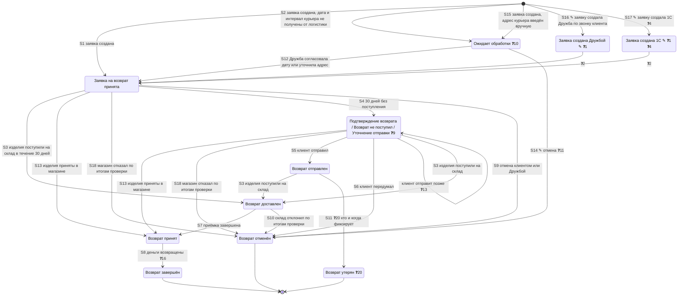
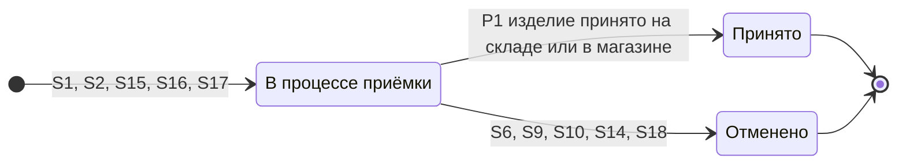
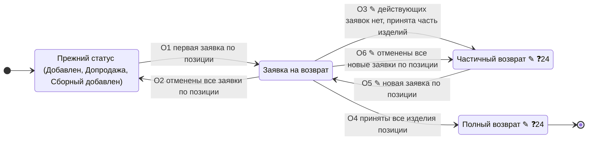

# Статусы возврата (TO-BE, MVP) — заявка, позиция возврата, позиция исходного заказа

**Тип:** диаграмма состояний трёх уровней: заявка на возврат (возвратный заказ), позиция возврата, позиция исходного заказа.

**Обозначения:**
- без пометки — статус или переход взят со встреч или со схемы Miro (источник — в таблицах ниже);
- ✎ — предложение автора бандла, на встречах не обсуждалось и не утверждено (`ADR-RET-073`, «Предложено»); если вариантов несколько через «/», нужно выбрать один;
- ❓N — не определено, N — номер вопроса в разделе «Открытые вопросы».

Схема статусов целиком ещё не подтверждена (вопрос 5).

**Общие правила:**
- Статус исходного заказа при возврате не меняется и остаётся «Выполнен» (`ADR-RET-019`, `ADR-RET-039`).
- В MVP интеграции с логистикой нет: статусы заявки двигают вручную склад, магазин и Дружба (`ADR-RET-017`, `ADR-RET-040`).
- Автоотмены в MVP нет (`ADR-RET-053`).

## 1. Заявка на возврат

### 1.1 Диаграмма

Основа — схема статусов из Miro, которую показывали на встрече 08.10.2026: Статусы.png. Статус «Ожидает обработки» добавлен по решению 15.10.2026, на схеме его нет.

Названия статусов «Ожидает обработки» и «Подтверждение возврата» не утверждены. У «Подтверждения возврата» варианты перечислены через «/»: первым — название со встреч, остальные ✎ — предложения автора бандла.

### 1.2 Статусы

#|
|| **Статус** | **Когда** | **Кто переводит** | **Видит клиент** | **Допускает отмену** | **Источник** ||
|| Заявка на возврат принята | Заявка создана в ЛК или МП. Заявка, созданная Дружбой или 1С, ✎ сначала получает свой статус ❓1 | Система | Да | Да — клиент ❓14 | Схема Miro; Встреча 08.10, `00:08:55–00:09:12`, `00:15:55` ||
|| Заявка создана Дружбой ✎ ❓1 | Отдел дружбы с клиентами оформил заявку по звонку клиента | Система | ❓3 | Как у «Заявка на возврат принята» ✎ | Предложение автора бандла ||
|| Заявка создана 1С ✎ ❓1 | Заявку создала 1С, например при возврате в магазине без заявки (`ADR-RET-051`) ❓4 | Система | ❓3 | Как у «Заявка на возврат принята» ✎ | Предложение автора бандла ||
|| Ожидает обработки ❓10 | Заявка создана способом «Курьер», но дату и интервал приезда курьера от логистики получить не удалось — логистика вернула ошибку или ответ без дат. Дружба звонит клиенту и согласовывает дату и интервал.
Заявка создана способом «Курьер», адрес введён вручную, без выбора из подсказок геосервиса. Дружба звонит клиенту, уточняет адрес и согласует дату и интервал — как у заказа с адресом, введённым вручную; причина «проверить адрес» передаётся в RetailCRM. По такому адресу даты и интервалы у логистики не запрашиваются | Система | ❓6 | ✎ Да — ❓11 клиент или Дружба | `ADR-RET-075`; Встреча 15.10, `00:39:22–00:39:43`; название предлагалось — Встреча 14.10, `00:42:42`. Ручной адрес — `ADR-RET-074`; заказы — статусы заказа AS-IS, §1 ||
|| Подтверждение возврата / Возврат не поступил ✎ / Уточнение отправки ✎ ❓9 | 30 дней после создания, изделия не поступили на склад и не сданы в магазине | ❓12 система или RetailCRM | Нет ❓7 | Да — на схеме отмена Дружбой; ❓15 может ли клиент | Схема Miro; `ADR-RET-053`; Встреча 08.10, `00:09:12–00:10:13` ||
|| Возврат отправлен | Клиент на обзвоне сказал, что отправил | Дружба | Нет ❓7 | Нет | Схема Miro; `ADR-RET-053`; Встреча 08.10, `00:09:46–00:10:13` ||
|| Возврат доставлен | Изделия поступили на склад. Только для склада: в магазине изделия сразу принимаются | Склад, вручную | Да | Нет | Схема Miro; Встреча 08.10, `00:09:12`, `00:15:55` ||
|| Возврат принят | Приёмка завершена на складе или в магазине | Склад или магазин, вручную | Да | Нет | Схема Miro («В магазине / на складе»); Встреча 08.10, `00:09:12`, `00:17:01–00:18:22` ||
|| Возврат завершён | Деньги возвращены | ❓16 | Да | Нет | Схема Miro («Возврат ДС»); Встреча 08.10, `00:09:12`; `ADR-RET-040` ||
|| Возврат отменён | Отмена клиентом, Дружбой, складом или магазином по итогам проверки | Клиент, Дружба, склад, магазин | Да | — | Схема Miro; Встреча 08.10, `00:09:46`, `00:10:39–00:11:06`, `00:19:50–00:21:32`; `ADR-RET-041` ||
|| Возврат утерян ❓20 | Возврат утерян после отправки | ❓20 | ❓8 | Нет | Схема Miro («Заказ утерян?»); Встреча 08.10, `00:15:32–00:15:55` ||
|#

**Причина отмены.** На схеме Miro — вопрос «Используем статусы причин отмены для заказа возврата и для отмены по экспертизе?». На встрече 08.10 решили детализировать отмену причинами, как у заказов, если это просто (`00:19:50–00:21:32`). См. вопрос 19.

**Отказ склада и магазина.** Отдельного статуса отказа в возврате нет: отказ склада или магазина — «Возврат отменён» с причиной отмены (Встреча 08.10, `00:11:06`; `ADR-RET-041`).

**Статусы курьера и ТК** клиенту на первом этапе не показываются (Встреча 08.10, `00:16:20`).

### 1.3 Переходы

#|
|| **№** | **Из** | **В** | **Событие** ||
|| S1 | — | Заявка на возврат принята | Заявка создана ||
|| S16 ✎ | — | Заявка создана Дружбой ❓1 | Отдел дружбы с клиентами оформил заявку по звонку клиента. Дальше — ❓2 ||
|| S17 ✎ | — | Заявка создана 1С ❓1 | Заявку создала 1С ❓4. Дальше — ❓2 ||
|| S2 | — | Ожидает обработки ❓10 | Заявка создана способом «Курьер», но дату и интервал приезда курьера от логистики получить не удалось — логистика вернула ошибку или ответ без дат ||
|| S15 | — | Ожидает обработки | Заявка создана способом «Курьер», адрес введён вручную ||
|| S12 | Ожидает обработки | Заявка на возврат принята | Дружба согласовала с клиентом дату и интервал или уточнила адрес ||
|| S14 ✎ | Ожидает обработки | Возврат отменён | Отмена ❓11 ||
|| S3 | Заявка на возврат принята | Возврат доставлен | Изделия поступили на склад в течение 30 дней после создания заявки ||
|| S3 | Возврат отправлен | Возврат доставлен | Изделия поступили на склад после того, как клиент на обзвоне подтвердил отправку ||
|| S3 | Подтверждение возврата | Возврат доставлен | Изделия поступили на склад до звонка Дружбы: звонок клиенту не нужен ||
|| S13 | Заявка на возврат принята | Возврат принят | Изделия приняты в магазине. Отказ магазина — S18 ||
|| S13 | Подтверждение возврата | Возврат принят | Изделия приняты в магазине до звонка Дружбы ||
|| S4 | Заявка на возврат принята | Подтверждение возврата ❓9 | 30 дней без поступления. Если изделия поступят на склад или в магазин до звонка Дружбы — переходы S3 и S13 из «Подтверждения возврата» ||
|| S5 | Подтверждение возврата | Возврат отправлен | Клиент на обзвоне сказал, что отправил ||
|| — | Подтверждение возврата | Подтверждение возврата | Клиент отправит позже ❓13 ||
|| S6 | Подтверждение возврата | Возврат отменён | Клиент передумал ||
|| S7 | Возврат доставлен | Возврат принят | Приёмка завершена. Если часть изделий отклонена — ❓18 ||
|| S8 | Возврат принят | Возврат завершён | Деньги возвращены ❓16. При обмене без возврата денег — ❓17 ||
|| S9 | Заявка на возврат принята | Возврат отменён | Отмена клиентом или Дружбой ||
|| S10 | Возврат доставлен | Возврат отменён | Склад отклонил по итогам проверки. Причина отмены — ❓19 ||
|| S18 | Заявка на возврат принята, Подтверждение возврата | Возврат отменён | Магазин отказал в возврате по итогам проверки при приёмке. Причина отмены — ❓19 ||
|| S11 | Возврат отправлен | Возврат утерян | Утеря ❓20 ||
|#

### 1.4 Пути заявки по способам возврата (MVP)

#|
|| **Способ** | **Путь** ||
|| Курьер, СДЭК, 5Post, Почта России | Заявка на возврат принята → Возврат доставлен → Возврат принят → Возврат завершён ||
|| Курьер: дата и интервал не получены от логистики | Ожидает обработки ❓10 → Заявка на возврат принята → далее как у курьера / Возврат отменён ✎ ❓11 ||
|| Курьер: адрес введён вручную | Ожидает обработки → Заявка на возврат принята → далее как у курьера / Возврат отменён ✎ ❓11 ||
|| Магазин 12 STOREEZ по заявке | Заявка на возврат принята → Возврат принят (в магазине) → Возврат завершён ||
|| Нет поступления 30 дней | Заявка на возврат принята → Подтверждение возврата → Возврат отправлен → Возврат доставлен → … / Возврат отменён ||
|| Магазин без заявки (`ADR-RET-051`) | Заявка создаётся после возврата: Заявка создана 1С ✎ ❓4 → ❓2 ||
|| Заявка, созданная Дружбой по звонку | Заявка создана Дружбой ✎ ❓1 → ❓2 → далее по способу возврата ||
|#

## 2. Позиция возврата

Два статуса позиции возврата нужны, чтобы видеть частичную приёмку (`ADR-RET-040`; Встреча 02.10, `00:09:06–00:09:53`). При отмене заявки позиция получает «Отменено», при утере — ❓21.

## 3. Позиция исходного заказа

#|
|| **Переход** | **Правило** | **Источник** ||
|| O1 | При первой заявке по позиции позиция получает «Заявка на возврат». На схеме Miro — «меняем статус позиции заказа», статус «(какой??)» | `ADR-RET-039`; Встреча 02.10, `00:08:22–00:08:50`; Статусы.png ||
|| O2 | При отмене позиция возвращается в прежний статус | Схема Miro («Возвращаем предыдущий»); Встреча 12.10, `00:45:17–00:45:42`. ✎ Уточнение автора: только если по позиции не осталось других заявок, кроме отменённых (`ADR-RET-073`) ||
|| O3 ✎ | По позиции нет действующих заявок, принята часть изделий — «Частичный возврат» | Предложение автора бандла, `ADR-RET-073` ||
|| O4 | Приняты все изделия позиции — «Полный возврат» | Статус «Возвращено» — `ADR-RET-039` (Встреча 02.10, `00:08:50`). ✎ Название «Полный возврат» — предложение автора бандла ❓24. ✎ Условие «все изделия позиции» — `ADR-RET-073` ||
|| O5 ✎ | Новая заявка по позиции в статусе «Частичный возврат» — снова «Заявка на возврат» | Предложение автора бандла, `ADR-RET-073` ||
|| O6 ✎ | Позиция была «Частичный возврат», по ней создали новую заявку, и все новые заявки отменили — позиция возвращается в «Частичный возврат» | Правило O2 «возвращаем предыдущий» для статуса O3 ✎; `ADR-RET-073` ||
|#

✎ По `ADR-RET-073` статус позиции исходного заказа — только отметка для Дружбы, RetailCRM и Mindbox; доступность изделий для возврата считается по заявкам. До принятия `ADR-RET-073` действует `ADR-RET-065`: после первой заявки оставшиеся изделия позиции возвращаются через Дружбу.

Коды статусов позиции — новые, коды 5 и 9 не используются (`ADR-RET-080`); статусы для Mindbox — ❓22.

## 4. Связь уровней по событиям

События — в порядке процесса.

#|
|| **Событие** | **Заявка** | **Позиция возврата** | **Позиция исходного заказа** ||
|| S1 Заявка создана | «Заявка на возврат принята» | «В процессе приёмки» | O1 или O5 ✎; без изменений, если по позиции уже есть действующая заявка ||
|| S2 Заявка создана, дата и интервал курьера не получены от логистики | «Ожидает обработки» ❓10 | «В процессе приёмки» | O1 или O5 ✎; без изменений, если по позиции уже есть действующая заявка ||
|| S15 Заявка создана, адрес курьера введён вручную | «Ожидает обработки» | «В процессе приёмки» | O1 или O5 ✎; без изменений, если по позиции уже есть действующая заявка ||
|| S16 ✎ Дружба создала заявку по звонку | «Заявка создана Дружбой» ❓1 | «В процессе приёмки» | O1 или O5 ✎; без изменений, если по позиции уже есть действующая заявка ||
|| S17 ✎ 1С создала заявку | «Заявка создана 1С» ❓1 | «В процессе приёмки» ❓4 | O1 или O5 ✎; без изменений, если по позиции уже есть действующая заявка ||
|| S12 Дружба согласовала дату и интервал курьера или уточнила адрес | «Заявка на возврат принята» | без изменений | без изменений ||
|| S4 30 дней без поступления | «Подтверждение возврата» ❓9 | без изменений | без изменений ||
|| S5 Клиент на обзвоне подтвердил отправку | «Возврат отправлен» | без изменений | без изменений ||
|| S3 Изделия поступили на склад | «Возврат доставлен» | без изменений | без изменений ||
|| P1 Изделие принято на складе или в магазине | без изменений, пока приняты не все | «Принято» | O3 ✎ или O4, когда по позиции не осталось действующих заявок ||
|| S7 Приёмка завершена на складе | «Возврат принят» | все — «Принято» | O3 ✎ или O4 ||
|| S13 Изделия приняты в магазине | «Возврат принят» | все — «Принято» | O3 ✎ или O4 ||
|| S8 Деньги возвращены | «Возврат завершён» ❓16 | без изменений | без изменений ||
|| S6, S9, S10, S14 ✎, S18 Отмена | «Возврат отменён» | «Отменено» | O2 или O6 ✎, если по позиции не осталось действующих заявок; иначе без изменений ||
|| S11 Утеря | «Возврат утерян» ❓20 | ❓21 | ❓23 ||
|#

## 5. Открытые вопросы

### Источник заявки

**1. Нужен ли отдельный статус для заявки, созданной Дружбой или 1С, или достаточно признака «способ оформления»?** У заказа источник хранится признаком, а не статусом: поле «способ оформления» (`order_method`) — корзина сайта, МП, RetailCRM, оформление по телефону, магазин (Mercaux), Lamoda; оно же передаётся в RetailCRM (`orderMethod`). Отдельных статусов по источнику у заказа нет: от источника зависит только стартовый статус некоторых каналов, например заказ из магазина и заказ блогера создаются в «Ожидает обработки». Признак остаётся у заявки навсегда, а статус меняется по ходу процесса.
- а) признак «способ оформления» у заявки, стартовый статус общий
- б) отдельные статусы «Заявка создана Дружбой» и «Заявка создана 1С» ✎

**2. Если нужны отдельные статусы: куда заявка переходит из них дальше?**
- а) сразу в «Заявка на возврат принята» — статус только фиксирует, кто создал заявку
- б) статус держится, пока Дружба или 1С не подтвердит заявку — что тогда подтверждается?

**3. Видит ли клиент статусы «Заявка создана Дружбой» и «Заявка создана 1С», или для него заявка выглядит как «Заявка на возврат принята»?**

**4. В каких случаях заявку создаёт 1С?** Известен один случай: клиент принёс онлайн-заказ в магазин без заявки (`ADR-RET-051`). Есть ли другие? В каком статусе создаётся такая заявка — «Заявка создана 1С» ✎ или сразу «Возврат принят», если изделия уже приняты в магазине?

### Схема целиком

**5. Подтвердите схему статусов целиком: какие статусы и переходы согласованы, а какие нужно изменить.**

### Что видит клиент

#|
|| **Внутренний статус заявки** | **Видит клиент** | **Что показывается клиенту** | **Вопрос** ||
|| Заявка на возврат принята | Да | «Заявка на возврат принята» | — ||
|| Заявка создана Дружбой ✎ | ❓3 | ❓3 | См. вопрос 3 ||
|| Заявка создана 1С ✎ | ❓3 | ❓3 | См. вопрос 3 ||
|| Ожидает обработки ❓10 | ❓6 | ❓6 | **6. Видит ли клиент заявку в «Ожидает обработки» в отдельном статусе? Если да — какое название ему показывается?** Заявка попадает в этот статус, если дату и интервал курьера от логистики получить не удалось или адрес введён вручную. У заказов в статусе «Ожидает обработки» клиент видит «Заказ в обработке» ||
|| Подтверждение возврата / Возврат не поступил ✎ / Уточнение отправки ✎ ❓9 | Нет | ❓7 | **7. Какой статус видит клиент, пока заявка в «Подтверждении возврата» и «Возврат отправлен»?** Эти статусы клиенту не показываются. Например, «Заявка на возврат принята»? ||
|| Возврат отправлен | Нет | ❓7 | См. вопрос 7 ||
|| Возврат доставлен | Да | «Возврат доставлен» | — ||
|| Возврат принят | Да | «Возврат принят» | — ||
|| Возврат завершён | Да | «Возврат завершён» | — ||
|| Возврат отменён | Да | «Возврат отменён» | — ||
|| Возврат утерян ❓20 | ❓8 | ❓8 | **8. Видит ли клиент статус «Возврат утерян»?** На схеме Miro статус не отмечен как видимый клиенту, на встрече 08.10 назван среди клиентских ||
|#

### Заявка на возврат

**9. Как назвать статус заявки, по которой изделия не поступили за 30 дней?** Клиент его не видит, статус нужен Дружбе.
- а) Подтверждение возврата — `ADR-RET-053`
- б) Возврат не поступил ✎
- в) Уточнение отправки ✎
- г) Не поступил за 30 дней ✎

**10. Какой статус получает заявка, которую Дружба обрабатывает вручную: дату и интервал курьера от логистики получить не удалось или адрес введён вручную?** На встрече 14.10 предлагали «Ожидает обработки» — так же называется статус заказа, который Дружба обрабатывает вручную. На встрече 20.10 Product Manager сказала, что для возврата это должен быть отдельный статус, а не текущий статус заказов, например «Обработка возврата»: по такой заявке Дружбе нужно выполнить действие.
- а) «Обработка возврата» — тот же статус, что описан здесь как «Ожидает обработки», с другим названием
- б) отдельный статус с другим смыслом — каким?

**11. Кто может отменить заявку в статусе «Ожидает обработки»?**
- а) клиент сам в ЛК или МП
- б) Дружба, если клиент отказался при звонке
- в) оба

**12. Какая система переводит заявку в «Подтверждение возврата» через 30 дней?**
- а) сайт
- б) RetailCRM

**13. Сколько заявка может оставаться в «Подтверждении возврата», если клиент обещает отправить позже? Через какой срок Дружба снова с ним связывается?**

**14. В каких статусах клиент может сам отменить заявку?**
- а) только в «Заявка на возврат принята» — как на схеме Miro
- б) пока изделия не поступили на склад или в магазин — как сейчас в US 4 и SRS

**15. Может ли клиент сам отменить заявку в «Подтверждении возврата», или её отменяет только Дружба?**

**16. По какому событию заявка получает «Возврат завершён», и кто его фиксирует, если интеграции с платёжными сервисами нет?**

**17. Какой финальный статус у возвратного заказа при обмене, когда деньги не возвращаются (`ADR-RET-070`)?**
- а) Возврат завершён
- б) Возврат принят

**18. Какой статус у заявки, если склад принял часть изделий, а часть отклонил по итогам экспертизы?**
- а) «Возврат принят» по принятым изделиям, отклонённые позиции — отдельно
- б) вся заявка «Возврат отменён»

**19. Используем ли для заявки причины отмены, как у обычных заказов, чтобы различать отмену клиентом, Дружбой и складом по итогам экспертизы? Если да — какой список причин и кто их проставляет?**

**20. Вводим ли статус «Возврат утерян»? Если да — кто его ставит?** Видит ли его клиент — вопрос 8.

### Позиция возврата

**21. Какой статус получает позиция возврата при утере возврата?**

### Позиция исходного заказа

**22. Какие статусы Mindbox отправлять для заказа «Выполнен» вместе с новыми статусами позиции (`cms_mb_statuses_map`)?**

**23. Какой статус получает позиция исходного заказа при утере возврата?**

**24. Подтвердите названия статусов позиции исходного заказа.**
- а) «Частичный возврат» и «Полный возврат» ✎ — сейчас так называются статусы заказа целиком; в TO-BE статус заказа не меняется, а эти названия переходят к позиции
- б) «Частично возвращено» и «Возвращено» — «Возвращено» решили на встрече 02.10 (`ADR-RET-039`)

Если а): старые статусы заказа с такими же названиями останутся у заказов, оформленных до запуска. Нужно ли их различать с новыми статусами позиции в RetailCRM, 1С и Mindbox?

## 6. Связанные артефакты

- ADR: `ADR-RET-017`, `ADR-RET-019`, `ADR-RET-039`, `ADR-RET-040`, `ADR-RET-041`, `ADR-RET-051`, `ADR-RET-053`, `ADR-RET-065`, `ADR-RET-070`, `ADR-RET-075`, `ADR-RET-073`, `ADR-RET-074`, `ADR-RET-080` — adr/.
- BRD: `RULE-28`, `RULE-29`, `FR-28`, `FR-29`, `FR-52`, `OQ-1` — brd.md.
- User Story: US1, US3, US4 — user-story-mvp.md; US16 — user-story-post-mvp.md.
- Модель данных: `cms_return_statuses`, `cms_return_positions`, `cms_return_position_statuses` — ERD. В ERD у позиции возврата четыре статуса («ожидается, получена, принята, отклонена»), на встрече 02.10.2026 — два.

## 7. Источники

#|
|| **Метка в тексте** | **Документ** | **Фрагменты** ||
|| Встреча 02.10 | [bandicam 2026-10-02 10-00-25-844] 12storeez & Intaro.ru (возвраты).md | `00:03:24–00:19:46` ||
|| Встреча 07.10, макеты | [bandicam 2026-10-07 14-00-18-551]  Возвраты 2.0. Макеты.md | `00:33:08–00:35:44` ||
|| Встреча 07.10, оценки | [bandicam 2026-10-07 16-30-04-845]  PJ Returns 2.0 - итоги оценок и дальнейшее движение.md | `00:29:50–00:36:51` ||
|| Встреча 08.10 | [bandicam 2026-10-08 15-01-33-311] PJ Возвраты 2.0 - webapp + инструкция для пользователя.md | `00:08:13–00:21:51` ||
|| Встреча 12.10 | [bandicam 2026-10-12 13-01-16-972] 12storeez + intaro.ru (RetailCRM).md | `00:33:34–00:46:56` ||
|| Встреча 14.10 | [bandicam 2026-10-14 15-00-46-865] Возвраты 2.0. Обсудить доработки логистики.md | `00:37:58–00:43:19` ||
|| Встреча 15.10 | [bandicam 2026-10-15 15-00-31-732] PJ Возвраты (регулярная встреча по проекта у рамках OKR Q4).md | `00:38:08–00:39:43` ||
|| Встреча 20.10 | [bandicam 2026-10-20 15-29-36-304] Обсудить даты и интервалы на возврат для ТК CDEK.md | `00:32:50–00:34:06` ||
|| Синхрон 7–8.10 | Синхрон 7-8.10.md | раздел «Статусная модель» ||
|| Схема Miro | Статусы.png — схема статусов из Miro, показанная на встрече 08.10.2026 | — ||
|#

## Приложение. Статусы в коде монолита (AS-IS)

Справочно: что сейчас есть в коде монолита и на что повлияют новые статусы. Используется для проверки по коду.

Сущности возврата в монолите нет, она проектируется в ERD.
Ниже — статусы заказа и позиций, которые сейчас участвуют в возврате.

### Где хранится статус позиции заказа

- Поле `cms_order_positions.status` (integer) содержит `internal_id` справочника `order_position_statuses`.
- Поля справочника: `title`, `code`, `cancel_status`, `active`, `internal_id` — `modules/statuses/models/OrderPositionStatus.php:11-21`.
- `code` — код статуса RetailCRM: обмен сопоставляет `code ↔ internal_id` (`src/Modules/Order/Repository/OrderPositionStatusRepository.php`, `RcrmOrderPositionTransformer.php:29-35`).
- Статус Mindbox по каждой позиции берётся из `cms_mb_statuses_map` по паре «статус заказа + статус позиции»; если пары нет — уходит `101` (`src/Modules/Mindbox/Transformer/MindboxOrderPositionToDtoTransformer.php:37-81`).

### Коды позиций, связанные с возвратом (`modules/orders/models/OrderPosition.php:113-130`)

Названия — из справочника статусов.

#|
|| **Код** | **Константа** | **Что известно из кода** ||
|| 1, 2, 8, 10, 11 | `STATUS_ADDED` «Добавлен», `STATUS_CROSSSELL` «Допродажа», `STATUS_SALED` «Продан» (`active = 0`), `STATUS_IN_RESERVE` «ПРЕДЗАКАЗ» (`active = 0`), `STATUS_COLLECTIVE_ADDED` «Сборный добавлен» | «Активная» позиция — `OrderPosition::isActive()` (`:678-686`) ||
|| 5 | `STATUS_RETURNED` «Возврат (отгруженного)», `code = returned`, `active = 0` | Считается возвращённой — `OrderPosition::isReturned()` (`:674-676`) ||
|| 9 | `STATUS_LOST` «ВОЗВРАТ (если был отгружен)», `code = lost` | Ставится при подаче заявки из ЛК — `OrderRefundService::prepareRefundPositionOrder` (`src/Modules/Order/Services/OrderRefundService.php:90`) ||
|| 13 | `STATUS_CHANGE` «Обмен» | Обмен ||
|| 14 | `STATUS_CANCELED` «Отменён» | Отменена ||
|#

### Статус заказа при возврате сейчас

- При подаче заявки из ЛК заказ получает `31` «Возврат из ЛК» (`OrderRefundService.php:109`).
- 1С возвращает статусы заказа `20`, `21`, `22`, `29`, `31`, `34`, `40`, `53`, `75` (`modules/orders/dictionaries/OrderDictionary.php:45-57`).
- В TO-BE статус заказа не меняется и остаётся «Выполнен» (`ADR-RET-039`).

### Что завязано на коды 5 и 9

#|
|| **Логика** | **Где** | **Эффект** ||
|| Сумма к оплате и сумма возврата в ЛК / МП | `OrderService::getPaymentDataDto` (`modules/orders/services/OrderService.php:159-170`) | позиции 5 и 9 исключаются из суммы заказа и считаются суммой возврата ||
|| Пересчёт суммы заказа из RetailCRM | `OrderService.php:735-743` | позиции 5 и 9 не входят в сумму ||
|| Обмен с 1С | `OneCExchangeTransformer.php:308-312` | позиции 5 и 9 уходят с признаком `return = true` ||
|| Обмен с RetailCRM | `RcrmOrderTransformer.php:287-294` | причины возврата позиций 5 и 9 — в поля `prichina_vozv`, `pvt2…` ||
|| Повторный возврат из МП | `src/Modules/Mobile/Controllers/OrdersController.php:569-573` | позиция с кодом 9 повторно не возвращается ||
|| Блокировка оплаты наличными | `User::isBlockForCashPay` (`modules/users/models/User.php:1031-1035`) | позиции с кодом 9 участвуют в блокировке клиента ||
|| Lamoda | `LamodaOrderOutboxService.php:316-318` | код 9 → `CLAIMED_OK` ||
|#

Для нового процесса заводятся новые коды статусов позиции (`ADR-RET-080`). Логику из таблицы выше и строки
`cms_mb_statuses_map` нужно дополнить для новых кодов.
