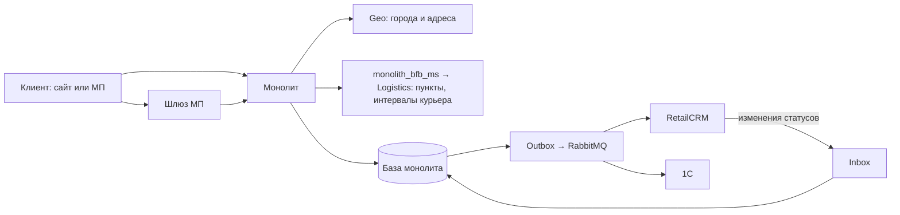

# Мониторинг процесса возврата

Метрики, экраны Grafana и тревоги, по которым видно, работает ли оформление возврата на сайте и в мобильном приложении, на каком шаге сломалось и доходят ли заявки до RetailCRM и 1С.

**Главное правило:** ответ сервера «200» — ещё не успех, а отказ по правилам — не авария. Успех — заявка сохранена в базе. Отказ по правилам — истёк срок возврата, изделие уже в другой заявке, клиент не заполнил поле: так система и должна работать. Авария — техническая ошибка: сервис упал, не ответил вовремя, внешняя система вернула ошибку.

## 1. Процесс и его границы

**Цель процесса:** клиент сам оформляет заявку на возврат на сайте или в МП, заявка попадает в RetailCRM и 1С, где с ней работают склад, Отдел дружбы и бухгалтерия.

**Успешный результат:** заявка сохранена в базе монолита и принята RetailCRM и 1С.

**Этапы:** доступность возврата в карточке заказа → выбор изделий и причин → город и способ возврата → пункт, магазин или дата курьера → создание заявки → передача в RetailCRM и 1С → изменения статусов → отмена клиентом.

**Альтернативные ветви:**
- логистика не ответила на запрос интервалов — заявка курьером создаётся без даты, дату согласует Отдел дружбы (`ADR-RET-071`);
- логистика ответила пустым списком интервалов — курьер недоступен с этого адреса, клиент выбирает другой способ;
- сайт и МП проходят те же шаги, МП — через шлюз МП.

**Подтверждено кодом и документацией:**
- обмен заявками с RetailCRM и 1С идёт тем же механизмом, что обмен заказами: запись в outbox, отправка через RabbitMQ, повторы с лимитом (`ADR-RET-044`, [инфраструктура монолита](../../../../knowledge/12storeez-master-web/architecture/07-infrastructure.md), «Outbox и Inbox»);
- в MVP нет интеграции с транспортными компаниями: коды для сдачи отправляет сама ТК, логисты выгружают заявки вручную (`ADR-RET-017`);
- выплата денег — в 1С и бухгалтерии, событие выплаты на сайт не приходит (`ADR-RET-040`, `ADR-RET-045`).

**Неизвестно:** через какой из двух шлюзов МП (`core` или `mobile`) пойдут новые методы возврата; что считается подтверждением приёма заявки в RetailCRM и 1С.

## 2. Метрики по этапам

### 2.1. Создание заявки

| Метрика | Как считать | Что показывает | Зачем |
|---|---|---|---|
| **NFR-MON-01. Создано заявок** | Число заявок, сохранённых в базе, за 15 минут, час, сутки; отдельно сайт и МП | Клиенты доходят до конца и оформляют возврат | Главный показатель: если днём обычно есть заявки, а за час — ноль, оформление сломано |
| **NFR-MON-02. Ошибки при создании** | Число попыток создать заявку, закончившихся технической ошибкой, за 15 минут | Сколько клиентов нажали «Подтвердить возврат» и получили ошибку | Ловит поломку на последнем шаге — самую дорогую: клиент всё заполнил и не смог отправить |
| **NFR-MON-03. Доля успешных созданий** | Создано ÷ (создано + ошибки) × 100 % за 15 минут; считается при 5 и больше попытках в окне | Какая часть попыток проходит | Видно масштаб сбоя. Отказы по правилам в расчёт не входят, поэтому показатель не падает из-за клиентов с истёкшим сроком |
| **NFR-MON-04. Отказы по правилам** | Число отказов при создании по причинам: срок истёк, изделие недоступно, ошибка в данных формы | Как часто правила отсекают заявки | Резкий рост при обычном трафике — признак ошибки в расчёте срока или доступности изделий, хотя технически всё работает |
| **NFR-MON-05. Время создания заявки** | Время ответа метода создания, в которое укладываются 95 % запросов (p95), за 15 минут | Сколько клиент ждёт после нажатия «Подтвердить возврат» | Рост времени — ранний признак перегрузки базы, ещё до массовых ошибок |

- NFR-MON-01–04 — метод создания заявки в монолите (новый метод) · нужно добавить · счётчик исходов (`counter`) через существующий `PrometheusService` по образцу платёжных метрик (`src/Modules/Metrics/Service/PaymentMetricsService.php`). Успех фиксируется после сохранения заявки, а не по ответу 200.
- NFR-MON-05 — тот же метод · нужно добавить · гистограмма длительности (`histogram`).

### 2.2. Данные для оформления

| Метрика | Как считать | Что показывает | Зачем |
|---|---|---|---|
| **NFR-MON-06. Пустой справочник причин** | Число ответов, в которых список причин возврата пуст | Клиент не может выбрать причину и дальше не пройдёт | Справочник у всех один, поэтому пустой ответ — всегда авария, даже при ответе «200» |
| **NFR-MON-07. Ошибки загрузки способов и пунктов** | Доля ошибок и неответов при загрузке способов возврата для города, пунктов СДЭК и 5Post, магазинов; отдельно по каждой службе | Какой способ возврата сейчас недоступен из-за сбоя | Видно, где искать: ошибки только по СДЭК — проверять вызов логистики по СДЭК, а не весь сервис |
| **NFR-MON-08. Интервалы курьера** | Число запросов дат и интервалов по трём исходам: интервалы пришли / пустой список / ошибка или нет ответа | Работает ли вызов логистики для курьерского возврата | Пустой список — норма: курьер не забирает с этого адреса. Ошибка — сбой на стороне вызова логистики. Без разделения эти случаи не отличить |
| **NFR-MON-09. Заявки курьером без даты** | Число заявок курьером, созданных без даты и интервала, потому что логистика не ответила | Сколько клиентов ждут звонка Отдела дружбы для согласования даты | Рост — логистика недоступна; заодно предупреждает Отдел дружбы о дополнительной ручной работе |

- NFR-MON-06, 07 — методы причин, способов, пунктов и магазинов в монолите · нужно добавить · счётчик исходов с разбивкой по списку и службе. Пустые списки способов, пунктов и магазинов — норма для части городов, тревога — только при росте доли относительно обычного уровня.
- NFR-MON-08 — вызов `monolith_bfb_ms` в монолите (`modules/common/client/MonolithBfbMsClient.php`) · сейчас пишется только лог ошибки при ответе ≠ 200, таймаут отдельно не учитывается · нужно добавить счётчик трёх исходов и длительность.
- NFR-MON-09 — метод создания заявки · нужно добавить · признак «курьер без даты» уже есть в логике создания (SRS МП, US 1.5).

### 2.3. Передача заявок в RetailCRM и 1С

| Метрика | Как считать | Что показывает | Зачем |
|---|---|---|---|
| **NFR-MON-10. Передача заявок** | Число отправок заявок в RetailCRM и 1С по исходам: успешно / ошибка, будет повтор / потеряно после всех повторов | Доходят ли заявки до систем, где с ними работают сотрудники | Сообщение, не прошедшее после всех повторов, теряется без уведомления. Каждая потерянная заявка — клиент, о возврате которого никто не знает |
| **NFR-MON-11. Заявки, не дошедшие до RetailCRM и 1С** | Число заявок, созданных больше 30 минут назад и без подтверждения приёма; отдельно RetailCRM и 1С | Заявки, застрявшие между сайтом и внешней системой | Ловит зависание, которого не видно по ошибкам: например, очередь остановилась и ничего не отправляется |
| **NFR-MON-12. Входящие изменения статусов** | Число изменений заявки из RetailCRM и 1С по исходам: применено / ошибка / неизвестный статус | Обновляются ли статусы заявки у нас после действий сотрудников | Клиент видит статус на сайте и в МП; ошибка разбора или неизвестный статус — клиенту показывается устаревшее состояние |

- NFR-MON-10 — обработчики outbox `rcrm` и `onec` (консьюмеры `rabbit-outbox-transactions/create|update`) · сейчас при ошибке только структурированный лог, после лимита повторов сообщение отбрасывается · нужно добавить счётчик исходов для типа «возврат».
- NFR-MON-11 — база монолита · уточнить: у заявки нужна отметка о подтверждении приёма внешней системой (открытый вопрос 2) · после этого считается запросом к базе (`gauge`).
- NFR-MON-12 — обработчики inbox `rcrm` и `onec` · нужно добавить счётчик исходов.

### 2.4. Сопровождение заявки

| Метрика | Как считать | Что показывает | Зачем |
|---|---|---|---|
| **NFR-MON-13. Заявки, ждущие действий сотрудников** | Число заявок курьером без даты, которые ждут Отдел дружбы дольше 1 рабочего дня; число заявок в статусе «Подтверждение возврата» (`ADR-RET-053`) | Где копятся заявки, требующие ручной работы | Видно, что Отдел дружбы не успевает и клиенты ждут звонка |

- NFR-MON-13 — база монолита · можно посчитать после утверждения статусной модели (`ADR-RET-040`).

### 2.5. Общее состояние

| Метрика | Как считать | Что показывает | Зачем |
|---|---|---|---|
| **NFR-MON-14. Ошибки и скорость методов возврата** | По каждому методу возврата (карточка заказа, причины, способы, создание, отмена, список и экран возвратов): доля ответов 5xx и время ответа p95 за 5 минут | Какой именно запрос сломался или замедлился | Точка поиска причины, когда главный экран показал проблему |
| **NFR-MON-15. Мониторинг работает** | Поступают ли метрики от монолита и шлюзов МП за последние 5 минут | Можно ли верить остальным графикам | Без этой проверки пропавшие данные выглядят как «ошибок нет» |

- NFR-MON-14 — сайт: JSON-логи nginx монолита · можно посчитать, если логи собираются в хранилище, доступное Grafana (открытый вопрос 4). Шлюз `mobile`: сбор метрик `fiberprometheus` подключён в коде, но выключен (`mobile-monorepo-go/cmd/mobile_api/mobile_api.go:101-102`) · нужно включить. Шлюз `core`: метрик нет · уточнить.
- NFR-MON-15 — `/metrics` монолита (Prometheus) есть; ошибки записи метрик уже пишутся в лог как `METRIC_ERROR` (`src/Modules/Metrics/Service/PrometheusService.php`) · можно посчитать.

### 2.6. Метрики для бизнеса

Считаются по сохранённым заявкам за период, выбранный на панели Grafana: сутки, неделя, месяц, произвольные даты. Канал (сайт, МП) — фильтр на панели.

| Метрика | Как считать | Что показывает | Зачем |
|---|---|---|---|
| **NFR-MON-16. Количество возвратов** | Число заявок, созданных за период; по дням или часам на графике | Сколько возвратов оформляют и как это меняется | Нагрузка на склад, Отдел дружбы и логистику; пики после распродаж; эффект от самостоятельного оформления |
| **NFR-MON-17. Изделий в возврате** | Число изделий во всех заявках за период; среднее на заявку | Объём возвращаемого товара | Планирование приёмки на складе и в магазинах |
| **NFR-MON-18. Популярность способов возврата** | Число заявок и доля по способам: курьер, пункт СДЭК, пункт 5Post, магазин 12 STOREEZ, Почта России | Какой способ выбирают чаще | Решения о развитии способов и договорах со службами; резкое падение доли способа — возможно, он перестал показываться |
| **NFR-MON-19. Способ «как в заказе»** | Доля заявок, где клиент оставил способ, подставленный из заказа | Совпадает ли подстановка с выбором клиента | Проверка решения подставлять способ из заказа: низкая доля — подстановка мешает |
| **NFR-MON-20. Причины возврата** | Число изделий по каждой причине и группе; топ-10 за период | Почему возвращают товары | Товарной команде и качеству: рост «не подошёл размер» или «брак» — сигнал разобраться |
| **NFR-MON-21. Сумма к возврату** | Сумма к возврату по заявкам за период; средняя сумма заявки | Сколько денег предстоит вернуть | Прогноз выплат для финансов |
| **NFR-MON-22. Куда возвращаются деньги** | Доля заявок с возвратом на карту оплаты против доли с банковскими реквизитами | Сколько возвратов требуют ручной выплаты по реквизитам | Нагрузка на бухгалтерию; основание для решений о возврате на сертификат |
| **NFR-MON-23. Отмены заявок** | Доля заявок, отменённых клиентом, от созданных за период | Сколько клиентов передумали | Высокая доля — повод проверить понятность инструкции и ошибочные заявки |
| **NFR-MON-24. Возвраты по городам** | Число заявок по городам; топ-10 за период | Где возвращают чаще | Решения о подключении способов возврата в городах |
| **NFR-MON-25. Доля заказов с возвратом** | Заказы с заявкой на возврат ÷ полученные заказы за период × 100 % | Какая часть покупок возвращается | Ключевой показатель для бизнеса; сравнение по месяцам |

- NFR-MON-16–18, 20–25 — таблицы заявок, позиций и заказов в базе монолита · можно посчитать запросом к реплике базы, подключённой в Grafana на чтение (открытый вопрос 5). На панелях только итоги, без номеров заказов, ФИО, адресов и реквизитов.
- NFR-MON-19 — нужно добавить: признак у заявки, что способ совпал с подставленным из заказа.

## 3. Экраны Grafana

### 3.1. «Возвраты — состояние процесса»

Для дежурного и владельца процесса. Обновление — 1 минута, фильтр «сайт / МП».

1. **Создано заявок** — NFR-MON-01; три числа: за 15 минут, час, сутки. Видно, что заявки перестали создаваться.
2. **Доля успешных созданий** — NFR-MON-03; линия, норма около 100 %. Видно масштаб сбоя; при малом числе попыток панель пустая, а не 0 %.
3. **Ошибки по шагам** — NFR-MON-02, 06, 07, 08, 10; столбики по шагам, в норме пусто. Цвет столбика показывает, на каком шаге сбой.
4. **Внешние системы** — NFR-MON-07, 08, 10, 12; доля ошибок вызовов логистики по службам, RetailCRM, 1С. Видно, к какой интеграции идти.
5. **Требует внимания** — NFR-MON-09, 10 «потеряно», 11, 13; числа, любое больше нуля — разбор. Видно потерянные и зависшие заявки.
6. **Мониторинг работает** — NFR-MON-15; зелёный или серый индикатор. Видно, можно ли верить экрану.

На графиках отмечаются релизы и включение процесса возвратов (`ADR-RET-069`): видно, что ошибки начались после выкладки, а пустые графики — из-за выключенного процесса.

### 3.2. «Возвраты — диагностика»

Для разработчиков. Таблица методов возврата с долей 5xx и p95 (NFR-MON-14); исходы интервалов курьера и длительность (NFR-MON-08); исходы по спискам и службам (NFR-MON-07); передача и входящие изменения по RetailCRM и 1С (NFR-MON-10, 12); таблица самых старых недошедших заявок (NFR-MON-11). Переход к логам — по `request_id`, который уже пишется в каждую запись лога монолита (`src/Modules/Common/Service/Logger.php`).

### 3.3. «Возвраты — бизнес»

Без технических тревог: количество возвратов по дням (NFR-MON-16), способы возврата круговой диаграммой (NFR-MON-18), топ причин и городов таблицами (NFR-MON-20, 24), сумма и доля заказов с возвратом числами (NFR-MON-21, 25).

## 4. Когда поднимать тревогу

| Ситуация | Метрика / уровень | Кому и куда смотреть |
|---|---|---|
| Заявки создаются с ошибками | NFR-MON-02 / Critical | Бэкенд; экран диагностики → метод создания, логи по `request_id` |
| Нет ни одной заявки при попытках | NFR-MON-01 / Critical | Бэкенд; панель «Ошибки по шагам» |
| Справочник причин пустой | NFR-MON-06 / Critical | Бэкенд; справочник причин в админке |
| Заявка потеряна при передаче | NFR-MON-10 / Critical | Бэкенд, владелец интеграции; лог обработчика outbox |
| Заявка не дошла до RetailCRM или 1С | NFR-MON-11 / Warning, от 5 заявок — Critical | Бэкенд; очереди RabbitMQ и обработчики outbox |
| Ошибки вызова логистики для интервалов | NFR-MON-08 / Warning | Бэкенд, команда логистики; вызов `monolith_bfb_ms` |
| Растут заявки курьером без даты | NFR-MON-09 / Warning | Отдел дружбы, команда логистики |
| Ошибки по одной службе пунктов выдачи | NFR-MON-07 / Warning | Команда логистики; ошибки по службе на экране диагностики |
| Создание заявки замедлилось | NFR-MON-05 / Warning | Бэкенд; длительность и нагрузка базы |
| Ошибка входящего статуса | NFR-MON-12 / Warning | Бэкенд, RetailCRM; маппинг статусов |
| Метрики не поступают | NFR-MON-15 / Critical | DevOps; сбор `/metrics`, деплой |

Все пороги — кандидатные, согласуются после двух недель работы по фактическому объёму заявок (открытый вопрос 1). Тревоги по долям срабатывают, только когда процесс возвратов включён и попыток в окне достаточно.

- **NFR-MON-02:** 3 и больше ошибок за 15 минут при 5 и больше попытках; держится 5 минут. Первая проверка — ошибки метода создания в Sentry и логах, последний релиз.
- **NFR-MON-01:** ни одной заявки за 30 минут при 3 и больше попытках. Первая проверка — какой шаг краснеет на панели «Ошибки по шагам».
- **NFR-MON-06:** 1 пустой ответ. Первая проверка — справочник причин в админке.
- **NFR-MON-10:** 1 потерянное сообщение. Первая проверка — найти заявку по логу, переотправить после устранения причины.
- **NFR-MON-11:** заявка не подтверждена 30 минут. Первая проверка — очереди и обработчики outbox `rcrm`, `onec`.
- **NFR-MON-08:** половина запросов с ошибкой при 5 и больше запросах за 15 минут; объединяется в одно уведомление с NFR-MON-09. Оформление продолжается без даты, поэтому уровень Warning.
- **NFR-MON-09:** 3 и больше заявок за час. Отдел дружбы согласует даты с клиентами.
- **NFR-MON-07:** 30 % ошибок по одной службе при 10 и больше запросах за 15 минут.
- **NFR-MON-05:** p95 больше 5 секунд 15 минут подряд.
- **NFR-MON-12:** 1 ошибка или неизвестный статус за 15 минут.
- **NFR-MON-15:** нет данных 5 минут; отдельный сигнал, не равен «ошибок ноль».

Повтор уведомления — не чаще раза в 30 минут.

## 5. Что потребуется для внедрения

**Уже есть:**
- монолит отдаёт метрики Prometheus (`/metrics`, хранилище Redis) и считает по этому образцу платёжные операции — попытка / успех / ошибка;
- в каждой записи лога монолита есть `request_id` для поиска операции;
- Sentry в монолите и обоих шлюзах МП;
- health-проверки: монолит `/api2/healthcheck/ping`, шлюз `mobile` `/health`, шлюз `core` `/api/ping`.

**Нужно добавить:**
- монолит: счётчики и длительности NFR-MON-01–10, 12; признак способа «как в заказе» для NFR-MON-19;
- монолит: отметка о подтверждении приёма заявки RetailCRM и 1С для NFR-MON-11;
- шлюз `mobile`: включить сбор метрик для NFR-MON-14;
- Grafana: подключить реплику базы на чтение для NFR-MON-11, 13, 16–25;
- аннотации релизов и включения процесса возвратов.

**MVP — к запуску:** NFR-MON-01–11, 14, 15; экран «Состояние процесса»; тревоги по NFR-MON-01, 02, 06, 10, 11, 15. Готово, когда на stage после создания заявки каждым способом и отмены все метрики MVP получили значения, а тестовая потеря сообщения обмена вызвала тревогу.

**Should — первый месяц:** NFR-MON-12, 13; экран «Диагностика»; остальные тревоги; пороги пересмотрены по фактическому объёму.

**Could — после MVP:** бизнес-метрики NFR-MON-16–25 и экран «Бизнес»; зависит от подключения реплики базы и согласования доступа.

## 6. Открытые вопросы и риски

| № | Вопрос или риск | Кому |
|---|---|---|
| 1 | Сколько заявок на возврат ожидается в сутки? От этого зависят пороги тревог | Product Manager |
| 2 | Что считать подтверждением приёма заявки в RetailCRM и 1С и где хранить отметку? | Бэкенд, RetailCRM, 1С |
| 3 | Логистика при отсутствии интервалов отвечает пустым списком, а ошибкой — только при сбое? | Команда логистики |
| 4 | Собираются ли логи монолита и nginx в хранилище, доступное Grafana? | DevOps |
| 5 | Можно ли подключить в Grafana реплику базы и кто из бизнеса получит доступ к экрану «Бизнес»? | DevOps, ИБ, Head of PMO |
| 6 | Через какой шлюз МП — `core` или `mobile` — пойдут методы возврата? | Команда шлюзов МП |
| 7 | Куда отправлять тревоги: канал, дежурный, Отдел дружбы? | DevOps, Head of PMO |
| 8 | Риск: в лог ошибки запроса интервалов пишется полный адрес забора (`MonolithBfbMsClient.php`) | ИБ, бэкенд |
