## Полезные материалы

| Название | Ссылка |
|---|---|
| Макеты (МП) | https://www.figma.com/design/u5Fe5N4lypCdqgZn6533F2/%F0%9F%93%B1-06.-Profile--Redesign-?node-id=5547-145537&t=qoHbaQAbTlMNGNZX-4 |
| Макеты (сайт) | https://www.figma.com/design/eXX6wwylh99ztlNUgziZia/%25F0%259F%2596%25A5-05.-Profile--Redesign-?node-id=6317-86695&t=fKHpK9cmN3IoE3WY-0 |
| Эпик | https://tracker.yandex.ru/ITGENERAL-33 |
| Под эпик | https://tracker.yandex.ru/ECOMDEV-2246<br>https://tracker.yandex.ru/ECOMDEV-2256 |
| Маппинг статусов Post MVP | https://docs.google.com/spreadsheets/d/1BBenI7YT8DtquR58krRBBzdwoCjFuYeCKyyl9-66d4Q/edit?gid=2096004650#gid=2096004650 |
| BRD | https://docs.google.com/document/d/1rZKCC6zf38xjrW-WQuvGZcEYEMoMK7TBrHrj91QzOpA/edit?tab=t.5rgjndw51swl |
| Причины возвратов | https://docs.google.com/spreadsheets/d/1bBBNP4z9KuJfFFw6_zToKsN-TS_cBT0x/edit?gid=278087742#gid=278087742 |
| Названия элементов интерфейса | [ui-terms.md](../ui/ui-terms.md) |
| Элементы экранов оформления возврата | [return-creation-mobile-mvp_ui.md](../ui/return-creation-mobile-mvp_ui.md) |

## Не забыть про:

* Qlik
* Mindbox (отправлять письма по триггеру статус) \+ расчет баллов к возврату

## Основные принципы

1. Для каждого способа возврата клиенту показывается инструкция, что ему делать: описание способа на экране «Оформление возврата» и инструкция в блоке «Что дальше» экрана созданного возврата. Оба текста заводятся в админке отдельно для каждого способа возврата, содержание определяет бизнес; приложение отображает тексты, полученные с сервера. Тексты на макетах — пример.
2. Одинаковые изделия хранятся в заказе одной позицией, и при создании заявки статус меняется сразу у всей позиции. Поэтому после возврата части изделий остаток позиции отображается на экране заказа в блоке «Ваш заказ», но в списке изделий для возврата его нет: такой остаток возвращается через Отдел дружбы с клиентами. При отмене заявки статус позиции возвращается.

## Функциональные требования

### Админка

Для сценариев МП в админке нужны доработки, которых нет в текущих экранах.

1. Пользователь админки должен иметь возможность изменять клиентское название статуса возврата.
2. Пользователь админки должен иметь возможность объединять несколько статусов возврата под одним клиентским названием: клиент видит такие статусы как один статус (группировка).
3. Пользователь админки должен иметь возможность задавать для каждого способа возврата инструкцию для блока «Что дальше» экрана созданного возврата — отдельно от описания способа на экране «Оформление возврата».
4. Пользователь админки должен иметь возможность задавать порядок способов возврата: по нему формируется список способов и выбирается способ по умолчанию, если способ доставки заказа недоступен для возврата.
5. В справочник способов возврата должны быть добавлены способы «Магазин 12 STOREEZ» и «Почта России» с теми же настройками, что у курьера, СДЭК и 5Post: название, описание, инструкция, включение на сайте и в МП.
6. Пользователь админки должен иметь возможность включать и отключать способы возврата для города: по этой настройке метод получения способов возврата для города отдаёт только включённые для города способы.

## Данные

Предварительный состав таблиц: при реализации таблицы и поля могут быть уточнены. Используется обоими каналами — мобильным приложением и сайтом.

**Новые таблицы**

* заявки на возврат (`cms_returns`) — заявка, способ возврата и его данные, дата «Вернуть до», банковские реквизиты; по ней определяются заявки по заказу
* позиции возврата (`cms_return_positions`) — одно изделие с причиной и статусом
* статусы заявки (`cms_return_statuses`) — справочник: название статуса в системе, клиентское название и код статуса для обмена, признак «допускает отмену клиентом». Список статусов и признаки хранятся в справочнике, а не в коде
* группы статусов заявки (`cms_return_status_groups`) — справочник: группировка статусов в админке
* статусы позиции возврата (`cms_return_position_statuses`) — справочник
* история изменений заявки (`cms_return_history`) — снимок всей заявки с позициями и их статусами после каждого изменения, как у заказов; история статусов заявки и позиций восстанавливается по снимкам
* возврат денег по способам (`cms_return_refunds`) — куда и сколько вернуть по заявке
* способы возврата денег и их соответствие способам оплаты (`cms_refund_methods`, `cms_payment_type_refund_method`) — справочники: по ним определяется, куда вернутся деньги и нужны ли банковские реквизиты
* соответствие способов возврата службам доставки (`cms_return_method_delivery_type`) — какая возвратная служба выполняет способ возврата и какому способу возврата соответствует служба доставки заказа (способ «как в заказе»)

**Изменения существующих таблиц и настроек**

* новая настройка — срок оформления возврата для клиентов F&F, 30 дней (по аналогии 14 дней)
* причины возврата и группы причин (`cms_return_reasons`, `cms_return_reasons_groups`) — существующие справочники: название причины для изделий в заявках; данные справочника обновляются — причины добавляются и меняются
* способы возврата (`cms_return_method`) — существующий справочник: новые записи «Магазин 12 STOREEZ» и «Почта России»
* службы доставки (`cms_delivery_tk`) — существующая таблица: новые записи возвратных служб со своим типом доставки; описание способа и инструкция «Что дальше» хранятся в существующих текстовых полях записи возвратной службы, новые поля не заводятся
* города служб доставки (`cms_delivery_city`) — существующая таблица: новые записи городов для возвратных служб с ФИАС
* магазины (`cms_catalog_stock`) — существующая таблица: новое поле — признак «Принимает возвраты»

# User story

## Оформление возврата

### Отобразить кнопку оформления возврата на экране заказа US 1.1

Как клиент, совершивший покупку, я хочу иметь возможность начать оформление возврата из карточки заказа, чтобы самостоятельно оформить возврат без обращения в поддержку

### Дизайн

Ссылка на Figma: https://www.figma.com/design/u5Fe5N4lypCdqgZn6533F2/%F0%9F%93%B1-06.-Profile--Redesign-?node-id=7985-73307&t=qoHbaQAbTlMNGNZX-4

### Сценарий

#### Предусловие

1. Пользователь авторизован

#### Основная последовательность "Отобразить кнопку оформления возврата на экране заказа"

| Шаг | Исполнитель | Описание |
|---|---|---|
| 1 | Пользователь | Открывает экран заказа |
| 2 | APP | Вызвать метод `GET /получить карточку заказа` (`GET /api/orders/{id}`, доработка метода) |
| 2.1 | Бэкенд | Рассчитать и вернуть в ответе `return.request_until_date` — последний день, когда можно оформить заявку на возврат: дата получения заказа + 14 дней<br><br>**Опционально**<br>1. Если клиент F&F, то дата получения заказа + 30 дней |
| 2.2 | Бэкенд | Для каждой позиции заказа вернуть в ответе:<br>— `items[].available_return_quantity` — сколько изделий позиции клиент может вернуть сейчас: равно `items[].remaining_quantity`, когда возврат по позиции разрешён, иначе 0;<br>— `items[].can_be_returned` — признак, что позицию можно вернуть: срок возврата не истёк и по позиции нет активной заявки на возврат;<br>— `items[].return_items` — изделия позиции в активных заявках на возврат, по одному на изделие, с причиной возврата `reason_title`; если причина не выбрана, то название группы причин;<br>— `items[].remaining_quantity` — сколько изделий позиции остаётся у клиента: количество в позиции минус изделия в активных заявках на возврат. Рассчитывается для всех позиций при любом сроке и любой доступности возврата<br><br>*Активная заявка — заявка в любом статусе, кроме «Возврат отменён»* |
| 2.3 | Бэкенд | Вернуть в ответе сообщение со статусом `can_be_returned`, если хотя бы у одной позиции `items[].can_be_returned = true`. Текст сообщения — «Можно вернуть изделия до [Дата]», где [Дата] — `return.request_until_date`<br><br>**Опционально**<br>1. Если срок возврата истёк — дата `return.request_until_date` прошла, — то сообщение не возвращать<br>2. Если для всех позиций заказа есть активные заявки на возврат, то сообщение не возвращать |
| 3 | APP | Отобразить в блоке «Ваш заказ · N» позиции заказа с количеством изделий у клиента — `items[].remaining_quantity`<br><br>**Опционально**<br>1. Если все изделия позиции в активных заявках на возврат, то позицию в блоке «Ваш заказ · N» не отображать |
| 4 | APP | Отобразить после блока «Ваш заказ · N» блок «Оформлен возврат · N» (по данным ответа метода `GET /получить карточку заказа`): каждое изделие с активной заявкой на возврат — отдельной строкой с выбранной причиной возврата. Из блока переход в возврат не выполняется: изделия блока и сам блок не нажимаются<br><br>**Опционально**<br>1. Если по заказу нет активных заявок на возврат, то блок «Оформлен возврат · N» не отображать<br>2. Если заявка на возврат отменена, то изделия этой заявки отобразить в блоке «Ваш заказ · N» |
| 5 | APP | Отобразить кнопку «Оформить возврат», если в ответе метода `GET /получить карточку заказа` есть сообщение со статусом `can_be_returned`<br><br>**Опционально**<br>1. Если сообщения нет, то кнопку не отображать |
| 6 | APP | Отобразить под кнопкой текст `messages[].message` элемента со `status = "can_be_returned"` — «Можно вернуть изделия до [Дата]» — и ссылку «Правила возврата»<br><br>**Опционально**<br>1. Если кнопка «Оформить возврат» не отображается, то текст и ссылку «Правила возврата» не отображать |

**Примечание**

1. В списке заказов признак возврата не отображается: клиент видит оформленный возврат только на экране заказа.

**Комментарий**

На уточнении:

1. Включается ли новый возврат переключателем в админке, и что видит клиент, пока переключатель выключен: старый возврат или кнопки возврата нет?
2. Что происходит с выпущенными версиями приложения после включения нового возврата: обязательное обновление приложения через настройку «Обязательное обновление для Android / iOS», скрытие кнопки возврата в старых версиях или отказ в создании возврата по-старому с просьбой обновить приложение?
3. Работает ли обязательное обновление приложения на iOS и Android?

### Взаимодействие компонентов

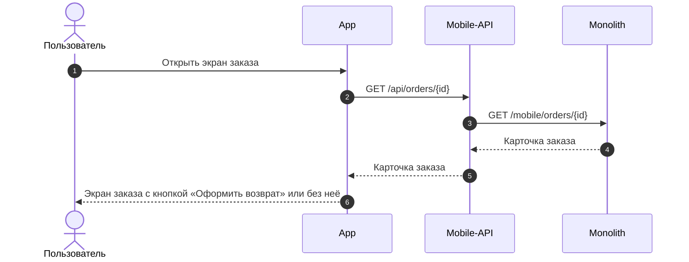

### Логика сценария

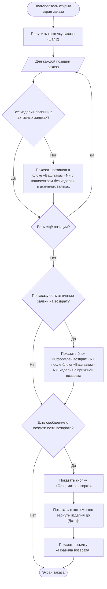

### Логика бэкенда

**`GET /получить карточку заказа` (`GET /api/orders/{id}`) — доработка метода**

* возврат доступен по заказам в тех же статусах, что сейчас: «Заказ выполнен», «Заказ выдан», «Частичный выкуп» и статусы, отмеченные в справочнике статусов как возвратные. Брони и покупки в магазине по чеку возврат в ЛК не допускают — как сейчас
* дата получения заказа — дата завершения заказа (`end_date`), как сейчас
* проверять категорию клиента (F&F) и считать последний день оформления заявки: 14 или 30 дней с даты получения заказа (`return.request_until_date`)
* проверять срок возврата по этой дате вместо текущей проверки 14 дней по позиции
* по каждой позиции учитывать изделия в заявках на возврат, кроме отменённых, и считать, сколько изделий ещё можно вернуть (`items[].available_return_quantity`, `items[].can_be_returned`)
* отдавать сообщение «Можно вернуть изделия до [Дата]», если есть позиция, которую можно вернуть (`messages`)
* отдавать по каждой позиции изделия в заявках на возврат, кроме отменённых, с причиной возврата (`items[].return_items`)
* отдавать по каждой позиции, сколько изделий остаётся у клиента (`items[].remaining_quantity`)
* отдавать текст о том, куда вернутся деньги (`return.refund`)
* отдавать адрес, пункт выдачи или магазин доставки заказа для подстановки при возврате (`order_delivery`)

**Логика метода `GET /получить карточку заказа`**

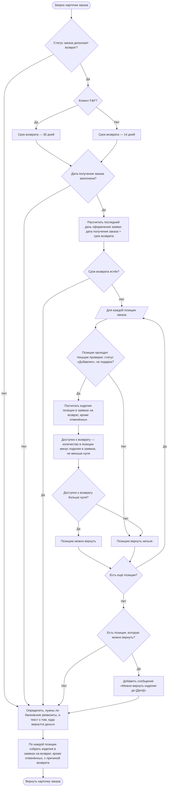

### Задачи

| Название | Ссылка |
|---|---|
| Доработать метод получения информации по заказу | https://tracker.yandex.ru/ECOMDEV-2343 |

### Выбрать изделия и причины возврата US 1.2

Как клиент, оформляющий возврат, я хочу выбрать одно или несколько изделий из заказа и указать причину возврата для каждого выбранного изделия, чтобы сформировать возврат только для тех изделий, которые я хочу вернуть

### Дизайн

Ссылка на Figma: https://www.figma.com/design/u5Fe5N4lypCdqgZn6533F2/%F0%9F%93%B1-06.-Profile--Redesign-?node-id=7240-60450&t=qoHbaQAbTlMNGNZX-4

### Сценарий

#### Предусловие

1. На экране заказа отображается кнопка «Оформить возврат» (US 1.1)

#### Основная последовательность "Выбрать изделия и причины возврата"

| Шаг | Исполнитель | Описание |
|---|---|---|
| 1 | Пользователь | Нажимает «Оформить возврат» |
| 2 | APP | Отобразить экран «Выберите изделия» по данным ответа метода `GET /получить карточку заказа` |
| 2.1 | APP | Отобразить позиции, у которых `items[].can_be_returned = true`<br><br>**Опционально**<br>1. Если `items[].can_be_returned = false`, то позицию не отображать |
| 2.2 | APP | Отобразить каждое изделие позиции отдельной строкой. Количество строк — `items[].available_return_quantity` |
| 2.3 | APP | Отобразить кофр или подарок, если он отдельная позиция заказа, отдельной строкой |
| 2.4 | APP | Отобразить предупреждение о необходимости вернуть изделия в полной комплектации |
| 3 | Пользователь | Отмечает чекбоксами изделия |
| 4 | APP | Изменить заголовок экрана на «Выберите изделия · N» и сделать кнопку «Указать причину возврата» активной. Кофр или подарок при выборе основного изделия автоматически не отмечать<br><br>**Опционально**<br>1. Если не выбрано ни одного изделия, то кнопка «Указать причину возврата» неактивна |
| 5 | Пользователь | Нажимает «Указать причину возврата» |
| 6 | APP | Вызвать метод `GET /получить справочник причин возврата` (`GET /api/orders/v2/return-reasons`) |
| 6.1 | Бэкенд | Вернуть активные группы причин в заданном порядке, в каждой группе — активные причины в заданном порядке. Группа без активных причин возвращается с пустым списком причин |
| 7 | APP | Отобразить экран «Причина возврата» с подзаголовком «Изделие 1 из N» |
| 8 | Пользователь | Выбирает группу причин в выпадающем списке |
| 9 | APP | Отобразить список причин выбранной группы<br><br>**Опционально**<br>1. Если у группы нет причин, то выбор группы считать выбором причины и перейти к шагу 11 |
| 10 | Пользователь | Выбирает причину |
| 11 | APP | Перейти к следующему выбранному изделию и изменить подзаголовок на «Изделие K из N», где K — номер изделия. Шаги 8–10 повторяются для каждого выбранного изделия |
| 12 | APP | После выбора причины для последнего изделия сделать кнопку «Выбрать способ возврата» активной<br><br>**Опционально**<br>1. Если причина указана не для всех выбранных изделий, то кнопка «Выбрать способ возврата» неактивна<br>2. Если пользователь вернулся к экрану «Выберите изделия» с экрана причин или с экрана «Оформление возврата» и изменил состав изделий, то причины указываются заново для каждого выбранного изделия, начиная с шага 5 |

### Взаимодействие компонентов

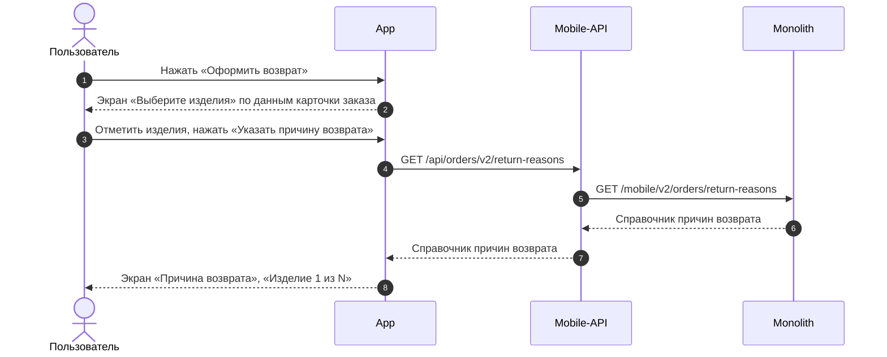

### Логика сценария

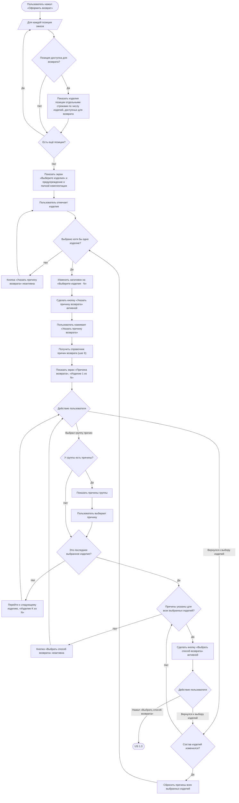

### Задачи

| Название | Ссылка |
|---|---|

### Выбрать способ возврата US 1.3

Как клиент, оформляющий возврат, я хочу выбрать способ возврата товаров, чтобы успешно завершить оформление заявки на возврат

### Дизайн

Ссылка на Figma: https://www.figma.com/design/u5Fe5N4lypCdqgZn6533F2/%F0%9F%93%B1-06.-Profile--Redesign-?node-id=7235-41564&t=KUiaYx2kcuq61I5X-4

### Сценарий

#### Предусловие

1. Пользователь указал причины возврата для всех выбранных изделий (US 1.2)

#### Основная последовательность "Выбрать способ возврата"

| Шаг | Исполнитель | Описание |
|---|---|---|
| 1 | Пользователь | Нажимает «Выбрать способ возврата» |
| 2 | APP | Определить город возврата: взять `order_delivery.country_iso` и `order_delivery.city_fias` из ответа метода `GET /получить карточку заказа` (US 1.1)<br><br>**Опционально**<br>1. Если `order_delivery.city_fias` не заполнен, то открыть шторку «Выберите город». См. альтернативную последовательность "Сменить город" |
| 3 | APP | Вызвать метод `GET /получить данные города` (`GET /api/v1/geo/countries/{country_iso_code}/cities/{geo_id}/details`): `country_iso_code` — `order_delivery.country_iso`, `geo_id` — `order_delivery.city_fias`. Из ответа взять часовой пояс города `timezone` — он передаётся в запрос дат и интервалов курьера<br><br>**Опционально**<br>1. Если данные города не получены, то открыть шторку «Выберите город». См. альтернативную последовательность "Сменить город" |
| 4 | APP | Вызвать метод `GET /получить способы возврата для города` (`GET /api/v2/delivery/{order_id}/return-method-list`, новый метод, TBD): страна, регион и город возврата из ответа метода `GET /получить данные города` (шаг 3) |
| 4.1 | Бэкенд | Вернуть способы возврата, возвратная служба которых работает в городе возврата, в порядке приоритета. Для каждого способа — признак `is_order_method` (способ совпадает со способом доставки заказа и город возврата — город заказа), служба и код типа доставки, а для СДЭК, 5Post, Магазин 12 STOREEZ и Почта России — дату «Вернуть до»: текущая дата + 10 календарных дней |
| 5 | APP | Отобразить экран «Оформление возврата» с городом и способами возврата (из ответа метода `GET /получить способы возврата для города`)<br><br>**Опционально**<br>1. Если для города нет доступных способов возврата, то отобразить сообщение об отсутствии доступных способов возврата и действие «Написать нам». Поле города остаётся доступным для нажатия<br>2. Если пользователь нажал «Написать нам», то открыть шторку «Отдел дружбы с клиентами» с часами работы отдела и действиями «Позвонить» и «Написать», как в US 1.4 |
| 6 | APP | Предвыбрать способ возврата, у которого `is_order_method = true` (способ доставки из заказа доступен для возврата)<br><br>**Опционально**<br>1. Если ни у одного способа `is_order_method = true` (способ доставки заказа недоступен для возврата или город возврата отличается от города заказа), то выбрать первый способ в списке — по приоритету<br>2. Если пользователь переключился на другой способ в том же городе и вернулся к прежнему, то отобразить данные, заполненные для этого способа: подставленные из заказа или введённые пользователем (сбрасывать запрещено) |
| 7 | APP | Подставить адрес или точку из исходного заказа, если выбран способ с `is_order_method = true`<br><br>**Опционально**<br>1. Если способ выбран по приоритету, то адрес и точку не подставлять: пользователь заполняет их сам |
| 7.1 | APP | Курьер — подставить адрес из `order_delivery.address` из ответа метода `GET /получить карточку заказа`: улица, дом, корпус, квартира, индекс — и отобразить над полями адреса подсказку "проверить актуальность адреса". Далее — шаги 7–9 альтернативной последовательности "Курьер" с адресом из заказа<br><br>**Опционально**<br>1. Если в ответе `order_delivery.address` не заполнен, то поля адреса оставить незаполненными<br>2. Если в адресе заказа нет индекса, то отобразить поле «Индекс» для ручного ввода<br>3. Если пользователь изменил подставленный адрес, то выполнить шаги 3–6 альтернативной последовательности "Курьер", сбросить выбранные дату и интервал и запросить даты и интервалы заново (шаги 7–9) |
| 7.2 | APP | СДЭК, 5Post — вызвать метод `GET /получить данные пункта выдачи` (`GET /api/v1/pickup/provider/{provider}/points/{point}`): `provider` — служба выбранного способа из ответа метода `GET /получить способы возврата для города`, `point` — `order_delivery.pvz.id`<br><br>**Опционально**<br>1. Если пункт в заказе не указан, то метод не вызывать и поле точки оставить незаполненным<br>2. Если данные пункта не получены — пункт не принимает возвраты, — то поле точки оставить незаполненным |
| 7.3 | APP | Магазин 12 STOREEZ — вызвать метод `GET /получить магазины, принимающие возвраты` (`GET /api/v1/stores/returns`, новый метод, TBD) по городу возврата и подставить магазин `order_delivery.store.store_code`, если он есть в списке<br><br>**Опционально**<br>1. Если магазин в заказе не указан, то метод не вызывать и поле точки оставить незаполненным<br>2. Если магазина заказа нет в списке, то поле точки оставить незаполненным |
| 8 | APP | Для способов СДЭК, 5Post, Магазин 12 STOREEZ и Почта России отобразить дату, до которой нужно передать изделия в выбранную точку, — дату из ответа метода `GET /получить способы возврата для города`. Пока пользователь на экране «Оформление возврата», дата не меняется |

#### Альтернативная последовательность "Сменить город"

| Шаг | Исполнитель | Описание |
|---|---|---|
| 1 | Пользователь | Нажимает на поле города |
| 2 | APP | Вызвать метод `GET /получить список городов` (`GET /api/v1/geo/countries/{country_iso_code}/cities`) с кодом страны города возврата, без поискового запроса<br><br>**Опционально**<br>1. Если страна города возврата не определена, то метод не вызывать |
| 3 | APP | Отобразить шторку «Выберите город»: поле страны с текущей страной, поле поиска и список городов этой страны<br><br>**Опционально**<br>1. Если страна не определена, то в поле страны предложить выбрать страну, список городов не отображать<br>2. Если пользователь закрыл шторку, не выбрав город, то оставить ранее выбранный город и способы возврата |
| 3.1 | Пользователь | Нажимает на поле страны |
| 3.2 | APP | Вызвать метод `GET /получить список стран` (`GET /api/v1/geo/countries`) и отобразить окно выбора страны со списком стран и поиском по названию |
| 3.3 | Пользователь | Выбирает страну |
| 3.4 | APP | Вызвать метод `GET /получить список городов` (`GET /api/v1/geo/countries/{country_iso_code}/cities`) с кодом выбранной страны и отобразить в шторке выбранную страну и её города |
| 3.5 | Пользователь | Вводит название города в поле поиска |
| 3.6 | APP | Вызвать метод `GET /получить список городов` (`GET /api/v1/geo/countries/{country_iso_code}/cities`) с кодом страны и введённым названием и отобразить найденные города<br><br>**Опционально**<br>1. Если города не найдены, то отобразить сообщение, что по запросу ничего не найдено |
| 4 | Пользователь | Выбирает город в списке: среди городов страны или среди найденных по поиску. Сменить страну (шаги 3.1–3.4) и искать город (шаги 3.5–3.6) необязательно |
| 4.1 | APP | Вызвать метод `GET /получить данные города` (`GET /api/v1/geo/countries/{country_iso_code}/cities/{geo_id}/details`) для выбранного города. Из ответа взять часовой пояс города `timezone` — он передаётся в запрос дат и интервалов курьера |
| 5 | APP | Закрыть шторку и отобразить шторку «Смена города» с предупреждением о сбросе способа возврата и кнопками «Продолжить» и «Отмена»<br><br>**Опционально**<br>1. Если город выбирается впервые — город возврата не удалось определить из заказа, — то шторку не отображать и перейти к шагу 7<br>2. Если выбран тот же город, то шторку не отображать и оставить данные без изменений<br>3. Если пользователь нажал «Отмена», то закрыть шторку и оставить данные без изменений |
| 6 | Пользователь | Нажимает «Продолжить» |
| 7 | APP | Сбросить выбранный способ возврата и все данные способов (адрес, дата и интервал, точка передачи), применить выбранный город |
| 8 | APP | Вызвать метод `GET /получить способы возврата для города` (`GET /api/v2/delivery/{order_id}/return-method-list`, новый метод, TBD) с теми же параметрами, что на шаге 4 основной последовательности, — из ответа метода `GET /получить данные города` (шаг 4.1) |
| 9 | APP | Отобразить способы возврата для нового города<br><br>**Опционально**<br>1. Если для города нет доступных способов возврата, то отобразить сообщение и действие «Написать нам», как на шаге 5 основной последовательности |
| 10 | APP | Выбрать способ возврата так же, как на шаге 6 основной последовательности<br><br>**Опционально**<br>1. Если выбран город исходного заказа и способ с `is_order_method = true`, то подставить адрес или точку из заказа, как на шаге 7 основной последовательности<br>2. Если выбран другой город, то адрес и точку не подставлять: пользователь заполняет их сам |

#### Альтернативная последовательность "Курьер"

| Шаг | Исполнитель | Описание |
|---|---|---|
| 1 | Пользователь | Выбирает способ «Курьер», или способ выбран системой на шаге 6 основной последовательности |
| 2 | APP | Отобразить поля адреса: «Улица», «Дом, корпус», «Квартира». Пока не заполнены улица и дом, в блоке «Дата возврата» вместо выбора даты и интервала отобразить текст «Сначала укажите адрес» |
| 3 | Пользователь | Вводит улицу и дом |
| 4 | APP | Вызвать метод `GET /получить подсказки адреса` (`GET /api/v1/geo/countries/{country_iso_code}/addresses/`) по введённому тексту и отобразить подсказки |
| 5 | Пользователь | Выбирает адрес из подсказок |
| 6 | APP | Вызвать метод `GET /получить данные адреса` (`GET /api/v1/geo/countries/{country_iso_code}/addresses/{geo_id}/details`) по `geo_id` выбранного адреса<br><br>**Опционально**<br>1. Если почтовый индекс не определён — геосервис не вернул индекс по выбранному адресу, дом не найден или геосервис недоступен, — то отобразить поле «Индекс» для ручного ввода<br>2. Если дата и интервал уже были выбраны для прежнего адреса, то сбросить их |
| 7 | APP | Сформировать параметры запроса дат и интервалов:<br>— адрес забора — текстом: улица, дом, корпус, квартира, индекс — подставленный из заказа или введённый пользователем; передаётся как адрес отправки, а не как адрес доставки;<br>— код типа доставки `delivery_type_code` — свой код возвратной курьерской службы, по аналогии с кодом типа доставки заказа; берётся из способа «Курьер» в ответе метода `GET /получить способы возврата для города`;<br>— часовой пояс `timezone` — из ответа метода `GET /получить данные города` (шаг 3 основной последовательности или шаг 4.1 альтернативной последовательности "Сменить город") |
| 8 | APP | Вызвать метод `POST /получить даты и интервалы курьера` (`POST /api/v1/delivery/intervals`, доработка метода): адрес забора, `delivery_type_code` и `timezone` из шага 7 |
| 9 | APP | Отобразить все даты и интервалы приезда курьера из ответа метода `POST /получить даты и интервалы курьера`. Сколько дат показывать, определяет логистика по настройке типа доставки возврата; приложение даты не обрезает и не добавляет, в том числе для клиентов F&F. Предвыбрать первую дату и первый интервал<br><br>**Опционально**<br>1. Если метод вернул успешный ответ с пустым списком дат и интервалов — курьер не может забрать изделия с этого адреса, например свободные интервалы закончились, — то отобразить сообщение «К сожалению, нет свободных дат для вызова курьера» и предложить выбрать другой способ возврата<br>2. Если метод вернул ошибку — сервис логистики недоступен, — то выбор даты и интервала не отображать: возврат курьером оформляется без даты и интервала, дату и интервал с клиентом согласует Отдел дружбы с клиентами (US 1.5) |
| 10 | Пользователь | При необходимости выбирает другую дату и интервал |

**Комментарий**

На уточнении:

1. Возвращает ли сервис логистики успешный ответ с пустым списком дат и интервалов, если для адреса нет свободных интервалов (например, интервалы закончились), а ошибку — только при сбое? От этого зависит, какой сценарий увидит клиент: при пустом списке курьер недоступен, при ошибке возврат курьером оформляется без даты. Сейчас шлюз мобильного приложения и сайт так и различают ответы: ошибка сервиса логистики возвращается ошибкой, успешный ответ может прийти с пустым списком.
2. Какой текст показать клиенту при пустом списке дат и интервалов и что клиент видит вместо выбора даты и интервала, если сервис логистики недоступен? Тексты должны быть такими же, как в прямом потоке оформления заказа, но для возврата они не согласованы.
3. Верно ли, что для возврата пустой список дат и интервалов обрабатывается иначе, чем в прямом потоке? В прямом потоке заказ оформляется без интервалов и при сбое логистики, и когда интервалы от СДЭК не пришли. Для возврата без даты оформляется только при сбое логистики, а при пустом списке курьер недоступен и клиент выбирает другой способ. Для возврата решено действовать «аналогично прямому потоку», но явно решение принято только для сбоя логистики, поэтому при пустом списке поведение может расходиться с ожиданием бизнеса.
4. Сколько дат и интервалов возвращает логистика по настройке типа доставки возврата, и в каких днях они считаются — в рабочих или календарных? Вопрос к System Analyst BTS — Елене Васильевой (встреча 14.10.2026).
5. Возвращает ли логистика первые N доступных дат в населённых пунктах, где курьер приезжает не каждый день, а не N дней подряд? Вопрос к Елене Васильевой.
6. До какого времени клиент может выбрать интервал на завтра? Вопрос к Acting Head of Transport Logistics — Артёму Лисину.

#### Альтернативная последовательность "Выбрать пункт СДЭК, 5Post или магазин 12 STOREEZ"

| Шаг | Исполнитель | Описание |
|---|---|---|
| 1 | APP | Отобразить в блоке точки кнопку «Выберите пункт» для СДЭК и 5Post или «Выберите магазин» для магазина 12 STOREEZ<br><br>**Опционально**<br>1. Если точка уже выбрана — подставлена из заказа или выбрана пользователем, — то отобразить название, адрес и время работы точки и «Изменить» |
| 2 | Пользователь | Нажимает «Выберите пункт», «Выберите магазин» или «Изменить» |
| 3 | APP | Вызвать метод получения точек приёма:<br>— СДЭК, 5Post — `GET /получить пункты выдачи` (`GET /api/v1/pickup/provider/{provider}/points`, доработка метода): `provider` — служба выбранного способа из ответа метода `GET /получить способы возврата для города`, по городу возврата и признаку возврата — только пункты, принимающие возвраты;<br>— магазин — `GET /получить магазины, принимающие возвраты` (`GET /api/v1/stores/returns`, новый метод, TBD) по городу возврата |
| 4 | APP | Отобразить точки, принимающие возвраты, на карте и списком |
| 5 | Пользователь | Выбирает точку |
| 6 | APP | Вызвать метод получения данных точки:<br>— СДЭК, 5Post — `GET /получить данные пункта выдачи` (`GET /api/v1/pickup/provider/{provider}/points/{point}`);<br>— магазин — `GET /получить данные магазина` (`GET /api/v1/stores/{store_code}`, новый метод, TBD) |
| 7 | APP | Отобразить карточку точки:<br>— пункт СДЭК, 5Post — название, адрес, как добраться, время работы, телефон;<br>— магазин — название, адрес, как добраться, время работы, телефон, парковка<br><br>**Опционально**<br>1. Если у поля нет данных, то поле не отображать |
| 8 | Пользователь | Подтверждает выбор |
| 9 | APP | Вернуть пользователя на экран «Оформление возврата» и отобразить название, адрес и время работы выбранной точки |

#### Альтернативная последовательность "Почта России"

| Шаг | Исполнитель | Описание |
|---|---|---|
| 1 | Пользователь | Выбирает способ «Почта России» |
| 2 | APP | Отобразить инструкцию по возврату и адрес склада из описания способа «Почта России» и внешнюю ссылку «Пункты Почты России» |
| 3 | Пользователь | Нажимает «Пункты Почты России» |
| 4 | APP | Открыть карту отделений Почты России по Калининграду и Калининградской области на внешнем ресурсе |

**Примечание**

1. Способ возврата приходит в ответе метода `GET /получить способы возврата для города` и отображается, если возвратная служба этого способа работает в городе возврата. Возвратные службы ведутся отдельно от служб доставки заказов, со своим списком городов: города, где забирают или принимают возврат, могут не совпадать с городами доставки. «Почта России» определяется так же, как остальные способы: её возвратная служба работает только в Калининграде и Калининградской области, поэтому в других городах её в списке нет.
2. Дата «Вернуть до» на экране «Оформление возврата» предварительная: она считается при открытии экрана и не пересчитывается, пока пользователь на нём. Окончательная дата передачи считается от даты создания заявки + 10 календарных дней. Если пользователь создаёт заявку на следующий календарный день (например, начал оформление до полуночи, а подтвердил после), дата на экране возврата будет на день позже, чем на экране «Оформление возврата».
3. Часовой пояс города `timezone` передаётся в запрос дат и интервалов курьера всегда: по нему логистика считает ручные интервалы, а без него интервалы считаются по московскому времени (UTC+03:00). Часовой пояс приходит только в ответе метода `GET /получить данные города`, поэтому данные города запрашиваются и тогда, когда город подставлен из заказа.
4. В MVP даты и интервалы курьера для возврата приходят только от СДЭК и только по населённым пунктам РФ.

### Взаимодействие компонентов

**Основная последовательность "Выбрать способ возврата"**

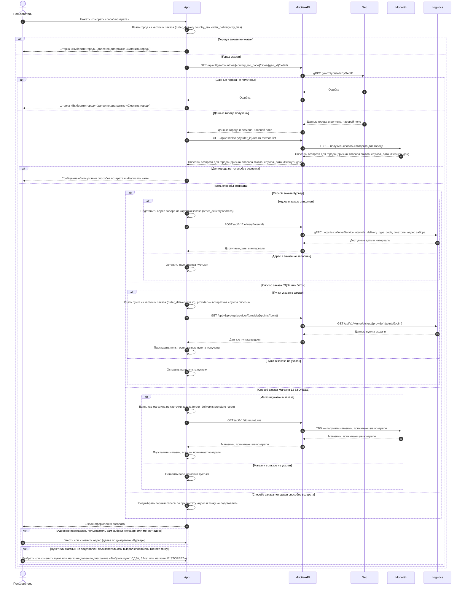

**Альтернативная последовательность "Сменить город"**

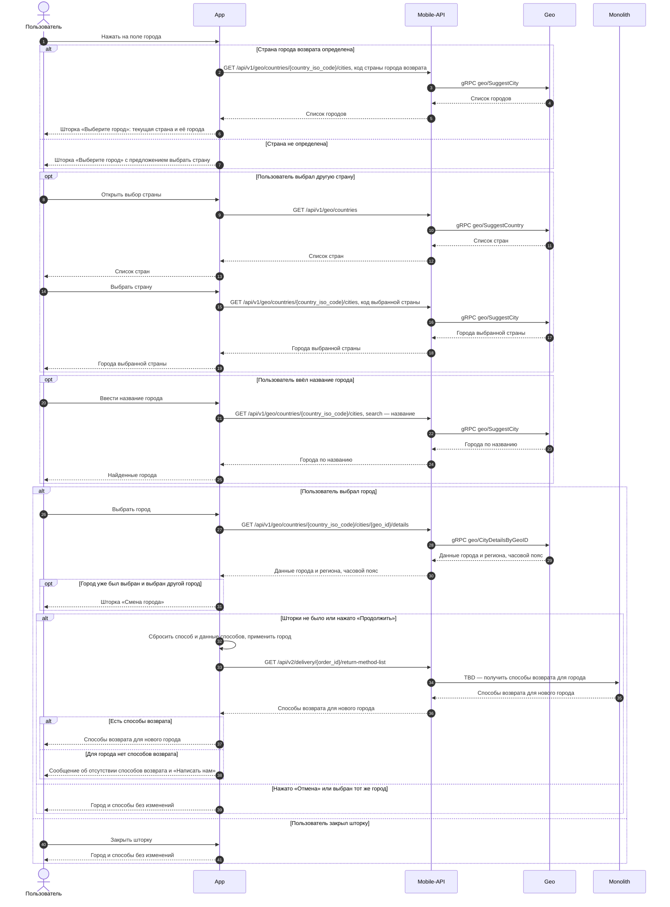

**Альтернативная последовательность "Курьер"**

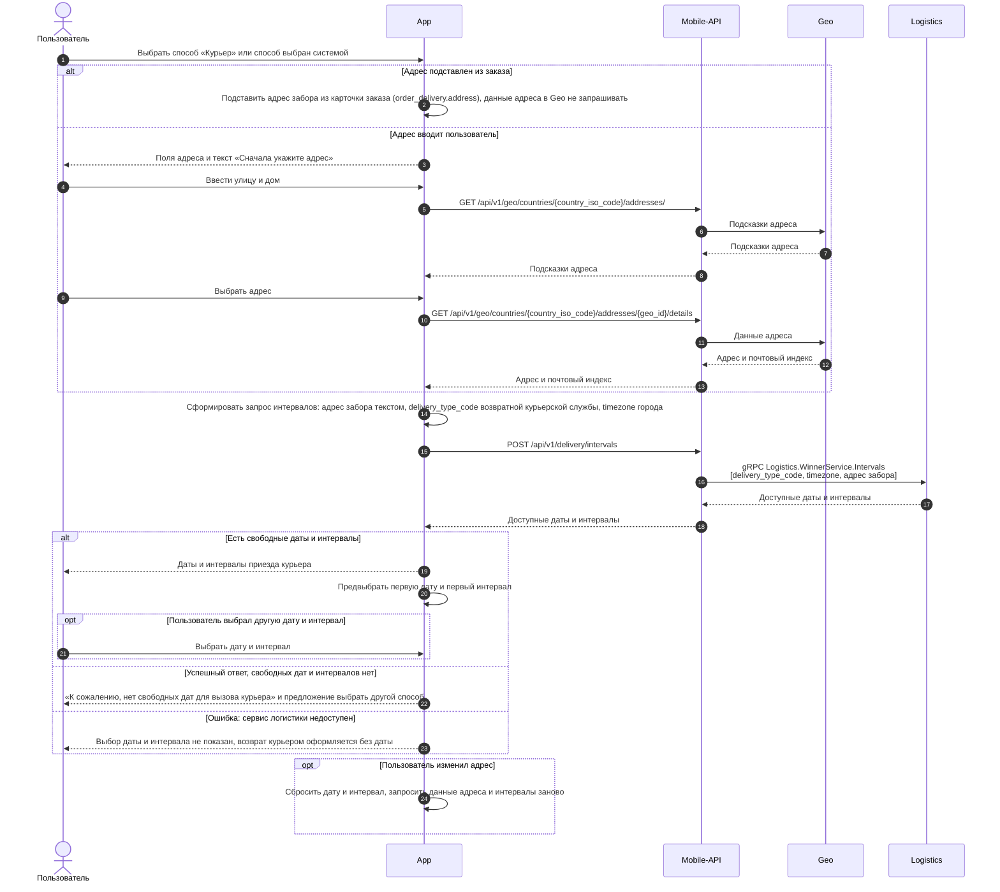

**Альтернативная последовательность "Выбрать пункт СДЭК, 5Post или магазин 12 STOREEZ"**

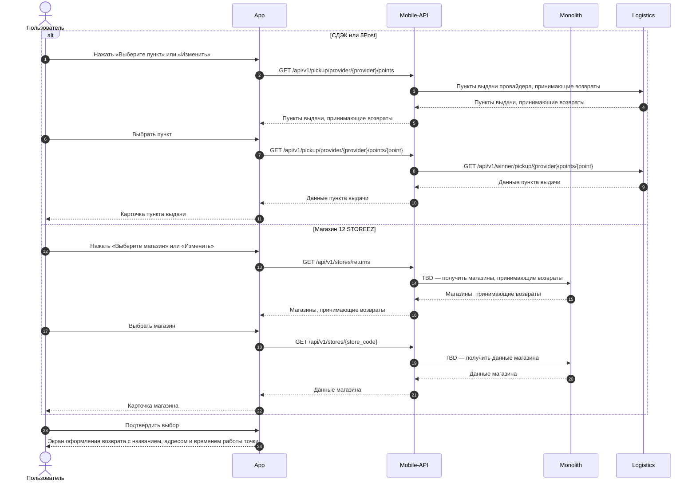

### Логика сценария

**Основная последовательность "Выбрать способ возврата"**

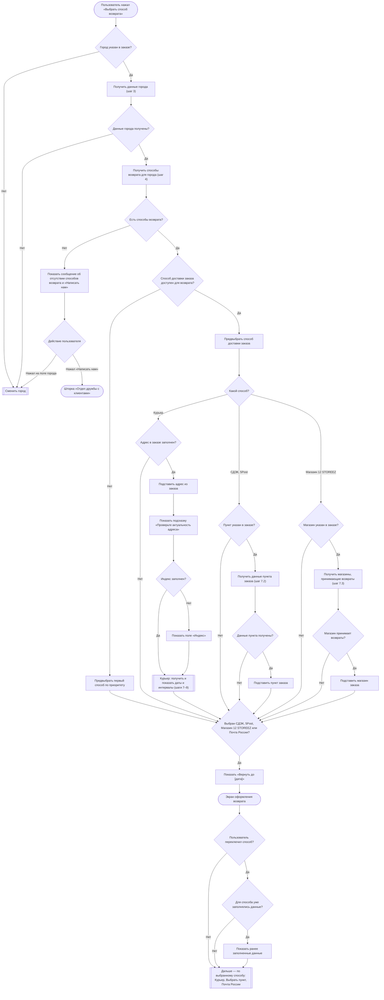

**Альтернативная последовательность "Сменить город"**

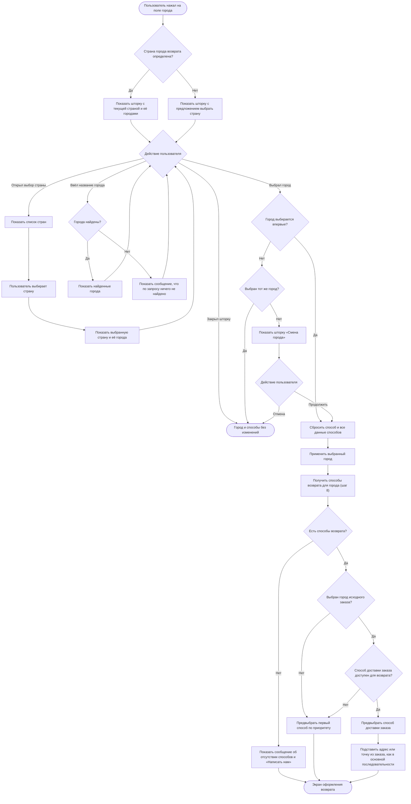

**Альтернативная последовательность "Курьер"**

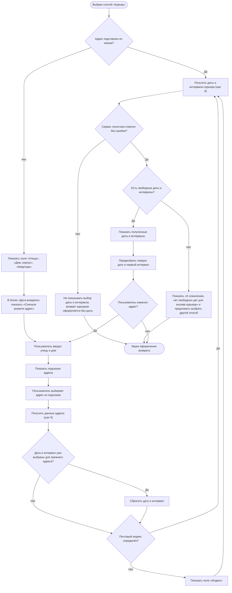

**Альтернативная последовательность "Выбрать пункт СДЭК, 5Post или магазин 12 STOREEZ"**

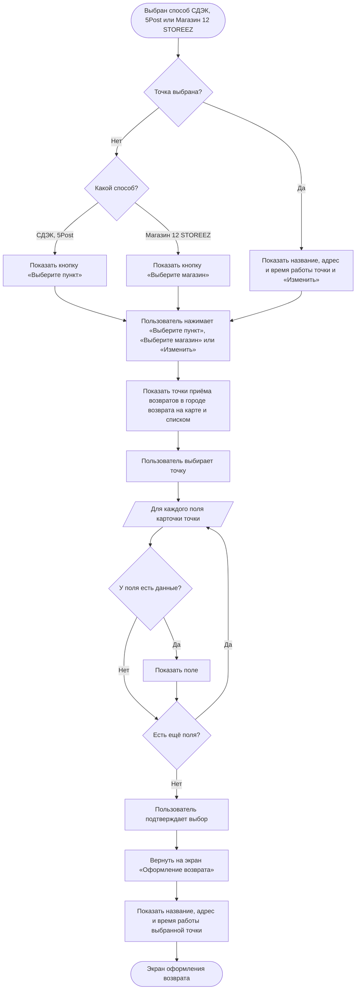

**Альтернативная последовательность "Почта России"**

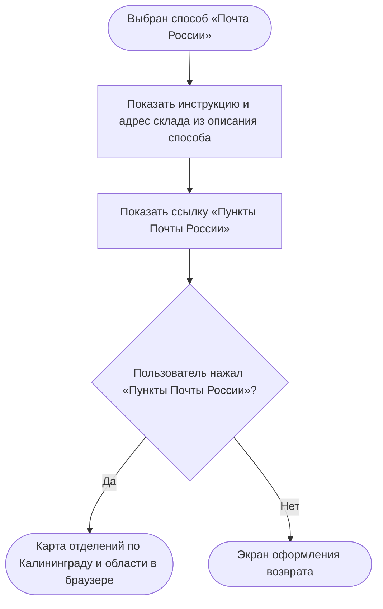

### Логика бэкенда

**`GET /получить способы возврата для города` — новый метод**

Текущий метод списка способов возврата используется выпущенными версиями приложения, поэтому его логика не меняется: для новой логики создаётся новый метод.

* отбирать способы возврата по возвратным службам, которые работают в городе возврата: у возвратной службы свой тип доставки и свой список городов (возможно), отдельно от служб доставки заказов
* определять возвратную службу способа и способ «как в заказе» через справочник соответствия, а не через соответствие, заданное в коде
* отдавать способы в порядке приоритета способов возврата
* отмечать способ, совпадающий со способом доставки заказа, если город возврата — город заказа (`is_order_method`)
* отдавать по каждому способу службу и код типа доставки возвратной службы (`delivery_type_code`)
* для СДЭК, 5Post, Магазина 12 STOREEZ и Почты России отдавать дату «Вернуть до» — текущая дата + 10 календарных дней
* поддержать новые способы «Магазин 12 STOREEZ» и «Почта России»

**`GET /получить магазины, принимающие возвраты` — новый метод**

* отдавать магазины которые допускают возврат в выбранном городе

**`GET /получить данные магазина` — новый метод**

* отдавать детальную информацию по магазину (по макету): название, адрес, как добраться, время работы, телефон и парковку магазина

**`GET /получить пункты выдачи` (`GET /api/v1/pickup/provider/{provider}/points`) — доработка метода**

* передавать в сервис логистики возвратную службу выбранного способа (`provider`), чтобы получить только пункты, принимающие возвраты; формат передачи согласуется с командой логистики

**`POST /получить даты и интервалы курьера` (`POST /api/v1/delivery/intervals`) — доработка метода**

* принимать адрес забора как адрес отправки, код типа доставки возвратной курьерской службы и часовой пояс города (`delivery_type_code`, `timezone`)

**Логика метода `GET /получить способы возврата для города`**

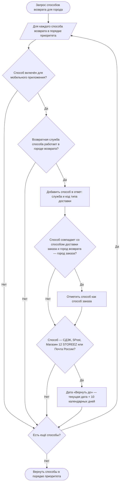

### Задачи

| Название | Ссылка |
|---|---|
| Добавить признак приёма возвратов | https://tracker.yandex.ru/ECOMDEV-2359 |

### Определить способ возврата денежных средств US 1.4

Как клиент, оформляющий возврат, я хочу понимать, каким способом мне будут возвращены денежные средства, и при необходимости указать банковские реквизиты, чтобы получить денежные средства за возвращённые изделия

### Дизайн

Ссылка на Figma: https://www.figma.com/design/u5Fe5N4lypCdqgZn6533F2/%F0%9F%93%B1-06.-Profile--Redesign-?node-id=7240-58493&t=KUiaYx2kcuq61I5X-4

### Сценарий

#### Предусловие

1. Пользователь находится на экране «Оформление возврата» (US 1.3)

#### Основная последовательность "Определить способ возврата денежных средств"

| Шаг | Исполнитель | Описание |
|---|---|---|
| 1 | Бэкенд | Вернуть в ответе метода `GET /получить карточку заказа` (US 1.1):<br>— `return.is_bank_data_required` — нужны ли банковские реквизиты: `true`, если заказ оплачен при получении или полностью или частично подарочным сертификатом;<br>— `return.refund.message` — текст о том, куда вернутся деньги; не возвращается, если нужны банковские реквизиты;<br>— сумму и баллы к возврату за каждое изделие |
| 2 | APP | Определить, нужны ли банковские реквизиты: взять `return.is_bank_data_required` из ответа метода `GET /получить карточку заказа` (US 1.1) |
| 3 | APP | Отобразить в блоке «Возврат средств» текст о том, куда вернутся деньги, из ответа метода `GET /получить карточку заказа`. Блок «Банковские реквизиты» не отображать<br><br>**Опционально**<br>1. Если `return.is_bank_data_required = true`, то блок «Возврат средств» не отображать, а в блоке «Банковские реквизиты» отобразить кнопку «Укажите банковские реквизиты». См. альтернативную последовательность "Указать банковские реквизиты" |
| 4 | APP | Отобразить текст «Если вам необходимо получить возврат другим способом или на другие реквизиты, пожалуйста, обратитесь в Отдел дружбы с клиентами» со ссылкой «Отдел дружбы с клиентами»<br><br>**Опционально**<br>1. Если `return.is_bank_data_required = true`, то текст не отображать<br>2. Если пользователь нажал на ссылку «Отдел дружбы с клиентами», то открыть шторку «Отдел дружбы с клиентами» с часами работы отдела и действиями «Позвонить» и «Написать» |
| 5 | APP | Отобразить в блоке «Итого к возврату» сумму денежных средств за выбранные изделия — сумма к возврату за изделие из ответа метода `GET /получить карточку заказа` по каждому выбранному изделию<br><br>**Опционально**<br>1. Если по выбранным изделиям есть баллы к возврату, то отобразить их количество в блоке «Баллы к возврату» |

#### Альтернативная последовательность "Указать банковские реквизиты"

| Шаг | Исполнитель | Описание |
|---|---|---|
| 1 | Пользователь | Нажимает «Укажите банковские реквизиты» |
| 2 | APP | Отобразить экран «Банковские реквизиты» с пустыми полями. Реквизиты из предыдущих возвратов не подставлять |
| 3 | Пользователь | Заполняет поля |
| 4 | Пользователь | Нажимает «Продолжить». Кнопка «Продолжить» активна всегда |
| 5 | APP | Проверить заполнение полей: обязательны все поля, кроме «Номер банковской карты»<br><br>**Опционально**<br>1. Если номер счёта начинается с «30232810», то поле «Номер банковской карты» тоже обязательно<br>2. Если обязательные поля не заполнены, то не выполнять переход и подсветить все незаполненные поля красным контуром; поле «Номер банковской карты» — с текстом «Укажите номер банковской карты» |
| 6 | APP | Вернуть пользователя на экран «Оформление возврата» и отобразить сохранённые реквизиты: ФИО получателя, название банка и номер счёта<br><br>**Опционально**<br>1. Если пользователь нажал на блок с заполненными реквизитами, то открыть экран «Банковские реквизиты» с заполненными данными; после изменения и нажатия «Продолжить» проверить поля, как на шаге 5, и обновить реквизиты на экране «Оформление возврата» |

**Комментарий**

На уточнении:

1. Предзаполнять ли поля «Фамилия получателя», «Имя получателя» и «Отчество получателя» данными клиента — фамилией и именем из заказа, отчеством из профиля ЛК, если оно заполнено, — с возможностью изменить. «БИК банка», «Название банка», «Номер лицевого счета» и «Номер банковской карты» клиент в любом случае заполняет сам?
2. Оставить ли поле «Номер банковской карты» обязательным всегда, как в текущем приложении и текущей проверке на сервере, а не только для счёта, начинающегося с «30232810»?
3. Правила расчёта баллов к возврату не утверждены — [вопросы по баллам](../questions/refund-bonus_questions.md).

### Логика сценария

**Основная последовательность "Определить способ возврата денежных средств"**

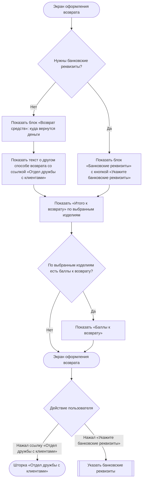

**Альтернативная последовательность "Указать банковские реквизиты"**

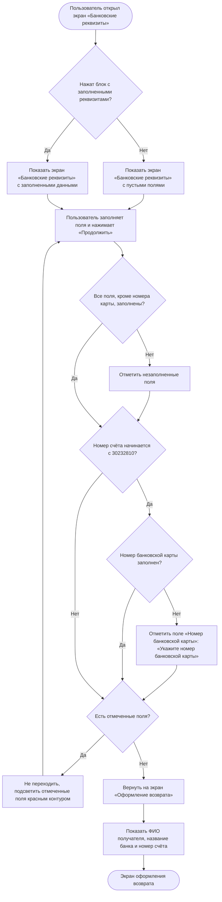

### Задачи

| Название | Ссылка |
|---|---|

### Подтвердить создание заявки на возврат US 1.5

Как клиент, я хочу отправить заполненную форму и увидеть экран подтверждения заявки, чтобы быть уверенным, что мой возврат принят в работу, и легко отслеживать его статус

### Дизайн

Ссылка на Figma: https://www.figma.com/design/u5Fe5N4lypCdqgZn6533F2/%F0%9F%93%B1-06.-Profile--Redesign-?node-id=9066-130891&t=KUiaYx2kcuq61I5X-4

### Сценарий

#### Предусловие

1. Пользователь заполнил данные на экране «Оформление возврата» (US 1.3, US 1.4)

#### Основная последовательность "Подтвердить создание заявки на возврат"

| Шаг | Исполнитель | Описание |
|---|---|---|
| 1 | Пользователь | Нажимает «Подтвердить возврат» |
| 2 | APP | Проверить заполнение обязательных полей и блоков для выбранного способа возврата по таблице «Проверка обязательных полей»<br><br>**Опционально**<br>1. Если обязательные поля или блоки не заполнены, то заявку не отправлять, подсветить все незаполненные поля и блоки с текстом ошибки и прокрутить экран к первому из них. Кнопка «Подтвердить возврат» остаётся активной |
| 3 | APP | Вызвать метод `POST /создать заявку на возврат` (новый метод).<br><br>Передать выбранные изделия и причину по каждому, город, способ возврата, адрес или точку передачи, дату и интервал курьера, банковские реквизиты (если нужны). На время запроса отобразить на кнопке «Подтвердить возврат» индикатор загрузки; повторное нажатие недоступно |
| 3.1 | Бэкенд | Проверить срок подачи заявки, доступность выбранных изделий и данные заявки — те же проверки, что на шаге 2, — и создать заявку. Статус позиций заказа из заявки изменить целиком. Статус заказа не менять. Для способов СДЭК, 5Post, Магазин 12 STOREEZ и Почта России рассчитать дату «Вернуть до» — дата создания заявки + 10 календарных дней<br><br>**Опционально**<br>1. Если срок подачи заявки истёк, то заявку не создавать и вернуть ошибку срока подачи<br>2. Если данные заявки не прошли проверку, то заявку не создавать и вернуть ошибку с полем или блоком<br>3. Если заявка курьером создаётся без даты и интервала, потому что сервис логистики был недоступен, то создать заявку в отдельном статусе для обработки Отделом дружбы с клиентами |
| 4 | APP | Если заявка создана, то закрыть экран «Оформление возврата» и отобразить поверх экрана заказа шторку подтверждения «Заявка уже у нас» с кнопкой «К возврату». Содержание шторки зависит от способа возврата: для способа «Курьер» — сообщение, что с клиентом свяжутся, если найти курьера на выбранную дату не получится<br><br>**Опционально**<br>1. Если бэкенд вернул ошибку срока подачи, то отобразить сообщение о недоступности оформления возврата<br>2. Если бэкенд вернул ошибку проверки данных (не заполнено обязательное поле, не выбрана точка, не заполнены банковские реквизиты, не указан номер банковской карты для счёта, начинающегося с «30232810»), то подсветить поле или блок с ошибкой, как на шаге 2<br>3. Если при создании заявки произошла другая ошибка, то отобразить сообщение, что заявку не удалось создать. Введённые данные сохраняются, пользователь может повторить попытку с шага 1 |
| 5 | Пользователь | Нажимает «К возврату» или закрывает шторку |
| 6 | APP | Открыть экран созданного возврата по идентификатору возврата (US 3)<br><br>**Опционально**<br>1. Если пользователь закрыл шторку, то вызвать метод `GET /получить карточку заказа` (`GET /api/orders/{id}`, доработка метода) и отобразить обновлённый экран заказа (US 1.1) |

**Проверка обязательных полей**

| Способ возврата | Поле или блок | Когда обязательно | Подсветка |
|---|---|---|---|
| Курьер | «Улица» | Всегда | Красный контур, текст «Укажите улицу» |
| Курьер | «Дом, корпус» | Всегда | Красный контур, текст «Укажите дом» |
| Курьер | «Индекс» | Если поле отображается | Красный контур, текст «Укажите индекс» |
| СДЭК, 5Post | Блок «Пункт возврата» | Всегда | Текст «Укажите пункт ПВЗ» |
| Магазин 12 STOREEZ | Блок «Магазин 12 STOREEZ» | Всегда | Текст «Укажите магазин» |
| Курьер | Способ возврата | Если сервис логистики вернул успешный ответ с пустым списком дат и интервалов: курьер недоступен, нужно выбрать другой способ | Текст «К сожалению, нет свободных дат для вызова курьера» |
| Любой | Блок «Банковские реквизиты» | Если нужны банковские реквизиты | Текст «Укажите банковские реквизиты» красным со значком ошибки |

**Комментарий**

На уточнении:

1. Как называется статус заявки курьером без даты, и видит ли его клиент? Рабочий вариант статусов не утверждён — [диаграмма состояний](../diagrams/state/return-status_state.md).
2. Какой текст показать в окне «Заявка уже у нас», если заявка курьером оформлена без даты и интервала, потому что сервис логистики был недоступен?
3. Какая система будет мастером заявки на возврат — сайт или 1С, — и меняется ли после этого, кто присваивает номер заявки и в каком порядке заявка передаётся в RetailCRM и 1С?

### Взаимодействие компонентов

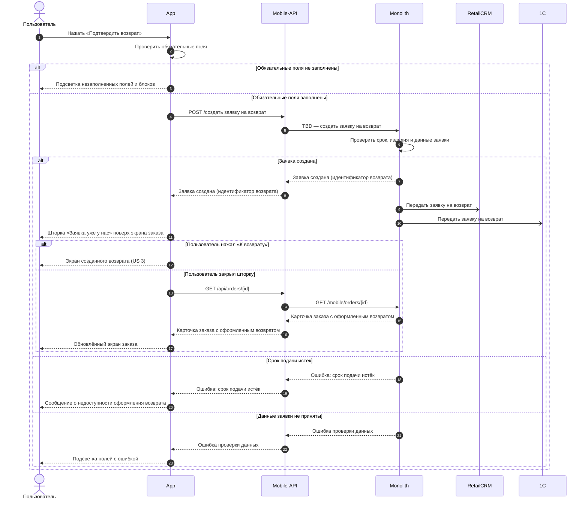

### Логика сценария

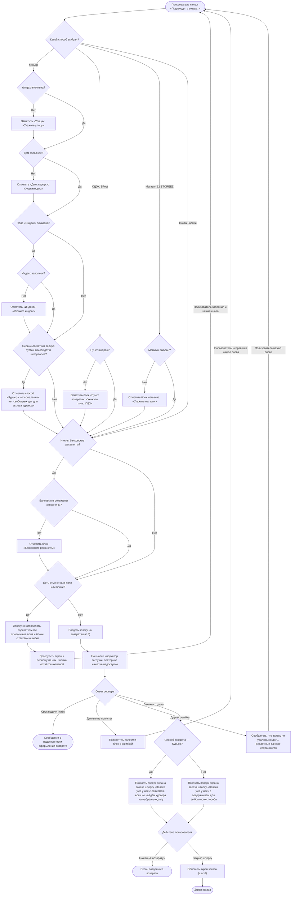

### Логика бэкенда

**`POST /создать заявку на возврат` — новый метод**

* проверять, что заказ принадлежит клиенту и срок оформления заявки не истёк — по той же дате, что в ответе метода `GET /получить карточку заказа` (`return.request_until_date`, US 1.1)
* проверять, что выбранные изделия ещё доступны для возврата: по позиции нет активной заявки и изделий не больше, чем доступно
* проверять данные по выбранному способу: адрес, индекс, дату и интервал курьера (если переданы), пункт или магазин, банковские реквизиты, если нужны, и номер карты для счёта, начинающегося с «30232810», — те же проверки, что в приложении
* создавать заявку и по одной позиции возврата на каждое изделие с причиной возврата
* сохранять способ возврата и его данные: адрес, дату и интервал курьера, пункт или магазин со слепком названия, адреса и режима работы
* сохранять банковские реквизиты в заявке, если они нужны
* для СДЭК, 5Post, Магазина 12 STOREEZ и Почты России считать дату «Вернуть до» — дата создания заявки + 10 календарных дней
* менять статус позиций заказа из заявки целиком; статус заказа не меняется — сейчас при оформлении возврата заказ получает статус «Возврат из ЛК», эту смену убрать
* записывать снимок заявки с позициями и их статусами в историю изменений заявки
* возвращать идентификатор созданной заявки, а при ошибке — ошибку срока подачи или ошибку с полем или блоком
* принимать заявку курьером без даты и интервала: её создавать в отдельном статусе для обработки Отделом дружбы с клиентами. Дата и интервал курьера, если переданы, проверяются, как сейчас
* после того как Отдел дружбы с клиентами согласовал с клиентом дату и интервал или перенёс их по просьбе клиента, принимать их из RetailCRM и сохранять в заявке
* после создания передавать заявку в RetailCRM и 1С асинхронно

**Логика метода `POST /создать заявку на возврат`**

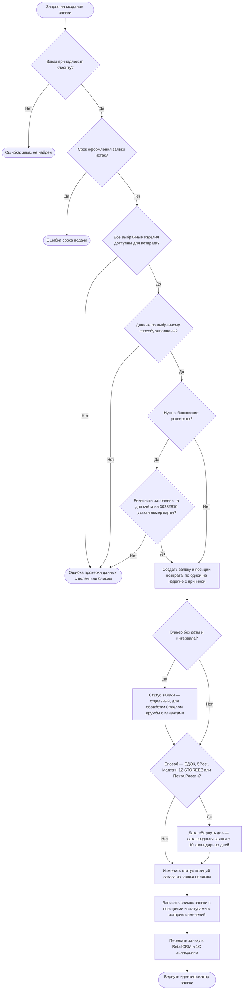

### Задачи

| Название | Ссылка |
|---|---|

## Просмотр возвратов

### Просмотреть список возвратов US 2

Как авторизованный клиент, я хочу видеть список оформленных возвратов, чтобы находить нужную заявку на возврат, понимать текущее состояние и перейти к подробной информации

### Дизайн

Ссылка на Figma: https://www.figma.com/design/u5Fe5N4lypCdqgZn6533F2/%F0%9F%93%B1-06.-Profile--Redesign-?node-id=7987-111023&t=KUiaYx2kcuq61I5X-4

### Сценарий

#### Предусловие

1. Пользователь авторизован

#### Основная последовательность "Просмотреть список возвратов"

| Шаг | Исполнитель | Описание |
|---|---|---|
| 1 | Пользователь | Открывает экран «Возврат заказов» из пункта «Возврат заказов» на экране «Профиль» |
| 2 | APP | Вызвать метод `GET /получить список возвратов` (новый метод) |
| 3 | APP | Отобразить список возвратов. Для каждого возврата — информацию, по которой можно определить возврат и понять его текущее состояние<br><br>**Опционально**<br>1. Если у пользователя нет оформленных возвратов, то отобразить сообщение об отсутствии оформленных возвратов и кнопку перехода в каталог |
| 4 | Пользователь | Выбирает возврат |
| 5 | APP | Открыть экран возврата (US 3) |

**Примечание**

- Статус возврата показывается под клиентским названием, которое задаётся в админке. Если несколько статусов объединены в админке в группу, клиент видит их как один статус с общим названием.

### Взаимодействие компонентов

```mermaid
sequenceDiagram
    autonumber
    actor U as Пользователь
    participant APP as App
    participant API as Mobile-API
    participant MON as Monolith

    U->>APP: Открыть экран «Возврат заказов»
    APP->>API: GET /получить список возвратов
    API->>MON: GET /получить список возвратов
    MON-->>API: Список возвратов
    API-->>APP: Список возвратов
    APP-->>U: Список возвратов или сообщение об их отсутствии
```

### Просмотреть детальную информацию по заявке на возврат US 3

Как клиент, оформивший возврат, я хочу иметь полный доступ к информации и материалам по своей заявке, чтобы легко контролировать статус возврата на каждом этапе и оперативно получать нужные данные без обращения в поддержку

### Дизайн

Ссылка на Figma: https://www.figma.com/design/u5Fe5N4lypCdqgZn6533F2/%F0%9F%93%B1-06.-Profile--Redesign-?node-id=7992-114681&t=KUiaYx2kcuq61I5X-4

### Сценарий

#### Предусловие

1. Заявка на возврат создана

#### Основная последовательность "Просмотреть детальную информацию по заявке на возврат"

| Шаг | Исполнитель | Описание |
|---|---|---|
| 1 | Пользователь | Открывает экран возврата |
| 2 | APP | Вызвать метод `GET /получить детальную информацию по заявке на возврат` (новый метод) |
| 3 | APP | Отобразить экран возврата по данным заявки. Плашка статуса не раскрывается<br><br>**Опционально**<br>1. Если для способа возврата не задан текст инструкции «Что дальше», то блок не отображать<br>2. Если способ возврата — СДЭК, 5Post или Магазин 12 STOREEZ, то отобразить кнопку «Смотреть на карте» |
| 4 | Пользователь | Нажимает «Копировать» рядом с номером возврата |
| 5 | APP | Скопировать номер возврата в буфер обмена и отобразить всплывающее уведомление «Номер возврата скопирован»<br><br>**Опционально**<br>1. Если пользователь нажал на карточку товара в блоке «Изделия к возврату», то открыть карточку этого товара в каталоге<br>2. Если пользователь нажал «Смотреть на карте», то открыть внешнее приложение карт, установленное на устройстве, с точкой передачи из заявки (механизм перехода из раздела «Бронирования»). Изменить точку передачи нельзя |

**Примечание**

1. Экран возврата содержит текущий статус, инструкцию «Что дальше», способ возврата, способ выплаты и состав изделий. В блоке «Способ возврата» показываются данные выбранного способа: для курьера — адрес забора, дата и интервал приезда курьера; для СДЭК, 5Post и Магазина 12 STOREEZ — точка сдачи и «Вернуть до [дата]»; для Почты России — «Вернуть до [дата]». Дата и интервал приезда курьера — те, что выбраны при оформлении. Если клиент перенёс приезд, договорившись с курьером или транспортной компанией, на экране возврата остаются прежние дата и интервал. Если дату и интервал согласовал или перенёс Отдел дружбы с клиентами, на экране возврата отображаются новые дата и интервал.
2. Дата «Вернуть до» — срок передачи изделий в точку сдачи, сохранённый в заявке при её создании (US 1.5). Это не дата «Можно вернуть изделия до» на экране заказа (US 1.1): та дата — срок, до которого можно оформить заявку.
3. Если дата «Вернуть до» прошла, заявка автоматически не отменяется: автоотмена — Post-MVP (US 5). Если через 30 дней после создания заявки изделия не поступили на склад или в магазин, заявка переходит в статус «Подтверждение возврата», и её обрабатывает Отдел дружбы с клиентами.
4. Статус возврата показывается под клиентским названием, которое задаётся в админке. Если несколько статусов объединены в админке в группу, клиент видит их как один статус с общим названием.
5. Срок возврата денег считается от поступления изделий на склад, при возврате в магазин — от приёмки изделий в магазине: компания отправляет деньги в течение 3 дней, срок зачисления зависит от банка клиента. Клиенту сообщается только срок отправки, одной формулировкой для всех способов оплаты, — в тексте блока «Что дальше», который заводится в админке, поэтому текст для магазина отличается от текста для остальных способов.

**Комментарий**

На уточнении:

1. Какая система переводит заявку в «Подтверждение возврата» через 30 дней после создания — сайт или RetailCRM?

### Взаимодействие компонентов

```mermaid
sequenceDiagram
    autonumber
    actor U as Пользователь
    participant APP as App
    participant API as Mobile-API
    participant MON as Monolith
    participant MAP as Приложение карт

    U->>APP: Открыть экран возврата
    APP->>API: GET /получить детальную информацию по заявке на возврат
    API->>MON: GET /получить детальную информацию по заявке на возврат
    MON-->>API: Данные заявки
    API-->>APP: Данные заявки
    APP-->>U: Экран возврата

    opt Смотреть на карте
        U->>APP: Нажать «Смотреть на карте»
        APP->>MAP: Открыть точку передачи из заявки
        MAP-->>U: Точка на карте
    end
```

### Получить документы и QR-код возврата US 3.1

Как клиент, оформивший возврат, я хочу получать в карточке возврата заявление, кассовый чек возврата и QR-код для сдачи в магазине, чтобы сдать изделия в розничном магазине по заявке и иметь под рукой документы по возврату без обращения в поддержку

### Дизайн

Ссылка на Figma: https://www.figma.com/design/u5Fe5N4lypCdqgZn6533F2/%F0%9F%93%B1-06.-Profile--Redesign-?node-id=8007-118957&t=KUiaYx2kcuq61I5X-4

### Сценарий

#### Предусловие

1. Пользователь находится на экране возврата (US 3)

#### Основная последовательность "Получить документы и QR-код возврата"

| Шаг | Исполнитель | Описание |
|---|---|---|
| 1 | APP | Отобразить на экране возврата кнопку «Скачать заявление»<br><br>**Опционально**<br>1. Если способ возврата — Магазин 12 STOREEZ, то отобразить кнопку «Показать QR-код»<br>2. Если по заявке выполнен возврат денежных средств и сформирован кассовый чек возврата, то отобразить кнопку «Скачать чек» |
| 2 | Пользователь | Нажимает «Скачать заявление» |
| 3 | APP | Вызвать метод `GET /получить заявление на возврат` (новый метод) и сохранить PDF-файл заявления на устройство пользователя<br><br>**Опционально**<br>1. Если пользователь нажал «Скачать чек», то вызвать метод `GET /получить кассовый чек возврата` (новый метод) и сохранить файл чека на устройство<br>2. Если пользователь нажал «Показать QR-код», то отобразить шторку с QR-кодом заявки для приёма изделий в магазине. QR-код можно предъявить с экрана без печати и без подключения к интернету |

**Примечание**

1. Где формируются заявление и кассовый чек возврата и что содержит QR-код, определяется по итогам проработки интеграции с 1С.
2. Если клиент не может показать QR-код, сотрудник магазина находит заявку по ФИО, номеру телефона или номеру заказа.

### Взаимодействие компонентов

```mermaid
sequenceDiagram
    autonumber
    actor U as Пользователь
    participant APP as App
    participant API as Mobile-API
    participant MON as Monolith

    U->>APP: Нажать «Скачать заявление»
    APP->>API: GET /получить заявление на возврат
    API->>MON: GET /получить заявление на возврат
    MON-->>API: PDF заявления
    API-->>APP: PDF заявления
    APP-->>U: Файл заявления на устройстве

    opt Скачать чек
        U->>APP: Нажать «Скачать чек»
        APP->>API: GET /получить кассовый чек возврата
        API->>MON: GET /получить кассовый чек возврата
        MON-->>API: Файл чека
        API-->>APP: Файл чека
        APP-->>U: Файл чека на устройстве
    end

    opt Показать QR-код
        U->>APP: Нажать «Показать QR-код»
        APP-->>U: Шторка с QR-кодом заявки
    end
```

### Отменить заявку на возврат US 4

Как клиент, оформивший заявку на возврат, я хочу иметь возможность самостоятельно отменить созданную заявку, чтобы не возвращать товар, если я передумал, или оформить новую заявку, если допустил ошибку (выбрал не тот товар или способ сдачи)

### Сценарий

#### Предусловие

1. Пользователь находится на экране возврата (US 3)

#### Основная последовательность "Отменить заявку на возврат"

| Шаг | Исполнитель | Описание |
|---|---|---|
| 1 | APP | Отобразить возможность отменить заявку, если заявка в статусе, допускающем отмену<br><br>**Опционально**<br>1. Если заявка в статусе, в котором отмена запрещена, — изделия получены компанией: поступили на склад или приняты в магазине, — то возможность отмены не отображать |
| 2 | Пользователь | Инициирует отмену возврата |
| 3 | APP | Запросить подтверждение отмены<br><br>**Опционально**<br>1. Если пользователь отказался от отмены, то вернуть его на экран возврата без изменения статуса заявки |
| 4 | Пользователь | Подтверждает отмену |
| 5 | APP | Вызвать метод `POST /отменить заявку на возврат` (новый метод) |
| 5.1 | Бэкенд | Отменить заявку: перевести её в статус «Возврат отменён» и вернуть позициям заказа статус, который был до создания заявки<br><br>**Опционально**<br>1. Если заявка в статусе, в котором отмена запрещена, то заявку не отменять и вернуть ошибку |
| 6 | APP | Отобразить статус заявки «Возврат отменён». Изделия из отменённой заявки снова доступны для оформления возврата, если срок возврата не истёк (US 1.1)<br><br>**Опционально**<br>1. Если бэкенд вернул ошибку отмены, то отобразить сообщение о невозможности отмены возврата |

**Комментарий**

На уточнении:

1. В каких статусах заявки клиент может её отменить: только в «Заявка на возврат принята», или пока изделия не поступили на склад или в магазин? Рабочий вариант статусов не утверждён — [диаграмма состояний](../diagrams/state/return-status_state.md).

### Взаимодействие компонентов

```mermaid
sequenceDiagram
    autonumber
    actor U as Пользователь
    participant APP as App
    participant API as Mobile-API
    participant MON as Monolith

    U->>APP: Подтвердить отмену заявки
    APP->>API: POST /отменить заявку на возврат
    API->>MON: POST /отменить заявку на возврат
    alt Отмена выполнена
        MON-->>API: Заявка отменена
        API-->>APP: Заявка отменена
        APP-->>U: Статус «Возврат отменён»
    else Статус заявки не допускает отмену
        MON-->>API: Ошибка: отмена невозможна
        API-->>APP: Ошибка: отмена невозможна
        APP-->>U: Сообщение о невозможности отмены возврата
    end
```

**Примечание**

1. Запрет отмены обеспечивает бэкенд: запрос отмены заявки в статусе, в котором отмена запрещена, отклоняется, даже если отправлен в обход интерфейса или статус изменился, пока пользователь был на экране возврата. Скрытие возможности отмены в интерфейсе — только для удобства пользователя.
