## Полезные материалы

| Название | Ссылка |
|---|---|
| Макеты (МП) | https://www.figma.com/design/u5Fe5N4lypCdqgZn6533F2/%F0%9F%93%B1-06.-Profile--Redesign-?node-id=5547-145537&t=qoHbaQAbTlMNGNZX-4 |
| Макеты (сайт) | https://www.figma.com/design/eXX6wwylh99ztlNUgziZia/%25F0%259F%2596%25A5-05.-Profile--Redesign-?node-id=6317-86695&t=fKHpK9cmN3IoE3WY-0 |
| Эпик | https://tracker.yandex.ru/ITGENERAL-33 |
| Под эпик | https://tracker.yandex.ru/ECOMDEV-2246<br>https://tracker.yandex.ru/ECOMDEV-2256 |
| Маппинг статусов Post MVP | https://docs.google.com/spreadsheets/d/1BBenI7YT8DtquR58krRBBzdwoCjFuYeCKyyl9-66d4Q/edit?gid=2096004650#gid=2096004650 |
| BRD | https://docs.google.com/document/d/1rZKCC6zf38xjrW-WQuvGZcEYEMoMK7TBrHrj91QzOpA/edit?tab=t.5rgjndw51swl |
| Причины возвратов | https://docs.google.com/spreadsheets/d/1bBBNP4z9KuJfFFw6_zToKsN-TS_cBT0x/edit?gid=278087742#gid=278087742 |
| Названия элементов интерфейса | [ui-terms.md](../ui/ui-terms.md) |
| Элементы экранов оформления возврата | [return-creation-mobile-mvp_ui.md](../ui/return-creation-mobile-mvp_ui.md) |

## Открытые вопросы

*US 1.1 Отобразить кнопку оформления возврата на экране заказа*

1. Что происходит с выпущенными версиями приложения после включения нового возврата: обязательное обновление приложения через настройку «Обязательное обновление для Android / iOS», скрытие кнопки возврата в старых версиях или отказ в создании возврата по-старому с просьбой обновить приложение?
2. Включается ли новый возврат переключателем в админке, и что видит клиент, пока переключатель выключен: старый возврат или кнопки возврата нет?
3. Работает ли обязательное обновление приложения на iOS и Android?
4. Отсекаются ли сейчас брони и покупки в магазине по чеку текущей проверкой статуса заказа? Если нет — в «Логику бэкенда» нужен пункт «Брони и покупки в магазине по чеку возврат в ЛК не допускают» (под вопросом).

*US 1.3 Выбрать способ возврата*

1. Работают ли курьеры СДЭК во всех населённых пунктах с офисом СДЭК или только там, где офис принимает посылки? Там, где офиса СДЭК нет, курьера нет. Список ФИАС населённых пунктов, где доступен курьер СДЭК, запрошен у СДЭК — System Analyst (BTS) — Елена Васильева.

*US 1.4 Определить способ возврата денежных средств*

1. Предзаполнять ли ФИО получателя данными клиента с возможностью изменить? Фамилию и имя — из заказа, отчество — из профиля ЛК, если заполнено. 
    - БИК, название банка, номер лицевого счёта и номер карты клиент в любом случае заполняет сам.
2. Оставить ли поле «Номер банковской карты» обязательным всегда, как в текущем приложении и текущей проверке на сервере, а не только для счёта, начинающегося с «30232810»?
3. Правила расчёта баллов к возврату не утверждены — [вопросы по баллам](../questions/refund-bonus_questions.md).
4. Как считается сумма к возврату за изделие: цена с учётом скидок, оплаты подарочным сертификатом и баллами? Где описано правило расчёта?

*US 1.5 Подтвердить создание заявки на возврат*

1. Какой текст показать в окне «Заявка уже у нас», если заявка курьером оформлена без даты и интервала, потому что логистика не вернула даты и интервалы?

*US 2 Просмотреть список возвратов*

1. Показывать ли в списке возвраты, оформленные до запуска нового процесса? Предлагается не показывать: по старой схеме возврат менял заказ, отдельной заявки на возврат не было.

*US 3 Просмотреть детальную информацию по заявке на возврат*

1. Какая система переводит заявку в «Подтверждение возврата» через 30 дней после создания — сайт или RetailCRM?
2. При нажатии на изделие на экране возврата открывается карточка товара в каталоге?

*US 3.1 Получить документы и QR-код возврата*

1. Где формируются заявление и кассовый чек возврата и что содержит QR-код?

*US 4 Отменить заявку на возврат*

1. При отмене заявки кто отменяет уже созданный возвратный заказ в СДЭК или 5Post и вызов курьера: наш бэкенд, RetailCRM или Отдел дружбы с клиентами вручную?

## Глоссарий

| Термин | Определение |
|---|---|
| Активная заявка | Заявка на возврат в любом статусе, кроме «Возврат отменён», в том числе «Возврат принят» и «Возврат завершён». Возврат, отклонённый складом по итогам проверки, имеет статус «Возврат отменён». |
| Дата получения заказа | Дата завершения заказа |
| Последний день оформления заявки | Последний день, когда клиент может оформить заявку на возврат по заказу |
| TBD (to be defined — «будет определено») | Пометка у названия поля API или адреса метода: название предварительное. Требование задаёт смысл значения, а не его название |

## Не забыть про:

### Смежные системы

| Система | Что затрагивает возврат |
|---|---|
| Qlik | Отчётность по возвратам |
| Mindbox | Письма клиенту по смене статуса возврата, расчёт баллов к возврату |

## Основные принципы

1. Инструкции по способам возврата:
   - для каждого способа клиент видит два текста: описание на экране «Оформление возврата» и инструкцию «Что дальше» на экране созданного возврата;
   - оба текста заводятся в админке отдельно для каждого способа, содержание определяет бизнес.
2. Возврат части позиции:
   - одинаковые изделия хранятся в заказе одной позицией, и при создании заявки статус меняется у всей позиции;
   - если по позиции есть изделия в возврате, оставшиеся изделия видны в блоке «Ваш заказ», но в MVP выбрать их к возврату в приложении не получится: статус меняется у всей позиции. Их возврат оформляет Отдел дружбы с клиентами по обращению клиента. *Если появится способ возвращать остаток позиции в приложении, ограничение можно снять*;
   - при отмене заявки статус позиции возвращается, и её снова можно вернуть до последнего дня оформления заявки.
3. Номер возврата:
   - номер, который видит клиент, присваивает сайт для любой заявки: созданной клиентом, Отделом дружбы с клиентами или магазином;
   - формат — номер заказа и порядковый номер возврата по заказу: `598591-01`, …, `598591-10`. Отменённые заявки тоже учитываются в нумерации;
   - для обмена с 1С используется отдельный внутренний номер, клиенту он не показывается.
4. Права, статус и сроки проверяет бэкенд при каждом запросе. Приложение скрывает недоступные действия только для удобства пользователя.
5. При технической ошибке метода приложение показывает стандартное сообщение об ошибке, как в остальных разделах. Введённые пользователем данные не сбрасываются.


## Функциональные требования

### Админка

Для сценариев МП в админке нужны доработки, которых нет в текущих экранах.

1. Пользователь админки должен иметь возможность управлять внутренними (техническими) и клиентскими статусами возврата. Нескольким внутренним статусам можно задать одно клиентское название: клиент видит такие статусы как один статус.
2. Пользователь админки должен иметь возможность объединять внутренние статусы возврата в группы по этапам процесса (например, «Новые», «В работе», «Завершённые»). Группа видна только в админке.
3. Пользователь админки должен иметь возможность управлять данными способа возврата: название, описание на экране «Оформление возврата», инструкция для блока «Что дальше» экрана созданного возврата, включение на сайте и в МП.
4. Пользователь админки должен иметь возможность задавать порядок способов возврата: по нему формируется список способов и выбирается способ по умолчанию, если способ доставки заказа недоступен для возврата.
5. Пользователь админки должен иметь возможность включать и отключать способы возврата для города: по этой настройке метод получения способов возврата для города отдаёт только включённые для города способы.

## Данные БД

Предварительный состав: таблицы и поля уточняются при реализации. 

**Новые таблицы**

| Таблица | Что хранит |
|---|---|
| `cms_returns` | Заявка на возврат |
| `cms_return_positions` | Позиция возврата: одно изделие с причиной и статусом |
| `cms_return_statuses` | Справочник статусов заявки: системное и клиентское название, тип для значка (в работе, выполнен, отменён), код для обмена, признак «допускает отмену клиентом» |
| `cms_return_status_groups` | Группы статусов |
| `cms_return_position_statuses` | Справочник статусов позиции возврата |
| `cms_return_history` | История изменений заявки: снимок заявки с позициями после каждого изменения |
| `cms_return_refunds` | Куда и сколько вернуть денег по заявке |
| `cms_refund_methods` | Справочник способов возврата денег: на карту, по реквизитам, баллами и т. д. У каждого — название и признак «нужны реквизиты» |
| `cms_return_method_delivery_type` | Соответствие способов возврата возвратным службам и службам доставки заказа (способ «как в заказе») |

**Изменения существующих таблиц и настроек**

| Таблица или настройка | Что меняется |
|---|---|
| Настройка срока возврата | Новая настройка: срок для клиентов F&F — 30 дней |
| `cms_return_reasons`, `cms_return_reasons_groups` | Обновить причины и группы по таблице «Причины возвратов» |
| `cms_return_method` | Добавить новые способы «Магазин 12 STOREEZ» и «Почта России» |
| `cms_delivery_tk` | Новые возвратные службы со своим типом доставки |
| `cms_delivery_city` | Города возвратных служб (с ФИАС) |
| `cms_catalog_stock` | Новое поле: признак «Принимает возвраты» |

# User story

## Оформление возврата

### Отобразить кнопку оформления возврата на экране заказа US 1.1

Как клиент, совершивший покупку, я хочу иметь возможность начать оформление возврата из карточки заказа, чтобы самостоятельно оформить возврат без обращения в поддержку

### Дизайн

Ссылка на Figma: https://www.figma.com/design/u5Fe5N4lypCdqgZn6533F2/%F0%9F%93%B1-06.-Profile--Redesign-?node-id=7985-73307&t=qoHbaQAbTlMNGNZX-4

### Сценарий

#### Предусловие

1. Пользователь авторизован

#### Основная последовательность "Отобразить кнопку оформления возврата на экране заказа"

| Шаг | Исполнитель | Описание |
|---|---|---|
| 1 | Пользователь | Открывает экран заказа |
| 2 | APP | Вызвать метод `GET /получить карточку заказа` (`GET /api/orders/{id}`) |
| 3 | APP | Отобразить в блоке «Ваш заказ · N» позиции заказа с количеством изделий, оставшихся у клиента (`items[].remaining_quantity`, TBD). N — число строк в блоке, одна строка — одна позиция<br><br>**Опционально**<br>1. Если у клиента не осталось изделий позиции (`items[].remaining_quantity = 0`, TBD), то позицию в блоке «Ваш заказ · N» не отображать |
| 4 | APP | Отобразить после блока «Ваш заказ · N» блок «Оформлен возврат · N»: каждое изделие позиций в активных заявках на возврат (`items[].return_items`, TBD) — отдельной строкой с выбранной причиной возврата. N — число строк в блоке, одна строка — одно изделие<br><br>**Опционально**<br>1. Если по заказу нет активных заявок на возврат, то блок «Оформлен возврат · N» не отображать |
| 5 | APP | Отобразить кнопку «Оформить возврат», если в ответе метода `GET /получить карточку заказа` есть сообщение со статусом `can_be_returned`<br><br>**Опционально**<br>1. Если сообщения нет, то кнопку не отображать |
| 6 | APP | Отобразить под кнопкой текст `messages[].message` элемента со `status = "can_be_returned"` — «Можно вернуть изделия до [Дата]» — и ссылку «Правила возврата»<br><br>**Опционально**<br>1. Если кнопка «Оформить возврат» не отображается, то текст и ссылку «Правила возврата» не отображать |

**Примечание**

1. В списке заказов признак возврата не отображается: клиент видит оформленный возврат только на экране заказа.

### Взаимодействие компонентов

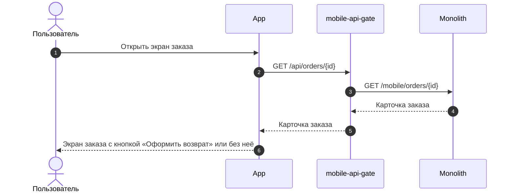

### Логика сценария

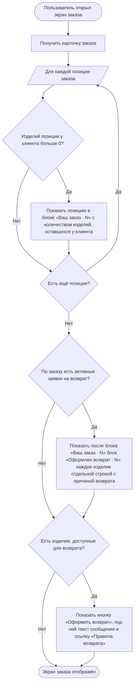

### Логика бэкенда

**`GET /получить карточку заказа` (`GET /api/orders/{id}`) — доработка метода**

1. Срок возврата: для клиентов F&F — 30 дней с даты получения заказа, для остальных — 14 дней, как сейчас. Отдавать последний день оформления заявки (`return.request_until_date`, TBD). Проверять срок для заказа и позиций по этой дате вместо текущей проверки 14 дней.
2. Текст сообщения `can_be_returned` — «Можно вернуть изделия до [Дата]» изменить на реальную дату, а не упоминание про 14 дней. [Дата] — последний день оформления заявки (`return.request_until_date`, TBD).
3. По каждой позиции отдавать данные по заявкам на возврат — по таблице «Данные позиции для возврата». Позицию с изделиями в возврате (`items[].return_items`, TBD) вернуть нельзя, даже если у клиента остались её изделия.
4. Признак `return.is_bank_data_required` = `true` также, если заказ полностью или частично оплачен подарочным сертификатом (US 1.4).
5. Отдавать текст о том, куда вернутся деньги (`return.refund.message`, TBD, US 1.4), если банковские реквизиты не нужны.
6. Отдавать адрес, пункт выдачи или магазин, куда был доставлен заказ (`order_delivery`, TBD, US 1.3).
7. Сообщение со статусом `can_be_returned` возвращать, только если хотя бы одну позицию заказа можно вернуть (`items[].can_be_returned = true`).

**Данные позиции для возврата**

| Поле | Что означает | Как считается | Где используется |
|---|---|---|---|
| `items[].return_items`, TBD | Изделия позиции, оформленные в возврат | Каждое изделие в активной заявке, кроме изделий с результатом приёмки «Отменено», — отдельная запись с причиной возврата (`reason_title`, TBD). Если причина не выбрана — название группы причин | Блок «Оформлен возврат · N» |
| `items[].remaining_quantity`, TBD | Сколько изделий позиции осталось у клиента | Количество в позиции минус изделия в возврате. *Считается всегда, даже если вернуть позицию нельзя* | Блок «Ваш заказ · N» |
| `items[].can_be_returned` | Можно ли оформить возврат по позиции | `true`, если выполнены текущие проверки и:<br>1. Последний день оформления заявки (`return.request_until_date`, TBD) не прошёл<br>2. По позиции нет изделий в возврате (`items[].return_items`, TBD) | Сообщение «Можно вернуть изделия до [Дата]», экран «Выберите изделия» |
| `items[].available_return_quantity`, TBD | Сколько изделий позиции можно выбрать к возврату | Если позицию можно вернуть — равно `remaining_quantity`, иначе 0 | Экран «Выберите изделия» |

**Пример:** в позиции 3 изделия

| Поле | Заявок нет | Изделие в активной заявке |
|---|---|---|
| `return_items` | пусто | 1 изделие |
| `remaining_quantity` | 3 | 2 |
| `can_be_returned` | `true` | `false` |
| `available_return_quantity` | 3 | 0 |

### Задачи

| Название | Ссылка |
|---|---|
| Доработать метод получения информации по заказу | https://tracker.yandex.ru/ECOMDEV-2343 |

### Выбрать изделия и причины возврата US 1.2

Как клиент, оформляющий возврат, я хочу выбрать одно или несколько изделий из заказа и указать причину возврата для каждого выбранного изделия, чтобы сформировать возврат только для тех изделий, которые я хочу вернуть

### Дизайн

Ссылка на Figma: https://www.figma.com/design/u5Fe5N4lypCdqgZn6533F2/%F0%9F%93%B1-06.-Profile--Redesign-?node-id=7240-60450&t=qoHbaQAbTlMNGNZX-4

### Сценарий

#### Предусловие

1. На экране заказа отображается кнопка «Оформить возврат» (US 1.1)

#### Основная последовательность "Выбрать изделия и причины возврата"

| Шаг | Исполнитель | Описание |
|---|---|---|
| 1 | Пользователь | Нажимает «Оформить возврат» |
| 2 | APP | Отобразить экран «Выберите изделия» по данным ответа метода `GET /получить карточку заказа` |
| 2.1 | APP | Отобразить позиции, у которых `items[].can_be_returned = true`<br><br>**Опционально**<br>1. Если `items[].can_be_returned = false`, то позицию не отображать |
| 2.2 | APP | Отобразить каждое изделие позиции отдельной строкой. Количество строк — число изделий позиции к выбору (`items[].available_return_quantity`, TBD) |
| 2.3 | APP | Отобразить предупреждение о необходимости вернуть изделия в полной комплектации |
| 3 | Пользователь | Отмечает чекбоксами изделия |
| 4 | APP | Изменить заголовок экрана на «Выберите изделия · N», где N — число выбранных изделий. Сделать кнопку «Указать причину возврата» активной<br><br>**Опционально**<br>1. Если не выбрано ни одного изделия, то кнопка «Указать причину возврата» неактивна |
| 5 | Пользователь | Нажимает «Указать причину возврата» |
| 6 | APP | Вызвать метод `GET /получить справочник причин возврата` (`GET /api/orders/v2/return-reasons`) |
| 7 | APP | Отобразить экран «Причина возврата» с подзаголовком «Изделие 1 из N» |
| 8 | Пользователь | Выбирает группу причин в выпадающем списке |
| 9 | APP | Отобразить список причин выбранной группы |
| 10 | Пользователь | Выбирает причину |
| 11 | APP | Перейти к следующему выбранному изделию и изменить подзаголовок на «Изделие K из N», где K — номер изделия. Шаги 8–10 повторяются для каждого выбранного изделия<br><br>**Опционально**<br>1. Если пользователь нажал «Назад», то перейти к предыдущему изделию. Выбранная причина сохраняется, её можно изменить<br>2. Если пользователь нажал «Назад» на первом изделии, то вернуться к экрану «Выберите изделия» |
| 12 | APP | После выбора причины для последнего изделия сделать кнопку «Выбрать способ возврата» активной<br><br>**Опционально**<br>1. Если причина указана не для всех выбранных изделий, то кнопка «Выбрать способ возврата» неактивна<br>2. Если пользователь вернулся к экрану «Выберите изделия» и изменил состав изделий, то сбросить причины. Причины указываются заново, начиная с шага 5. Вернуться можно с экранов «Причина возврата» и «Оформление возврата» |

### Взаимодействие компонентов

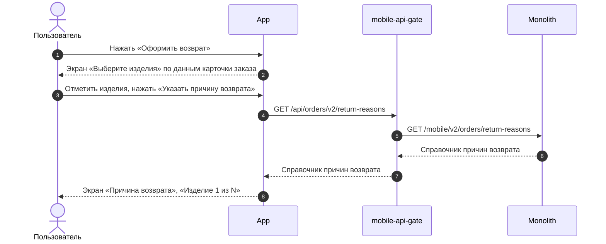

### Логика сценария

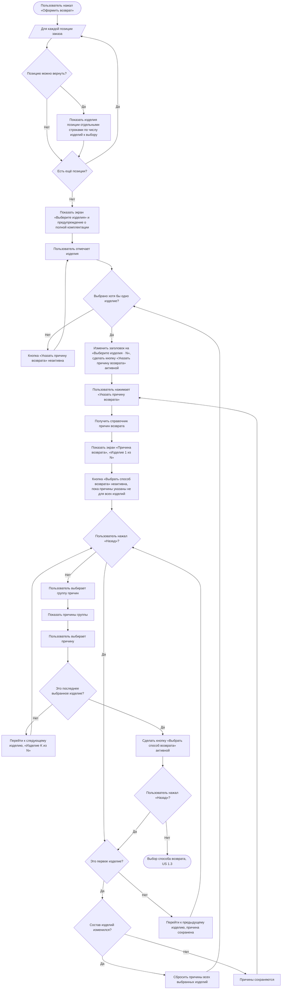

### Логика бэкенда

**Справочник причин и групп возврата — обновление данных**

1. Актуализировать существующий справочник причин возврата в таблицах `cms_return_reasons` и `cms_return_reasons_groups` согласно таблице [«Причины возвратов»](https://docs.google.com/spreadsheets/u/1/d/1bBBNP4z9KuJfFFw6_zToKsN-TS_cBT0x/edit?gid=175594683#gid=175594683): обновить названия существующих причин и добавить новые причины. Существующую структуру справочника, коды причин и механизм их обработки не изменять. Справочник общий для сайта и мобильного приложения.

### Задачи

| Название | Ссылка |
|---|---|

### Выбрать способ возврата US 1.3

Как клиент, оформляющий возврат, я хочу выбрать способ возврата товаров, чтобы успешно завершить оформление заявки на возврат

### Дизайн

Ссылка на Figma: https://www.figma.com/design/u5Fe5N4lypCdqgZn6533F2/%F0%9F%93%B1-06.-Profile--Redesign-?node-id=7235-41564&t=KUiaYx2kcuq61I5X-4

### Сценарий

#### Предусловие

1. Пользователь указал причины возврата для всех выбранных изделий (US 1.2)

#### Основная последовательность "Выбрать способ возврата"

| Шаг | Исполнитель | Описание |
|---|---|---|
| 1 | Пользователь | Нажимает «Выбрать способ возврата» |
| 2 | APP | Определить город возврата: взять страну и город доставки заказа (`order_delivery.country_iso`, `order_delivery.city_fias`, TBD) из ответа метода `GET /получить карточку заказа` (US 1.1)<br><br>**Опционально**<br>1. Если город доставки заказа (`order_delivery.city_fias`, TBD) не заполнен, то открыть шторку «Выберите город». См. альтернативную последовательность "Сменить город" |
| 3 | APP | Вызвать метод `GET /получить данные города` (`GET /api/v1/geo/countries/{country_iso_code}/cities/{geo_id}/details`) по стране и городу доставки заказа<br><br>**Опционально**<br>1. Если данные города не получены, то открыть шторку «Выберите город». См. альтернативную последовательность "Сменить город" |
| 4 | APP | Вызвать метод `GET /получить способы возврата для города` (`GET /api/v2/delivery/{order_id}/return-method-list`, TBD) по городу возврата |
| 5 | APP | Отобразить экран «Оформление возврата» с городом и способами возврата из ответа метода `GET /получить способы возврата для города`<br><br>**Опционально**<br>1. Если для города нет доступных способов возврата, то отобразить сообщение об отсутствии доступных способов возврата и действие «Написать нам». Поле города остаётся доступным для нажатия<br>2. Если пользователь нажал «Написать нам», то открыть шторку «Отдел дружбы с клиентами» с часами работы отдела и действиями «Позвонить» и «Написать», как в US 1.4<br>3. Если пользователь нажал «Назад», то вернуться к экрану «Причина возврата» на последнее изделие. Выбранные изделия и причины сохраняются |
| 6 | APP | Предвыбрать способ возврата, совпадающий со способом доставки заказа (`is_order_method = true`, TBD)<br><br>**Опционально**<br>1. Если такого способа нет, то выбрать первый способ в списке<br>2. Если пользователь переключился на другой способ в том же городе и вернулся к прежнему, то отобразить данные, заполненные для этого способа: подставленные из заказа или введённые пользователем. Данные не сбрасываются |
| 7 | APP | Подставить адрес или точку из исходного заказа, если выбран способ, совпадающий со способом доставки заказа (`is_order_method = true`, TBD)<br><br>**Опционально**<br>1. Если способ выбран по приоритету, то адрес и точку не подставлять: пользователь заполняет их сам |
| 7.1 | APP | Курьер — подставить адрес доставки заказа (`order_delivery.address`, TBD) из ответа метода `GET /получить карточку заказа`: улица, дом, корпус, квартира, индекс. Отобразить над полями адреса подсказку "проверить актуальность адреса"<br><br>**Опционально**<br>1. Если адрес доставки заказа не заполнен, то поля адреса оставить незаполненными<br>2. Если в адресе заказа нет индекса, то отобразить поле «Индекс» для ручного ввода |
| 7.1.1 | APP | Запросить и отобразить даты и интервалы курьера для адреса из заказа — шаги 7–8 альтернативной последовательности "Курьер"<br><br>**Опционально**<br>1. Если пользователь изменил подставленный адрес, то сбросить выбранные дату и интервал и выполнить шаги 3–8 альтернативной последовательности "Курьер" |
| 7.2 | APP | СДЭК, 5Post — вызвать метод `GET /получить данные пункта выдачи` (`GET /api/v1/pickup/provider/{provider}/points/{point}`) по службе выбранного способа и пункту выдачи заказа (`order_delivery.pvz.id`, TBD)<br><br>**Опционально**<br>1. Если пункт в заказе не указан, то метод не вызывать и поле точки оставить незаполненным |
| 7.2.1 | APP | Подставить пункт в поле точки, если в ответе метода `is_return_available = true` (TBD)<br><br>**Опционально**<br>1. Если `is_return_available = false`, то поле точки оставить незаполненным<br>2. Если данные пункта не получены, то поле точки оставить незаполненным |
| 7.3 | APP | Магазин 12 STOREEZ — вызвать метод `GET /получить магазины, принимающие возвраты` (`GET /api/v1/stores/returns`, TBD) по городу возврата<br><br>**Опционально**<br>1. Если магазин в заказе не указан, то метод не вызывать и поле точки оставить незаполненным |
| 7.3.1 | APP | Подставить магазин доставки заказа (`order_delivery.store.store_code`, TBD) в поле точки, если он есть в списке<br><br>**Опционально**<br>1. Если магазина заказа нет в списке, то поле точки оставить незаполненным |
| 8 | APP | Для способов СДЭК, 5Post, Магазин 12 STOREEZ и Почта России отобразить дату «Вернуть до» из ответа метода `GET /получить способы возврата для города`. Пока пользователь на экране «Оформление возврата», дата не меняется |

#### Альтернативная последовательность "Сменить город"

| Шаг | Исполнитель | Описание |
|---|---|---|
| 1 | Пользователь | Нажимает на поле города |
| 2 | APP | Вызвать метод `GET /получить список городов` (`GET /api/v1/geo/countries/{country_iso_code}/cities`) с кодом страны города возврата, без поискового запроса<br><br>**Опционально**<br>1. Если страна города возврата не определена, то метод не вызывать |
| 3 | APP | Отобразить шторку «Выберите город»: поле страны с текущей страной, поле поиска и список городов этой страны<br><br>**Опционально**<br>1. Если страна не определена, то в поле страны предложить выбрать страну, список городов не отображать<br>2. Если пользователь закрыл шторку, не выбрав город, то оставить ранее выбранный город и способы возврата |
| 3.1 | Пользователь | Нажимает на поле страны |
| 3.2 | APP | Вызвать метод `GET /получить список стран` (`GET /api/v1/geo/countries`) и отобразить окно выбора страны со списком стран и поиском по названию |
| 3.3 | Пользователь | Выбирает страну |
| 3.4 | APP | Вызвать метод `GET /получить список городов` (`GET /api/v1/geo/countries/{country_iso_code}/cities`) с кодом выбранной страны и отобразить в шторке выбранную страну и её города |
| 3.5 | Пользователь | Вводит название города в поле поиска |
| 3.6 | APP | Вызвать метод `GET /получить список городов` (`GET /api/v1/geo/countries/{country_iso_code}/cities`) с кодом страны и введённым названием и отобразить найденные города<br><br>**Опционально**<br>1. Если города не найдены, то отобразить сообщение, что по запросу ничего не найдено |
| 4 | Пользователь | Выбирает город в списке: среди городов страны или среди найденных по поиску. Сменить страну (шаги 3.1–3.4) и искать город (шаги 3.5–3.6) необязательно |
| 4.1 | APP | Вызвать метод `GET /получить данные города` (`GET /api/v1/geo/countries/{country_iso_code}/cities/{geo_id}/details`) для выбранного города |
| 5 | APP | Закрыть шторку и отобразить шторку «Смена города» с предупреждением о сбросе способа возврата и кнопками «Продолжить» и «Отмена»<br><br>**Опционально**<br>1. Если город возврата не определён из заказа, то шторку не отображать и перейти к шагу 7<br>2. Если выбран тот же город, то шторку не отображать и оставить данные без изменений<br>3. Если пользователь нажал «Отмена», то закрыть шторку и оставить данные без изменений |
| 6 | Пользователь | Нажимает «Продолжить» |
| 7 | APP | Сбросить выбранный способ возврата и все данные способов (адрес, дата и интервал, точка передачи), применить выбранный город |
| 8 | APP | Вызвать метод `GET /получить способы возврата для города` (`GET /api/v2/delivery/{order_id}/return-method-list`, TBD) с данными нового города из шага 4.1 |
| 9 | APP | Отобразить способы возврата для нового города<br><br>**Опционально**<br>1. Если для города нет доступных способов возврата, то отобразить сообщение и действие «Написать нам», как на шаге 5 основной последовательности |
| 10 | APP | Выбрать способ возврата так же, как на шаге 6 основной последовательности<br><br>**Опционально**<br>1. Если выбран город исходного заказа и способ, совпадающий со способом доставки заказа (`is_order_method = true`, TBD), то подставить адрес или точку из заказа, как на шаге 7 основной последовательности<br>2. Если выбран другой город, то адрес и точку не подставлять: пользователь заполняет их сам |

#### Альтернативная последовательность "Курьер"

| Шаг | Исполнитель | Описание |
|---|---|---|
| 1 | Пользователь | Выбирает способ «Курьер» или способ выбран системой на шаге 6 основной последовательности |
| 2 | APP | Отобразить поля адреса: «Улица», «Дом, корпус», «Квартира»<br><br>**Опционально**<br>1. Если улица и дом не заполнены, то в блоке «Дата возврата» вместо выбора даты и интервала отобразить текст «Сначала укажите адрес» |
| 3 | Пользователь | Вводит улицу, затем дом |
| 4 | APP | Вызвать метод `GET /получить подсказки адреса` (`GET /api/v1/geo/countries/{country_iso_code}/addresses/`) по введённому тексту и отобразить список подсказок<br><br>**Опционально**<br>1. Если вводится дом, то последней строкой списка отобразить подсказку с введённым текстом из ответа метода<br>2. Если геосервис недоступен, то показать в списке только подсказку с введённым текстом |
| 5 | Пользователь | Нажимает на подсказку в списке: найденный адрес или подсказку с введённым текстом<br><br>**Опционально**<br>1. Если выбрана подсказка с введённым текстом, то адрес введён вручную<br>2. Если пользователь закрыл список, не нажав на подсказку, то улица или дом не заполняются, как при оформлении заказа |
| 6 | APP | Вызвать метод `GET /получить данные адреса` (`GET /api/v1/geo/countries/{country_iso_code}/addresses/{geo_id}/details`) по `geo_id` выбранного адреса<br><br>**Опционально**<br>1. Если в ответе нет индекса или геосервис недоступен, то отобразить поле «Индекс» для ручного ввода<br>2. Если дата и интервал уже были выбраны для прежнего адреса, то сбросить их<br>3. Если адрес введён вручную, то метод не вызывать и отобразить поле «Индекс» для ручного ввода |
| 7 | APP | Вызвать метод `POST /получить даты и интервалы курьера` (`POST /api/v1/delivery/intervals`) после выбора дома на шаге 5 по адресу забора, способу «Курьер» и часовому поясу города возврата |
| 8 | APP | Отобразить даты и интервалы приезда курьера из ответа метода `POST /получить даты и интервалы курьера`<br><br>**Опционально**<br>1. Если метод вернул ошибку или пустой список дат, то не отображать выбор даты и интервала. Возврат оформляется без них. Дату и интервал согласует с клиентом Отдел дружбы с клиентами (US 1.5) |
| 8.1 | APP | Предвыбрать первую дату и первый интервал |
| 9 | Пользователь | При необходимости выбирает другую дату и интервал |

#### Альтернативная последовательность "Выбрать пункт СДЭК, 5Post или магазин 12 STOREEZ"

| Шаг | Исполнитель | Описание |
|---|---|---|
| 1 | APP | Отобразить в блоке точки кнопку «Выберите пункт» для СДЭК и 5Post или «Выберите магазин» для магазина 12 STOREEZ<br><br>**Опционально**<br>1. Если точка уже выбрана, то отобразить название, адрес и время работы точки и «Изменить» |
| 2 | Пользователь | Нажимает «Выберите пункт», «Выберите магазин» или «Изменить» |
| 3 | APP | Вызвать метод получения точек приёма, принимающих возвраты, в городе возврата. Метод зависит от выбранного способа:<br>— СДЭК, 5Post — `GET /получить пункты выдачи` (`GET /api/v1/pickup/provider/{provider}/points`) по службе выбранного способа и городу возврата;<br>— магазин — `GET /получить магазины, принимающие возвраты` (`GET /api/v1/stores/returns`, TBD) по городу возврата |
| 4 | APP | Отобразить точки, принимающие возвраты, на карте и списком |
| 5 | Пользователь | Выбирает точку |
| 6 | APP | Получить данные выбранной точки. Метод зависит от способа:<br>— СДЭК, 5Post — `GET /получить данные пункта выдачи` (`GET /api/v1/pickup/provider/{provider}/points/{point}`);<br>— магазин — `GET /получить данные магазина` (`GET /api/v1/stores/{store_code}`, TBD) |
| 7 | APP | Отобразить карточку точки:<br>— пункт СДЭК, 5Post — название, адрес, как добраться, время работы, телефон;<br>— магазин — название, адрес, как добраться, время работы, телефон, парковка<br><br>**Опционально**<br>1. Если у поля нет данных, то поле не отображать |
| 8 | Пользователь | Подтверждает выбор |
| 9 | APP | Вернуть пользователя на экран «Оформление возврата» и отобразить название, адрес и время работы выбранной точки |

#### Альтернативная последовательность "Почта России"

| Шаг | Исполнитель | Описание |
|---|---|---|
| 1 | Пользователь | Выбирает способ «Почта России» |
| 2 | APP | Отобразить инструкцию по возврату и адрес склада из описания способа «Почта России» и внешнюю ссылку «Пункты Почты России» |
| 3 | Пользователь | Нажимает «Пункты Почты России» |
| 4 | APP | Открыть карту отделений Почты России по Калининграду и Калининградской области по ссылке на внешнем ресурсе |

**Примечание**

*Способы возврата*

1. Способ возврата отображается, если его возвратная служба работает в городе возврата. Возвратные службы ведутся отдельно от служб доставки, со своим списком городов, и он может не совпадать с городами доставки. «Почта России» определяется по тому же правилу: её возвратная служба работает только в Калининграде и Калининградской области, поэтому в других городах этого способа нет. Например, курьер СДЭК есть только в населённых пунктах с офисом СДЭК.
2. Если способа, совпадающего со способом доставки заказа, нет, то предвыбирается первый способ по приоритету. Так бывает, если способ доставки заказа недоступен для возврата или город возврата отличается от города заказа.
3. Дата «Вернуть до» на экране «Оформление возврата» предварительная: она считается при открытии экрана и не меняется, пока пользователь на нём. Окончательная дата — дата создания заявки + 10 календарных дней. Если пользователь начал оформление до полуночи, а подтвердил после, окончательная дата будет на день позже предварительной.

*Курьер: адрес забора*

4. Адрес из заказа не считается введённым вручную, даже если клиент вводил его вручную при оформлении заказа: адрес заказа уже проверил Отдел дружбы с клиентами, и по нему заказ доставлен. Даты и интервалы курьера для адреса из заказа запрашиваются как обычно.
5. Адрес принимается, только когда пользователь нажал на подсказку в списке — найденный адрес или подсказку с введённым текстом. Даты и интервалы курьера запрашиваются:
   - адрес найден в подсказках — после нажатия на найденный дом в списке подсказок;
   - адреса нет в подсказках или геосервис недоступен — после нажатия на подсказку с введённым текстом в списке подсказок дома;
   - адрес подставлен из заказа — сразу после подстановки;
   - пользователь изменил улицу или дом — дата, интервал и индекс сбрасываются, запрос повторяется по тем же правилам.

*Курьер: даты и интервалы*

6. Часовой пояс города `timezone` всегда передаётся в запрос дат и интервалов курьера. По нему логистика считает ручные интервалы; без него интервалы считаются по московскому времени (UTC+03:00). Часовой пояс приходит только в ответе метода `GET /получить данные города`. Поэтому данные города запрашиваются и тогда, когда город подставлен из заказа, если часового пояса нет в кэше.
7. В MVP даты и интервалы курьера для возврата приходят только от СДЭК и только по населённым пунктам РФ.
8. Для курьера СДЭК на каждую дату приходит один интервал — 9:00–18:00 по местному времени.
9. Число дат задаёт логистика. Приложение его не меняет, в том числе для клиентов F&F.

### Взаимодействие компонентов

**Основная последовательность "Выбрать способ возврата"**

```mermaid
sequenceDiagram
    autonumber
    actor U as Пользователь
    participant APP as App
    participant API as mobile-api-gate
    participant GEO as Geo
    participant MON as Monolith
    participant LOG as Logistics

    U->>APP: Нажать «Выбрать способ возврата»
    APP->>APP: Взять страну и город доставки из карточки заказа (order_delivery.country_iso, order_delivery.city_fias, TBD)
    alt Город в заказе не указан
        APP-->>U: Шторка «Выберите город» (далее по диаграмме «Сменить город»)
    else Город указан
        APP->>API: GET /api/v1/geo/countries/{country_iso_code}/cities/{geo_id}/details
        API->>GEO: gRPC geo/CityDetailsByGeoID
        alt Данные города не получены
            GEO-->>API: Ошибка
            API-->>APP: Ошибка
            APP-->>U: Шторка «Выберите город» (далее по диаграмме «Сменить город»)
        else Данные города получены
            GEO-->>API: Данные города и региона, часовой пояс
            API-->>APP: Данные города и региона, часовой пояс
            APP->>API: GET /api/v2/delivery/{order_id}/return-method-list (TBD)
            API->>MON: TBD — получить способы возврата для города
            MON-->>API: Способы возврата для города (признак способа заказа, служба, дата «Вернуть до»)
            API-->>APP: Способы возврата для города (признак способа заказа, служба, дата «Вернуть до»)
            alt Для города нет способов возврата
                APP-->>U: Сообщение об отсутствии способов возврата и «Написать нам»
            else Есть способы возврата
                alt Способ заказа Курьер
                    alt Адрес в заказе заполнен
                        APP->>APP: Подставить адрес забора из карточки заказа (order_delivery.address, TBD)
                        APP->>API: POST /api/v1/delivery/intervals
                        API->>LOG: gRPC Logistics.WinnerService.Intervals: sending_address, is_return, delivery_type_code, timezone
                        LOG-->>API: Даты и интервалы, ответ без дат или ошибка (обработка — по диаграмме «Курьер»)
                        API-->>APP: Даты и интервалы, ответ без дат или ошибка
                    else Адрес в заказе не заполнен
                        APP->>APP: Оставить поля адреса пустыми
                    end
                else Способ заказа СДЭК или 5Post
                    alt Пункт указан в заказе
                        APP->>APP: Взять пункт из карточки заказа (order_delivery.pvz.id, TBD), provider — возвратная служба способа
                        APP->>API: GET /api/v1/pickup/provider/{provider}/points/{point}
                        API->>LOG: GET /api/v1/winner/pickup/{provider}/points/{point}
                        LOG-->>API: Данные пункта выдачи, признак «принимает возвраты»
                        API-->>APP: Данные пункта выдачи, признак «принимает возвраты»
                        APP->>APP: Подставить пункт, если он принимает возвраты
                    else Пункт в заказе не указан
                        APP->>APP: Оставить поле пункта пустым
                    end
                else Способ заказа Магазин 12 STOREEZ
                    alt Магазин указан в заказе
                        APP->>APP: Взять магазин доставки из карточки заказа (order_delivery.store.store_code, TBD)
                        APP->>API: GET /api/v1/stores/returns (TBD)
                        API->>MON: TBD — получить магазины, принимающие возвраты
                        MON-->>API: Магазины, принимающие возвраты
                        API-->>APP: Магазины, принимающие возвраты
                        APP->>APP: Подставить магазин, если он принимает возвраты
                    else Магазин в заказе не указан
                        APP->>APP: Оставить поле магазина пустым
                    end
                else Способа заказа нет среди способов возврата
                    APP->>APP: Предвыбрать первый способ по приоритету, адрес и точку не подставлять
                end
                APP-->>U: Экран «Оформление возврата»
                opt Адрес не подставлен, пользователь сам выбрал «Курьер» или меняет адрес
                    U->>APP: Ввести или изменить адрес (далее по диаграмме «Курьер»)
                end
                opt Пункт или магазин не подставлен, пользователь сам выбрал способ или меняет точку
                    U->>APP: Выбрать или изменить пункт или магазин (далее по диаграмме «Выбрать пункт СДЭК, 5Post или магазин 12 STOREEZ»)
                end
            end
        end
    end
```

**Альтернативная последовательность "Сменить город"**

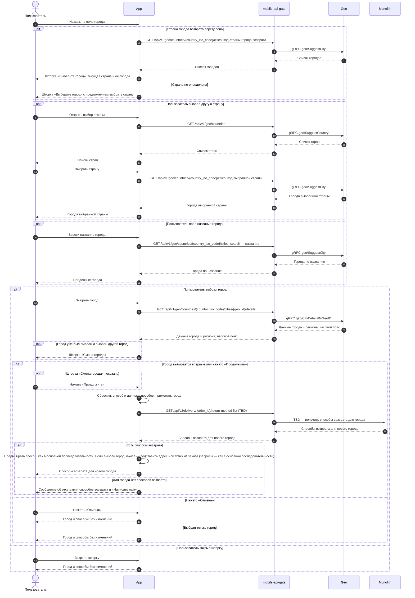

**Альтернативная последовательность "Курьер"**

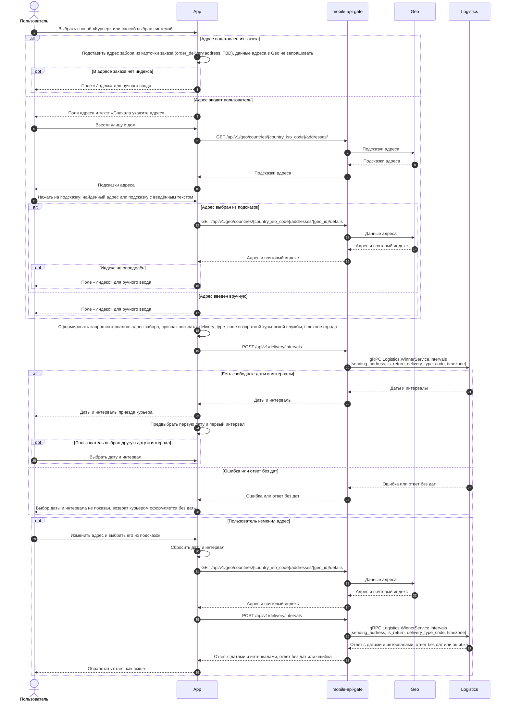

**Альтернативная последовательность "Выбрать пункт СДЭК, 5Post или магазин 12 STOREEZ"**

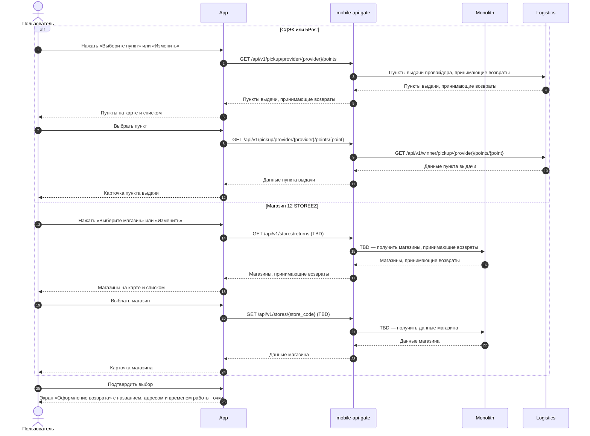

### Логика сценария

**Основная последовательность "Выбрать способ возврата"**

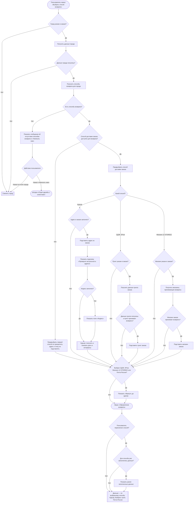

**Альтернативная последовательность "Сменить город"**

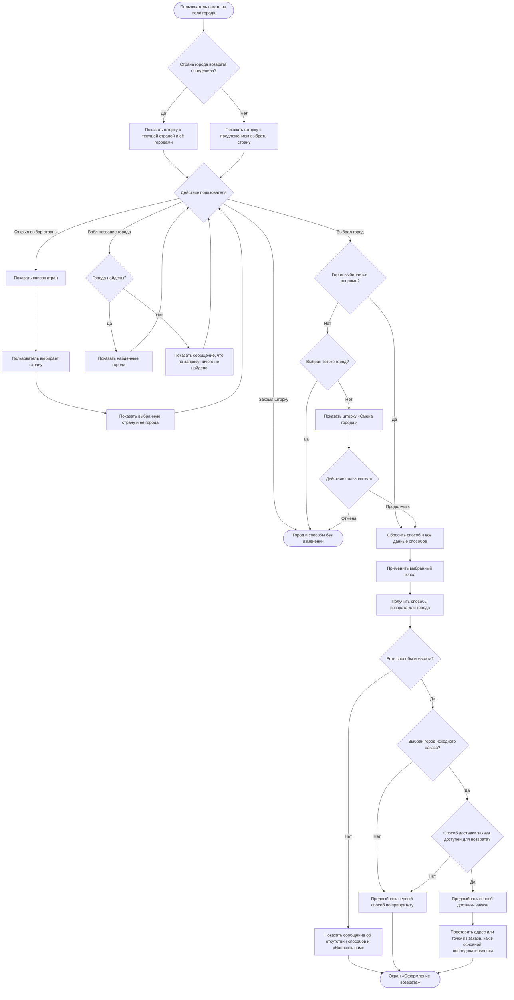

**Альтернативная последовательность "Курьер"**

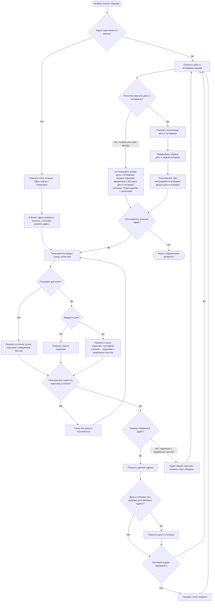

**Альтернативная последовательность "Выбрать пункт СДЭК, 5Post или магазин 12 STOREEZ"**

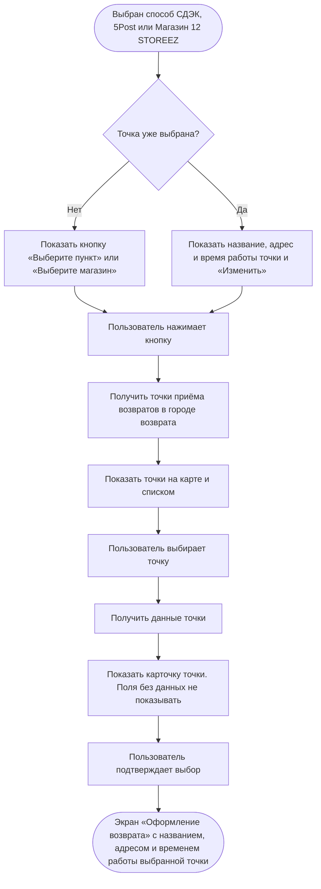

**Альтернативная последовательность "Почта России"**

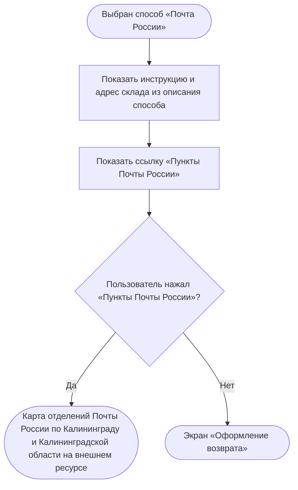

### Логика бэкенда

**`GET /получить способы возврата для города` (`GET /api/v2/delivery/{order_id}/return-method-list`, TBD) — новый метод**

Текущий метод списка способов возврата используется выпущенными версиями приложения, поэтому его логика не меняется, а для новой логики создаётся новый метод.

1. Отбирать способы возврата по возвратным службам, которые работают в городе возврата. У возвратной службы свой тип доставки и своя настройка городов. Список городов может совпадать с городами доставки или отличаться, например, если в городе нет пунктов, принимающих возвраты.
2. Определять возвратную службу способа и способ «как в заказе».
3. Отдавать способы в порядке приоритета способов возврата.
4. Отмечать способ, совпадающий со способом доставки заказа, если город возврата — город заказа (`is_order_method`, TBD).
5. Отдавать по каждому способу возвратную службу и код типа доставки возвратной службы (`delivery_type_code`). Служба нужна для запроса пунктов выдачи, код типа доставки — для запроса дат и интервалов курьера.
6. Для СДЭК, 5Post, Магазина и Почты России отдавать дату «Вернуть до»: текущая дата + 10 календарных дней.
7. Поддержать новые способы «Магазин 12 STOREEZ» и «Почта России».

**`GET /получить магазины, принимающие возвраты` (`GET /api/v1/stores/returns`, TBD) — новый метод**

- Отдавать магазины в городе возврата, которые принимают возвраты.

**`GET /получить данные магазина` (`GET /api/v1/stores/{store_code}`, TBD) — новый метод**

- Отдавать детальную информацию по магазину.
- Если магазинов, принимающих возвраты, мало, данные карточки можно отдавать в ответе метода `GET /получить магазины, принимающие возвраты` без отдельного метода — решает разработка.

**`GET /получить пункты выдачи` (`GET /api/v1/pickup/provider/{provider}/points`) — доработка метода**

- Логистика: добавить в запрос необязательный фильтр `is_return_available` (bool), в ответ — признак `is_return_available` у каждого пункта.
- mobile-api-gate: передавать фильтр `is_return_available = true` в запросе к логистике, чтобы для возврата отдавать только пункты, принимающие возвраты.

**`GET /получить данные пункта выдачи` (`GET /api/v1/pickup/provider/{provider}/points/{point}`) — доработка метода**

- Логистика: отдавать в данных пункта признак `is_return_available`.
- mobile-api-gate: передавать этот признак в ответе метода (`is_return_available`).

**`POST /получить даты и интервалы курьера` (`POST /api/v1/delivery/intervals`) — доработка метода**

- Необходимо добавить новые параметры в запрос к Логистике:
  - `is_return` — признак возврата, по которому Логистика определяет, что необходимо проверить доступные даты и интервалы для возвратного потока: `true`.
  - `sending_address` — адрес забора изделий для возврата, объект из частей адреса (таблица ниже). Строка адреса не собирается.
- Код города не передаётся.
- Корпус и строение передаются в `house` вместе с номером дома; квартира не передаётся.
- Код типа доставки возвратной курьерской службы (`delivery_type_code`) и часовой пояс города возврата (`timezone`) передаются, как сейчас; часовой пояс — всегда.

| Поле `sending_address` | Обязательное | Адрес из подсказок — `GET /получить данные адреса` (`GET /api/v1/geo/countries/{country_iso_code}/addresses/{geo_id}/details`) | Адрес из заказа | Адрес, введённый вручную |
|---|---|---|---|---|
| `country_iso` | нет, по умолчанию `RU` | страна из данных города возврата | страна заказа | страна из данных города возврата |
| `region` | да | регион из данных города возврата | регион заказа | регион из данных города возврата |
| `city` | да | город из данных города возврата | населённый пункт заказа | город из данных города возврата |
| `street` | нет | улица с типом | улица заказа | введённая улица |
| `house` | да | `house.title` — дом с корпусом и строением | дом заказа | введённый дом |

Пример: `"sending_address": {"country_iso": "RU", "region": "Нижегородская обл", "city": "Нижний Новгород", "street": "ул Лебяжья", "house": "д. 1"}`.

- адрес не передан — Логистика отдаёт ручные интервалы, как сейчас
- адрес передан и интеграция со СДЭК включена — интервалы СДЭК
- адрес передан, интеграция со СДЭК выключена — ручные интервалы

### Задачи

| Название | Ссылка |
|---|---|
| Добавить признак приёма возвратов | https://tracker.yandex.ru/ECOMDEV-2359 |
| Логистика: признак возврата и адрес отправки в запросе дат и интервалов | https://tracker.yandex.ru/TNT-2837 |
| Логистика: адрес по частям в запросе дат и интервалов | https://tracker.yandex.ru/TNT-2876 |
| Логистика: фильтр и признак приёма возвратов для пунктов выдачи | https://tracker.yandex.ru/TNT-2712 |

### Определить способ возврата денежных средств US 1.4

Как клиент, оформляющий возврат, я хочу понимать, каким способом мне будут возвращены денежные средства, и при необходимости указать банковские реквизиты, чтобы получить денежные средства за возвращённые изделия

### Дизайн

Ссылка на Figma: https://www.figma.com/design/u5Fe5N4lypCdqgZn6533F2/%F0%9F%93%B1-06.-Profile--Redesign-?node-id=7240-58493&t=KUiaYx2kcuq61I5X-4

### Сценарий

#### Предусловие

1. Пользователь находится на экране «Оформление возврата» (US 1.3)

#### Основная последовательность "Определить способ возврата денежных средств"

| Шаг | Исполнитель | Описание |
|---|---|---|
| 1 | APP | Взять из ответа метода `GET /получить карточку заказа` (US 1.1):<br>— нужны ли банковские реквизиты (`return.is_bank_data_required`);<br>— текст о том, куда вернутся деньги (`return.refund.message`, TBD) |
| 2 | APP | Отобразить в блоке «Возврат средств» текст о том, куда вернутся деньги. Блок «Банковские реквизиты» не отображать<br><br>**Опционально**<br>1. Если `return.is_bank_data_required = true`, то блок «Возврат средств» не отображать, а в блоке «Банковские реквизиты» отобразить кнопку «Укажите банковские реквизиты». См. альтернативную последовательность "Указать банковские реквизиты" |
| 3 | APP | Отобразить текст «Если вам необходимо получить возврат другим способом или на другие реквизиты, пожалуйста, обратитесь в Отдел дружбы с клиентами» со ссылкой «Отдел дружбы с клиентами»<br><br>**Опционально**<br>1. Если `return.is_bank_data_required = true`, то текст не отображать<br>2. Если пользователь нажал на ссылку «Отдел дружбы с клиентами», то открыть шторку «Отдел дружбы с клиентами» с часами работы отдела и действиями «Позвонить» и «Написать» |
| 4 | APP | Вызвать метод `POST /рассчитать сумму и баллы к возврату` (`POST /api/v1/orders/{order_id}/return/calculate`, TBD) по выбранным изделиям |
| 5 | APP | Отобразить в блоке «Итого к возврату» сумму к возврату из ответа метода `POST /рассчитать сумму и баллы к возврату`<br><br>**Опционально**<br>1. Если баллы к возврату больше 0, то отобразить их в блоке «Баллы к возврату»<br>2. Если баллы не рассчитаны — TBD |

#### Альтернативная последовательность "Указать банковские реквизиты"

| Шаг | Исполнитель | Описание |
|---|---|---|
| 1 | Пользователь | Нажимает «Укажите банковские реквизиты» |
| 2 | APP | Отобразить экран «Банковские реквизиты» с пустыми полями. Реквизиты из предыдущих возвратов не подставлять |
| 3 | Пользователь | Заполняет поля |
| 4 | Пользователь | Нажимает «Продолжить». Кнопка «Продолжить» активна всегда |
| 5 | APP | Проверить заполнение полей: обязательны все поля, кроме «Номер банковской карты»<br><br>**Опционально**<br>1. Если номер счёта начинается с «30232810», то поле «Номер банковской карты» тоже обязательно<br>2. Если обязательные поля не заполнены, то не выполнять переход и подсветить незаполненные поля красным контуром. Под полем «Номер банковской карты» показать текст «Укажите номер банковской карты»|
| 6 | APP | Вернуть пользователя на экран «Оформление возврата» и отобразить сохранённые реквизиты: ФИО получателя, название банка и номер счёта<br><br>**Опционально**<br>1. Если пользователь нажал на блок с заполненными реквизитами, то открыть экран «Банковские реквизиты» с заполненными данными<br>2. Если пользователь изменил реквизиты и нажал «Продолжить», то проверить поля, как на шаге 5, и обновить реквизиты на экране «Оформление возврата» |

**Примечание**

1. Банковские реквизиты нужны, если заказ оплачен при получении или подарочным сертификатом (полностью или частично). В этом случае текст о том, куда вернутся деньги, не приходит.

### Взаимодействие компонентов

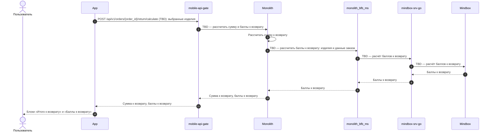

### Логика сценария

**Основная последовательность "Определить способ возврата денежных средств"**

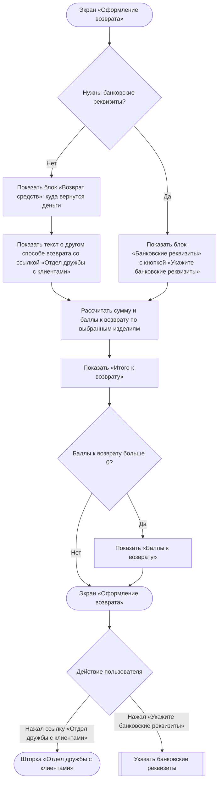

**Альтернативная последовательность "Указать банковские реквизиты"**

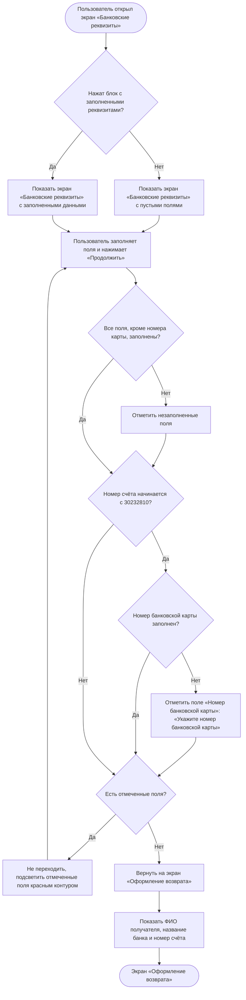

### Логика бэкенда

**`POST /рассчитать сумму и баллы к возврату` (`POST /api/v1/orders/{order_id}/return/calculate`, TBD) — новый метод**

1. Рассчитывать сумму к возврату по выбранным изделиям.
2. Запрашивать в Mindbox баллы к возврату по выбранным изделиям.
3. Возвращать сумму к возврату и баллы к возврату. Значения предварительные: при создании заявки сумма и баллы рассчитываются заново (US 1.5).

### Задачи

| Название | Ссылка |
|---|---|

### Подтвердить создание заявки на возврат US 1.5

Как клиент, я хочу отправить заполненную форму и увидеть экран подтверждения заявки, чтобы быть уверенным, что мой возврат принят в работу, и легко отслеживать его статус

### Дизайн

Ссылка на Figma: https://www.figma.com/design/u5Fe5N4lypCdqgZn6533F2/%F0%9F%93%B1-06.-Profile--Redesign-?node-id=9066-130891&t=KUiaYx2kcuq61I5X-4

### Сценарий

#### Предусловие

1. Пользователь заполнил данные на экране «Оформление возврата» (US 1.3, US 1.4)

#### Основная последовательность "Подтвердить создание заявки на возврат"

| Шаг | Исполнитель | Описание |
|---|---|---|
| 1 | Пользователь | Нажимает «Подтвердить возврат» |
| 2 | APP | Проверить заполнение обязательных полей и блоков для выбранного способа возврата по таблице «Проверка обязательных полей»<br><br>**Опционально**<br>1. Если обязательные поля или блоки не заполнены, то заявку не отправлять, подсветить все незаполненные поля и блоки с текстом ошибки и прокрутить экран к первому из них. Кнопка «Подтвердить возврат» остаётся активной |
| 3 | APP | Вызвать метод `POST /создать заявку на возврат` (TBD) с данными, заполненными на экране «Оформление возврата». На время запроса отобразить на кнопке «Подтвердить возврат» индикатор загрузки, повторное нажатие недоступно |
| 4 | APP | Скрыть индикатор загрузки. После успешного создания заявки закрыть экран «Оформление возврата»<br><br>**Опционально**<br>1. Если бэкенд вернул ошибку срока подачи, то показать сообщение о недоступности оформления возврата<br>2. Если бэкенд вернул ошибку проверки данных, то подсветить поле или блок с ошибкой, как на шаге 2<br>3. Если ошибка в номере банковской карты, то подсветить блок «Банковские реквизиты»<br>4. Если бэкенд вернул ошибку, то оставить экран «Оформление возврата» открытым, кнопку «Подтвердить возврат» сделать доступной. Введённые данные не сбрасываются |
| 4.1 | APP | Показать поверх экрана заказа шторку «Заявка уже у нас» с кнопкой «К возврату». Текст шторки зависит от способа возврата<br><br>**Опционально**<br>1. Если способ возврата — Курьер, то показать сообщение, что с клиентом свяжутся, если на выбранную дату курьера не найдут |
| 5 | Пользователь | Нажимает «К возврату» или закрывает шторку |
| 6 | APP | Открыть экран созданного возврата (US 3)<br><br>**Опционально**<br>1. Если пользователь закрыл шторку, то вызвать метод `GET /получить карточку заказа` (`GET /api/orders/{id}`) и отобразить обновлённый экран заказа (US 1.1) |

**Проверка обязательных полей**

| Способ возврата | Поле или блок | Когда обязательно | Подсветка |
|---|---|---|---|
| Курьер | «Улица» | Всегда | Красный контур, текст «Укажите улицу» |
| Курьер | «Дом, корпус» | Всегда | Красный контур, текст «Укажите дом» |
| Курьер | «Индекс» | Если поле отображается | Красный контур, текст «Укажите индекс» |
| СДЭК, 5Post | Блок «Пункт возврата» | Всегда | Текст «Укажите пункт ПВЗ» |
| Магазин 12 STOREEZ | Блок «Магазин 12 STOREEZ» | Всегда | Текст «Укажите магазин» |
| Любой | Блок «Банковские реквизиты» | Если нужны банковские реквизиты | Текст «Укажите банковские реквизиты» красным со значком ошибки |

### Взаимодействие компонентов

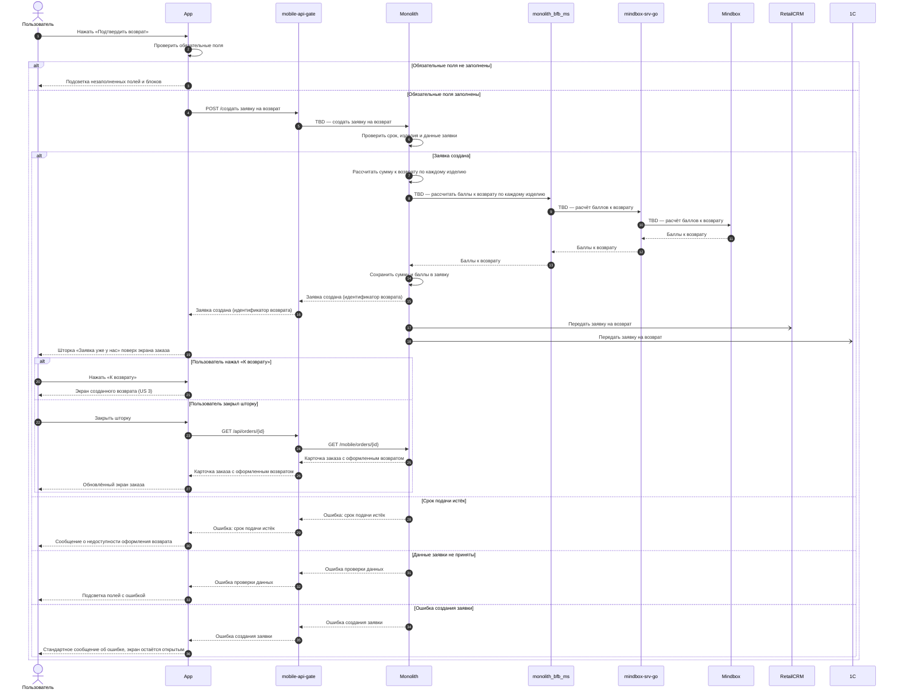

### Логика сценария

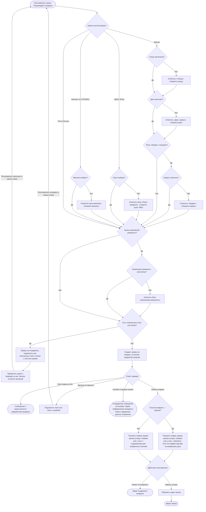

### Логика бэкенда

**`POST /создать заявку на возврат` (TBD) — новый метод**

1. Проверять, что срок оформления заявки не истёк — по последнему дню оформления заявки (`return.request_until_date`, TBD), как в US 1.1. Если срок истёк, заявку не создавать и возвращать ошибку срока подачи.
2. Заново проверять по правилам US 1.1, что выбранные изделия можно вернуть: по позиции нет изделий в возврате (`items[].return_items`, TBD) и изделий не больше, чем доступно. Если изделия нельзя вернуть, заявку не создавать и возвращать ошибку с полем или блоком.
3. Повторять на сервере проверку обязательных данных, которую делают сайт и приложение (таблица «Проверка обязательных полей»). Неполную заявку не создавать, а возвращать ошибку с полем или блоком.
4. Для пункта и магазина сохранять в заявке название, адрес, режим работы и координаты на момент создания.
5. Заявку курьером без даты и интервала создавать в статусе «Возврат ожидает обработки», с датой и интервалом — в статусе «Заявка на возврат принята». Принимать признак ручного ввода адреса (`manual_input`, TBD): заявку с адресом, введённым вручную, создавать по тому же правилу; если она создаётся без даты и интервала, передавать в RetailCRM причину обработки «проверить адрес», как у заказа.
6. Для СДЭК, 5Post, Магазина 12 STOREEZ и Почты России считать дату «Вернуть до»: дата создания заявки + 10 календарных дней. Сохранять её в заявке.
7. Менять статус позиций заказа из заявки целиком.
8. Статус заказа не менять: смену статуса заказа на «Возврат из ЛК», которая выполняется сейчас, при создании заявки не выполнять.
9. Записывать снимок заявки с позициями и их статусами в историю изменений заявки — для показа истории статусов.
10. Проверять, что заказ принадлежит клиенту. Иначе возвращать ошибку.
11. Дату и интервал курьера, если они переданы, проверять, как сейчас.
12. Принимать из RetailCRM дату и интервал курьера, которые Отдел дружбы с клиентами согласовал с клиентом или перенёс по его просьбе, и сохранять их в заявке.
13. После создания передавать заявку в RetailCRM и 1С одновременно, как заказ: каждая система получает её из своей очереди.
14. Если номер лицевого счёта начинается с «30232810», проверять, что передан номер банковской карты. Если номера карты нет, возвращать ошибку, по которой приложение и сайт подсвечивают блок «Банковские реквизиты».
15. Заново рассчитывать сумму к возврату по каждому изделию заявки и сохранять её в заявке.
16. Заново запрашивать в Mindbox баллы к возврату по каждому изделию заявки и сохранять их в заявке.

### Задачи

| Название | Ссылка |
|---|---|

## Просмотр возвратов

### Просмотреть список возвратов US 2

Как авторизованный клиент, я хочу видеть список оформленных возвратов, чтобы находить нужную заявку на возврат, понимать текущее состояние и перейти к подробной информации

### Дизайн

Ссылка на Figma: https://www.figma.com/design/u5Fe5N4lypCdqgZn6533F2/%F0%9F%93%B1-06.-Profile--Redesign-?node-id=7987-111023&t=KUiaYx2kcuq61I5X-4

### Сценарий

#### Предусловие

1. Пользователь авторизован

#### Основная последовательность "Просмотреть список возвратов"

| Шаг | Исполнитель | Описание |
|---|---|---|
| 1 | Пользователь | Открывает экран «Возврат заказов» из пункта «Возврат заказов» на экране «Профиль» |
| 2 | APP | Вызвать метод `GET /получить список возвратов` (TBD) |
| 3 | APP | Отобразить список возвратов<br><br>**Опционально**<br>1. Если у пользователя нет оформленных возвратов, то отобразить сообщение об их отсутствии и кнопку перехода в каталог |
| 4 | Пользователь | Выбирает возврат |
| 5 | APP | Открыть экран возврата (US 3) |

**Примечание**

1. Статус возврата показывается под клиентским названием, которое задаётся в админке. Если у нескольких внутренних статусов одно клиентское название, клиент видит их как один статус.

### Взаимодействие компонентов

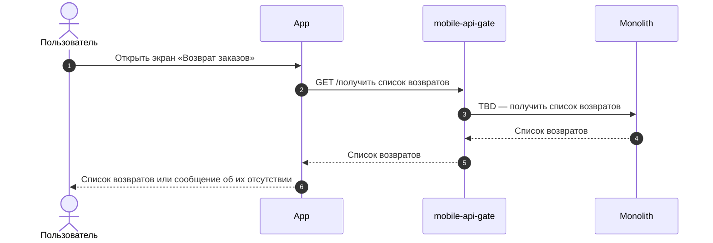

### Логика сценария

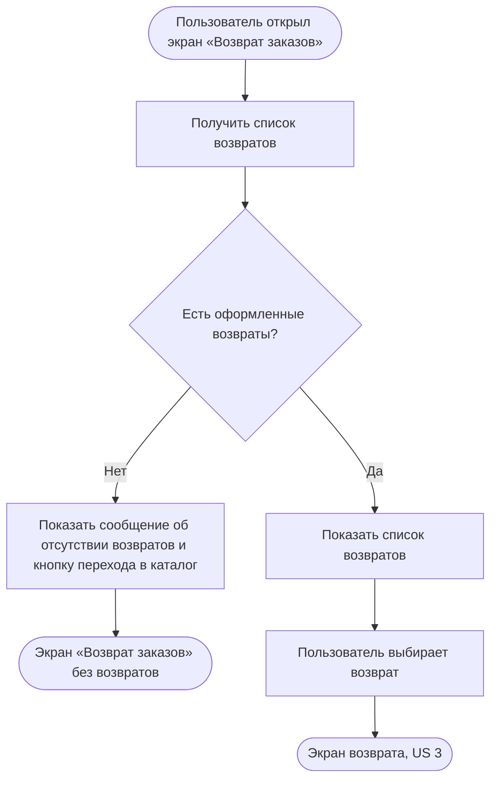

### Логика бэкенда

**`GET /получить список возвратов` (TBD) — новый метод**

1. Отдавать заявки на возврат клиента по всем его заказам, в любом статусе, включая отменённые, независимо от того, кто оформил заявку: клиент, Отдел дружбы с клиентами или магазин.
2. Сортировать по дате создания, от новых к старым.
3. Дату «Вернуть до», сохранённую в заявке при создании (US 1.5), отдавать для СДЭК, 5Post, Магазина 12 STOREEZ и Почты России.
4. Отдавать клиентский статус заявки: название и тип для значка (`status.type`, TBD) — в работе, выполнен, отменён (ориентироваться на макет).
5. Каждую заявку отдавать отдельным элементом списка, в том числе если по одному заказу оформлено несколько заявок.
6. Для каждого изделия передавать цены за единицу из соответствующей позиции исходного заказа: цену со скидкой и цену до скидки.

### Задачи

| Название | Ссылка |
|---|---|

### Просмотреть детальную информацию по заявке на возврат US 3

Как клиент, оформивший возврат, я хочу иметь полный доступ к информации и материалам по своей заявке, чтобы легко контролировать статус возврата на каждом этапе и оперативно получать нужные данные без обращения в поддержку

### Дизайн

Ссылка на Figma: https://www.figma.com/design/u5Fe5N4lypCdqgZn6533F2/%F0%9F%93%B1-06.-Profile--Redesign-?node-id=7992-114681&t=KUiaYx2kcuq61I5X-4

### Сценарий

#### Предусловие

1. Заявка на возврат создана

#### Основная последовательность "Просмотреть детальную информацию по заявке на возврат"

| Шаг | Исполнитель | Описание |
|---|---|---|
| 1 | Пользователь | Открывает экран возврата |
| 2 | APP | Вызвать метод `GET /получить детальную информацию по заявке на возврат` (TBD) |
| 3 | APP | Отобразить экран возврата: статус, инструкцию «Что дальше», срок возврата, способ возврата, способ возврата денег, изделия к возврату, «Итого к возврату» и «Баллы к возврату»<br><br>**Опционально**<br>1. Если системный статус заявки (`status.code`, TBD) — «Возврат завершен» или «Возврат отменен», то блоки «Что дальше» и «Срок возврата» не отображать<br>2. Если для способа возврата не задан текст «Что дальше», то блок не отображать<br>3. Если способ возврата — СДЭК, 5Post или Магазин 12 STOREEZ и системный статус заявки отличается от «Возврат отменен», то отобразить кнопку «Смотреть на карте»<br>4. Если способ возврата — Магазин 12 STOREEZ и системный статус заявки отличается от «Возврат отменен», то отобразить кнопку «Показать QR-код»<br>5. Если у части изделий заявки результат приёмки «Отменено» (`items[].status`, TBD), то отобразить их в блоке «Не переданы» отдельно от изделий к возврату |
| 4 | APP | Обработать действие пользователя на экране<br><br>**Опционально**<br>1. Если пользователь нажал «Копировать» рядом с номером возврата, то скопировать номер в буфер обмена и показать уведомление «Номер возврата скопирован»<br>2. Если пользователь нажал «Смотреть на карте», то открыть приложение карт на устройстве с точкой передачи из заявки, как на экране магазина при бронировании товара. Изменить точку нельзя<br>3. Если пользователь нажал «Показать QR-код», то отобразить шторку с QR-кодом заявки |

**Примечание**

1. Дата и интервал курьера на экране — выбранные при оформлении. Если их согласовал или перенёс Отдел дружбы с клиентами, показываются новые. Если клиент сам договорился с курьером о переносе, на экране остаются прежние.
2. Дата «Вернуть до» — срок передачи изделий в точку сдачи, сохранённый при создании заявки.
3. Если дата «Вернуть до» прошла, заявка не отменяется автоматически (автоотмена — Post-MVP). Если через 30 дней после создания изделия не поступили на склад или в магазин, заявка переходит в статус «Подтверждение возврата» и её обрабатывает Отдел дружбы с клиентами.
4. Срок возврата денег клиенту сообщается в тексте «Что дальше» из админки. Компания отправляет деньги в течение 3 дней: при возврате в магазин — от приёмки в магазине, для остальных способов — от поступления на склад. Клиенту сообщается только срок отправки, одной формулировкой для всех способов оплаты: срок зачисления зависит от банка. Поэтому текст для магазина отличается от текста для остальных способов.
5. Изменить заявку (способ возврата, точку, дату и интервал курьера) клиент в приложении не может. Изменения вносит Отдел дружбы с клиентами по обращению клиента.
6. Статус возврата показывается под клиентским названием, которое задаётся в админке. Если у нескольких внутренних статусов одно клиентское название, клиент видит их как один статус.
7. QR-код можно показать с экрана, без печати и без интернета.
8. Если клиент не может показать QR-код, сотрудник магазина находит заявку по ФИО, номеру телефона или номеру заказа.
9. Результат приёмки изделия — «Принято» или «Отменено». «Отменено» получает изделие, которое клиент не принёс или магазин отказался принять. Заявка при этом не отменяется: принятые изделия продолжают обработку возврата, отменённые исключаются из возврата.
10. Статус «Возврат завершен» означает, что компания перечислила деньги клиенту. Дата зачисления зависит от банка клиента.

### Взаимодействие компонентов

```mermaid
sequenceDiagram
    autonumber
    actor U as Пользователь
    participant APP as App
    participant API as mobile-api-gate
    participant MON as Monolith
    participant MAP as Приложение карт

    U->>APP: Открыть экран возврата
    APP->>API: GET /получить детальную информацию по заявке на возврат
    API->>MON: TBD — получить детальную информацию по заявке на возврат
    MON-->>API: Данные заявки
    API-->>APP: Данные заявки
    APP-->>U: Экран возврата

    opt Смотреть на карте
        U->>APP: Нажать «Смотреть на карте»
        APP->>MAP: Открыть точку передачи из заявки
        MAP-->>U: Точка на карте
    end

    opt Показать QR-код
        U->>APP: Нажать «Показать QR-код»
        APP-->>U: Шторка с QR-кодом заявки
    end
```

### Логика сценария

```mermaid
flowchart TD
    S([Пользователь открыл экран возврата]) --> A["Получить данные заявки"]
    A --> F{"Системный статус заявки — «Возврат завершен» или «Возврат отменен»?"}
    F -->|Нет| B{"Для способа возврата задан текст «Что дальше»?"}
    B -->|Да| B1["Показать блок «Что дальше»"]
    C{"Какой способ возврата?"}
    F -->|Да| R{"Системный статус заявки — «Возврат отменен»?"}
    R -->|Нет| C
    R -->|Да| N
    B1 --> C
    B -->|Нет| C
    P1["Показать кнопку «Смотреть на карте»"]
    C -->|Магазин 12 STOREEZ| M1["Показать кнопку «Показать QR-код»"]
    M1 --> P1
    C -->|СДЭК, 5Post| P1
    N{"У части изделий результат приёмки «Отменено»?"}
    P1 --> N
    C -->|Курьер, Почта России| N
    N -->|Да| N1["Показать блок «Не переданы»"]
    D["Показать экран возврата"]
    N1 --> D
    N -->|Нет| D
    D --> E{"Действие пользователя"}
    E -->|Нажал «Копировать»| E1["Скопировать номер возврата и показать уведомление «Номер возврата скопирован»"]
    E1 --> Z([Экран возврата])
    E -->|Нажал «Смотреть на карте»| E2["Открыть приложение карт с точкой передачи из заявки"]
    E2 --> Z2([Приложение карт])
    E -->|Нажал «Показать QR-код»| E3["Показать шторку с QR-кодом заявки"]
    E3 --> Z3([Шторка с QR-кодом])
```

### Логика бэкенда

**`GET /получить детальную информацию по заявке на возврат` (TBD) — новый метод**

1. Дату и интервал курьера отдавать из заявки. Если их согласовал или перенёс Отдел дружбы с клиентами, отдавать обновлённые.
2. Текст «Что дальше» отдавать из админки по способу возврата.
3. Отдавать признак, можно ли отменить заявку (`can_be_cancelled`, TBD), по её текущему статусу.
4. Данные точки передачи (название, адрес, режим работы, координаты) отдавать из заявки. Координаты нужны для кнопки «Смотреть на карте».
5. Для способа «Магазин 12 STOREEZ» отдавать данные для QR-кода (`qr_code`, TBD).
6. Отдавать признак, что кассовый чек возврата сформирован (`has_receipt`, TBD), — для кнопки «Скачать чек» (US 3.1).
7. Отдавать системный статус заявки (`status.code`, TBD) и его клиентское название.
8. Дату «Вернуть до», сохранённую в заявке при создании (US 1.5), отдавать для СДЭК, 5Post, Магазина 12 STOREEZ и Почты России.
9. Для каждого изделия передавать цены за единицу из соответствующей позиции исходного заказа: цену со скидкой и цену до скидки.
10. «Итого к возврату» и «Баллы к возврату» отдавать по суммам к возврату и баллам, потраченным при покупке, сохранённым для каждого изделия при создании заявки (US 1.5): по изделиям заявки, кроме изделий с результатом приёмки «Отменено». Для заявки в статусе «Возврат отменен» — по всем изделиям заявки. Баллы, начисленные за покупку, в «Баллы к возврату» не входят.
11. В статусе «Возврат завершен» в «Итого к возврату» отдавать сумму, перечисленную клиенту.
12. Для каждого изделия отдавать результат приёмки (`items[].status`, TBD): «Принято», «Отменено» или пусто, пока результата нет.

**Пример:** в заявке два изделия — 15 000 ₽ и 150 баллов, 5 000 ₽ и 50 баллов

| Поле | Заявка не отменена, изделие на 5 000 ₽ — «Отменено» | Заявка «Возврат отменен» |
|---|---|---|
| Результат приёмки | пусто или «Принято»; «Отменено» | «Отменено»; «Отменено» |
| «Итого к возврату» | 15 000 ₽ | 20 000 ₽ |
| «Баллы к возврату» | 150 | 200 |

### Задачи

| Название | Ссылка |
|---|---|

### Скачать заявление и чек возврата US 3.1

Как клиент, оформивший возврат, я хочу скачивать заявление на возврат и кассовый чек возврата, чтобы иметь необходимые документы без обращения в поддержку

### Дизайн

Ссылка на Figma: https://www.figma.com/design/u5Fe5N4lypCdqgZn6533F2/%F0%9F%93%B1-06.-Profile--Redesign-?node-id=8007-118957&t=KUiaYx2kcuq61I5X-4

### Сценарий

#### Предусловие

1. Пользователь находится на экране возврата (US 3)

#### Основная последовательность "Скачать заявление на возврат"

| Шаг | Исполнитель | Описание |
|---|---|---|
| 1 | APP | Отобразить на экране возврата кнопку «Скачать заявление»<br><br>**Опционально**<br>1. Если кассовый чек возврата сформирован (`has_receipt = true`, TBD), то отобразить кнопку «Скачать чек». См. альтернативную последовательность "Скачать чек" |
| 2 | Пользователь | Нажимает «Скачать заявление» |
| 3 | APP | Вызвать метод `GET /получить заявление на возврат` (TBD) |
| 4 | APP | Сохранить PDF-файл заявления на устройство |

#### Альтернативная последовательность "Скачать чек"

| Шаг | Исполнитель | Описание |
|---|---|---|
| 1 | Пользователь | Нажимает «Скачать чек» |
| 2 | APP | Вызвать метод `GET /получить кассовый чек возврата` (TBD) |
| 3 | APP | Сохранить файл чека на устройство |

### Взаимодействие компонентов

```mermaid
sequenceDiagram
    autonumber
    actor U as Пользователь
    participant APP as App
    participant API as mobile-api-gate
    participant MON as Monolith

    opt Скачать заявление
        U->>APP: Нажать «Скачать заявление»
        APP->>API: GET /получить заявление на возврат
        API->>MON: TBD — получить заявление на возврат
        MON-->>API: Заявление на возврат в PDF (способ передачи TBD)
        API-->>APP: Заявление на возврат в PDF (способ передачи TBD)
        APP-->>U: Файл заявления на устройстве
    end

    opt Скачать чек
        U->>APP: Нажать «Скачать чек»
        APP->>API: GET /получить кассовый чек возврата
        API->>MON: TBD — получить кассовый чек возврата
        MON-->>API: Кассовый чек возврата (способ передачи TBD)
        API-->>APP: Кассовый чек возврата (способ передачи TBD)
        APP-->>U: Файл чека на устройстве
    end
```

### Логика сценария

**Основная последовательность "Скачать заявление на возврат"**

```mermaid
flowchart TD
    S([Пользователь на экране возврата]) --> A["Показать кнопку «Скачать заявление»"]
    A --> B{"Кассовый чек возврата сформирован?"}
    B -->|Нет| E1{"Действие пользователя"}
    B -->|Да| B1["Показать кнопку «Скачать чек»"]
    B1 --> E2{"Действие пользователя"}
    E1 -->|Нажал «Скачать заявление»| D1["Получить PDF-файл заявления"]
    E2 -->|Нажал «Скачать заявление»| D1
    E2 -->|Нажал «Скачать чек»| CH[["Скачать чек"]]
    D1 --> D2["Сохранить файл заявления на устройство"]
    D2 --> Z([Файл заявления на устройстве])
```

### Логика бэкенда

**`GET /получить заявление на возврат` (TBD) — новый метод**

1. Обеспечить получение PDF-файла заявления на возврат, сформированного на основании данных заявки.

**`GET /получить кассовый чек возврата` (TBD) — новый метод**

1. Обеспечить получение кассового чека возврата, если чек сформирован (`has_receipt = true`, TBD).

### Задачи

| Название | Ссылка |
|---|---|

### Отменить заявку на возврат US 4

Как клиент, оформивший заявку на возврат, я хочу иметь возможность самостоятельно отменить созданную заявку, чтобы не возвращать товар, если я передумал, или оформить новую заявку, если допустил ошибку (выбрал не тот товар или способ сдачи)

### Дизайн

Ссылка на Figma: https://www.figma.com/design/u5Fe5N4lypCdqgZn6533F2/%F0%9F%93%B1-06.-Profile--Redesign-?node-id=8943-100757&t=1WHerU9r17fxsUgP-4

### Сценарий

#### Предусловие

1. Пользователь находится на экране возврата (US 3)

#### Основная последовательность "Отменить заявку на возврат"

| Шаг | Исполнитель | Описание |
|---|---|---|
| 1 | APP | Отобразить на экране возврата кнопку «Отменить возврат» и подпись «Если вам нужно внести изменения по возврату, отмените заявку и оформите ее заново», если в ответе метода `GET /получить детальную информацию по заявке на возврат` (TBD, US 3) отмена заявки доступна (`can_be_cancelled = true`, TBD) |
| 2 | Пользователь | Нажимает «Отменить возврат» |
| 3 | APP | Отобразить шторку «Отменить возврат?» с текстом «Заявка на возврат будет отменена» и кнопками «Отменить возврат» и «Закрыть»<br><br>**Опционально**<br>1. Если пользователь нажал «Закрыть» или крестик, то закрыть шторку. Статус заявки не меняется |
| 4 | Пользователь | Нажимает «Отменить возврат» в шторке |
| 5 | APP | Вызвать метод `POST /отменить заявку на возврат` (TBD) |
| 6 | APP | Закрыть шторку и вызвать метод `GET /получить детальную информацию по заявке на возврат` (TBD, US 3) — после успешной отмены и после ошибки, что статус заявки не допускает отмену |
| 7 | APP | Отобразить экран возврата по ответу метода (US 3). После успешной отмены — со статусом «Возврат отменен»<br><br>**Опционально**<br>1. Если бэкенд вернул ошибку, что статус заявки не допускает отмену, то отобразить сообщение о невозможности отмены возврата |

**Примечание**

1. Клиент может отменить заявку в статусах «Возврат ожидает обработки», «Заявка на возврат принята», «Подтверждение возврата» и «Возврат отправлен» — до статуса «Возврат принят».
2. Причину отмены клиент не указывает.
3. Изделия из отменённой заявки снова доступны для оформления возврата, если срок возврата не истёк (US 1.1).

### Взаимодействие компонентов

```mermaid
sequenceDiagram
    autonumber
    actor U as Пользователь
    participant APP as App
    participant API as mobile-api-gate
    participant MON as Monolith
    participant RCRM as RetailCRM
    participant ONEC as 1C

    U->>APP: Нажать «Отменить возврат»
    APP-->>U: Шторка «Отменить возврат?»
    alt Пользователь подтвердил отмену
        U->>APP: Нажать «Отменить возврат» в шторке
        APP->>API: POST /отменить заявку на возврат
        API->>MON: TBD — отменить заявку на возврат
        alt Отмена выполнена
            MON-->>API: Заявка отменена
            API-->>APP: Заявка отменена
            MON-)RCRM: Передать отмену заявки
            MON-)ONEC: Передать отмену заявки
            APP->>API: GET /получить детальную информацию по заявке на возврат
            API->>MON: TBD — получить детальную информацию по заявке на возврат
            MON-->>API: Детальная информация по заявке
            API-->>APP: Детальная информация по заявке
            APP-->>U: Экран возврата со статусом «Возврат отменен»
        else Статус заявки не допускает отмену
            MON-->>API: Ошибка: отмена невозможна
            API-->>APP: Ошибка: отмена невозможна
            APP->>API: GET /получить детальную информацию по заявке на возврат
            API->>MON: TBD — получить детальную информацию по заявке на возврат
            MON-->>API: Детальная информация по заявке
            API-->>APP: Детальная информация по заявке
            APP-->>U: Экран возврата с актуальными данными и сообщение о невозможности отмены возврата
        end
    else Пользователь закрыл шторку
        U->>APP: Нажать «Закрыть» или крестик
        APP-->>U: Экран возврата без изменений
    end
```

### Логика сценария

**Основная последовательность "Отменить заявку на возврат"**

```mermaid
flowchart TD
    S([Пользователь на экране возврата]) --> A{"Отмена заявки доступна?"}
    A -->|Нет| Z1([Экран возврата])
    A -->|Да| B["Показать кнопку «Отменить возврат»"]
    B -->|Пользователь нажал «Отменить возврат»| D["Показать шторку «Отменить возврат?»"]
    D --> E{"Действие пользователя"}
    E -->|Нажал «Закрыть» или крестик| F["Закрыть шторку"]
    F --> Z1
    E -->|Нажал «Отменить возврат»| H{"Статус заявки допускает отмену?"}
    H -->|Да| G["Перевести заявку в статус «Возврат отменен»"]
    G --> I["Обновить экран возврата"]
    I --> Z2([Экран возврата со статусом «Возврат отменен»])
    H -->|Нет| J["Обновить экран возврата"]
    J --> K["Показать сообщение о невозможности отмены возврата"]
    K --> Z3([Экран возврата с актуальными данными])
```

### Логика бэкенда

**`POST /отменить заявку на возврат` (TBD) — новый метод**

1. Проверять, что заявка относится к заказу клиента. Иначе возвращать ошибку.
2. Проверять актуальный статус заявки: клиент может отменить заявку в статусах «Возврат ожидает обработки», «Заявка на возврат принята», «Подтверждение возврата» и «Возврат отправлен». В остальных статусах заявку не отменять и возвращать ошибку, что статус заявки не допускает отмену. По этим же статусам отдавать признак `can_be_cancelled` в методе `GET /получить детальную информацию по заявке на возврат` (TBD, US 3).
3. Переводить заявку в статус «Возврат отменен».
4. Изделиям заявки ставить результат «Отменено» (`items[].status`, TBD, US 3). Суммы к возврату и баллы по изделиям, сохранённые при создании заявки (US 1.5), оставлять прежними.
5. Позициям исходного заказа возвращать статус, который был до создания заявки, если по позиции не осталось других заявок, кроме отменённых. Заявка, в которой все изделия позиции получили «Отменено», для этой позиции считается отменённой.
6. Записывать снимок заявки с позициями и их статусами в историю изменений заявки (US 1.5).
7. Передавать отмену заявки в RetailCRM и 1С.

### Задачи

| Название | Ссылка |
|---|---|
