## Полезные материалы

#|
|| **Название** | **Ссылка** ||
|| Макеты (МП) | https://www.figma.com/design/u5Fe5N4lypCdqgZn6533F2/%F0%9F%93%B1-06.-Profile--Redesign-?node-id=5547-145537&t=qoHbaQAbTlMNGNZX-4 ||
|| Макеты (сайт) | https://www.figma.com/design/eXX6wwylh99ztlNUgziZia/%25F0%259F%2596%25A5-05.-Profile--Redesign-?node-id=6317-86695&t=fKHpK9cmN3IoE3WY-0 ||
|| Эпик | https://tracker.yandex.ru/ITGENERAL-33 ||
|| Под эпик | https://tracker.yandex.ru/ECOMDEV-2246
https://tracker.yandex.ru/ECOMDEV-2256 ||
|| Маппинг статусов Post MVP | https://docs.google.com/spreadsheets/d/1BBenI7YT8DtquR58krRBBzdwoCjFuYeCKyyl9-66d4Q/edit?gid=2096004650#gid=2096004650 ||
|| BRD | https://docs.google.com/document/d/1rZKCC6zf38xjrW-WQuvGZcEYEMoMK7TBrHrj91QzOpA/edit?tab=t.5rgjndw51swl ||
|| Причины возвратов | https://docs.google.com/spreadsheets/d/1bBBNP4z9KuJfFFw6_zToKsN-TS_cBT0x/edit?gid=278087742#gid=278087742 ||
|| Названия элементов интерфейса | ui-terms.md ||
|| Элементы экранов оформления возврата | return-creation-mobile-mvp_ui.md ||
|#

## Глоссарий

#|
|| **Термин** | **Определение** ||
|| Активная заявка | Заявка на возврат в любом статусе, кроме «Возврат отменён», в том числе «Возврат принят» и «Возврат завершён». Возврат, отклонённый складом по итогам проверки, имеет статус «Возврат отменён». ||
|| Дата получения заказа | Дата завершения заказа ||
|| Последний день оформления заявки | Последний день, когда клиент может оформить заявку на возврат по заказу ||
|| TBD (to be defined — «будет определено») | Пометка у названия поля API или адреса метода: название предварительное. Требование задаёт смысл значения, а не его название ||
|#

## Не забыть про:

### Смежные системы

#|
|| **Система** | **Что затрагивает возврат** ||
|| Qlik | Отчётность по возвратам ||
|| Mindbox | Письма клиенту по смене статуса возврата, расчёт баллов к возврату ||
|#

## Основные принципы

1. Инструкции по способам возврата:
   - для каждого способа клиент видит два текста: описание на экране «Оформление возврата» и инструкцию «Что дальше» на экране созданного возврата;
   - оба текста заводятся в админке отдельно для каждого способа, содержание определяет бизнес.
2. Возврат части позиции:
   - одинаковые изделия хранятся в заказе одной позицией, и при создании заявки статус меняется у всей позиции;
   - если по позиции есть активная заявка, оставшиеся изделия видны в блоке «Ваш заказ», но в MVP выбрать их к возврату в приложении не получится: статус меняется у всей позиции. Их возврат оформляет Отдел дружбы с клиентами по обращению клиента. *Если появится способ возвращать остаток позиции в приложении, ограничение можно снять*;
   - при отмене заявки статус позиции возвращается, и её снова можно вернуть до последнего дня оформления заявки.
3. Номер возврата:
   - номер, который видит клиент, присваивает сайт для любой заявки: созданной клиентом, Отделом дружбы с клиентами или магазином;
   - формат — номер заказа и порядковый номер возврата по заказу: `598591-01`, …, `598591-10`. Отменённые заявки тоже учитываются в нумерации;
   - для обмена с 1С используется отдельный внутренний номер, клиенту он не показывается.

## Функциональные требования

### Админка

Для сценариев МП в админке нужны доработки, которых нет в текущих экранах.

1. Пользователь админки должен иметь возможность изменять клиентское название статуса возврата.
2. Пользователь админки должен иметь возможность объединять несколько статусов возврата под одним клиентским названием: клиент видит такие статусы как один статус (группировка).
3. Пользователь админки должен иметь возможность задавать для каждого способа возврата инструкцию для блока «Что дальше» экрана созданного возврата — отдельно от описания способа на экране «Оформление возврата».
4. Пользователь админки должен иметь возможность задавать порядок способов возврата: по нему формируется список способов и выбирается способ по умолчанию, если способ доставки заказа недоступен для возврата.
5. В справочник способов возврата должны быть добавлены способы «Магазин 12 STOREEZ» и «Почта России» с теми же настройками, что у курьера, СДЭК и 5Post: название, описание, инструкция, включение на сайте и в МП.
6. В справочник причин и групп возврата должны быть добавлены и обновлены причины — по таблице [«Причины возвратов»](https://docs.google.com/spreadsheets/u/1/d/1bBBNP4z9KuJfFFw6_zToKsN-TS_cBT0x/edit?gid=175594683#gid=175594683).
7. Пользователь админки должен иметь возможность включать и отключать способы возврата для города: по этой настройке метод получения способов возврата для города отдаёт только включённые для города способы.

## Данные БД



**Новые таблицы**

#|
|| **Таблица** | **Что хранит** ||
|| `cms_returns` | Заявка на возврат ||
|| `cms_return_positions` | Позиция возврата: одно изделие с причиной и статусом ||
|| `cms_return_statuses` | Справочник статусов заявки: системное и клиентское название, тип для значка (в работе, выполнен, отменён), код для обмена, признак «допускает отмену клиентом» ||
|| `cms_return_status_groups` | Группы статусов ||
|| `cms_return_position_statuses` | Справочник статусов позиции возврата ||
|| `cms_return_history` | История изменений заявки: снимок заявки с позициями после каждого изменения ||
|| `cms_return_refunds` | Куда и сколько вернуть денег по заявке ||
|| `cms_refund_methods` | Справочник способов возврата денег: на карту, по реквизитам, баллами и т. д. У каждого — название и признак «нужны реквизиты» ||
|| `cms_return_method_delivery_type` | Соответствие способов возврата возвратным службам и службам доставки заказа (способ «как в заказе») ||
|#

**Изменения существующих таблиц и настроек**

#|
|| **Таблица или настройка** | **Что меняется** ||
|| Настройка срока возврата | Новая настройка: срок для клиентов F&F — 30 дней ||
|| `cms_return_reasons`, `cms_return_reasons_groups` | Обновить причины и группы по таблице «Причины возвратов» ||
|| `cms_return_method` | Добавить новые способы «Магазин 12 STOREEZ» и «Почта России» ||
|| `cms_delivery_tk` | Новые возвратные службы со своим типом доставки ||
|| `cms_delivery_city` | Города возвратных служб (с ФИАС) ||
|| `cms_catalog_stock` | Новое поле: признак «Принимает возвраты» ||
|#



# User story

## Оформление возврата

### Отобразить кнопку оформления возврата на экране заказа US 1.1



### Дизайн

Ссылка на Figma: https://www.figma.com/design/u5Fe5N4lypCdqgZn6533F2/%F0%9F%93%B1-06.-Profile--Redesign-?node-id=7985-73307&t=qoHbaQAbTlMNGNZX-4

### Сценарий

#### Предусловие

1. Пользователь авторизован

#### Основная последовательность "Отобразить кнопку оформления возврата на экране заказа"

#|
||

**Шаг**

|

**Исполнитель**

|

**Описание**

||
||

1

|

Пользователь

|

Открывает экран заказа

||
||

2

|

APP

|

Вызвать метод `GET /получить карточку заказа` (`GET /api/orders/{id}`, доработка метода)

||
||

2\.1

|

Бэкенд

|

Рассчитать последний день оформления заявки на возврат (`return.request_until_date`, TBD): дата получения заказа \+ 14 дней

**Опционально**

1. Если клиент F&F, то дата получения заказа \+ 30 дней

||
||

2\.2

|

Бэкенд

|

Рассчитать для каждой позиции заказа данные для возврата — по таблице «Данные позиции для возврата» в разделе «Логика бэкенда»

||
||

2\.3

|

Бэкенд

|

Вернуть сообщение со статусом `can_be_returned` «Можно вернуть изделия до \[Дата\]», если хотя бы одну позицию заказа можно вернуть (`items[].can_be_returned = true`). 

* \[Дата\] — последний день оформления заявки (`return.request_until_date`, TBD)

||
||

3

|

APP

|

Отобразить в блоке «Ваш заказ · N» позиции заказа с количеством изделий, оставшихся у клиента (`items[].remaining_quantity`, TBD). 

* N — число строк в блоке, одна строка — одна позиция

**Опционально**

1. Если у клиента не осталось изделий позиции (`items[].remaining_quantity = 0`, TBD), то позицию в блоке «Ваш заказ · N» не отображать

||
||

4

|

APP

|

Отобразить после блока «Ваш заказ · N» блок «Оформлен возврат · N»: каждое изделие позиций в активных заявках на возврат (`items[].return_items`, TBD) — отдельной строкой с выбранной причиной возврата. 

* N — число строк в блоке, одна строка — одно изделие. Из блока переход в возврат не выполняется

**Опционально**

1. Если по заказу нет активных заявок на возврат, то блок «Оформлен возврат · N» не отображать

||
||

5

|

APP

|

Отобразить кнопку «Оформить возврат», если в ответе метода `GET /получить карточку заказа` есть сообщение со статусом `can_be_returned`

**Опционально**

1. Если сообщения нет, то кнопку не отображать

||
||

6

|

APP

|

Отобразить под кнопкой текст `messages[].message` элемента со `status = "can_be_returned"` — «Можно вернуть изделия до \[Дата\]» — и ссылку «Правила возврата»

**Опционально**

1. Если кнопка «Оформить возврат» не отображается, то текст и ссылку «Правила возврата» не отображать

||
|#



```
Feature: Отображение кнопки и условий возврата в карточке заказа

Сценарий: Кнопка возврата доступна при отсутствии ранее созданных заявок
  Дано заявки на возврат для всех позиций заказа отсутствуют
  И с даты получения заказа прошло <= 14 дней/30 дней
  Когда клиент просматривает карточку заказа
  Тогда кнопка оформления возврата отображается и активна

Сценарий: Кнопка возврата доступна при наличии действующей заявки на часть товаров
  Дано в заказе есть позиция, на которую еще не оформлен возврат
  И хотя бы для одной позиции в заказе есть активная заявка на возврат (!="Возврат отменён")
  И с даты получения заказа прошло <= 14 дней/30 дней
  Когда клиент просматривает карточку заказа
  Тогда кнопка оформления возврата отображается и активна

Сценарий: Возврат снова доступен после отмены предыдущей заявки
  Дано хотя бы для одной позиции в заказе есть заявка в статусе "Возврат отменён"
  И для этой позиции отсутствуют другие активные заявки (!="Возврат отменён")
  И с даты получения заказа прошло <= 14 дней/30 дней
  Когда клиент просматривает карточку заказа
  Тогда кнопка оформления возврата отображается и активна

Сценарий: Отображение даты возврата для клиентов F&amp;F
  Дано клиент относится к категории F&amp;F (cms_users_user.is_vic = 1)
  И с даты получения заказа прошло <= 30 дней
  И кнопка "Оформить возврат" отображается и активна
  Когда клиент просматривает карточку заказа
  Тогда дата, до которой можно оформить заявку, равна "дата получения заказа + 30 дней"
  И под кнопкой отображается текст "Можно вернуть изделия до [Дата]"
  И отображается кликабельная ссылка "Правила возврата"

Сценарий: Отображение даты возврата для обычных клиентов
  Дано клиент не относится к категории F&amp;F (cms_users_user.is_vic = 0)
  И с даты получения заказа прошло <= 14 дней
  И кнопка "Оформить возврат" отображается и активна
  Когда клиент просматривает карточку заказа
  Тогда дата, до которой можно оформить заявку, равна "дата получения заказа + 14 дней"
  И под кнопкой отображается текст "Можно вернуть изделия до [Дата]"
  И отображается кликабельная ссылка "Правила возврата"

Сценарий: Срок оформления возврата истёк
  Дано с даты получения заказа прошло > 14 дней/30 дней
  Когда клиент просматривает карточку заказа
  Тогда кнопка оформления возврата не отображается

Сценарий: Нет изделий, доступных для возврата 
  Дано для всех позиций заказа есть активные заявки на возврат (!="Возврат отменён")
  И с даты получения заказа прошло <= 14 дней/30 дней
  Когда клиент просматривает карточку заказа
  Тогда кнопка оформления возврата не отображается

# ПЕРЕНЕСЕНО 14.10.2026 из US13 по решению автора: не отдельная история, а критерий начала оформления возврата
Сценарий: Позиции с оформленным возвратом в карточке заказа
  Дано по одной или нескольким позициям заказа оформлен возврат (статус возврата != "Возврат отменён")
  Когда клиент открывает карточку заказа
  Тогда позиции без возврата отображаются в блоке "Ваш заказ · N"
  И позиции с оформленным возвратом отображаются в отдельном блоке "Оформлен возврат · N"
  И у каждой позиции блока отображается выбранная причина возврата
```





1. В списке заказов признак возврата не отображается: клиент видит оформленный возврат только на экране заказа.



**Комментарий**

**{red}(На уточнении:)**

1. Что происходит с выпущенными версиями приложения после включения нового возврата: обязательное обновление приложения через настройку «Обязательное обновление для Android / iOS», скрытие кнопки возврата в старых версиях или отказ в создании возврата по-старому с просьбой обновить приложение?
2. Включается ли новый возврат переключателем в админке, и что видит клиент, пока переключатель выключен: старый возврат или кнопки возврата нет?
3. Работает ли обязательное обновление приложения на iOS и Android?
4. Отсекаются ли сейчас брони и покупки в магазине по чеку текущей проверкой статуса заказа? Если нет — в «Логику бэкенда» нужен пункт «Брони и покупки в магазине по чеку возврат в ЛК не допускают» ({orange}(под вопросом)).

### Взаимодействие компонентов



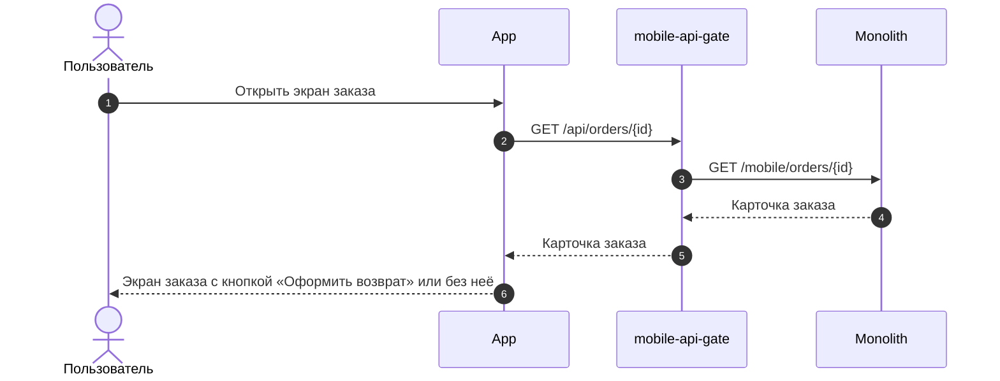


### Логика сценария



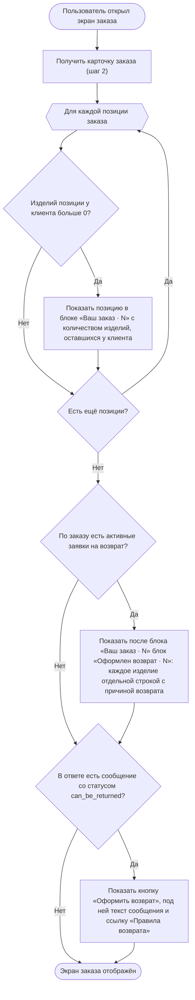
&nbsp;



### Логика бэкенда

*\*Предположительно, что требуется*

**`GET /получить карточку заказа` (`GET /api/orders/{id}`) — доработка метода**

1. Срок возврата: для клиентов F&F — 30 дней с даты получения заказа, для остальных — 14 дней, как сейчас. Отдавать последний день оформления заявки (`return.request_until_date`, TBD). Проверять срок для заказа и позиций по этой дате вместо текущей проверки 14 дней.
2. Текст сообщения `can_be_returned` — «Можно вернуть изделия до \[Дата\]» изменить на реальную дату, а не упоминание про 14 дней.
3. По каждой позиции отдавать данные по заявкам на возврат — по таблице «Данные позиции для возврата». Позицию с активной заявкой вернуть нельзя, даже если у клиента остались её изделия.
4. Признак `return.is_bank_data_required` = `true` также, если заказ полностью или частично оплачен подарочным сертификатом (US 1.4).
5. Отдавать текст о том, куда вернутся деньги (`return.refund.message`, TBD, US 1.4), если банковские реквизиты не нужны.
6. Отдавать адрес, пункт выдачи или магазин, куда был доставлен заказ (`order_delivery`, TBD, US 1.3).
7. По каждой позиции отдавать сумму и баллы к возврату за одно изделие (`items[].refund_amount`, `items[].refund_bonus`, TBD, US 1.4). *{orange}(Правила расчёта баллов — на уточнении.)*

**Данные позиции для возврата**

*Термин «активная заявка» — в разделе «Глоссарий».*

#|
|| **Поле** | **Что означает** | **Как считается** | **Где используется** ||
|| `items[].return_items`, TBD | Изделия позиции, оформленные в возврат | Каждое изделие в активной заявке — отдельная запись с причиной возврата (`reason_title`, TBD). Если причина не выбрана — название группы причин | Блок «Оформлен возврат · N» ||
|| `items[].remaining_quantity`, TBD | Сколько изделий позиции осталось у клиента | Количество в позиции минус изделия в возврате. *Считается всегда, даже если вернуть позицию нельзя* | Блок «Ваш заказ · N» ||
|| `items[].can_be_returned` | Можно ли оформить возврат по позиции | `true`, если выполнены текущие проверки и:
1. Последний день оформления заявки (`return.request_until_date`, TBD) не прошёл
2. По позиции нет активной заявки | Сообщение «Можно вернуть изделия до [Дата]», экран «Выберите изделия» ||
|| `items[].available_return_quantity`, TBD | Сколько изделий позиции можно выбрать к возврату | Если позицию можно вернуть — равно `remaining_quantity`, иначе 0 | Экран «Выберите изделия» ||
|#

**Пример:** в позиции 3 изделия

#|
|| **Поле** | **Заявок нет** | **Изделие в активной заявке** ||
|| `return_items` | пусто | 1 изделие ||
|| `remaining_quantity` | 3 | 2 ||
|| `can_be_returned` | `true` | `false` ||
|| `available_return_quantity` | 3 | 0 ||
|#

### Задачи

#|
|| **Название** | **Ссылка** ||
|| Доработать метод получения информации по заказу | https://tracker.yandex.ru/ECOMDEV-2343 ||
|#



### Выбрать изделия и причины возврата US 1.2



### Дизайн

Ссылка на Figma: https://www.figma.com/design/u5Fe5N4lypCdqgZn6533F2/%F0%9F%93%B1-06.-Profile--Redesign-?node-id=7240-60450&t=qoHbaQAbTlMNGNZX-4

### Сценарий

#### Предусловие

1. На экране заказа отображается кнопка «Оформить возврат» (US 1.1)

#### Основная последовательность "Выбрать изделия и причины возврата"

#|
||

**Шаг**

|

**Исполнитель**

|

**Описание**

||
||

1

|

Пользователь

|

Нажимает «Оформить возврат»

||
||

2

|

APP

|

Отобразить экран «Выберите изделия» по данным ответа метода `GET /получить карточку заказа`

||
||

2\.1

|

APP

|

Отобразить позиции, у которых `items[].can_be_returned = true`

**Опционально**

1. Если `items[].can_be_returned = false`, то позицию не отображать

||
||

2\.2

|

APP

|

Отобразить каждое изделие позиции отдельной строкой. Число строк — `items[].available_return_quantity`, TBD

||
||

2\.3

|

APP

|

Отобразить предупреждение о необходимости вернуть изделия в полной комплектации

||
||

3

|

Пользователь

|

Отмечает чекбоксами изделия

||
||

4

|

APP

|

Изменить заголовок экрана на «Выберите изделия · N», где N — число выбранных изделий. Сделать кнопку «Указать причину возврата» активной

**Опционально**

1. Если не выбрано ни одного изделия, то кнопка «Указать причину возврата» неактивна

||
||

5

|

Пользователь

|

Нажимает «Указать причину возврата»

||
||

6

|

APP

|

Вызвать метод `GET /получить справочник причин возврата` (`GET /api/orders/v2/return-reasons`, существующий)

||
||

6\.1

|

Бэкенд

|

Вернуть активные группы причин в заданном порядке, в каждой группе — активные причины в заданном порядке.

||
||

7

|

APP

|

Отобразить экран «Причина возврата» с подзаголовком «Изделие 1 из N»

||
||

8

|

Пользователь

|

Выбирает группу причин в выпадающем списке

||
||

9

|

APP

|

Отобразить список причин выбранной группы

**Опционально**

1. Если у группы нет причин, то выбор группы считать выбором причины и перейти к шагу 11

||
||

10

|

Пользователь

|

Выбирает причину

||
||

11

|

APP

|

Перейти к следующему выбранному изделию и изменить подзаголовок на «Изделие K из N», где K — номер изделия. Переход между изделиями — по макету

**Опционально**

1. Если пользователь нажал «Назад», то перейти к предыдущему изделию. Выбранная причина сохраняется, её можно изменить
2. Если пользователь нажал «Назад» на первом изделии, то вернуться к экрану «Выберите изделия»

||
||

12

|

APP

|

После выбора причины для последнего изделия сделать кнопку «Выбрать способ возврата» активной

**Опционально**

1. Если причина указана не для всех выбранных изделий, то кнопка «Выбрать способ возврата» неактивна
2. Если пользователь вернулся к экрану «Выберите изделия» и изменил состав изделий, то причины сбрасываются и указываются заново, начиная с шага 5

||
|#



```
Feature: Формирование состава возврата и указание причин

Сценарий: Отображение списка изделий при оформлении возврата
  Дано кнопка оформления возврата отображается и активна
  Когда клиент нажимает кнопку "Оформить возврат"
  Тогда отображаются только позиции без заявок на возврат или со статусом заявки = "Возврат отменён"
  И для позиции заказа с количеством >=2 система отображает каждую единицу как отдельное изделие
  И отображается предупреждение о необходимости вернуть изделия в полной комплектации

@NEW
Сценарий: Подарок или кофр не отображается в списке изделий для возврата
  Дано в заказе есть подарок или кофр отдельной позицией
  Когда клиент нажимает кнопку "Оформить возврат"
  Тогда подарок и кофр не отображаются в списке изделий для возврата

Сценарий: Ни одно изделие не выбрано
  Дано клиент находится на форме выбора изделий для возврата
  Когда клиент не выбрал ни одного изделия
  Тогда кнопка "Указать причину возврата" находится в неактивном состоянии

Сценарий: Динамическое изменение заголовка при выборе изделий
  Дано клиент находится на экране "Выберите изделия"
  Когда клиент отмечает чекбоксом N изделий
  Тогда заголовок экрана меняется на "Выберите изделия · N"
  И кнопка "Указать причину возврата" становится активной

Сценарий: Пошаговое указание причин возврата (двухуровневый выбор)
  Дано клиент нажимает "Указать причину возврата"
  Тогда система открывает экран "Причина возврата" с подзаголовком "Изделие 1 из N"
  Когда клиент выбирает группу причин из выпадающего списка
  Тогда система отображает детализированный список причин
  Когда клиент выбирает конкретную причину из списка
  Тогда система переходит к следующему выбранному изделию, если причины указаны не для всех изделий
  И после указания причины для последнего изделия кнопка "Выбрать способ возврата" становится активной

Сценарий: Причина возврата указана не для всех выбранных изделий
  Дано клиент выбрал одно или несколько изделий для возврата
  И находится на экране указания причин возврата
  Когда причина возврата указана не для всех выбранных изделий
  Тогда кнопка "Выбрать способ возврата" неактивна

# TODO (На уточнение): Если будет принято решение изменять статус всей позиции заказа при оформлении возврата части её изделий, применяется следующее ограничение. Иначе удалить
Сценарий: Возврат части изделий одной позиции заказа
  Дано позиция заказа содержит несколько одинаковых изделий
  И хотя бы на одно изделие оформлена действующая заявка на возврат
  Когда клиент открывает экран выбора изделий для возврата
  Тогда все изделия этой позиции исключаются из списка доступных для возврата
```

**Ограничение MVP по сценарию "Возврат части изделий одной позиции заказа":** при оформлении возврата части количества одной позиции заказа вся позиция становится недоступной для последующего самостоятельного возврата через сайт и мобильное приложение. Возврат оставшихся изделий осуществляется через Отдел дружбы с клиентами в RetailCRM.
**Причина:** принятое бизнесом упрощение реализации ввиду низкой частоты заказов с несколькими одинаковыми изделиями.



### Взаимодействие компонентов



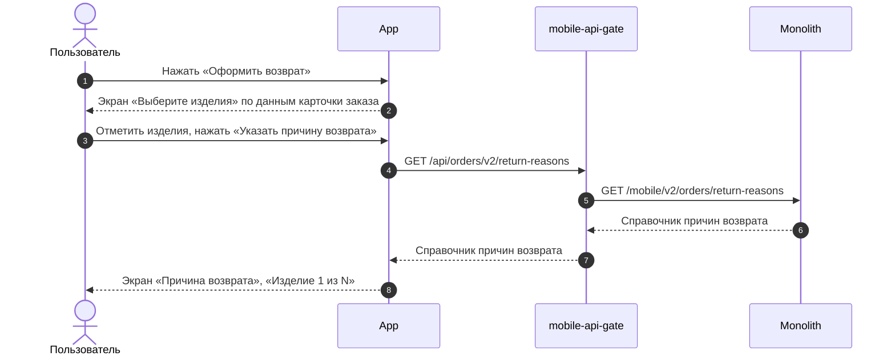


### Логика сценария



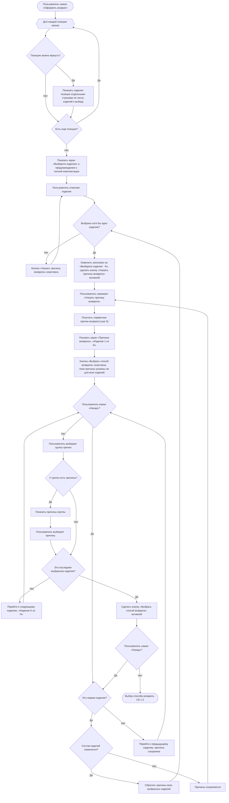
&nbsp;



### Задачи

#|
||

**Название**

|

**Ссылка**

||
||

|

||
|#



### Выбрать способ возврата US 1.3



### Дизайн

Ссылка на Figma: https://www.figma.com/design/u5Fe5N4lypCdqgZn6533F2/%F0%9F%93%B1-06.-Profile--Redesign-?node-id=7235-41564&t=KUiaYx2kcuq61I5X-4

### Сценарий

#### Предусловие

1. Пользователь указал причины возврата для всех выбранных изделий (US 1.2)

#### Основная последовательность "Выбрать способ возврата"

#|
||

**Шаг**

|

**Исполнитель**

|

**Описание**

||
||

1

|

Пользователь

|

Нажимает «Выбрать способ возврата»

||
||

2

|

APP

|

Определить город возврата: взять страну и город доставки заказа (`order_delivery.country_iso`, `order_delivery.city_fias`, TBD) из ответа метода `GET /получить карточку заказа` (US 1.1)

**Опционально**

1. Если город доставки заказа (`order_delivery.city_fias`, TBD) не заполнен, то открыть шторку «Выберите город». См. альтернативную последовательность "Сменить город"

||
||

3

|

APP

|

Вызвать метод `GET /получить данные города` (`GET /api/v1/geo/countries/{country_iso_code}/cities/{geo_id}/details`): 

* `country_iso_code` — страна доставки заказа (`order_delivery.country_iso`, TBD), `geo_id` — город доставки заказа (`order_delivery.city_fias`, TBD). Из ответа взять часовой пояс города `timezone` (обязательно) — он передаётся в запрос дат и интервалов курьера

**Опционально**

1. Если данные города не получены, то открыть шторку «Выберите город». См. альтернативную последовательность "Сменить город"

||
||

4

|

APP

|

Вызвать метод `GET /получить способы возврата для города` (`GET /api/v2/delivery/{order_id}/return-method-list`, новый метод, TBD): страна, регион и город возврата из ответа метода `GET /получить данные города` (шаг 3)

||
||

4\.1

|

Бэкенд

|

Вернуть способы возврата, которые работают в городе, в порядке приоритета. Для каждого способа вернуть:

* службу и код типа доставки
* признак `is_order_method` (TBD): способ совпадает со способом доставки заказа и город возврата — город заказа
* для СДЭК, 5Post, Магазина 12 STOREEZ и Почты России — дату «Вернуть до»: текущая дата \+ 10 календарных дней

||
||

5

|

APP

|

Отобразить экран «Оформление возврата» с городом и способами возврата (из ответа метода `GET /получить способы возврата для города`)

**Опционально**

1. Если для города нет доступных способов возврата, то отобразить сообщение об отсутствии доступных способов возврата и действие «Написать нам». Поле города остаётся доступным для нажатия
2. Если пользователь нажал «Написать нам», то открыть шторку «Отдел дружбы с клиентами» с часами работы отдела и действиями «Позвонить» и «Написать», как в US 1.4
3. Если пользователь нажал «Назад», то вернуться к экрану «Причина возврата» на последнее изделие. Выбранные изделия и причины сохраняются

||
||

6

|

APP

|

Предвыбрать способ возврата, совпадающий со способом доставки заказа (`is_order_method = true`, TBD)

**Опционально**

1. Если такого способа нет, то выбрать первый способ в списке. Так бывает, если способ доставки заказа недоступен для возврата или город возврата отличается от города заказа
2. Если пользователь переключился на другой способ и вернулся к прежнему, то отобразить данные, которые были заполнены для прежнего способа. Данные не сбрасываются

||
||

7

|

APP

|

Подставить адрес или точку из исходного заказа, если выбран способ, совпадающий со способом доставки заказа (`is_order_method = true`, TBD)

**Опционально**

1. Если способ выбран по приоритету, то адрес и точку не подставлять: пользователь заполняет их сам

||
||

7\.1

|

APP

|

Курьер — подставить адрес доставки заказа (`order_delivery.address`, TBD) из ответа метода `GET /получить карточку заказа`: улица, дом, корпус, квартира, индекс — и отобразить над полями адреса подсказку "проверить актуальность адреса". Далее — шаги 7–8 альтернативной последовательности "Курьер" с адресом из заказа

**Опционально**

1. Если адрес доставки заказа (`order_delivery.address`, TBD) не заполнен, то поля адреса оставить незаполненными
2. Если в адресе заказа нет индекса, то отобразить поле «Индекс» для ручного ввода ({orange}(под вопросом))
3. Если пользователь изменил подставленный адрес, то выполнить шаги 3–6 альтернативной последовательности "Курьер", сбросить выбранные дату и интервал и запросить даты и интервалы заново (шаги 7–8)

||
||

7\.2

|

APP

|

СДЭК, 5Post — вызвать метод `GET /получить данные пункта выдачи` (`GET /api/v1/pickup/provider/{provider}/points/{point}`, доработка метода):

* `provider` — служба выбранного способа (из ответа метода `GET /получить способы возврата для города`),
* `point` — пункт выдачи заказа (`order_delivery.pvz.id`, TBD) (из ответа метода `GET /получить карточку заказа`)

Подставить пункт, если он принимает возвраты (`is_return_available = true`)

**Опционально**

1. Если пункт в заказе не указан, то метод не вызывать и поле точки оставить незаполненным
2. Если пункт не принимает возвраты или данные пункта не получены, то поле точки оставить незаполненным

||
||

7\.3

|

APP

|

Магазин 12 STOREEZ — вызвать метод `GET /получить магазины, принимающие возвраты` (`GET /api/v1/stores/returns`, новый метод, TBD) по городу возврата и подставить магазин доставки заказа (`order_delivery.store.store_code`, TBD), если он есть в списке

**Опционально**

1. Если магазин в заказе не указан, то метод не вызывать и поле точки оставить незаполненным
2. Если магазина заказа нет в списке, то поле точки оставить незаполненным

||
||

8

|

APP

|

Для способов СДЭК, 5Post, Магазин 12 STOREEZ и Почта России отобразить дату, до которой нужно передать изделия в выбранную точку, — дату из ответа метода `GET /получить способы возврата для города`. Пока пользователь на экране «Оформление возврата», дата не меняется

||
|#



```
Feature: Определение города и списка доступных способов возврата

# TODO (На уточнение): Проверить, могут ли отсутствовать или изменяться идентификаторы городов, сохранённые в исходных заказах. Если справочник городов единый и идентификаторы сохраняются, отдельная обработка неопределённого города не требуется.
Сценарий: Город возврата определён автоматически из заказа
  Дано клиент указал причины возврата для выбранных позиций
  Когда клиент нажимает кнопку "Выбрать способ возврата"
  И город возврата определен автоматически из данных заказа
  Тогда система отображает только способы возврата, применимые к этому городу

Сценарий: Успешный ручной выбор города и загрузка способов возврата
  Дано клиент находится на экране оформления возврата
  Когда клиент нажимает на поле города
  Тогда открывается шторка выбора города
  Когда клиент самостоятельно выбирает страну или город из списка
  Тогда шторка закрывается
  И система применяет выбранный город
  И отображает способы возврата, доступные для данного города

Сценарий: Для города возврата отсутствуют доступные способы возврата
  Дано для города возврата нет доступных способов возврата
  Когда <Событие>
  Тогда система отображает сообщение об отсутствии доступных способов возврата
  И отображается кнопка "Написать нам"
  И поле выбора города остается доступным для нажатия

  Варианты:
    | Событие                                                                                    |
    | клиент нажимает кнопку "Выбрать способ возврата", и город определён из данных заказа         |
    | клиент выбрал город в шторке выбора города (после подтверждения смены города, если она была) |

Сценарий: Предупреждение о сбросе способа возврата при смене города
  Дано клиент открыл шторку выбора города на экране оформления возврата
  И город возврата заполнен
  Когда клиент выбирает другой город из списка
  Тогда шторка закрывается
  И поверх экрана оформления возврата отображается модальное окно "Смена города" с предупреждением о сбросе способа возврата
  И отображаются кнопки "Продолжить" и "Отмена"

Сценарий: Подтверждение смены города
  Дано отображается модальное окно "Смена города"
  Когда клиент нажимает кнопку "Продолжить"
  Тогда модальное окно закрывается
  И ранее выбранный способ возврата и все заполненные для способов данные (адрес, дата и интервал, точка передачи) сбрасываются
  И система применяет новый город
  И отображаются доступные способы возврата для нового города
  И система автоматически выбирает первый по приоритету способ возврата

Сценарий: Отказ от смены города
  Дано отображается модальное окно "Смена города"
  Когда клиент нажимает кнопку "Отмена"
  Тогда модальное окно закрывается
  И система возвращает клиента на экран выбора способа возврата без изменения данных
```

```
Feature: Определение способа возврата по умолчанию

Сценарий: Автоматический выбор способа возврата по исходному заказу
  Дано клиент оформляет возврат в городе исходного заказа
  И способ и адрес доставки исходного заказа доступны для сценария возврата
  Когда клиент переходит на экран выбора способа возврата
  Тогда система автоматически выбирает способ возврата, соответствующий исходному заказу
  И система предзаполняет адрес возврата данными из исходного заказа

Сценарий: Исходная точка или адрес доставки недоступны для возврата
  Дано клиент оформляет возврат в городе исходного заказа
  И способ доставки из исходного заказа доступен для возврата
  И конкретная точка или адрес из исходного заказа недоступны для возврата
  Когда клиент переходит на экран выбора способа возврата
  Тогда система автоматически выбирает способ возврата, соответствующий исходному заказу
  И поле выбора адреса или точки возврата остается незаполненным

Сценарий: Исходный способ доставки недоступен для возврата
  Дано способ доставки из исходного заказа недоступен для сценария возврата
  И для выбранного города доступен хотя бы один другой способ возврата
  Когда клиент переходит на экран выбора способа возврата
  Тогда система автоматически выбирает первый доступный способ возврата по приоритету

Сценарий: Определение способа возврата при оформлении в другом городе
  Дано клиент оформляет возврат в городе, отличном от города исходного заказа
  И для выбранного города доступны способы возврата
  Когда клиент переходит на экран выбора способа возврата
  Тогда система автоматически выбирает первый доступный способ возврата по приоритету

Сценарий: Данные заказа подставляются снова при возврате к исходному городу
  Дано клиент сменил город возврата на другой и подтвердил сброс данных
  Когда клиент снова выбирает город из исходного заказа и подтверждает смену города
  Тогда система автоматически выбирает способ возврата, соответствующий исходному заказу
  И подставляет адрес или точку из исходного заказа, если они доступны для возврата

Сценарий: Возврат к ранее выбранному способу возврата в том же городе
  Дано для способа возврата заполнены данные (предзаполнены из исходного заказа или введены клиентом)
  Когда клиент переключает способ возврата на любой другой в рамках того же города
  И затем снова возвращается обратно
  Тогда система показывает данные, которые были заполнены для этого способа
```



#### Альтернативная последовательность "Сменить город"

#|
||

**Шаг**

|

**Исполнитель**

|

**Описание**

||
||

1

|

Пользователь

|

Нажимает на поле города

||
||

2

|

APP

|

Вызвать метод `GET /получить список городов` (`GET /api/v1/geo/countries/{country_iso_code}/cities`) с кодом страны города возврата, без поискового запроса

**Опционально**

1. Если страна города возврата не определена, то метод не вызывать

||
||

3

|

APP

|

Отобразить шторку «Выберите город»: поле страны с текущей страной, поле поиска и список городов этой страны

**Опционально**

1. Если страна не определена, то в поле страны предложить выбрать страну, список городов не отображать
2. Если пользователь закрыл шторку, не выбрав город, то оставить ранее выбранный город и способы возврата

||
||

3\.1

|

Пользователь

|

Нажимает на поле страны

||
||

3\.2

|

APP

|

Вызвать метод `GET /получить список стран` (`GET /api/v1/geo/countries`) и отобразить окно выбора страны со списком стран и поиском по названию

||
||

3\.3

|

Пользователь

|

Выбирает страну

||
||

3\.4

|

APP

|

Вызвать метод `GET /получить список городов` (`GET /api/v1/geo/countries/{country_iso_code}/cities`) с кодом выбранной страны и отобразить в шторке выбранную страну и её города

||
||

3\.5

|

Пользователь

|

Вводит название города в поле поиска

||
||

3\.6

|

APP

|

Вызвать метод `GET /получить список городов` (`GET /api/v1/geo/countries/{country_iso_code}/cities`) с кодом страны и введённым названием и отобразить найденные города

**Опционально**

1. Если города не найдены, то отобразить сообщение, что по запросу ничего не найдено

||
||

4

|

Пользователь

|

Выбирает город в списке: среди городов страны или среди найденных по поиску. Сменить страну (шаги 3.1–3.4) и искать город (шаги 3.5–3.6) необязательно

||
||

4\.1

|

APP

|

Вызвать метод `GET /получить данные города` (`GET /api/v1/geo/countries/{country_iso_code}/cities/{geo_id}/details`) для выбранного города. Из ответа взять часовой пояс города `timezone` — он передаётся в запрос дат и интервалов курьера (обязательно)

||
||

5

|

APP

|

Закрыть шторку и отобразить шторку «Смена города» с предупреждением о сбросе способа возврата и кнопками «Продолжить» и «Отмена»

**Опционально**

1. Если город возврата не удалось определить из заказа и пользователь выбирает город впервые, то шторку не отображать и перейти к шагу 7
2. Если выбран тот же город, то шторку не отображать и оставить данные без изменений
3. Если пользователь нажал «Отмена», то закрыть шторку и оставить данные без изменений

||
||

6

|

Пользователь

|

Нажимает «Продолжить»

||
||

7

|

APP

|

Сбросить выбранный способ возврата и все данные способов (адрес, дата и интервал, точка передачи), применить выбранный город

||
||

8

|

APP

|

Вызвать метод `GET /получить способы возврата для города` (`GET /api/v2/delivery/{order_id}/return-method-list`, новый метод, TBD) с теми же параметрами, что на шаге 4 основной последовательности, — из ответа метода `GET /получить данные города` (шаг 4.1)

||
||

9

|

APP

|

Отобразить способы возврата для нового города

**Опционально**

1. Если для города нет доступных способов возврата, то отобразить сообщение и действие «Написать нам», как на шаге 5 основной последовательности

||
||

10

|

APP

|

Выбрать способ возврата так же, как на шаге 6 основной последовательности

**Опционально**

1. Если выбран город исходного заказа и способ, совпадающий со способом доставки заказа (`is_order_method = true`, TBD), то подставить адрес или точку из заказа, как на шаге 7 основной последовательности
2. Если выбран другой город, то адрес и точку не подставлять: пользователь заполняет их сам

||
|#

#### Альтернативная последовательность "Курьер"

#|
|| **Шаг** | **Исполнитель** | **Описание** ||
|| 1 | Пользователь | Выбирает способ «Курьер» или способ выбран системой на шаге 6 основной последовательности ||
|| 2 | APP | Отобразить поля адреса: «Улица», «Дом, корпус», «Квартира». Пока не заполнены улица и дом, в блоке «Дата возврата» вместо выбора даты и интервала отобразить текст «Сначала укажите адрес» ||
|| 3 | Пользователь | Вводит улицу, затем дом ||
|| 4 | APP | Вызвать метод `GET /получить подсказки адреса` (`GET /api/v1/geo/countries/{country_iso_code}/addresses/`) по введённому тексту и отобразить список подсказок

**Опционально**
1. Если подсказки не найдены, то показать в списке подсказку с введённым текстом
2. Если геосервис недоступен, то показать в списке только подсказку с введённым текстом ||
|| 5 | Пользователь | Нажимает на подсказку в списке: найденный адрес или подсказку с введённым текстом

**Опционально**
1. Если выбрана подсказка с введённым текстом, то адрес введён вручную
2. Если пользователь закрыл список, не нажав на подсказку, то улица или дом не заполняются ||
|| 6 | APP | Вызвать метод `GET /получить данные адреса` (`GET /api/v1/geo/countries/{country_iso_code}/addresses/{geo_id}/details`) по `geo_id` выбранного адреса

**Опционально**
1. Если почтовый индекс не определён (геосервис не вернул индекс, дом не найден или геосервис недоступен), то отобразить поле «Индекс» для ручного ввода
2. Если дата и интервал уже были выбраны для прежнего адреса, то сбросить их
3. Если адрес введён вручную, то метод не вызывать и отобразить поле «Индекс» для ручного ввода ||
|| 7 | APP | Вызвать метод `POST /получить даты и интервалы курьера` (`POST /api/v1/delivery/intervals`, доработка метода) после выбора дома на шаге 5. Передать:

* адрес забора (`sending_address`, TBD)
* признак возврата (`is_return`, TBD)
* код типа доставки возвратной курьерской службы (`delivery_type_code`) из способа «Курьер»
* часовой пояс города возврата (`timezone`)

**Опционально**
1. Если адрес введён вручную, то вызвать метод, не дожидаясь ввода индекса ||
|| 8 | APP | Отобразить даты и интервалы приезда курьера из ответа метода `POST /получить даты и интервалы курьера`. Число дат задаёт логистика, приложение его не меняет (в том числе для клиентов F&F). Предвыбрать первую дату и первый интервал

**Опционально**
1. Если метод вернул ошибку или ответ без дат (массив дат отсутствует или пуст), то выбор даты и интервала не отображать. Возврат курьером оформляется без даты и интервала, их согласует с клиентом Отдел дружбы с клиентами (US 1.5) ||
|| 9 | Пользователь | При необходимости выбирает другую дату и интервал ||
|#



```
Feature: Выбор способа возврата - Курьер

Сценарий: Дата и интервал приезда курьера недоступны до ввода адреса
  Дано клиент выбрал способ возврата "Курьер"
  И улица или дом не заполнены
  Тогда в блоке "Дата возврата" вместо выбора даты и интервала отображается текст "Сначала укажите адрес"
  Когда улица и дом выбраны из подсказок или предзаполнены из исходного заказа (квартира/офис не влияют)
  Тогда система отображает доступные даты и интервалы приезда курьера, полученные от логистики для указанного адреса

Сценарий: Адрес курьера введён вручную
  Дано клиент выбрал способ возврата "Курьер"
  И адреса нет в подсказках или геосервис недоступен
  Когда клиент вводит адрес вручную
  Тогда система отображает даты и интервалы приезда курьера, полученные от логистики для указанного адреса

@NEW
Сценарий: Логистика не вернула даты для адреса, введённого вручную
  Дано клиент выбрал способ возврата "Курьер"
  И адрес введён вручную
  Когда логистика вернула ошибку или ответ без дат и интервалов приезда курьера
  Тогда система не отображает выбор даты и интервала
  И клиент может подтвердить возврат курьером без даты и интервала
  И заявка создаётся в статусе "Возврат ожидает обработки"
  И Отдел дружбы с клиентами видит причину обработки "проверить адрес"
  И Отдел дружбы с клиентами уточняет адрес и согласует с клиентом дату и интервал приезда курьера

# ИЗМЕНЕНО 23.10.2026 по решению автора
Сценарий: Запрос индекса при неопределенности адреса геокодером
  Дано клиент выбрал способ возврата "Курьер"
  И введенный адрес не позволяет автоматически определить почтовый индекс (в том числе адрес введён вручную)
  Тогда система отображает дополнительное поле "Индекс"

Сценарий: Ручной ввод почтового индекса
  Дано клиент выбрал способ возврата "Курьер"
  И геосервис распознал адрес, но не смог определить почтовый индекс
  Тогда система отображает поле "Индекс" для ручного ввода

Сценарий: Не заполнены обязательные поля курьерского возврата
  Дано клиент выбрал способ возврата "Курьер"
  И обязательное поле "<Поле>" не заполнено
  Когда клиент нажимает "Подтвердить возврат"
  Тогда заявка на возврат не отправляется
  И поле "<Поле>" подсвечивается красным контуром с текстом "<Текст ошибки>"

  Примеры:
    | Поле                               | Текст ошибки   |
    | Улица                              | Укажите улицу  |
    | Дом, корпус                        | Укажите дом    |
    | Индекс (если поле отображается)    | Укажите индекс |

Сценарий: Отображение дат приезда курьера
  Дано клиент выбрал способ возврата "Курьер" и указал адрес
  Когда логистика вернула даты и интервалы приезда курьера
  Тогда отображаются все полученные даты и интервалы, в том числе после окончания срока подачи заявки
  И выбраны первая дата и первый интервал

Сценарий: Сервис логистики недоступен при выборе курьера
  Дано способ "Курьер" доступен для выбранного города
  И клиент указал адрес забора
  И сервис логистики вернул ошибку при запросе дат и интервалов
  Когда клиент выбирает способ возврата "Курьер"
  Тогда система не отображает выбор даты и интервала
  И клиент может подтвердить возврат курьером без даты и интервала
  И заявка создаётся в статусе "Возврат ожидает обработки"
  И Отдел дружбы с клиентами согласует с клиентом дату и интервал приезда курьера

@NEW
Сценарий: Логистика вернула ответ без дат при выборе курьера
  Дано способ "Курьер" доступен для выбранного города
  И клиент указал адрес забора
  И логистика вернула ответ без дат и интервалов приезда курьера
  Когда клиент выбирает способ возврата "Курьер"
  Тогда система не отображает выбор даты и интервала
  И клиент может подтвердить возврат курьером без даты и интервала
  И заявка создаётся в статусе "Возврат ожидает обработки"
  И Отдел дружбы с клиентами согласует с клиентом дату и интервал приезда курьера
```



#### Альтернативная последовательность "Выбрать пункт СДЭК, 5Post или магазин 12 STOREEZ"

#|
||

**Шаг**

|

**Исполнитель**

|

**Описание**

||
||

1

|

APP

|

Отобразить в блоке точки кнопку «Выберите пункт» для СДЭК и 5Post или «Выберите магазин» для магазина 12 STOREEZ

**Опционально**

1. Если точка уже выбрана (подставлена из заказа или выбрана пользователем), то отобразить название, адрес и время работы точки и «Изменить»

||
||

2

|

Пользователь

|

Нажимает «Выберите пункт», «Выберите магазин» или «Изменить»

||
||

3

|

APP

|

Вызвать метод получения точек приёма по городу возврата:

* СДЭК, 5Post — `GET /получить пункты выдачи` (`GET /api/v1/pickup/provider/{provider}/points`, доработка метода): только пункты, принимающие возвраты (`is_return_available = true`). `provider` — служба выбранного способа из ответа метода `GET /получить способы возврата для города`
* магазин — `GET /получить магазины, принимающие возвраты` (`GET /api/v1/stores/returns`, новый метод, TBD)

||
||

4

|

APP

|

Отобразить точки, принимающие возвраты, на карте и списком

||
||

5

|

Пользователь

|

Выбирает точку

||
||

6

|

APP

|

Вызвать метод получения данных точки:

* СДЭК, 5Post — `GET /получить данные пункта выдачи` (`GET /api/v1/pickup/provider/{provider}/points/{point}`, доработка метода)
* магазин — `GET /получить данные магазина` (`GET /api/v1/stores/{store_code}`, новый метод, TBD)

||
||

7

|

APP

|

Отобразить карточку точки:

* пункт СДЭК, 5Post — название, адрес, как добраться, время работы, телефон (смотри на макет)
* магазин — название, адрес, как добраться, время работы, телефон, парковка (смотри на макет)

**Опционально**

1. Если у поля нет данных, то поле не отображать

||
||

8

|

Пользователь

|

Подтверждает выбор

||
||

9

|

APP

|

Вернуть пользователя на экран «Оформление возврата» и отобразить название, адрес и время работы выбранной точки

||
|#



```
Feature: Выбор способа возврата — Пункты приёма (СДЭК / 5Post / Магазин 12 STOREEZ)

Сценарий: Автовыбор способа и предзаполнение точки из исходного заказа
  Дано исходный заказ был получен способом "<Способ доставки>"
  И этот пункт выдачи/магазин доступен для приема возврата
  Когда клиент открывает экран оформления возврата
  Тогда система автоматически выбирает способ "<Способ>"
  И подставляет пункт выдачи/магазин из исходного заказа

Сценарий: Выбор точки передачи изделий
  Дано клиент выбрал способ возврата "<Способ>"
  И точка возврата еще не выбрана
  Когда клиент выбирает доступную точку на карте или из списка
  И подтверждает выбор в детальной карточке
  Тогда выбранная точка используется как место передачи изделий при оформлении возврата

  Примеры:
    | <Способ>           |
    | СДЭК               |
    | 5Post              |
    | Магазин 12 STOREEZ |

Сценарий: Изменение ранее выбранной точки
  Дано для способа "<Способ>" уже выбрана точка возврата
  Когда клиент нажимает "Изменить"
  Тогда открывается экран выбора точки возврата
  И клиент может выбрать другую точку на карте или из списка

# TODO (На уточнение): Если клиент создаёт заявку в другой календарный день, окончательная дата передачи рассчитывается от фактической даты создания заявки + 10 календарных дней. Подтвердить допустимость отличия этой даты от предварительной.
Сценарий: Отображение предельного срока передачи изделий
  Дано клиент находится на экране оформления возврата
  И выбран способ возврата "<Способ>"
  Когда отображается экран оформления возврата
  Тогда система отображает "Вернуть до [Дата]"
  И дата рассчитывается как текущая дата + 10 календарных дней
  И предварительно рассчитанная дата не изменяется, пока клиент находится на экране оформления

  Примеры:
    | Способ             |
    | СДЭК               |
    | 5Post              |
    | Магазин 12 STOREEZ |
    | Почта России       |
```



#### Альтернативная последовательность "Почта России"

#|
|| **Шаг** | **Исполнитель** | **Описание** ||
|| 1 | Пользователь | Выбирает способ «Почта России» ||
|| 2 | APP | Отобразить инструкцию по возврату и адрес склада из описания способа «Почта России» и внешнюю ссылку «Пункты Почты России» ||
|| 3 | Пользователь | Нажимает «Пункты Почты России» ||
|| 4 | APP | Открыть карту отделений Почты России по ссылке из описания способа «Почта России» на внешнем ресурсе ||
|#



```
Feature: Выбор способа возврата — Почта России

Сценарий: Доступность способа "Почта России" для Калининградской области
  Дано клиент оформляет возврат для города "Калининград" или Калининградской области
  Когда клиент открывает экран оформления возврата
  Тогда способ возврата "Почта России" отображается в списке доступных способов

Сценарий: Скрытие способа "Почта России" для других регионов РФ
  Дано клиент оформляет возврат для любого другого города РФ (кроме Калининградской области)
  Когда клиент открывает экран оформления возврата
  Тогда способ возврата "Почта России" не отображается в списке доступных способов

Сценарий: Выбор Почты России (Калининград)
  Когда клиент выбирает способ возврата "Почта России"
  Тогда система отображает инструкцию по возврату и адрес склада для отправки
  И отображает ссылку "Пункты Почты России"

Сценарий: Переход на внешнюю карту отделений Почты России
  Дано клиент выбрал способ возврата "Почта России"
  Когда клиент нажимает на ссылку "Пункты Почты России"
  Тогда система открывает карту отделений (Калининград и Калининградская область) на внешнем ресурсе Почты России в браузере или приложении
```





1. Способ возврата отображается, если его возвратная служба работает в городе возврата. Возвратные службы ведутся отдельно от служб доставки, со своим списком городов, и он может не совпадать с городами доставки. «Почта России» определяется по тому же правилу: её возвратная служба работает только в Калининграде и Калининградской области, поэтому в других городах этого способа нет.
2. Дата «Вернуть до» на экране «Оформление возврата» предварительная: она считается при открытии экрана и не меняется, пока пользователь на нём. Окончательная дата — дата создания заявки \+ 10 календарных дней. Если пользователь начал оформление до полуночи, а подтвердил после, окончательная дата будет на день позже предварительной.
3. Часовой пояс города `timezone` передаётся в запрос дат и интервалов курьера всегда: по нему логистика считает ручные интервалы, а без него интервалы считаются по московскому времени (UTC\+03:00). Часовой пояс приходит только в ответе метода `GET /получить данные города`, поэтому данные города запрашиваются и тогда, когда город подставлен из заказа (**если нельзя получить тайм зону из кэша**).
4. В MVP даты и интервалы курьера для возврата приходят только от СДЭК и только по населённым пунктам РФ.
5. Адрес из заказа не считается введённым вручную, даже если клиент вводил его вручную при оформлении заказа. Такой заказ перед доставкой проверяет Отдел дружбы с клиентами, исправленный адрес приходит на сайт из RetailCRM, и по этому адресу заказ доставлен. Даты и интервалы курьера для адреса из заказа запрашиваются как обычно.
6. Число дат, рабочие или календарные дни и ближайшую доступную дату определяет логистика по своим настройкам. Приложение показывает даты и интервалы так, как их вернула логистика.
7. Для курьерского возврата СДЭК логистика возвращает только даты, интервал один — 9:00–18:00 по местному времени клиента. Конкретное время клиент выбирает в SMS от СДЭК. Даты показываются на 3 дня вперёд; при оформлении после 16:00 ближайшая дата сдвигается на день. Это настройки логистики.
8. Курьер СДЭК для возврата есть только в населённых пунктах, где есть офис СДЭК, поэтому способ «Курьер» отображается только в этих населённых пунктах.
9. Адрес забора передаётся в логистику одной строкой как адрес отправки `sending_address` вместе с признаком возврата `is_return`, а не в адресе доставки `delivery_address` (имена параметров предварительные, TBD). Код города не передаётся. Для адреса из подсказок строка — полное название адреса `house.full_title` из ответа метода `GET /получить данные адреса` (`GET /api/v1/geo/countries/{country_iso_code}/addresses/{geo_id}/details`). Для адреса из заказа строка собирается из полей адреса заказа: регион, населённый пункт, улица, дом, квартира, индекс. Состав строки для адреса, введённого вручную, — на уточнении.
10. Подсказка с введённым текстом — отдельная строка в раскрывающемся списке подсказок, в которой повторяется текст, введённый в поле. Это не само поле ввода: на эту подсказку нужно нажать, как на найденный адрес. Адрес принимается, только когда пользователь нажал на подсказку в списке — найденный адрес или подсказку с введённым текстом. Даты и интервалы курьера запрашиваются:
   - адрес найден в подсказках — после нажатия на найденный дом в списке подсказок;
   - адреса нет в подсказках — после нажатия на подсказку с введённым текстом в списке подсказок дома;
   - геосервис недоступен — после нажатия на подсказку с введённым текстом в списке подсказок дома;
   - адрес подставлен из заказа — сразу после подстановки;
   - пользователь изменил улицу или дом — дата и интервал сбрасываются, запрос повторяется по тем же правилам.

   Ввода индекса запрос не ждёт.



**Комментарий**

**{red}(На уточнении:)**

1. Что клиент видит вместо выбора даты и интервала, если логистика не вернула даты и интервалы?
2. Дорабатывается ли в MVP страница админки сайта «Проверка доставки» для курьерского возврата? Для Отдела дружбы с клиентами это единственный источник дат. Сейчас страница запрашивает даты только по типу доставки — без адреса забора и часового пояса — и показывает одинаковое пустое окно, когда дат нет и когда произошла ошибка.
3. Работают ли курьеры СДЭК во всех населённых пунктах с офисом СДЭК или только там, где офис принимает посылки? От этого зависит список ФИАС для курьерского возврата. Уточняет System Analyst (BTS) — Елена Васильева.
4. Из чего собирается строка адреса забора для адреса, введённого вручную? Предложено: по той же схеме, что полный адрес из геосервиса, — страна, регион, населённый пункт, улица, дом. Страна, регион и населённый пункт берутся из ответа метода `GET /получить данные города`, к ним через запятую добавляются улица и дом. Состав полного адреса публикует System Analyst (BTS) — Елена Васильева.
5. Приходит ли подсказка с введённым текстом в ответе метода `GET /получить подсказки адреса`, если адрес не найден? Сайт такую подсказку получает, а приложение получает подсказки другим путём — через Mobile API Gateway из геосервиса. Если подсказки нет, её добавляет Mobile API Gateway или приложение. Уточняет System Analyst (BTS) — Елена Васильева.

### Взаимодействие компонентов

**Основная последовательность "Выбрать способ возврата"**



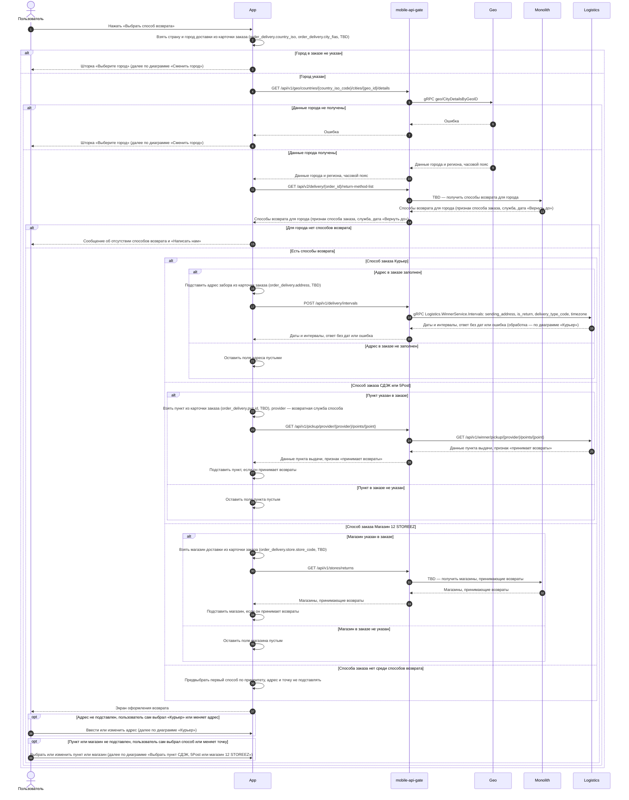


**Альтернативная последовательность "Сменить город"**



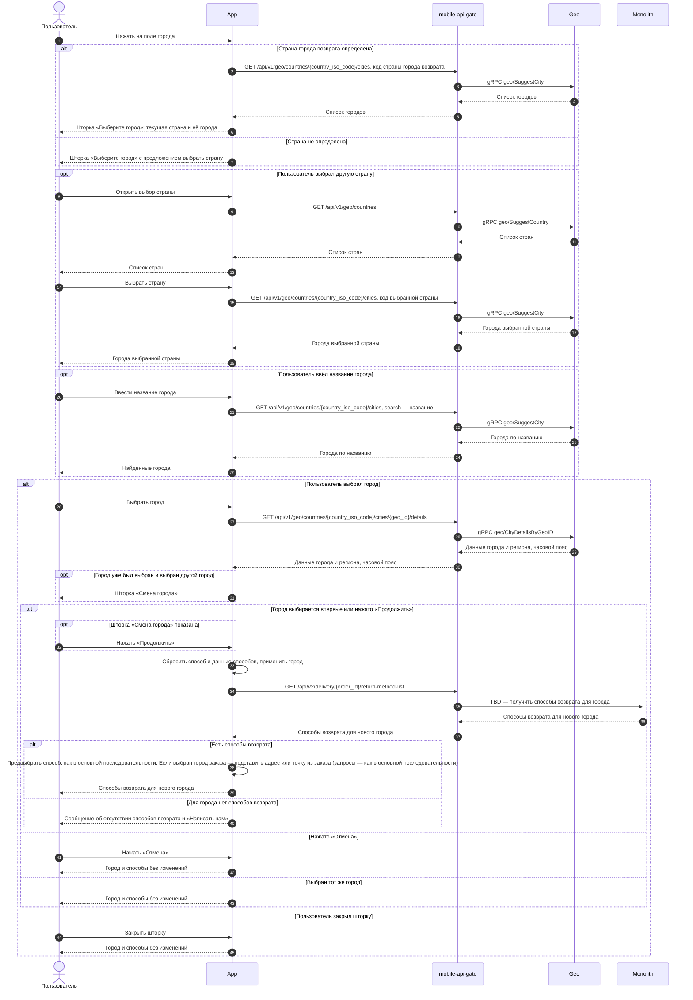


**Альтернативная последовательность "Курьер"**



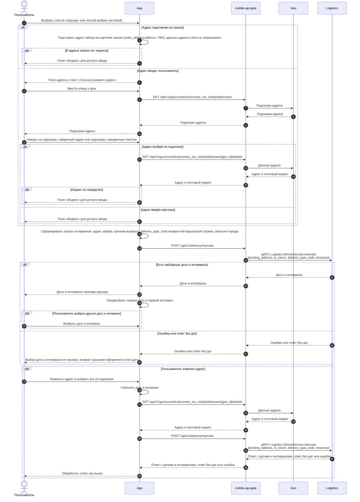


**Альтернативная последовательность "Выбрать пункт СДЭК, 5Post или магазин 12 STOREEZ"**



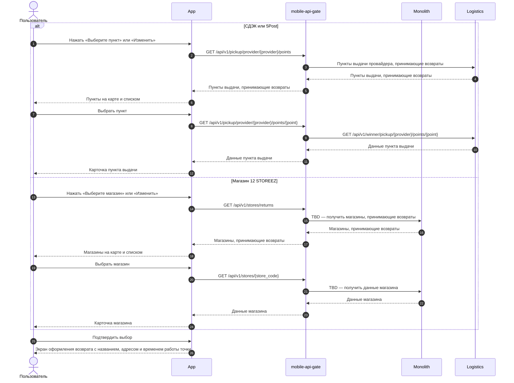


### Логика сценария

**Основная последовательность "Выбрать способ возврата"**



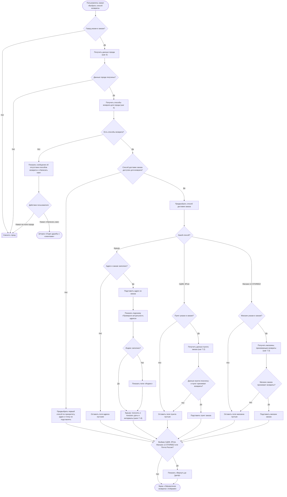
&nbsp;



**Альтернативная последовательность "Сменить город"**



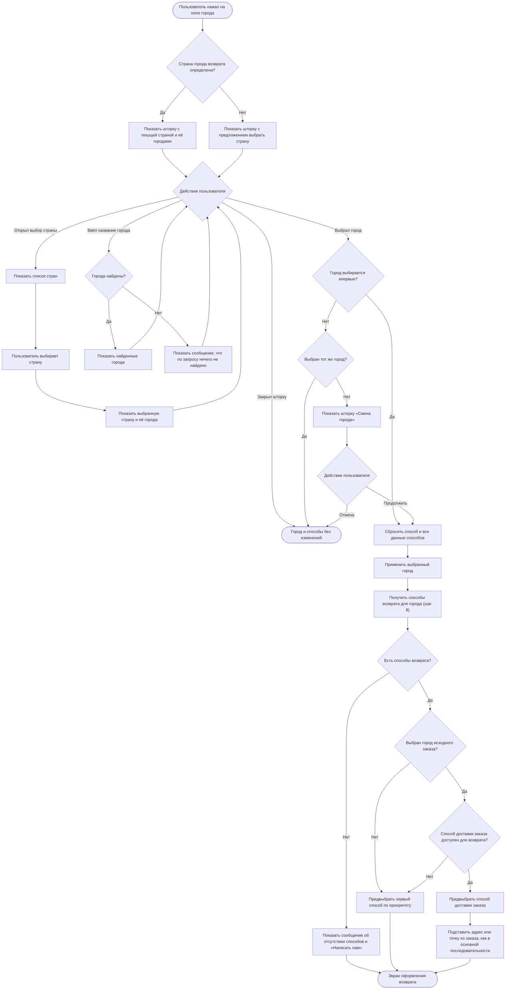
&nbsp;



**Альтернативная последовательность "Курьер"**



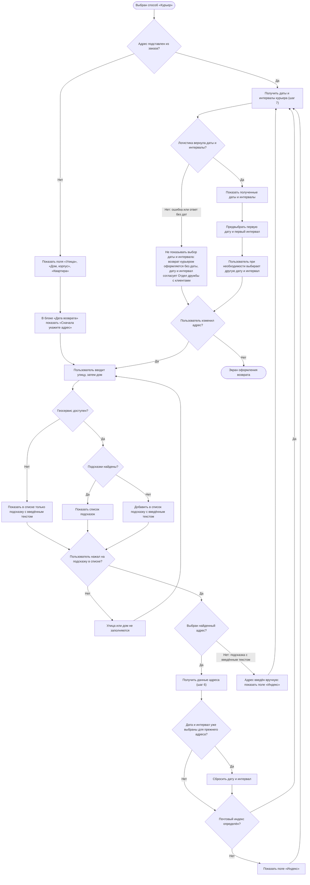
&nbsp;



**Альтернативная последовательность "Выбрать пункт СДЭК, 5Post или магазин 12 STOREEZ"**



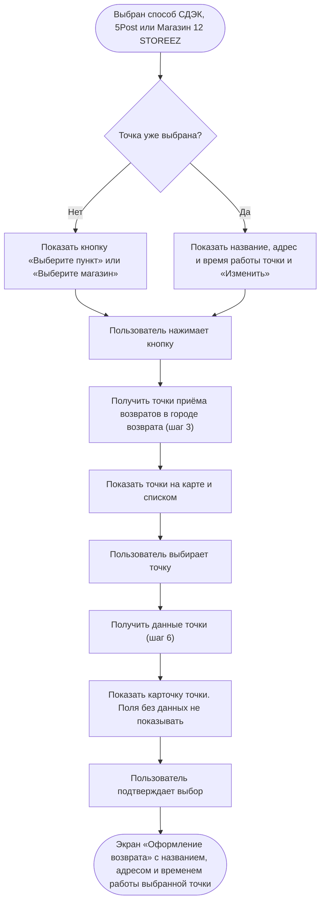
&nbsp;



**Альтернативная последовательность "Почта России"**



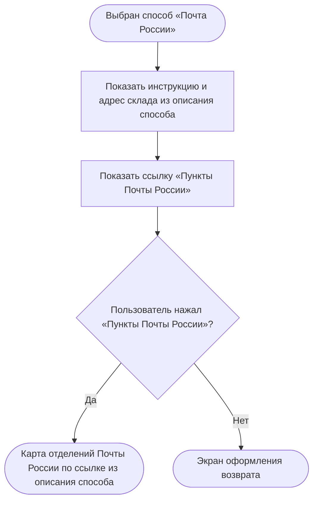
&nbsp;



### Логика бэкенда

**`GET /получить способы возврата для города` (`GET /api/v2/delivery/{order_id}/return-method-list`) — новый метод**

*Текущий метод списка способов возврата используется выпущенными версиями приложения, поэтому его логика не меняется, а для новой логики создаётся новый метод.*

1. Отбирать способы возврата по возвратным службам, которые работают в городе возврата. У возвратной службы свой тип доставки и своя настройка городов. Список городов может совпадать с городами доставки или отличаться, например, если в городе нет пунктов, принимающих возвраты.
2. Определять возвратную службу способа и способ «как в заказе».
3. Отдавать способы в порядке приоритета способов возврата.
4. Отмечать способ, совпадающий со способом доставки заказа, если город возврата — город заказа (`is_order_method`, TBD).
5. Отдавать по каждому способу код типа доставки возвратной службы (`delivery_type_code`) — он нужен для запроса дат и интервалов курьера.
6. Для СДЭК, 5Post, Магазина и Почты России отдавать дату «Вернуть до»: текущая дата \+ 10 календарных дней.
7. Поддержать новые способы «Магазин 12 STOREEZ» и «Почта России».

**`GET /получить магазины, принимающие возвраты` (`GET /api/v1/stores/returns`) — новый метод**

- Отдавать магазины в городе возврата, которые принимают возвраты.

**`GET /получить данные магазина` (`GET /api/v1/stores/{store_code}`) — новый метод (или если магазинов мало отдавать всю информацию в списке магазинов)**

- Отдавать детальную информацию по магазину.

**`GET /получить пункты выдачи` (`GET /api/v1/pickup/provider/{provider}/points`) — доработка метода**

- Логистика: добавить в запрос необязательный фильтр `is_return_available` (bool), в ответ — признак `is_return_available` у каждого пункта.
- mobile-api-gate: передавать фильтр `is_return_available = true` в запросе к логистике, чтобы для возврата отдавать только пункты, принимающие возвраты.

**`GET /получить данные пункта выдачи` (`GET /api/v1/pickup/provider/{provider}/points/{point}`) — доработка метода**

- Логистика: отдавать в данных пункта признак `is_return_available`.
- mobile-api-gate: передавать этот признак в ответе метода (`is_return_available`).

**`POST /получить даты и интервалы курьера` (`POST /api/v1/delivery/intervals`) — доработка метода**

- Принимать адрес забора и признак возврата и передавать их в логистику как адрес отправки `sending_address` и признак `is_return` (имена предварительные, TBD).
- Принимать код типа доставки возвратной курьерской службы (`delivery_type_code`) и часовой пояс города возврата (`timezone`).

### Задачи

#|
|| **Название** | **Ссылка** ||
|| Добавить признак приёма возвратов | https://tracker.yandex.ru/ECOMDEV-2359 ||
|| Логистика: фильтр и признак приёма возвратов для пунктов выдачи | https://tracker.yandex.ru/TNT-2712 ||
|#



### Определить способ возврата денежных средств US 1.4



### Дизайн

Ссылка на Figma: https://www.figma.com/design/u5Fe5N4lypCdqgZn6533F2/%F0%9F%93%B1-06.-Profile--Redesign-?node-id=7240-58493&t=KUiaYx2kcuq61I5X-4

### Сценарий

#### Предусловие

1. Пользователь находится на экране «Оформление возврата» (US 1.3)

#### Основная последовательность "Определить способ возврата денежных средств"

#|
|| **Шаг** | **Исполнитель** | **Описание** ||
|| 1 | APP | Взять из ответа метода `GET /получить карточку заказа` (US 1.1):

* нужны ли банковские реквизиты (`return.is_bank_data_required`). Реквизиты нужны, если заказ оплачен при получении или подарочным сертификатом (полностью или частично)
* текст о том, куда вернутся деньги (`return.refund.message`, TBD). Если нужны реквизиты, текста нет
* сумму и баллы к возврату за каждое изделие (`items[].refund_amount`, `items[].refund_bonus`, TBD) ||
|| 2 | APP | Отобразить в блоке «Возврат средств» текст о том, куда вернутся деньги. Блок «Банковские реквизиты» не отображать

**Опционально**
1. Если `return.is_bank_data_required = true`, то блок «Возврат средств» не отображать, а в блоке «Банковские реквизиты» отобразить кнопку «Укажите банковские реквизиты». См. альтернативную последовательность "Указать банковские реквизиты" ||
|| 3 | APP | Отобразить текст «Если вам необходимо получить возврат другим способом или на другие реквизиты, пожалуйста, обратитесь в Отдел дружбы с клиентами» со ссылкой «Отдел дружбы с клиентами»

**Опционально**
1. Если `return.is_bank_data_required = true`, то текст не отображать
2. Если пользователь нажал на ссылку «Отдел дружбы с клиентами», то открыть шторку «Отдел дружбы с клиентами» с часами работы отдела и действиями «Позвонить» и «Написать» ||
|| 4 | APP | Отобразить в блоке «Итого к возврату» сумму к возврату по всем выбранным изделиям

**Опционально**
1. Если по выбранным изделиям есть баллы к возврату, то отобразить их сумму в блоке «Баллы к возврату» ||
|#



```
Feature: Определение способа возврата денежных средств

Сценарий: Отображение способа возврата средств и ссылки на поддержку при онлайн-оплате
  Дано исходный заказ оплачен онлайн способом "<Способ оплаты>"
  И заказ не оплачивался подарочным сертификатом, в том числе частично
  Когда клиент открывает экран оформления возврата
  Тогда в блоке "Возврат средств" отображается текст "На банковскую карту, с которой была произведена оплата"
  И блок "Банковские реквизиты" не отображается
  И система отображает ссылку на Отдел дружбы для случаев, если требуется возврат другим способом
  И клиент может продолжить оформление возврата без ввода дополнительных данных

    Примеры:
    | Способ оплаты              |
    | Банковской картой          |
    | СБП                        |
    | Яндекс Пэй                 |
    | Цифровой рубль             |
    | Оплата Долями              |
    | Оплата Подели              |
    | Сплит                      |

# ИЗМЕНЕНО 16.10.2026 по решению автора — объединены два входа в Отдел дружбы с клиентами
Сценарий: Обращение в Отдел дружбы с клиентами
  Дано на экране оформления возврата <Ситуация>
  И отображается <Элемент>
  Когда клиент нажимает <Элемент>
  Тогда система открывает "Отдел дружбы с клиентами"
  И отображаются часы работы отдела
  И доступны действия "Позвонить" и "Написать"

  Примеры:
    | Ситуация                                              | Элемент                                                      |
    | для города возврата нет доступных способов возврата   | кнопка "Написать нам"                                        |
    | исходный заказ оплачен онлайн                         | ссылка "Отдел дружбы с клиентами" в блоке "Возврат средств"  |

Сценарий: Ввод банковских реквизитов
  Дано исходный заказ оплачен способом "<Способ оплаты>" (return.is_bank_data_required = true)
  И банковские реквизиты еще не заполнены
  Когда клиент открывает экран оформления возврата
  Тогда в блоке "Банковские реквизиты" отображается кнопка "Укажите банковские реквизиты"
  И текст о возврате на банковскую карту не отображается
  Когда клиент нажимает "Укажите банковские реквизиты"
  И на экране "Банковские реквизиты" заполняет ФИО получателя, название банка, БИК банка и номер лицевого счета
  И нажимает кнопку "Продолжить"
  Тогда система возвращает клиента на экран оформления возврата
  И отображает сохраненные реквизиты (ФИО получателя, название банка и номер счета)

  Примеры:
    | Способ оплаты                                          |
    | Наличными при получении                                |
    | Банковской картой при получении                        |
    | Подарочный сертификат полностью                        |
    | Подарочный сертификат частично + онлайн-оплата         |

# ВАЖНО (подтверждено бухгалтерией): Если номер лицевого счёта начинается с "30232810", клиент обязан указать номер банковской карты. Без этого реквизита банк отклонит возврат денежных средств. Проверка обязательна на Frontend при заполнении реквизитов и на Backend при создании заявки.
Сценарий: Обязательность номера карты для кредитного счета
  Дано клиент находится на экране "Банковские реквизиты"
  Когда клиент вводит номер счета, начинающийся с "30232810"
  Тогда система отображает обязательное поле "Номер банковской карты"
  Когда клиент нажимает "Продолжить", не заполнив номер карты
  Тогда переход к оформлению возврата не выполняется
  И поле "Номер банковской карты" подсвечивается красным контуром с текстом "Укажите номер банковской карты"

Сценарий: Реквизиты из предыдущих возвратов не предзаполняются
  Дано клиент ранее указывал банковские реквизиты в другой заявке на возврат
  Когда клиент открывает экран "Банковские реквизиты" при оформлении нового возврата
  Тогда поля реквизитов не заполнены

Сценарий: Подтверждение возврата без банковских реквизитов
  Дано для возврата необходимо указать банковские реквизиты
  И банковские реквизиты не заполнены
  Когда клиент нажимает "Подтвердить возврат"
  Тогда заявка на возврат не создаётся
  И система информирует о необходимости заполнить банковские реквизиты

Feature: Отображение итогового расчета возврата

Сценарий: Отображение итоговой суммы возврата
  Дано клиент выбрал изделия для возврата
  Когда клиент открывает экран оформления возврата
  Тогда отображается итоговая сумма денежных средств к возврату за выбранные изделия
  И при наличии баллов к возврату отображается их количество
```

**Правило информирования о сроках возврата денежных средств**

Согласно договорённости от 08.10.2026, для всех способов оплаты клиенту отображается единая информация: компания обязуется обработать возврат и отправить денежные средства в течение 3 дней с момента поступления возвращённых изделий на склад. Срок зачисления зависит от банка клиента и компанией не гарантируется.

Отдельные сроки по способам оплаты не отображаются. Точная формулировка сообщения определяется утверждённым макетом.

**TODO (На уточнение):** Определить формулировку для возврата в розничный магазин, поскольку срок возврата денежных средств отсчитывается от приёмки изделий в магазине, а не от поступления на склад (`RULE-30`).



#### Альтернативная последовательность "Указать банковские реквизиты"

#|
|| **Шаг** | **Исполнитель** | **Описание** ||
|| 1 | Пользователь | Нажимает «Укажите банковские реквизиты» ||
|| 2 | APP | Отобразить экран «Банковские реквизиты» с пустыми полями. Реквизиты из предыдущих возвратов не подставлять ||
|| 3 | Пользователь | Заполняет поля ||
|| 4 | Пользователь | Нажимает «Продолжить». Кнопка «Продолжить» активна всегда ||
|| 5 | APP | Проверить заполнение полей: обязательны все поля, кроме «Номер банковской карты»

**Опционально**
1. Если номер счёта начинается с «30232810», то поле «Номер банковской карты» тоже обязательно
2. Если обязательные поля не заполнены, то не выполнять переход и подсветить незаполненные поля красным контуром. Под полем «Номер банковской карты» показать текст «Укажите номер банковской карты» ||
|| 6 | APP | Вернуть пользователя на экран «Оформление возврата» и отобразить сохранённые реквизиты: ФИО получателя, название банка и номер счёта

**Опционально**
1. Если пользователь нажал на блок с заполненными реквизитами, то открыть экран «Банковские реквизиты» с заполненными данными. После изменения и нажатия «Продолжить» проверить поля, как на шаге 5, и обновить реквизиты на экране «Оформление возврата» ||
|#

**Комментарий**

**{red}(На уточнении:)**

1. Предзаполнять ли ФИО получателя данными клиента с возможностью изменить? Фамилию и имя — из заказа, отчество — из профиля ЛК, если заполнено.
   - БИК, название банка, номер лицевого счёта и номер карты клиент в любом случае заполняет сам.
2. Оставить ли поле «Номер банковской карты» обязательным всегда, как в текущем приложении и текущей проверке на сервере, а не только для счёта, начинающегося с «30232810»?
3. Правила расчёта баллов к возврату не утверждены — вопросы по баллам.
4. Как считается сумма к возврату за изделие: цена с учётом скидок, оплаты подарочным сертификатом и баллами? Где описано правило расчёта?

### Логика сценария

**Основная последовательность "Определить способ возврата денежных средств"**



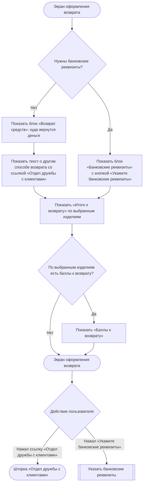
&nbsp;



**Альтернативная последовательность "Указать банковские реквизиты"**



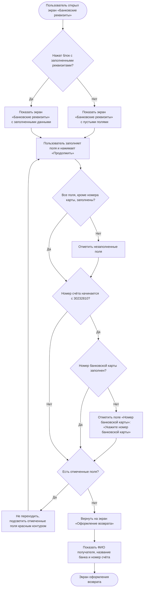
&nbsp;



### Задачи

#|
||

**Название**

|

**Ссылка**

||
|#



### Подтвердить создание заявки на возврат US 1.5



### Дизайн

Ссылка на Figma: https://www.figma.com/design/u5Fe5N4lypCdqgZn6533F2/%F0%9F%93%B1-06.-Profile--Redesign-?node-id=9066-130891&t=KUiaYx2kcuq61I5X-4

### Сценарий

#### Предусловие

1. Пользователь заполнил данные на экране «Оформление возврата» (US 1.3, US 1.4)

#### Основная последовательность "Подтвердить создание заявки на возврат"

#|
||

**Шаг**

|

**Исполнитель**

|

**Описание**

||
||

1

|

Пользователь

|

Нажимает «Подтвердить возврат»

||
||

2

|

APP

|

Проверить заполнение обязательных полей и блоков для выбранного способа возврата по таблице «Проверка обязательных полей»

**Опционально**

1. Если обязательные поля или блоки не заполнены, то заявку не отправлять, подсветить все незаполненные поля и блоки с текстом ошибки и прокрутить экран к первому из них. Кнопка «Подтвердить возврат» остаётся активной

||
||

3

|

APP

|

Вызвать метод `POST /создать заявку на возврат` (TBD, новый метод). 

* На время запроса показать на кнопке «Подтвердить возврат» индикатор загрузки, повторное нажатие недоступно

||
||

3\.1

|

Бэкенд

|

Проверить заявку и создать её:

* срок подачи заявки не истёк
* выбранные изделия можно вернуть (правило `can_be_returned` из US 1.1)
* обязательные данные заполнены (таблица «Проверка обязательных полей»)

После создания: изменить статус позиций заказа из заявки целиком, статус заказа не менять. Для СДЭК, 5Post, Магазина 12 STOREEZ и Почты России перерассчитать дату «Вернуть до»: дата создания заявки \+ 10 календарных дней и сохранить в заявку

**Опционально**

1. Если срок подачи истёк, то заявку не создавать и вернуть ошибку срока подачи
2. Если изделия нельзя вернуть или данные не прошли проверку, то заявку не создавать и вернуть ошибку с полем или блоком
3. Если заявка курьером создаётся без даты и интервала, то создать её в статусе «Возврат ожидает обработки»
4. Если адрес введён вручную и заявка создаётся без даты и интервала, то передать в RetailCRM причину обработки «проверить адрес», как у заказа

||
||

4

|

APP

|

Закрыть экран «Оформление возврата» и показать поверх экрана заказа шторку «Заявка уже у нас» с кнопкой «К возврату». Текст шторки зависит от способа возврата. Для «Курьера» — сообщение, что с клиентом свяжутся, если на выбранную дату курьера не найдут

**Опционально**

1. Если бэкенд вернул ошибку срока подачи, то показать сообщение о недоступности оформления возврата
2. Если бэкенд вернул ошибку проверки данных, то подсветить поле или блок с ошибкой, как на шаге 2. Если ошибка в номере банковской карты (для счёта, начинающегося с «30232810»), то подсветить блок «Банковские реквизиты»
3. Если произошла другая ошибка, то показать сообщение, что заявку не удалось создать. Экран «Оформление возврата» не закрывать и введённые данные не сбрасывать: пользователь может сразу повторить попытку

||
||

5

|

Пользователь

|

Нажимает «К возврату» или закрывает шторку

||
||

6

|

APP

|

Открыть экран созданного возврата по идентификатору возврата (US 3)

**Опционально**

1. Если пользователь закрыл шторку, то вызвать метод `GET /получить карточку заказа` (`GET /api/orders/{id}`, доработка метода) и отобразить обновлённый экран заказа (US 1.1)

||
|#



```
Feature: Подтверждение и создание заявки на возврат

Сценарий: Успешное создание заявки на возврат
  Дано клиент заполнил все обязательные данные оформления возврата
  Когда клиент нажимает "Подтвердить возврат"
  Тогда система создаёт заявку на возврат
  И отображается экран подтверждения "Заявка уже у нас"
  И по кнопке "К возврату" клиент переходит в карточку созданного возврата

Сценарий: Срок создания заявки истёк к моменту подтверждения
  Дано срок подачи заявки на возврат истёк
  Когда клиент подтверждает создание возврата
  Тогда заявка не создаётся
  И клиент информируется о недоступности оформления возврата

Сценарий: Ошибка при создании заявки
  Дано клиент заполнил все обязательные данные оформления возврата
  Когда при подтверждении возврата происходит ошибка создания заявки
  Тогда заявка на возврат не считается созданной
  И клиент информируется, что заявку не удалось создать
  И ранее указанные данные остаются доступными без повторного ввода
  И клиент может повторить попытку создания заявки

Сценарий: Переход к первому незаполненному полю
  Дано клиент не заполнил одно или несколько обязательных полей оформления возврата
  Когда клиент нажимает "Подтвердить возврат"
  Тогда заявка на возврат не отправляется
  И все незаполненные поля и блоки подсвечиваются
  И экран прокручивается к первому незаполненному полю или блоку
```



**Проверка обязательных полей**

#|
|| **Способ возврата** | **Поле или блок** | **Когда обязательно** | **Подсветка** ||
|| Курьер | «Улица» | Всегда | Красный контур, текст «Укажите улицу» ||
|| Курьер | «Дом, корпус» | Всегда | Красный контур, текст «Укажите дом» ||
|| Курьер | «Индекс» | Если поле отображается | Красный контур, текст «Укажите индекс» ||
|| СДЭК, 5Post | Блок «Пункт возврата» | Всегда | Текст «Укажите пункт ПВЗ» ||
|| Магазин 12 STOREEZ | Блок «Магазин 12 STOREEZ» | Всегда | Текст «Укажите магазин» ||
|| Любой | Блок «Банковские реквизиты» | Если нужны банковские реквизиты | Текст «Укажите банковские реквизиты» красным со значком ошибки ||
|#

**Комментарий**

**{red}(На уточнении:)**

1. Какой текст показать в окне «Заявка уже у нас», если заявка курьером оформлена без даты и интервала, потому что логистика не вернула даты и интервалы?

2. В каком порядке заявка на возврат передаётся в RetailCRM и 1С? Мастер-система возврата — 1С.

### Взаимодействие компонентов



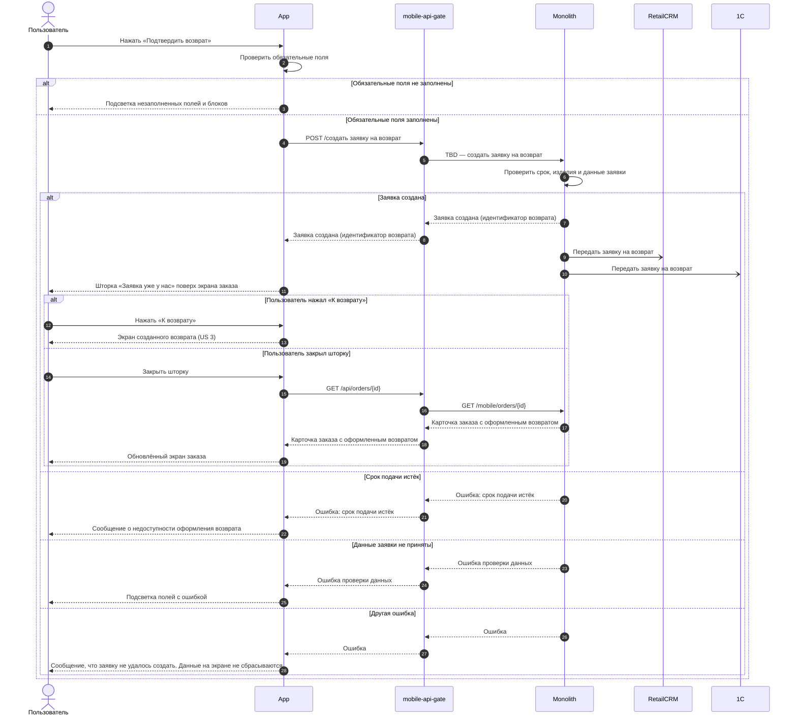


### Логика сценария



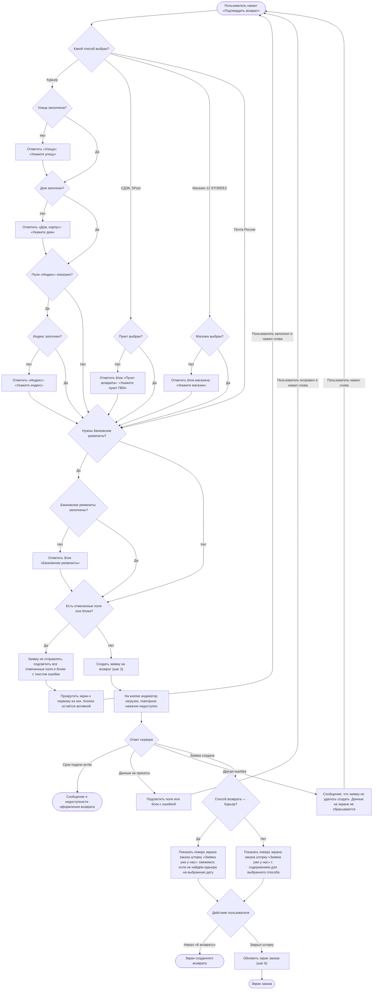
&nbsp;



### Логика бэкенда

**`POST /создать заявку на возврат` (TBD) — новый метод**

1. Проверять, что срок оформления заявки не истёк — по последнему дню оформления заявки (`return.request_until_date`, TBD), как в US 1.1.
2. Проверять, что выбранные изделия можно вернуть: по позиции нет активной заявки и изделий не больше, чем доступно. ({red}(отсылка к вопросу выше по №4))
3. Повторять на сервере проверку обязательных данных, которую делает приложение (таблица «Проверка обязательных полей»). Неполную заявку не создавать, а возвращать ошибку с полем или блоком.
4. Для пункта и магазина сохранять в заявке название, адрес и режим работы на момент создания.
5. Заявку курьером без даты и интервала создавать в статусе «Возврат ожидает обработки», с датой и интервалом — в статусе «Заявка на возврат принята». Принимать признак ручного ввода адреса (`manual_input`, TBD): заявку с адресом, введённым вручную, создавать по тому же правилу; если она создаётся без даты и интервала, передавать в RetailCRM причину обработки «проверить адрес», как у заказа.
6. Для СДЭК, 5Post, Магазина 12 STOREEZ и Почты России считать дату «Вернуть до»: дата создания заявки \+ 10 календарных дней.
7. Менять статус позиций заказа из заявки целиком.
8. Статус заказа не менять. Сейчас при оформлении возврата заказ получает статус «Возврат из ЛК» — эту смену нужно будет убрать при новом флоу.
9. Записывать снимок заявки с позициями и их статусами в историю изменений заявки. Для дальнейшего показа истории статусов

### Задачи

#|
|| **Название** | **Ссылка** ||
|#



## Просмотр возвратов

### Просмотреть список возвратов US 2



### Дизайн

Ссылка на Figma: https://www.figma.com/design/u5Fe5N4lypCdqgZn6533F2/%F0%9F%93%B1-06.-Profile--Redesign-?node-id=7987-111023&t=KUiaYx2kcuq61I5X-4

### Сценарий

#### Предусловие

1. Пользователь авторизован

#### Основная последовательность "Просмотреть список возвратов"

#|
|| **Шаг** | **Исполнитель** | **Описание** ||
|| 1 | Пользователь | Открывает экран «Возврат заказов» из пункта «Возврат заказов» на экране «Профиль» ||
|| 2 | APP | Вызвать метод `GET /получить список возвратов` (TBD, новый метод) ||
|| 3 | APP | Отобразить список возвратов по макету

**Опционально**
1. Если у пользователя нет оформленных возвратов, то отобразить сообщение об их отсутствии и кнопку перехода в каталог ||
|| 4 | Пользователь | Выбирает возврат ||
|| 5 | APP | Открыть экран возврата (US 3) ||
|#



```
Feature: Просмотр списка возвратов

Сценарий: Просмотр списка возвратов, если есть
  Дано у клиента есть один или несколько оформленных возвратов в любом статусе
  Когда клиент открывает список возвратов
  Тогда для каждого возврата доступна информация, позволяющая идентифицировать возврат и понять его текущее состояние
  И клиент может открыть выбранный возврат

Сценарий: Просмотр пустого списка возвратов
  Дано у авторизованного клиента нет ни одного оформленного возврата
  Когда клиент открывает список возвратов
  Тогда система информирует клиента об отсутствии оформленных возвратов
  И предоставляет возможность перейти к покупкам в каталог
```



**Комментарий**

**{red}(На уточнении:)**

1. Показывать ли в списке возвраты, оформленные до запуска нового процесса? Предлагается не показывать: по старой схеме возврат менял заказ, отдельной заявки на возврат не было.

### Взаимодействие компонентов



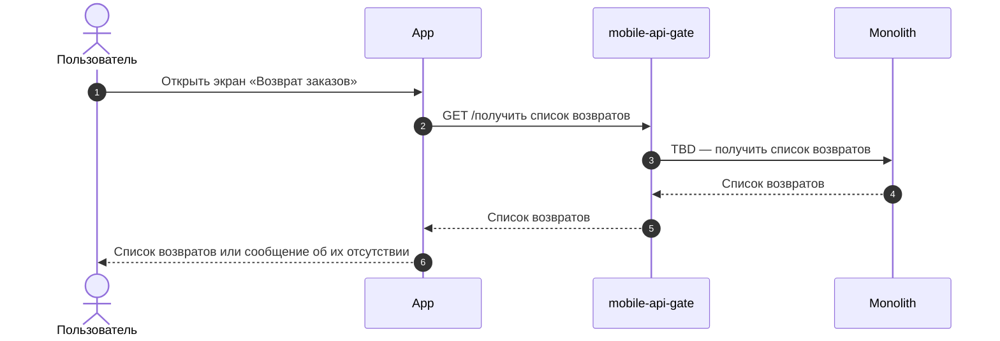


### Логика бэкенда

**`GET /получить список возвратов` (TBD) — новый метод**

1. Отдавать заявки на возврат клиента по всем его заказам, в любом статусе, включая отменённые, независимо от того, кто оформил заявку: клиент, Отдел дружбы с клиентами или магазин.
2. Сортировать по дате создания, от новых к старым.
3. Дату «Вернуть до» отдавать для СДЭК, 5Post, Магазина 12 STOREEZ и Почты России.
4. Отдавать клиентский статус заявки: название и тип для значка (`status.type`, TBD) — в работе, выполнен, отменён (ориентироваться на макет).



### Просмотреть детальную информацию по заявке на возврат US 3



### Дизайн

Ссылка на Figma: https://www.figma.com/design/u5Fe5N4lypCdqgZn6533F2/%F0%9F%93%B1-06.-Profile--Redesign-?node-id=7992-114681&t=KUiaYx2kcuq61I5X-4

### Сценарий

#### Предусловие

1. Заявка на возврат создана

#### Основная последовательность "Просмотреть детальную информацию по заявке на возврат"

#|
|| **Шаг** | **Исполнитель** | **Описание** ||
|| 1 | Пользователь | Открывает экран возврата ||
|| 2 | APP | Вызвать метод `GET /получить детальную информацию по заявке на возврат` (TBD, новый метод) ||
|| 3 | APP | Отобразить экран возврата по макету

**Опционально**
1. Если для способа возврата не задан текст «Что дальше», то блок не отображать
2. Если способ возврата — СДЭК, 5Post или Магазин 12 STOREEZ, то отобразить кнопку «Смотреть на карте» ||
|| 4 | APP | Обработать действие пользователя на экране

**Опционально**
1. Если пользователь нажал «Копировать» рядом с номером возврата, то скопировать номер в буфер обмена и показать уведомление «Номер возврата скопирован»
2. Если пользователь нажал на изделие, то открыть карточку товара в каталоге
3. Если пользователь нажал «Смотреть на карте», то открыть приложение карт на устройстве с точкой передачи из заявки (как в разделе «Бронирования»). Изменить точку нельзя ||
|#



```
Feature: Просмотр деталей созданной заявки на возврат

Сценарий: Отображение основной информации при открытии заявки
  Дано заявка на возврат была ранее успешно создана
  Когда клиент открывает страницу детальной информации по заявке
  Тогда система отображает информацию по заявке (статус, инструкцию при наличии, способ возврата, способ выплаты и состав изделий)

# TODO (На уточнение): Допускается ли самостоятельная отмена заявки в статусе "Подтверждение возврата" или дальнейшая отмена выполняется только Отделом дружбы?
# ИЗМЕНЕНО 17.10.2026 по решению автора
Сценарий: Передача неактуализированной заявки на ручную проверку
  Дано заявка находится в статусе "Заявка на возврат принята"
  И с даты создания заявки прошло 30 календарных дней
  И изделия по заявке не поступили на склад и не приняты в магазине
  Когда система выполняет проверку заявок
  Тогда заявка автоматически переводится в статус "Подтверждение возврата"
  И заявка становится доступной Отделу дружбы для дальнейшей ручной обработки

# TODO (На уточнение)
Сценарий: Переход в карточку товара из состава возврата
  Дано клиент находится на экране детальной информации по заявке
  Когда клиент нажимает на карточку товара в блоке "Изделия к возврату"
  Тогда система перенаправляет клиента на страницу соответствующего товара в каталоге

# TODO (На уточнение): поведение кнопки на сайте; поведение, если на устройстве нет приложения карт
Сценарий: Просмотр выбранной точки передачи на карте
  Дано заявка на возврат создана со способом "ПВЗ СДЭК", "5Post" или "Розничный магазин"
  И клиент находится на экране детальной информации по заявке в мобильном приложении
  Когда клиент нажимает "Смотреть на карте"
  Тогда открывается внешнее приложение карт с выбранной в заявке точкой передачи
  И изменить точку передачи в заявке нельзя
```





1. Дата и интервал курьера на экране — выбранные при оформлении. Если их согласовал или перенёс Отдел дружбы с клиентами, показываются новые. Если клиент сам договорился с курьером о переносе, на экране остаются прежние.
2. Дата «Вернуть до» — срок передачи изделий в точку сдачи, сохранённый при создании заявки.
3. Если дата «Вернуть до» прошла, заявка не отменяется автоматически (автоотмена — Post-MVP). Если через 30 дней после создания изделия не поступили на склад или в магазин, заявка переходит в статус «Подтверждение возврата» и её обрабатывает Отдел дружбы с клиентами.
4. Срок возврата денег клиенту сообщается в тексте «Что дальше» из админки. Компания отправляет деньги в течение 3 дней: при возврате в магазин — от приёмки в магазине, для остальных способов — от поступления на склад. Клиенту сообщается только срок отправки, одной формулировкой для всех способов оплаты: срок зачисления зависит от банка. Поэтому текст для магазина отличается от текста для остальных способов.
5. Изменить заявку (способ возврата, точку, дату и интервал курьера) клиент в приложении не может. Изменения вносит Отдел дружбы с клиентами по обращению клиента.



**Комментарий**

**{red}(На уточнении:)**

1. Какая система переводит заявку в «Подтверждение возврата» через 30 дней после создания — сайт или RetailCRM?
2. При нажатии на изделие на экране возврата открывается карточка товара в каталоге?
3. Откуда брать координаты точки передачи для кнопки «Смотреть на карте»: сохранять их в заявке при создании (US 1.5) или получать по коду точки (пункта выдачи или магазина)? В разделе «Бронирования» координат в ответе нет: метод отдаёт только код, название и адрес магазина.

### Взаимодействие компонентов



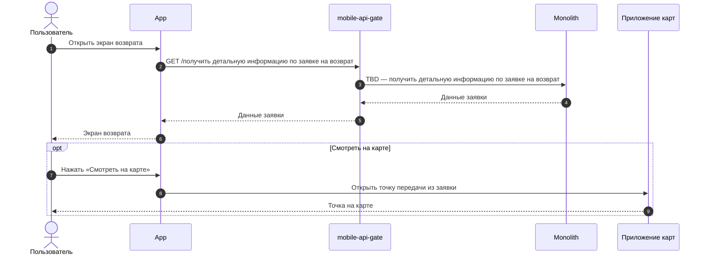


### Логика бэкенда

**`GET /получить детальную информацию по заявке на возврат` (TBD) — новый метод**

1. Дату и интервал курьера отдавать из заявки. Если их согласовал или перенёс Отдел дружбы с клиентами, отдавать обновлённые.
2. Текст «Что дальше» отдавать из админки по способу возврата.
3. Отдавать признак, можно ли отменить заявку (`can_be_cancelled`, TBD), по её текущему статусу.
4. Данные точки передачи (название, адрес, режим работы) отдавать из заявки. Для кнопки «Смотреть на карте» отдавать координаты точки (**как реализовано для Бронирования, уточнить**).



### Получить документы и QR-код возврата US 3.1



### Дизайн

Ссылка на Figma: https://www.figma.com/design/u5Fe5N4lypCdqgZn6533F2/%F0%9F%93%B1-06.-Profile--Redesign-?node-id=8007-118957&t=KUiaYx2kcuq61I5X-4

### Сценарий

#### Предусловие

1. Пользователь находится на экране возврата (US 3)

#### Основная последовательность "Получить документы и QR-код возврата"

#|
|| **Шаг** | **Исполнитель** | **Описание** ||
|| 1 | APP | Отобразить на экране возврата кнопку «Скачать заявление»

**Опционально**
1. Если способ возврата — Магазин 12 STOREEZ, то отобразить кнопку «Показать QR-код»
2. Если кассовый чек возврата сформирован, то отобразить кнопку «Скачать чек» ||
|| 2 | APP | Обработать действие пользователя

**Опционально**
1. Если пользователь нажал «Скачать заявление», то вызвать метод `GET /получить заявление на возврат` (TBD, новый метод) и сохранить PDF-файл на устройство
2. Если пользователь нажал «Скачать чек», то вызвать метод `GET /получить кассовый чек возврата` (TBD, новый метод) и сохранить файл на устройство
3. Если пользователь нажал «Показать QR-код», то отобразить шторку с QR-кодом заявки. QR-код можно показать с экрана, без печати и без интернета ||
|#



```
Feature: Документы и QR-код заявки на возврат

Сценарий: Отображение QR-кода для сдачи возврата в розничном магазине
  Дано заявка на возврат создана со способом "Розничный магазин"
  Когда клиент открывает детальную информацию по заявке
  Тогда система отображает QR-код для идентификации возврата при передаче изделий в магазине
  И QR-код можно предъявить без подключения к интернету

Сценарий: Формирование и скачивание заявления на возврат
  Дано клиент находится на экране детальной информации по заявке
  Когда клиент нажимает "Скачать заявление"
  Тогда система формирует заявление в формате PDF на основании данных заявки
  И предоставляет сформированный файл для скачивания

# TODO (На уточнение): Подтвердить, по какому событию система узнаёт о выполненном возврате денежных средств и получает сформированный кассовый чек для скачивания.
Сценарий: Скачивание чека возврата денежных средств
  Дано по заявке выполнен возврат денежных средств
  И сформирован кассовый чек возврата
  Когда клиент открывает детальную информацию по заявке
  Тогда клиенту доступно скачивание кассового чека возврата
```





1. Если клиент не может показать QR-код, сотрудник магазина находит заявку по ФИО, номеру телефона или номеру заказа.



**Комментарий**

**{red}(На уточнении:)**

1. Где формируются заявление и кассовый чек возврата и что содержит QR-код?

### Взаимодействие компонентов



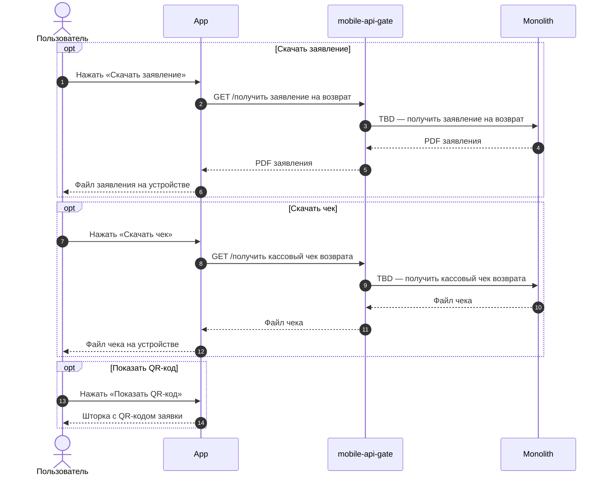


### Логика бэкенда

1. **`GET /получить детальную информацию по заявке на возврат` (TBD, US 3) — доработка метода**
   1. Отдавать признак, что кассовый чек возврата сформирован (`has_receipt`, TBD).
   2. Для способа «Магазин 12 STOREEZ» отдавать данные для QR-кода (`qr_code`, TBD).
2. **`GET /получить заявление на возврат` (TBD) — новый метод**
   1. Отдавать PDF-файл заявления на возврат по заявке.
3. **`GET /получить кассовый чек возврата` (TBD) — новый метод**
   1. Отдавать файл кассового чека возврата, если чек сформирован.



### Отменить заявку на возврат US 4



### Дизайн

Ссылка на Figma: https://www.figma.com/design/u5Fe5N4lypCdqgZn6533F2/%F0%9F%93%B1-06.-Profile--Redesign-?node-id=8943-100757&t=1WHerU9r17fxsUgP-4

### Сценарий

#### Предусловие

1. Пользователь находится на экране возврата (US 3)

#### Основная последовательность "Отменить заявку на возврат"

#|
|| **Шаг** | **Исполнитель** | **Описание** ||
|| 1 | APP | Отобразить возможность отменить заявку, если в данных заявки есть признак, что её можно отменить (`can_be_cancelled = true`, TBD)

**Опционально**
1. Если отмена запрещена (например, изделия уже поступили на склад или приняты в магазине), то возможность отмены не отображать ||
|| 2 | Пользователь | Инициирует отмену возврата ||
|| 3 | APP | Запросить подтверждение отмены

**Опционально**
1. Если пользователь отказался от отмены, то вернуть его на экран возврата без изменения статуса заявки ||
|| 4 | Пользователь | Подтверждает отмену ||
|| 5 | APP | Вызвать метод `POST /отменить заявку на возврат` (TBD, новый метод) ||
|| 5.1 | Бэкенд | Отменить заявку: перевести её в статус «Возврат отменён» и вернуть позициям заказа статус, который был до создания заявки

**Опционально**
1. Если заявка в статусе, в котором отмена запрещена, то заявку не отменять и вернуть ошибку ||
|| 6 | APP | Отобразить статус заявки «Возврат отменён»

**Опционально**
1. Если бэкенд вернул ошибку отмены, то отобразить сообщение о невозможности отмены возврата ||
|#



```
Feature: Самостоятельная отмена заявки на возврат клиентом

Сценарий: Доступность возможности отмены возврата
  Дано клиент находится на экране деталей возврата
  И заявка находится в статусе, допускающем отмену
  Тогда клиенту доступна возможность отменить заявку

# TODO: Уточнить крайний статус, после которого отмена клиентом невозможна
Сценарий: Отсутствие возможности отмены после получения изделий компанией
  Дано клиент находится на экране деталей возврата
  И изделия по заявке поступили на склад или приняты в магазине
  Тогда возможность отмены заявки недоступна

Сценарий: Отмена заявки при изменении её статуса
  Дано клиент открыл карточку возврата, когда отмена была доступна
  И до подтверждения отмены заявка перешла в статус, в котором отмена запрещена
  Когда клиент пытается отменить заявку
  Тогда система проверяет актуальный статус заявки
  И отклоняет отмену
  И отображает клиенту сообщение о невозможности отмены возврата

Сценарий: Подтверждение намерения отменить возврат
  Дано клиенту доступна возможность отмены
  Когда клиент инициирует отмену возврата
  Тогда система запрашивает у клиента подтверждение этого действия

Сценарий: Успешная отмена заявки
  Дано клиент подтвердил отмену заявки
  Когда система успешно обрабатывает запрос
  Тогда статус текущей заявки изменяется на "Возврат отменён"
  И товары из отмененной заявки снова становятся доступны для оформления нового возврата (если не истёк срок возврата)
```



**Комментарий**

**{red}(На уточнении:)**

1. В каких статусах заявки клиент может её отменить: только в «Заявка на возврат принята», или пока изделия не поступили на склад или в магазин? Рабочий вариант статусов не утверждён — диаграмма состояний.
2. При отмене заявки кто отменяет уже созданный возвратный заказ в СДЭК или 5Post и вызов курьера: наш бэкенд, RetailCRM или Отдел дружбы с клиентами вручную?

### Взаимодействие компонентов



```mermaid
sequenceDiagram
    autonumber
    actor U as Пользователь
    participant APP as App
    participant API as mobile-api-gate
    participant MON as Monolith
    participant RCRM as RetailCRM
    participant ONEC as 1C

    U->>APP: Подтвердить отмену заявки
    APP->>API: POST /отменить заявку на возврат
    API->>MON: TBD — отменить заявку на возврат
    alt Отмена выполнена
        MON-->>API: Заявка отменена
        API-->>APP: Заявка отменена
        MON-)RCRM: Передать отмену заявки
        MON-)ONEC: Передать отмену заявки
        APP-->>U: Статус «Возврат отменён»
    else Статус заявки не допускает отмену
        MON-->>API: Ошибка: отмена невозможна
        API-->>APP: Ошибка: отмена невозможна
        APP-->>U: Сообщение о невозможности отмены возврата
    end
```


### Логика бэкенда

**`POST /отменить заявку на возврат` (TBD) — новый метод**

1. Проверять, что заказ принадлежит клиенту и статус заявки допускает отмену. Иначе возвращать ошибку.
2. Переводить заявку в статус «Возврат отменён».
3. Возвращать позициям заказа статус, который был до создания заявки.
4. Передавать отмену в RetailCRM и 1С.


