## Полезные материалы

| Название | Ссылка |
|---|---|
| Макеты | [v2 Создание возврата](<../../sources/mockups/v2 Создание возврата/>) |
| Макеты | [v2.1 После создания возврата (просмотр и раздел возвратов)](<../../sources/mockups/v2.1 После создания возврата (просмотр и раздел возвратов)/>) |
| User Story | [user-story.md](../user-story/user-story.md) |
| Эпик | [ECOMDEV-2246 [MVP] Возвраты](https://tracker.yandex.ru/ECOMDEV-2246) |
| Эпик | [ECOMDEV-2256 [Post-MVP] Возвраты](https://tracker.yandex.ru/ECOMDEV-2256) |
| BRD | [brd.md](../brd.md) |
| Use Case | [use-case.md](../use-case/use-case.md) |
| Спецификация экранов | [screen-spec.md](../screen-spec/screen-spec.md) |
| TO-BE шаги мобильного приложения | [steps/mobile](../steps/mobile/) |

## Основные принципы

1. **Важно.** Для каждого способа возврата клиенту показывается инструкция, что ему делать: описание способа на экране оформления и инструкция в блоке «Что дальше» карточки созданного возврата. Оба текста заводятся в админке отдельно для каждого способа возврата, содержание определяет бизнес; приложение отображает тексты, полученные с сервера. Тексты на макетах — пример.
2. **Важно.** Срок возврата денег считается от поступления изделий на склад, при возврате в магазин — от приёмки изделий в магазине: компания отправляет деньги в течение 3 дней, срок зачисления зависит от банка клиента. Клиенту сообщается только срок отправки, одной формулировкой для всех способов оплаты, — в тексте блока «Что дальше», который заводится в админке, поэтому текст для магазина отличается от текста для остальных способов.
3. При создании заявки статус позиции заказа меняется целиком; остаток изделий позиции возвращается через Отдел дружбы с клиентами. При отмене заявки статус позиции возвращается.
4. Сумму и баллы к возврату считает сервер, приложение только отображает их.
5. Все проверки, которые приложение выполняет при создании заявки, повторяются на сервере.

## Функциональные требования

### Админка

Для сценариев МП в админке нужны доработки, которых нет в текущих экранах.

1. Пользователь админки должен иметь возможность изменять клиентское название статуса возврата.
2. Пользователь админки должен иметь возможность объединять несколько статусов возврата под одним клиентским названием: клиент видит такие статусы как один статус (группировка).
3. Пользователь админки должен иметь возможность задавать для каждого способа возврата инструкцию для блока «Что дальше» карточки созданного возврата — отдельно от описания способа на экране оформления.
4. Пользователь админки должен иметь возможность задавать порядок способов возврата: по нему формируется список способов и выбирается способ по умолчанию, если способ доставки заказа недоступен для возврата.
5. В справочник способов возврата должны быть добавлены способы «Магазин 12 STOREEZ» и «Почта России» с теми же настройками, что у курьера, СДЭК и 5Post: название, описание, инструкция, включение на сайте и в МП.
6. Пользователь админки должен иметь возможность включать и отключать способы возврата для города: по этой настройке метод получения способов возврата для города отдаёт только включённые для города способы.

# User story

## Оформление возврата

### Отобразить кнопку оформления возврата в карточке заказа US 1.1

Как клиент, совершивший покупку, я хочу иметь возможность начать оформление возврата из карточки заказа, чтобы самостоятельно оформить возврат без обращения в поддержку

### Дизайн

Макеты: [v2 Создание возврата](<../../sources/mockups/v2 Создание возврата/>)

### Сценарий

#### Предусловие

1. Пользователь авторизован

#### Основная последовательность "Отобразить кнопку оформления возврата в карточке заказа"

| Шаг | Исполнитель | Описание |
|---|---|---|
| 1 | Пользователь | Открывает карточку заказа |
| 2 | Система | Вызвать метод `GET /получить карточку заказа` (`GET /api/orders/{id}`, доработка метода) |
| 3 | Система | Отобразить в блоке «Ваш заказ · N» позиции заказа с количеством изделий без активной заявки на возврат. Количество — `items[].count` минус число изделий позиции в активных заявках на возврат  Опционально Если все изделия позиции в активных заявках на возврат, то позицию в блоке «Ваш заказ · N» не отображать |
| 4 | Система | Отобразить после блока «Ваш заказ · N» блок «Оформлен возврат · N» по данным ответа метода `GET /получить карточку заказа`: каждое изделие с активной заявкой на возврат — отдельной строкой с выбранной причиной возврата.  Опционально 1. Если по заказу нет активных заявок на возврат, то блок «Оформлен возврат · N» не отображать 2. Если заявка на возврат отменена, то изделия этой заявки отобразить в блоке «Ваш заказ · N» |
| 5 | Система | Отобразить кнопку «Оформить возврат», если в ответе метода `GET /получить карточку заказа` есть сообщение со статусом `can_be_returned`. Сообщение приходит, если хотя бы у одной позиции `items[].can_be_returned = true`: с даты получения заказа прошло не больше 14 дней (для клиента F&F — не больше 30 дней) и для позиции нет активной заявки на возврат. Активная заявка — заявка в любом статусе, кроме «Возврат отменён»  Опционально 1. Если с даты получения заказа прошло больше 14 дней (для клиента F&F — больше 30 дней), то кнопку не отображать 2. Если для всех позиций заказа есть активные заявки на возврат, то кнопку не отображать |
| 6 | Система | Отобразить под кнопкой текст сообщения `can_be_returned` — «Можно вернуть изделия до [Дата]» — и ссылку «Правила возврата». Дата — дата получения заказа + 14 дней, для клиента F&F — + 30 дней  Опционально Если кнопка «Оформить возврат» не отображается, то текст и ссылку «Правила возврата» не отображать |

**Ограничение**

Одинаковые изделия хранятся в заказе одной позицией, и при оформлении возврата статус меняется сразу у всей позиции. Поэтому после возврата части изделий оставшиеся изделия этой позиции отображаются в блоке «Ваш заказ», но вернуть их самостоятельно нельзя. Для возврата клиент обращается в Отдел дружбы.

### Взаимодействие компонентов

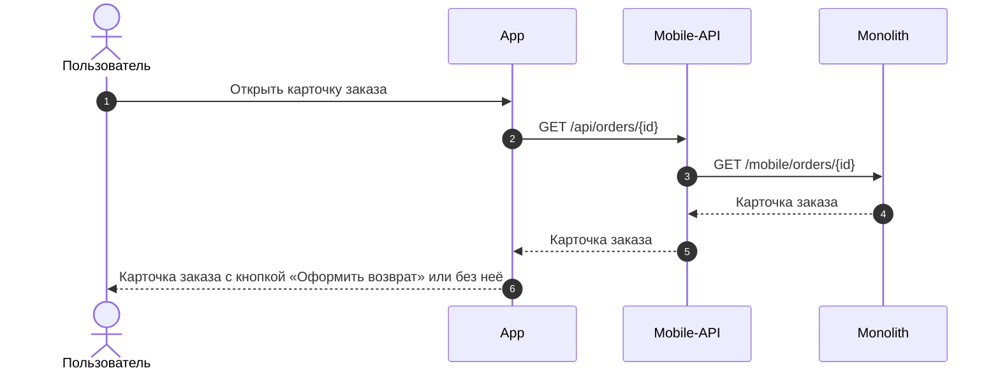

### Логика сценария

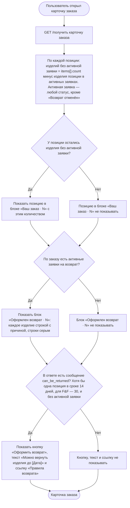

### Задачи

| Название | Ссылка |
|---|---|
| ECOMDEV-2343 | https://tracker.yandex.ru/ECOMDEV-2343 |

### Выбрать изделия и причины возврата US 1.2

Как клиент, оформляющий возврат, я хочу выбрать одно или несколько изделий из заказа и указать причину возврата для каждого выбранного изделия, чтобы сформировать возврат только для тех изделий, которые я хочу вернуть

### Дизайн

Макеты: [v2 Создание возврата](<../../sources/mockups/v2 Создание возврата/>)

### Сценарий

#### Предусловие

1. В карточке заказа отображается кнопка «Оформить возврат» (US 1.1)

#### Основная последовательность "Выбрать изделия и причины возврата"

| Шаг | Исполнитель | Описание |
|---|---|---|
| 1 | Пользователь | Нажимает «Оформить возврат» |
| 2 | Система | Отобразить экран «Выберите изделия» по данным карточки заказа (`GET /получить карточку заказа`) |
| 2.1 | Система | Отобразить позиции, у которых `items[].can_be_returned = true` |
| 2.2 | Система | Отобразить каждое изделие позиции отдельной строкой. Количество строк — `items[].available_return_quantity` |
| 2.3 | Система | Отобразить кофр или подарок, если он отдельная позиция заказа, отдельной строкой |
| 2.4 | Система | Отобразить предупреждение о необходимости вернуть изделия в полной комплектации |
| 3 | Пользователь | Отмечает чекбоксами изделия |
| 4 | Система | Изменить заголовок экрана на «Выберите изделия · N» и сделать кнопку «Указать причину возврата» активной. Кофр или подарок при выборе основного изделия автоматически не отмечать  Опционально Если не выбрано ни одного изделия, то кнопка «Указать причину возврата» неактивна |
| 5 | Пользователь | Нажимает «Указать причину возврата» |
| 6 | Система | Вызвать метод `GET /получить справочник причин возврата` (`GET /api/orders/v2/return-reasons`) |
| 7 | Система | Отобразить экран «Причина возврата» с подзаголовком «Изделие 1 из N» |
| 8 | Пользователь | Выбирает группу причин в выпадающем списке |
| 9 | Система | Отобразить список причин выбранной группы  Опционально Если у группы нет причин, то выбор группы считать выбором причины и перейти к шагу 11 |
| 10 | Пользователь | Выбирает причину |
| 11 | Система | Перейти к следующему выбранному изделию и изменить подзаголовок на «Изделие K из N», где K — номер изделия. Шаги 8–10 повторяются для каждого выбранного изделия |
| 12 | Система | После выбора причины для последнего изделия сделать кнопку «Выбрать способ возврата» активной  Опционально 1. Если причина указана не для всех выбранных изделий, то кнопка «Выбрать способ возврата» неактивна 2. Если пользователь вернулся к экрану «Выберите изделия» с экрана причин или с экрана оформления возврата и изменил состав изделий, то причины указываются заново для каждого выбранного изделия, начиная с шага 5 |

**Примечание**

Одинаковые изделия хранятся в заказе одной позицией, и при оформлении возврата статус меняется сразу у всей позиции. Поэтому если на часть изделий позиции уже оформлена заявка, оставшиеся изделия этой позиции в списке не отображаются. Для их возврата клиент обращается в Отдел дружбы.

### Взаимодействие компонентов

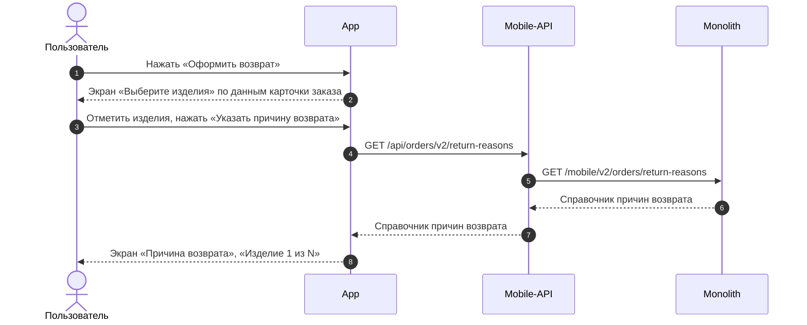

### Логика сценария

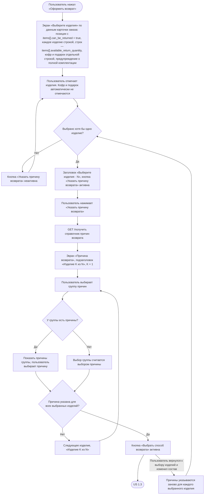

### Задачи

| Название | Ссылка |
|---|---|
| ECOMDEV-2343 | https://tracker.yandex.ru/ECOMDEV-2343 |

### Выбрать способ возврата US 1.3

Как клиент, оформляющий возврат, я хочу выбрать способ возврата товаров, чтобы успешно завершить оформление заявки на возврат

### Дизайн

Макеты: [v2 Создание возврата](<../../sources/mockups/v2 Создание возврата/>)

### Сценарий

#### Предусловие

1. Пользователь указал причины возврата для всех выбранных изделий (US 1.2)

#### Основная последовательность "Выбрать способ возврата"

| Шаг | Исполнитель | Описание |
|---|---|---|
| 1 | Пользователь | Нажимает «Выбрать способ возврата» |
| 2 | Система | Определить город возврата: взять `order_delivery.country_iso` и `order_delivery.city_fias` из карточки заказа (полученной в US 1.1 `GET /получить карточку заказа`)  Опционально Если `order_delivery.city_fias` не заполнен, то открыть шторку выбора города. См. альтернативную последовательность "Сменить город" |
| 3 | Система | Вызвать метод `GET /получить данные города` (`GET /api/v1/geo/countries/{country_iso_code}/cities/{geo_id}/details`): `country_iso_code` — `order_delivery.country_iso`, `geo_id` — `order_delivery.city_fias`  Опционально Если данные города не получены, то открыть шторку выбора города. См. альтернативную последовательность "Сменить город" |
| 4 | Система | Вызвать метод `GET /получить способы возврата для города` (`GET /api/v1/delivery/{order_id}/return-method-list`, доработка метода) по данным города и региона из шага 3 |
| 5 | Система | Отобразить экран оформления возврата с городом и способами возврата из ответа метода `GET /получить способы возврата для города`  Опционально 1. Если для города нет доступных способов возврата, то отобразить сообщение об отсутствии доступных способов возврата и действие «Написать нам». Поле города остаётся доступным для нажатия 2. Если пользователь нажал «Написать нам», то открыть окно «Отдел дружбы с клиентами» с часами работы отдела и действиями «Позвонить» и «Написать», как в US 1.4 |
| 6 | Система | Предвыбрать способ возврата, у которого `is_order_method = true`  Опционально 1. Если ни у одного способа `is_order_method = true` (способ доставки заказа недоступен для возврата или город возврата отличается от города заказа), то выбрать первый способ в списке — список упорядочен по приоритету 2. Если пользователь переключился на другой способ в том же городе и вернулся к прежнему, то отобразить данные, заполненные для этого способа: подставленные из заказа или введённые пользователем |
| 7 | Система | Подставить адрес или точку из исходного заказа, если выбран способ с `is_order_method = true`  Опционально Если способ выбран по приоритету, то адрес и точку не подставлять: пользователь заполняет их сам |
| 7.1 | Система | Курьер — подставить адрес из `order_delivery.address` карточки заказа: улица, дом, корпус, квартира, индекс — и отобразить над полями адреса подсказку проверить актуальность адреса. Далее — шаги 7–9 альтернативной последовательности "Курьер"  Опционально 1. Если в ответе `order_delivery.address` не заполнен, то поля адреса оставить незаполненными 2. Если индекс не заполнен, то отобразить поле «Индекс» для ручного ввода |
| 7.2 | Система | СДЭК, 5Post — вызвать метод `GET /получить данные пункта выдачи` (`GET /api/v1/pickup/provider/{provider}/points/{point}`): `provider` — `order_delivery.pvz.provider`, `point` — `order_delivery.pvz.id`  Опционально Если пункт не принимает возвраты, то поле точки оставить незаполненным |
| 7.3 | Система | Магазин 12 STOREEZ — вызвать метод `GET /получить магазины, принимающие возвраты` (`GET /api/v1/stores/returns`, новый метод) по городу возврата и подставить магазин `order_delivery.store.store_code`, если он есть в списке  Опционально Если магазина заказа нет в списке, то поле точки оставить незаполненным |
| 8 | Система | Для способов СДЭК, 5Post, Магазин 12 STOREEZ и Почта России отобразить дату, до которой нужно передать изделия в выбранную точку, — дату из ответа метода `GET /получить способы возврата для города`. Дата — текущая дата + 10 календарных дней; пока пользователь на экране оформления, дата не меняется |

#### Альтернативная последовательность "Сменить город"

| Шаг | Исполнитель | Описание |
|---|---|---|
| 1 | Пользователь | Нажимает на поле города |
| 2 | Система | Вызвать метод `GET /получить список городов` (`GET /api/v1/geo/countries/{country_iso_code}/cities`) |
| 3 | Система | Отобразить шторку выбора города |
| 3.1 | Пользователь | Вводит название города в поле поиска |
| 3.2 | Система | Вызвать метод `GET /получить список городов` (`GET /api/v1/geo/countries/{country_iso_code}/cities`) по введённому названию и отобразить найденные города |
| 4 | Пользователь | Выбирает страну или город  Опционально 1. Если пользователь закрыл шторку, не выбрав город, то оставить ранее выбранный город и способы возврата 2. Если пользователь выбрал страну, то вызвать метод `GET /получить список городов` для выбранной страны и вернуться к шагу 3 |
| 4.1 | Система | Вызвать метод `GET /получить данные города` (`GET /api/v1/geo/countries/{country_iso_code}/cities/{geo_id}/details`) для выбранного города |
| 5 | Система | Закрыть шторку и отобразить модальное окно «Смена города» с предупреждением о сбросе способа возврата и кнопками «Продолжить» и «Отмена»  Опционально 1. Если город возврата не был заполнен, то окно не отображать и перейти к шагу 7 2. Если выбран тот же город, то окно не отображать и оставить данные без изменений 3. Если пользователь нажал «Отмена», то закрыть окно и оставить данные без изменений |
| 6 | Пользователь | Нажимает «Продолжить» |
| 7 | Система | Сбросить выбранный способ возврата и все данные способов (адрес, дата и интервал, точка передачи), применить выбранный город |
| 8 | Система | Вызвать метод `GET /получить способы возврата для города` (`GET /api/v1/delivery/{order_id}/return-method-list`, доработка метода) по данным города и региона из шага 4.1 |
| 9 | Система | Отобразить способы возврата для нового города  Опционально Если для города нет доступных способов возврата, то отобразить сообщение и действие «Написать нам», как на шаге 5 основной последовательности |
| 10 | Система | Выбрать способ возврата так же, как на шаге 6 основной последовательности  Опционально 1. Если выбран город исходного заказа и способ с `is_order_method = true`, то подставить адрес или точку из заказа, как на шаге 7 основной последовательности 2. Если выбран другой город, то адрес и точку не подставлять: пользователь заполняет их сам |

#### Альтернативная последовательность "Курьер"

| Шаг | Исполнитель | Описание |
|---|---|---|
| 1 | Пользователь | Выбирает способ «Курьер», или способ выбран системой на шаге 6 основной последовательности |
| 2 | Система | Отобразить поля адреса: «Улица», «Дом, корпус», «Квартира». Пока не заполнены улица и дом, в блоке «Дата возврата» вместо выбора даты и интервала отобразить текст «Сначала укажите адрес» |
| 3 | Пользователь | Вводит улицу и дом |
| 4 | Система | Вызвать метод `GET /получить подсказки адреса` (`GET /api/v1/geo/countries/{country_iso_code}/addresses/`) по введённому тексту и отобразить подсказки |
| 5 | Пользователь | Выбирает адрес из подсказок |
| 6 | Система | Вызвать метод `GET /получить данные адреса` (`GET /api/v1/geo/countries/{country_iso_code}/addresses/{geo_id}/details`) по `geo_id` выбранного адреса  Опционально Если по адресу не удалось определить почтовый индекс, то отобразить поле «Индекс» для ручного ввода |
| 7 | Система | Определить курьерскую службу: взять службу способа «Курьер» из ответа метода `GET /получить способы возврата для города` |
| 8 | Система | Вызвать метод `POST /получить даты и интервалы курьера` (`POST /api/v1/delivery/intervals`) по курьерской службе из шага 7 |
| 9 | Система | Отобразить даты и интервалы приезда курьера из ответа метода `POST /получить даты и интервалы курьера`, не позже последнего дня срока возврата (`return.request_until_date` из карточки заказа)  Опционально 1. Если сегодня последний день срока возврата, то отобразить даты на 3 дня вперёд после окончания срока, любую из них можно выбрать 2. Если свободных дат или интервалов нет, то отобразить сообщение «К сожалению, нет свободных дат для вызова курьера» и предложить выбрать другой способ возврата |
| 10 | Пользователь | Выбирает дату и интервал |

#### Альтернативная последовательность "Выбрать пункт СДЭК, 5Post или магазин 12 STOREEZ"

| Шаг | Исполнитель | Описание |
|---|---|---|
| 1 | Система | Если точка не выбрана, отобразить кнопку «Выберите пункт» для СДЭК и 5Post или «Выберите магазин» для магазина 12 STOREEZ |
| 2 | Пользователь | Нажимает «Выберите пункт», «Выберите магазин» или «Изменить» у выбранной точки |
| 3 | Система | Вызвать метод получения точек приёма: — СДЭК, 5Post — `GET /получить пункты выдачи` (`GET /api/v1/pickup/provider/{provider}/points`): `provider` — служба выбранного способа из ответа метода `GET /получить способы возврата для города`, по городу возврата; — магазин — `GET /получить магазины, принимающие возвраты` (`GET /api/v1/stores/returns`, новый метод) по городу возврата |
| 4 | Система | Отобразить точки на карте и списком |
| 5 | Пользователь | Выбирает точку |
| 6 | Система | Вызвать метод получения данных точки: — СДЭК, 5Post — `GET /получить данные пункта выдачи` (`GET /api/v1/pickup/provider/{provider}/points/{point}`); — магазин — `GET /получить данные магазина` (`GET /api/v1/stores/{store_code}`, новый метод) |
| 7 | Система | Отобразить карточку точки: — пункт СДЭК, 5Post — название, адрес, как добраться, время работы, телефон; — магазин — название, адрес, как добраться, время работы, телефон, парковка. Поля без данных не отображать |
| 8 | Пользователь | Подтверждает выбор |
| 9 | Система | Вернуть пользователя на экран оформления возврата и отобразить название, адрес и время работы выбранной точки |

#### Альтернативная последовательность "Почта России"

| Шаг | Исполнитель | Описание |
|---|---|---|
| 1 | Пользователь | Выбирает способ «Почта России» |
| 2 | Система | Отобразить инструкцию по возврату и адрес склада из описания способа «Почта России» в ответе метода `GET /получить способы возврата для города` и внешнюю ссылку «Пункты Почты России» |
| 3 | Пользователь | Нажимает «Пункты Почты России» |
| 4 | Система | Открыть карту отделений Почты России по Калининграду и Калининградской области на внешнем ресурсе в браузере или в приложении |

**Примечание**

1. Способы возврата для города определяются настройкой: для каждой транспортной компании в городе указано, принимает ли она возвраты. Если у транспортной компании в городе возврата есть способ возврата, он приходит в ответе метода и отображается. «Почта России» определяется так же, как остальные способы: она настроена только для Калининграда и Калининградской области, поэтому в других городах её в списке нет.
2. Дата «Вернуть до» на экране оформления предварительная: она считается при открытии экрана и не пересчитывается, пока пользователь на нём. Окончательная дата передачи считается от даты создания заявки + 10 календарных дней. Если пользователь создаёт заявку на следующий календарный день (например, начал оформление до полуночи, а подтвердил после), дата в карточке возврата будет на день позже, чем на экране оформления.

### Взаимодействие компонентов

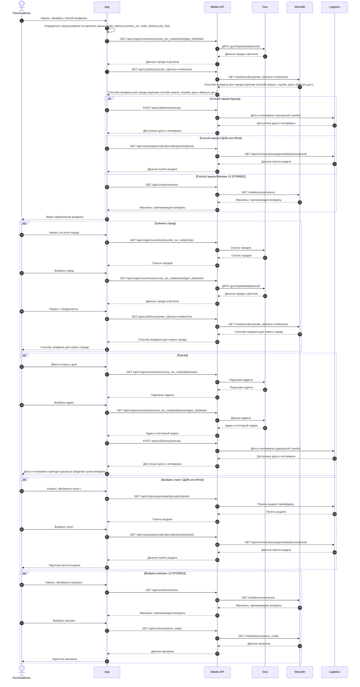

### Логика сценария

**Основная последовательность "Выбрать способ возврата"**

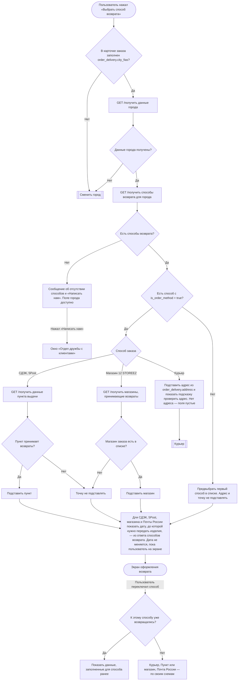

**Альтернативная последовательность "Сменить город"**

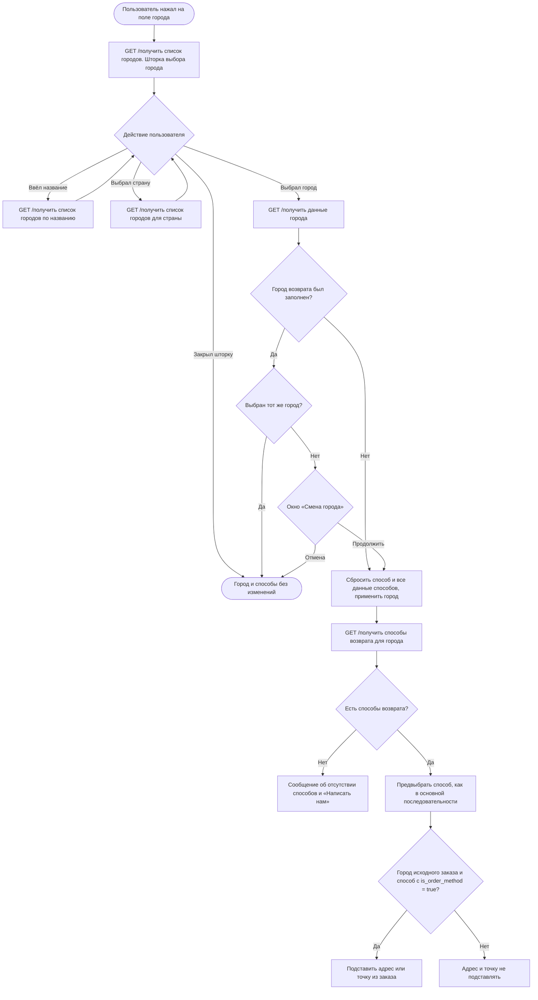

**Альтернативная последовательность "Курьер"**

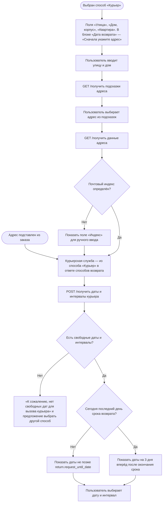

**Альтернативная последовательность "Выбрать пункт СДЭК, 5Post или магазин 12 STOREEZ"**

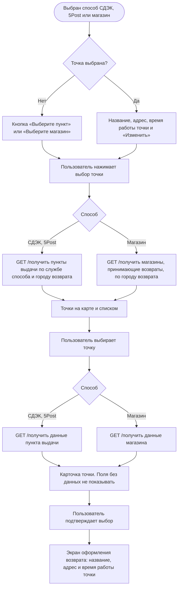

**Альтернативная последовательность "Почта России"**

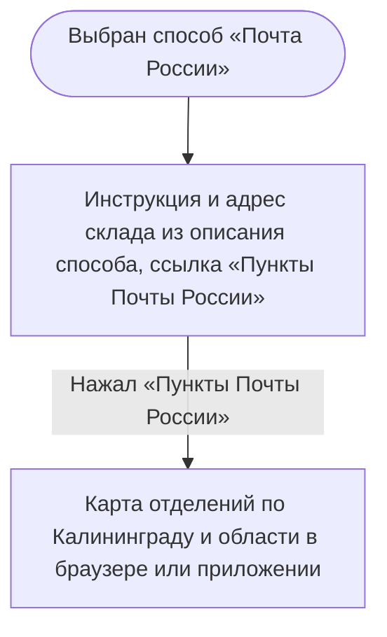

### Задачи

| Название | Ссылка |
|---|---|
| ECOMDEV-2343 | https://tracker.yandex.ru/ECOMDEV-2343 |
| ECOMDEV-2359 | https://tracker.yandex.ru/ECOMDEV-2359 |

### Определить способ возврата денежных средств US 1.4

Как клиент, оформляющий возврат, я хочу понимать, каким способом мне будут возвращены денежные средства, и при необходимости указать банковские реквизиты, чтобы получить денежные средства за возвращённые изделия

### Дизайн

Макеты: [v2 Создание возврата](<../../sources/mockups/v2 Создание возврата/>)

### Сценарий

#### Предусловие

1. Пользователь находится на экране оформления возврата (US 1.3)

#### Основная последовательность "Определить способ возврата денежных средств"

| Шаг | Исполнитель | Описание |
|---|---|---|
| 1 | Система | Определить, нужны ли банковские реквизиты: взять `return.is_bank_data_required` из карточки заказа, полученной в US 1.1 (`GET /получить карточку заказа`) |
| 2 | Система | Отобразить в блоке «Возврат средств» текст о том, куда вернутся деньги, из ответа метода `GET /получить карточку заказа`. Блок «Банковские реквизиты» не отображать  Опционально Если `return.is_bank_data_required = true`, то блок «Возврат средств» не отображать, а в блоке «Банковские реквизиты» отобразить кнопку «Укажите банковские реквизиты». См. альтернативную последовательность "Указать банковские реквизиты" |
| 3 | Система | Отобразить текст «Если вам необходимо получить возврат другим способом или на другие реквизиты, пожалуйста, обратитесь в Отдел дружбы с клиентами» со ссылкой «Отдел дружбы с клиентами»  Опционально 1. Если `return.is_bank_data_required = true`, то текст не отображать 2. Если пользователь нажал на ссылку «Отдел дружбы с клиентами», то открыть окно «Отдел дружбы с клиентами» с часами работы отдела и действиями «Позвонить» и «Написать» |
| 4 | Система | Отобразить в блоке «Итого к возврату» сумму денежных средств за выбранные изделия — сумма к возврату за изделие из карточки заказа по каждому выбранному изделию  Опционально Если по выбранным изделиям есть баллы к возврату, то отобразить их количество в блоке «Баллы к возврату» |

#### Альтернативная последовательность "Указать банковские реквизиты"

| Шаг | Исполнитель | Описание |
|---|---|---|
| 1 | Пользователь | Нажимает «Укажите банковские реквизиты» |
| 2 | Система | Отобразить экран «Банковские реквизиты» с пустыми полями: «Фамилия получателя», «Имя получателя», «Отчество получателя», «БИК банка», «Название банка», «Номер лицевого счета», «Номер банковской карты». Реквизиты из предыдущих возвратов не подставлять |
| 3 | Пользователь | Заполняет поля  Опционально Если номер счёта начинается с «30232810», то поле «Номер банковской карты» обязательно для заполнения |
| 4 | Пользователь | Нажимает «Продолжить» |
| 5 | Система | Вернуть пользователя на экран оформления возврата и отобразить сохранённые реквизиты: ФИО получателя, название банка и номер счёта  Опционально 1. Если номер счёта начинается с «30232810» и поле «Номер банковской карты» не заполнено, то не выполнять переход и подсветить поле красным контуром с текстом «Укажите номер банковской карты» 2. Если пользователь нажал на блок с заполненными реквизитами, то открыть экран «Банковские реквизиты» с заполненными данными; после изменения и нажатия «Продолжить» обновить реквизиты на экране оформления возврата |

### Логика сценария

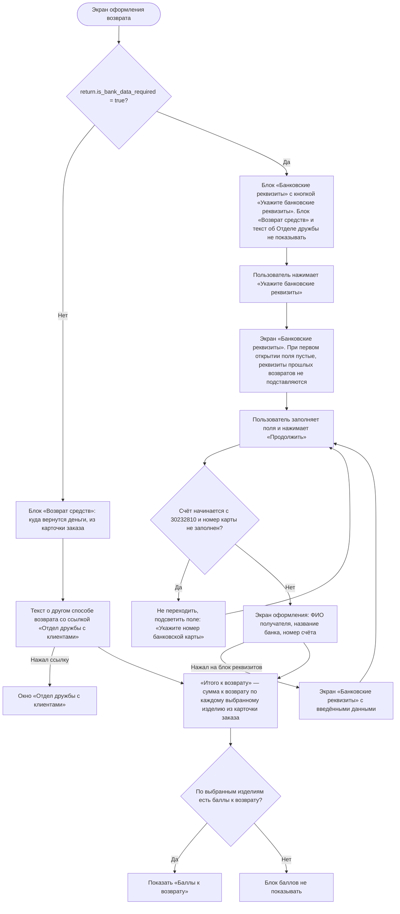

### Задачи

| Название | Ссылка |
|---|---|
| ECOMDEV-2343 | https://tracker.yandex.ru/ECOMDEV-2343 |

### Подтвердить создание заявки на возврат US 1.5

Как клиент, я хочу отправить заполненную форму и увидеть экран подтверждения заявки, чтобы быть уверенным, что мой возврат принят в работу, и легко отслеживать его статус

### Дизайн

Макеты: [v2 Создание возврата](<../../sources/mockups/v2 Создание возврата/>)

### Сценарий

#### Предусловие

1. Пользователь заполнил данные на экране оформления возврата (US 1.3, US 1.4)

#### Основная последовательность "Подтвердить создание заявки на возврат"

| Шаг | Исполнитель | Описание |
|---|---|---|
| 1 | Пользователь | Нажимает «Подтвердить возврат» |
| 2 | Система | Проверить заполнение обязательных полей и блоков для выбранного способа возврата по таблице «Проверка обязательных полей»  Опционально Если обязательные поля или блоки не заполнены, то заявку не отправлять, подсветить все незаполненные поля и блоки с текстом ошибки и прокрутить экран к первому из них. Кнопка «Подтвердить возврат» остаётся активной |
| 3 | Система | Вызвать метод `POST /создать заявку на возврат` (новый метод). Передать выбранные изделия и причину по каждому, город, способ возврата, адрес или точку передачи, дату и интервал курьера, банковские реквизиты (если нужны). На время запроса отобразить на кнопке «Подтвердить возврат» индикатор загрузки; повторное нажатие недоступно |
| 4 | Система | Вернуть пользователя в карточку заказа  Опционально 1. Если срок подачи заявки истёк, то заявка не создаётся: отобразить сообщение о недоступности оформления возврата 2. Если сервер не принял данные заявки (не заполнено обязательное поле, не выбраны дата и интервал или точка, не заполнены банковские реквизиты, не указан номер банковской карты для счёта, начинающегося с «30232810»), то заявка не создаётся: подсветить поле или блок с ошибкой, как на шаге 2 3. Если при создании заявки произошла другая ошибка, то отобразить сообщение, что заявку не удалось создать. Введённые данные сохраняются, пользователь может повторить попытку с шага 1 |
| 4.1 | Система | Вызвать метод `GET /получить карточку заказа` (`GET /api/orders/{id}`, доработка метода) для обновления карточки заказа (US 1.1) |
| 5 | Система | Отобразить поверх карточки заказа шторку подтверждения «Заявка уже у нас» с кнопкой «К возврату». Содержание шторки зависит от способа возврата: для способа «Курьер» — сообщение, что с клиентом свяжутся, если найти курьера на выбранную дату не получится  Опционально Если пользователь закрыл шторку, то оставить его в карточке заказа |
| 6 | Пользователь | Нажимает «К возврату» |
| 7 | Система | Открыть карточку созданного возврата по идентификатору возврата |

**Проверка обязательных полей**

| Способ возврата | Поле или блок | Когда обязательно | Подсветка |
|---|---|---|---|
| Курьер | «Улица» | Всегда | Красный контур, текст «Укажите улицу» |
| Курьер | «Дом, корпус» | Всегда | Красный контур, текст «Укажите дом» |
| Курьер | «Индекс» | Если поле отображается | Красный контур, текст «Укажите индекс» |
| Курьер | Блок «Дата возврата»: дата и интервал | Всегда | Подсветка блока |
| СДЭК, 5Post | Блок «Пункт возврата» | Всегда | Текст «Укажите пункт ПВЗ» |
| Магазин 12 STOREEZ | Блок «Магазин 12 STOREEZ» | Всегда | Текст «Укажите магазин» |
| Любой | Блок «Банковские реквизиты» | Если нужны банковские реквизиты | Текст «Укажите банковские реквизиты» красным со значком ошибки |

### Взаимодействие компонентов

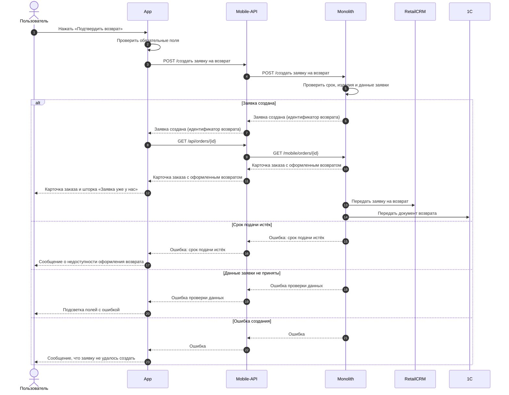

### Логика сценария

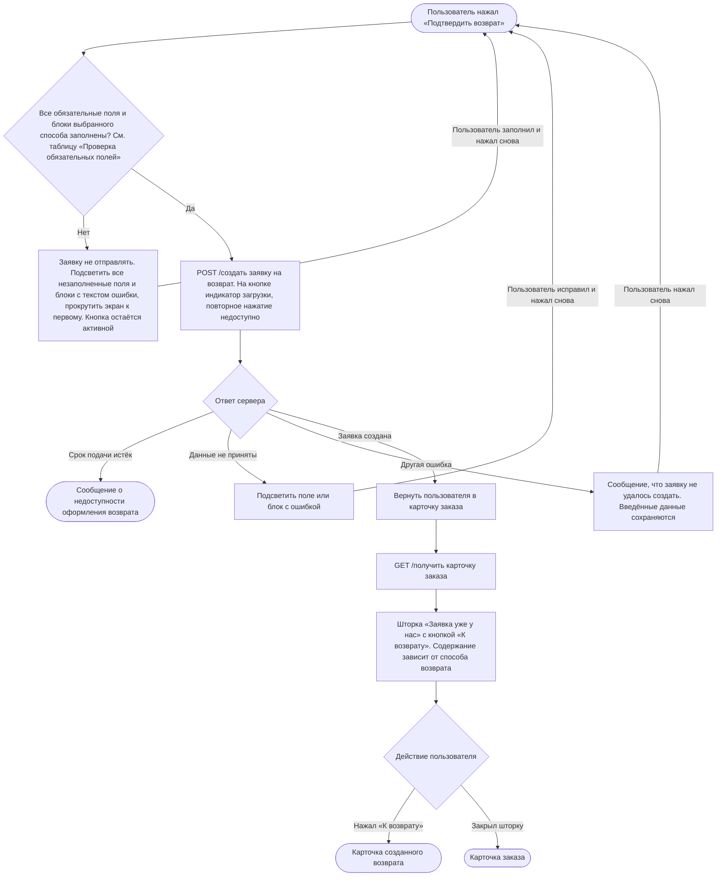

## Просмотр возвратов

### Просмотреть список возвратов US 2

Как авторизованный клиент, я хочу видеть список оформленных возвратов, чтобы находить нужную заявку на возврат, понимать текущее состояние и перейти к подробной информации

### Дизайн

Макеты: [v2.1 После создания возврата (просмотр и раздел возвратов)](<../../sources/mockups/v2.1 После создания возврата (просмотр и раздел возвратов)/>)

### Сценарий

#### Предусловие

1. Пользователь авторизован

#### Основная последовательность "Просмотреть список возвратов"

| Шаг | Исполнитель | Описание |
|---|---|---|
| 1 | Пользователь | Открывает раздел «Возвраты» |
| 2 | Система | Вызвать метод `GET /получить список возвратов` |
| 3 | Система | Отобразить список возвратов. Для каждого возврата — информацию, по которой можно определить возврат и понять его текущее состояние  Опционально Если у пользователя нет оформленных возвратов, то отобразить сообщение об отсутствии оформленных возвратов и кнопку перехода в каталог |
| 4 | Пользователь | Выбирает возврат |
| 5 | Система | Открыть карточку возврата (US 3) |

### Взаимодействие компонентов

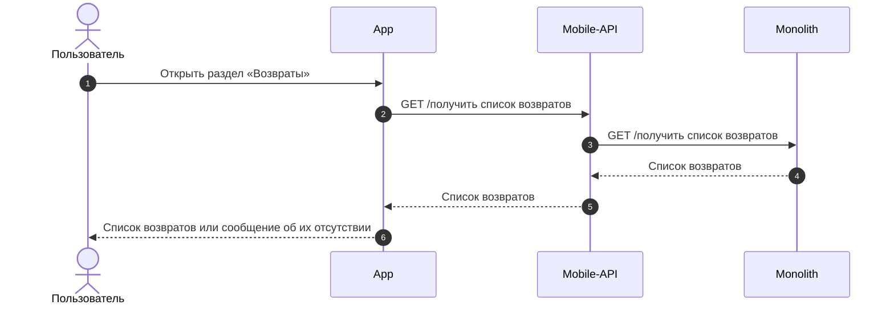

### Просмотреть детальную информацию по заявке на возврат US 3

Как клиент, оформивший возврат, я хочу иметь полный доступ к информации и материалам по своей заявке, чтобы легко контролировать статус возврата на каждом этапе и оперативно получать нужные данные без обращения в поддержку

### Дизайн

Макеты: [v2.1 После создания возврата (просмотр и раздел возвратов)](<../../sources/mockups/v2.1 После создания возврата (просмотр и раздел возвратов)/>)

### Сценарий

#### Предусловие

1. Заявка на возврат создана

#### Основная последовательность "Просмотреть детальную информацию по заявке на возврат"

| Шаг | Исполнитель | Описание |
|---|---|---|
| 1 | Пользователь | Открывает карточку возврата |
| 2 | Система | Вызвать метод `GET /получить детальную информацию по заявке на возврат` |
| 3 | Система | Отобразить текущий статус, инструкцию «Что дальше», способ возврата, способ выплаты и состав изделий. Плашка статуса не раскрывается  Опционально 1. Если для способа возврата не задан текст инструкции «Что дальше», то блок не отображать 2. Если способ возврата — Магазин 12 STOREEZ, то отобразить QR-код заявки для приёма изделий в магазине. QR-код можно предъявить с экрана без печати и без подключения к интернету 3. Если способ возврата — СДЭК или 5Post, то отобразить информацию, что код для сдачи придёт от транспортной компании по SMS и на email, указанные в заказе: для СДЭК — штрихкод и номер накладной, для 5Post — QR-код и PIN 4. Если по заявке выполнен возврат денежных средств и сформирован кассовый чек, то отобразить кнопку «Скачать чек» 5. Если заявка в статусе «Отклонен» и зафиксирована причина отказа, то отобразить статус «Отклонен» и блок с причиной отказа |
| 4 | Пользователь | Нажимает «Скачать заявление» |
| 5 | Система | Вызвать метод `GET /получить заявление на возврат`. Заявление формируется в формате PDF по данным заявки |
| 6 | Система | Сохранить файл заявления на устройство пользователя  Опционально 1. Если пользователь нажал «Скачать чек», то вызвать метод `GET /получить кассовый чек возврата` и сохранить файл на устройство 2. Если пользователь нажал «Копировать» рядом с номером возврата, то скопировать номер в буфер обмена и отобразить уведомление «Номер возврата скопирован» 3. Если пользователь нажал на карточку товара в блоке «Изделия к возврату», то открыть карточку этого товара в каталоге |

### Взаимодействие компонентов

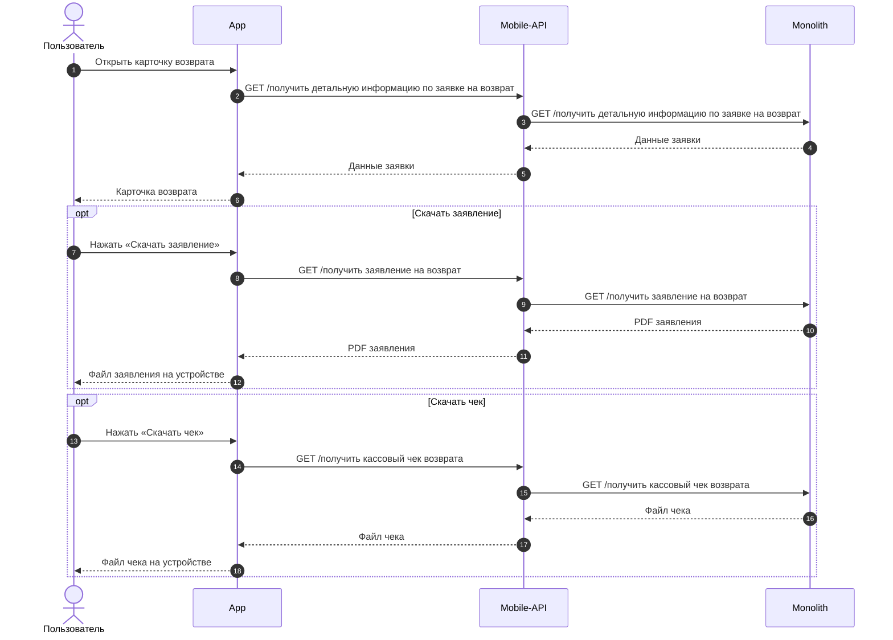

### Просмотреть код для передачи изделий в транспортную компанию US 8

Как клиент, оформляющий возврат через партнёрские службы доставки, я хочу получать логистические идентификаторы, сформированные партнёром, чтобы предъявить их в пункте приёма для быстрой идентификации и отправки товара

### Дизайн

Макеты: [v2.1 После создания возврата (просмотр и раздел возвратов)](<../../sources/mockups/v2.1 После создания возврата (просмотр и раздел возвратов)/>)

### Сценарий

#### Предусловие

1. Пользователь находится в карточке возврата (US 3)

#### Основная последовательность "Просмотреть код для передачи изделий в транспортную компанию"

| Шаг | Исполнитель | Описание |
|---|---|---|
| 1 | Система | Отобразить пункт «Показать код», если по данным заявки партнёрская служба сформировала данные приёмки  Опционально 1. Если данные приёмки ещё не сформированы, то пункт «Показать код» не отображать 2. Если зафиксирована передача товара в пункт приёма (статус «Товар передан» или более поздний), то пункт «Показать код» не отображать |
| 2 | Пользователь | Нажимает «Показать код» |
| 3 | Система | Открыть модальное окно с графическим кодом (QR-код или штрихкод) и его числовым дубликатом (номер накладной или PIN) |
| 4 | Пользователь | Нажимает «Закрыть» или крестик в углу окна |
| 5 | Система | Закрыть окно и вернуть пользователя в карточку возврата |

## Жизненный цикл заявки

### Отменить заявку на возврат US 4

Как клиент, оформивший заявку на возврат, я хочу иметь возможность самостоятельно отменить созданную заявку, чтобы не возвращать товар, если я передумал, или оформить новую заявку, если допустил ошибку (выбрал не тот товар или способ сдачи)

### Сценарий

#### Предусловие

1. Пользователь находится в карточке возврата (US 3)

#### Основная последовательность "Отменить заявку на возврат"

| Шаг | Исполнитель | Описание |
|---|---|---|
| 1 | Система | Отобразить возможность отменить заявку, если заявка в состоянии, допускающем отмену, и передача изделий не зафиксирована  Опционально Если передача изделий зафиксирована, то возможность отмены не отображать |
| 2 | Пользователь | Инициирует отмену возврата |
| 3 | Система | Запросить подтверждение отмены  Опционально Если пользователь отказался от отмены, то вернуть его в карточку возврата без изменения статуса заявки |
| 4 | Пользователь | Подтверждает отмену |
| 5 | Система | Вызвать метод `POST /отменить заявку на возврат` |
| 6 | Система | Отобразить статус заявки «Возврат отменён». Изделия из отменённой заявки снова доступны для оформления возврата, если срок возврата не истёк (US 1.1)  Опционально Если к моменту подтверждения отмены зафиксирована передача изделий, то отмена не выполняется: отобразить сообщение о невозможности отмены возврата |

### Взаимодействие компонентов

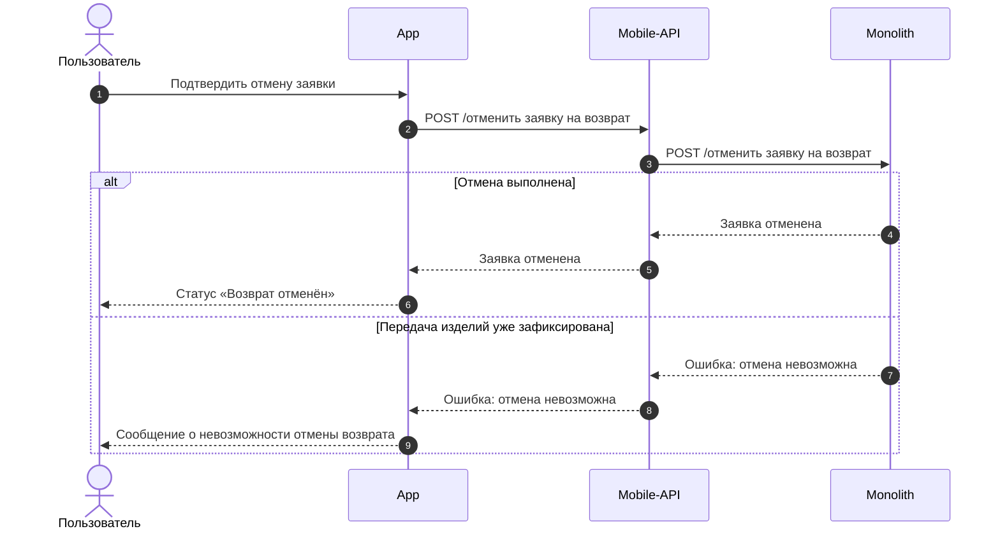
