## Полезные материалы

| Название | Ссылка |
|---|---|
| Макеты (сайт) | https://www.figma.com/design/eXX6wwylh99ztlNUgziZia/%25F0%259F%2596%25A5-05.-Profile--Redesign-?node-id=6317-86695&t=fKHpK9cmN3IoE3WY-0 |
| Макеты (сайт), создание возврата | [web/v1 Создание возврата](<../../sources/mockups/web/v1 Создание возврата/>) |
| Макеты (сайт), после создания возврата | [web/v1 После создания возврата (просмотр и раздел возвратов)](<../../sources/mockups/web/v1 После создания возврата (просмотр и раздел возвратов)/>) |
| Эпик | https://tracker.yandex.ru/ITGENERAL-33 |
| Под эпик | https://tracker.yandex.ru/ECOMDEV-2246<br>https://tracker.yandex.ru/ECOMDEV-2256 |
| BRD | https://docs.google.com/document/d/1rZKCC6zf38xjrW-WQuvGZcEYEMoMK7TBrHrj91QzOpA/edit?tab=t.5rgjndw51swl |
| Причины возвратов | https://docs.google.com/spreadsheets/d/1bBBNP4z9KuJfFFw6_zToKsN-TS_cBT0x/edit?gid=278087742#gid=278087742 |
| Задачи на бэкенд сайта | [[B][Web] order-card-return_task-v2.md](<../backend/US-01/[B][Web] order-card-return_task-v2.md>)<br>[[B][Web] refund-get-positions_task-v2.md](<../backend/US-01/[B][Web] refund-get-positions_task-v2.md>)<br>[[B][Web] return-stores-list_task.md](<../backend/US-01/stores/[B][Web] return-stores-list_task.md>) |
| AS-IS сайта | [as-is/web/](../../as-is/web/) |
| Названия элементов интерфейса | [ui-terms.md](../ui/ui-terms.md) |
| SRS мобильного приложения, MVP | [srs-mobile-mvp.md](./srs-mobile-mvp.md) |
| SRS сайта, Post-MVP | [srs-web-post-mvp.md](<./post mvp/srs-web-post-mvp.md>) |

## Глоссарий

| Термин | Определение |
|---|---|
| Активная заявка | Заявка на возврат в любом статусе, кроме «Возврат отменён», в том числе «Возврат принят» и «Возврат завершён». Возврат, отклонённый складом по итогам проверки, имеет статус «Возврат отменён». |
| Дата получения заказа | Дата завершения заказа |
| Последний день оформления заявки | Последний день, когда клиент может оформить заявку на возврат по заказу |
| TBD (to be defined — «будет определено») | Пометка у названия поля API или адреса метода: название предварительное. Требование задаёт смысл значения, а не его название |

## Не забыть про:

### Смежные системы

| Система | Что затрагивает возврат |
|---|---|
| Qlik | Отчётность по возвратам |
| Mindbox | Письма клиенту по смене статуса возврата, расчёт баллов к возврату |

## Основные принципы

1. Инструкции по способам возврата:
   - для каждого способа клиент видит два текста: описание на панели «Оформление возврата» и инструкцию «Что дальше» на странице созданного возврата;
   - оба текста заводятся в админке отдельно для каждого способа, содержание определяет бизнес. Тексты на макетах — пример.
2. Возврат части позиции:
   - одинаковые изделия хранятся в заказе одной позицией, и при создании заявки статус меняется у всей позиции;
   - если по позиции есть активная заявка, оставшиеся изделия видны в блоке «Ваш заказ», но в MVP выбрать их к возврату на сайте не получится: статус меняется у всей позиции. Их возврат оформляет Отдел дружбы с клиентами по обращению клиента. *Если появится способ возвращать остаток позиции на сайте, ограничение можно снять*;
   - при отмене заявки статус позиции возвращается, и её снова можно вернуть до последнего дня оформления заявки.
3. Форма возврата (выбор изделий, причины, оформление возврата, банковские реквизиты, выбор города и точки) открывается боковой панелью поверх страницы заказа. Если пользователь нажал за пределами панели, сайт отображает модальное окно «Закрыть форму возврата?» с предупреждением, что введённые данные не сохранятся, и кнопками «Продолжить оформление» и «Закрыть». «Продолжить оформление» закрывает модальное окно, введённые данные сохраняются; «Закрыть» закрывает форму без сохранения данных, пользователь остаётся на странице заказа.
4. Номер возврата:
   - номер, который видит клиент, присваивает сайт для любой заявки: созданной клиентом, Отделом дружбы с клиентами или магазином;
   - формат — номер заказа и порядковый номер возврата по заказу: `598591-01`, …, `598591-10`. Отменённые заявки тоже учитываются в нумерации;
   - для обмена с 1С используется отдельный внутренний номер, клиенту он не показывается.
5. Права, статус и сроки проверяет бэкенд при каждом запросе. Сайт скрывает недоступные действия только для удобства пользователя.
6. При технической ошибке метода сайт показывает стандартное сообщение об ошибке, как в остальных разделах. Введённые пользователем данные не сбрасываются.

## Функциональные требования

### Админка

Для сценариев сайта в админке нужны доработки, которых нет в текущих экранах.

1. Пользователь админки должен иметь возможность управлять внутренними (техническими) и клиентскими статусами возврата. Нескольким внутренним статусам можно задать одно клиентское название: клиент видит такие статусы как один статус.
2. Пользователь админки должен иметь возможность объединять внутренние статусы возврата в группы по этапам процесса (например, «Новые», «В работе», «Завершённые»). Группа видна только в админке.
3. Пользователь админки должен иметь возможность управлять данными способа возврата: название, описание на панели «Оформление возврата», инструкция для блока «Что дальше» страницы созданного возврата, включение на сайте и в МП.
4. Пользователь админки должен иметь возможность задавать порядок способов возврата: по нему формируется список способов и выбирается способ по умолчанию, если способ доставки заказа недоступен для возврата.
5. Пользователь админки должен иметь возможность включать и отключать способы возврата для города: по этой настройке метод получения способов возврата для города отдаёт только включённые для города способы.

## Данные

Состав таблиц общий для сайта и мобильного приложения — см. [SRS МП, раздел «Данные БД»](./srs-mobile-mvp.md#данные-бд).

# User story

## Оформление возврата

### Отобразить кнопку оформления возврата на странице заказа US 1.1

Как клиент, совершивший покупку, я хочу иметь возможность начать оформление возврата из карточки заказа, чтобы самостоятельно оформить возврат без обращения в поддержку

### Дизайн

Макеты: [web/v1 Создание возврата](<../../sources/mockups/web/v1 Создание возврата/>), макет 1

### Сценарий

#### Предусловие

1. Пользователь авторизован

#### Основная последовательность "Отобразить кнопку оформления возврата на странице заказа"

| Шаг | Исполнитель | Описание |
|---|---|---|
| 1 | Пользователь | Открывает страницу заказа |
| 2 | Сайт | Вызвать метод `GET /получить страницу заказа` (`GET /profile/view/{id}`) |
| 2.1 | Бэкенд | Рассчитать последний день оформления заявки на возврат (`status.request_until_date`, TBD): дата получения заказа + 14 дней<br><br>**Опционально**<br>1. Если клиент F&F, то дата получения заказа + 30 дней |
| 2.2 | Бэкенд | Рассчитать для каждой позиции заказа данные для возврата — по таблице «Данные позиции для возврата» в разделе «Логика бэкенда» |
| 2.3 | Бэкенд | Вернуть `status.show_refund_button = true`<br><br>**Опционально**<br>1. Если ни одну позицию заказа вернуть нельзя (у всех позиций «Можно вернуть» = нет в таблице «Данные позиции для возврата»), то вернуть `status.show_refund_button = false` |
| 3 | Сайт | Отобразить в блоке «Ваш заказ · N» позиции заказа с количеством изделий, оставшихся у клиента (`positions[].remaining_quantity`, TBD). N — число строк в блоке, одна строка — одна позиция<br><br>**Опционально**<br>1. Если у клиента не осталось изделий позиции (`positions[].remaining_quantity = 0`, TBD), то позицию в блоке «Ваш заказ · N» не отображать |
| 4 | Сайт | Отобразить после блока «Ваш заказ · N» блок «Оформлен возврат · N»: каждое изделие позиций в активных заявках на возврат (`positions[].return_items`, TBD) — отдельной строкой с выбранной причиной возврата. N — число строк в блоке, одна строка — одно изделие<br><br>**Опционально**<br>1. Если по заказу нет активных заявок на возврат, то блок «Оформлен возврат · N» не отображать |
| 5 | Сайт | Отобразить в блоке «Статус» кнопку «Оформить возврат», если `status.show_refund_button = true`<br><br>**Опционально**<br>1. Если `status.show_refund_button = false`, то кнопку не отображать |
| 6 | Сайт | Отобразить под кнопкой текст «Можно вернуть изделия до [Дата]», где [Дата] — последний день оформления заявки (`status.request_until_date`, TBD), и ссылку «Правила возврата»<br><br>**Опционально**<br>1. Если кнопка «Оформить возврат» не отображается, то текст и ссылку «Правила возврата» не отображать |

**Примечание**

1. В списке заказов признак возврата не отображается: клиент видит оформленный возврат только на странице заказа.

### Взаимодействие компонентов

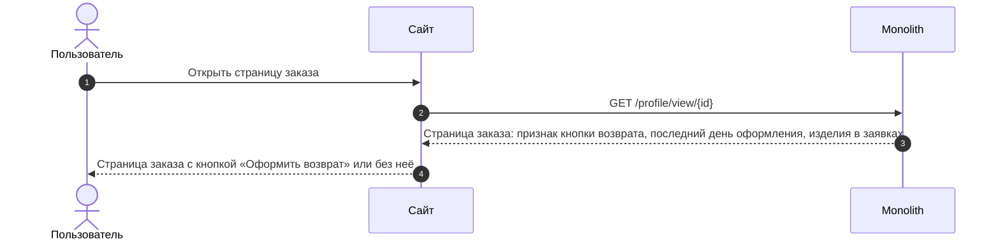

### Логика сценария

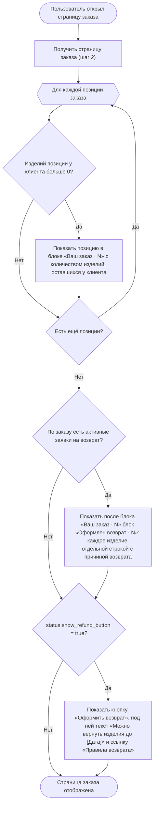

### Логика бэкенда

**`GET /получить страницу заказа` (`GET /profile/view/{id}`) — доработка метода**

Поля с пометкой TBD — рабочие названия. Итоговые названия — в задаче на доработку метода.

* выполнять расчёт доступности возврата — по диаграмме «Логика метода `GET /получить страницу заказа`» и таблице «Данные позиции для возврата» ниже: категория клиента (F&F), последний день оформления заявки (14 или 30 дней с даты получения заказа), изделия в заявках на возврат, кроме отменённых, количество изделий, доступных для возврата
* отдавать последний день оформления заявки (`status.request_until_date`, TBD)
* считать признак кнопки возврата (`status.show_refund_button`) по общему расчёту вместо текущей проверки 14 дней
* отдавать по каждой позиции данные для возврата — по таблице «Данные позиции для возврата» ниже

**Данные позиции для возврата**

| Значение | Поле | Правило | Где используется | Пример А: 3 изделия, заявок нет | Пример Б: 3 изделия, 1 в заявке |
|---|---|---|---|---|---|
| Изделия в возврате | `positions[].return_items`, TBD | Изделия позиции в активных заявках, по одному на изделие, с названием причины возврата (`reason_title`, TBD); если причина не выбрана — название группы причин | Блок «Оформлен возврат · N» | нет | 1 изделие |
| Изделия у клиента | `positions[].remaining_quantity`, TBD | Количество в позиции минус изделия в возврате. Считается для всех позиций при любом сроке и любой доступности возврата | Блок «Ваш заказ · N» | 3 | 2 |
| Можно вернуть | в ответе по позиции не отдаётся | Статус заказа допускает возврат, статус позиции допускает возврат — «Добавлен», как сейчас; позиция — не подарок; последний день оформления заявки (`status.request_until_date`, TBD) не прошёл и по позиции нет активной заявки | Кнопка «Оформить возврат» (`status.show_refund_button`); отбор позиций в ответе метода `GET /получить позиции для возврата` (US 1.2) | да | нет |
| Изделий к выбору | `data.positions[].available_return_quantity`, TBD — в ответе метода `GET /получить позиции для возврата` (US 1.2) | «Можно вернуть» = да → «Изделия у клиента», иначе 0 | Число строк позиции на экране выбора изделий (US 1.2) | 3 | 0 |

**Логика метода `GET /получить страницу заказа`**

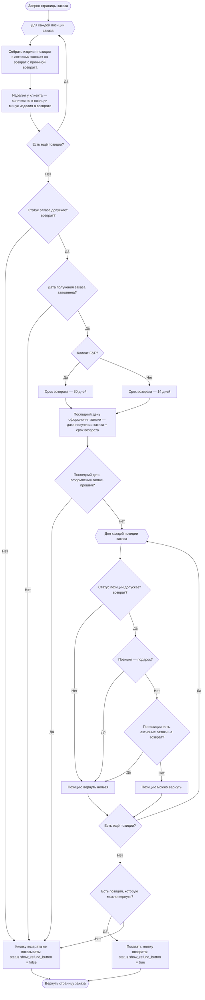

### Задачи

| Название | Ссылка |
|---|---|

### Выбрать изделия и причины возврата US 1.2

Как клиент, оформляющий возврат, я хочу выбрать одно или несколько изделий из заказа и указать причину возврата для каждого выбранного изделия, чтобы сформировать возврат только для тех изделий, которые я хочу вернуть

### Дизайн

Макеты: [web/v1 Создание возврата](<../../sources/mockups/web/v1 Создание возврата/>), макеты 2–6, 29

### Сценарий

#### Предусловие

1. На странице заказа отображается кнопка «Оформить возврат» (US 1.1)

#### Основная последовательность "Выбрать изделия и причины возврата"

| Шаг | Исполнитель | Описание |
|---|---|---|
| 1 | Пользователь | Нажимает «Оформить возврат» |
| 2 | Сайт | Вызвать метод `GET /получить позиции для возврата` (`GET /orders/refund/get-positions?id={id}`) |
| 2.1 | Бэкенд | Проверить доступность возврата тем же расчётом, что на шаге 2 US 1.1 |
| 2.2 | Бэкенд | Вернуть позиции, которые можно вернуть, с числом изделий к выбору (`data.positions[].available_return_quantity`, TBD) — по таблице «Данные позиции для возврата» US 1.1<br><br>**Опционально**<br>1. Если возврат по заказу недоступен, то вернуть пустой список позиций |
| 2.3 | Бэкенд | Вернуть справочник причин `data.reason_groups`: активные группы причин в заданном порядке, в каждой группе — активные причины в заданном порядке<br><br>**Опционально**<br>1. Если в группе нет активных причин, то вернуть группу с пустым списком причин |
| 2.4 | Бэкенд | Вернуть данные для оформления:<br>— признак банковских реквизитов `data.need_bank_details` (US 1.4);<br>— текст о том, куда вернутся деньги (`data.refund.message`, TBD, US 1.4);<br>— данные доставки заказа (`data.order_delivery`, TBD, US 1.3) |
| 3 | Сайт | Отобразить панель «Выберите изделия» по данным ответа метода `GET /получить позиции для возврата` |
| 3.1 | Сайт | Отобразить каждое изделие позиции отдельной строкой. Количество строк — число изделий позиции к выбору (`data.positions[].available_return_quantity`, TBD) |
| 3.2 | Сайт | Отобразить предупреждение о необходимости вернуть изделия в полной комплектации |
| 4 | Пользователь | Отмечает чекбоксами изделия |
| 5 | Сайт | Изменить заголовок панели на «Выберите изделия · N», где N — число выбранных изделий. Сделать кнопку «Указать причину возврата» активной<br><br>**Опционально**<br>1. Если не выбрано ни одного изделия, то кнопка «Указать причину возврата» неактивна |
| 6 | Пользователь | Нажимает «Указать причину возврата» |
| 7 | Сайт | Отобразить панель «Причина возврата» с подзаголовком «Изделие 1 из N» |
| 8 | Пользователь | Выбирает группу причин в выпадающем списке |
| 9 | Сайт | Отобразить список причин выбранной группы<br><br>**Опционально**<br>1. Если у группы нет причин, то выбор группы считать выбором причины и перейти к шагу 11 |
| 10 | Пользователь | Выбирает причину |
| 11 | Сайт | Перейти к следующему выбранному изделию и изменить подзаголовок на «Изделие K из N», где K — номер изделия. Шаги 8–10 повторяются для каждого выбранного изделия<br><br>**Опционально**<br>1. Если пользователь нажал «Назад», то перейти к предыдущему изделию. Выбранная причина сохраняется, её можно изменить<br>2. Если пользователь нажал «Назад» на первом изделии, то вернуться к панели «Выберите изделия» |
| 12 | Сайт | После выбора причины для последнего изделия сделать кнопку «Выбрать способ возврата» активной<br><br>**Опционально**<br>1. Если причина указана не для всех выбранных изделий, то кнопка «Выбрать способ возврата» неактивна<br>2. Если пользователь вернулся к панели «Выберите изделия» и изменил состав изделий, то сбросить причины. Причины указываются заново, начиная с шага 6. Вернуться можно с панелей «Причина возврата» и «Оформление возврата» |

### Взаимодействие компонентов

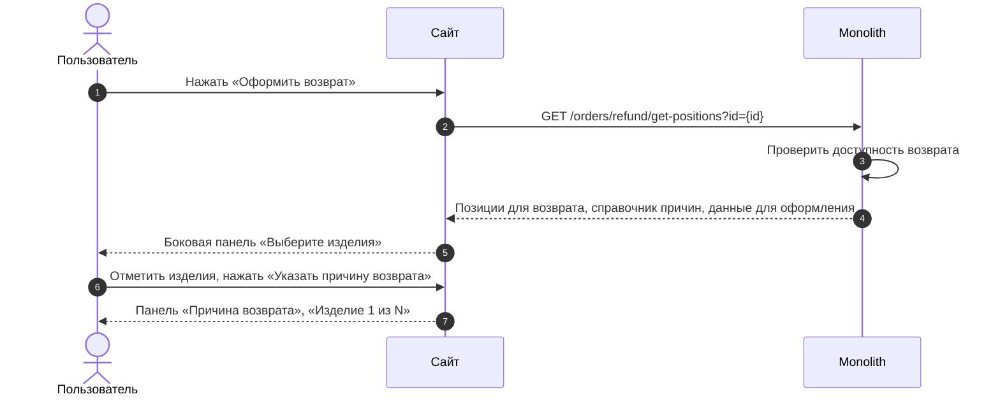

### Логика сценария

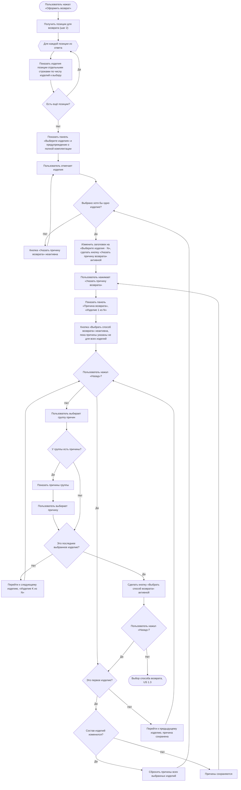

### Логика бэкенда

**Справочник причин и групп возврата (`cms_return_reasons`, `cms_return_reasons_groups`) — обновление данных**

* добавить и обновить причины и группы возврата по таблице [«Причины возвратов»](https://docs.google.com/spreadsheets/u/1/d/1bBBNP4z9KuJfFFw6_zToKsN-TS_cBT0x/edit?gid=175594683#gid=175594683). Справочник общий для сайта и мобильного приложения

**`GET /получить позиции для возврата` (`GET /orders/refund/get-positions?id={id}`) — доработка метода**

Поля с пометкой TBD — рабочие названия. Итоговые названия — в задаче на доработку метода.

* выполнять общий расчёт доступности возврата при каждом запросе — тот же, что для страницы заказа (US 1.1): форма может быть открыта спустя время после открытия страницы заказа
* отбирать позиции по тем же условиям, что на странице заказа: позиция в статусе «Добавлен» и не подарок по признаку подарка, а не по цене
* отдавать только позиции, которые можно вернуть, и число изделий к выбору (`data.positions[].available_return_quantity`, TBD) — по таблице «Данные позиции для возврата» US 1.1
* отдавать текст о том, куда вернутся деньги (`data.refund.message`, TBD), и данные доставки заказа для подстановки при возврате (`data.order_delivery`, TBD)
* справочник причин (`data.reason_groups`) формировать по текущей логике — тот же отбор, что в методе причин мобильного приложения: активные группы и активные причины в заданном порядке
* признак банковских реквизитов (`data.need_bank_details`) считать по общему для сайта и мобильного приложения правилу: реквизиты нужны, если заказ оплачен при получении или полностью или частично подарочным сертификатом. **Внимание:** сейчас на сайте признак считается иначе — `true` для всех способов оплаты, кроме онлайн-оплаты, — поэтому для части способов оплаты сайт и мобильное приложение покажут разное. Текущий расчёт нужно заменить общим

**Логика метода `GET /получить позиции для возврата`**

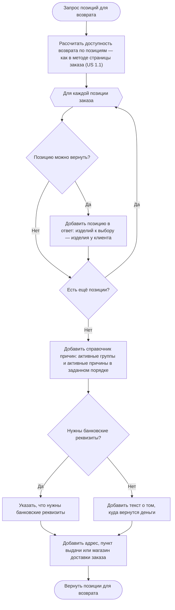

### Задачи

| Название | Ссылка |
|---|---|

### Выбрать способ возврата US 1.3

Как клиент, оформляющий возврат, я хочу выбрать способ возврата товаров, чтобы успешно завершить оформление заявки на возврат

### Дизайн

Макеты: [web/v1 Создание возврата](<../../sources/mockups/web/v1 Создание возврата/>), макеты 7–9, 12–20, 22, 23, 25–28

### Сценарий

#### Предусловие

1. Пользователь указал причины возврата для всех выбранных изделий (US 1.2)

#### Основная последовательность "Выбрать способ возврата"

| Шаг | Исполнитель | Описание |
|---|---|---|
| 1 | Пользователь | Нажимает «Выбрать способ возврата» |
| 2 | Сайт | Определить город возврата: взять страну и город доставки заказа (`data.order_delivery.country_iso`, `data.order_delivery.city_fias`, TBD) из ответа метода `GET /получить позиции для возврата` (US 1.2)<br><br>**Опционально**<br>1. Если город доставки заказа (`data.order_delivery.city_fias`, TBD) не заполнен, то открыть панель «Выберите город». См. альтернативную последовательность "Сменить город" |
| 3 | Сайт | Вызвать метод `GET /получить данные города` (`GET /api/v1/delivery/geo/countries/{countryIso}/cities/{geo_id}/details`) по стране и городу доставки заказа<br><br>**Опционально**<br>1. Если данные города не получены, то открыть панель «Выберите город». См. альтернативную последовательность "Сменить город" |
| 3.1 | Сайт | Взять из ответа часовой пояс города `timezone` |
| 4 | Сайт | Вызвать метод `GET /получить способы возврата для города` (`GET /api/orders/{order_id}/return-method-list`) по городу возврата |
| 4.1 | Бэкенд | Вернуть способы возврата, возвратная служба которых работает в городе возврата, в порядке приоритета. Для каждого способа вернуть:<br>— службу и код типа доставки;<br>— признак `is_order_method` (TBD): способ совпадает со способом доставки заказа и город возврата — город заказа;<br>— для СДЭК, 5Post, Магазина 12 STOREEZ и Почты России — дату «Вернуть до»: текущая дата + 10 календарных дней |
| 5 | Сайт | Отобразить панель «Оформление возврата» с городом и способами возврата из ответа метода `GET /получить способы возврата для города`<br><br>**Опционально**<br>1. Если для города нет доступных способов возврата, то отобразить сообщение об отсутствии доступных способов возврата и действие «Написать нам». Поле города остаётся доступным для нажатия<br>2. Если пользователь нажал «Написать нам», то открыть модальное окно «Отдел дружбы с клиентами» с часами работы отдела и действиями «Позвонить» и «Написать», как в US 1.4<br>3. Если пользователь нажал «Назад», то вернуться к панели «Причина возврата» на последнее изделие. Выбранные изделия и причины сохраняются |
| 6 | Сайт | Предвыбрать способ возврата, совпадающий со способом доставки заказа (`is_order_method = true`, TBD)<br><br>**Опционально**<br>1. Если такого способа нет, то выбрать первый способ в списке<br>2. Если пользователь переключился на другой способ в том же городе и вернулся к прежнему, то отобразить данные, заполненные для этого способа: подставленные из заказа или введённые пользователем. Данные не сбрасываются |
| 7 | Сайт | Подставить адрес или точку из исходного заказа, если выбран способ, совпадающий со способом доставки заказа (`is_order_method = true`, TBD)<br><br>**Опционально**<br>1. Если способ выбран по приоритету, то адрес и точку не подставлять: пользователь заполняет их сам |
| 7.1 | Сайт | Курьер — подставить адрес доставки заказа (`data.order_delivery.address`, TBD) из ответа метода `GET /получить позиции для возврата`: улица, дом, корпус, квартира, индекс<br><br>**Опционально**<br>1. Если адрес доставки заказа не заполнен, то поля адреса оставить незаполненными<br>2. Если в адресе заказа нет индекса, то отобразить поле «Индекс» для ручного ввода |
| 7.1.1 | Сайт | Отобразить над полями адреса подсказку "проверить актуальность адреса" |
| 7.1.2 | Сайт | Запросить и отобразить даты и интервалы курьера для адреса из заказа — шаги 7–8 альтернативной последовательности "Курьер"<br><br>**Опционально**<br>1. Если пользователь изменил подставленный адрес, то сбросить выбранные дату и интервал и выполнить шаги 3–8 альтернативной последовательности "Курьер" |
| 7.2 | Сайт | СДЭК, 5Post — вызвать метод `GET /получить данные пункта выдачи` (`GET /api/v1/delivery/pickup/provider/{provider}/points/{point}`) по службе выбранного способа и пункту выдачи заказа (`data.order_delivery.pvz.id`, TBD)<br><br>**Опционально**<br>1. Если пункт в заказе не указан, то метод не вызывать и поле точки оставить незаполненным |
| 7.2.1 | Сайт | Подставить пункт в поле точки, если в ответе метода `is_return_available = true` (TBD)<br><br>**Опционально**<br>1. Если `is_return_available = false`, то поле точки оставить незаполненным<br>2. Если данные пункта не получены, то поле точки оставить незаполненным |
| 7.3 | Сайт | Магазин 12 STOREEZ — вызвать метод `GET /получить магазины, принимающие возвраты` (`GET /content/showrooms/showrooms-return?city_fias={city_fias}`, TBD) по городу возврата<br><br>**Опционально**<br>1. Если магазин в заказе не указан, то метод не вызывать и поле точки оставить незаполненным |
| 7.3.1 | Сайт | Подставить магазин доставки заказа (`data.order_delivery.store.store_code`, TBD) в поле точки, если он есть в списке<br><br>**Опционально**<br>1. Если магазина заказа нет в списке, то поле точки оставить незаполненным |
| 8 | Сайт | Для способов СДЭК, 5Post, Магазин 12 STOREEZ и Почта России отобразить дату «Вернуть до» из ответа метода `GET /получить способы возврата для города`. Пока пользователь на панели «Оформление возврата», дата не меняется |

#### Альтернативная последовательность "Сменить город"

| Шаг | Исполнитель | Описание |
|---|---|---|
| 1 | Пользователь | Нажимает на поле города |
| 2 | Сайт | Вызвать метод `GET /получить список городов` (`GET /api/v1/delivery/geo/countries/{countryIso}/cities`) с кодом страны города возврата, без поискового запроса<br><br>**Опционально**<br>1. Если страна города возврата не определена, то метод не вызывать |
| 3 | Сайт | Отобразить панель «Выберите город»: поле страны с текущей страной, поле поиска и список городов этой страны<br><br>**Опционально**<br>1. Если страна не определена, то в поле страны предложить выбрать страну, список городов не отображать<br>2. Если пользователь закрыл панель, не выбрав город, то оставить ранее выбранный город и способы возврата |
| 3.1 | Пользователь | Нажимает на поле страны |
| 3.2 | Сайт | Вызвать метод `GET /получить список стран` (`GET /api/v1/delivery/geo/suggest-country`) и отобразить окно выбора страны со списком стран и поиском по названию |
| 3.3 | Пользователь | Выбирает страну |
| 3.4 | Сайт | Вызвать метод `GET /получить список городов` (`GET /api/v1/delivery/geo/countries/{countryIso}/cities`) с кодом выбранной страны и отобразить в панели выбранную страну и её города |
| 3.5 | Пользователь | Вводит название города в поле поиска |
| 3.6 | Сайт | Вызвать метод `GET /получить список городов` (`GET /api/v1/delivery/geo/countries/{countryIso}/cities`) с кодом страны и введённым названием и отобразить найденные города<br><br>**Опционально**<br>1. Если города не найдены, то отобразить сообщение, что по запросу ничего не найдено |
| 4 | Пользователь | Выбирает город в списке: среди городов страны или среди найденных по поиску. Сменить страну (шаги 3.1–3.4) и искать город (шаги 3.5–3.6) необязательно |
| 4.1 | Сайт | Вызвать метод `GET /получить данные города` (`GET /api/v1/delivery/geo/countries/{countryIso}/cities/{geo_id}/details`) для выбранного города |
| 4.2 | Сайт | Взять из ответа часовой пояс города `timezone` |
| 5 | Сайт | Закрыть панель и отобразить модальное окно «Смена города» с предупреждением о сбросе способа возврата и кнопками «Продолжить» и «Отмена»<br><br>**Опционально**<br>1. Если город возврата не определён из заказа, то модальное окно не отображать и перейти к шагу 7<br>2. Если выбран тот же город, то модальное окно не отображать и оставить данные без изменений<br>3. Если пользователь нажал «Отмена», то закрыть модальное окно и оставить данные без изменений |
| 6 | Пользователь | Нажимает «Продолжить» |
| 7 | Сайт | Сбросить выбранный способ возврата и все данные способов (адрес, дата и интервал, точка передачи), применить выбранный город |
| 8 | Сайт | Вызвать метод `GET /получить способы возврата для города` (`GET /api/orders/{order_id}/return-method-list`) с данными нового города из шага 4.1 |
| 9 | Сайт | Отобразить способы возврата для нового города<br><br>**Опционально**<br>1. Если для города нет доступных способов возврата, то отобразить сообщение и действие «Написать нам», как на шаге 5 основной последовательности |
| 10 | Сайт | Выбрать способ возврата так же, как на шаге 6 основной последовательности<br><br>**Опционально**<br>1. Если выбран город исходного заказа и способ, совпадающий со способом доставки заказа (`is_order_method = true`, TBD), то подставить адрес или точку из заказа, как на шаге 7 основной последовательности<br>2. Если выбран другой город, то адрес и точку не подставлять: пользователь заполняет их сам |

#### Альтернативная последовательность "Курьер"

| Шаг | Исполнитель | Описание |
|---|---|---|
| 1 | Пользователь | Выбирает способ «Курьер» или способ выбран системой на шаге 6 основной последовательности |
| 2 | Сайт | Отобразить поля адреса: «Улица», «Дом, корпус», «Квартира»<br><br>**Опционально**<br>1. Если улица и дом не заполнены, то в блоке «Дата возврата» вместо выбора даты и интервала отобразить текст «Сначала укажите адрес» |
| 3 | Пользователь | Вводит улицу, затем дом |
| 4 | Сайт | Вызвать метод `GET /получить подсказки адреса` (`GET /api/v1/delivery/geo/countries/{countryIso}/addresses`) по введённому тексту и отобразить список подсказок<br><br>**Опционально**<br>1. Если вводится дом, то последней строкой списка отобразить подсказку с введённым текстом из ответа метода<br>2. Если геосервис недоступен, то список не отображать. Улица и дом вводятся как обычный текст, адрес введён вручную |
| 5 | Пользователь | Нажимает на подсказку в списке: найденный адрес или подсказку с введённым текстом<br><br>**Опционально**<br>1. Если выбрана подсказка с введённым текстом, то адрес введён вручную<br>2. Если пользователь ушёл из поля, не нажав на подсказку, то подсветить поле ошибкой, как при оформлении заказа, и введённый текст не принимать<br>3. Если геосервис недоступен, то вводит улицу и дом без выбора из списка |
| 6 | Сайт | Вызвать метод `GET /получить данные адреса` (`GET /api/v1/delivery/geo/countries/{countryIso}/addresses/details?geo_id={geo_id}`) по `geo_id` выбранного адреса<br><br>**Опционально**<br>1. Если в ответе нет индекса или геосервис недоступен, то отобразить поле «Индекс» для ручного ввода<br>2. Если дата и интервал уже были выбраны для прежнего адреса, то сбросить их<br>3. Если адрес введён вручную, то метод не вызывать и отобразить поле «Индекс» для ручного ввода |
| 7 | Сайт | Вызвать метод `GET /получить даты и интервалы курьера` (`GET /delivery/delivery/intervals`) после выбора дома на шаге 5 по адресу забора и способу «Курьер»<br><br>**Опционально**<br>1. Если геосервис недоступен, то вызвать метод, когда пользователь ушёл из поля «Дом, корпус», а улица и дом заполнены |
| 8 | Сайт | Отобразить даты и интервалы приезда курьера из ответа метода `GET /получить даты и интервалы курьера`<br><br>**Опционально**<br>1. Если метод вернул ошибку или пустой список дат, то не отображать выбор даты и интервала. Возврат оформляется без них. Дату и интервал согласует с клиентом Отдел дружбы с клиентами (US 1.5) |
| 8.1 | Сайт | Предвыбрать первую дату и первый интервал |
| 9 | Пользователь | При необходимости выбирает другую дату и интервал |

#### Альтернативная последовательность "Выбрать пункт СДЭК, 5Post или магазин 12 STOREEZ"

| Шаг | Исполнитель | Описание |
|---|---|---|
| 1 | Сайт | Отобразить в блоке точки кнопку «Выберите пункт» для СДЭК и 5Post или «Выберите магазин» для магазина 12 STOREEZ<br><br>**Опционально**<br>1. Если точка уже выбрана, то отобразить название, адрес и время работы точки и «Изменить» |
| 2 | Пользователь | Нажимает «Выберите пункт», «Выберите магазин» или «Изменить» |
| 3 | Сайт | Вызвать метод получения точек приёма, принимающих возвраты, в городе возврата. Метод зависит от выбранного способа:<br>— СДЭК, 5Post — `GET /получить пункты выдачи` (`GET /api/v1/delivery/pickup/provider/{provider}/points`) по службе выбранного способа и городу возврата;<br>— магазин — `GET /получить магазины, принимающие возвраты` (`GET /content/showrooms/showrooms-return?city_fias={city_fias}`, TBD) по городу возврата |
| 4 | Сайт | Отобразить точки, принимающие возвраты, на карте и списком |
| 5 | Пользователь | Выбирает точку |
| 6 | Сайт | Получить данные выбранной точки. Метод зависит от способа:<br>— СДЭК, 5Post — `GET /получить данные пункта выдачи` (`GET /api/v1/delivery/pickup/provider/{provider}/points/{point}`);<br>— магазин — `GET /получить данные магазина` (`GET /content/showrooms/showroom-view?storeCode={store_code}`) |
| 7 | Сайт | Отобразить карточку точки:<br>— пункт СДЭК, 5Post — название, адрес, как добраться, время работы, телефон;<br>— магазин — название, адрес, как добраться, время работы, телефон, парковка<br><br>**Опционально**<br>1. Если у поля нет данных, то поле не отображать |
| 8 | Пользователь | Подтверждает выбор |
| 9 | Сайт | Вернуть пользователя на панель «Оформление возврата» и отобразить название, адрес и время работы выбранной точки |

#### Альтернативная последовательность "Почта России"

| Шаг | Исполнитель | Описание |
|---|---|---|
| 1 | Пользователь | Выбирает способ «Почта России» |
| 2 | Сайт | Отобразить инструкцию по возврату и адрес склада из описания способа «Почта России» и внешнюю ссылку «Пункты Почты России» |
| 3 | Пользователь | Нажимает «Пункты Почты России» |
| 4 | Сайт | Открыть карту отделений Почты России по Калининграду и Калининградской области по ссылке на внешнем ресурсе |

**Примечание**

*Способы возврата*

1. Способ возврата отображается, если его возвратная служба работает в городе возврата. Возвратные службы ведутся отдельно от служб доставки, со своим списком городов, и он может не совпадать с городами доставки. «Почта России» определяется по тому же правилу: её возвратная служба работает только в Калининграде и Калининградской области, поэтому в других городах этого способа нет. Например, курьер СДЭК есть только в населённых пунктах с офисом СДЭК.
2. Если способа, совпадающего со способом доставки заказа, нет, то предвыбирается первый способ по приоритету. Так бывает, если способ доставки заказа недоступен для возврата или город возврата отличается от города заказа.
3. Дата «Вернуть до» на панели «Оформление возврата» предварительная: она считается при открытии панели и не меняется, пока пользователь на ней. Окончательная дата — дата создания заявки + 10 календарных дней. Если пользователь начал оформление до полуночи, а подтвердил после, окончательная дата будет на день позже предварительной.

*Курьер: адрес забора*

4. Адрес из заказа не считается введённым вручную, даже если клиент вводил его вручную при оформлении заказа: адрес заказа уже проверил Отдел дружбы с клиентами, и по нему заказ доставлен. Даты и интервалы курьера для адреса из заказа запрашиваются как обычно.
5. Подсказка с введённым текстом — отдельная строка в раскрывающемся списке подсказок, в которой повторяется текст, введённый в поле. Это не само поле ввода: на эту подсказку нужно нажать, как на найденный адрес. Адрес принимается, только когда пользователь нажал на подсказку в списке — найденный адрес или подсказку с введённым текстом. Подсказка с введённым текстом приходит в ответе метода `GET /получить подсказки адреса` последней строкой списка подсказок дома. Исключение — геосервис недоступен: тогда списка нет, и улица и дом вводятся как обычный текст. Даты и интервалы курьера запрашиваются:
   - адрес найден в подсказках — после нажатия на найденный дом в списке подсказок;
   - адреса нет в подсказках — после нажатия на подсказку с введённым текстом в списке подсказок дома;
   - геосервис недоступен — когда пользователь ушёл из поля «Дом, корпус», а улица и дом заполнены;
   - адрес подставлен из заказа — сразу после подстановки;
   - пользователь изменил улицу или дом — дата, интервал и индекс сбрасываются, запрос повторяется по тем же правилам.

*Курьер: даты и интервалы*

6. Часовой пояс города `timezone` всегда передаётся в запрос дат и интервалов курьера. По нему логистика считает ручные интервалы; без него интервалы считаются по московскому времени (UTC+03:00). Часовой пояс приходит только в ответе метода `GET /получить данные города`. Поэтому данные города запрашиваются и тогда, когда город подставлен из заказа.
7. В MVP даты и интервалы курьера для возврата приходят только от СДЭК и только по населённым пунктам РФ.
8. Для курьера СДЭК на каждую дату приходит один интервал — 9:00–18:00 по местному времени.
9. Число дат задаёт логистика. Сайт его не меняет, в том числе для клиентов F&F.

### Взаимодействие компонентов

**Основная последовательность "Выбрать способ возврата"**

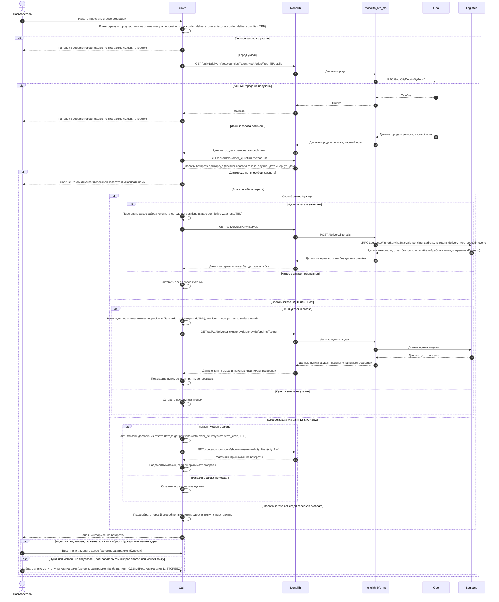

**Альтернативная последовательность "Сменить город"**

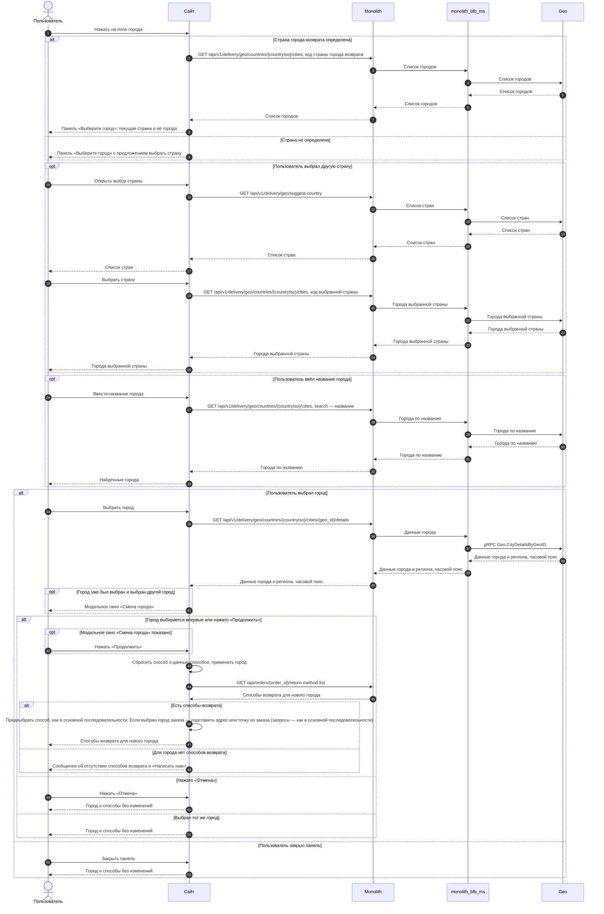

**Альтернативная последовательность "Курьер"**

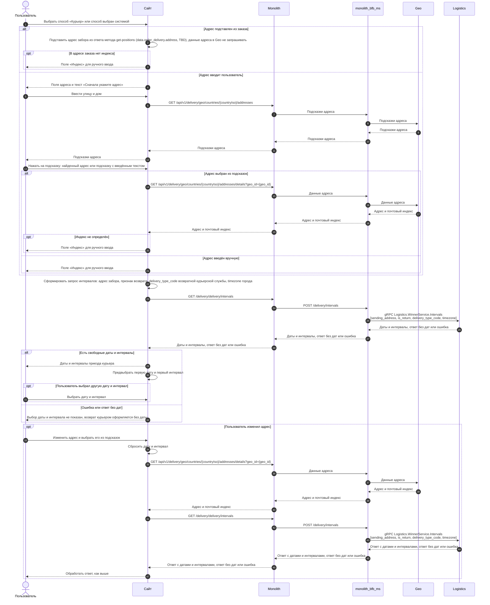

**Альтернативная последовательность "Выбрать пункт СДЭК, 5Post или магазин 12 STOREEZ"**

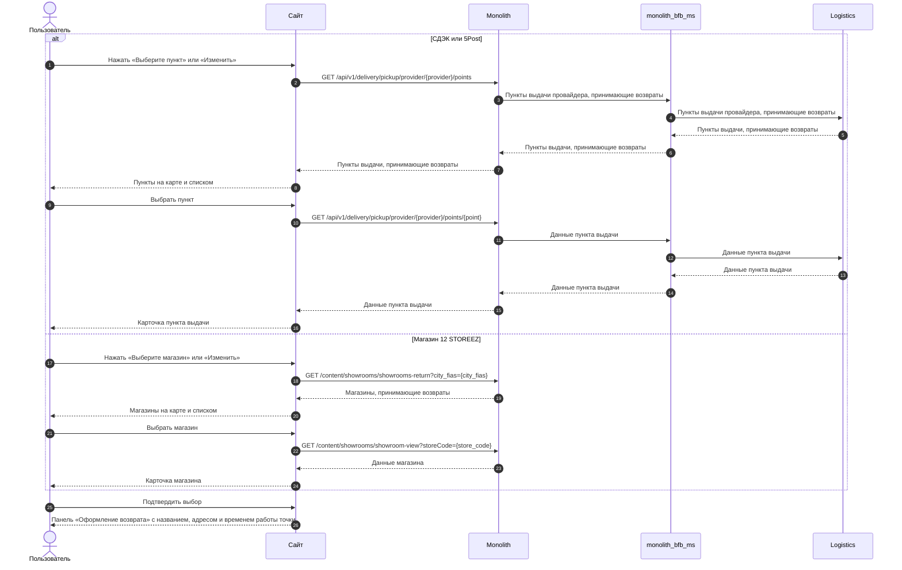

### Логика сценария

**Основная последовательность "Выбрать способ возврата"**

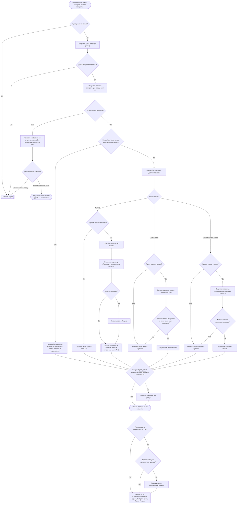

**Альтернативная последовательность "Сменить город"**

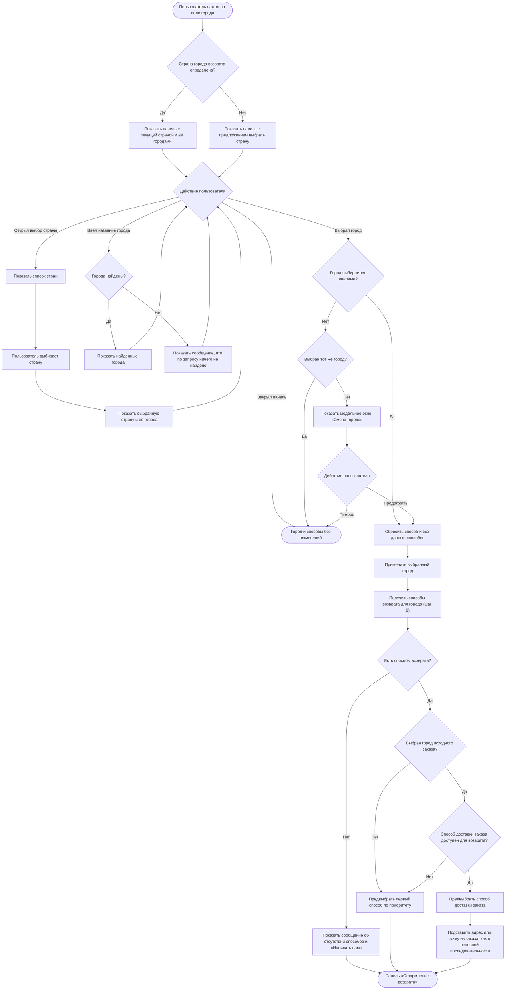

**Альтернативная последовательность "Курьер"**

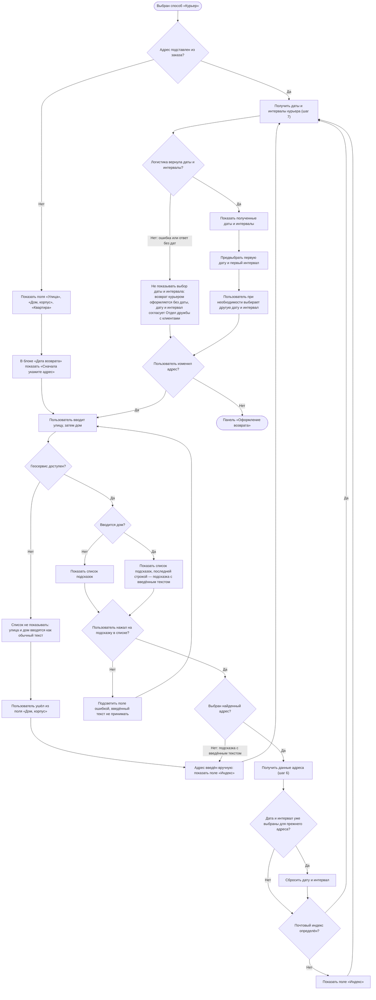

**Альтернативная последовательность "Выбрать пункт СДЭК, 5Post или магазин 12 STOREEZ"**

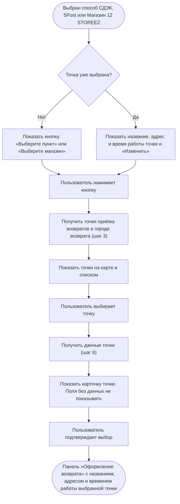

**Альтернативная последовательность "Почта России"**

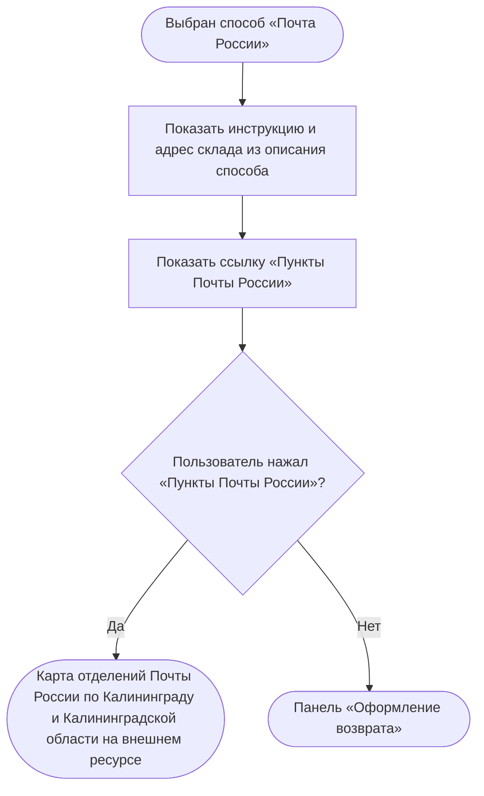

### Логика бэкенда

**`GET /получить способы возврата для города` (`GET /api/orders/{order_id}/return-method-list`) — доработка метода**

* отбирать и отдавать способы возврата по новой логике — общей с новым методом способов возврата мобильного приложения ([SRS МП, US 1.3](./srs-mobile-mvp.md)): возвратные службы, работающие в городе возврата, порядок приоритета, признак способа заказа, служба и код типа доставки возвратной службы (`delivery_type_code`), дата «Вернуть до» для СДЭК, 5Post, Магазина 12 STOREEZ и Почты России — текущая дата + 10 календарных дней. Расчёт один для обоих каналов, отличается только набор способов, включённых для канала
* текущий расчёт списка способов используется и этим методом, и методом выпущенных версий мобильного приложения. Его не менять: метод сайта переводится на новую логику, метод выпущенных версий приложения работает по-прежнему
* входные параметры не меняются: страны, региона и города возврата достаточно. В ответ добавляются признак способа заказа, служба, `delivery_type_code` и дата «Вернуть до»
* поддержать новые способы «Магазин 12 STOREEZ» и «Почта России»

**`GET /получить магазины, принимающие возвраты` (`GET /content/showrooms/showrooms-return?city_fias={city_fias}`) — новый метод**

* отдавать магазины, которые принимают возвраты в выбранном городе, — тот же отбор и набор данных, что в методе мобильного приложения

**`GET /получить пункты выдачи` (`GET /api/v1/delivery/pickup/provider/{provider}/points`) — доработка метода**

* передавать через `monolith_bfb_ms` в сервис логистики возвратную службу выбранного способа (`provider`) и фильтр `is_return_available = true`, чтобы получить только пункты, принимающие возвраты
* для служб доставки заказов метод работает как сейчас (оформление заказа)

**`GET /получить данные пункта выдачи` (`GET /api/v1/delivery/pickup/provider/{provider}/points/{point}`) — доработка метода**

* отдавать признак `is_return_available` из ответа логистики

**`GET /получить даты и интервалы курьера` (`GET /delivery/delivery/intervals`) — доработка метода**

* Необходимо добавить новые параметры в запрос к Логистике (через `monolith_bfb_ms`):
  * `sending_address` (TBD) — полный адрес забора изделий для возврата. Передаётся одной строкой (требование Логистики).
  * `is_return` (TBD) — признак возврата, по которому Логистика определяет, что необходимо проверить доступные даты и интервалы для возвратного потока.
* код типа доставки возвратной курьерской службы (`delivery_type_code`) и часовой пояс города (`timezone`) передаются, как сейчас; часовой пояс — всегда
* код города не передаётся. Состав строки `sending_address`:
  * адрес из подсказок — `data.house.fullTitle` из ответа `GET /получить данные адреса` (`GET /api/v1/delivery/geo/countries/{countryIso}/addresses/details?geo_id={geo_id}`);
  * адрес из заказа — поля адреса заказа: страна, регион, населённый пункт, улица, дом, квартира, индекс;
  * адрес, введённый вручную, — на уточнении.
* для возврата интервалы не зависят от корзины: тип заказа из корзины не определяется
* без адреса забора метод работает как сейчас (оформление заказа)

### Задачи

| Название | Ссылка |
|---|---|
| Добавить признак приёма возвратов | https://tracker.yandex.ru/ECOMDEV-2359 |
| Логистика: фильтр и признак приёма возвратов для пунктов выдачи | https://tracker.yandex.ru/TNT-2712 |

### Определить способ возврата денежных средств US 1.4

Как клиент, оформляющий возврат, я хочу понимать, каким способом мне будут возвращены денежные средства, и при необходимости указать банковские реквизиты, чтобы получить денежные средства за возвращённые изделия

### Дизайн

Макеты: [web/v1 Создание возврата](<../../sources/mockups/web/v1 Создание возврата/>), макеты 7, 11, 12, 14, 28

### Сценарий

#### Предусловие

1. Пользователь находится на панели «Оформление возврата» (US 1.3)

#### Основная последовательность "Определить способ возврата денежных средств"

| Шаг | Исполнитель | Описание |
|---|---|---|
| 1 | Сайт | Взять из ответа метода `GET /получить позиции для возврата` (US 1.2):<br>— нужны ли банковские реквизиты (`data.need_bank_details`);<br>— текст о том, куда вернутся деньги (`data.refund.message`, TBD) |
| 2 | Сайт | Отобразить в блоке «Возврат средств» текст о том, куда вернутся деньги. Блок «Банковские реквизиты» не отображать<br><br>**Опционально**<br>1. Если `data.need_bank_details = true`, то блок «Возврат средств» не отображать, а в блоке «Банковские реквизиты» отобразить кнопку «Укажите банковские реквизиты». См. альтернативную последовательность "Указать банковские реквизиты" |
| 3 | Сайт | Отобразить текст «Если вам необходимо получить возврат другим способом или на другие реквизиты, пожалуйста, обратитесь в Отдел дружбы с клиентами» со ссылкой «Отдел дружбы с клиентами»<br><br>**Опционально**<br>1. Если `data.need_bank_details = true`, то текст не отображать<br>2. Если пользователь нажал на ссылку «Отдел дружбы с клиентами», то открыть модальное окно «Отдел дружбы с клиентами» с часами работы отдела и действиями «Позвонить» и «Написать» |
| 4 | Сайт | Вызвать метод `POST /рассчитать сумму и баллы к возврату` (TBD) по выбранным изделиям |
| 4.1 | Бэкенд | Рассчитать сумму к возврату по выбранным изделиям |
| 4.2 | Бэкенд | Запросить в Mindbox баллы к возврату по выбранным изделиям |
| 4.3 | Бэкенд | Вернуть сумму к возврату и баллы к возврату |
| 5 | Сайт | Отобразить в блоке «Итого к возврату» сумму к возврату из ответа метода `POST /рассчитать сумму и баллы к возврату`<br><br>**Опционально**<br>1. Если баллы к возврату больше 0, то отобразить их в блоке «Баллы к возврату»<br>2. Если баллы не рассчитаны — TBD |

#### Альтернативная последовательность "Указать банковские реквизиты"

| Шаг | Исполнитель | Описание |
|---|---|---|
| 1 | Пользователь | Нажимает «Укажите банковские реквизиты» |
| 2 | Сайт | Отобразить панель «Банковские реквизиты» с пустыми полями. Реквизиты из предыдущих возвратов не подставлять |
| 3 | Пользователь | Заполняет поля |
| 4 | Пользователь | Нажимает «Продолжить». Кнопка «Продолжить» активна всегда |
| 5 | Сайт | Проверить заполнение полей: обязательны все поля, кроме «Номер банковской карты»<br><br>**Опционально**<br>1. Если номер счёта начинается с «30232810», то поле «Номер банковской карты» тоже обязательно<br>2. Если обязательные поля не заполнены, то не выполнять переход и подсветить незаполненные поля красным контуром. Под полем «Номер банковской карты» показать текст «Укажите номер банковской карты» |
| 6 | Сайт | Вернуть пользователя на панель «Оформление возврата» и отобразить сохранённые реквизиты: ФИО получателя, название банка и номер счёта<br><br>**Опционально**<br>1. Если пользователь нажал на блок с заполненными реквизитами, то открыть панель «Банковские реквизиты» с заполненными данными<br>2. Если пользователь изменил реквизиты и нажал «Продолжить», то проверить поля, как на шаге 5, и обновить реквизиты на панели «Оформление возврата» |

**Примечание**

1. Банковские реквизиты нужны, если заказ оплачен при получении или подарочным сертификатом (полностью или частично). В этом случае текст о том, куда вернутся деньги, не приходит.

### Взаимодействие компонентов

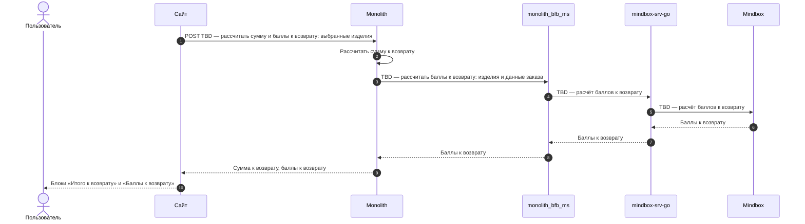

### Логика сценария

**Основная последовательность "Определить способ возврата денежных средств"**

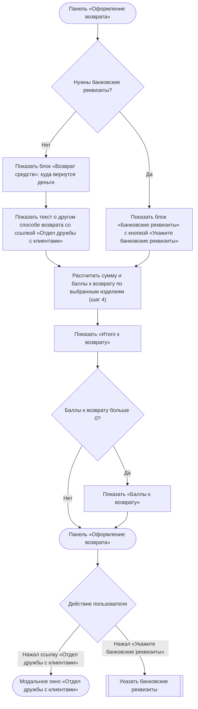

**Альтернативная последовательность "Указать банковские реквизиты"**

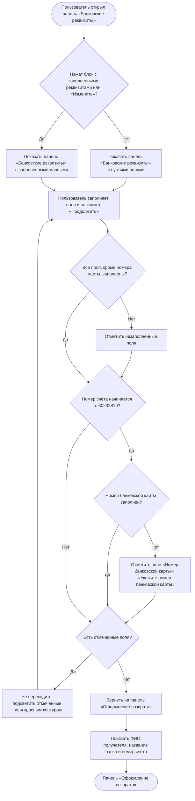

### Задачи

| Название | Ссылка |
|---|---|

### Подтвердить создание заявки на возврат US 1.5

Как клиент, я хочу отправить заполненную форму и увидеть экран подтверждения заявки, чтобы быть уверенным, что мой возврат принят в работу, и легко отслеживать его статус

### Дизайн

Макеты: [web/v1 Создание возврата](<../../sources/mockups/web/v1 Создание возврата/>), макеты 21, 24

### Сценарий

#### Предусловие

1. Пользователь заполнил данные на панели «Оформление возврата» (US 1.3, US 1.4)

#### Основная последовательность "Подтвердить создание заявки на возврат"

| Шаг | Исполнитель | Описание |
|---|---|---|
| 1 | Пользователь | Нажимает «Подтвердить возврат» |
| 2 | Сайт | Проверить заполнение обязательных полей и блоков для выбранного способа возврата по таблице «Проверка обязательных полей»<br><br>**Опционально**<br>1. Если обязательные поля или блоки не заполнены, то заявку не отправлять, подсветить все незаполненные поля и блоки с текстом ошибки и прокрутить панель к первому из них. Кнопка «Подтвердить возврат» остаётся активной |
| 3 | Сайт | Вызвать метод `POST /создать заявку на возврат` (TBD) с данными, заполненными на панели «Оформление возврата». На время запроса отобразить на кнопке «Подтвердить возврат» индикатор загрузки, повторное нажатие недоступно |
| 3.1 | Бэкенд | Проверить заявку:<br>— срок подачи заявки не истёк;<br>— выбранные изделия можно вернуть (правило «Можно вернуть» из US 1.1);<br>— обязательные данные заполнены (таблица «Проверка обязательных полей»)<br><br>**Опционально**<br>1. Если срок подачи истёк, то заявку не создавать и вернуть ошибку срока подачи<br>2. Если изделия нельзя вернуть или данные не прошли проверку, то заявку не создавать и вернуть ошибку с полем или блоком |
| 3.2 | Бэкенд | Создать заявку<br><br>**Опционально**<br>1. Если заявка курьером создаётся без даты и интервала, то создать её в статусе «Возврат ожидает обработки»<br>2. Если адрес введён вручную и заявка создаётся без даты и интервала, то передать в RetailCRM причину обработки «проверить адрес», как у заказа |
| 3.3 | Бэкенд | Изменить статус позиций заказа из заявки целиком. Статус заказа не менять |
| 3.4 | Бэкенд | Для СДЭК, 5Post, Магазина 12 STOREEZ и Почты России рассчитать дату «Вернуть до»: дата создания заявки + 10 календарных дней. Сохранить её в заявку |
| 3.5 | Бэкенд | Рассчитать сумму к возврату по каждому изделию заявки и сохранить её в заявку |
| 3.6 | Бэкенд | Запросить в Mindbox баллы к возврату по каждому изделию заявки и сохранить их в заявку |
| 4 | Сайт | Скрыть индикатор загрузки и закрыть боковую панель «Оформление возврата»<br><br>**Опционально**<br>1. Если бэкенд вернул ошибку срока подачи, то показать сообщение о недоступности оформления возврата<br>2. Если бэкенд вернул ошибку проверки данных, то подсветить поле или блок с ошибкой, как на шаге 2<br>3. Если ошибка в номере банковской карты, то подсветить блок «Банковские реквизиты»<br>4. Если бэкенд вернул ошибку, то скрыть индикатор загрузки, панель «Оформление возврата» не закрывать, кнопку «Подтвердить возврат» сделать доступной. Введённые данные сохраняются |
| 4.1 | Сайт | Показать поверх страницы заказа модальное окно «Заявка уже у нас» с кнопкой «К возврату». Текст модального окна зависит от способа возврата<br><br>**Опционально**<br>1. Если способ возврата — Курьер, то показать сообщение, что с клиентом свяжутся, если на выбранную дату курьера не найдут |
| 5 | Пользователь | Нажимает «К возврату» или закрывает модальное окно |
| 6 | Сайт | Открыть страницу созданного возврата по идентификатору возврата (US 3)<br><br>**Опционально**<br>1. Если пользователь закрыл модальное окно, то вызвать метод `GET /получить страницу заказа` (`GET /profile/view/{id}`) и отобразить обновлённую страницу заказа (US 1.1) |

**Проверка обязательных полей**

| Способ возврата | Поле или блок | Когда обязательно | Подсветка |
|---|---|---|---|
| Курьер | «Улица» | Всегда | Красный контур, текст «Укажите улицу» |
| Курьер | «Дом, корпус» | Всегда | Красный контур, текст «Укажите дом» |
| Курьер | «Индекс» | Если поле отображается | Красный контур, текст «Укажите индекс» |
| СДЭК, 5Post | Блок «Пункт возврата» | Всегда | Текст «Укажите пункт ПВЗ» |
| Магазин 12 STOREEZ | Блок «Магазин 12 STOREEZ» | Всегда | Текст «Укажите магазин» |
| Любой | Блок «Банковские реквизиты» | Если нужны банковские реквизиты | Текст «Укажите банковские реквизиты» красным со значком ошибки |

### Взаимодействие компонентов

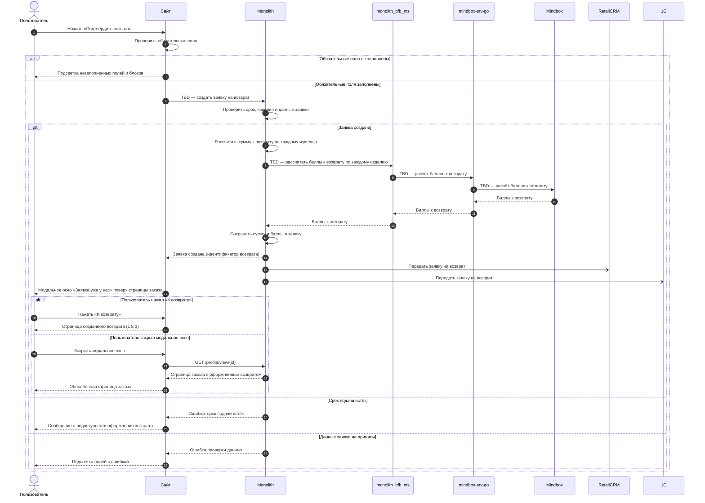

### Логика сценария

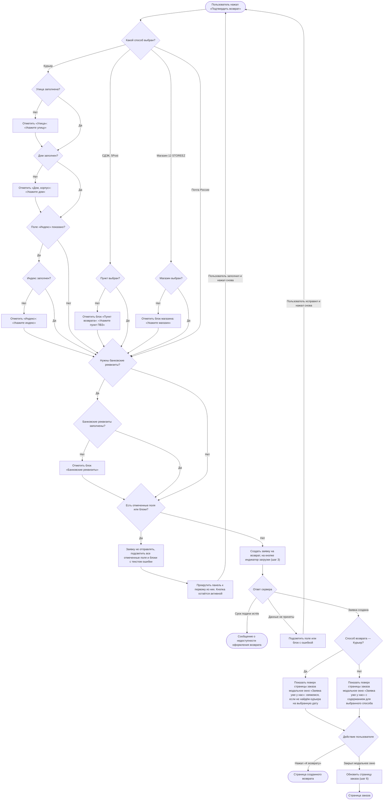

### Логика бэкенда

**`POST /создать заявку на возврат` (TBD) — новый метод**

* логика — [SRS МП, US 1.5](./srs-mobile-mvp.md)

### Задачи

| Название | Ссылка |
|---|---|

### Скачать пустой бланк заявления без авторизации US 1.6

Как неавторизованный покупатель, я хочу скачать пустой бланк заявления на возврат, чтобы распечатать и заполнить его вручную для возврата товара через розничный магазин без входа в личный кабинет

### Сценарий

#### Предусловие

1. Пользователь не авторизован
2. Пользователь находится в блоке «Вернуть в розничный магазин 12 STOREEZ» на странице правил возврата

#### Основная последовательность "Скачать пустой бланк заявления без авторизации"

| Шаг | Исполнитель | Описание |
|---|---|---|
| 1 | Пользователь | Нажимает на ссылку «скачайте его по этой ссылке» |
| 2 | Сайт | Сохранить PDF-файл бланка заявления на возврат на устройство пользователя |

### Задачи

| Название | Ссылка |
|---|---|

## Просмотр возвратов

### Просмотреть список возвратов US 2

Как авторизованный клиент, я хочу видеть список оформленных возвратов, чтобы находить нужную заявку на возврат, понимать текущее состояние и перейти к подробной информации

### Дизайн

Макеты: [web/v1 После создания возврата (просмотр и раздел возвратов)](<../../sources/mockups/web/v1 После создания возврата (просмотр и раздел возвратов)/>), макеты 8, 9

### Сценарий

#### Предусловие

1. Пользователь авторизован

#### Основная последовательность "Просмотреть список возвратов"

| Шаг | Исполнитель | Описание |
|---|---|---|
| 1 | Пользователь | Открывает страницу «Возврат заказов» из пункта «Возврат заказов» в меню профиля |
| 2 | Сайт | Вызвать метод `GET /получить список возвратов` (TBD) |
| 3 | Сайт | Отобразить список возвратов по макету<br><br>**Опционально**<br>1. Если у пользователя нет оформленных возвратов, то отобразить сообщение об их отсутствии и кнопку перехода в каталог |
| 4 | Пользователь | Выбирает возврат |
| 5 | Сайт | Открыть страницу возврата (US 3) |

**Примечание**

1. Статус возврата показывается под клиентским названием, которое задаётся в админке. Если у нескольких внутренних статусов одно клиентское название, клиент видит их как один статус.

### Взаимодействие компонентов

```mermaid
sequenceDiagram
    autonumber
    actor U as Пользователь
    participant WEB as Сайт
    participant MON as Monolith

    U->>WEB: Открыть страницу «Возврат заказов»
    WEB->>MON: TBD — получить список возвратов
    MON-->>WEB: Список возвратов
    WEB-->>U: Список возвратов или сообщение об их отсутствии
```

### Логика бэкенда

**`GET /получить список возвратов` (TBD) — новый метод**

* логика — [SRS МП, US 2](./srs-mobile-mvp.md)

### Задачи

| Название | Ссылка |
|---|---|

### Просмотреть детальную информацию по заявке на возврат US 3

Как клиент, оформивший возврат, я хочу иметь полный доступ к информации и материалам по своей заявке, чтобы легко контролировать статус возврата на каждом этапе и оперативно получать нужные данные без обращения в поддержку

### Дизайн

Макеты: [web/v1 После создания возврата (просмотр и раздел возвратов)](<../../sources/mockups/web/v1 После создания возврата (просмотр и раздел возвратов)/>), макеты 1–7

### Сценарий

#### Предусловие

1. Заявка на возврат создана

#### Основная последовательность "Просмотреть детальную информацию по заявке на возврат"

| Шаг | Исполнитель | Описание |
|---|---|---|
| 1 | Пользователь | Открывает страницу возврата |
| 2 | Сайт | Вызвать метод `GET /получить детальную информацию по заявке на возврат` (TBD) |
| 3 | Сайт | Отобразить страницу возврата по макету<br><br>**Опционально**<br>1. Если для способа возврата не задан текст «Что дальше», то блок не отображать<br>2. Если способ возврата — СДЭК, 5Post или Магазин 12 STOREEZ, то отобразить кнопку «Смотреть на карте»<br>3. Если способ возврата — Магазин 12 STOREEZ, то отобразить кнопку «Показать QR-код» |
| 4 | Сайт | Обработать действие пользователя на странице<br><br>**Опционально**<br>1. Если пользователь нажал «Копировать» рядом с номером возврата, то скопировать номер в буфер обмена и показать уведомление «Номер возврата скопирован»<br>2. Если пользователь нажал «Смотреть на карте», то открыть карту с точкой передачи из заявки. Изменить точку нельзя<br>3. Если пользователь нажал «Показать QR-код», то отобразить модальное окно с QR-кодом заявки |

**Примечание**

1. Дата и интервал курьера на странице — выбранные при оформлении. Если их согласовал или перенёс Отдел дружбы с клиентами, показываются новые. Если клиент сам договорился с курьером о переносе, на странице остаются прежние.
2. Дата «Вернуть до» — срок передачи изделий в точку сдачи, сохранённый при создании заявки.
3. Если дата «Вернуть до» прошла, заявка не отменяется автоматически (автоотмена — Post-MVP). Если через 30 дней после создания изделия не поступили на склад или в магазин, заявка переходит в статус «Подтверждение возврата» и её обрабатывает Отдел дружбы с клиентами.
4. Срок возврата денег клиенту сообщается в тексте «Что дальше» из админки. Компания отправляет деньги в течение 3 дней: при возврате в магазин — от приёмки в магазине, для остальных способов — от поступления на склад. Клиенту сообщается только срок отправки, одной формулировкой для всех способов оплаты: срок зачисления зависит от банка. Поэтому текст для магазина отличается от текста для остальных способов.
5. Изменить заявку (способ возврата, точку, дату и интервал курьера) клиент на сайте не может. Изменения вносит Отдел дружбы с клиентами по обращению клиента.
6. Статус возврата показывается под клиентским названием, которое задаётся в админке. Если у нескольких внутренних статусов одно клиентское название, клиент видит их как один статус.
7. QR-код можно показать с экрана, без печати и без интернета.
8. Если клиент не может показать QR-код, сотрудник магазина находит заявку по ФИО, номеру телефона или номеру заказа.

### Взаимодействие компонентов

```mermaid
sequenceDiagram
    autonumber
    actor U as Пользователь
    participant WEB as Сайт
    participant MON as Monolith
    participant MAP as Карта

    U->>WEB: Открыть страницу возврата
    WEB->>MON: TBD — получить детальную информацию по заявке на возврат
    MON-->>WEB: Данные заявки
    WEB-->>U: Страница возврата

    opt Смотреть на карте
        U->>WEB: Нажать «Смотреть на карте»
        WEB->>MAP: Открыть точку передачи из заявки
        MAP-->>U: Точка на карте
    end

    opt Показать QR-код
        U->>WEB: Нажать «Показать QR-код»
        WEB-->>U: Модальное окно с QR-кодом заявки
    end
```

### Логика бэкенда

**`GET /получить детальную информацию по заявке на возврат` (TBD) — новый метод**

* логика — [SRS МП, US 3](./srs-mobile-mvp.md)

### Задачи

| Название | Ссылка |
|---|---|

### Получить документы и QR-код возврата US 3.1

Как клиент, оформивший возврат, я хочу получать в карточке возврата заявление, кассовый чек возврата и QR-код для сдачи в магазине, чтобы сдать изделия в розничном магазине по заявке и иметь под рукой документы по возврату без обращения в поддержку

### Дизайн

Макеты: [web/v1 После создания возврата (просмотр и раздел возвратов)](<../../sources/mockups/web/v1 После создания возврата (просмотр и раздел возвратов)/>), макеты 1–7

### Сценарий

#### Предусловие

1. Пользователь находится на странице возврата (US 3)

#### Основная последовательность "Скачать заявление на возврат"

| Шаг | Исполнитель | Описание |
|---|---|---|
| 1 | Сайт | Отобразить на странице возврата кнопку «Скачать заявление»<br><br>**Опционально**<br>1. Если кассовый чек возврата сформирован, то отобразить кнопку «Скачать чек». См. альтернативную последовательность "Скачать чек" |
| 2 | Пользователь | Нажимает «Скачать заявление» |
| 3 | Сайт | Вызвать метод `GET /получить заявление на возврат` (TBD) |
| 4 | Сайт | Сохранить PDF-файл заявления на устройство |

#### Альтернативная последовательность "Скачать чек"

| Шаг | Исполнитель | Описание |
|---|---|---|
| 1 | Пользователь | Нажимает «Скачать чек» |
| 2 | Сайт | Вызвать метод `GET /получить кассовый чек возврата` (TBD) |
| 3 | Сайт | Сохранить файл чека на устройство |

### Взаимодействие компонентов

```mermaid
sequenceDiagram
    autonumber
    actor U as Пользователь
    participant WEB as Сайт
    participant MON as Monolith

    opt Скачать заявление
        U->>WEB: Нажать «Скачать заявление»
        WEB->>MON: TBD — получить заявление на возврат
        MON-->>WEB: PDF заявления
        WEB-->>U: Файл заявления на устройстве
    end

    opt Скачать чек
        U->>WEB: Нажать «Скачать чек»
        WEB->>MON: TBD — получить кассовый чек возврата
        MON-->>WEB: Файл чека
        WEB-->>U: Файл чека на устройстве
    end
```

### Логика бэкенда

**`GET /получить заявление на возврат` (TBD) — новый метод**

* логика — [SRS МП, US 3.1](./srs-mobile-mvp.md)

**`GET /получить кассовый чек возврата` (TBD) — новый метод**

* логика — [SRS МП, US 3.1](./srs-mobile-mvp.md)

### Задачи

| Название | Ссылка |
|---|---|

### Отменить заявку на возврат US 4

Как клиент, оформивший заявку на возврат, я хочу иметь возможность самостоятельно отменить созданную заявку, чтобы не возвращать товар, если я передумал, или оформить новую заявку, если допустил ошибку (выбрал не тот товар или способ сдачи)

### Дизайн

Макеты: [web/v1 После создания возврата (просмотр и раздел возвратов)](<../../sources/mockups/web/v1 После создания возврата (просмотр и раздел возвратов)/>), макеты 1–5, 10

### Сценарий

#### Предусловие

1. Пользователь находится на странице возврата (US 3)

#### Основная последовательность "Отменить заявку на возврат"

| Шаг | Исполнитель | Описание |
|---|---|---|
| 1 | Сайт | Отобразить возможность отменить заявку, если в ответе метода `GET /получить детальную информацию по заявке на возврат` (TBD, US 3) `can_be_cancelled = true` (TBD)<br><br>**Опционально**<br>1. Если `can_be_cancelled = false`, то возможность отмены не отображать |
| 2 | Пользователь | Инициирует отмену возврата |
| 3 | Сайт | Запросить подтверждение отмены<br><br>**Опционально**<br>1. Если пользователь отказался от отмены, то вернуть его на страницу возврата без изменения статуса заявки |
| 4 | Пользователь | Подтверждает отмену |
| 5 | Сайт | Вызвать метод `POST /отменить заявку на возврат` (TBD) |
| 5.1 | Бэкенд | Отменить заявку: перевести её в статус «Возврат отменён» и вернуть позициям заказа статус, который был до создания заявки<br><br>**Опционально**<br>1. Если заявка в статусе, в котором отмена запрещена, то заявку не отменять и вернуть ошибку |
| 6 | Сайт | Отобразить статус заявки «Возврат отменён»<br><br>**Опционально**<br>1. Если бэкенд вернул ошибку отмены, то отобразить сообщение о невозможности отмены возврата |

**Примечание**

1. Изделия из отменённой заявки снова доступны для оформления возврата, если срок возврата не истёк (US 1.1).

### Взаимодействие компонентов

```mermaid
sequenceDiagram
    autonumber
    actor U as Пользователь
    participant WEB as Сайт
    participant MON as Monolith
    participant RCRM as RetailCRM
    participant ONEC as 1C

    U->>WEB: Подтвердить отмену заявки
    WEB->>MON: TBD — отменить заявку на возврат
    alt Отмена выполнена
        MON-->>WEB: Заявка отменена
        MON-)RCRM: Передать отмену заявки
        MON-)ONEC: Передать отмену заявки
        WEB-->>U: Статус «Возврат отменён»
    else Статус заявки не допускает отмену
        MON-->>WEB: Ошибка: отмена невозможна
        WEB-->>U: Сообщение о невозможности отмены возврата
    end
```

### Логика бэкенда

**`POST /отменить заявку на возврат` (TBD) — новый метод**

* логика — [SRS МП, US 4](./srs-mobile-mvp.md)

### Задачи

| Название | Ссылка |
|---|---|
