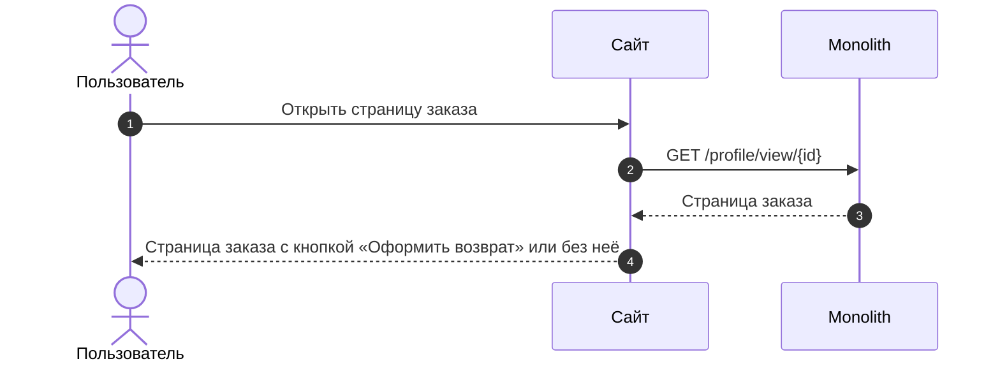
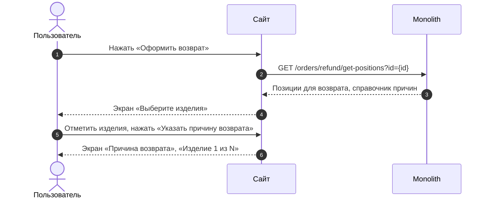
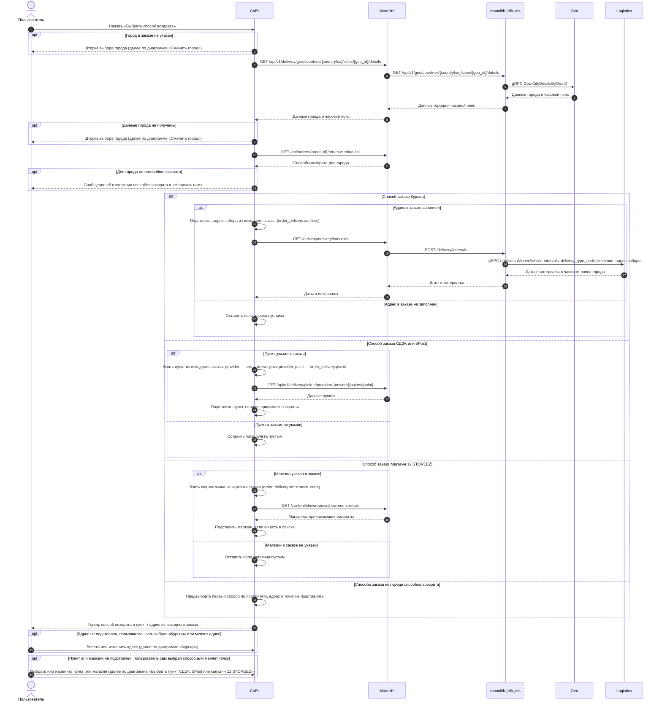
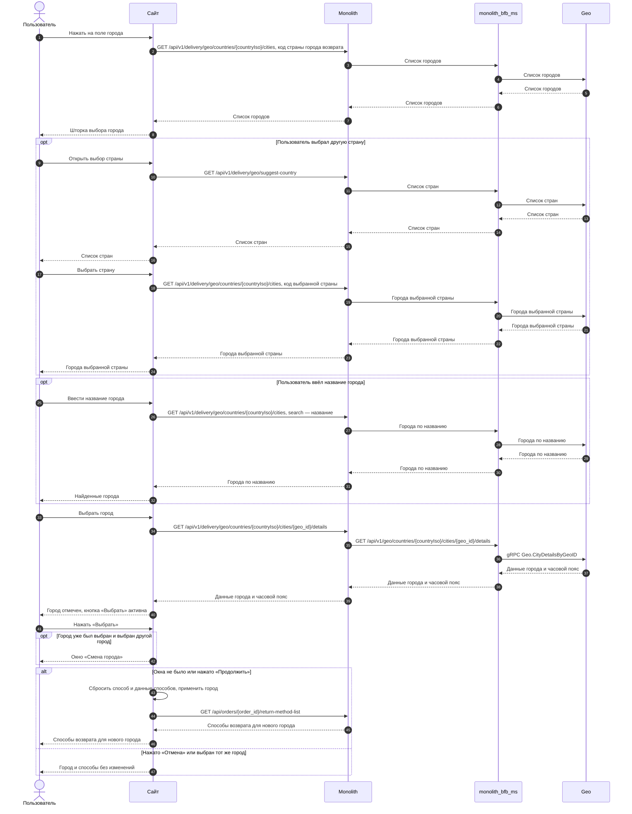
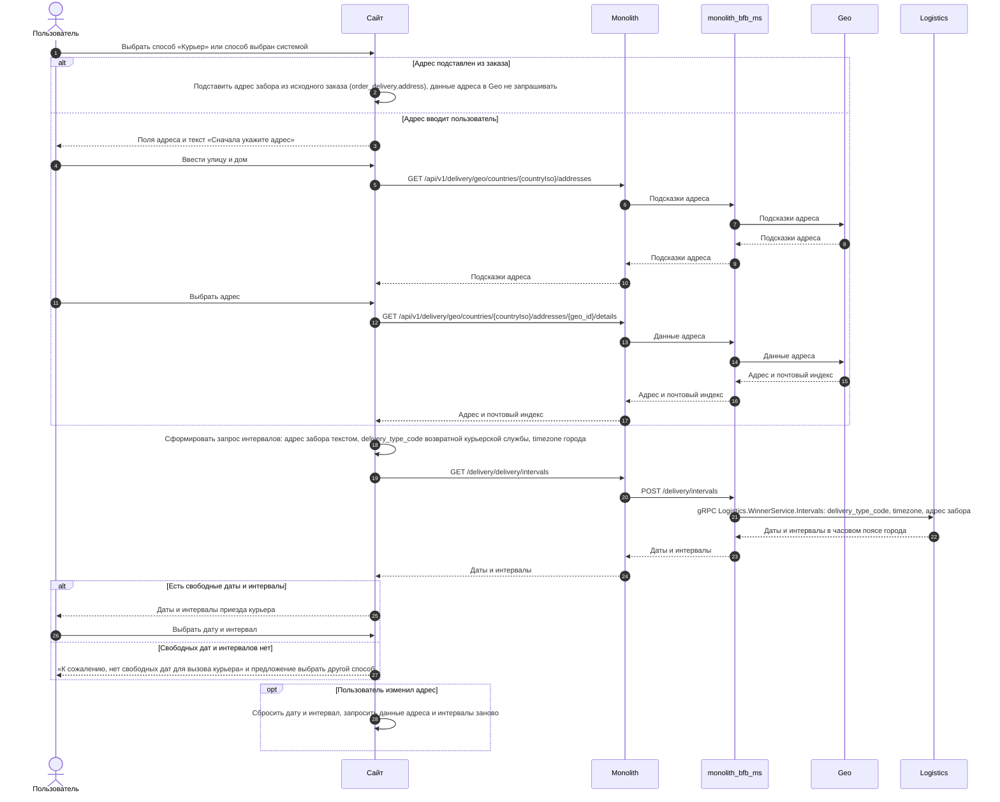
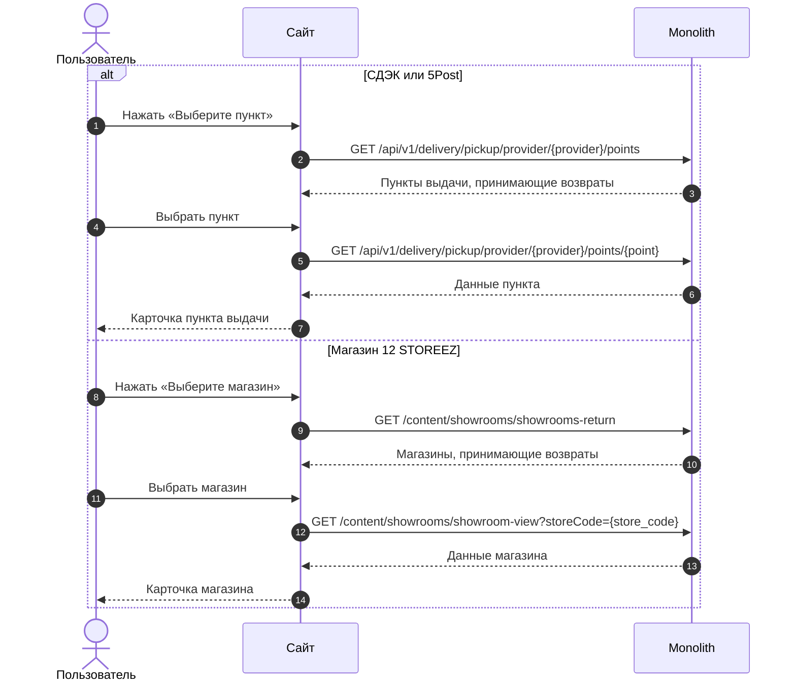
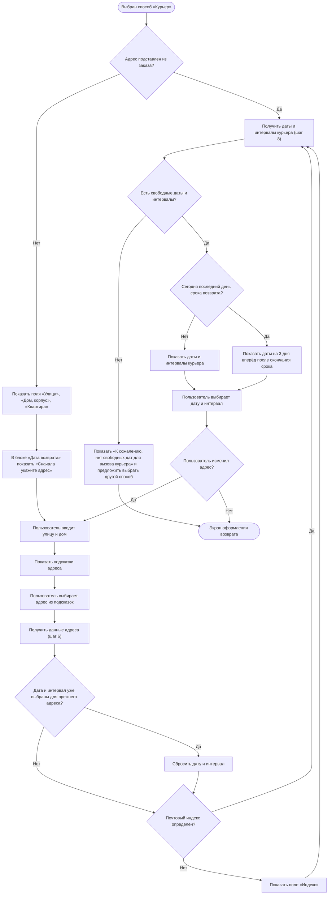
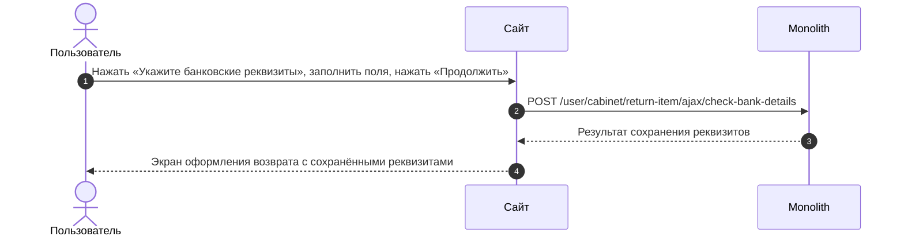

# SRS: Возвраты 2.0 — сайт, MVP

## Полезные материалы

| Название | Ссылка |
|---|---|
| BRD / ТЗ | [brd.md](../brd.md) |
| Epic | ECOMDEV-2246 [MVP] Возвраты, ECOMDEV-2256 [Post-MVP] Возвраты — [user-story-mvp.md](../user-story/user-story-mvp.md) |
| Макеты | [v2 Создание возврата](<../../sources/mockups/v2 Создание возврата/>) |
| Макеты | [v2.1 После создания возврата (просмотр и раздел возвратов)](<../../sources/mockups/v2.1 После создания возврата (просмотр и раздел возвратов)/>) |
| API-документация | [reference/api/web/](../../as-is/api/) |
| API-документация | [[B][Web] order-card-return_task-v2.md](<../backend/US-01/[B][Web] order-card-return_task-v2.md>), [[B][Web] refund-get-positions_task-v2.md](<../backend/US-01/[B][Web] refund-get-positions_task-v2.md>) |
| ADR / решения | [adr/](../adr/) |
| Другие материалы | [Use Case](../use-case/use-case.md), [Спецификация экранов](../screen-spec/screen-spec.md), [TO-BE шаги сайта](../steps/web/) |
| Другие материалы | [SRS мобильного приложения, MVP](./srs-mobile-mvp.md) |
| Другие материалы | [SRS сайта, Post-MVP](./srs-web-post-mvp.md) |

---

# User Story

## Оформление возврата

### US 1.1. Условия отображения кнопки возврата заказа

**Как** клиент, совершивший покупку, **я хочу** иметь возможность начать оформление возврата из карточки заказа, **чтобы** самостоятельно оформить возврат без обращения в поддержку.

### Дизайн

Макеты: [v2 Создание возврата](<../../sources/mockups/v2 Создание возврата/>)

### Сценарий

#### Основная последовательность «Условия отображения кнопки возврата заказа»

| Шаг | Исполнитель | Описание |
|---:|---|---|
| 1 | Пользователь | Открывает страницу заказа |
| 2 | Сайт | Получает данные страницы заказа (`GET /profile/view/{id}`) |
| 3 | Бэкенд | Определяет категорию клиента (`cms_users_user.is_vic`) |
| 4 | Бэкенд | Проверяет, что с даты получения заказа прошло <= 14 дней для обычного клиента (`cms_users_user.is_vic = 0`) или <= 30 дней для клиента F&F (`cms_users_user.is_vic = 1`) |
| 5 | Бэкенд | Проверяет заявки на возврат по позициям заказа |
| 6 | Бэкенд | Определяет, что хотя бы для одной позиции заказа нет активной заявки на возврат (!= "Отменен") |
| 7 | Сайт | Отображает кнопку «Оформить возврат» в активном состоянии |
| 8 | Бэкенд | Рассчитывает дату, до которой можно оформить заявку: «дата получения заказа + 14 дней» для обычного клиента, «дата получения заказа + 30 дней» для клиента F&F |
| 9 | Сайт | Отображает под кнопкой текст «Можно вернуть изделия до [Дата]» и кликабельную ссылку «Правила возврата» |

##### Опционально

1. Шаг 6. Если заявки на возврат для всех позиций заказа отсутствуют, то кнопка оформления возврата отображается и активна.
2. Шаг 6. Если в заказе есть позиция, на которую ещё не оформлен возврат, и хотя бы для одной позиции есть активная заявка (!= "Отменен"), то кнопка оформления возврата отображается и активна.
3. Шаг 6. Если для позиции есть заявка в статусе "Отменен" и для этой позиции отсутствуют другие активные заявки (!= "Отменен"), то кнопка оформления возврата отображается и активна.
4. Шаг 4. Если с даты получения заказа прошло > 14 дней для обычного клиента или > 30 дней для клиента F&F, то кнопка оформления возврата не отображается.
5. Шаг 6. Если для всех позиций заказа есть активные заявки на возврат (!= "Отменен"), то кнопка оформления возврата не отображается.

### Взаимодействие компонентов

### Задачи

| Название | Ссылка |
|---|---|

---

### US 1.2. Выбор изделий и причин возврата

**Как** клиент, оформляющий возврат, **я хочу** выбрать одно или несколько изделий из заказа и указать причину возврата для каждого выбранного изделия, **чтобы** сформировать возврат только для тех изделий, которые я хочу вернуть.

### Дизайн

Макеты: [v2 Создание возврата](<../../sources/mockups/v2 Создание возврата/>)

### Сценарий

#### Предусловия

1. Кнопка «Оформить возврат» отображается и активна.

#### Основная последовательность «Выбор изделий и причин возврата»

| Шаг | Исполнитель | Описание |
|---:|---|---|
| 1 | Пользователь | Нажимает кнопку «Оформить возврат» |
| 2 | Сайт | Получает позиции заказа, доступные для возврата, и справочник причин возврата (`GET /orders/refund/get-positions?id={id}`) |
| 2.1 | Бэкенд | Возвращает позиции заказа, доступные для возврата, и активные группы причин в заданном порядке, в каждой группе — активные причины в заданном порядке. Группа без активных причин возвращается с пустым списком причин |
| 3 | Сайт | Отображает экран «Выберите изделия»: только позиции без заявок на возврат или со статусом заявки = "Отменен" |
| 4 | Сайт | Отображает каждую единицу позиции заказа с количеством >= 2 как отдельное изделие |
| 5 | Сайт | Отображает кофр или подарок отдельной позицией заказа, не выбранной автоматически в состав заявки на возврат |
| 6 | Сайт | Отображает предупреждение о необходимости вернуть изделия в полной комплектации |
| 7 | Пользователь | Отмечает чекбоксом N изделий |
| 8 | Сайт | Меняет заголовок экрана на «Выберите изделия · N» и делает кнопку «Указать причину возврата» активной |
| 9 | Пользователь | Нажимает «Указать причину возврата» |
| 10 | Сайт | Открывает экран «Причина возврата» с подзаголовком «Изделие 1 из N» |
| 11 | Пользователь | Выбирает группу причин из выпадающего списка |
| 12 | Сайт | Отображает детализированный список причин (радио-баттоны) |
| 13 | Пользователь | Выбирает конкретную причину из списка |
| 14 | Сайт | Переходит к «Изделию 2 из N»; шаги 11–13 повторяются для каждого выбранного изделия |
| 15 | Сайт | Делает кнопку «Выбрать способ возврата» активной |

##### Опционально

1. Шаг 7. Если клиент не выбрал ни одного изделия, то кнопка «Указать причину возврата» находится в неактивном состоянии.
2. Шаг 15. Если причина возврата указана не для всех выбранных изделий, то кнопка «Выбрать способ возврата» неактивна.
3. Шаг 12. Если у выбранной группы нет причин, то выбор группы считается выбором причины, и система переходит к шагу 14.

### Взаимодействие компонентов

### Задачи

| Название | Ссылка |
|---|---|

---

### US 1.3. Выбор способа возврата

**Как** клиент, оформляющий возврат, **я хочу** выбрать способ возврата товаров, **чтобы** успешно завершить оформление заявки на возврат.

### Дизайн

Макеты: [v2 Создание возврата](<../../sources/mockups/v2 Создание возврата/>)

### Сценарий

#### Предусловия

1. Клиент указал причины возврата для выбранных позиций.
2. Клиент оформляет возврат в городе исходного заказа; способ и адрес доставки исходного заказа доступны для сценария возврата.

#### Основная последовательность «Выбор способа возврата»

| Шаг | Исполнитель | Описание |
|---:|---|---|
| 1 | Пользователь | Нажимает кнопку «Выбрать способ возврата» |
| 2 | Сайт | Определяет город возврата из данных заказа |
| 3 | Сайт | Получает данные города (`GET /api/v1/delivery/geo/countries/{countryIso}/cities/{geo_id}/details`); из ответа берёт часовой пояс города `timezone` — он передаётся в запрос дат и интервалов курьера |
| 4 | Сайт | Получает способы возврата для города (`GET /api/orders/{order_id}/return-method-list`) |
| 5 | Сайт | Отображает только способы возврата, применимые к этому городу |
| 6 | Сайт | Автоматически выбирает способ возврата, соответствующий исходному заказу |
| 7 | Сайт | Предзаполняет адрес возврата данными из исходного заказа; для Курьера — подставляет адрес забора из исходного заказа (`order_delivery.address`), далее — шаги 7–9 альтернативной последовательности «Курьер» с адресом из заказа; для СДЭК / 5Post — подставляет пункт выдачи из исходного заказа (`GET /api/v1/delivery/pickup/provider/{provider}/points/{point}`); для Магазина 12 STOREEZ — подставляет магазин из исходного заказа, если он есть в списке магазинов, принимающих возвраты (`GET /content/showrooms/showrooms-return` (новый метод)) |
| 8 | Бэкенд | Для способов СДЭК, 5Post, Магазин 12 STOREEZ, Почта России рассчитывает дату сдачи «дата оформления заявки + 10 календарных дней» и возвращает её в ответе метода получения способов возврата для города |
| 8.1 | Сайт | Отображает для этих способов текст «Вернуть до [рассчитанная дата]» |

##### Опционально

**Альтернативные сценарии**

1. Шаг 5. Если клиент открыл шторку выбора города и закрыл её, не выбрав город, то клиент остаётся на экране оформления возврата с ранее выбранным городом и способами возврата; экрана с призывом «Укажите город» нет.
2. Шаг 2. Если клиент нажимает на поле города, то см. альтернативную последовательность «Сменить город».
3. Шаг 5. Если клиент выбирает другой город при заполненном городе возврата, то система отображает модальное окно «Смена города» с предупреждением о сбросе способа возврата и кнопками «Продолжить» и «Отмена».
4. Альтернатива 3. Если клиент нажимает «Продолжить», то ранее выбранный способ возврата и все введённые для способов данные (адрес, дата и интервал, точка передачи) сбрасываются, система применяет новый город, отображает доступные для него способы возврата и автоматически выбирает первый по приоритету способ возврата.
5. Альтернатива 3. Если клиент нажимает «Отмена», то модальное окно закрывается, и клиент возвращается на экран выбора способа возврата без изменения данных.
6. Шаг 6. Если способ доставки исходного заказа недоступен для возврата и для города доступен хотя бы один другой способ, то система автоматически выбирает первый доступный способ возврата по приоритету.
7. Шаг 6. Если клиент оформляет возврат в городе, отличном от города исходного заказа, и для города доступны способы возврата, то система автоматически выбирает первый доступный способ возврата по приоритету.
8. Шаг 7. Если способ доставки исходного заказа доступен для возврата, а конкретная точка или адрес из исходного заказа недоступны, то система выбирает способ, соответствующий исходному заказу, и оставляет поле адреса или точки возврата незаполненным.
9. Шаг 7. Если клиент снова выбирает город исходного заказа после смены города, то система не подставляет адрес и точку возврата из исходного заказа: данные были сброшены при смене города, клиент заполняет их заново.
10. Шаг 7. Если клиент в городе исходного заказа вручную сменил способ возврата, а затем снова выбрал способ, соответствующий исходному заказу, то система предзаполняет адрес возврата данными из исходного заказа, если клиент не изменял его для этого способа.
11. Шаг 6. Если клиент выбирает способ «Курьер», то система отображает поля для ввода адреса (Улица, Дом, Квартира), выбора даты и временного интервала (см. альтернативную последовательность «Курьер»); пока улица или дом не заполнены, вместо выбора даты и интервала отображается текст «Сначала укажите адрес»; после ввода улицы и дома система отображает доступные даты и интервалы (квартира не влияет); после заполнения адреса и выбора даты и интервала данные курьерской доставки считаются корректно заполненными.
12. Альтернатива 11. Если клиент оформляет возврат в последний допустимый день срока (14-й день для всех клиентов), то календарь отображает даты приезда курьера на 3 дня вперёд за пределы основного срока возврата (технический буфер курьерского канала), и клиент может выбрать любую из них.
13. Шаг 7. Если для способа СДЭК / 5Post точка возврата не выбрана, то система отображает кнопку «Выберите пункт»; для Магазина 12 STOREEZ — «Выберите магазин».
14. Альтернатива 13. Если клиент нажимает «Выберите пункт» / «Выберите магазин», выбирает доступную точку на карте или из списка (СДЭК / 5Post — `GET /api/v1/delivery/pickup/provider/{provider}/points` (доработка метода): по признаку возврата отображаются только пункты, принимающие возвраты; магазин — `GET /content/showrooms/showrooms-return` (новый метод)) и подтверждает выбор в детальной карточке точки (СДЭК / 5Post — `GET /api/v1/delivery/pickup/provider/{provider}/points/{point}`; магазин — `GET /content/showrooms/showroom-view?storeCode={store_code}`), то система возвращает клиента на экран оформления возврата и отображает адрес выбранной точки. Детальная карточка магазина содержит название, адрес, как добраться, время работы, телефон и парковку (поле без данных не выводится); срок доставки и срок возврата не показываются.
15. Шаг 7. Если клиент нажимает «Изменить» в блоке точки возврата, выбирает новую точку и подтверждает выбор, то система обновляет адрес выбранной точки на экране оформления возврата.
16. Шаг 7. Если клиент выбрал точку или ввёл адрес, дату и интервал для способа, переключился на другой способ в том же городе и снова выбрал прежний способ, то система показывает ранее выбранную точку или введённые данные.
17. Шаг 5. Если возврат оформляется для города «Калининград» или Калининградской области, то способ «Почта России» отображается в списке доступных способов; для других городов РФ — не отображается.
18. Шаг 6. Если клиент выбирает способ «Почта России», то система отображает инструкцию по возврату, адрес склада для отправки и ссылку «Пункты Почты России»; по нажатию на ссылку открывается карта отделений (Калининград и Калининградская область) на внешнем ресурсе Почты России в браузере или приложении.

**Ошибочные сценарии**

19. Шаг 5. Если для выбранного города отсутствуют доступные способы возврата, то система отображает сообщение об отсутствии доступных способов возврата и кнопку «Написать нам»; поле выбора города остаётся доступным для нажатия.
20. Альтернатива 11. Если у курьерской службы отсутствуют свободные даты или интервалы, то система отображает сообщение «К сожалению, нет свободных дат для вызова курьера» и предлагает выбрать другой способ возврата.
21. Альтернатива 11. Если почтовый индекс не определён — геосервис не вернул индекс по выбранному адресу, дом не найден или геосервис недоступен (`GET /api/v1/delivery/geo/countries/{countryIso}/addresses/{geo_id}/details`), то система отображает дополнительное поле «Индекс»; при нажатии «Подтвердить возврат» с незаполненным индексом система не отправляет заявку и подсвечивает поле «Индекс» красным контуром с текстом «Укажите индекс».

#### Альтернативная последовательность «Сменить город»

| Шаг | Исполнитель | Описание |
|---:|---|---|
| 1 | Пользователь | Нажимает на поле города |
| 2 | Сайт | Вызвать метод `GET /получить список городов` (`GET /api/v1/delivery/geo/countries/{countryIso}/cities`) с кодом страны города возврата, без поискового запроса  Опционально 1. Если страна города возврата не передана, то использовать страну по умолчанию — Россия |
| 3 | Сайт | Отобразить шторку «Выберите город»: кнопку страны с текущей страной, поле поиска «Название города...», список городов страны и неактивную кнопку «Выбрать» |
| 3.1 | Пользователь | Нажимает на кнопку страны |
| 3.2 | Сайт | Вызвать метод `GET /получить список стран` (`GET /api/v1/delivery/geo/suggest-country`) и отобразить окно выбора страны со списком стран и поиском по названию |
| 3.3 | Пользователь | Выбирает страну |
| 3.4 | Сайт | Вызвать метод `GET /получить список городов` (`GET /api/v1/delivery/geo/countries/{countryIso}/cities`) с кодом выбранной страны и отобразить в шторке выбранную страну и её города |
| 3.5 | Пользователь | Вводит название города в поле поиска |
| 3.6 | Сайт | Вызвать метод `GET /получить список городов` (`GET /api/v1/delivery/geo/countries/{countryIso}/cities`) с кодом страны и введённым названием и отобразить найденные города. Запрос отправляется, когда введено больше одного символа |
| 4 | Пользователь | Выбирает город в списке: среди городов страны или среди найденных по поиску. Сменить страну (шаги 3.1–3.4) и искать город (шаги 3.5–3.6) необязательно |
| 5 | Сайт | Вызвать метод `GET /получить данные города` (`GET /api/v1/delivery/geo/countries/{countryIso}/cities/{geo_id}/details`), отметить выбранный город в списке и сделать кнопку «Выбрать» активной. Из ответа взять часовой пояс города `timezone` — он передаётся в запрос дат и интервалов курьера |
| 6 | Пользователь | Нажимает «Выбрать» |
| 7 | Сайт | Закрыть шторку. Далее — альтернативный сценарий 3 (окно «Смена города»), затем шаг 4 основной последовательности с выбранным городом |

#### Альтернативная последовательность «Курьер»

| Шаг | Исполнитель | Описание |
|---:|---|---|
| 1 | Пользователь | Выбирает способ «Курьер», или способ выбран системой на шаге 6 основной последовательности |
| 2 | Сайт | Отобразить поля адреса: «Улица», «Дом, корпус», «Квартира». Пока не заполнены улица и дом, в блоке «Дата возврата» вместо выбора даты и интервала отобразить текст «Сначала укажите адрес» |
| 3 | Пользователь | Вводит улицу и дом |
| 4 | Сайт | Вызвать метод `GET /получить подсказки адреса` (`GET /api/v1/delivery/geo/countries/{countryIso}/addresses`) по введённому тексту и отобразить подсказки |
| 5 | Пользователь | Выбирает адрес из подсказок |
| 6 | Сайт | Вызвать метод `GET /получить данные адреса` (`GET /api/v1/delivery/geo/countries/{countryIso}/addresses/{geo_id}/details`)  Опционально 1. Если почтовый индекс не определён — геосервис не вернул индекс по выбранному адресу, дом не найден или геосервис недоступен, — то отобразить поле «Индекс» для ручного ввода 2. Если дата и интервал уже были выбраны для прежнего адреса, то сбросить их |
| 7 | Сайт | Сформировать параметры запроса дат и интервалов: — адрес забора — текстом: улица, дом, корпус, квартира, индекс — подставленный из заказа или введённый пользователем; передаётся как адрес отправки, а не как адрес доставки; — код типа доставки `delivery_type_code` — свой код возвратной курьерской службы, по аналогии с кодом типа доставки заказа; берётся из способа «Курьер» в ответе метода получения способов возврата для города (шаг 4 основной последовательности); — часовой пояс `timezone` — из ответа метода получения данных города (шаг 3 основной последовательности или данные города, выбранного при смене города) |
| 8 | Сайт | Вызвать метод `GET /получить даты и интервалы курьера` (`GET /delivery/delivery/intervals`, доработка метода): адрес забора, `delivery_type_code` и `timezone` из шага 7 |
| 9 | Сайт | Отобразить даты и интервалы приезда курьера из ответа метода `GET /получить даты и интервалы курьера`  Опционально 1. Если сегодня последний день срока возврата, то отобразить даты на 3 дня вперёд после окончания срока, любую из них можно выбрать 2. Если свободных дат или интервалов нет, то отобразить сообщение «К сожалению, нет свободных дат для вызова курьера» и предложить выбрать другой способ возврата |
| 10 | Пользователь | Выбирает дату и интервал |

**Примечание**

1. В MVP даты и интервалы курьера для возврата приходят только от СДЭК и только по населённым пунктам РФ.
2. Часовой пояс города `timezone` передаётся в запрос дат и интервалов курьера всегда — и когда интервалы приходят от транспортной компании, и когда включены ручные интервалы логистики. Транспортная компания определяет часовой пояс по адресу сама, а ручные интервалы логистика считает по переданному часовому поясу; если он не передан, интервалы считаются по московскому времени (UTC+03:00). Часовой пояс приходит в ответе метода получения данных города, поэтому данные города запрашиваются и тогда, когда город подставлен из заказа. Данные города можно брать из кеша на бэке: если города в кеше нет, они запрашиваются у геосервиса и сохраняются в кеш.

### Взаимодействие компонентов

**Основная последовательность «Выбор способа возврата»**

**Сменить город**

**Альтернативная последовательность «Курьер»**

**Выбрать пункт СДЭК, 5Post или магазин 12 STOREEZ**

### Логика сценария

**Альтернативная последовательность «Курьер»**

### Задачи

| Название | Ссылка |
|---|---|

---

### US 1.4. Определение способа возврата денежных средств

**Как** клиент, оформляющий возврат, **я хочу** понимать, каким способом мне будут возвращены денежные средства, и при необходимости указать банковские реквизиты, **чтобы** получить денежные средства за возвращённые изделия.

### Дизайн

Макеты: [v2 Создание возврата](<../../sources/mockups/v2 Создание возврата/>)

### Сценарий

#### Предусловия

1. Исходный заказ оплачен онлайн (банковская карта, СБП, «Долями» / «Подели») и не оплачивался подарочным сертификатом.

#### Основная последовательность «Определение способа возврата денежных средств»

| Шаг | Исполнитель | Описание |
|---:|---|---|
| 1 | Пользователь | Открывает экран оформления возврата |
| 2 | Сайт | Определяет способ оплаты исходного заказа по данным формы возврата (`GET /orders/refund/get-positions?id={id}`) |
| 2.1 | Бэкенд | Возвращает в данных формы возврата признак `data.need_bank_details` — нужны ли банковские реквизиты: `true` для всех способов оплаты, кроме онлайн-оплаты; текст `data.refund.message` — куда вернутся деньги, если реквизиты не нужны; сумму к возврату за каждое изделие |
| 3 | Сайт | Отображает в блоке «Возврат средств» текст «На банковскую карту, с которой была произведена оплата» |
| 4 | Сайт | Скрывает блок «Банковские реквизиты» |
| 5 | Сайт | Отображает текст «Если вам необходимо получить возврат другим способом или на другие реквизиты, пожалуйста, обратитесь в Отдел дружбы с клиентами» со ссылкой «Отдел дружбы с клиентами» |
| 6 | Сайт | Отображает в блоке «Итого к возврату» рассчитанную для выбранных изделий денежную сумму |
| 7 | Пользователь | Продолжает оформление возврата без ввода дополнительных данных |

##### Опционально

1. Шаг 3. Если исходный заказ оплачен подарочным сертификатом полностью или частично, то текст о возврате на карту не отображается, а отображается блок «Банковские реквизиты» — как при оплате при получении (альтернатива 3); по реквизитам возвращается вся сумма, при частичной оплате — включая онлайн-часть. На сертификат деньги не возвращаются; возврат на сертификат — Post-MVP (US 14).
2. Шаг 5. Если клиент нажимает на ссылку «Отдел дружбы с клиентами», то система открывает окно «Отдел дружбы с клиентами» с часами работы отдела и действиями «Позвонить» и «Написать».
3. Шаг 3. Если исходный заказ оплачен при получении или полностью или частично подарочным сертификатом (`return.is_bank_data_required = true`) и банковские реквизиты ещё не заполнены, то в блоке «Банковские реквизиты» система отображает кнопку «Укажите банковские реквизиты».
4. Альтернатива 3. Если клиент нажимает «Укажите банковские реквизиты», заполняет на экране «Банковские реквизиты» ФИО получателя, название банка, БИК банка и номер лицевого счёта и нажимает «Продолжить», то система сохраняет реквизиты (`POST /user/cabinet/return-item/ajax/check-bank-details`), возвращает клиента на экран оформления возврата и отображает сохранённые реквизиты (ФИО получателя, название банка и номер счёта).
5. Альтернатива 4. Если клиент ранее указывал банковские реквизиты в другой заявке на возврат, то при открытии экрана «Банковские реквизиты» поля не заполнены.
6. Альтернатива 4. Если клиент вводит номер кредитного счёта, начинающийся с «30232810», и поле «Номер банковской карты» пустое, то кнопка «Продолжить» неактивна; после заполнения поля «Номер банковской карты» кнопка становится активной.
7. Альтернатива 4. Если клиент нажимает на блок с заполненными реквизитами, то система открывает экран «Банковские реквизиты» с предзаполненными данными; после изменения и нажатия «Продолжить» система обновляет отображение реквизитов на экране оформления возврата.
8. Шаг 6. Если для оформляемого возврата предусмотрен возврат бонусов или баллов, то система отображает в блоке «Баллы к возврату» количество баллов к возврату.

### Взаимодействие компонентов

### Задачи

| Название | Ссылка |
|---|---|

---

### US 1.5. Подтверждение и создание заявки на возврат

**Как** клиент, **я хочу** отправить заполненную форму и увидеть экран подтверждения заявки, **чтобы** быть уверенным, что мой возврат принят в работу, и легко отслеживать его статус.

### Дизайн

Макеты: [v2 Создание возврата](<../../sources/mockups/v2 Создание возврата/>)

### Сценарий

#### Предусловия

1. Клиент заполнил все обязательные данные оформления возврата.

#### Основная последовательность «Подтверждение и создание заявки на возврат»

| Шаг | Исполнитель | Описание |
|---:|---|---|
| 1 | Пользователь | Подтверждает создание возврата |
| 2 | Бэкенд | Проверяет, что срок подачи заявки не истёк |
| 3 | Бэкенд | Проверяет, что выбранные изделия и способ возврата остаются доступными |
| 4 | Бэкенд | Создаёт заявку на возврат (TBD) |
| 5 | Бэкенд | Делает созданную заявку доступной клиенту для дальнейшего просмотра |

##### Опционально

1. Шаг 2. Если срок подачи заявки истёк, то заявка не создаётся, и система информирует клиента о недоступности оформления возврата.
2. Шаг 4. Если происходит ошибка создания заявки, то заявка не считается созданной, система информирует клиента, что заявку не удалось создать, ранее указанные данные остаются доступными без повторного ввода, и клиент может повторить попытку с шага 1.

### Задачи

| Название | Ссылка |
|---|---|

---

### US 1.6. Скачивание пустого бланка заявления без авторизации

**Как** неавторизованный покупатель, **я хочу** скачать пустой бланк заявления на возврат, **чтобы** распечатать и заполнить его вручную для возврата товара через розничный магазин без входа в личный кабинет.

### Сценарий

#### Предусловия

1. Клиент не авторизован в личном кабинете.
2. Клиент находится в блоке «Вернуть в розничный магазин 12 STOREEZ» на странице правил возврата.

#### Основная последовательность «Скачивание пустого бланка заявления без авторизации»

| Шаг | Исполнитель | Описание |
|---:|---|---|
| 1 | Пользователь | Нажимает на ссылку «скачайте его по этой ссылке» |
| 2 | Сайт | Скачивает бланк заявления на возврат в формате PDF на устройство клиента |

### Задачи

| Название | Ссылка |
|---|---|

---

## Просмотр возвратов

### US 2. Просмотр списка возвратов

**Как** авторизованный клиент, **я хочу** видеть список оформленных возвратов, **чтобы** находить нужную заявку на возврат, понимать текущее состояние и перейти к подробной информации.

### Дизайн

Макеты: [v2.1 После создания возврата (просмотр и раздел возвратов)](<../../sources/mockups/v2.1 После создания возврата (просмотр и раздел возвратов)/>)

### Сценарий

#### Предусловия

1. У клиента есть один или несколько оформленных возвратов в любом статусе.

#### Основная последовательность «Просмотр списка возвратов»

| Шаг | Исполнитель | Описание |
|---:|---|---|
| 1 | Пользователь | Открывает список возвратов |
| 2 | Сайт | Получает список возвратов клиента (TBD) |
| 3 | Сайт | Отображает для каждого возврата информацию, позволяющую идентифицировать возврат и понять его текущее состояние |
| 4 | Пользователь | Открывает выбранный возврат |
| 5 | Сайт | Открывает детальную информацию по заявке |

##### Опционально

1. Шаг 3. Если у клиента нет ни одного оформленного возврата, то система информирует клиента об отсутствии оформленных возвратов и предоставляет возможность перейти к покупкам в каталог.

### Задачи

| Название | Ссылка |
|---|---|

---

### US 3. Просмотр детальной информации по заявке на возврат

**Как** клиент, оформивший возврат, **я хочу** иметь полный доступ к информации и материалам по своей заявке, **чтобы** легко контролировать статус возврата на каждом этапе и оперативно получать нужные данные без обращения в поддержку.

### Дизайн

Макеты: [v2.1 После создания возврата (просмотр и раздел возвратов)](<../../sources/mockups/v2.1 После создания возврата (просмотр и раздел возвратов)/>)

### Сценарий

#### Предусловия

1. Заявка на возврат была ранее успешно создана.

#### Основная последовательность «Просмотр детальной информации по заявке на возврат»

| Шаг | Исполнитель | Описание |
|---:|---|---|
| 1 | Пользователь | Открывает страницу детальной информации по заявке |
| 2 | Сайт | Загружает информацию по заявке (TBD) |
| 3 | Сайт | Отображает карточку возврата по данным заявки |

##### Опционально

1. Шаг 3. Плашка текущего статуса не раскрывается: история статусов — Post-MVP (US 15). Если для способа возврата не задан текст инструкции «Что дальше», блок не отображается.
2. Шаг 3. Если клиент нажимает на иконку «Копировать» рядом с номером возврата, то номер возврата сохраняется в буфер обмена устройства, и система отображает всплывающее уведомление «Номер возврата скопирован».
3. Шаг 3. Если клиент нажимает на карточку товара в блоке «Изделия к возврату», то система перенаправляет клиента на страницу соответствующего товара в каталоге.
4. Шаг 3. Если заявка создана со способом возврата «СДЭК» или «5Post», то система отображает информацию, что код для сдачи (СДЭК — штрихкод и номер накладной; 5Post — QR-код и PIN) будет направлен транспортной компанией по SMS на номер телефона и на email, указанные в заказе.
5. Шаг 3. Если заявка находится в статусе «Отклонен» и по результатам проверки зафиксирована причина отказа, то система отображает статус «Отклонен» и блок с текстом причины отказа.

**Примечание**

1. Карточка возврата содержит текущий статус, инструкцию «Что дальше», способ возврата, способ выплаты и состав изделий. В блоке «Способ возврата» показываются данные выбранного способа: для курьера — адрес забора, дата и интервал приезда курьера; для СДЭК, 5Post и Магазина 12 STOREEZ — точка сдачи и «Вернуть до [дата]»; для Почты России — «Вернуть до [дата]».
2. Дата «Вернуть до» — срок передачи изделий в точку сдачи, сохранённый в заявке при её создании (US 1.5). Это не дата «Можно вернуть изделия до» на странице заказа (US 1.1): та дата — срок, до которого можно оформить заявку.
3. Если дата «Вернуть до» прошла, заявка автоматически не отменяется: автоотмена — Post-MVP (US 5). Если через 30 дней после создания заявки изделия не поступили на склад или в магазин, заявка переходит в статус «Подтверждение возврата», и её обрабатывает Отдел дружбы с клиентами.
4. Статус возврата показывается под клиентским названием, которое задаётся в админке. Если несколько статусов объединены в админке в группу, клиент видит их как один статус с общим названием.

### Задачи

| Название | Ссылка |
|---|---|

---

### US 3.1. Документы и QR-код возврата

**Как** клиент, оформивший возврат, **я хочу** получать в карточке возврата заявление, кассовый чек возврата и QR-код для сдачи в магазине, **чтобы** сдать изделия в розничном магазине по заявке и иметь под рукой документы по возврату без обращения в поддержку.

### Дизайн

Макеты: [v2.1 После создания возврата (просмотр и раздел возвратов)](<../../sources/mockups/v2.1 После создания возврата (просмотр и раздел возвратов)/>)

### Сценарий

#### Предусловия

1. Клиент находится на странице детальной информации по заявке (US 3).

#### Основная последовательность «Документы и QR-код возврата»

| Шаг | Исполнитель | Описание |
|---:|---|---|
| 1 | Сайт | Отображает на странице возврата кнопку «Скачать заявление» |
| 2 | Пользователь | Нажимает «Скачать заявление» |
| 3 | Бэкенд | Формирует заявление в формате PDF на основании данных заявки (TBD) |
| 3.1 | Сайт | Скачивает файл заявления на устройство клиента |

##### Опционально

1. Шаг 1. Если по заявке выполнен возврат денежных средств и сформирован кассовый чек возврата, то система отображает кнопку «Скачать чек»; по нажатию файл кассового чека скачивается на устройство клиента (TBD).
2. Шаг 1. Если заявка создана со способом возврата «Магазин 12 STOREEZ», то система отображает QR-код заявки для приёма изделий в магазине; QR-код можно предъявить с экрана устройства без печати и без подключения к интернету.

**Примечание**

1. Где формируются заявление и кассовый чек возврата и что содержит QR-код, определяется по итогам проработки интеграции с 1С.

### Задачи

| Название | Ссылка |
|---|---|

---

## Жизненный цикл заявки

### US 4. Отмена заявки на возврат

**Как** клиент, оформивший заявку на возврат, **я хочу** иметь возможность самостоятельно отменить созданную заявку, **чтобы** не возвращать товар, если я передумал, или оформить новую заявку, если допустил ошибку (выбрал не тот товар или способ сдачи).

### Сценарий

#### Предусловия

1. Клиент находится на странице деталей возврата.
2. Заявка находится в статусе, допускающем отмену (статусы — TBD).

#### Основная последовательность «Отмена заявки на возврат»

| Шаг | Исполнитель | Описание |
|---:|---|---|
| 1 | Сайт | Предоставляет клиенту возможность инициировать отмену возврата |
| 2 | Пользователь | Инициирует отмену возврата |
| 3 | Сайт | Запрашивает у клиента подтверждение действия (формат диалога — TBD) |
| 4 | Пользователь | Подтверждает отмену заявки |
| 5 | Бэкенд | Отменяет заявку (TBD) |
| 6 | Бэкенд | Изменяет статус заявки на «Отменен» |
| 7 | Сайт | Информирует клиента об успешной отмене (финальный экран после отмены — TBD) |
| 8 | Бэкенд | Делает товары из отменённой заявки снова доступными для оформления нового возврата, если не истёк срок возврата |

##### Опционально

1. Шаг 1. Если заявка находится в статусе, не допускающем отмену (статусы — TBD), то система скрывает возможность отмены возврата.
2. Шаг 4. Если клиент отказывается от действия (закрывает окно или нажимает «Отмена»), то система возвращает клиента на страницу деталей заявки без изменения её статуса.

### Задачи

| Название | Ссылка |
|---|---|

---

### US 6. Исполнение возврата денежных средств и восстановление бонусов

**Как** клиент, **я хочу** получить деньги и потраченные бонусы за возвращённый товар, **чтобы** завершить процесс возврата и вернуть свои средства.

### Сценарий

#### Предусловия

1. Соответствие возвращаемых изделий условиям возврата подтверждено складом.
2. При оплате заказа клиент использовал бонусные баллы.

#### Основная последовательность «Исполнение возврата денежных средств и восстановление бонусов»

| Шаг | Исполнитель | Описание |
|---:|---|---|
| 1 | Бэкенд | Фиксирует успешную приёмку товара |
| 2 | Бэкенд | Автоматически восстанавливает на бонусный счёт клиента бонусные баллы, применённые к подтверждённым единицам, в течение 1–3 дней независимо от момента выплаты денежных средств (TBD) |
| 3 | Уполномоченный сотрудник | Выполняет возврат средств через платёжного провайдера |
| 4 | Бэкенд | Получает подтверждение успешного перевода от провайдера (TBD) |
| 5 | Бэкенд | Обновляет статус выплаты |

##### Опционально

1. Шаг 2. Если условиям возврата соответствует только часть изделий (остальные отклонены), то бонусные баллы восстанавливаются только за подтверждённые изделия в размере, применённом к каждой единице изделия при покупке.
2. Шаг 3. Если исходный заказ оплачен подарочным сертификатом полностью или частично, то вся сумма за подтверждённые изделия, включая онлайн-часть при частичной оплате, перечисляется на банковские реквизиты из заявки; на сертификат деньги не возвращаются (возврат на сертификат — Post-MVP, US 14).

### Задачи

| Название | Ссылка |
|---|---|

---

### US 7. Уведомление об истекающем сроке передачи возврата

**Как** клиент, **я хочу** получать напоминание, если срок передачи моего возврата подходит к концу, **чтобы** не пропустить дедлайн и вовремя передать товар в доставку.

### Сценарий

#### Предусловия

1. У клиента есть активная заявка на возврат (статус «Создан»).

#### Основная последовательность «Уведомление об истекающем сроке передачи возврата»

| Шаг | Исполнитель | Описание |
|---:|---|---|
| 1 | Бэкенд | Определяет, что до окончания установленного срока передачи остаётся ровно 1 день (24 часа) |
| 2 | Бэкенд | Проверяет, что изделия по возврату ещё не переданы логистическому партнёру или в магазин |
| 3 | Бэкенд | Автоматически отправляет клиенту уведомление (Push / Email) с напоминанием об истекающем сроке передачи возврата (TBD) |

### Задачи

| Название | Ссылка |
|---|---|

---

### US 10. CSI-опрос после возврата

**Как** клиент, получивший возврат денежных средств, **я хочу** оценить скорость и удобство процесса возврата и оставить обратную связь, **чтобы** компания учитывала мой опыт и улучшала процесс возврата.

### Сценарий

#### Предусловия

1. По заявке выполнен возврат денежных средств.

#### Основная последовательность «CSI-опрос после возврата»

| Шаг | Исполнитель | Описание |
|---:|---|---|
| 1 | Бэкенд | Фиксирует выполнение возврата денежных средств |
| 2 | Бэкенд | В тот же день направляет клиенту короткий CSI-опрос об оценке скорости и удобства процесса возврата (TBD) |
| 3 | Пользователь | Отвечает на CSI-опрос |
| 4 | Бэкенд | Сохраняет ответ |
| 5 | Бэкенд | Передаёт результаты опроса на платформу Отзывов (TBD) |

### Задачи

| Название | Ссылка |
|---|---|

---

## Администрирование возвратов

### US 12. Админка: включение и отключение способов возврата по городу

**Как** ответственный за процесс возврата, **я хочу** включать и отключать способы возврата для каждого города, **чтобы** клиенту показывались только способы, реально доступные в его городе.

### Сценарий

#### Предусловия

1. Способ возврата включён для города.

#### Основная последовательность «Отключение способа возврата в городе»

| Шаг | Исполнитель | Описание |
|---:|---|---|
| 1 | Администратор | Отключает способ возврата для города |
| 2 | Администратор | Сохраняет настройку |
| 3 | Бэкенд | Сохраняет настройку (TBD) |
| 4 | Бэкенд | При оформлении возврата в этом городе не отображает клиенту этот способ |

##### Опционально

1. Предусловие 1. Если способ возврата отключён для города и администратор включает его и сохраняет настройку, то способ становится доступен клиенту при оформлении возврата в этом городе.

### Задачи

| Название | Ссылка |
|---|---|
