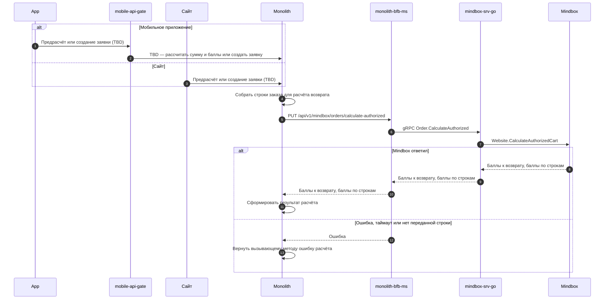

# ECOMDEV-2829: [B] Возвраты. Расчёт баллов к возврату в Mindbox

## Цель

Рассчитывать в Mindbox баллы к возврату по существующему заказу: передавать в расчёт заказ, в котором выбранные для возврата изделия выделены в строки со статусом возврата.

## Описание реализации

Обмен: расчёт заказа, монолит → `monolith-bfb-ms` `PUT /api/v1/mindbox/orders/calculate-authorized` → gRPC `Order.CalculateAuthorized` (`mindbox-srv-go`) → операция Mindbox `Website.CalculateAuthorizedCart`.



Предрасчёт показывает баллы клиенту, создание заявки сохраняет их по изделиям заявки; оба метода — отдельные задачи. Фиксация возврата при «Возврат принят» в эту задачу не входит. Полная схема от оформления до фиксации — `SEQ-RET-BONUS`.



**Контекст.** Сейчас расчёт вызывается только для корзины: ID заказа в него не передаётся, одна позиция заказа — одна строка, `line_id` равен ID товара. Для возврата нужно узнать у Mindbox, сколько баллов вернётся клиенту, если часть изделий заказа перейдёт в статус возврата. Баллы по изделиям распределяет Mindbox, сайт показывает результат. Новых операций Mindbox не нужно: расчёт по существующему заказу выполняет действующая операция калькуляции. Mindbox считает существующий заказ по акциям, действовавшим на момент его оформления, если в расчёт передан ID заказа.

Вызывается:
- методом предварительного расчёта на экране оформления возврата, когда клиент выбрал изделия или изменил выбор;
- методом создания заявки на возврат после проверки заявки.

Оба метода ставятся отдельными задачами {red}(задачи не заведены). Расчёт вызывается, только если включён фичетогл новых возвратов; при выключенном фичетогле расчёт корзины работает по текущей логике. Расчёт ничего не меняет в заказе Mindbox.

Необходимо:
1. Собрать строки заказа для расчёта возврата.
2. Передать в расчёт ID заказа в Mindbox, строки и сумму списанных баллов.
3. Получить из ответа баллы к возврату.

#### 1. Собрать строки заказа

Строки собираются для каждой исходной позиции заказа по данным заявок на возврат, а не по статусу позиции заказа. Если позиция на сайте хранится несколькими записями, в расчёт попадают все её изделия, количество позиции — исходное.

1. Разделить изделия позиции на три группы — каждое изделие ровно в одну:
   - возвращаемые сейчас — изделия, переданные вызывающим методом (выбор клиента или изделия заявки);
   - ранее возвращённые — изделия позиции, возврат которых уже зафиксирован в Mindbox по другим заявкам {red}(критерий отбора — по статусу заявки или по успешной фиксации в Mindbox, вопрос 3);
   - с прежним статусом строки — остальные изделия позиции, в том числе изделия незавершённых и отменённых заявок {red}(изделия незавершённых заявок после ECOMDEV-2828 передаются в Mindbox отдельной строкой с кодом «Заявка на возврат», вопрос 8).
2. Проверить, что сумма трёх групп равна количеству позиции; если не равна — Mindbox не вызывать, записать ошибку в лог и вернуть вызывающему методу ошибку расчёта.
3. Сформировать строки:

| Группа | Строка | `quantity` | `status` |
|---|---|---|---|
| С прежним статусом строки | Одна строка | Количество группы | Код Mindbox по паре «статус заказа + статус позиции до первой заявки» из `cms_mb_statuses_map`: «Заказ выполнен» — `311`, «Заказ выдан» — `302` |
| Возвращаемые сейчас | Одна строка | Количество группы | Код по `cms_mb_statuses_map` для пары «статус заказа + ВОЗВРАТ (если был отгружен)»: `505` (ECOMDEV-2828) |
| Ранее возвращённые | Строки, с которыми возврат был зафиксирован в Mindbox: то же количество и тот же `line_id` | Количество строки | Тот же код, что у возвращаемых сейчас |

   Строка с количеством 0 не передаётся. Остальные поля строки (`id`, `price`, `custom_fields`) — по текущей логике расчёта.
4. Присвоить строкам `sequence_number` и `line_id`:
   - `sequence_number` (в Mindbox — `lineNumber`) — порядковый номер исходной позиции в заказе. Все строки одной позиции получают один номер, номера остальных позиций не меняются;
   - `line_id` (в Mindbox — `lineId`) — целое число, уникальное в заказе. Строка, которая уже передавалась в Mindbox в изменении заказа, сохраняет свой `line_id`. Строке возвращаемых сейчас изделий присваивается новый номер; в расчёте он нужен только для того, чтобы отличать строки друг от друга, и после расчёта не сохраняется. {red}(Правило формирования не согласовано, вопрос 2. Предложение: `line_id` — ID записи позиции заказа на сайте.)
5. Рассчитать скидки строки:
   - скидка распродажи `Sale_12Storeez` — (цена до скидки − цена со скидкой) × `quantity` строки, по текущей логике;
   - скидка промокода позиции — делится между строками на стороне сайта {red}(правило деления не согласовано, вопрос 4).



Заказ выполнен, при покупке списаны баллы, возвратов по заказу не было. Позиция 1 — брюки, 1 шт.; позиция 2 — футболка M, 3 шт.

| `sequence_number` | Товар | `quantity` | `status` | `line_id` |
|---|---|---|---|---|
| 1 | Брюки | 1 | `311` | текущий `line_id` строки |
| 2 | Футболка, размер M | 2 | `311` | текущий `line_id` строки |
| 2 | Футболка, размер M | 1 | `505` | новый номер |

`bonuses[].amount` — баллы, списанные при покупке. Mindbox отвечает `spentAmount` = `-33` → баллы к возврату = 33. Числа — иллюстрация; распределение баллов выполняет Mindbox.



#### 2. Передать в расчёт

| Поле | Расположение в запросе `calculate-authorized` | Тип | Источник | Значения и условия передачи |
|---|---|---|---|---|
| ID заказа в Mindbox | `mindbox_order_id`, заказ | integer | ID заказа в Mindbox из заказа сайта | Передаётся при расчёте возврата; при расчёте корзины не передаётся. Нет ID — Mindbox не вызывать, вернуть вызывающему методу ошибку расчёта |
| Строки | `positions[]` | array | Раздел 1 | Состав и порядок — по разделу 1 |
| `line_id` | `positions[]` | integer | Раздел 1, шаг 4 | Вместо ID товара |
| `sequence_number` | `positions[]` | integer | Раздел 1, шаг 4 | При расчёте возврата передаётся всегда; в расчёте корзины не передаётся, как сейчас |
| `bonuses[].amount` | заказ | number | Баллы, списанные по заказу | Возвратов не было — баллы, списанные при покупке. Есть зафиксированные возвраты — остаток списанных баллов после последней фиксации |

`totalPrice` в расчёт не передаётся: в запросе операции расчёта такого поля нет.

Передача ID заказа в Mindbox в запросе расчёта реализована в задаче ECOMDEV-1185 (ветка `bugfix/ECOMDEV-1185`, параметр `mindbox_order_id`); в этой задаче используется её реализация.

#### 3. Получить баллы к возврату

1. Проверить ответ: если `monolith-bfb-ms` вернул ошибку, не ответил за `MINDBOX_TIMEOUT` или в ответе нет переданной строки (по `line_id`) — вернуть вызывающему методу ошибку расчёта {red}(что видит клиент — вопрос 5).
2. Если Mindbox разделил строку на несколько с одним `line_id` — присвоить каждой новой строке свой `line_id`.
3. Сформировать результат расчёта:
   - баллы к возврату — модуль `bonuses_changes[].spent_amount` (`-33` → 33);
   - баллы по каждой строке — `amount` элемента `positions[].applied_promotions[]` с `type = spentBonusPoints`, так же как баллы по позициям при оформлении заказа.

Что делать с результатом — показать клиенту или сохранить по изделиям заявки — решает вызывающий метод.

Что не меняется: расчёт корзины при оформлении заказа, создание и изменение заказа в Mindbox.

Вне этой задачи:
- `monolith-bfb-ms` — не меняется: тело запроса передаётся в gRPC без изменений, поля `mindbox_order_id`, `line_id` и `sequence_number` в контракте `CalculateRequest` есть;
- `mindbox-srv-go` (команда BTS) — ID заказа в расчёте сервис принимает (TNT-2687); передача `line_id` и `sequence_number` в `lineId` и `lineNumber` операции Mindbox {red}(вопрос 7);
- фиксация возврата в Mindbox при «Возврат принят».

Зависимость: ECOMDEV-1185 — передача ID заказа в расчёт {red}(задача на паузе, вопрос 6); ECOMDEV-2828 — код строки возврата `505` в маппинге; доработка `mindbox-srv-go`, если по вопросу 7 она потребуется. Выкатывать после них.

## Тестирование



**Предусловия:** включён фичетогл новых возвратов; доступно исходящее тело запроса `calculate-authorized`; заказы в статусе «Заказ выполнен» с баллами, списанными при покупке: позиция из 3 одинаковых изделий; заказ с несколькими позициями; заказ с зафиксированным возвратом; заказ без ID в Mindbox.

1. Возврат 1 изделия из позиции в 3 шт. — в запросе строка 2 шт. со статусом `311` и строка 1 шт. со статусом `505`, у строк одинаковый `sequence_number` и разные `line_id`, передан ID заказа в Mindbox.
2. Возврат 2 изделий из позиции в 3 шт. — строка 2 шт. со статусом `505` и строка 1 шт. со статусом `311`.
3. Возврат всех изделий позиции — одна строка со статусом `505`, строки с количеством 0 нет.
4. Заказ с несколькими позициями, возврат изделий одной позиции — у остальных позиций `sequence_number` такой же, как при расчёте без возврата; позиции без выбранных изделий — одна строка с текущим количеством и статусом.
5. Заказ с зафиксированным возвратом — ранее возвращённые изделия передаются строкой со статусом `505` и тем же `line_id`, что при фиксации; `bonuses[].amount` равен остатку после фиксации. Заказ без возвратов — `bonuses[].amount` равен баллам, списанным при покупке.
6. Mindbox вернул `spent_amount` = `-33` — баллы к возврату = 33.
7. Нет ID заказа в Mindbox — Mindbox не вызывается, вызывающий метод получает ошибку расчёта.
8. Ошибка `monolith-bfb-ms`, таймаут или нет переданной строки в ответе — вызывающий метод получает ошибку расчёта.
9. Фичетогл выключен — расчёт корзины при оформлении заказа передаёт те же данные, что до доработки.



## Открытые вопросы

1. Примет ли Mindbox заказ, все строки которого в статусе `505`, если в доп. поле `orderStatus` передан «Заказ выполнен»? Отдельного поля статуса заказа в операциях расчёта и изменения заказа нет. — менеджер Mindbox (Ирина Васильева). Влияет на расчёт полного возврата.
2. Как формировать `line_id` строки, чтобы он был уникален в заказе и не менялся между отправками: подходит ли ID записи позиции заказа на сайте? — System Architect (Леша Осипенко), Backend Developer (Оля Свистунова).
3. Ранее возвращённые изделия — это изделия заявок в «Возврат принят» или только изделия, возврат которых уже зафиксирован в Mindbox? — System Architect (Леша Осипенко), Backend Developer (Оля Свистунова).
4. Как делится скидка промокода позиции между строками? — Backend Developer (Оля Свистунова).
5. Что видит клиент, если Mindbox не ответил за допустимое время? — Product Manager.
6. ECOMDEV-1185 стоит на паузе: будет ли она выкачена до этой задачи или передачу ID заказа в расчёт нужно вынести в отдельную задачу? — Backend Developer (Люба Козлова), Backend Developer (Оля Свистунова). Блокирует выкатку.
7. Передаёт ли `mindbox-srv-go` `line_id` и `sequence_number` строк расчёта в `lineId` и `lineNumber` операции Mindbox? — команда BTS (Елена Васильева). Блокирует выкатку.
8. Как передавать в расчёт изделия незавершённых заявок: отдельной строкой с её `line_id` и кодом «Заявка на возврат», как в изменении заказа после ECOMDEV-2828, или вместе с остальными изделиями позиции с прежним кодом? — System Analyst (Екатерина Лемешева), Backend Developer (Оля Свистунова).
